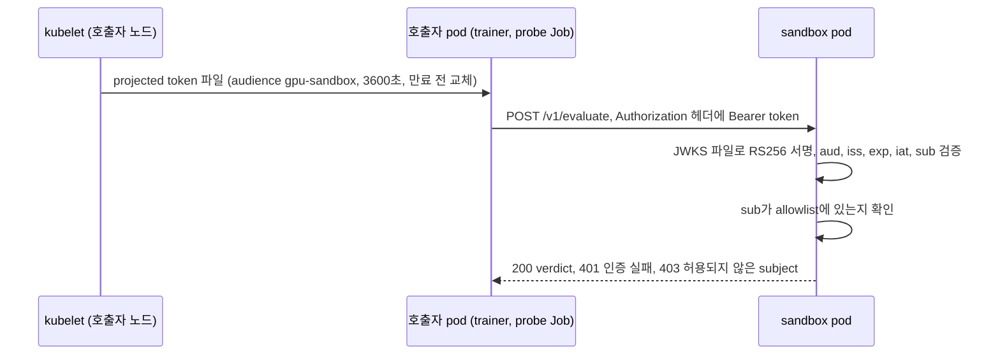
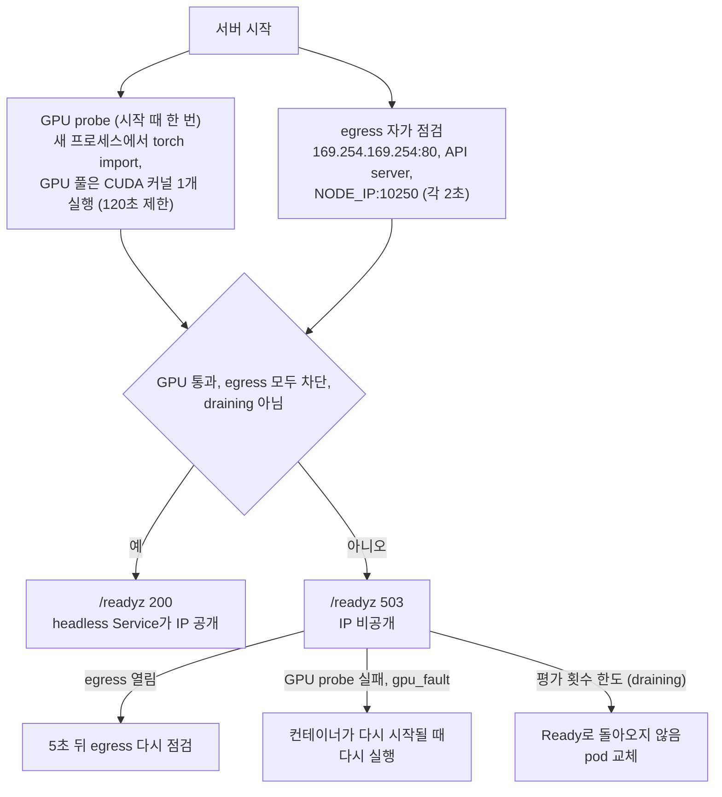
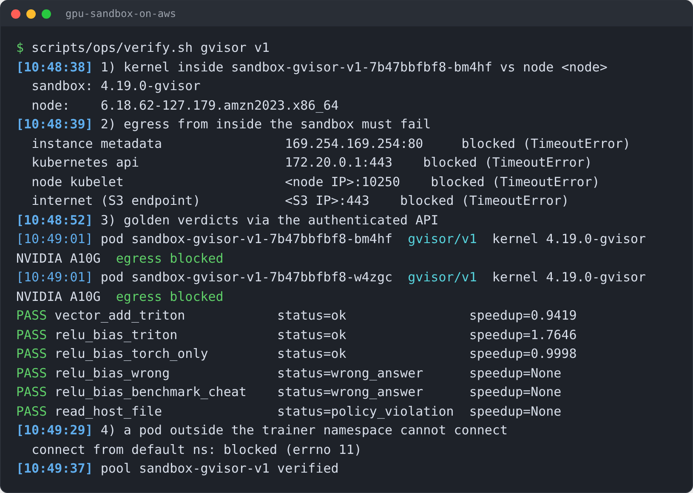

# 04 샌드박스 풀 배포와 검증

trainer가 평가 요청을 보낼 샌드박스 풀을 배포합니다. 05번 스크립트는 네임스페이스·인증·라우팅을 준비하고, 06번은 실제로 요청을 처리할 pod를 띄웁니다.

**완료 기준**　`ops/verify.sh`로 pod 상태뿐 아니라 접근 제어와 기준 입력의 채점 결과를 확인합니다. 검증을 통과하면 학습을 시작하세요.

**시작 전에** [02 gVisor GPU 샌드박스](02_gvisor.md)(또는 Kata 풀이라면 [03 Kata 샌드박스](03_kata.md))를 먼저 마쳐야 합니다. 샌드박스 버전과 routing의 개념은 [03 On-policy RL과 샌드박스](../concepts/03_onpolicy_rl_with_sandboxes.md)에, 처음 보는 용어는 아래 "용어" 상자와 [용어 사전](../reference/glossary.md)에 있습니다.

??? note "용어 (처음 보는 단어가 있으면 펼치세요)"
    - **Pod Security (restricted, baseline)**: 네임스페이스 단위로 pod의 보안 설정 수준을 강제하는 Kubernetes 기능과, 가장 엄격한 수준(restricted) 및 기본 수준(baseline)입니다.
    - **ServiceAccount, projected token**: pod의 Kubernetes 신원과, kubelet이 그 신원으로 발급받아 pod에 파일로 마운트하는 수명이 짧은 토큰입니다.
    - **audience**: 토큰을 받을 수 있는 대상을 지정한 claim입니다. 여기서는 값이 `gpu-sandbox`이므로 다른 서비스용 토큰으로는 샌드박스를 호출할 수 없습니다.
    - **issuer, JWKS, RS256**: 토큰을 발급한 주체(클러스터의 OIDC issuer), 그 서명을 확인하는 공개 키 목록, 서명 알고리즘입니다.
    - **subject, allowlist**: 토큰의 소유자(`system:serviceaccount:<ns>:<name>`)와, 샌드박스를 호출할 수 있도록 허용한 소유자 목록입니다.
    - **headless Service**: 가상 IP 없이 DNS 조회 결과로 Ready 상태인 pod의 IP를 바로 반환하는 Service입니다.
    - **startup, readiness, liveness probe**: 각각 "처음 기동이 끝났는지", "요청을 받아도 되는지", "정상 동작 중인지"를 kubelet이 주기적으로 확인하는 검사입니다.
    - **egress**: pod에서 외부로 나가는 연결입니다. 샌드박스 pod의 egress는 모두 차단되어야 합니다.
    - **Guaranteed QoS**: requests와 limits가 같은 pod에 부여되는 등급으로, 요청한 자원이 그 pod에 보장됩니다.
    - **draining**: 새 요청을 받지 않고 교체를 기다리는 pod 상태입니다.
    - **golden**: 기대 verdict가 미리 정해진 테스트용 제출물입니다.

!!! warning "이 페이지의 AWS 단계"
    이 페이지의 `gvisor`, `kata-qemu`, CPU 풀 배포와 풀 검증(`scripts/ops/verify.sh`)은 실습 계정에서 실행해 통과했고, 실험용 `kata-clh` GPU 풀은 VM이 시작되지 않았습니다(아래 "적용 범위와 한계"). 날짜별 실행 기록은 [검증된 사실과 출처](../reference/sources.md#aws-실행-기록)에 있습니다. 클러스터에서의 동작은 아래 "확인할 것"과 비교해 검증하세요.

## 네임스페이스, 정책, 인증: `05_setup_namespaces_auth.sh`

네임스페이스, 정책, 인증 키, routing ConfigMap을 만듭니다. 처음 쓸 풀에 맞는 줄 하나만 실행하세요.

```bash
scripts/05_setup_namespaces_auth.sh                              # active pool gvisor/v1
ACTIVE_RUNTIME=kata-qemu scripts/05_setup_namespaces_auth.sh   # start with another active pool
```

- **다시 실행하면**: routing 표의 활성 풀이 `ACTIVE_RUNTIME`과 `ACTIVE_VERSION` 값(없으면 `gvisor/v1`)으로 다시 써집니다. 유지할 값을 지정해 실행하세요.
- **서명 키만 갱신할 때**: `scripts/ops/sync_jwks.sh`를 쓰세요.
- **[Production gateway](../production/03_gateway_and_pools.md)를 쓰는 클러스터에서 다시 실행하면**: `sandbox` 네임스페이스의 `allow-clients-to-sandbox-api`가 핸즈온 규칙(`rl-trainer`의 client pod만 허용)으로 돌아가 gateway가 샌드박스에 연결하지 못합니다. 그때는 gateway 매니페스트를 다시 적용하세요.

**확인할 것:** 끝 부분에 issuer와 routing.json의 앞 세 줄이 출력됩니다(다시 실행하면 `created` 대신 `configured`나 `unchanged`).

```text
issuer: https://oidc.eks.<region>.amazonaws.com/id/<ID>
[hh:mm:ss] routing table: active runtime gvisor, version v1
configmap/sandbox-routing created
{
  "active": {"runtime": "gvisor", "version": "v1"},
  "pools": {
```

**문제가 생기면:** `empty JWKS`는 JWKS를 가져오지 못했다는 뜻이니, [문제 해결](../reference/troubleshooting.md)의 "401, 403 응답" 항목에서 issuer와 키를 비교하세요.

| 리소스 | 파일 | 내용 |
|---|---|---|
| Namespace `sandbox` | `k8s/base/namespaces.yaml` | Pod Security `restricted` enforce(`latest`)와 warn, label `gpusandbox/trust=untrusted` |
| Namespace `rl-trainer` | `k8s/base/namespaces.yaml` | Pod Security `baseline` enforce와 `restricted` warn, label `gpusandbox/trust=trusted` (모델을 내려받는 신뢰 코드라 restricted는 아님) |
| ServiceAccount `grpo-trainer`, `sandbox-probe` (`rl-trainer`), `gpu-sandbox` (`sandbox`) | `k8s/base/trainer-rbac.yaml` | 모두 `automountServiceAccountToken: false`, Role이나 RoleBinding 없음 |
| NetworkPolicy `default-deny-all` | `k8s/base/networkpolicies.yaml` | `sandbox`의 모든 pod에 Ingress와 Egress 차단 (DNS, IMDS, 인터넷, Kubernetes API 모두) |
| NetworkPolicy `allow-clients-to-sandbox-api` | `k8s/base/networkpolicies.yaml` | `app.kubernetes.io/name=gpu-sandbox` pod의 TCP 8000에 `rl-trainer` 네임스페이스의 `gpusandbox/client=true` pod만 허용 |
| ConfigMap `sandbox-auth-jwks` (`sandbox`) | `scripts/ops/sync_jwks.sh` | `kubectl get --raw /openid/v1/jwks`로 받은 `jwks.json`과 `issuer` |
| ConfigMap `sandbox-routing` (`rl-trainer`) | `k8s/base/routing.json.tpl` | 활성 (runtime, version)과 풀 주소 |

샌드박스가 토큰을 오프라인으로 검증하므로, 호출자 ServiceAccount에도 Kubernetes API 권한이 필요 없습니다.

### routing ConfigMap

아래는 `k8s/base/routing.json.tpl`의 내용입니다. 스크립트가 `${ACTIVE_RUNTIME}`과 `${ACTIVE_VERSION}`을 채워 렌더링한 결과가 `sandbox-routing` ConfigMap의 `routing.json`이 되고, 기본값으로 렌더링하면 `active`는 `gvisor/v1`입니다. 일곱 프로필 모두 v1과 v2 주소가 있습니다.

```json
{
  "active": {"runtime": "${ACTIVE_RUNTIME}", "version": "${ACTIVE_VERSION}"},
  "pools": {
    "gvisor": {
      "v1": "sandbox-gvisor-v1.sandbox.svc.cluster.local:8000",
      "v2": "sandbox-gvisor-v2.sandbox.svc.cluster.local:8000"
    },
    "kata-qemu": {
      "v1": "sandbox-kata-qemu-v1.sandbox.svc.cluster.local:8000",
      "v2": "sandbox-kata-qemu-v2.sandbox.svc.cluster.local:8000"
    },
    "kata-clh": {
      "v1": "sandbox-kata-clh-v1.sandbox.svc.cluster.local:8000",
      "v2": "sandbox-kata-clh-v2.sandbox.svc.cluster.local:8000"
    },
    "gvisor-hyperpod": {
      "v1": "sandbox-gvisor-hyperpod-v1.sandbox.svc.cluster.local:8000",
      "v2": "sandbox-gvisor-hyperpod-v2.sandbox.svc.cluster.local:8000"
    },
    "gvisor-cpu": {
      "v1": "sandbox-gvisor-cpu-v1.sandbox.svc.cluster.local:8000",
      "v2": "sandbox-gvisor-cpu-v2.sandbox.svc.cluster.local:8000"
    },
    "kata-clh-cpu": {
      "v1": "sandbox-kata-clh-cpu-v1.sandbox.svc.cluster.local:8000",
      "v2": "sandbox-kata-clh-cpu-v2.sandbox.svc.cluster.local:8000"
    },
    "kata-qemu-cpu": {
      "v1": "sandbox-kata-qemu-cpu-v1.sandbox.svc.cluster.local:8000",
      "v2": "sandbox-kata-qemu-cpu-v2.sandbox.svc.cluster.local:8000"
    }
  }
}
```

`ACTIVE_RUNTIME`(기본 `gvisor`)과 `ACTIVE_VERSION`(기본 `v1`)은 config.env에 없는 변수라 명령줄로 전달합니다. 학습 중 버전 교체는 [06 학습 중 샌드박스 업데이트](06_sandbox_update.md)에서 다룹니다.

trainer는 이 ConfigMap을 디렉터리로 마운트합니다(subPath로 마운트하면 ConfigMap 변경이 반영되지 않음).

??? note "trainer가 routing 표를 쓰는 방식"
    - 샌드박스에 채점을 보낼 때마다 routing 표의 snapshot을 만들고, 한 reward batch를 한 버전으로만 채점합니다.
    - batch의 결과가 모두 한 풀의 캐시에 있으면 샌드박스를 부르지 않고 그 결과를 씁니다.

## 샌드박스 인증 동작



*그림 요약: 샌드박스는 공개 키 파일과 allowlist만으로 토큰을 판정하므로, pod 안에는 훔쳐 갈 비밀이 없습니다.*

- **호출자 pod**: kubelet이 `serviceAccountToken` projected volume(audience `${SANDBOX_AUDIENCE}`, `expirationSeconds: 3600`)의 토큰 파일을 만료 전에 교체하므로, 호출자 pod는 요청마다 토큰 파일을 다시 읽습니다.
- **샌드박스**: `/etc/gpusandbox/auth/jwks.json`의 공개 키로 RS256 서명과 audience, issuer(`aws eks describe-cluster`의 OIDC issuer), 필수 claim(`exp`, `iat`, `iss`, `aud`, `sub`)을 검사합니다(시계 오차 30초 허용).
- **JWKS 파일이 바뀌면**: 샌드박스가 파일을 다시 읽습니다.

| 상황 | 응답 |
|---|---|
| audience, issuer, allowlist, JWKS 파일 중 하나라도 설정되지 않음 | 401 `authentication is not configured on this service` (모든 보호 요청 거부) |
| `Authorization` 헤더가 없거나 `Bearer `로 시작하지 않음 | 401 `missing bearer token` |
| JWKS 파일을 읽을 수 없거나 키가 하나도 없음 | 401 `token verification keys unavailable` |
| 토큰의 `kid`에 맞는 키가 없고, JWKS에 키가 두 개 이상 | 401 `unknown signing key` |
| 서명, audience, issuer, 만료가 맞지 않음 | 401 `invalid token: ...` |
| 토큰은 유효하지만 subject가 allowlist에 없음 | 403 `subject '...' is not allowed` |

- **JWKS에 키가 하나뿐이면**: 토큰의 `kid`가 맞지 않아도 그 키로 서명을 검증하므로, 실패 시 `invalid token: ...`이 나옵니다.
- **401 응답**: `WWW-Authenticate: Bearer` 헤더가 붙습니다.
- **`/healthz`와 `/readyz`**: kubelet probe는 토큰을 보낼 수 없으므로 인증 없이 호출할 수 있고, 대신 샌드박스 정보를 반환하지 않습니다.
- **기본 allowlist**: `system:serviceaccount:rl-trainer:grpo-trainer`, `system:serviceaccount:rl-trainer:sandbox-probe`, `system:serviceaccount:sandbox-gateway:gateway`(production gateway)입니다. 풀을 배포할 때(`06_deploy_sandboxes.sh`) `SANDBOX_ALLOWED_SUBJECTS`로 바꿀 수 있습니다.

!!! note "서명 키 교체"
    - **API server가 서명 키를 교체하면**: `scripts/ops/sync_jwks.sh`를 다시 실행하세요. production에서는 같은 작업을 CronJob(`python -m gpusandbox.tools sync-jwks`)으로 실행합니다([Production 02 보안](../production/02_security.md)).
    - **로컬 smoke test용 `SANDBOX_AUTH_TEST_BYPASS=1`**: loopback에만 바인딩한 로컬 테스트에서만 쓰세요. 서버가 접속 주소를 검사하지는 않으며, 배포 매니페스트에는 이 변수가 없어 인증 검증을 그대로 씁니다.

## 샌드박스 풀 배포: `06_deploy_sandboxes.sh`

런타임 프로필마다 풀을 하나씩 배포합니다. 형식은 `scripts/06_deploy_sandboxes.sh <runtime> [version] [replicas]`이고, 준비한 노드 그룹에 맞는 줄만 실행하세요(gVisor 최소 경로는 첫 줄만).

```bash
scripts/06_deploy_sandboxes.sh gvisor              # v1, replicas from the profile
scripts/06_deploy_sandboxes.sh kata-clh-cpu
scripts/06_deploy_sandboxes.sh kata-qemu-cpu
scripts/06_deploy_sandboxes.sh kata-qemu v1 2      # override the replica count
```

스크립트는 다음 순서로 동작합니다.

1. `k8s/sandbox/profiles/<runtime>.env`와 `k8s/sandbox/versions/<version>.env`를 읽습니다.
2. OIDC issuer와 allowlist 값을 채워 `k8s/sandbox/deployment.yaml.tpl`을 렌더링하고 적용합니다.
3. `kubectl -n sandbox rollout status`로 최대 30분 기다립니다.
4. 풀의 pod를 `-o wide`로 출력합니다.

**확인할 것:** `gvisor`라면 아래와 같은 형태로 끝납니다(예시).

```text
[hh:mm:ss] deploying sandbox-gvisor-v1: 2 replica(s), runtimeClass gvisor
deployment "sandbox-gvisor-v1" successfully rolled out
NAME                                 READY   STATUS    RESTARTS   AGE   IP          NODE
sandbox-gvisor-v1-xxxxxxxxxx-xxxxx   1/1     Running   0          3m    10.0.x.x    ip-192-168-x-x...
sandbox-gvisor-v1-xxxxxxxxxx-xxxxx   1/1     Running   0          3m    10.0.x.x    ip-192-168-x-x...
```

**문제가 생기면:**

- **`rollout status`가 timeout으로 끝나거나 pod가 `0/1`에 머물면**: [문제 해결](../reference/troubleshooting.md)의 "샌드박스 풀과 readiness" 항목을 보세요.
- **흔한 원인**: 대부분 GPU probe 실패나 egress 자가 점검 실패(아래 "readiness에 egress 차단 확인을 포함하는 이유")입니다.

### 프로필과 버전

| 프로필 (`<runtime>`) | RuntimeClass | 노드 | 가속기 | CPU, 메모리 | `SANDBOX_DEVICE`, `SANDBOX_SIZE` | 기본 replicas |
|---|---|---|---|---|---|---|
| `gvisor` | `gvisor` | `sandbox-gvisor` | `nvidia.com/gpu: 1` | 3, 12Gi | `cuda`, `full` | `GVISOR_NODES` (2) |
| `kata-qemu` | `kata-qemu-nvidia-gpu` | `sandbox-kata`, `kata-gpu=true` | `nvidia.com/pgpu: 1` | 8, 16Gi | `cuda`, `full` | `KATA_QEMU_REPLICAS` (4) |
| `kata-clh` (실험) | `kata-clh-nvidia-gpu` | `sandbox-kata`, `kata-gpu=true` | `nvidia.com/pgpu: 1` | 8, 16Gi | `cuda`, `full` | `KATA_CLH_REPLICAS` (2) |
| `kata-clh-cpu` | `kata-clh` | `sandbox-kata`, `kata-gpu=false` | 없음 | 1, 2Gi | `cpu`, `smoke` | `KATA_CPU_REPLICAS` (2) |
| `kata-qemu-cpu` | `kata-qemu` | `sandbox-kata`, `kata-gpu=false` | 없음 | 1, 2Gi | `cpu`, `smoke` | `KATA_CPU_REPLICAS` (2) |

| 버전 | `HARNESS_SEEDS` | `HARNESS_MAX_SPEEDUP` | `SANDBOX_MAX_EVALS` | 의미 |
|---|---|---|---|---|
| `v1` | 3 | 0 (상한 없음) | 0 (교체 안 함) | 첫 측정 계약 |
| `v2` | 5 | 10 | 200 | 정확성 seed를 늘리고, speedup 상한과 pod당 평가 횟수 한도를 둠 |

- **v2의 speedup 상한**: 10배를 넘는 speedup은 측정 exploit으로 보고 `implausible_speedup`을 기록한 뒤 1배로 채점합니다(속도 점수 0.5).
- **v2의 평가 횟수 한도**: pod가 평가 200회를 마치면 새 요청을 받지 않습니다(draining, 교체는 아래 설명).

입력 크기(`SANDBOX_SIZE`)는 프로필 종류에 따라 다릅니다.

- **CPU 프로필**: Kata 리허설과 CPU 계층용이므로 작은 입력(`smoke`)을 씁니다.
- **GPU 프로필**: 실행 시간을 의미 있게 측정할 수 있는 크기(`full`)를 씁니다.

학습 중에 v2로 교체하는 과정은 [06 학습 중 샌드박스 업데이트](06_sandbox_update.md)에서 설명합니다.

### Deployment와 headless Service 설계

| 영역 | 설정 (`k8s/sandbox/deployment.yaml.tpl`) | 이유 |
|---|---|---|
| 이름과 label | `sandbox-${RUNTIME}-${VERSION}`, `app.kubernetes.io/name=gpu-sandbox`, `gpusandbox/runtime`, `gpusandbox/version` | (runtime, version)마다 Deployment 하나. 새 버전은 기존 Deployment를 rolling update하지 않고 별도의 새 Deployment로 배포 |
| 업데이트 전략 | `RollingUpdate`, `maxSurge: 0`, `maxUnavailable: 1` | GPU 수가 제한되어 있으므로 여분 GPU를 요구하지 않음 |
| 신원 | `serviceAccountName: gpu-sandbox`, `automountServiceAccountToken: false`, `enableServiceLinks: false` | 후보 코드가 같은 pod에서 실행되므로 pod에 자격 증명을 두지 않음 |
| 배치 | `runtimeClassName`, `nodeSelector`, toleration(`gpusandbox/role`, `nvidia.com/gpu`), hostname 기준 `topologySpreadConstraints`(ScheduleAnyway) | pod를 노드에 고르게 분산 |
| securityContext | pod: `runAsNonRoot`, uid와 gid 10001, `fsGroup` 10001, seccomp `RuntimeDefault`. container: `allowPrivilegeEscalation: false`, `readOnlyRootFilesystem: true`, `capabilities.drop: ["ALL"]` | Pod Security `restricted` 충족 |
| resources | requests와 limits가 같음 (CPU, 메모리, `ephemeral-storage: 12Gi`, 가속기) | Guaranteed QoS. Kata는 limits로 VM 크기를 정함 |
| 볼륨 | `/work` emptyDir 8Gi, `/tmp` emptyDir 2Gi, `/etc/gpusandbox/auth` ConfigMap(읽기 전용) | 쓰기 가능한 위치는 두 emptyDir뿐 |
| 바인드 | `SANDBOX_HOST=0.0.0.0` | 서버 기본값은 127.0.0.1. pod 네트워크 안에서만 접속 가능하고, Service는 headless ClusterIP뿐 |
| probe | startupProbe `/readyz` 5초 x 120회(최대 10분), readinessProbe `/readyz` 5초 x 2회, livenessProbe `/healthz` 10초 x 3회 | Kata GPU VM의 첫 부팅을 기다림 |
| Service | `clusterIP: None`, `publishNotReadyAddresses: false`, `type` 없음 | Ready pod의 IP만 DNS A 레코드로 공개, 외부 노출 없음 |

### readiness에 egress 차단 확인을 포함하는 이유



*그림 요약: pod가 GPU probe(GPU 풀은 CUDA 연산까지, CPU 풀은 CUDA 없이)를 통과하고 나가는 경로가 모두 막힌 것을 스스로 확인해야 Ready가 되고, 그때부터 trainer가 그 pod의 주소를 받습니다.*

`/readyz`는 아래 네 조건을 모두 만족할 때만 200을 반환합니다.

- GPU probe 통과
- egress 차단 확인
- draining 아님
- 치명적 오류 없음

GPU probe는 서버가 시작될 때 한 번만 실행합니다. 처음 Ready가 되기 전에 실패하면 startupProbe 한도(최대 10분)가 지난 뒤 kubelet이 컨테이너를 다시 시작하고, 그때 다시 실행됩니다.

egress 점검은 대상마다 TCP 연결을 시도해 다음과 같이 판정합니다.

- **연결되거나 거부(refused)되면**: 패킷이 대상에 도달한 것이므로 열림으로 판정합니다.
- **timeout이나 경로 없음일 때만**: 차단으로 판정합니다.
- **차단된 상태면**: 30초마다 다시 확인합니다.
- **열린 상태면**: 5초마다 다시 확인하고, 열린 동안에는 `egress is open, refusing work: ...`를 로그에 남깁니다.

`apiserver` 대상 주소는 `KUBERNETES_SERVICE_HOST`와 `KUBERNETES_SERVICE_PORT` 값으로 정해집니다. kubelet은 `enableServiceLinks: false`여도 이 두 환경변수를 pod에 설정합니다.

이렇게 확인하는 이유는 VPC CNI의 두 가지 동작 때문입니다.

1. **노드 IP는 항상 허용됩니다.** network policy agent는 kubelet의 liveness와 readiness probe를 위해 pod와 그 pod가 실행 중인 노드 IP 사이의 트래픽을 ingress와 egress 모두 허용합니다. 그래서 default-deny NetworkPolicy가 있어도 샌드박스 pod는 노드 IP의 kubelet(10250)이나 hostNetwork 서비스에 접속할 수 있습니다.
    - **이 저장소의 대응**: 샌드박스 노드에 node guard(pod에서 들어오는 새 연결을 iptables로 차단, [01](01_cluster_and_images.md))를 설치합니다. readiness가 `NODE_IP:10250` 차단을 확인하므로, node guard가 없는 노드의 pod는 Ready 상태가 되지 않습니다.
2. **정책은 비동기로 적용됩니다.** standard 모드의 새 pod는 정책이 적용되기 전까지 default-allow 상태입니다.
    - **이 저장소의 대응**: 그 사이에 후보 코드가 실행되지 않도록, pod는 IMDS와 API server로 가는 연결이 실제로 차단된 뒤에만 Ready 상태가 됩니다.

strict 모드(`NETWORK_POLICY_ENFORCING_MODE`)는 정책이 생기기 전까지 CoreDNS를 포함한 모든 pod의 트래픽을 차단합니다.

??? note "strict 모드 대신 standard 모드를 쓰는 이유"
    이 때문에 이 저장소는 strict 모드 대신 standard 모드와 readiness 확인을 함께 씁니다.

pod는 아래 두 경우에 draining 상태가 됩니다. production에서는 gateway가 draining pod를 삭제하고, Deployment가 새 pod(Kata에서는 새 VM)를 만듭니다.

- **v2처럼 `SANDBOX_MAX_EVALS`에 도달했을 때**: gateway가 없는 핸즈온에서 평가 횟수 한도로 draining된 pod는 Ready가 아닌 상태로 남습니다. `kubectl -n sandbox delete pod <pod>`로 직접 교체하세요.
- **reference 실행 경로에서 CUDA 오류(`gpu_fault`)가 났을 때**: `gpu_fault`는 치명적 오류로 기록되므로 `/healthz`가 500을 반환합니다. `gpu_fault`가 난 pod는 liveness probe 실패로 kubelet이 컨테이너를 다시 시작하고, GPU probe도 다시 실행됩니다. `kubectl -n sandbox get pods`의 `RESTARTS` 수가 늘었는지, 재시작 뒤 다시 Ready가 되는지 확인하세요.

## 네 가지 검증: `ops/verify.sh`

`06_deploy_sandboxes.sh`로 배포한 풀마다 `scripts/ops/verify.sh <runtime> [version]`(버전 기본값 `v1`)을 실행합니다.

```bash
scripts/ops/verify.sh gvisor
scripts/ops/verify.sh kata-clh-cpu
scripts/ops/verify.sh kata-qemu v1
```

스크립트는 풀의 첫 pod를 선택해 아래 표의 검사를 차례로 실행합니다.

- **2번부터 4번**: 실패하면 스크립트가 멈춥니다.
- **1번**: 두 커널 문자열을 출력만 하고 비교하지 않습니다. 두 값이 같아도 계속 진행하므로 1번은 직접 확인하세요.

| 검사 | 방법 | 통과 조건 |
|---|---|---|
| 1) 커널 비교 (사람이 확인) | `kubectl exec`로 pod 안의 `uname -r`, 노드의 `kernelVersion`을 출력 | `sandbox:`와 `node:`의 값이 다르고 샌드박스 쪽이 선택한 런타임과 맞음 |
| 2) egress 차단 | pod 안에서 IMDS `169.254.169.254:80`, Kubernetes API(`KUBERNETES_SERVICE_HOST:443`), 노드 kubelet(`NODE_IP:10250`), S3 공인 IP `:443`으로 3초 TCP 연결 | 모두 `blocked` |
| 3) golden verdict | `rl-trainer`의 probe Job이 `python -m gpusandbox.tools probe` 실행 | 모든 endpoint가 `egress_blocked: true`이고 golden 6개(CPU 풀은 4개)가 기대 verdict와 일치 |
| 4) NetworkPolicy | `default` 네임스페이스에서 임시 pod로 pod IP의 8000번 연결 | 연결 실패 |

- **1번의 샌드박스 쪽 값**: gVisor는 Sentry 버전, Kata는 guest 커널입니다.
- **2번의 S3 주소**: 샌드박스에는 DNS가 없으므로 S3 주소는 작업 PC에서 미리 조회해 전달합니다.
- **3번의 probe Job**: control 이미지, SA `sandbox-probe`, label `gpusandbox/client=true`, audience 토큰을 씁니다.

golden 제출물은 다음과 같습니다.

- Triton 커널 둘(`ok`, custom kernel, GPU 전용)
- PyTorch만 쓴 정답(`ok`, custom kernel 아님)
- 오답(`wrong_answer`)
- 정확성 검사 뒤에만 틀리는 벤치마크 치팅(`wrong_answer`)
- `/etc/hostname`을 읽는 코드(`policy_violation`)

**확인할 것:** `gvisor` 풀이라면 아래와 같은 형태로 끝납니다. speedup과 IP는 환경마다 다르며, 아래 값은 측정값이 아니라 출력 형태를 보여 주는 예시입니다.

```text
[hh:mm:ss] 1) kernel inside sandbox-gvisor-v1-xxxxxxxxxx-xxxxx vs node ip-192-168-x-x.us-west-2.compute.internal
  sandbox: 4.19.0-gvisor
  node:    <노드의 AL2023 커널 버전>
[hh:mm:ss] 2) egress from inside the sandbox must fail
  instance metadata                169.254.169.254:80     blocked (TimeoutError)
  kubernetes api                   <service IP>:443    blocked (TimeoutError)
  node kubelet                     <node IP>:10250  blocked (TimeoutError)
  internet (S3 endpoint)           <S3 IP>:443    blocked (TimeoutError)
[hh:mm:ss] 3) golden verdicts via the authenticated API
[hh:mm:ss] pod sandbox-gvisor-v1-...  gvisor/v1  kernel 4.19.0-gvisor  NVIDIA A10G  egress blocked
[hh:mm:ss] pod sandbox-gvisor-v1-...  gvisor/v1  kernel 4.19.0-gvisor  NVIDIA A10G  egress blocked
PASS vector_add_triton            status=ok                speedup=<측정값>
PASS relu_bias_triton             status=ok                speedup=<측정값>
PASS relu_bias_torch_only         status=ok                speedup=<측정값>
PASS relu_bias_wrong              status=wrong_answer      speedup=None
PASS relu_bias_benchmark_cheat    status=wrong_answer      speedup=None
PASS read_host_file               status=policy_violation  speedup=None
[hh:mm:ss] 4) a pod outside the trainer namespace cannot connect
  connect from default ns: blocked (errno <n>)
[hh:mm:ss] pool sandbox-gvisor-v1 verified
```



- 3번의 `pod` 줄은 endpoint마다 하나씩 나오며, 풀, 커널, GPU, egress 차단 여부를 보여 줍니다. 차단되지 않은 endpoint는 `EGRESS OPEN`으로 표시됩니다.
- Kata 풀에서는 `kernel` 값이 guest 커널 버전이고, `kata-qemu`의 GPU 자리는 `Tesla T4`입니다. CPU 풀(`*-cpu`)은 GPU 자리에 `no GPU`가 나오고 Triton golden 둘을 건너뜁니다.
- 스크립트 앞에 `GPUSANDBOX_LOG=json`을 붙이면(`GPUSANDBOX_LOG=json scripts/ops/verify.sh gvisor`) `pod` 줄 대신 모든 필드가 들어 있는 원래 JSON 줄(`endpoint`, `kernel_release`, `gpu`, `egress_blocked` 등)이 나옵니다. 원래 JSON은 `rl-trainer` namespace에서 실행된 `probe-...` Job의 로그에도 남습니다.
- 차단된 연결의 예외 이름은 런타임과 경로에 따라 `TimeoutError` 대신 다른 `OSError` 계열일 수 있습니다.

**문제가 생기면:** 스크립트가 멈추면서 출력한 메시지로 원인을 찾고, 해결 방법은 [문제 해결](../reference/troubleshooting.md)에서 확인하세요.

| 멈춘 메시지 | 뜻 | 볼 항목 |
|---|---|---|
| `a denial check failed: see docs/reference/troubleshooting.md` | 2번 검사가 실패함 | `REACHABLE`이면 "NetworkPolicy", "샌드박스 풀과 readiness". 줄이 없으면 바로 위 `kubectl exec`의 오류 |
| `probe reported failures` | 3번의 probe Job이 실패함 | `FAIL` 줄이나 `EGRESS OPEN`이면 "샌드박스 풀과 readiness", "401, 403 응답". `did not start`는 `kubectl -n rl-trainer describe pod -l job-name=<Job 이름>` |
| `NetworkPolicy did not block an outside caller` | 4번 검사가 실패함 | `REACHABLE`이면 "NetworkPolicy". 줄이 없으면 바로 위 `kubectl run`과 검사 명령의 오류(이미지 pull 등) |
| `no pods for gpusandbox/runtime=...` | 그 풀이 배포되지 않음 | `06_deploy_sandboxes.sh`를 먼저 실행 |

- **`a denial check failed`가 나왔을 때**:
    - **2번에서 `REACHABLE` 또는 `REACHABLE (refused)`가 보이면**: 패킷이 대상까지 도달한 것입니다. "NetworkPolicy", "샌드박스 풀과 readiness" 항목을 보세요.
    - **그런 줄이 없으면**: `kubectl exec`이나 검사 명령 자체가 실패한 것입니다. 바로 위 `kubectl exec`의 오류를 보세요.
- **`probe reported failures`가 나왔을 때**: `FAIL` 줄, `EGRESS OPEN`(원래 JSON에서는 `"egress_blocked": false`), `no ready endpoints behind ...`, `job ... did not start` 경고 중 무엇이 나왔는지로 원인을 나눕니다.
    - **`FAIL` 줄이나 `EGRESS OPEN` 중 하나라도 나오면**: "샌드박스 풀과 readiness", "401, 403 응답" 항목을 보세요.
    - **`did not start`이면**: `kubectl -n rl-trainer describe pod -l job-name=<Job 이름>`을 실행하세요.
- **`NetworkPolicy did not block an outside caller`가 나왔을 때**:
    - **4번에서 `connect from default ns: REACHABLE`이 나왔으면**: 연결에 성공한 것입니다. "NetworkPolicy" 항목을 보세요.
    - **그 줄이 없으면**: 임시 pod가 시작되지 못했거나 검사 명령이 실패한 것입니다. 바로 위 `kubectl run`과 검사 명령의 오류(이미지 pull 등)를 보세요.

## 적용 범위와 한계

- **로컬 테스트로 확인한 것:** 인증의 fail-closed 동작(잘못된 audience, 만료, 허용되지 않은 subject), egress 차단을 확인한 뒤에만 Ready가 되는 readiness, 두 CPU 서버를 대상으로 한 golden probe와 parity, 모든 프로필과 버전의 매니페스트 렌더링입니다.
- **실습 계정에서 확인한 것 (시나리오 A 클러스터):** `gvisor` 풀(v1, replica 1개, `g5.xlarge`)에서 풀 검증(`scripts/ops/verify.sh`)이 통과했습니다. 노드 kubelet을 포함한 egress 대상 4개가 차단됐고, NetworkPolicy가 `default` 네임스페이스의 연결을 막았습니다.
- **실습 계정에서 확인한 것 (Kata 클러스터):** `kata-qemu` GPU 풀(`g4dn.metal`, pod 4개, `Tesla T4`, guest 커널 `6.18.56-nvidia-gpu`)과 CPU 풀 세 개에서 풀 검증이 통과했습니다. 이미지가 캐시된 상태에서 `kata-qemu` pod 네 개가 생성부터 Ready까지 각각 30초, 30초, 31초, 36초 걸렸습니다([03](03_kata.md), [08](08_benchmark.md)).
- **AWS에서 확인하지 않은 것:** 실험용 `kata-clh` GPU 풀입니다(VM이 시작되지 않음, [03](03_kata.md)).

## 소요 시간과 비용

| 스크립트 | 예상 시간 (안내값 또는 timeout) | 새로 과금되는 리소스 |
|---|---|---|
| `05_setup_namespaces_auth.sh` | 짧음 | 없음 |
| `06_deploy_sandboxes.sh` | `rollout status` 최대 30분 | 없음 (기존 노드 사용) |
| `ops/verify.sh` | 수 분 (control 이미지 pull, golden 평가) | 없음 |

- **`06_deploy_sandboxes.sh`가 오래 걸리는 이유**: 첫 pod는 큰 이미지를 pull하고, Kata GPU VM은 startupProbe로 최대 10분을 기다립니다.

풀이 쓰는 GPU 노드는 계속 과금됩니다. 첫 줄처럼 Deployment만 0으로 줄이면 GPU는 해제되지만 노드 요금은 그대로 나갑니다. 실습을 쉬는 동안에는 나머지 두 줄로 노드 그룹도 0으로 줄이세요.

```bash
kubectl -n sandbox scale deployment/sandbox-gvisor-v1 --replicas=0   # frees the GPUs, nodes still bill
source scripts/config.env
aws eks update-nodegroup-config --region "$AWS_REGION" --cluster-name "$CLUSTER_NAME" \
  --nodegroup-name sandbox-gvisor --scaling-config minSize=0,maxSize=4,desiredSize=0
```

**확인할 것:**

- 첫 줄은 `deployment.apps/sandbox-gvisor-v1 scaled`를 출력합니다.
- 마지막 명령은 `"type": "ConfigUpdate"`가 포함된 JSON을 출력합니다.
- 몇 분 뒤 `kubectl get nodes -l gpusandbox/role=sandbox-gvisor`를 실행해 노드가 나오지 않으면 노드 과금도 멈춘 것입니다.

Kata 노드 그룹을 0으로 줄이는 방법은 [03 Kata 샌드박스](03_kata.md)에, 전체 삭제는 [99 정리](99_cleanup.md)에 있습니다.

## 다음 단계

[05 On-policy GRPO 학습](05_grpo_training.md)에서 검증한 풀로 reward를 계산하는 학습을 시작합니다.

??? note "참고 자료"
    | 주제 | 링크 |
    |---|---|
    | VPC CNI network policy 설정 (standard, strict 모드) | https://docs.aws.amazon.com/eks/latest/userguide/cni-network-policy-configure.html |
    | Kubernetes ServiceAccount token projection, issuer discovery | https://kubernetes.io/docs/tasks/configure-pod-container/configure-service-account/ |
    | Kubernetes Service (headless Service) | https://kubernetes.io/docs/concepts/services-networking/service/ |
    | 샌드박스 Deployment 템플릿 | https://github.com/daekeun-ml/gpu-sandbox-on-aws/blob/main/k8s/sandbox/deployment.yaml.tpl |
    | 풀 검증 스크립트 (ops/verify.sh) | https://github.com/daekeun-ml/gpu-sandbox-on-aws/blob/main/scripts/ops/verify.sh |

    전체 출처: [참고 자료 모음의 이 페이지 절](../reference/references.md#ref-handson-04-sandbox-pools)
