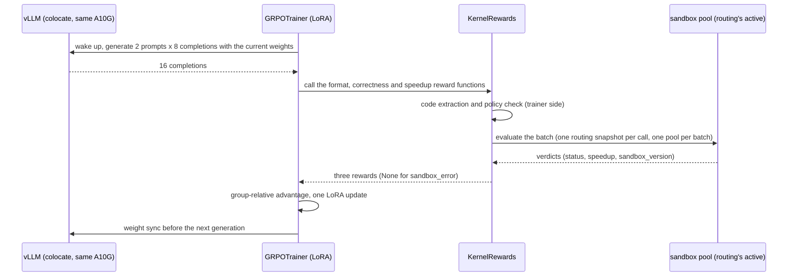

# 05 On-policy GRPO training

!!! info "TL;DR"
    Train `Qwen/Qwen2.5-Coder-1.5B-Instruct` (LoRA) with GRPO on one A10G, and confirm with the `reward_batch` log that the on-policy loop, sandbox scoring included, runs end to end.

## Pain point

Generating rollouts (vLLM) and training the policy on one A10G 24 GB means sharing memory over time. A small model rarely writes a correct Triton kernel at first, so with a reward of 1 for correct and 0 otherwise all 8 answers in a group score 0, the advantage is 0, and there is no learning signal. If answers left unscored because a sandbox pod was busy or dead also get 0, the policy is punished for an infrastructure problem. And if the sandbox version changes mid-training ([06](06_sandbox_update.md)), the log must record which version scored which batch.

![a: with a reward of 1 if correct and 0 otherwise, when the sandbox scores one group of 8 completions and there is no correct kernel, all 8 score 0, the advantage is 0 and there is no learning signal; when a pod is busy or dead, the failed scoring also gets 0 and the policy is punished for an infrastructure problem. b: with partial credit (0.1, 0.15, 0.3, 0.4), even the gap between 0.3 and 0.1 is a learning signal, and sandbox_error returns None, so the completion is left out of the group baseline and not punished](../images/figures/handson-05_grpo_training.svg)

*Takeaway: A 0-or-1 reward removes the learning signal, and scoring failures as 0 sends the policy a wrong signal. Partial credit turns differences inside a group into a learning signal, and sandbox_error returns None and is left out of the group baseline.*


## Why

- **Strictly on-policy by default.** One generated batch feeds exactly one optimizer step, and vLLM on the same GPU (colocate) releases its memory meanwhile through sleep mode.
- **The reward has three components with partial credit, and `sandbox_error` is excluded, not scored 0.** When all three return `None`, the answer is left out of the group baseline.
- **Each batch sent to the sandboxes records the pool that scored it.** A `{"event": "reward_batch", ...}` line carries the runtime, version, routing_revision, served_versions and status counts. A batch settled by local checks or the cache alone has no such line.

**Before you start:** finish [04 Deploy and verify sandbox pools](04_sandbox_pools.md). GRPO and version pinning are in [03 On-policy RL with sandboxes](../concepts/03_onpolicy_rl_with_sandboxes.md), the reward design in [01 When the sandbox needs a GPU](../concepts/01_why_gpu_sandbox.md), and terms in the [Glossary](../reference/glossary.md).

??? note "Terms (expand if a word is new to you)"
    - **GRPO**: an RL algorithm that generates several answers (a group) per prompt and reinforces the answers that beat the group average.
    - **On-policy, strictly on-policy**: training only on data the current policy just generated; "strictly" means each generated batch is used for one optimizer step and then discarded.
    - **Rollout, completion, group**: the process of the model generating an answer for a prompt, one such answer, and the set of answers from the same prompt (eight here).
    - **Advantage**: how much an answer's reward exceeds its group average.
    - **LoRA**: training small adapter matrices instead of all model weights. It saves a lot of memory.
    - **vLLM colocate, sleep mode**: the mode that runs the vLLM generation engine on the trainer's GPU, and the feature that releases vLLM's memory while training runs.
    - **Reference model, KL**: a baseline model that measures how far training has moved from the start, and that distance. With `beta` 0 it is not used here.
    - **Importance sampling correction**: correcting, with probability ratios, the distribution gap caused by numerical differences between the generation engine and the training model.
    - **Job, emptyDir**: a Kubernetes workload that completes when done, and a scratch volume that disappears with the pod.
    - **OOM**: a process failure because GPU memory ran out (out of memory).

!!! warning "Validation status"
    The default 60-step run (`scripts/07_run_grpo.sh`) and a 5-step run ran in the practice account, and both Jobs ended Complete. The memory and cost figures are calculations, not measurements. The dated run record is in [Verified facts and sources](../reference/sources.md#aws-run-record).

## Before you begin

- `scripts/ops/verify.sh gvisor` passed in [04 Deploy and verify sandbox pools](04_sandbox_pools.md). The routing table's default active pool is `gvisor/v1`.
- The scenario A cluster has the `trainer` node group (`g5.2xlarge`, one A10G). To train on HyperPod, follow [07 HyperPod scenario](07_hyperpod.md).
- `scripts/config.env` contains `TRAINER_IMAGE_URI` and `SANDBOX_AUDIENCE` (default `gpu-sandbox`); if either is empty, the script stops.

## Run

Create the training Job and follow its logs. Run only one of the two commands below; pasting both submits a separate 20-step Job after the 60-step Job.

```bash
scripts/07_run_grpo.sh        # 60 optimizer steps (default)
scripts/07_run_grpo.sh 20     # or: a shorter run
```

| Order | What the script does |
|---|---|
| 1 | sets `RUN_ID` (default `date +%Y%m%d-%H%M%S`), `MAX_STEPS` (first argument, default 60) and `MODEL_ID` (default `Qwen/Qwen2.5-Coder-1.5B-Instruct`). |
| 2 | renders `k8s/trainer/job-grpo.yaml.tpl` and creates the Job `grpo-${RUN_ID}` in the `rl-trainer` namespace. |
| 3 | waits up to 30 minutes for the pod to become Ready. |
| 4 | follows the logs filtered by `"event"`, `loss`, `Error` and `Traceback`. In a terminal, JSON events and TRL dicts are shown as one-line summaries. Ctrl-C stops following the logs, not the training. |

**What to look for:** lines in the order below (example shape; values differ per run). The image pull and model download can leave a few minutes without output after the first lines.

```text
job.batch/grpo-20261113-101500 created
[hh:mm:ss] job grpo-20261113-101500 submitted; following logs (Ctrl-C stops following, not training)
pod/grpo-20261113-101500-xxxxx condition met
[hh:mm:ss] routing  mode direct  runtime gvisor  version v1  address sandbox-gvisor-v1.sandbox.svc.cluster.local:8000
[hh:mm:ss] batch   1  gvisor/v1  ...
[hh:mm:ss] train  loss ...  reward ...
...
[hh:mm:ss] train done  train_runtime ...  train_loss ...  epoch ...
[hh:mm:ss] done  output /outputs/grpo/final  reward_batches <int>
CUDA Error: invalid argument at /workspace/csrc/cumem_allocator.cpp:249
```

The fields each summary keeps are listed under [Reading the logs](#reading-the-logs) below. To see every field from the start, run `GPUSANDBOX_LOG=json scripts/07_run_grpo.sh`. For a run that has already started, read the raw log with the `kubectl logs` command right below.

In the default 60-step run in the practice account, every step printed one `reward_batch`, 60 in all. `status` mixed `ok`, `wrong_answer`, `compile_error` and `runtime_error`, with no `sandbox_error` at all. Scoring a batch took 31 seconds at the median, and `train_runtime` was 2697 seconds (about 45 minutes). The screen below shows the start and end of that run.


After `done`, vLLM printed the `CUDA Error` of the last line while shutting down, yet the Job still ended Complete (exit 0). If you see that line, judge success by the Job status.

**If it fails:** if the pod stays Pending, `status` is mostly `sandbox_error`, or you hit an OOM, see the "How to verify" table at the end and the "training" section of [Troubleshooting](../reference/troubleshooting.md).

`RUN_ID` and `MODEL_ID` are not in `scripts/config.env`, so environment variables change them. `RUN_ID` becomes part of the Job name: use only lowercase letters, digits and hyphens.

To follow the logs again, use the Job name the script printed (full, unfiltered log).

```bash
kubectl -n rl-trainer logs -f "job/grpo-<RUN_ID>"
```

**What to look for:** the raw JSON events and TRL dict lines instead of the summaries, plus model loading and vLLM initialization logs.

## What to look at in the Job manifest

| Field | Value | Reason |
|---|---|---|
| Pod label | `gpusandbox/client: "true"` | the NetworkPolicy `allow-clients-to-sandbox-api` in the sandbox namespace admits on port 8000 only pods with this label from the `rl-trainer` namespace. Without it, connections are blocked and the completions that must go to the sandbox become sandbox_error. Completions with no code block or caught by the trainer-side policy check never reach the sandbox and are scored as usual. |
| `automountServiceAccountToken` | `false` | no Kubernetes API token. The trainer does not call the API and receives only the sandbox token. |
| Projected token | audience `${SANDBOX_AUDIENCE}`, `expirationSeconds: 3600`, `/var/run/secrets/gpusandbox/token` | sandbox pods accept only this audience and allowed subjects (`system:serviceaccount:rl-trainer:grpo-trainer` and others). kubelet replaces the file in place, and the client rereads it on every request. |
| Routing ConfigMap | `sandbox-routing` mounted as the directory `/etc/gpusandbox/routing` (not subPath) | a subPath mount does not receive ConfigMap updates. For the version switch in [06](06_sandbox_update.md) to reach a running pod, it must be a directory mount. |
| Resources | CPU 7, memory 28Gi, `nvidia.com/gpu: 1` | leaves room for the system on `g5.2xlarge` (8 vCPU, 32 GiB). |
| `/dev/shm` | memory emptyDir 8Gi | the container's default shared memory is small, so it is set separately. |
| `/outputs`, `/cache` | emptyDir | checkpoints (every 20 steps, at most 2) and the HF cache disappear with the pod. |
| `backoffLimit`, `ttlSecondsAfterFinished` | `0`, `86400` | no retry on failure, and a finished Job is deleted after 24 hours. |
| `PYTORCH_CUDA_ALLOC_CONF` | `expandable_segments:True` | reduces memory fragmentation. |

!!! note "Keeping the training results"
    The LoRA adapter and `sandbox_metrics.jsonl` live on an emptyDir, so once the container ends not even `kubectl cp` can retrieve them (fine for a pipeline check). The JSON events also go to stdout: save them with the command below before the Job is deleted (24 hours after completion). To keep the adapter, attach shared storage to `/outputs` ([Production 06 Scaling with veRL](../production/06_scaling_with_verl.md)).

    ```bash
    kubectl -n rl-trainer logs "job/grpo-<RUN_ID>" | grep '"event"' > grpo-events.jsonl
    ```

    **What to look for:** `wc -l grpo-events.jsonl` prints a line count above 0, and the first line is `{"event": "routing", ...}`.

## train_grpo.py defaults

| Argument | Default | Meaning |
|---|---|---|
| `--model` | `Qwen/Qwen2.5-Coder-1.5B-Instruct` | Apache-2.0, not gated |
| `--max-level` | `2` | the 9 tasks of levels 0 to 2 |
| `--repeats` | `64` | dataset rows per task (9 × 64 = 576 rows) |
| `--num-generations` | `8` | completions per prompt (GRPO group size) |
| `--per-device-batch` | `4` | completions per micro-batch |
| `--grad-accum` | `4` | micro-batches per optimizer step |
| `--max-completion-length` | `768` | longer than TRL's default 512 (kernel code plus explanation) |
| `--learning-rate` | `1e-5` | the value recommended for LoRA (TRL's GRPOConfig default is 1e-6) |
| `--lora-r`, `--lora-alpha` | `32`, `64` | `target_modules="all-linear"` |
| `--vllm-gpu-memory-utilization` | `0.35` | TRL's default is 0.3 |
| `--vllm-max-model-length` | `2048` | prompt and completion together |
| `--reward-weights` | `0.1,1.0,0.5` | format, correctness, speedup |
| `--allow-torch-only` | off | when on, correct answers without Triton also get correctness 1.0 and the speedup |
| `--runtime` | none | a runtime to use instead of the routing table's active runtime |
| `--save-steps`, `--seed` | `20`, `42` | checkpoint interval; seed for the dataset shuffle and GRPOConfig |

```text
generation batch = per-device batch 4 x processes 1 x steps_per_generation 4 = 16 completions
16 completions / num_generations 8      = 2 prompts (2 GRPO groups) per optimizer step
60 steps x 2 prompts                    = 120 prompts out of 576 dataset rows
```

TRL refuses to start if the generation batch is not divisible by `num_generations`. The argument table above lists the command-line defaults of `train_grpo.py`. Of these, the learning rate, batch size, gradient accumulation, number of generations, maximum length, reward weights, save interval, seed and vLLM memory settings go to `GRPOConfig`. `--max-level` and `--repeats` shape the dataset, `--lora-r` and `--lora-alpha` go to `LoraConfig`, and `--allow-torch-only` and `--runtime` configure the reward functions (`KernelRewards`). In `GRPOConfig` the script also sets `use_vllm=True`, `vllm_mode="colocate"`, `vllm_enable_sleep_mode=True`, `logging_steps=1`, `save_total_limit=2` and `report_to="none"`. The items in the table below are not set on the GPU training path, so they keep TRL's defaults. These defaults were checked with a `GRPOConfig` from the local TRL 1.18.0; re-check them if you change the TRL version.

| TRL default | Value | Meaning |
|---|---|---|
| `steps_per_generation`, `num_iterations` | `gradient_accumulation_steps`, `1` | a generated batch is used for one optimizer step only |
| `beta` | `0.0` | no reference model is loaded (no KL term) |
| `loss_type`, `scale_rewards` | `"dapo"`, `"group"` | rewards are normalized within the group |
| `vllm_importance_sampling_correction` | `True` | corrects numerical differences between vLLM and the training model with importance sampling |
| `gradient_checkpointing`, `bf16` | `True`, `True` | defaults GRPOConfig sets differently from TrainingArguments |

## Flow of one step



*Takeaway: generation, scoring and the update each happen once per step, in order, so sandbox evaluation time is part of every step's time.*

TRL calls the three reward functions separately, but `KernelRewards` caches verdicts by a hash of the task, prompt and completion text, so on one pool each completion is evaluated once. After a version switch, when new completions are scored on the new pool, entries in the same batch cached from the old pool are scored again on the new pool. When the whole batch is cached from one pool, its results are used without calling the sandboxes. Either way, one batch is scored by one version.

## Reward components

The three components in `src/gpusandbox/rewards.py`:

- **format**: the extractor pairs opening and closing fences in order to split the text into closed code blocks, then keeps only blocks with no language tag or a `python`, `py` or `python3` tag (any case) as candidates. It picks the last candidate containing the string `class ModelNew`, else the last candidate. A `bash` or `text` block earlier in the answer therefore does not hide the Python block after it. 1.0 if the chosen code parses and has a top-level `ModelNew` class, else 0.0. Only one block is scored, so put the whole `ModelNew` in one `python` block, as the prompt asks.
- **correctness**: a stepped score by sandbox status (table below).
- **speedup**: with the default settings, only for results with status `ok` and `custom_kernel=true`, `0.5 + 0.5 × clamp(log2(speedup), -1, 2)`. `custom_kernel` is true when the code uses Triton and the kernel launch count is not zero, and also when the launch count could not be collected. With `--allow-torch-only`, PyTorch-only correct answers get the same formula. 0.5x gives 0.0, 1x gives 0.5, 2x gives 1.0, 4x or more gives 1.5.

| Sandbox status | correctness | Notes |
|---|---|---|
| `ok` + custom Triton kernel | 1.0 | |
| `ok`, no Triton kernel | 0.3 | 1.0 with `--allow-torch-only` |
| `wrong_answer` | 0.2 | ran but the values are wrong (including timed-output mismatches) |
| `runtime_error` | 0.05 | Triton compiles on first launch, so kernel compile errors land here |
| `compile_error`, `timeout`, `policy_violation`, no code | 0.0 | |
| `sandbox_error` | None | all three components None |

With weights 0.1, 1.0 and 0.5, the totals are:

| Outcome | format | correctness | speedup | Total |
|---|---|---|---|---|
| no code block, syntax error, no ModelNew | 0 | 0 | 0 | 0.0 |
| `compile_error`, `timeout`, other `policy_violation` | 1 | 0 | 0 | 0.1 |
| `runtime_error` | 1 | 0.05 | 0 | 0.15 |
| `wrong_answer` | 1 | 0.2 | 0 | 0.3 |
| `ok`, no Triton | 1 | 0.3 | 0 | 0.4 |
| `ok` + Triton, 0.5x or less | 1 | 1.0 | 0.0 | 1.1 |
| `ok` + Triton, 1x | 1 | 1.0 | 0.5 | 1.35 |
| `ok` + Triton, 4x or more | 1 | 1.0 | 1.5 | 1.85 |
| `sandbox_error` | None | None | None | excluded (advantage 0) |

With partial credit, the gap between code that runs but is wrong (0.3) and code that does not even run (0.1) becomes a learning signal too. As the TRL documentation describes, a `None` removes that function from the calculation.

## Reading the logs

The log mixes two kinds of lines. The first is the Python dict TRL prints every step (its `loss` key passes the script's filter).

| TRL metric | Meaning |
|---|---|
| `rewards/format_reward/mean`, `rewards/correctness_reward/mean`, `rewards/speedup_reward/mean` | mean per component (answers with None excluded) |
| `reward`, `reward_std` | mean and standard deviation of the weighted reward |
| `frac_reward_zero_std` | fraction of groups whose reward standard deviation is 0. Near 1 means all answers in a group tie, so there is almost no learning signal |
| `completions/mean_length`, `completions/clipped_ratio` | completion length, and the fraction cut at 768 tokens. A cut inside a code block leaves that block unclosed, so format is 0 unless an earlier Python block is closed. A cut in the explanation after a closed block still scores that block |
| `entropy`, `clip_ratio/*`, `sampling/importance_sampling_ratio/*` | policy entropy, clipping ratio, vLLM correction ratio |
| `loss`, `grad_norm`, `learning_rate` | the usual training metrics. With `beta` 0, `kl` is not recorded |

The `train` line of the terminal summary shows only `loss`, `reward`, `reward_std`, `grad_norm`, `learning_rate` and `epoch` from these. Read the other metrics in the raw dict (the pod log or `GPUSANDBOX_LOG=json`).

The second is the JSON events this repository's code prints to stdout. Only `reward_batch` and, on a version change, `sandbox_version_switch` are also written to `/outputs/grpo/sandbox_metrics.jsonl`. To keep `routing` at the start and `done` at the end as well, save the Job log (see "Keeping the training results" above). Below is the raw JSON shape you see in the pod log and with `GPUSANDBOX_LOG=json`.

```text
{"event": "routing", "mode": "direct", "runtime": "gvisor", "version": "v1", "address": "sandbox-gvisor-v1.sandbox.svc.cluster.local:8000"}
{"event": "reward_batch", "batch": <int>, "global_step": <int>, "runtime": "gvisor", "version": "v1",
 "served_versions": {"v1": <int>}, "routing_revision": <int>, "n": <int>, "status": {"<status>": <int>, ...},
 "pass_rate": <float>, "custom_kernel_rate": <float>, "mean_speedup": <float or null>,
 "eval_p50_s": <float or null>, "eval_p95_s": <float or null>, "batch_wall_s": <float>, "ts": <float>}
{"event": "done", "output": "/outputs/grpo/final", "reward_batches": <int>}
```

| `reward_batch` field | Meaning |
|---|---|
| `batch`, `global_step` | which reward batch this is, and the trainer's `global_step` (completed optimizer steps) at scoring time |
| `runtime`, `version` | the pool that scored this batch (the routing snapshot of the last sandbox call) |
| `served_versions` | counts per version recorded in the results. Normally it has a single key equal to `version`. In direct mode a result without a version (a failed request, for example) gets the requested version, so also check the `sandbox_error` count in `status` |
| `routing_revision` | increases by 1 each time the routing table content changes |
| `n`, `status` | the number of answers sent to sandboxes in this batch and the count per status. Answers without code, trainer-side policy violations and cache hits are not included. Answers cached from another pool and scored again are included |
| `pass_rate`, `custom_kernel_rate` | fraction of `n` that is `ok`, and fraction with `custom_kernel` true (including Triton code whose launches could not be counted) |
| `mean_speedup` | mean speedup of the `ok` answers (with or without a kernel), null if none |
| `eval_p50_s`, `eval_p95_s`, `batch_wall_s` | p50/p95 of the evaluation time measured by the sandbox server (`duration_s`), and the time the trainer waited for the whole batch. With no measured time at all (for example every call failed) both p50 and p95 are null; with only one, p95 is null |

The `reward_batch` line of the terminal summary shows only `batch`, `runtime/version`, `status`, `pass_rate`, `mean_speedup` and `batch_wall_s` from these. When `served_versions` has more than one version, `MIXED VERSIONS {...}` is appended. Whether the results came from the requested version (`version`) shows in the raw JSON, as the key of `served_versions`.

A step that sent no answer to a sandbox prints no `reward_batch` line. The `sandbox_version_switch` event of a version switch is covered in [06](06_sandbox_update.md).

## What to expect from a 1.5B model

This asset shows that the on-policy loop runs end to end; it does not promise a learning curve.

| Level | Tasks |
|---|---|
| 0 | `vector_add`, `relu_bias`, `scaled_residual` |
| 1 | `silu_mul`, `gelu_tanh`, `row_sum_sq` |
| 2 | `row_softmax`, `rms_norm`, `layer_norm` |
| 3 (excluded by default) | `matmul_bias_relu` (float16) |

A comment in the tasks module calls level 0 the sanity level that small models usually solve. So reward will most likely show up on level 0 first (inference), while level 2, where correct kernels are rare, can have a sparse reward and a high `frac_reward_zero_std`. The default 60 steps cover 120 prompts (about 13 per task), which may be too few to judge a trend. In the 60-step run in the practice account, the `ok` share was 5.3% over the first 20 steps and 6.0% over the last 20, nearly the same.

Diagnose in this order: `reward_batch` appears on steps that have new completions to score, `sandbox_error` is rare, the format reward is above 0, then how the `wrong_answer` and `runtime_error` ratios move, and whether `ok` + custom kernel appears even once.

## Changing options

Use only openly licensed models for `MODEL_ID` (`Qwen2.5-Coder-3B-Instruct` has a non-commercial license, qwen-research, and is not used; 7B is in the production track). The GPU path was designed around the default model, so check others with a short run first.

```bash
MODEL_ID=<open-license-model-id> scripts/07_run_grpo.sh 20
```

**What to look for:** logs of the same shape as the default run, and the Job finishes 20 steps without an OOM.

`07_run_grpo.sh` passes only `--max-steps`, `--model`, `--output-dir` and `--metrics-file`. Add other arguments (`--max-level`, `--allow-torch-only`, batch sizes) to the `args` list in your local copy of `k8s/trainer/job-grpo.yaml.tpl`.

```yaml
          args:
            - --output-dir=/outputs/grpo
            - --max-steps=${MAX_STEPS}
            - --model=${MODEL_ID}
            - --metrics-file=/outputs/grpo/sandbox_metrics.jsonl
            - --max-level=0              # added: level-0 tasks only (denser reward)
            # - --allow-torch-only       # credit for correct PyTorch-only answers
```

`--max-level 0` reduces the tasks to three and makes the reward less sparse. `--allow-torch-only` gives correct PyTorch-only answers correctness 1.0 and a speedup score, which changes the task; use it only to check the pipeline.

## A10G 24 GB memory budget

The table below is an estimate calculated from the settings.

| Item | Rough size | Basis |
|---|---|---|
| Policy model weights (bf16) | about 3 GB | 1.5B parameters × 2 bytes |
| vLLM share | up to about 8.4 GB | `vllm_gpu_memory_utilization` 0.35 × 24 GB: vLLM's own copy of the weights (about 3 GB) plus the KV cache |
| LoRA adapter, gradients, optimizer state | under 1 GB (estimate) | only the rank-32 adapter trains; the base weights are frozen |
| Activations, logits, headroom | the remaining about 12 GB | per-device batch 4 × (prompt + up to 768 tokens), gradient checkpointing on by default |

The backward pass uses the vLLM weights and cache that sleep mode releases, at the cost of host-to-device transfer time when vLLM wakes up (TRL documentation). On an OOM, reduce in this order:

1. `--per-device-batch 2 --grad-accum 8`: keeps the product at 16, so prompts per step stay the same.
2. `--max-completion-length 512`: watch whether the cut ratio (`completions/clipped_ratio`) rises.
3. `--vllm-gpu-memory-utilization 0.3`: a smaller KV cache can slow generation.

For 7B the bf16 weights alone are about 15 GB, and in colocate mode the training model and vLLM each hold a copy, so it would not fit on one A10G 24 GB (inference).

## Scope and limits

GPU memory use was not measured. The step times and the per-step reward and loss come from the single 5-step run above.

## Time and cost

In the practice account the whole Job took about 50 minutes for the default 60-step run and about 12 minutes for a 5-step run, both including the image pull and model download. Time goes to the trainer image pull on the first run (large, based on `vllm/vllm-openai:v0.33.0`), the model download on every run (`HF_HOME` is an emptyDir), vLLM initialization, and per step the generation, sandbox evaluation and training.

| Node | Count | USD/hour |
|---|---|---|
| trainer `g5.2xlarge` | 1 | 1.212 |
| sandbox-gvisor `g5.xlarge` | 2 | 2.012 |
| system `m6i.large` | 2 | 0.192 |
| EC2 node total | | 3.416 |

The EKS control plane, NAT gateway and EBS are billed separately. If a `g4dn.metal` node is running, add 7.824 USD per hour (us-east-1 and us-west-2 On-Demand). After training, scale the GPU node groups to zero with the commands in "Time and cost" of [01 Cluster and images](01_cluster_and_images.md), or delete them with [99 Cleanup](99_cleanup.md).

## How to verify

1. `kubectl -n rl-trainer get pods -l job-name=grpo-<RUN_ID>` shows the pod Running.
2. The first event line is `routing  mode direct  runtime gvisor  version v1  ...`.
3. Every step prints a TRL dict line. Steps with new completions to score also print a `batch` line (`reward_batch`) without `MIXED VERSIONS`, and most of the counts per status are not `sandbox_error`. A step whose completions all lack a code block, all fail the trainer-side policy check or are all cached from one pool passes without `reward_batch`.
4. At the end `done  output /outputs/grpo/final  ...` appears and the Job becomes Complete. The vLLM shutdown error that follows (`cumem_allocator.cpp:249`) also appeared in the 5-step run in the practice account, and that Job was Complete too.

| Symptom | Possible cause | Check |
|---|---|---|
| `status` is mostly `sandbox_error` | NetworkPolicy label, token audience, pool Ready state | `scripts/ops/verify.sh gvisor`, the "training" and "401 and 403 responses" sections of [Troubleshooting](../reference/troubleshooting.md) |
| Few `reward_batch` lines | most answers have no code block or fail the trainer-side policy, so none go to a sandbox | `rewards/format_reward/mean`, `completions/clipped_ratio` in the raw TRL dict |
| CUDA OOM | memory budget exceeded | reduce in the order of the memory section above |
| Pod Pending | no trainer node, or the GPU is not registered | `kubectl get nodes -L gpusandbox/role`, the output of `scripts/04_install_gpu_stack.sh` |

!!! question "❓ Misconception: answers the sandbox could not score are trained as 0"
    For `sandbox_error` all three components are None. TRL 1.18.0 leaves such completions out of the group baseline and sets their advantage to 0, so the policy is not punished for infrastructure failures. Many of them do shrink the learning signal, so watch `status` in `reward_batch`.

!!! question "❓ Misconception: if the reward does not rise, the pipeline is broken"
    With a 1.5B model and 60 steps, a reward that barely moves is not unusual. Suspect the pipeline when `status` is mostly `sandbox_error`, when a `batch` line carries `MIXED VERSIONS`, when the key of `served_versions` in the raw JSON differs from `version`, or when no `reward_batch` line appears during the whole run. With no `reward_batch`, first check the format metric and `completions/clipped_ratio` for cut-off code. Confirm that training finished with the `done` event and the Job's Complete status.

!!! question "❓ Misconception: strictly on-policy means generation and training distributions are identical"
    Strictly on-policy only means a generated batch is used for one optimizer step. Per the TRL documentation, numerical differences between vLLM generation and the training model add an off-policy component, which TRL 1.18.0 corrects with importance sampling by default (the `sampling/importance_sampling_ratio/*` metrics).

With training running, switch the sandbox from v1 to v2 in [06 Updating the sandbox during training](06_sandbox_update.md). To run the same training on HyperPod, go to [07 HyperPod scenario](07_hyperpod.md).

??? note "References"
    | Topic | Link |
    |---|---|
    | TRL GRPO Trainer (metrics, colocate, sleep mode, None rewards) | https://huggingface.co/docs/trl/grpo_trainer |
    | TRL repository | https://github.com/huggingface/trl |
    | Base model (Apache-2.0) | https://huggingface.co/Qwen/Qwen2.5-Coder-1.5B-Instruct |
    | KernelBench (ModelNew contract) | https://github.com/ScalingIntelligence/KernelBench |
    | Amazon EC2 accelerated computing instances (A10G, T4) | https://docs.aws.amazon.com/ec2/latest/instancetypes/ac.html |

    All sources: [this page in All references](../reference/references.md#ref-handson-05-grpo-training)
