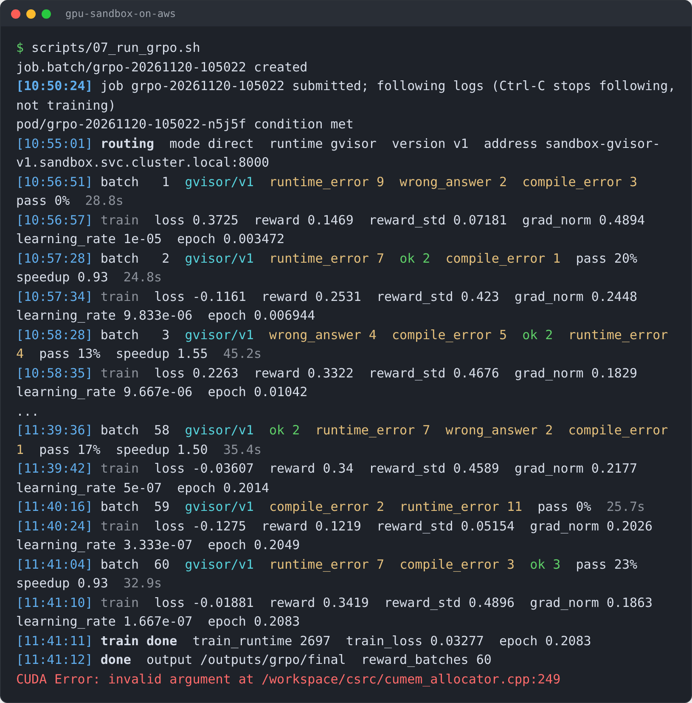
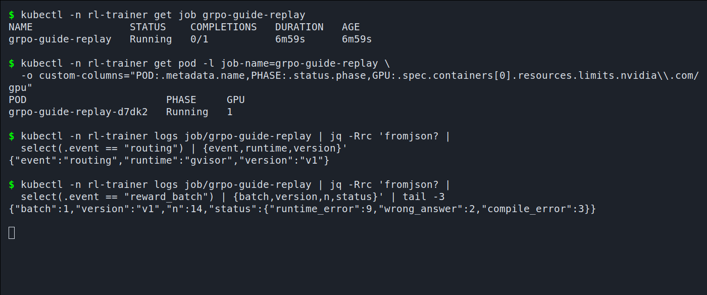
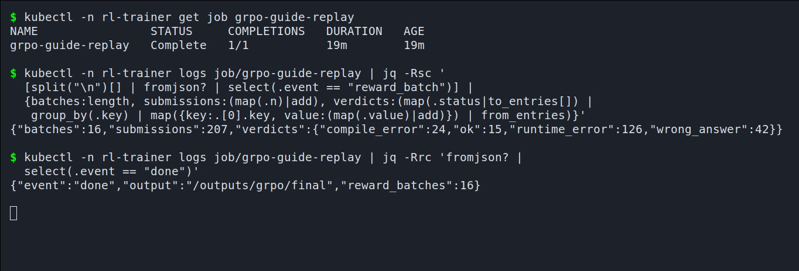

# 05 On-policy GRPO 학습

모델이 같은 문제에 답을 여러 개 내면 GRPO는 그 답들의 점수를 비교해 모델을 업데이트합니다. [04편](04_sandbox_pools.md)에서 검증한 `gvisor/v1` pool이 이번에는 모델이 막 작성한 코드를 채점합니다.

1. [trainer 노드와 이미지 확인](#시작-전-확인) 후 [학습 Job 하나를 제출](#실행)하세요. HyperPod로 학습하려면 [07편](07_hyperpod.md)에서 시작합니다.
2. [로그](#로그-읽는-법)에서 `routing` 줄에는 선택한 pool, `batch` 줄에는 코드 채점 결과, `train` 줄에는 모델 업데이트 기록이 나옵니다. 첫 `batch`의 판정과 다음 `train` 줄을 함께 읽으세요.
3. 학습 중 pool을 바꿔 보려면 Job이 진행되는 동안 다른 터미널에서 [06편](06_sandbox_update.md)을 여세요. 이번에는 학습만 한다면 [완료된 Job과 채점 건수](#trainer-complete)를 확인합니다.

??? note "용어 (처음 보는 단어가 있으면 펼치세요)"
    - **GRPO**: 모델이 prompt 하나에 생성한 여러 completion을 한 묶음(group)으로 비교하는 RL 알고리즘입니다. group 평균보다 reward가 높은 completion을 더 자주 생성하도록 모델을 학습합니다.
    - **on-policy, strictly on-policy**: on-policy에서는 현재 policy가 방금 생성한 데이터로만 학습합니다. strictly on-policy에서는 생성한 batch로 optimizer step을 한 번만 수행한 뒤 그 batch를 버립니다.
    - **rollout, completion, group**: 모델이 prompt에 답을 생성하는 과정, 그렇게 나온 답 하나, 같은 prompt에서 나온 답 묶음(여기서는 8개)입니다.
    - **advantage**: 한 completion의 reward가 group 평균보다 얼마나 높은지를 나타내는 값입니다.
    - **LoRA**: 모델 가중치 전체 대신 작은 어댑터 행렬만 학습하는 방법입니다. 메모리 사용량이 크게 줄어듭니다.
    - **vLLM colocate, sleep mode**: 생성 엔진 vLLM을 trainer와 같은 GPU에서 실행하는 모드를 colocate라고 합니다. sleep mode는 학습하는 동안 vLLM이 점유한 GPU 메모리를 잠시 해제하는 기능입니다.
    - **reference model, KL**: 학습 중인 모델이 학습 전 모델과 얼마나 달라졌는지 측정할 때 쓰는 기준 모델과, 그 차이를 나타내는 값입니다. 여기서는 `beta`가 0이라 쓰지 않습니다.
    - **importance sampling 보정**: 생성 엔진과 학습 모델의 수치 차이로 생기는 분포 차이를 확률 비율로 보정하는 방법입니다.
    - **Job, emptyDir**: 작업이 끝나면 완료 상태가 되는 Kubernetes 리소스와, pod가 삭제되면 함께 삭제되는 임시 볼륨입니다.
    - **OOM**: GPU 메모리가 부족해 프로세스가 실패하는 것(out of memory)입니다.

??? note "실습 계정에서 확인한 범위"
    실습 계정에서 기본값인 60 step run(`scripts/07_run_grpo.sh`)과 5 step run을 실행해 둘 다 Job이 Complete로 끝났습니다. 메모리와 비용 수치는 측정값이 아니라 계산값입니다. 날짜별 실행 기록은 [검증된 사실과 출처](../reference/sources.md#aws-실행-기록)에 있습니다.

## 시작 전 확인

- [04 샌드박스 pool 배포와 검증](04_sandbox_pools.md)에서 `scripts/ops/verify.sh gvisor`가 통과했습니다. routing table의 active 기본값은 `gvisor/v1`입니다.
- 시나리오 A 클러스터에 `trainer` 노드 그룹(`g5.2xlarge`, A10G 1장)이 있습니다. HyperPod에서 학습하려면 [07 HyperPod 시나리오](07_hyperpod.md)를 따르세요.
- `scripts/config.env`에 `TRAINER_IMAGE_URI`와 `SANDBOX_AUDIENCE`(기본 `gpu-sandbox`)가 있습니다. 하나라도 비면 스크립트가 멈춥니다.

## 실행

첫 실행은 5스텝으로 생성·채점·업데이트를 확인할 수 있습니다. 이어서 06편의 pool 교체를 연습하려면 기본 60스텝을 선택해 교체할 시간을 확보하세요. 둘 중 하나만 실행합니다.

=== "첫 실행 · 5스텝"

    ```bash
    scripts/07_run_grpo.sh 5
    ```

=== "pool 교체 연습 · 60스텝"

    ```bash
    scripts/07_run_grpo.sh
    ```

다른 길이가 필요하면 스텝 수를 인자로 넣으세요(예: `scripts/07_run_grpo.sh 20`).

| 순서 | 스크립트 동작 |
|---|---|
| 1 | `RUN_ID`(기본 `date +%Y%m%d-%H%M%S`), `MAX_STEPS`(첫 번째 인자, 기본 60), `MODEL_ID`(기본 `Qwen/Qwen2.5-Coder-1.5B-Instruct`)를 정합니다. |
| 2 | `k8s/trainer/job-grpo.yaml.tpl`을 렌더링해 `rl-trainer` namespace에 Job `grpo-${RUN_ID}`를 만듭니다. |
| 3 | pod가 Ready가 될 때까지 최대 30분 기다립니다. |
| 4 | 로그에서 `"event"`, `loss`, `Error`, `Traceback`이 들어간 줄만 걸러 실시간으로 출력합니다. |

- **4단계의 로그를 터미널에서 볼 때**: JSON 이벤트와 TRL dict를 한 줄 요약으로 바꿔 보여 줍니다.
- **4단계의 로그 출력 중 Ctrl-C를 누르면**: 로그 출력만 멈추고 학습은 계속됩니다.

**확인할 것:** 아래 순서로 줄이 나옵니다(예시 형태, 값은 실행마다 다름). 이미지 pull과 모델 다운로드 때문에 첫 줄 뒤 몇 분 동안 출력이 없을 수 있습니다.

```text
job.batch/grpo-20261113-101500 created
[hh:mm:ss] job grpo-20261113-101500 submitted; following logs (Ctrl-C stops following, not training)
pod/grpo-20261113-101500-xxxxx condition met
[hh:mm:ss] routing  mode direct  runtime gvisor  version v1  address sandbox-gvisor-v1.sandbox.svc.cluster.local:8000
[hh:mm:ss] batch   1  gvisor/v1  ...
[hh:mm:ss] train  loss ...  reward ...
...
[hh:mm:ss] train done  train_runtime ...  train_loss ...  epoch ...
[hh:mm:ss] done  output /outputs/grpo/final  reward_batches <int>
CUDA Error: invalid argument at /workspace/csrc/cumem_allocator.cpp:249
```

요약에 담기는 필드는 아래 [로그 읽는 법](#로그-읽는-법)에 있습니다. 모든 필드를 처음부터 보려면 `GPUSANDBOX_LOG=json scripts/07_run_grpo.sh`로 실행하세요. 이미 시작한 학습은 바로 아래 `kubectl logs` 명령으로 원래 로그를 봅니다.

실습 계정에서 기본값인 60 step run을 실행한 결과는 다음과 같습니다.

- step마다 `reward_batch`가 하나씩, 모두 60개 나왔습니다.
- `status`에는 `ok`, `wrong_answer`, `compile_error`, `runtime_error`가 섞였고 `sandbox_error`는 한 건도 없었습니다.
- batch 채점 시간은 중앙값 31초, `train_runtime`은 2697초(약 45분)였습니다.

아래 화면은 그 실행의 처음과 끝입니다.



`done` 뒤의 `CUDA Error` 줄은 학습이 끝난 뒤 vLLM이 종료하면서 출력합니다. 이 vLLM 버전은 기본값(`VLLM_ENABLE_V1_MULTIPROCESSING=1`)에서 엔진을 별도 자식 프로세스로 실행하고, sleep mode(`rl/trl/train_grpo.py`의 `vllm_enable_sleep_mode=True`)가 쓰는 cumem 할당기도 그 프로세스에 있습니다. 이 줄은 그 프로세스가 끝나면서 남기는 것으로 보입니다(학습 스크립트를 `done` 직후 `os._exit`로 끝내도 같은 줄이 나왔습니다). adapter 저장과 `done` 뒤에 나오고 Job은 그대로 Complete(exit 0)로 끝나므로, 이 줄이 보이면 Job 상태로 성공 여부를 판단하세요.

**문제가 생기면:** pod가 Pending이거나 `status`가 대부분 `sandbox_error`이거나 OOM이 나면, 끝의 "확인 방법" 표와 [문제 해결](../reference/troubleshooting.md)의 "학습" 항목을 보세요.

`RUN_ID`와 `MODEL_ID`는 `scripts/config.env`에 없는 변수라 환경 변수로 바꿀 수 있습니다. `RUN_ID`는 Job 이름에 들어가므로 소문자, 숫자, 하이픈만 쓰세요.

로그를 다시 보려면 스크립트가 출력한 Job 이름으로 다음 명령을 실행합니다(필터 없는 전체 로그).

```bash
kubectl -n rl-trainer logs -f "job/grpo-<RUN_ID>"
```

**확인할 것:** 요약이 아닌 원래 JSON 이벤트와 TRL dict 줄이 나오고, 모델 로딩과 vLLM 초기화 로그도 출력됩니다.

### 실행 중인 trainer와 첫 배치 { #trainer-running }

`RUN_ID=guide-replay scripts/07_run_grpo.sh 16`을 실행했습니다. `g5.2xlarge`의 A10G 한 장에서 모델을 학습하고, 실제 생성 코드의 채점은 EC2 gVisor pool에 보냈습니다.



### 완료된 학습과 채점 건수 { #trainer-complete }

Job이 `Complete`로 끝났습니다. trainer가 기록한 배치는 16개, 채점한 제출물은 207개, `ok` 판정은 15개였습니다. trainer가 보고한 `train_runtime`은 785.3초였고, 컨테이너는 종료 코드 0을 반환했습니다. 이 실행에서 학습 중 샌드박스를 바꾼 시점은 [6장 전환 기록](06_sandbox_update.md#switch-batches)에서 볼 수 있습니다.



## 로그 읽는 법

`wrong_answer`가 한 번 나왔다면 채점기가 기준 답과 다른 출력을 찾아낸 것입니다. `sandbox_error`는 그 답을 채점하지 못했다는 뜻이라 이 실습의 GRPO는 해당 답을 그룹 평균에서 뺍니다. 반복되면 [pool 검증](04_sandbox_pools.md)으로 돌아가세요.

`routing` 로그에서 trainer가 어느 pool로 채점을 요청할지 확인하세요. 그 뒤 `reward_batch`의 판정과 optimizer step을 함께 확인하세요. 샌드박스 요청이 모두 `sandbox_error`라면 로그가 찍혀도 채점 경로를 점검해야 합니다.

로그에는 두 종류의 줄이 함께 출력됩니다. 첫째는 TRL이 step마다 출력하는 Python dict입니다(`loss` 키가 있어 스크립트 필터를 통과).

| TRL 지표 | 의미 |
|---|---|
| `rewards/format_reward/mean`, `rewards/correctness_reward/mean`, `rewards/speedup_reward/mean` | component별 평균 (None인 completion은 제외) |
| `reward`, `reward_std` | 가중합 reward의 평균과 표준편차 |
| `frac_reward_zero_std` | reward 표준편차가 0인 비율. 1에 가까우면 group 안 completion이 모두 같은 점수라 학습 신호가 거의 없습니다 |
| `completions/mean_length`, `completions/clipped_ratio` | completion 길이, 768 token에서 잘린 비율 |
| `entropy`, `clip_ratio/*`, `sampling/importance_sampling_ratio/*` | policy 엔트로피, clipping 비율, vLLM 보정 비율 |
| `loss`, `grad_norm`, `learning_rate` | 일반 학습 지표. `beta`가 0이라 `kl`은 기록되지 않습니다 |

completion이 768 token에서 잘리면 format 점수는 잘린 위치에 따라 달라집니다.

- **코드 블록 안에서 잘리면**: 그 블록은 닫히지 않으므로, 앞에 닫힌 Python 블록이 없으면 format이 0이 됩니다.
- **블록을 닫은 뒤 설명에서 잘렸다면**: 그 블록으로 채점합니다.

터미널 요약의 `train` 줄에는 이 중 `loss`, `reward`, `reward_std`, `grad_norm`, `learning_rate`와 `epoch`만 나옵니다. 나머지 지표는 원래 dict(pod 로그 또는 `GPUSANDBOX_LOG=json`)에서 보세요.

둘째는 이 저장소 코드가 stdout에 출력하는 JSON 이벤트입니다. 그중 `reward_batch`와 버전이 바뀔 때의 `sandbox_version_switch`만 `/outputs/grpo/sandbox_metrics.jsonl`에도 기록됩니다. 시작 시점의 `routing`과 종료 시점의 `done`까지 보관하려면 Job 로그를 저장하세요(위 "학습 결과 보존"). 아래에서 pod 로그와 `GPUSANDBOX_LOG=json`에 표시되는 원래 JSON 형태를 볼 수 있습니다.

```text
{"event": "routing", "mode": "direct", "runtime": "gvisor", "version": "v1", "address": "sandbox-gvisor-v1.sandbox.svc.cluster.local:8000"}
{"event": "reward_batch", "batch": <int>, "global_step": <int>, "runtime": "gvisor", "version": "v1",
 "served_versions": {"v1": <int>}, "routing_revision": <int>, "n": <int>, "status": {"<status>": <int>, ...},
 "pass_rate": <float>, "custom_kernel_rate": <float>, "mean_speedup": <float or null>,
 "eval_p50_s": <float or null>, "eval_p95_s": <float or null>, "batch_wall_s": <float>, "ts": <float>}
{"event": "done", "output": "/outputs/grpo/final", "reward_batches": <int>}
```

| `reward_batch` 필드 | 의미 |
|---|---|
| `batch`, `global_step` | 몇 번째 reward batch인지, 채점할 때 trainer의 `global_step`(완료된 optimizer step 수) |
| `runtime`, `version` | 이 batch를 채점한 pool(마지막 샌드박스 호출의 routing snapshot) |
| `served_versions` | 결과에 기록된 버전별 개수. 정상이면 key가 `version` 하나뿐입니다 |
| `routing_revision` | routing table 내용이 바뀔 때마다 1씩 늘어납니다 |
| `n`, `status` | 이 batch에서 샌드박스로 보낸 completion의 수와 status별 개수 |
| `pass_rate`, `custom_kernel_rate` | `n` 중 `ok` 비율, `custom_kernel`이 참인 비율(launch 수를 세지 못한 Triton 코드 포함) |
| `mean_speedup` | `ok`인 completion(커널 여부 무관)의 speedup 평균, 없으면 null |
| `eval_p50_s`, `eval_p95_s`, `batch_wall_s` | 샌드박스 서버가 측정한 평가 시간(`duration_s`)의 p50/p95, trainer가 batch 전체를 기다린 시간 |

- **`served_versions`와 direct 모드**: direct 모드에서는 응답에 버전이 없으면(통신 실패 등) 요청한 버전을 채우므로, `status`의 `sandbox_error` 수도 함께 보세요.
- **`n`, `status`에 들어가는 것**: 코드 없음, trainer 쪽 정책 위반, 캐시 hit은 포함되지 않습니다. 다른 pool로 캐시돼 다시 채점한 completion은 포함됩니다.
- **`eval_p50_s`, `eval_p95_s`가 null일 때**: 측정 시간이 하나도 없으면(모두 통신 실패 등) p50과 p95가 모두 null, 하나뿐이면 p95만 null입니다.

터미널 요약의 `reward_batch` 줄은 이 중 `batch`, `runtime/version`, `status`, `pass_rate`, `mean_speedup`, `batch_wall_s`만 보여 줍니다. `served_versions`에 버전이 둘 이상이면 `MIXED VERSIONS {...}`가 붙습니다. 결과의 버전이 요청한 버전(`version`)과 같은지는 원래 JSON에서 `served_versions`의 키로 확인합니다.

샌드박스로 보낸 completion이 없는 step에는 `reward_batch` 줄이 없습니다. 버전 전환 때의 `sandbox_version_switch` 이벤트는 [06](06_sandbox_update.md)에서 다룹니다.

## 1.5B 모델에서 기대할 것

이 저장소는 on-policy 루프가 끝까지 실행되는지 확인하는 용도이고, 학습 곡선이 개선된다고 보장하지 않습니다.

| level | task |
|---|---|
| 0 | `vector_add`, `relu_bias`, `scaled_residual` |
| 1 | `silu_mul`, `gelu_tanh`, `row_sum_sq` |
| 2 | `row_softmax`, `rms_norm`, `layer_norm` |
| 3 (기본 제외) | `matmul_bias_relu` (float16) |

tasks 모듈 주석에 따르면 level 0은 기본 동작을 점검하는 단계입니다. 이 단계의 문제는 작은 모델도 대체로 풀 수 있습니다.

- **level 0**: 0보다 큰 reward는 level 0에서 먼저 나올 가능성이 큽니다(추론).
- **level 2**: 정답 커널이 드물어 reward가 희소하므로 `frac_reward_zero_std`가 높을 수 있습니다.
- **기본 60 step**: prompt 120개(task당 평균 13개 정도)는 추세를 판단하기에 적은 양일 수 있습니다. 실습 계정의 60 step run에서도 `ok` 비율은 처음 20 step 5.3%, 마지막 20 step 6.0%로 거의 같았습니다.

진단할 때는 아래 항목을 차례로 확인합니다.

1. 새로 채점할 completion이 있는 step에서 `reward_batch`가 나오는지
2. `sandbox_error`가 드문지
3. format reward가 0보다 큰지
4. `wrong_answer`와 `runtime_error` 비율이 어떻게 변하는지
5. `ok` + custom kernel이 한 번이라도 나오는지

## 자주 막히는 지점

- **pod가 `Pending`**이면 `kubectl describe pod`의 이벤트에서 GPU를 기다리는지 확인하세요. 같은 trainer 노드에 이전 Job이 남아 있으면 새 Job도 대기할 수 있습니다.
- **`sandbox_error`가 반복**되면 먼저 `scripts/ops/verify.sh gvisor`로 pool을 확인하세요. 이 상태는 샌드박스가 채점에 실패했다는 뜻입니다. 모델이 틀린 답을 낸 경우와 로그에서 구분할 수 있습니다.

OOM이나 첫 로그가 나오지 않는 경우는 [학습 문제 해결](../reference/troubleshooting.md#학습)을 참고하세요.

<details class="note" markdown="1">
<summary>trainer Job과 학습 파라미터 보기</summary>

## Job manifest에서 볼 부분

| 필드 | 값 | 이유 |
|---|---|---|
| pod label | `gpusandbox/client: "true"` | sandbox namespace의 NetworkPolicy `allow-clients-to-sandbox-api`는 `rl-trainer` namespace에서 이 label이 붙은 pod의 연결만 8000 포트로 허용합니다. |
| `automountServiceAccountToken` | `false` | Kubernetes API 토큰이 없습니다. trainer는 Kubernetes API를 호출하지 않고, 샌드박스용 토큰만 따로 받습니다. |
| projected token | audience `${SANDBOX_AUDIENCE}`, `expirationSeconds: 3600`, `/var/run/secrets/gpusandbox/token` | 샌드박스 pod는 audience가 이 값이고 subject가 허용 목록(`system:serviceaccount:rl-trainer:grpo-trainer` 등)에 있는 토큰만 허용합니다. |
| routing ConfigMap | `sandbox-routing`을 `/etc/gpusandbox/routing` 디렉터리로 마운트 (subPath 아님) | subPath로 마운트하면 ConfigMap 변경이 반영되지 않습니다. |
| resources | CPU 7, memory 28Gi, `nvidia.com/gpu: 1` | `g5.2xlarge`(8 vCPU, 32 GiB)에서 시스템용 자원을 남긴 값입니다. |
| `/dev/shm` | memory emptyDir 8Gi | 컨테이너 기본 공유 메모리가 작아서 따로 할당합니다. |
| `/outputs`, `/cache` | emptyDir | checkpoint(20 step마다, 최대 2개)와 HF 캐시는 pod가 삭제되면 함께 삭제됩니다. |
| `backoffLimit`, `ttlSecondsAfterFinished` | `0`, `86400` | 실패하면 다시 시도하지 않고, 끝난 Job은 24시간 뒤 삭제됩니다. |
| `PYTORCH_CUDA_ALLOC_CONF` | `expandable_segments:True` | 메모리 단편화를 줄입니다. |

- **pod label이 없으면**: NetworkPolicy가 연결을 차단해, 샌드박스로 보내야 하는 completion이 sandbox_error가 됩니다. 코드 블록이 없거나 trainer 쪽 정책 검사에서 걸린 completion은 샌드박스를 거치지 않으므로 평소대로 채점됩니다.
- **projected token 교체**: kubelet이 같은 경로의 파일을 교체하고, 클라이언트는 요청마다 파일을 다시 읽습니다.
- **routing ConfigMap 마운트**: [06](06_sandbox_update.md)의 버전 전환을 실행 중인 pod에 반영하려면 디렉터리로 마운트해야 합니다.

!!! note "학습 결과 보존"
    이 실습은 학습 파이프라인을 확인하기 위한 예제여서 LoRA adapter와 `sandbox_metrics.jsonl`을 emptyDir에 저장합니다. 컨테이너가 종료되면 `kubectl cp`로도 가져올 수 없습니다. JSON 이벤트는 stdout에도 출력되므로, Job이 삭제되기 전(완료 후 24시간)에 아래 명령으로 저장하세요. adapter를 보존하려면 `/outputs`에 공유 스토리지를 마운트하세요([Production 06 veRL로 확장](../production/06_scaling_with_verl.md)).

    ```bash
    kubectl -n rl-trainer logs "job/grpo-<RUN_ID>" | grep '"event"' > grpo-events.jsonl
    ```

    **확인할 것:** `wc -l grpo-events.jsonl`이 0보다 큰 줄 수를 출력하고, 첫 줄이 `{"event": "routing", ...}`입니다.

## train_grpo.py 기본값

| 인자 | 기본값 | 의미 |
|---|---|---|
| `--model` | `Qwen/Qwen2.5-Coder-1.5B-Instruct` | Apache-2.0, gated 아님 |
| `--max-level` | `2` | 난이도 0~2 task 9개 |
| `--repeats` | `64` | task당 dataset row 수 (9 × 64 = 576 rows) |
| `--num-generations` | `8` | prompt당 completion 수 (GRPO group 크기) |
| `--per-device-batch` | `4` | micro-batch당 completion 수 |
| `--grad-accum` | `4` | optimizer step당 micro-batch 수 |
| `--max-completion-length` | `768` | TRL 기본값 512보다 깁니다 (커널 코드와 설명) |
| `--learning-rate` | `1e-5` | LoRA 권장값 (TRL GRPOConfig 기본값은 1e-6) |
| `--lora-r`, `--lora-alpha` | `32`, `64` | `target_modules="all-linear"` |
| `--vllm-gpu-memory-utilization` | `0.35` | TRL 기본값은 0.3 |
| `--vllm-max-model-length` | `2048` | prompt와 completion 합계 |
| `--reward-weights` | `0.1,1.0,0.5` | format, correctness, speedup |
| `--allow-torch-only` | 꺼짐 | 켜면 Triton 없이 맞힌 completion도 correctness 1.0과 speedup을 받습니다 |
| `--runtime` | 없음 | routing table의 active runtime 대신 쓸 runtime |
| `--save-steps`, `--seed` | `20`, `42` | checkpoint 간격, dataset shuffle과 GRPOConfig seed |

```text
generation batch = per-device batch 4 x processes 1 x steps_per_generation 4 = 16 completions
16 completions / num_generations 8      = 2 prompts (2 GRPO groups) per optimizer step
60 steps x 2 prompts                    = 120 prompts out of 576 dataset rows
```

TRL은 generation batch가 `num_generations`로 나누어떨어지지 않으면 시작하지 않습니다.

??? note "인자가 전달되는 곳"
    위 인자 표는 `train_grpo.py`의 명령줄 기본값입니다.

    - **`GRPOConfig`**: 학습률, batch 크기, gradient accumulation, 생성 수, 최대 길이, reward 가중치, 저장 간격, seed, vLLM 메모리 설정을 넘깁니다. 그 밖에 `use_vllm=True`, `vllm_mode="colocate"`, `vllm_enable_sleep_mode=True`, `logging_steps=1`, `save_total_limit=2`, `report_to="none"`도 지정합니다.
    - **데이터셋**: `--max-level`과 `--repeats`가 설정합니다.
    - **`LoraConfig`**: `--lora-r`과 `--lora-alpha`가 설정합니다.
    - **채점 함수(`KernelRewards`)**: `--allow-torch-only`와 `--runtime`이 설정합니다.

GPU 학습 설정에서는 아래 항목을 따로 지정하지 않으므로 TRL 기본값이 적용됩니다. 이 기본값은 로컬 TRL 1.18.0의 `GRPOConfig`로 확인했으므로, TRL 버전을 바꾸면 다시 확인하세요.

| TRL 기본값 | 값 | 의미 |
|---|---|---|
| `steps_per_generation`, `num_iterations` | `gradient_accumulation_steps`, `1` | 생성한 batch마다 optimizer step을 한 번만 수행합니다 |
| `beta` | `0.0` | reference model을 로드하지 않습니다 (KL 항 없음) |
| `loss_type`, `scale_rewards` | `"dapo"`, `"group"` | group 안에서 reward를 정규화합니다 |
| `vllm_importance_sampling_correction` | `True` | vLLM과 학습 모델의 수치 차이를 importance sampling으로 보정합니다 |
| `gradient_checkpointing`, `bf16` | `True`, `True` | GRPOConfig가 TrainingArguments와 다르게 설정하는 기본값 |

</details>

## 한 step의 흐름

현재 모델이 답을 생성하면 샌드박스가 채점하고, trainer는 그 배치로 optimizer step을 한 번 실행합니다. [On-policy RL과 샌드박스](../concepts/03_onpolicy_rl_with_sandboxes.md)에서 학습 방식의 의미를 볼 수 있습니다.

??? note "한 step의 흐름"
    ```mermaid
    sequenceDiagram
        participant V as vLLM (colocate, 같은 A10G)
        participant T as GRPOTrainer (LoRA)
        participant R as KernelRewards
        participant S as 샌드박스 pool (routing의 active)
        T->>V: 깨우기, 현재 가중치로 2 prompts x 8 completions 생성
        V-->>T: completion 16개
        T->>R: format, correctness, speedup reward 함수 호출
        R->>R: 코드 추출과 정책 검사 (trainer 쪽)
        R->>S: batch 평가 (호출마다 routing snapshot, batch는 한 pool)
        S-->>R: verdict (status, speedup, sandbox_version)
        R-->>T: reward 3종 (sandbox_error면 None)
        T->>T: group 상대 advantage, LoRA 업데이트 한 번
        T->>V: 다음 생성 전에 가중치 동기화
    ```

    *그림 요약: 한 step 안에서 생성, 채점, 업데이트가 차례로 한 번씩 일어나므로, 샌드박스 평가 시간이 그대로 step 시간에 포함됩니다.*

    TRL은 세 reward 함수를 따로 호출합니다. `KernelRewards`는 task, prompt, completion 텍스트의 해시를 키로 verdict를 캐시합니다.

    - **같은 pool에서는**: 샌드박스 평가가 completion마다 한 번만 실행됩니다.
    - **버전 전환 뒤 새 completion을 새 pool에서 채점할 때**: 같은 batch에 있는 이전 pool의 캐시 항목도 새 pool에서 다시 채점합니다.
    - **batch 전체가 한 pool의 캐시에 있으면**: 샌드박스에 다시 요청하지 않고 해당 pool의 채점 결과를 재사용합니다.

    어느 경우든 한 batch는 한 버전으로 채점됩니다.

## Reward 구성

부분 점수는 완전히 맞힌 커널이 드문 초반에도 답 사이에 점수 차이를 만듭니다. `sandbox_error`로 채점하지 못한 completion은 group 평균 계산에서 제외합니다.

??? note "Reward 구성"
    `src/gpusandbox/rewards.py`의 세 component입니다.

    - **format**: 고른 코드가 파싱되고 최상위에 `ModelNew` 클래스가 있으면 1.0, 아니면 0.0입니다. 추출기는 다음 순서로 코드를 고릅니다.
        1. 여는 줄과 닫는 줄을 앞에서부터 차례로 짝지어 닫힌 코드 블록을 나눕니다.
        2. 언어 표시가 없거나 `python`, `py`, `python3`(대소문자 무관)인 블록만 후보로 삼습니다.
        3. `class ModelNew` 문자열이 있는 후보 중 마지막 블록을 고릅니다. 해당 문자열이 있는 블록이 없으면 마지막 후보를 선택합니다. 그래서 앞에 `bash`나 `text` 블록이 있어도 뒤의 Python 블록을 찾습니다.

        블록 하나만 채점하므로 prompt가 요구하는 대로 `ModelNew` 전체를 `python` 블록 하나에 넣어야 합니다.

    - **correctness**: 샌드박스 status에 따라 단계별 점수를 줍니다(아래 표).
    - **speedup**: 기본 설정에서는 status가 `ok`이고 `custom_kernel=true`인 결과에만 `0.5 + 0.5 × clamp(log2(speedup), -1, 2)`를 줍니다. 0.5배는 0.0, 1배는 0.5, 2배는 1.0, 4배 이상은 1.5입니다.
        - **`custom_kernel`**: 코드가 Triton을 쓰고 kernel launch 수가 0이 아닐 때 참이며, launch 수를 세지 못한 경우도 참으로 표시됩니다.
        - **`--allow-torch-only`를 켜면**: PyTorch 정답에도 같은 공식을 적용합니다.

    | sandbox status | correctness | 비고 |
    |---|---|---|
    | `ok` + custom Triton kernel | 1.0 | |
    | `ok`, Triton kernel 없음 | 0.3 | `--allow-torch-only`면 1.0 |
    | `wrong_answer` | 0.2 | 실행은 됐지만 값이 틀림 (timed output 불일치 포함) |
    | `runtime_error` | 0.05 | Triton은 첫 launch 때 컴파일하므로 커널 컴파일 오류도 이 status로 분류됩니다 |
    | `compile_error`, `timeout`, `policy_violation`, 코드 없음 | 0.0 | |
    | `sandbox_error` | None | 세 component 모두 None |

    합계는 각 component에 가중치 0.1, 1.0, 0.5를 곱해 더한 값입니다.

    | 결과 | format | correctness | speedup | 합계 |
    |---|---|---|---|---|
    | 코드 블록 없음, 문법 오류, ModelNew 없음 | 0 | 0 | 0 | 0.0 |
    | `compile_error`, `timeout`, 그 밖의 `policy_violation` | 1 | 0 | 0 | 0.1 |
    | `runtime_error` | 1 | 0.05 | 0 | 0.15 |
    | `wrong_answer` | 1 | 0.2 | 0 | 0.3 |
    | `ok`, Triton 없음 | 1 | 0.3 | 0 | 0.4 |
    | `ok` + Triton, 0.5배 이하 | 1 | 1.0 | 0.0 | 1.1 |
    | `ok` + Triton, 1배 | 1 | 1.0 | 0.5 | 1.35 |
    | `ok` + Triton, 4배 이상 | 1 | 1.0 | 1.5 | 1.85 |
    | `sandbox_error` | None | None | None | 제외 (advantage 0) |

    부분 점수가 있으므로, 실행은 되지만 틀린 코드(0.3)와 실행되지 않는 코드(0.1)의 차이도 학습 신호가 됩니다. TRL 문서에 따르면 reward 함수가 None을 반환하면 그 값은 reward 계산에서 제외됩니다.

<details class="note" markdown="1">
<summary>모델을 바꿀 때의 설정과 GPU 메모리 계산</summary>

## 옵션 바꾸기

`MODEL_ID`에는 오픈 라이선스 모델만 쓰세요(`Qwen2.5-Coder-3B-Instruct`는 비상업 라이선스 qwen-research라 제외, 7B는 Production 트랙). GPU 관련 설정은 기본 모델에 맞춘 값이므로, 다른 모델은 짧은 run으로 먼저 확인하세요.

```bash
MODEL_ID=<open-license-model-id> scripts/07_run_grpo.sh 20
```

**확인할 것:** 기본 실행과 같은 형태의 로그가 나오고, Job이 OOM 없이 20 step을 마칩니다.

`07_run_grpo.sh`는 `--max-steps`, `--model`, `--output-dir`, `--metrics-file`만 전달하므로, 다른 인자(`--max-level`, `--allow-torch-only`, batch 크기 등)는 로컬 사본의 `k8s/trainer/job-grpo.yaml.tpl` `args` 목록에 추가하세요.

```yaml
          args:
            - --output-dir=/outputs/grpo
            - --max-steps=${MAX_STEPS}
            - --model=${MODEL_ID}
            - --metrics-file=/outputs/grpo/sandbox_metrics.jsonl
            - --max-level=0              # added: level-0 tasks only (denser reward)
            # - --allow-torch-only       # credit for correct PyTorch-only answers
```

- **`--max-level 0`**: task를 3개로 줄여 reward를 덜 희소하게 만듭니다.
- **`--allow-torch-only`**: PyTorch만으로 맞힌 completion에도 correctness 1.0과 speedup 점수를 주므로 학습 과제 자체가 바뀝니다. 파이프라인 점검용으로만 쓰세요.

## A10G 24 GB 메모리 계산

아래 표는 설정값으로 계산한 추정치입니다.

| 항목 | 대략의 크기 | 근거 |
|---|---|---|
| policy 모델 가중치 (bf16) | 약 3 GB | 1.5B 파라미터 × 2 bytes |
| vLLM 할당분 | 최대 약 8.4 GB | `vllm_gpu_memory_utilization` 0.35 × 24 GB. vLLM이 따로 로드한 가중치 사본(약 3 GB)과 KV cache |
| LoRA adapter, gradient, optimizer state | 1 GB 미만 (추정) | rank 32 adapter만 학습하고 base 가중치는 고정 |
| activation, logits, 여유 | 나머지 약 12 GB | per-device batch 4 × (prompt + 최대 768 token), gradient checkpointing 기본 켜짐 |

sleep mode가 vLLM의 가중치와 cache를 해제해 확보한 메모리는 backward 계산에 쓰입니다. 그 대신 vLLM을 다시 깨울(wake up) 때 host와 device 사이의 전송 시간이 추가로 듭니다(TRL 문서). OOM이 나면 아래 순서로 설정값을 줄이세요.

1. `--per-device-batch 2 --grad-accum 8`: 두 값의 곱을 16으로 유지하므로 step당 prompt 수는 그대로입니다.
2. `--max-completion-length 512`: 잘림 비율(`completions/clipped_ratio`)이 함께 오르는지 확인합니다.
3. `--vllm-gpu-memory-utilization 0.3`: KV cache가 줄어 생성이 느려질 수 있습니다.

7B 모델은 bf16 가중치만 약 15 GB이고, colocate 모드에서는 학습 모델과 vLLM이 각각 가중치를 로드하므로 A10G 24 GB 한 장에는 메모리가 부족할 것으로 보입니다(추론).

</details>

## 적용 범위와 한계

GPU 메모리 사용량은 측정하지 않았습니다. step 시간과 step별 reward, loss 기록은 위의 5 step run 한 번에서 나온 것입니다.

## 소요 시간과 비용

실습 계정에서 Job 전체는 기본값 60 step run이 약 50분, 5 step run이 약 12분 걸렸습니다(둘 다 이미지 pull과 모델 다운로드 포함). 시간이 걸리는 단계는 다음과 같습니다.

- 첫 실행의 trainer 이미지 pull(`vllm/vllm-openai:v0.33.0` 기반이라 큼)
- 매 실행의 모델 다운로드(`HF_HOME`이 emptyDir)
- vLLM 초기화
- step마다의 생성, 샌드박스 평가, 학습

| 노드 | 수 | USD/시간 |
|---|---|---|
| trainer `g5.2xlarge` | 1 | 1.212 |
| sandbox-gvisor `g5.xlarge` | 2 | 2.012 |
| system `m6i.large` | 2 | 0.192 |
| EC2 노드 합계 | | 3.416 |

EKS control plane, NAT gateway, EBS 요금은 별도입니다. `g4dn.metal` 노드가 실행 중이면 시간당 7.824 USD가 추가로 나옵니다(us-east-1과 us-west-2 온디맨드 요금). 학습 뒤에는 [01 클러스터와 이미지](01_cluster_and_images.md)의 "소요 시간과 비용" 명령으로 GPU 노드 그룹을 0으로 줄이거나 [99 정리](99_cleanup.md)로 삭제하세요.

## 확인 방법

1. `kubectl -n rl-trainer get pods -l job-name=grpo-<RUN_ID>`의 출력에서 pod 상태가 Running입니다.
2. 첫 이벤트 줄이 `routing  mode direct  runtime gvisor  version v1  ...`입니다.
3. step마다 TRL dict 줄이 나옵니다.
    - **새로 채점할 completion이 있는 step**: `batch` 줄(`reward_batch`)도 나오고, 그 줄에 `MIXED VERSIONS`가 없으며, status별 개수의 대부분이 `sandbox_error`가 아닙니다.
    - **코드 블록이 없거나 trainer 쪽 정책 검사에서 모두 탈락하거나 모두 한 pool의 캐시에 있는 step**: `reward_batch` 없이 지나갑니다.
4. 학습이 끝나면 `done  output /outputs/grpo/final  ...`이 나오고 Job이 Complete가 됩니다. 그 뒤에 나오는 vLLM 종료 오류(`cumem_allocator.cpp:249`)는 실습 계정의 5 step run에서도 나왔고, 그때도 Job은 Complete였습니다.

| 증상 | 가능한 원인 | 확인 |
|---|---|---|
| `status`가 대부분 `sandbox_error` | NetworkPolicy label, token audience, pool Ready 상태 | `scripts/ops/verify.sh gvisor`, [문제 해결](../reference/troubleshooting.md)의 "학습"과 "401, 403 응답" 항목 |
| `reward_batch` 줄이 드묾 | 대부분의 completion이 코드 블록 없음이나 trainer 쪽 정책 위반이라 샌드박스로 보낸 completion이 없음 | 원래 TRL dict의 `rewards/format_reward/mean`, `completions/clipped_ratio` |
| CUDA OOM | 메모리 예산 초과 | 위 메모리 절의 순서대로 줄이기 |
| pod가 Pending | trainer 노드가 없거나 GPU가 등록되지 않음 | `kubectl get nodes -L gpusandbox/role`, `scripts/04_install_gpu_stack.sh` 출력 |

!!! question "❓ 오해: 샌드박스가 채점하지 못한 completion은 0점으로 학습된다"
    `sandbox_error`는 세 component가 모두 None입니다. TRL 1.18.0은 이런 completion을 group baseline에서 빼고 advantage를 0으로 두므로, policy가 인프라 장애 때문에 낮은 reward를 받지 않습니다. 다만 `sandbox_error`가 많으면 학습 신호가 줄어드니 `reward_batch`의 `status`를 확인하세요.

!!! question "❓ 오해: reward가 오르지 않으면 파이프라인이 고장 난 것이다"
    1.5B 모델로 60 step만 학습하면 reward가 거의 변하지 않아도 이상하지 않습니다. 파이프라인은 아래 경우에 의심하세요.

    - `sandbox_error`가 대부분일 때
    - `batch` 줄에 `MIXED VERSIONS`가 붙을 때
    - 원래 JSON에서 `served_versions`의 키가 `version`과 다를 때
    - 학습 내내 `reward_batch` 줄이 하나도 없을 때

    `reward_batch`가 없으면 먼저 format 지표와 `completions/clipped_ratio`로 코드가 잘리지 않았는지 보세요. 학습 완료는 `done` 이벤트와 Job의 Complete로 확인합니다.

!!! question "❓ 오해: strictly on-policy면 생성 분포와 학습 분포가 완전히 같다"
    strictly on-policy는 생성한 batch를 optimizer step 한 번에만 쓴다는 뜻입니다. TRL 문서에 따르면 vLLM 생성과 학습 모델의 수치 차이로 off-policy 성분이 생기고, TRL 1.18.0은 기본 설정으로 이 차이를 importance sampling으로 보정합니다(`sampling/importance_sampling_ratio/*` 지표).

학습이 정상적으로 실행되면 [06 학습 중 샌드박스 업데이트](06_sandbox_update.md)에서 샌드박스를 v1에서 v2로 바꿔 보세요. 같은 학습을 HyperPod에서 실행하려면 [07 HyperPod 시나리오](07_hyperpod.md)를 보세요.

??? note "참고 자료"
    | 주제 | 링크 |
    |---|---|
    | TRL GRPO Trainer (지표, colocate, sleep mode, None reward) | https://huggingface.co/docs/trl/grpo_trainer |
    | TRL 저장소 | https://github.com/huggingface/trl |
    | 기본 모델 (Apache-2.0) | https://huggingface.co/Qwen/Qwen2.5-Coder-1.5B-Instruct |
    | KernelBench (ModelNew 계약) | https://github.com/ScalingIntelligence/KernelBench |
    | Amazon EC2 가속 컴퓨팅 인스턴스 (A10G, T4) | https://docs.aws.amazon.com/ec2/latest/instancetypes/ac.html |

    [관련 대표 자료](../reference/references.md#ref-handson-05-grpo-training)
