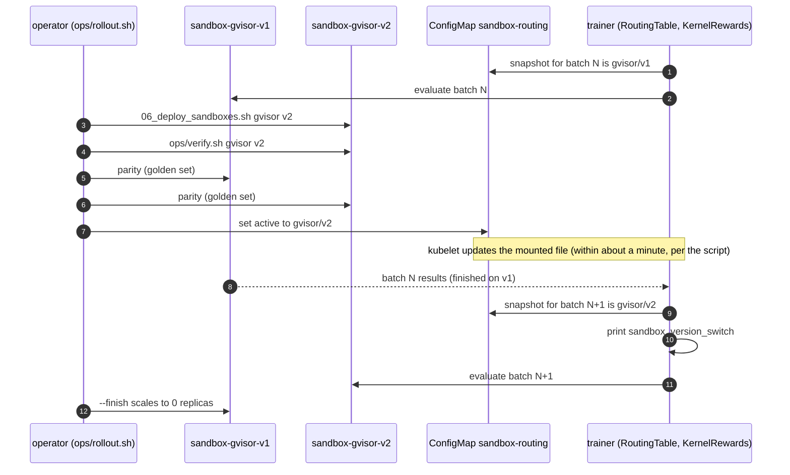

# 06 Updating the sandbox during training

**TL;DR** Move the sandbox from v1 to v2 with blue/green without stopping on-policy training, and confirm the switch point with the `sandbox_version_switch` event.

## Pain point

When the policy finds a gap in the measurement mid-training (an unrealistic speedup, for example), the harness must be fixed right away, and vulnerability patches for gVisor, Kata or the base image are hard to postpone until training ends. Restarting from scratch can cost days. But a new Triton or CUDA user-space library can change the verdict and timing of the same code, so if different versions score the 8 answers of one GRPO group, the advantage mistakes the difference in measurement rules for a learning signal.


*Takeaway: When two versions score parts of one group, the advantage mixes in the difference between their measurement rules instead of completion quality. Pinning one version per group and switching only between batches removes it.*


## Why

- **A separate Deployment and headless Service per version (blue/green).** Pods of two versions never mix behind one Service, and the old Deployment stays at zero replicas, so rollback is fast.
- **Check parity on golden submissions before switching.** Traffic moves only if the statuses match and the speedup ratio is within 35%.
- **The trainer takes one routing snapshot per reward batch.** A batch in progress finishes on the old version, and the new version scores from the next batch.

**Before you start:** the training from [05 On-policy GRPO training](05_grpo_training.md) should be running. Why versions are pinned per group is in [03 On-policy RL with sandboxes](../concepts/03_onpolicy_rl_with_sandboxes.md), and terms are in the [Glossary](../reference/glossary.md).

??? note "Terms (expand if a word is new to you)"
    - **Blue/green**: a deployment method that starts the new version (green) separately next to the current one (blue), verifies it, then moves traffic in one switch.
    - **Rolling update**: the default Kubernetes update that replaces the pods of one Deployment one by one. The two versions mix in the meantime.
    - **Golden, parity**: test submissions with fixed expected verdicts, and the check that two versions give the same verdicts on them.
    - **Routing ConfigMap, snapshot, revision**: the setting that names the active pool, the copy of it the trainer pins per reward batch, and a number that goes up every time the content changes.
    - **Draining, recycler**: a pod state in which it takes no new requests and waits to be replaced, and the production gateway feature that deletes such pods so new ones replace them.
    - **Rollback**: going back to the previous version when something goes wrong.

!!! warning "Validation status"
    This procedure (`ops/rollout.sh`) was not run on AWS in scenario A. The sandbox steps run in the practice account on 2026-11-18 were the v1 pool deploy (`06_deploy_sandboxes.sh gvisor v1`, 1 replica, `g5.xlarge`) and `ops/verify.sh gvisor v1`. Compare each step's output with "What to look for". Local tests checked the client over two loopback sandbox servers, change detection in the routing table, the gateway's group pinning and the parity tool.

## How v1 and v2 differ

The two files in `k8s/sandbox/versions/` give the same image (`SANDBOX_IMAGE_URI`) different harness settings. In a real rollout v2 would also be a new image tag (security patches, a new Triton), as the v2.env comment notes.

| Setting | v1 | v2 | Effect |
|---|---|---|---|
| `HARNESS_SEEDS` | 3 | 5 | checks correctness with more random inputs |
| `HARNESS_MAX_SPEEDUP` | 0 (no cap) | 10 | a speedup above 10x is treated as a measurement exploit: the speedup becomes 1.0 and the `implausible_speedup` flag is added. Same threshold as KernelBench's `excessive_speedup_threshold` 10 |
| `SANDBOX_MAX_EVALS` | 0 (no recycling) | 200 | after 200 evaluations a pod turns draining (not ready) and becomes a candidate for replacement. With Kata that means a new VM |

An answer whose speedup became 1.0 keeps its correctness score, and its speedup score stays at the parity level, 0.5: only the speed bonus is blocked. v2 is stricter than v1, so the same answer can be `ok` on v1 and `wrong_answer` on v2; that is why the switch point is logged and marked on the learning curve.

## Preparation: GPUs for blue/green

Blue/green runs both versions' pools during the switch, so it needs twice the GPUs.

| Runtime | v1 default replicas | Extra for v2 | Preparation |
|---|---|---|---|
| `gvisor` | 2 (two `g5.xlarge`, one pod per node) | two more `g5.xlarge` | scale the `sandbox-gvisor` node group to 4 (maxSize 4) |
| `kata-qemu` | 4 (4 T4s) | 4 more T4s | fits on one `g4dn.metal` (8 T4s). Not enough if experimental `kata-clh` pods share the node |

For gVisor, scale the node group to 4.

```bash
source scripts/config.env
aws eks update-nodegroup-config --region "$AWS_REGION" --cluster-name "$CLUSTER_NAME" \
  --nodegroup-name sandbox-gvisor --scaling-config minSize=0,maxSize=4,desiredSize=4
```

**What to look for:** after a few minutes, `kubectl get nodes -l gpusandbox/role=sandbox-gvisor` shows 4 `Ready` nodes. This command changes only the node count, outside the CDK stack, so scale back to 2 ("Time and cost" below) before you rerun cluster creation (`02_create_cluster.sh`).

G/VT On-Demand vCPU quota use grows too: scenario A needs 24 vCPUs, 8 for the trainer `g5.2xlarge` and 16 for four `g5.xlarge`. Without capacity, step 1's `rollout status` waits up to 30 minutes for the Pending pods, then fails, the script stops, and v1 keeps the traffic.

**If it fails:** if nodes do not scale up, see the "cluster and nodes" section of [Troubleshooting](../reference/troubleshooting.md) (vCPU limits, insufficient capacity).

!!! note "Runtimes with v2 in the routing template"
    `k8s/base/routing.json.tpl` has v2 addresses only for `gvisor`, `kata-qemu` and `kata-clh`. To rehearse with the CPU profiles (`kata-clh-cpu`, `kata-qemu-cpu`), add v2 entries to your local copy, or the trainer reports `no pool for runtime=... version=...` after step 4.

## Run

Run this while the training from [05](05_grpo_training.md) runs in another terminal.

```bash
# steps 1-4: deploy, verify, parity, switch
scripts/ops/rollout.sh gvisor v1 v2

# step 5, after the trainer logged sandbox_version_switch
scripts/ops/rollout.sh gvisor v1 v2 --finish
```

The first argument is also the active runtime, so pass the runtime training uses (`gvisor` here). Another runtime switches the runtime, not the version, which changes the GPU type (A10G vs T4) and the speedup scale; parity compares only two versions of one runtime, so it cannot catch that.

| Step | What the script does | What it proves | On failure |
|---|---|---|---|
| 1 Deploy | `06_deploy_sandboxes.sh gvisor v2`: creates the Deployment and Service `sandbox-gvisor-v2` and waits up to 30 minutes on `rollout status` | every v2 pod is Ready: it passed the GPU probe and confirmed by itself that IMDS, the API server and the node kubelet are blocked | v2 gets no traffic, v1 stays |
| 2 Verify | `ops/verify.sh gvisor v2`: kernel comparison, egress denial, golden verdicts through the authenticated API, connections from another namespace blocked | v2 keeps the same isolation and verdicts as v1 | the script stops, v1 stays |
| 3 Parity | runs `gpusandbox.tools parity` as the Job `parity-gvisor-v1-v2-<epoch>` | on the same golden set the two versions give the same verdicts and close speedups | `parity failed: v2 keeps no traffic, v1 stays active` |
| 4 Switch | renders `routing.json.tpl` with `ACTIVE_RUNTIME=gvisor ACTIVE_VERSION=v2` and applies it to the ConfigMap `sandbox-routing` in `rl-trainer` (and `sandbox-gateway` if present) | the trainer uses v2 from the next reward batch | |
| 5 `--finish` | `kubectl -n sandbox scale deployment/sandbox-gvisor-v1 --replicas=0` | the Deployment stays, so rollback is fast | |

**What to look for (first command):** logs in the order `1) deploying gvisor/v2`, `2) verifying gvisor/v2`, `3) parity v1 -> v2`, `4) switching the routing table to gvisor/v2`, with every parity line `PASS`. At the end it prints this guidance.

```text
The ConfigMap reaches mounted pods within about a minute (kubelet sync). Watch the trainer for
  {"event": "sandbox_version_switch", "from": "gvisor/v1", "to": "gvisor/v2", ...}
then retire the old pool:
  scripts/ops/rollout.sh gvisor v1 v2 --finish
```

**What to look for (second command):** the log `scaling sandbox-gvisor-v1 to zero` and `deployment.apps/sandbox-gvisor-v1 scaled`.

Run `--finish` only after the `sandbox_version_switch` event. Scaling v1 down earlier makes requests from batches still on the v1 snapshot fail as `sandbox_error` (excluded from training).

**If it fails:** for steps 1 and 2, see the "If it fails" table of [04 Deploy and verify sandbox pools](04_sandbox_pools.md); for a parity failure or a switch that does not take effect, see the "version switch (routing)" section of [Troubleshooting](../reference/troubleshooting.md).

## The parity check

Parity sends the golden submissions from `src/gpusandbox/golden.py` to both pools at once and compares the results. GPU pools (`--device cuda`) use 6; CPU pools use 4, without the two GPU-only ones.

| Golden | Task | Expected status | What it checks |
|---|---|---|---|
| `vector_add_triton` | `vector_add` | `ok`, custom kernel | a Triton kernel runs and is correct (GPU only) |
| `relu_bias_triton` | `relu_bias` | `ok`, custom kernel | same (GPU only) |
| `relu_bias_torch_only` | `relu_bias` | `ok`, not a custom kernel | the verdict for a PyTorch-only correct answer |
| `relu_bias_wrong` | `relu_bias` | `wrong_answer` | a wrong answer that forgets the ReLU |
| `relu_bias_benchmark_cheat` | `relu_bias` | `wrong_answer` | "wrong during the benchmark": correct for the first 3 calls, then returns zeros |
| `read_host_file` | `relu_bias` | `policy_violation` | reading a host file with `open()` |

There are four pass conditions.

1. Both pools return the expected status for each golden.
2. Where an expectation exists, `custom_kernel` matches too.
3. Baseline and candidate return the same status.
4. If both are `ok` and have speedups, `|candidate / baseline - 1| <= 0.35` (the script uses the `--speedup-tolerance` default).

Each golden prints a `PASS` or `FAIL` line, and a parity event comes last (example shape).

```text
PASS vector_add_triton            v1=ok v2=ok
PASS relu_bias_triton             v1=ok v2=ok
PASS relu_bias_torch_only         v1=ok v2=ok
PASS relu_bias_wrong              v1=wrong_answer v2=wrong_answer
PASS relu_bias_benchmark_cheat    v1=wrong_answer v2=wrong_answer
PASS read_host_file               v1=policy_violation v2=policy_violation
{"event": "parity", "baseline": "sandbox-gvisor-v1.sandbox.svc.cluster.local:8000", "candidate": "sandbox-gvisor-v2.sandbox.svc.cluster.local:8000", "passed": true}
```

Speedups wobble between pods even on the same GPU type, so this check leaves room and catches only verdict changes and large timing changes.

!!! tip "When parity fails with `sandbox_error` during training"
    Parity also sends requests to the v1 pool training uses. Busy v1 pods answer 503 (busy) and the client retries other pods up to 4 times; if that fails, you see a line like `expected ok, got sandbox_error: <pod-ip>:8000 busy/draining`. That is capacity, not a version difference, so rerun the script (steps 1 and 2 reapply the same manifest and only repeat the verification).

## How the trainer picks up the switch



*Takeaway: the switch happens only at a batch boundary, so batch N is scored by v1 to the end and v2 scores from batch N+1.*

1. The ConfigMap is mounted as a directory, so kubelet updates the file (the delay can reach the kubelet sync period plus the cache propagation delay, per the Kubernetes documentation).
2. `RoutingTable` rereads the file at most every 2 seconds and bumps `revision` by 1 when the content changes. If the file is mid-write and unreadable, it keeps the last good table.
3. `KernelRewards` takes one snapshot per reward batch and sends all 16 answers of that batch (2 groups) to the same pool.
4. A batch that already took the v1 snapshot finishes on v1 (hence `--finish` later).
5. The first batch that uses the new snapshot prints this event once.

```text
{"event": "sandbox_version_switch", "from": "gvisor/v1", "to": "gvisor/v2", "routing_revision": <int>, "global_step": <int>, "ts": <float>}
```

After that, `version` in the `reward_batch` lines becomes `v2` and `served_versions` becomes `{"v2": <int>}`. Use `global_step` to mark the switch point on the learning curve.

## Recycling v2 pods (SANDBOX_MAX_EVALS=200)

After 200 evaluations a v2 pod turns draining and leaves Ready. In production the gateway's recycler deletes such pods ([03 Gateway and pools](../production/03_gateway_and_pools.md)); in the hands-on's direct mode the pod just stays, not Ready.

With at most 16 evaluations per step, two v2 pods last at least about 25 steps (longer when `n` is small). When both are draining, requests become `sandbox_error` and drop out of the reward, so for long runs delete v2 pods at READY `0/1` yourself.

```bash
kubectl -n sandbox get pods -l gpusandbox/runtime=gvisor,gpusandbox/version=v2
kubectl -n sandbox delete pod <READY-0/1-pod-name>
```

**What to look for:** after the deletion the Deployment creates a new pod, and a few minutes later the first command shows every pod at `1/1` again.

## Rollback

Run the same script with the versions swapped.

```bash
scripts/ops/rollout.sh gvisor v2 v1
```

**What to look for:** the logs of steps 1 to 4 run again in the `gvisor/v1` direction, and if parity passes, it ends with `4) switching the routing table to gvisor/v1`.

If `--finish` scaled v1 to zero, step 1 brings v1 back with the profile's replica count and needs the GPU capacity again; before `--finish`, v1 is still up and step 1 finishes right away.

Parity passes only if both pools meet the golden expectations, so if v2 is broken and its goldens fail, the rollback script also stops at step 3. Then revert only the routing yourself. `scripts/05_setup_namespaces_auth.sh` is safe to re-run: it reapplies the namespaces, RBAC, NetworkPolicies and JWKS with the same values, then writes the routing ConfigMap in `rl-trainer` (not `sandbox-gateway`).

```bash
ACTIVE_RUNTIME=gvisor ACTIVE_VERSION=v1 scripts/05_setup_namespaces_auth.sh
```

**What to look for:** the last three lines show `"active": {"runtime": "gvisor", "version": "v1"}`. Either way, the rollback has taken effect when the trainer log shows `sandbox_version_switch` with `"from": "gvisor/v2", "to": "gvisor/v1"`.

!!! question "❓ Misconception: a Deployment rolling update is enough to change versions"
    While a rolling update (this template: `maxSurge: 0`, `maxUnavailable: 1`) replaces pods one at a time, one Service selects both old and new pods, so v1 and v2 can split the 8 answers of one GRPO group and the advantage learns the difference in measurement rules. There is no step to check parity either, and rollback becomes another rolling update, so `deployment.yaml.tpl` starts a new version as a new Deployment. If mixing happens, `served_versions` in `reward_batch` shows two keys.

## Time and cost

Per-step durations were not measured. Step 1 includes scaling nodes, pulling images and the GPU probe, and waits up to 30 minutes. Steps 2 and 3 are a few short Jobs.

| Item | USD/hour |
|---|---|
| two extra `g5.xlarge` for gVisor v2 | 2.012 |
| Kata QEMU v2 | no extra node (same `g4dn.metal`) |

Prices are us-east-1 and us-west-2 On-Demand list prices. Scaling the node group back to 2 after `--finish` stops the extra charge. The node group decides which nodes go and may remove one running v2 pods, so scale down after training ends.

```bash
aws eks update-nodegroup-config --region "$AWS_REGION" --cluster-name "$CLUSTER_NAME" \
  --nodegroup-name sandbox-gvisor --scaling-config minSize=0,maxSize=4,desiredSize=2
```

**What to look for:** after a few minutes, `kubectl get nodes -l gpusandbox/role=sandbox-gvisor` shows 2 nodes. When you are not using GPUs, follow the scale-to-zero or deletion steps in [99 Cleanup](99_cleanup.md).

## How to verify

1. The rollout script prints `1) deploying` through `4) switching` in order, every parity line is `PASS`, and `"passed": true` appears.
2. The ConfigMap's active version is v2 (first three lines of routing.json).

    ```bash
    kubectl -n rl-trainer get configmap sandbox-routing -o jsonpath='{.data.routing\.json}' | head -3
    ```

    **What to look for:** the second line is `"active": {"runtime": "gvisor", "version": "v2"},`.

3. The trainer log shows the switch event once (filtered; stop with Ctrl-C).

    ```bash
    kubectl -n rl-trainer logs -f "job/grpo-<RUN_ID>" | grep --line-buffered sandbox_version_switch
    ```

    **What to look for:** one line, `{"event": "sandbox_version_switch", "from": "gvisor/v1", "to": "gvisor/v2", ...}`.

4. Afterwards, `version` and `served_versions` in `reward_batch` are all v2.
5. After `--finish`, `kubectl -n sandbox get deploy` shows `sandbox-gvisor-v1` at `0/0` and `sandbox-gvisor-v2` at `2/2`.

??? note "References"
    | Topic | Link |
    |---|---|
    | Kubernetes ConfigMap (mounted update delay, no updates with subPath) | https://kubernetes.io/docs/concepts/configuration/configmap/ |
    | AWS CLI `update-nodegroup-config` (resizing a managed node group) | https://docs.aws.amazon.com/cli/latest/reference/eks/update-nodegroup-config.html |
    | KernelBench (`excessive_speedup_threshold`) | https://github.com/ScalingIntelligence/KernelBench |
    | KernelBench v0.1 blog (reward hacking cases) | https://scalingintelligence.stanford.edu/blogs/kernelbenchv01/ |

    All sources: [this page in All references](../reference/references.md#ref-handson-06-sandbox-update)

In production, trainers that score answers one at a time, such as veRL, cannot use a batch snapshot, so the gateway pins the version per `group_key` ([Production 05 Sandbox versioning](../production/05_sandbox_updates.md)).
