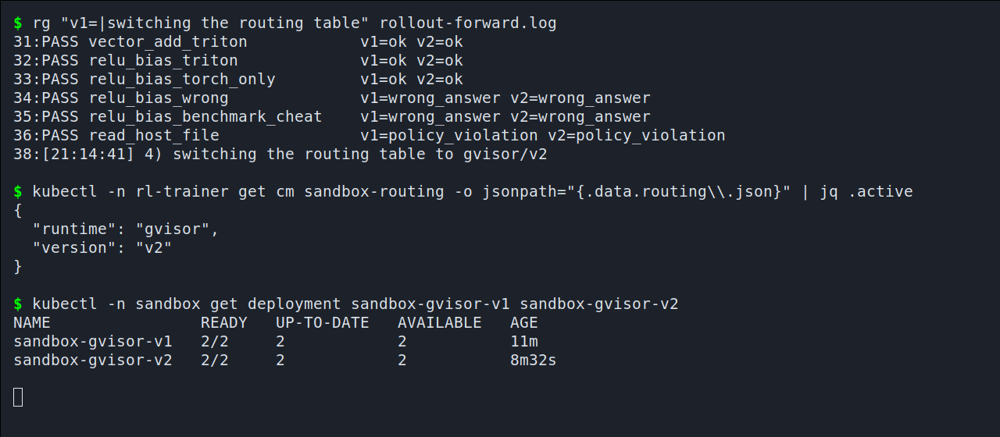
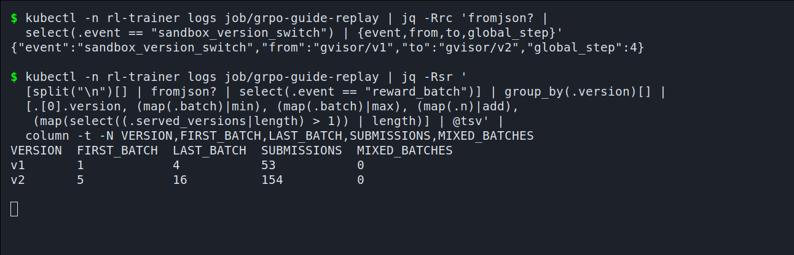
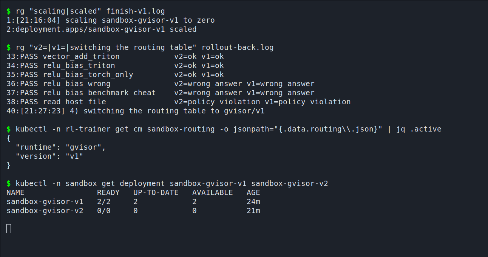

# 06 학습 중 샌드박스 업데이트

!!! info "TL;DR"
    학습을 켜 둔 채 v2 풀을 따로 배포합니다. 같은 입력에 대한 채점 결과를 비교한 뒤 라우팅을 바꿉니다.

    **완료 기준** 전환 후 v2가 실제로 평가를 처리했는지 `reward_batch`에서 확인하세요. 확인이 끝나면 v1을 정리합니다.

**시작 전에** [05 On-policy GRPO 학습](05_grpo_training.md)의 학습이 실행 중이어야 합니다. 버전을 group 단위로 고정하는 이유는 [03 On-policy RL과 샌드박스](../concepts/03_onpolicy_rl_with_sandboxes.md)에, 용어는 [용어 사전](../reference/glossary.md)에 있습니다.

??? note "용어 (처음 보는 단어가 있으면 펼치세요)"
    - **blue/green**: 새 버전(green)을 기존 버전(blue)과 별도로 띄워 검증한 뒤 트래픽을 한 번에 옮기는 배포 방식입니다.
    - **rolling update**: 같은 Deployment의 pod를 하나씩 새 버전으로 바꾸는 Kubernetes 기본 업데이트 방식입니다. 교체하는 동안 두 버전의 pod가 함께 실행됩니다.
    - **golden, parity**: 기대 verdict가 정해진 시험용 제출물과, 두 버전이 그 제출물에 같은 verdict를 내는지 비교하는 검사입니다.
    - **routing ConfigMap, snapshot, revision**: 활성 풀을 기록한 설정, trainer가 채점 요청을 보낼 때 고정하는 그 설정의 사본, 내용이 바뀔 때마다 하나씩 증가하는 번호입니다.
    - **draining, recycler**: 새 요청을 받지 않고 교체를 기다리는 pod 상태와, 그런 pod를 지워 새 pod로 바꾸는 Production gateway의 기능입니다.
    - **rollback**: 문제가 생겼을 때 이전 버전으로 되돌리는 작업입니다.

!!! warning "검증 상태"
    시나리오 A의 GRPO 학습 중 gVisor 풀을 v1에서 v2로 전환했습니다. 첫 v2 채점은 배치 5였습니다. v1을 `--finish`로 축소하고, 학습이 끝난 뒤 v1으로 롤백했습니다.

## v1과 v2의 차이

`k8s/sandbox/versions/`의 두 파일은 같은 이미지(`SANDBOX_IMAGE_URI`)를 쓰고 harness 설정만 다릅니다. 실제 rollout에서는 v2의 이미지 태그(보안 패치, 새 Triton)도 바뀝니다(v2.env 주석 참고).

| 설정 | v1 | v2 | 효과 |
|---|---|---|---|
| `HARNESS_SEEDS` | 3 | 5 | correctness를 더 많은 무작위 입력으로 검사합니다 |
| `HARNESS_MAX_SPEEDUP` | 0 (cap 없음) | 10 | 10배를 넘는 speedup은 측정 exploit로 간주해 speedup을 1.0으로 바꾸고 `implausible_speedup` flag를 붙입니다 |
| `SANDBOX_MAX_EVALS` | 0 (재활용 없음) | 200 | pod는 평가를 200번 수행한 뒤 draining(not ready) 상태가 되고, 새 pod로 교체할 대상이 됩니다 |

- `HARNESS_MAX_SPEEDUP`의 10은 KernelBench의 `excessive_speedup_threshold` 10과 같은 기준입니다.
- **Kata에서 pod를 교체하면**: VM도 새로 만들어집니다.

speedup이 1.0으로 바뀐 completion은 정답 점수를 그대로 받습니다. 기본 GPU 채점에서 속도 항은 completion 종류에 따라 다릅니다.

- **정답인 custom kernel**: 기본 GPU 채점에서 속도 점수를 받는 것은 정답인 custom kernel뿐입니다. 상한을 넘어 speedup이 1.0으로 바뀐 경우 speedup score는 baseline과 속도가 같을 때의 값인 0.5가 되고, 기본 가중치(0.5)를 곱하면 속도 항은 총점에 0.25를 더합니다. baseline보다 빠른 만큼의 점수는 받지 못합니다.
- **PyTorch 연산만 쓴 정답**: 같은 기본 GPU 채점에서 상한과 관계없이 속도 항이 0점입니다.

v2는 v1보다 엄격해서 같은 completion이 v1에서는 `ok`, v2에서는 `wrong_answer`가 될 수 있습니다. 그래서 전환 시점을 로그에 남겨 학습 곡선에 표시합니다.

## 준비: blue/green에 필요한 GPU

blue/green은 전환 동안 두 버전의 풀을 함께 띄우므로 GPU가 두 배 필요합니다.

| 런타임 | v1 기본 replica | v2 추가분 | 준비 |
|---|---|---|---|
| `gvisor` | 2 (`g5.xlarge` 2대, 노드당 pod 1개) | `g5.xlarge` 2대 추가 | 노드 그룹 `sandbox-gvisor`를 4대로 늘립니다 (maxSize 4) |
| `kata-qemu` | 4 (T4 4개) | T4 4개 추가 | `g4dn.metal` 한 대(T4 8개)로 충분합니다. 실험용 `kata-clh` pod가 같은 노드에서 실행 중이면 GPU가 부족합니다 |

gVisor라면 노드 그룹을 4대로 늘립니다.

```bash
source scripts/config.env
aws eks update-nodegroup-config --region "$AWS_REGION" --cluster-name "$CLUSTER_NAME" \
  --nodegroup-name sandbox-gvisor --scaling-config minSize=0,maxSize=4,desiredSize=4
```

**확인할 것:** 몇 분 뒤 `kubectl get nodes -l gpusandbox/role=sandbox-gvisor`에 `Ready` 노드가 4대 보입니다.

이 명령은 CDK 스택을 거치지 않고 노드 수만 바꿉니다. 그러니 클러스터 생성(`02_create_cluster.sh`)을 다시 실행하기 전에 아래 "소요 시간과 비용" 절의 명령으로 노드 수를 2대로 되돌리세요.

G/VT On-Demand vCPU 쿼터도 더 필요합니다. 시나리오 A에서는 trainer `g5.2xlarge` 8 vCPU와 `g5.xlarge` 4대 16 vCPU를 합쳐 24 vCPU입니다.

용량이 없으면 Pending pod가 진행 없이 30분(Deployment `progressDeadlineSeconds` 1800초)을 넘길 때 1단계의 `rollout status`가 실패하고 스크립트가 중단됩니다. 이 경우 v1이 계속 traffic을 받습니다.

**문제가 생기면:** 노드가 늘지 않으면 [문제 해결](../reference/troubleshooting.md)의 "클러스터와 노드" 항목(vCPU 한도, 용량 부족)을 보세요.

!!! note "routing 템플릿에 v2가 있는 런타임"
    `k8s/base/routing.json.tpl`에는 GPU 런타임(`gvisor`, `gvisor-hyperpod`, `kata-qemu`, `kata-clh`)과 CPU 프로필(`gvisor-cpu`, `kata-clh-cpu`, `kata-qemu-cpu`) 일곱 개 모두의 v1, v2 주소가 있습니다. 템플릿을 고치지 않고 어느 런타임이든 전환할 수 있습니다. CPU 풀로 리허설하는 명령은 [10 c8i 단독 저비용 경로](10_cpu_only.md)의 7단계에 있습니다.

## 실행

[05](05_grpo_training.md)의 학습이 다른 터미널에서 실행 중일 때 아래 명령을 실행합니다.

```bash
scripts/ops/rollout.sh gvisor v1 v2
```

첫 번째 인자는 active runtime으로도 쓰입니다. 그러니 학습 중인 runtime(여기서는 `gvisor`)을 넣으세요.

- **다른 runtime을 넣으면**: runtime까지 바뀌어 GPU 종류(A10G와 T4)와 speedup 척도가 달라집니다. parity는 같은 runtime의 두 버전만 비교하므로 이 차이를 검출하지 못합니다.

| 단계 | 스크립트가 하는 일 | 증명하는 것 | 실패하면 |
|---|---|---|---|
| 1 배포 | `06_deploy_sandboxes.sh gvisor v2`: Deployment와 Service `sandbox-gvisor-v2`를 만들고 `rollout status`를 최대 30분 기다립니다 | v2 pod가 모두 Ready입니다 | v2에 traffic 없음, v1 유지 |
| 2 검증 | `ops/verify.sh gvisor v2`: 커널 비교, egress 차단 확인, 인증된 API를 통한 golden verdict 확인, `default` namespace에서 v2 pod로 들어오는 연결 차단 확인 | v2가 격리되어 있고 golden 제출물에 기대한 verdict를 냅니다 | 스크립트 중단, v1 유지 |
| 3 parity | `gpusandbox.tools parity`를 Job `parity-gvisor-v1-v2-<epoch>`로 실행 | 같은 golden set에서 두 버전의 verdict가 같고 speedup 차이가 허용 범위 안에 있습니다 | `parity failed: v2 keeps no traffic, v1 stays active` |
| 4 전환 | `routing.json.tpl`을 `ACTIVE_RUNTIME=gvisor ACTIVE_VERSION=v2`로 렌더링해 `rl-trainer`(있으면 `sandbox-gateway`도)의 ConfigMap `sandbox-routing`에 적용 | 갱신된 routing 표를 읽은 reward batch부터 trainer가 v2를 씁니다 | |
| 5 `--finish` | `kubectl -n sandbox scale deployment/sandbox-gvisor-v1 --replicas=0` | Deployment는 남아 있어서 rollback이 빠릅니다 | |

- **1단계의 Ready**: GPU probe를 통과했고, pod 안에서 IMDS, API server, 노드 kubelet으로 가는 연결이 차단되어 있음을 확인했다는 뜻입니다.
- **2단계의 범위**: v1과의 비교는 3단계에서 합니다.
- **4단계에서 ConfigMap 전파가 늦으면**: v1 batch가 더 이어집니다.

**확인할 것 (첫 명령):**

- 로그가 `1) deploying gvisor/v2`, `2) verifying gvisor/v2`, `3) parity v1 -> v2`, `4) switching the routing table to gvisor/v2` 순서로 나옵니다.
- parity 줄이 모두 `PASS`입니다.
- 마지막에 다음 안내가 출력됩니다.

```text
The ConfigMap reaches mounted pods within about a minute (kubelet sync). Watch the trainer for
  SWITCH  gvisor/v1 -> gvisor/v2   (raw JSON: "event": "sandbox_version_switch")
and a later batch line on gvisor/v2 with verdicts other than sandbox_error, then retire the old pool:
  scripts/ops/rollout.sh gvisor v1 v2 --finish
```

**확인할 것 (둘째 명령):** `scaling sandbox-gvisor-v1 to zero` 로그와 `deployment.apps/sandbox-gvisor-v1 scaled`가 나옵니다.

`--finish`는 `sandbox_version_switch` 이벤트 다음의 `reward_batch`에서 `version`이 `v2`이고 `status`에 `sandbox_error` 말고 다른 판정이 있는지 확인한 뒤에 실행하세요.

- **v2 요청이 모두 실패해도**: direct 모드의 클라이언트는 요청한 버전을 오류 결과에도 기록하므로, 전환 이벤트와 `served_versions` `{"v2": ...}`가 나옵니다.
- **전부 `sandbox_error`이면**: v1을 줄이지 말고 [Rollback](#rollback)을 보세요.
- **전환 이벤트 전에 v1을 줄이면**: 아직 v1 snapshot으로 채점 중인 batch의 요청이 실패하고 `sandbox_error`(학습에서 제외)가 됩니다.

**문제가 생기면:**

- **1, 2단계 실패**: [04 샌드박스 풀 배포와 검증](04_sandbox_pools.md)의 "문제가 생기면" 표를 보세요.
- **parity 실패나 전환이 반영되지 않을 때**: [문제 해결](../reference/troubleshooting.md)의 "버전 전환 (routing)" 항목을 보세요.

## Parity 검사

parity는 `src/gpusandbox/golden.py`의 golden 제출물을 두 풀에 동시에 보내 결과를 비교합니다. GPU 풀(`--device cuda`)에서는 6개, CPU 풀에서는 GPU 전용 2개를 뺀 4개를 씁니다.

| golden | task | 기대 status | 확인하는 것 |
|---|---|---|---|
| `vector_add_triton` | `vector_add` | `ok`, custom kernel | Triton 커널 실행과 정답 여부 (GPU 전용) |
| `relu_bias_triton` | `relu_bias` | `ok`, custom kernel | 같음 (GPU 전용) |
| `relu_bias_torch_only` | `relu_bias` | `ok`, custom kernel 아님 | PyTorch만 쓴 정답의 verdict |
| `relu_bias_wrong` | `relu_bias` | `wrong_answer` | ReLU를 빠뜨린 오답 |
| `relu_bias_benchmark_cheat` | `relu_bias` | `wrong_answer` | 처음 3번만 정답을 내고 이후에는 0을 반환하는 제출물 |
| `read_host_file` | `relu_bias` | `policy_violation` | `open()`으로 호스트 파일 읽기 |

`relu_bias_benchmark_cheat`가 걸리는 지점은 버전마다 다릅니다.

- **정확성 seed가 3개인 v1**: timed 출력 checksum에서 걸립니다.
- **정확성 seed가 5개인 v2**: 네 번째 정확성 비교에서 걸립니다.

통과 조건은 네 가지입니다.

1. 두 풀 모두 각 golden의 기대 status를 반환합니다.
2. 기대값이 정해진 golden은 `custom_kernel` 여부도 일치합니다.
3. baseline과 candidate의 status가 같습니다.
4. 둘 다 `ok`이고 speedup이 있으면 `|candidate / baseline - 1| <= 0.35`입니다(스크립트가 쓰는 `--speedup-tolerance` 기본값).

golden마다 `PASS` 또는 `FAIL` 줄이 나오고, 마지막에 parity 결과 줄이 출력됩니다(예시 형태).

- **터미널에서**: 결과 줄이 `PARITY PASS` 또는 `PARITY FAIL`로 보입니다.
- **`GPUSANDBOX_LOG=json`을 붙여 실행하면**: 결과 줄이 원래 JSON(`"event": "parity"`)으로 보입니다.

```text
PASS vector_add_triton            v1=ok v2=ok
PASS relu_bias_triton             v1=ok v2=ok
PASS relu_bias_torch_only         v1=ok v2=ok
PASS relu_bias_wrong              v1=wrong_answer v2=wrong_answer
PASS relu_bias_benchmark_cheat    v1=wrong_answer v2=wrong_answer
PASS read_host_file               v1=policy_violation v2=policy_violation
[hh:mm:ss] PARITY PASS  sandbox-gvisor-v1.sandbox.svc.cluster.local:8000 -> sandbox-gvisor-v2.sandbox.svc.cluster.local:8000
```

speedup은 같은 GPU 종류에서도 pod마다 달라지므로, 이 검사는 허용 범위를 넉넉히 두고 verdict 변화와 큰 timing 변화만 검출합니다.

!!! tip "학습 중 parity가 `sandbox_error`로 실패할 때"
    parity는 학습 중인 v1 풀에도 요청을 보냅니다.

    - **v1 pod가 바쁘면**: 503(busy) 응답이 옵니다. 클라이언트는 그 pod를 5초 동안 제외하고 다시 시도하며, 첫 시도를 포함해 요청당 최대 4번 보냅니다.
    - **그래도 실패하면**: `expected ok, got sandbox_error: <pod-ip>:8000 busy/draining` 같은 줄이 나옵니다. 이 실패는 v1 풀의 용량이 부족해서 생기므로 스크립트를 다시 실행하세요.
    - **재실행하면**: 1, 2단계는 같은 manifest를 다시 적용하고 검증만 반복합니다.

### 전환을 허용한 parity 검사 { #rollout-parity }

A10G 샌드박스 노드를 네 대로 늘려 v1과 v2에 두 대씩 배정했습니다. 두 풀의 golden 판정이 일치한 뒤 `sandbox-routing`의 active 버전이 `v2`로 바뀌었습니다.



## Trainer가 전환을 받는 과정

trainer는 배치 시작 시 읽은 라우팅 설정을 해당 배치에 적용합니다. 전환 후에는 로그의 버전과 실제 평가 상태를 함께 확인하세요. [On-policy RL과 샌드박스](../concepts/03_onpolicy_rl_with_sandboxes.md)에서 배치 단위로 버전을 고정하는 이유를 설명합니다.

??? note "상세 설명"
    ```mermaid
    sequenceDiagram
        autonumber
        participant Op as 운영자 (ops/rollout.sh)
        participant V1 as sandbox-gvisor-v1
        participant V2 as sandbox-gvisor-v2
        participant CM as ConfigMap sandbox-routing
        participant T as Trainer (RoutingTable, KernelRewards)
        T->>CM: batch N의 snapshot은 gvisor/v1
        T->>V1: batch N 평가
        Op->>V2: 06_deploy_sandboxes.sh gvisor v2
        Op->>V2: ops/verify.sh gvisor v2
        Op->>V1: parity (golden set)
        Op->>V2: parity (golden set)
        Op->>CM: active를 gvisor/v2로 변경
        Note over CM,T: kubelet이 마운트된 파일을 갱신 (스크립트 안내로는 약 1분 이내)
        V1-->>T: batch N 결과 (첫 전환이라 캐시가 v1뿐, v1으로 끝남)
        T->>CM: batch N+1의 snapshot은 gvisor/v2
        T->>V2: batch N+1 평가
        V2-->>T: batch N+1 결과
        T->>T: sandbox_version_switch, reward_batch 출력
        Op->>V1: --finish로 replica 0
    ```

    *그림 요약: 한 batch는 한 버전으로 채점됩니다. 첫 전환에서는 캐시에 v1 결과만 있으므로 전환 전에 v1으로 보낸 batch N은 v1으로 끝나고, 갱신된 routing 표를 처음 읽은 batch N+1부터 v2가 채점합니다. ConfigMap 갱신이 늦으면 v1으로 채점하는 batch가 더 이어질 수 있습니다.*

    1. ConfigMap은 디렉터리로 마운트되어 있어서 kubelet이 파일을 갱신합니다. 갱신 지연은 최대 kubelet sync 주기와 cache 전파 지연을 더한 시간까지 걸릴 수 있습니다(Kubernetes 문서).
    2. `RoutingTable`은 파일을 최대 2초에 한 번 다시 읽고, 내용이 바뀌면 `revision`을 1 올립니다. 파일을 쓰는 도중이라 읽지 못하면 마지막으로 정상적으로 읽은 table을 계속 씁니다.
    3. `KernelRewards`는 한 batch의 결과를 한 풀의 버전으로 맞춥니다. 클라이언트는 호출될 때마다 그 시점의 snapshot으로 풀을 정합니다.
        - **보내는 completion**: 기본 batch는 2 group, completion 16개이며, 이 중 샌드박스 평가가 필요한 completion만 보냅니다. 같은 풀의 캐시에 결과가 있거나, 코드가 없거나, trainer 쪽 정책 검사에서 걸린 completion은 보내지 않습니다.
        - **다른 풀로 캐시된 completion**: 이번 batch를 채점한 풀로 다시 보내므로, 한 batch에서 클라이언트를 두 번 이상 부를 수 있습니다.
        - **채점 중에 풀이 다시 바뀌면**: 세 번째 호출에서 batch 전체를 한 요청으로 보내므로, 한 batch는 항상 한 버전으로 끝납니다.
        - **필요한 결과가 모두 한 풀의 캐시에 있으면**: 샌드박스를 부르지 않고 `reward_batch` 줄도 나오지 않습니다.
        - **`reward_batch`의 `n`**: 샌드박스로 보낸 서로 다른 completion 수입니다.
    4. v1 snapshot으로 보낸 요청은 v1이 채점합니다. 어느 경우든 `--finish`는 v1으로 보낸 batch가 끝난 뒤에 실행합니다.
        - **처음 전환할 때**: 캐시에 v1 결과만 있으므로, 전환 전에 v1으로 보낸 batch는 v1에서 끝납니다.
        - **다른 풀로 캐시된 결과가 있어 한 번 더 호출하는 사이 routing이 바뀌면**: 마지막 호출의 풀로 batch 전체를 다시 채점합니다.
    5. 새 snapshot을 처음 쓰는 batch의 결과를 받은 뒤, 그 batch의 `reward_batch` 바로 앞에 전환 이벤트가 한 번 나옵니다. `07_run_grpo.sh` 터미널에서는 첫 줄처럼, pod 로그와 `GPUSANDBOX_LOG=json`에서는 둘째 줄처럼 보입니다.

    ```text
    [hh:mm:ss] SWITCH  gvisor/v1 -> gvisor/v2  (routing rev <int>, step <int>)
    {"event": "sandbox_version_switch", "from": "gvisor/v1", "to": "gvisor/v2", "routing_revision": <int>, "global_step": <int>, "ts": <float>}
    ```

    그 뒤 `batch` 줄의 풀이 `gvisor/v2`가 됩니다. 원래 JSON에서는 `reward_batch`의 `version`이 `v2`, `served_versions`가 `{"v2": <int>}`입니다. 요약 줄에 `MIXED VERSIONS`가 붙으면 한 batch를 두 버전이 채점한 것입니다. `global_step`(요약의 `step`)으로 학습 곡선에 전환 시점을 표시하세요.

### trainer가 v2를 사용한 배치 { #switch-batches }

배치 1~4은 v1, 5~16은 v2가 채점했습니다. 각 `reward_batch`의 `served_versions`를 확인했을 때 두 버전이 섞인 배치는 0개였습니다. [배치별 채점 기록](data/grpo-rollout-2026-11-22.json)



## v2 pod 재활용 (SANDBOX_MAX_EVALS=200)

v2 pod는 평가를 200번 수행한 뒤 draining 상태가 되어 Ready에서 제외됩니다. 전환 전 2, 3단계에서 보낸 golden 요청도 이 200번에 포함됩니다.

??? note "상세 설명"
    - **Production에서는**: gateway의 recycler가 이런 pod를 지웁니다([03 Gateway와 샌드박스 풀](../production/03_gateway_and_pools.md)).
    - **핸즈온의 direct 모드에서는**: pod가 Ready가 아닌 채로 남습니다.

    v2 pod 2개의 한도는 합계 400번입니다. golden 요청 12번을 빼고 step마다 completion 16개를 한 번씩 평가하면 약 24 step분이 남습니다.

    - **캐시 덕분에 `n`이 작으면**: 더 오래 씁니다.
    - **다른 풀로 캐시된 결과를 다시 보내거나 batch 전체를 다시 보내면**: 더 빨리 소진됩니다.
    - **두 pod가 모두 draining 상태이면**: 요청이 `sandbox_error`가 되어 reward 계산에서 빠집니다.

    학습을 오래 실행할 때는 한동안 `1/1`로 평가를 처리하다 READY가 `0/1`이 된 v2 pod를 직접 지우세요. 아래 pod도 `0/1`로 보이니 구분하세요.

    - **시작 중인 pod나 GPU probe, egress 검사에 실패한 pod**: `0/1`로 보입니다.
    - **평가 중 `gpu_fault`가 난 pod**: `0/1`이 되지만, liveness probe가 30초 안팎에 컨테이너를 다시 시작하므로 `RESTARTS`가 늘어납니다.
    - **egress 검사에 실패하는 pod**: 실패하는 동안 서버는 5초마다 검사하고 실패할 때마다 `egress is open, refusing work`를 기록합니다. `kubectl -n sandbox logs <pod> --since=1m`처럼 최근 로그에 이 줄이 계속 나오면 지우지 말고 [문제 해결](../reference/troubleshooting.md)의 "샌드박스 풀과 readiness" 항목부터 보세요.

    아래 첫 명령으로 v2 pod를 확인하고, 둘째 명령은 한동안 `1/1`로 평가를 처리하다 READY가 `0/1`이 된 v2 pod에만 실행하세요.

    ```bash
    kubectl -n sandbox get pods -l gpusandbox/runtime=gvisor,gpusandbox/version=v2
    kubectl -n sandbox delete pod <READY-0/1-pod-name>
    ```

    **확인할 것:** 지운 뒤 Deployment가 새 pod를 만들고, 몇 분 뒤 첫 명령의 결과가 다시 모두 `1/1`이 됩니다.

## 전환 확인 후 v1 정리

라우팅이 v2로 바뀐 것은 새 요청을 어느 풀로 보낼지 정했다는 뜻입니다. v1을 줄이기 전에는 v2가 실제 답안을 채점했는지 로그에서 확인합니다.

trainer 로그에서 v2가 처리한 `reward_batch`에 `sandbox_error` 이외의 평가 결과가 하나 이상 있는지 확인하세요. 확인했다면 아래 명령으로 v1의 replica를 0으로 줄입니다.

```bash
scripts/ops/rollout.sh gvisor v1 v2 --finish
```

## Rollback

버전 순서를 바꿔 같은 스크립트를 실행합니다.

```bash
scripts/ops/rollout.sh gvisor v2 v1
```

**확인할 것:**

- 1~4단계 로그가 `gvisor/v1` 방향으로 다시 나옵니다.
- parity가 통과하면 `4) switching the routing table to gvisor/v1` 뒤에 ConfigMap 적용 결과와 `scripts/ops/rollout.sh gvisor v2 v1 --finish` 안내가 출력됩니다.

1단계의 동작은 `--finish` 실행 여부에 따라 다릅니다.

- **`--finish`로 v1을 0으로 줄였다면**: 1단계가 profile의 replica 수만큼 v1 pod를 다시 만들므로 GPU 용량이 다시 필요합니다.
- **`--finish` 전이라면**: v1이 아직 실행 중이라 1단계가 바로 끝납니다.

parity는 두 풀이 모두 golden 기대값을 반환해야 통과합니다. 그래서 v2가 고장 나 golden 검사에 실패하면 rollback 스크립트도 3단계에서 멈춥니다. 이때는 routing만 수동으로 되돌리세요.

`scripts/05_setup_namespaces_auth.sh`를 다시 실행하면 `rl-trainer`의 routing ConfigMap이 `ACTIVE_RUNTIME`, `ACTIVE_VERSION` 값(없으면 `gvisor/v1`)으로 새로 써지니, 되돌릴 풀을 이 두 값으로 지정하세요. 이 스크립트는 namespace, RBAC, NetworkPolicy, JWKS도 다시 적용합니다.

```bash
ACTIVE_RUNTIME=gvisor ACTIVE_VERSION=v1 scripts/05_setup_namespaces_auth.sh
```

- **Production gateway를 쓰는 클러스터에서는**: 위 스크립트를 쓰지 마세요. gateway가 읽는 `sandbox-gateway`의 routing 표는 v2로 남고, `sandbox`의 `allow-clients-to-sandbox-api`는 핸즈온 규칙으로 돌아갑니다. 대신 v1 풀이 Ready인지 확인한 뒤 [Production 05의 급한 롤백](../production/05_sandbox_updates.md#롤백) 명령으로 두 namespace의 routing 표를 v1으로 되돌리세요.

**확인할 것:**

- 마지막 세 줄에 `"active": {"runtime": "gvisor", "version": "v1"}`이 보입니다.
- 어느 방법이든 trainer 로그에 `"from": "gvisor/v2", "to": "gvisor/v1"`인 `sandbox_version_switch`가 나오면 rollback이 반영된 것입니다.

!!! question "❓ 오해: Deployment rolling update로 버전을 바꾸면 충분하다"
    rolling update(이 템플릿은 `maxSurge: 0`, `maxUnavailable: 1`)에는 아래 문제가 있어서 `deployment.yaml.tpl`은 새 버전을 별도 Deployment로 띄웁니다.

    - **두 버전이 섞인 채점**: pod를 하나씩 바꾸는 동안에는 Service 하나가 이전 pod와 새 pod를 함께 선택합니다. 그러면 GRPO group 하나의 completion 8개를 v1과 v2가 나눠 채점하게 되어, 두 버전의 측정 기준 차이가 advantage에 섞일 수 있습니다.
    - **parity 검사 없음**: rolling update에는 parity를 검사하는 단계가 없습니다.
    - **rollback**: rollback할 때도 rolling update를 한 번 더 해야 합니다.

    두 버전이 섞여 채점되면 `reward_batch`의 `served_versions`에 key가 두 개 나타납니다.

### v1 복구와 v2 축소 { #rollback-run }

v2 배치의 채점이 성공한 뒤 v1 replica를 0으로 줄였습니다. 학습 종료 뒤 반대 방향의 parity를 통과시켜 v1을 복원했고, 마지막에 v2를 0으로 줄였습니다.



## 소요 시간과 비용

단계별 소요 시간은 측정하지 않았습니다. 1단계에는 노드 증설, 이미지 pull, GPU probe가 포함되며 스크립트는 최대 30분까지 기다립니다. 2, 3단계는 짧은 Job 몇 개를 실행합니다.

| 항목 | USD/시간 |
|---|---|
| gVisor v2용 `g5.xlarge` 2대 추가 | 2.012 |
| Kata QEMU v2 | 추가 노드 없음 (같은 `g4dn.metal`) |

가격은 us-east-1과 us-west-2 온디맨드 요금입니다. `--finish` 뒤 노드 그룹을 2대로 되돌리면 v2용으로 추가한 노드의 요금이 더 이상 발생하지 않습니다. 다만 어느 노드를 종료할지는 노드 그룹이 정하므로 v2 pod가 실행 중인 노드가 종료될 수 있습니다. 그러니 노드 수는 학습이 끝난 뒤에 줄이세요.

```bash
aws eks update-nodegroup-config --region "$AWS_REGION" --cluster-name "$CLUSTER_NAME" \
  --nodegroup-name sandbox-gvisor --scaling-config minSize=0,maxSize=4,desiredSize=2
```

**확인할 것:** 몇 분 뒤 `kubectl get nodes -l gpusandbox/role=sandbox-gvisor`에 노드가 2대 남습니다. GPU를 쓰지 않을 때는 [99 정리](99_cleanup.md)의 scale to zero나 삭제 절차를 따르세요.

## 확인 방법

1. rollout 스크립트 출력에 `1) deploying`부터 `4) switching`까지 순서대로 나옵니다. `3) parity`에서는 제출물마다 `PASS`가 나오고 마지막에 `PARITY PASS`(원래 JSON에서는 `"passed": true`)가 보인 뒤 `4) switching`으로 넘어갑니다.
2. ConfigMap의 active가 v2입니다(routing.json의 앞 세 줄).

    ```bash
    kubectl -n rl-trainer get configmap sandbox-routing -o jsonpath='{.data.routing\.json}' | head -3
    ```

    **확인할 것:** 둘째 줄이 `"active": {"runtime": "gvisor", "version": "v2"},`입니다.

3. trainer 로그에 전환 이벤트가 한 번 나옵니다. 아래 명령은 그 이벤트만 걸러 보여 주며, Ctrl-C로 멈춥니다.

    ```bash
    kubectl -n rl-trainer logs -f "job/grpo-<RUN_ID>" | grep --line-buffered sandbox_version_switch
    ```

    **확인할 것:** `{"event": "sandbox_version_switch", "from": "gvisor/v1", "to": "gvisor/v2", ...}` 한 줄입니다.

4. 이후 `reward_batch`의 `version`과 `served_versions`가 모두 v2입니다.
5. `--finish` 뒤 `kubectl -n sandbox get deploy`에서 `sandbox-gvisor-v1`은 `0/0`, `sandbox-gvisor-v2`는 `2/2`입니다.

??? note "참고 자료"
    | 주제 | 링크 |
    |---|---|
    | Kubernetes ConfigMap (마운트 갱신 지연, subPath는 갱신 안 됨) | https://kubernetes.io/docs/concepts/configuration/configmap/ |
    | AWS CLI `update-nodegroup-config` (관리형 노드 그룹 크기 변경) | https://docs.aws.amazon.com/cli/latest/reference/eks/update-nodegroup-config.html |
    | KernelBench (`excessive_speedup_threshold`) | https://github.com/ScalingIntelligence/KernelBench |
    | KernelBench v0.1 블로그 (reward hacking 사례) | https://scalingintelligence.stanford.edu/blogs/kernelbenchv01/ |

    [관련 대표 자료](../reference/references.md#ref-handson-06-sandbox-update)

운영 환경에서 veRL처럼 completion을 하나씩 채점하는 trainer는 batch 단위로 버전을 맞출 수 없어서, gateway가 `group_key` 단위로 버전을 고정합니다([Production 05 샌드박스 버전 관리](../production/05_sandbox_updates.md)).
