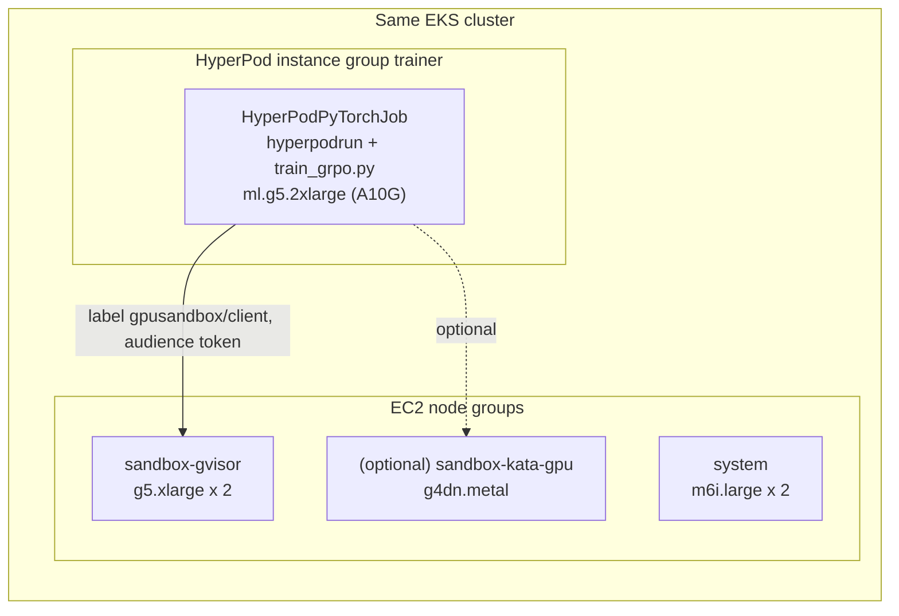
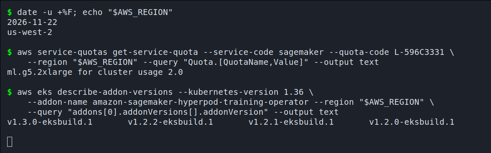
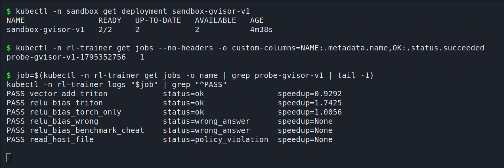
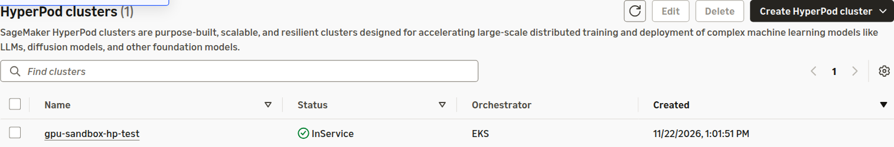
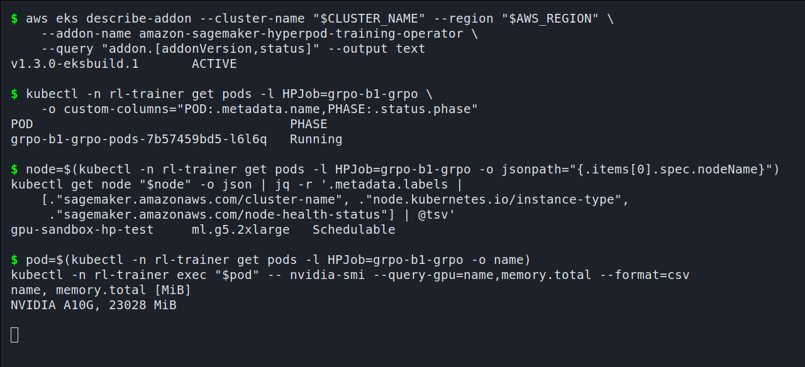
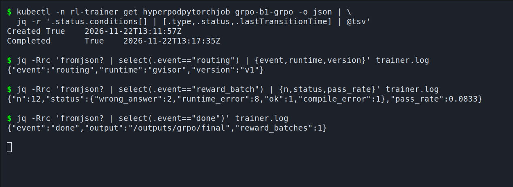
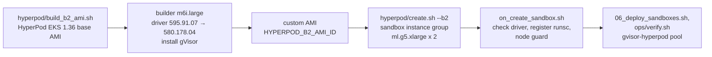
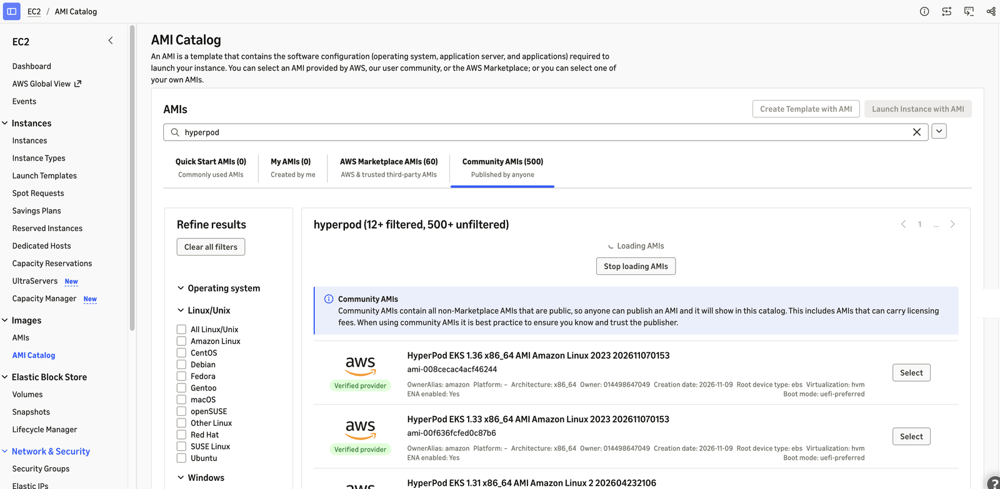

# 07 HyperPod scenario

In B1 the model trains on a SageMaker HyperPod node and its generated code is graded by a gVisor pool on EC2. Check **both the training node's identity and the grading results** to trace work across the two.

1. [Check the Region and quotas](#before-you-begin), then follow the [B1 steps](#b1-steps). This path provisions its own EKS cluster and EC2 grading nodes.
2. Once the HyperPod trainer is `Schedulable` and the EC2 pool passes verification, [submit one step](#6-training).
3. In the [run and its logs](#how-to-verify), find the trainer pod's node, the verdicts in `reward_batch`, and the job's `Completed` status. [Delete HyperPod first](#cleanup) during cleanup.

The [B2 lab](07_hyperpod_b2.md) puts the CPU system worker, GPU trainer and GPU graders in HyperPod instance groups.

??? note "Terms (expand if a word is new to you)"
    - **SageMaker HyperPod**: an AWS managed cluster for long-running training. With EKS as the orchestrator, it attaches groups of nodes to an existing EKS cluster.
    - **Instance group**: a set of HyperPod nodes that share an instance type and settings. It is similar to an EKS node group.
    - **HyperPodPyTorchJob, training operator**: the Kubernetes custom resource that describes a training job for HyperPod, and the controller (an EKS add-on) that runs and restarts that job.
    - **Elastic agent (`hyperpodrun`)**: the launcher that starts the training processes inside the container and reports their state to the operator. It extends the PyTorch ElasticAgent.
    - **Lifecycle script**: a shell script that runs when a HyperPod node is created. It is read from an S3 bucket.
    - **Dependency Helm chart**: the Helm chart that installs the components HyperPod needs, such as the health monitoring agent and device plugins, into the cluster.
    - **Execution role**: the IAM role HyperPod nodes use to call AWS APIs.
    - **NodeRecovery, deep health check**: the setting that automatically reboots or replaces a faulty node, and a long check that puts load on the GPUs and the network.
    - **nvproxy**: the gVisor feature that filters GPU driver calls (ioctl) and passes them on. Each driver version has its own allowlist.
    - **Device plugin**: a DaemonSet that advertises a node's GPUs to Kubernetes as a resource such as `nvidia.com/gpu`.
    - **emptyDir**: a temporary volume that exists only while its pod lives. Its content disappears when the pod is deleted.
    - **Taint**: a mark on a node. Pods without a matching toleration are not scheduled onto that node.
    - **IMDS**: the address (169.254.169.254) where an EC2 instance reads its own metadata and temporary credentials.
    - **ENI**: a virtual network interface attached to an instance. The VPC CNI hands out the ENI's IP addresses to pods, so the number of ENIs sets the per-node pod limit.

!!! warning "Validation status"
    B1 completed one GRPO step on an `ml.g5.2xlarge` in `us-west-2`. Two EC2 gVisor sandboxes evaluated 12 generated submissions. The [run record and screenshots](#how-to-verify) show node placement and the completed job. [Managed B2](07_hyperpod_b2.md) uses graders on HyperPod.

## Layout

[](../images/architecture/scenario-b1.drawio.png)

*Takeaway: In AWS resources, only the trainer sits on a HyperPod instance group and the rest is the same as scenario A.*

<details class="note" markdown="1">
<summary>B1 network path and authentication</summary>



*Takeaway: the sandboxes stay on EC2 nodes in the same cluster, so the NetworkPolicy and token authentication of scenario A apply unchanged.*

</details>

| Configuration | Training | Sandboxes | Status |
|---|---|---|---|
| B1 (default) | HyperPod instance group | EC2 node groups in the same EKS cluster (gVisor `g5.xlarge`, optionally Kata) | The default path of this page |
| B2 | HyperPod `trainer` | gVisor on the HyperPod `sandbox` group | A HyperPod `system` group runs the CPU pods. [B2 lab and screenshots](07_hyperpod_b2.md) |

## Before you begin

Fill in the HyperPod values in `scripts/config.env` first. A value left empty or with `__SET_ME__` makes the scripts print `set <name> in scripts/config.env` and stop.

| Variable | Value in the example file | What to do |
|---|---|---|
| `HYPERPOD_CLUSTER_NAME` | `gpu-sandbox-hp` | Can stay as is. It is also used in the execution role name (`<this value>-execution`) |
| `HYPERPOD_TRAINER_INSTANCE_TYPE` | `ml.g5.2xlarge` | Leave it. The job template's nodeAffinity uses this value too |
| `HYPERPOD_LCS_BUCKET` | `sagemaker-gpu-sandbox-lcs-__SET_ME__` | Replace `__SET_ME__` with a unique value. S3 bucket names must be unique worldwide. Keep the `sagemaker-` prefix |

Check the required CLIs, your AWS identity and the G/VT vCPU quota in one pass (the HyperPod scripts also use `git`).

```bash
scripts/01_check_prereqs.sh
```

**What to look for:** the last line is `Done. Request quota increases before 02_create_cluster.sh if any value above is too low.`.

HyperPod instances use the `ml.<type> for cluster usage` quotas, not the EC2 ones.

- **B1**: needs 8 vCPU of EC2 G/VT quota (two `g5.xlarge`) and one HyperPod `ml.g5.2xlarge`.
- **B2** uses HyperPod quotas in `us-east-1` for one `ml.m5.xlarge` system worker, one `ml.g5.2xlarge` trainer and two `ml.g5.xlarge` sandbox workers.

Check the HyperPod `ml.<type> for cluster usage` quotas under Amazon SageMaker in the Service Quotas console and request an increase if any is too low.

**If it fails:** see the "Configuration and scripts" section of [Troubleshooting](../reference/troubleshooting.md).



## Time and cost

Allow 20–30 minutes for EKS deployment. In the B1 run, the HyperPod cluster reached `InService` about 2½ minutes after `CreateCluster` returned. The trainer instance finished provisioning about 8 minutes after the request.

| Item | Count | USD/hour |
|---|---|---|
| HyperPod `ml.g5.2xlarge` (trainer) | 1 | 1.515 |
| EC2 `g5.xlarge` (gVisor sandboxes) | 2 | 2.012 |
| EC2 `m6i.large` (system) | 2 | 0.192 |
| Total | | 3.719 |

Prices are us-east-1 and us-west-2 On-Demand list prices. EKS control plane, NAT gateway and EBS are extra, and `g4dn.metal` adds 7.824 USD per hour. When you are done, follow "Cleanup" at the end.

## B1 steps

### 1. Cluster

One CDK stack creates the VPC, the EKS control plane (private API endpoint only), two system nodes, two gVisor sandbox nodes and an access instance. `--hyperpod` leaves out only the EC2 trainer node group. The deploy flow and the review of IAM changes (y/n) are the same as cluster creation (`02_create_cluster.sh`) in [01 Cluster and images](01_cluster_and_images.md).

```bash
scripts/02_create_cluster.sh --hyperpod
cdk/tunnel.sh    # in a second terminal; keep it running for every kubectl and helm step
```

**What to look for:**

- When the deploy finishes, `Outputs` shows `EndpointPublicAccess = false`.
- With the tunnel open, the `ROLE` column of `kubectl get nodes -L gpusandbox/role` shows two `system` nodes and two `sandbox-gvisor` nodes, and no `trainer` node.

HyperPod supports EKS 1.36 and publishes a matching x86_64 AMI. [HyperPod EKS prerequisites](https://docs.aws.amazon.com/sagemaker/latest/dg/sagemaker-hyperpod-eks-prerequisites.html)

??? note "What the CDK stack sets up for HyperPod"
    The CDK stack sets the authentication mode `API_AND_CONFIG_MAP` that HyperPod requires and the VPC CNI with NetworkPolicy enabled. It also tags the private subnets with `kubernetes.io/role/internal-elb=1`, which step 4 uses to find a subnet.

**If it fails:** see the "Cluster and nodes" section of [Troubleshooting](../reference/troubleshooting.md) (vCPU limits, AZs, insufficient capacity).

### 2. Images

Build the sandbox, trainer and control images and push them to ECR. With `HYPERPOD=1`, the trainer image gets `hyperpod-elastic-agent` 1.1.3 on vLLM 0.26.0 and PyTorch 2.11.0. The build runs `hyperpodrun --help` to check that the launcher starts.

```bash
HYPERPOD=1 scripts/03_build_push_images.sh
```

**What to look for:** at the end, `Add to scripts/config.env:` is followed by three lines, `export SANDBOX_IMAGE_URI=...`, `export TRAINER_IMAGE_URI=...` and `export CONTROL_IMAGE_URI=...`. Put these three lines into `scripts/config.env`.

!!! warning "Rebuild with a new IMAGE_TAG"
    ECR tags are IMMUTABLE, so if scenario A already pushed the same `IMAGE_TAG` (default `v1`), the push is rejected. Change `IMAGE_TAG` in `scripts/config.env` (for example to `v1-hp`) and rebuild. The script reads `config.env`, so a command-line environment variable cannot override it.

**If it fails:** see the "Configuration and scripts" section of [Troubleshooting](../reference/troubleshooting.md) (duplicate tags, slow builds).

### 3. GPU stack and runtimes

The command below installs the NVIDIA device plugin (CDI mode) for the EC2 GPU nodes, then registers the gVisor RuntimeClass and runs a GPU smoke test pod on one gVisor node. The smoke pod uses the `SANDBOX_IMAGE_URI` image you added in step 2, so without that value the script stops right at the start.

```bash
scripts/04_install_gpu_stack.sh
```

**What to look for:**

- The `allocatable GPUs per node` table in the output shows the `sandbox-gvisor` nodes with one GPU each (right after the device plugin restarts it can briefly show `0`).
- The output ends with the `cuda ok: NVIDIA A10G 2048.0` line from the smoke pod's log.
- HyperPod nodes appear only in step 4, so they are not in the table yet.

This device plugin runs only on nodes labelled `gpusandbox/device-plugin=cdi`.

- **EC2 sandbox nodes in B1**: these are the nodes it runs on.
- **HyperPod trainer nodes in B1**: the dependency chart from step 4 installs its own.
- **The HyperPod sandbox instance group of [B2](#b2)**: it carries this label too, so this plugin runs there.

To use Kata sandboxes as well (optional, full procedure in [03 Kata sandboxes](03_kata.md)), run the commands below in this order.

- **Bake the IOMMU AMI first**: with `WITH_KATA_GPU=1` and an empty `KATA_IOMMU_AMI_ID`, cluster creation stops in the CDK step.
- **When you run `scripts/kata/gpu_nodes.sh` with `KATA_IOMMU_AMI_ID` empty**: it bakes the AMI and stops, which is normal. The script bakes the AMI and stops only while this value is empty.
- **Running this again after a cleanup**: `08_cleanup.sh` deletes the AMI but leaves the `KATA_IOMMU_AMI_ID` line in `config.env`, so remove that line first.

```bash
# optional Kata pools: see 03_kata.md
scripts/kata/gpu_nodes.sh              # KATA_IOMMU_AMI_ID empty: bakes the IOMMU AMI, then stops
# in scripts/config.env: set WITH_KATA_CPU="1" and WITH_KATA_GPU="1", and paste the printed line  export KATA_IOMMU_AMI_ID="ami-..."
scripts/02_create_cluster.sh --hyperpod  # adds the Kata node groups; type 'metal' for g4dn.metal
scripts/kata/cpu_nodes.sh
scripts/kata/gpu_nodes.sh              # second run: GPU Operator, kata-deploy, pgpu check
```

For the Kata CPU pool alone, set only `WITH_KATA_CPU="1"`, then run cluster creation and `scripts/kata/cpu_nodes.sh`.

**If it fails:** if the gVisor smoke test fails, see [02 gVisor GPU sandboxes](02_gvisor.md) and the "gVisor" section of [Troubleshooting](../reference/troubleshooting.md).

### 4. HyperPod cluster

Create the HyperPod cluster and attach it to the EKS cluster. HyperPod instance charges start here.

```bash
scripts/hyperpod/create.sh
```

The script's five steps:

| Step | What it does | Why |
|---|---|---|
| 1 dependency chart | Clones `aws/sagemaker-hyperpod-cli` and installs `helm_chart/HyperPodHelmChart` into `kube-system` as `hyperpod-dependencies` | Required when HyperPod is created through the API |
| 2 lifecycle bucket | Creates `HYPERPOD_LCS_BUCKET` if missing, turns on all four Block Public Access settings (`BlockPublicAcls`, `IgnorePublicAcls`, `BlockPublicPolicy`, `RestrictPublicBuckets`) and uploads `infra/hyperpod/lifecycle/` | Lifecycle scripts run when a node is created and can change the node's configuration, so they must not be public |
| 3 execution role | `${HYPERPOD_CLUSTER_NAME}-execution`: trusts `sagemaker.amazonaws.com`, with `AmazonSageMakerClusterInstanceRolePolicy` + inline `hyperpod-eks` (EC2 ENI, ECR pull) + inline `lifecycle-bucket-read` | The role for HyperPod nodes is separate from the EKS node role |
| 4 CreateCluster | Creates the cluster with `Orchestrator.Eks.ClusterArn`, instance group `trainer`, the EKS cluster security group and a private subnet, `NodeRecovery: Automatic`. Polls every 30 seconds while creating and stops on failure | With the same security group, HyperPod nodes, EC2 nodes and the control plane can talk to each other |
| 5 training operator | Waits for a schedulable, Ready trainer node, runs `aws eks create-addon --addon-name amazon-sagemaker-hyperpod-training-operator`, then waits for `addon-active` | Installs the HyperPodPyTorchJob CRD and controller |

- **Defaults of the step 1 dependency chart**: with the main-branch values, the health monitoring agent, deep health check, job auto-restart, MPI operator and the NVIDIA, EFA and Neuron device plugins are on by default.
- **Instance group `trainer` in step 4**: one `ml.g5.2xlarge`, `ThreadsPerCore` 2 (8 vCPUs), `OnCreate` `on_create.sh`. The worker requests 5 vCPUs, 24 GiB and one GPU. The operator, its per-job pod manager and the other system pods together requested 2.75 vCPUs on this node.
- **Private subnet in step 4**: found by the tag `kubernetes.io/role/internal-elb=1`, set by the CDK stack.

**What to look for:**

- In step 4, the cluster status is printed after `waiting for InService (15-30 min)`. `status` must be `InService` and `failure` must be empty.
- In the final `kubectl get nodes` table, the node with instance type `ml.g5.2xlarge` has `node-health-status` `Schedulable`. The output looks roughly like this (example):

```text
NAME              STATUS   ROLES    AGE   VERSION   NODE-HEALTH-STATUS   INSTANCE-TYPE
<ec2-node>        Ready    <none>   40m   v1.36.x                        g5.xlarge
<hyperpod-node>   Ready    <none>   5m    v1.36.x   Schedulable          ml.g5.2xlarge
```

??? note "The `sagemaker-` prefix of the bucket name"
    The `sagemaker-` prefix of the bucket name follows the comment in `config.env.example` that the HyperPod managed policy expects this prefix. Read access comes from the separate inline policy.

`cluster.json.tpl` does not configure deep health checks (`OnStartDeepHealthChecks`: `InstanceStress`, `InstanceConnectivity` and others); add them to the instance group yourself if you need them.

??? note "Training operator permissions"
    The B1 and earlier B2 CDK stacks install the `cert-manager` and `eks-pod-identity-agent` add-ons and associate the `aws-hyperpod/hp-training-operator-controller-manager` service account with an IAM role. `create.sh` tags the HyperPod cluster `SageMaker=true`, which the role’s `AmazonSageMakerHyperPodTrainingOperatorAccess` policy requires for `DescribeClusterNode`.

On a rerun, the script behaves differently per step.

- **Applied again**: the step 1 Helm chart, the step 2 Block Public Access settings and the lifecycle file upload.
- **Run only when missing**: it creates the bucket only when it is missing, and creates the step 3 role and attaches its policies only when the role is missing.
- **Step 4's `create-cluster`**: expected to fail if a cluster with the same name exists (inference).

So if only step 5 failed, do not rerun the script: put the prerequisites in place and run just these commands.

```bash
source scripts/config.env
aws eks create-addon --region "$AWS_REGION" --cluster-name "$CLUSTER_NAME" \
  --addon-name amazon-sagemaker-hyperpod-training-operator
aws eks wait addon-active --region "$AWS_REGION" --cluster-name "$CLUSTER_NAME" \
  --addon-name amazon-sagemaker-hyperpod-training-operator
```

**What to look for:** the second command finishes without an error. If the first command says the add-on already exists, skip it and run only the second.

In [B2](#b2) (`create.sh --b2`), step 5 also registers the `gvisor-hyperpod` RuntimeClass after the add-on. If you recover this step in B2, also run `kubectl apply -f k8s/runtimes/runtimeclass-gvisor-hyperpod.yaml` once the add-on is `ACTIVE`.

**If it fails:** if the status is `Failed` or the node never becomes `Schedulable`, see the "HyperPod" section of [Troubleshooting](../reference/troubleshooting.md).

### 5. Namespaces and sandbox pools

Same as scenario A: create the namespaces, authentication, NetworkPolicies and routing table, deploy the gVisor sandbox pool, then verify isolation and verdicts.

```bash
scripts/05_setup_namespaces_auth.sh
scripts/06_deploy_sandboxes.sh gvisor
scripts/ops/verify.sh gvisor
```

**What to look for:** the last line of the third command is `pool sandbox-gvisor-v1 verified`. The output of each step is the same as "What to look for" in [04 Deploy and verify sandbox pools](04_sandbox_pools.md).



**If it fails:** see the "If it fails" table in [04 Deploy and verify sandbox pools](04_sandbox_pools.md) and the "Sandbox pools and readiness" section of [Troubleshooting](../reference/troubleshooting.md).

### 6. Training

Set a run ID, submit a one-step job and save its output locally. The operator removes the worker pod on completion.

```bash
export RUN_ID="b1-$(date +%Y%m%d-%H%M%S)"
scripts/hyperpod/run_grpo.sh 1      # smoke test; omit 1 for 60 steps
kubectl -n rl-trainer wait --for=create pods -l "HPJob=grpo-${RUN_ID}" --timeout=5m
kubectl -n rl-trainer wait --for=condition=Ready pods -l "HPJob=grpo-${RUN_ID}" --timeout=20m
kubectl -n rl-trainer logs -f -l "HPJob=grpo-${RUN_ID}" --tail=-1 | tee trainer.log | grep --line-buffered '"event"'
```

**What to look for:**

- `run_grpo.sh` prints `HyperPodPyTorchJob grpo-<RUN_ID> submitted` and one line for the job.
- In the trainer log, `{"event": "routing", ...}` appears within 20 minutes, followed by a `{"event": "reward_batch", ...}` line for every step that sent completions to the sandboxes. The first step includes the model download and vLLM initialization, so it takes a while.

See the [HyperPod training script](../reference/scripts.md#scriptshyperpodrun_grposh) for configuration and what happens after submission. Rewards and log formats match the [GRPO exercise](05_grpo_training.md).

**If it fails:**

- **If the pod is Pending or cannot find `hyperpodrun`**: see the "HyperPod" section of [Troubleshooting](../reference/troubleshooting.md).
- **If no events appear**: see the "Training" section of the same page.

<details class="note" markdown="1">
<summary>Training job template and node placement</summary>

## The HyperPodPyTorchJob template

The template sets placement, the trainer command, and log patterns used to detect a stalled job.

The HyperPod-specific settings in `k8s/trainer/hyperpod-job-grpo.yaml.tpl`:

| Field | Value | Meaning (per the AWS documentation) |
|---|---|---|
| command | `hyperpodrun --nproc_per_node=1 --nnodes=1 /opt/gpusandbox/rl/trl/train_grpo.py ...` | Launcher of the HyperPod elastic agent, an extension of the PyTorch ElasticAgent |
| `runPolicy.jobMaxRetryCount` | 3 | Maximum number of restarts at the process level |
| `restartPolicy.numRestartBeforeFullJobRestart` | 1 | Process-level restarts allowed before the operator restarts at the job level |
| `restartPolicy.evalPeriodSeconds` | 3600 | Period, in seconds, over which the restart limit is evaluated |
| `restartPolicy.maxFullJobRestarts` | 2 | Maximum full job restarts before the job fails |
| `cleanPodPolicy` | All | Which pods the operator cleans up |
| log rule `JobStart` | `.*"event": "routing".*`, `expectedStartCutOffInSeconds: 1200` | HANGING if no routing event appears within 20 minutes of the start |
| log rule `RewardStalled` | `.*"event": "reward_batch".*`, `expectedRecurringFrequencyInSeconds: 1800` | HANGING if more than 30 minutes pass between reward_batch lines |
| nodeAffinity | `node.kubernetes.io/instance-type In [ml.g5.2xlarge]`, `sagemaker.amazonaws.com/node-health-status In [Schedulable]` | Only healthy HyperPod nodes |
| pod labels | `app: grpo-trainer`, `gpusandbox/client: "true"` | Admitted by the same NetworkPolicy as in scenario A |
| `/outputs` | emptyDir | Pod Security `baseline` in the `rl-trainer` namespace forbids hostPath |

Per the AWS documentation, when a rule evaluates to HANGING, the HyperPod elastic agent treats the container as stuck and restarts the job with the training operator. Log monitoring reads stdout, where this repository prints its events with a flush.

A step that sends no answer to a sandbox leaves no `reward_batch` line, so if every answer has no code or fails the trainer-side policy for more than 30 minutes, `RewardStalled` can classify the job as hanging.

!!! note "Checkpoints after a restart"
    On start, `train_grpo.py` resumes from the latest checkpoint in `/outputs/grpo` (saved every 20 steps). An emptyDir lives as long as its pod, though.

    - **After a full job restart that recreates the pod, or a node replacement**: the directory is empty and training starts over.
    - **A process-level restart**: the result depends on whether the pod is reused.

    To resume after a node replacement, mount a shared storage PVC such as FSx for Lustre at `/outputs` ([06 Scaling with veRL](../production/06_scaling_with_verl.md)).

HyperPod nodes have two limits.

- **Pods per node**. Kubernetes reported a limit of 14 pods on the `ml.g5.2xlarge` trainer in this run. Check `.status.allocatable.pods` on your node. The limit depends on the AMI and VPC CNI version.
- **IMDS access**: only hostNetwork pods reach IMDS by default, so the trainer pod cannot read node credentials.

</details>

## How to verify

`InService` describes the HyperPod cluster. To check the path in the [B1 diagram](#layout), use steps 4–5 below to match the trainer pod to its node and find verdicts from the EC2 gVisor pool.

The AWS console showed `InService` while the trainer instance was still `Pending`. Check its status with `list-cluster-nodes`, then check node placement and trainer logs in Kubernetes.



```bash
source scripts/config.env
aws sagemaker list-cluster-nodes --region "$AWS_REGION" --cluster-name "$HYPERPOD_CLUSTER_NAME" \
  --query 'ClusterNodeSummaries[].[InstanceGroupName,InstanceStatus.Status]' --output table
```

1. In the last table of `hyperpod/create.sh`, the HyperPod node has `node-health-status` `Schedulable` and instance type `ml.g5.2xlarge`.
2. The HyperPod cluster status and failure message:

    ```bash
    aws sagemaker describe-cluster --region "$AWS_REGION" --cluster-name "$HYPERPOD_CLUSTER_NAME" \
      --query '{status: ClusterStatus, failure: FailureMessage}'
    ```

    **What to look for:** `status` is `InService` and `failure` is empty (`null`).

3. The training operator add-on status:

    ```bash
    aws eks describe-addon --region "$AWS_REGION" --cluster-name "$CLUSTER_NAME" \
      --addon-name amazon-sagemaker-hyperpod-training-operator --query addon.status
    ```

    **What to look for:** it prints `"ACTIVE"`.

4. The job and the node the trainer pod runs on:

    ```bash
    kubectl -n rl-trainer get hyperpodpytorchjob "grpo-${RUN_ID}"
    kubectl -n rl-trainer get pods -l "HPJob=grpo-${RUN_ID}" -o wide
    ```

    **What to look for:** the job shows one line, and the pod's NODE is the HyperPod node from item 1.

    

5. `{"event": "routing", ...}` appears in the trainer log within 20 minutes, followed by a `reward_batch` line for every step that sent completions to the sandboxes.

    ```bash
    kubectl -n rl-trainer wait --for=condition=Completed "hyperpodpytorchjob/grpo-${RUN_ID}" --timeout=30m
    jq -Rrc 'fromjson? | select(.event=="reward_batch" or .event=="done")' trainer.log
    ```

    The one-step job `grpo-b1-grpo` ran from 13:11:57 to 13:17:35 UTC, including image pull and model initialization. TRL reported 49.2 s of training. Of the 12 submissions sent to gVisor v1, one passed, two gave wrong answers, eight raised runtime errors and one failed to compile.

    

Load `$AWS_REGION`, `$CLUSTER_NAME` and `$HYPERPOD_CLUSTER_NAME` with `source scripts/config.env` first. If a check fails, see the "HyperPod" section of [Troubleshooting](../reference/troubleshooting.md).

A separate fixed-kernel benchmark sent 32 requests from the HyperPod trainer node to the two EC2 sandboxes. All 32 passed. Server-side p50 was 9.937 s and pool throughput was 0.199 eval/s. [Benchmark, screenshot and run data](08_benchmark.md#hyperpod-b1)

## B2 · Run all CPU and GPU workers on HyperPod { #b2 }

In Northern Virginia the HyperPod EKS creation workflow provisioned one `system` worker, one `trainer` and two `sandbox` workers. Kubernetes reported all four workers on a cluster with zero EKS managed node groups. [B2 lab and screenshots](07_hyperpod_b2.md)

[](../images/architecture/scenario-b2.drawio.png)

<details class="note" markdown="1">
<summary>Earlier CDK option with EC2 system nodes and a custom sandbox AMI</summary>

### Earlier B2 custom AMI path

B2 puts both the trainer and the GPU sandboxes on HyperPod instance groups. The sandbox instance group (`sandbox`) boots from a custom AMI that swaps the NVIDIA driver to 580.178.04 and installs gVisor, and runs the same kind of gVisor pool as scenario A (`gvisor-hyperpod`).



*Takeaway: an image built from the default AMI with the driver swapped and gVisor installed backs a separate instance group, which runs a gVisor pool the same way the EC2 nodes do.*

### Why a custom AMI is needed

A driver version missing from gVisor nvproxy's allowlist (unknown) does not run even with the bypass flag, and the default HyperPod EKS AMI's driver is one of them.

| Target | NVIDIA driver | gVisor release-20261109.0 nvproxy |
|---|---|---|
| HyperPod EKS AMI 1.34, 1.35, 1.36 (release of 2026-10-16) | 595.91.07 | not listed (cannot run) |
| HyperPod EKS AMI 1.33 (x86_64) | 580.178.04 | supported |
| EKS AL2023 NVIDIA AMI v20261107 (EC2 gVisor nodes) | 580.178.04 | supported |

The gVisor development branch does not have 595.91.07 either, as of 2026-11-14. So instead of moving the cluster down to 1.33 (extended support), this path uses HyperPod's supported custom AMI feature. The AWS documentation says an image built from a HyperPod public base AMI can go into an instance group's `ImageId`, and names "driver customizations" as a use case.

The replacement driver version, 580.178.04, matches the EC2 gVisor nodes.

- **Verdicts**: so B1 and B2 are expected to give the same verdicts on the same driver version (the earlier custom AMI has not been tested).
- **Kernel module flavor**: it differs, though. The AMI of the EC2 `g5.xlarge` nodes loads the proprietary kernel module (GSP off), while the B2 AMI installs the open kernel module.

| Item | B1 | B2 |
|---|---|---|
| Sandbox nodes | EC2 node group `sandbox-gvisor` (`g5.xlarge` x 2) | HyperPod instance group `sandbox` (`ml.g5.xlarge` x 2) |
| AMI and driver | EKS AL2023 NVIDIA AMI, 580.178.04 | custom AMI from the HyperPod EKS 1.36 base AMI with the driver replaced by 580.178.04 |
| gVisor install | node user data (handler in the NodeConfig) | baked into the AMI; the lifecycle script registers the handler with containerd |
| Device injection | CDI device plugin | the same CDI device plugin (selected by the instance group's label) |
| Node guard | node user data | lifecycle script |
| When a node fails | the EKS managed node group replaces the instance | HyperPod `NodeRecovery` reboots or replaces it |
| Sandbox node cost (per hour) | 1.006 x 2 = about 2.01 USD | 1.408 x 2 = about 2.82 USD |

Costs are On-Demand list prices for us-east-1 and us-west-2. With no EC2 GPU node group in B2, compute is the system nodes, the trainer (`ml.g5.2xlarge`) and the two sandbox nodes, about 4.52 USD per hour (estimate).

### Step 1: Create the cluster

These commands create, in order, the cluster (system nodes only), the images (the trainer with `hyperpodrun`), the CDI device plugin, and the namespaces with the routing table.

```bash
scripts/02_create_cluster.sh --hyperpod-b2
# open cdk/tunnel.sh in a second terminal before the next kubectl or helm step
HYPERPOD=1 scripts/03_build_push_images.sh
# add the three export lines printed above to scripts/config.env before the next command
scripts/04_install_gpu_stack.sh
ACTIVE_RUNTIME=gvisor-hyperpod scripts/05_setup_namespaces_auth.sh
```

**What to look for:**

- The first command ends with the CDK `Outputs` (`EndpointPublicAccess = false`).
- `03_build_push_images.sh` only prints the three `export` lines for `SANDBOX_IMAGE_URI`, `TRAINER_IMAGE_URI` and `CONTROL_IMAGE_URI` at the end; add them to `scripts/config.env` before the next command. Without them, the pool deployment in step 5 stops at the `SANDBOX_IMAGE_URI` check.
- With the tunnel open, `kubectl get nodes` shows only the two `system` nodes.
- There is no GPU node yet, so an empty GPU table from `04_install_gpu_stack.sh` is expected.
- The last output of `05_setup_namespaces_auth.sh` shows `"active": {"runtime": "gvisor-hyperpod", "version": "v1"}`.

### Step 2: Bake the custom AMI (`hyperpod/build_b2_ami.sh`)

Start a builder instance (`m6i.large`) from the HyperPod EKS 1.36 base AMI, replace the driver and create an image. Building a kernel module needs no GPU, so no GPU instance is used; expect 20 to 40 minutes (estimate).

The script first creates a builder-only security group in the cluster VPC and attaches it to the builder. The group allows no inbound traffic and outbound HTTPS (443) only (dnf repositories, the NVIDIA installer, gVisor downloads).

- **After creating the AMI**: it terminates the builder and, once termination finishes, deletes the group.
- **If the script stops before the builder starts**: the group is deleted too.

```bash
scripts/hyperpod/build_b2_ami.sh
```

The base AMI is an image HyperPod publishes. In the EC2 console, open the Community AMIs tab of the AMI Catalog and search for "hyperpod"; it looks like this (AMI IDs and the owner account differ by Region).



*The 1.36 and 1.33 AMIs were published on the same date.*

What the builder does (`infra/hyperpod/ami/customize-b2.sh`):

| Order | What it does |
|---|---|
| 1 | Finds out how the base AMI installed the driver and replaces the driver to match (list below the table) |
| 2 | Checks that the `nvidia` module on disk is 580.178.04 and the open kernel module (`Dual MIT/GPL`) |
| 3 | Installs the pinned gVisor after a sha512 check, and checks that `runsc nvproxy list-supported-drivers` lists 580.178.04 |
| 4 | Resets cloud-init so that nodes launched from the image boot from scratch |
| 5 | Writes one result line to the serial console and powers off. The script reads that line and creates the AMI only on success |

Task 1 depends on how the driver was installed.

- **For dnf packages**: it moves every package of the current driver version to 580.178.04 in one transaction and locks the versions.
- **For the `.run` installer**: it checks the file against two checksums (NVIDIA's and the one in `config.env`) and reinstalls with the open kernel module.

**What to look for:** an ending like this (example). Put the `export` line into `scripts/config.env`.

```text
[hh:mm:ss] base AMI ami-...
[hh:mm:ss] builder security group sg-... (outbound HTTPS only)
[hh:mm:ss] builder instance i-...: swapping the driver and installing gVisor, then it stops (20-40 min)
[hh:mm:ss] GPUSANDBOX-B2-BUILD: OK driver=580.178.04 method=dnf gvisor=20261109.0 kernel=6.12.111-136.204.amzn2023.x86_64
[hh:mm:ss] creating ami-... (hyperpod-eks-1.36-gvisor-nv580.178.04-...)
[hh:mm:ss] terminating builder i-...

Add to scripts/config.env:
export HYPERPOD_B2_AMI_ID="ami-..."
```

`method` shows `dnf` or `runfile` depending on the base AMI. Which one is unconfirmed, so the script handles both and stops on anything else.

**If it fails:**

- `no HyperPod EKS 1.36 AL2023 AMI found`: the script picks the newest public AMI owned by `amazon` and named `HyperPod EKS 1.36 x86_64 AMI Amazon Linux 2023 *`. If the naming changed, search the AMI Catalog's Community AMIs for "HyperPod EKS 1.36" and run `HYPERPOD_BASE_AMI_ID=ami-... scripts/hyperpod/build_b2_ami.sh` with that ID.
- `customization failed`: the builder (stopped) and its security group stay. Read the cause with the printed `get-console-output` command, terminate the builder with `terminate-instances`, and once it is terminated delete the group with the printed `delete-security-group` command.
- `builder i-... did not stop within 60 minutes`: inspect and terminate the builder the same way, then run the printed `delete-security-group` command.
- `could not delete sg-... yet`: the AMI was created but the group was not deleted. Once the builder is terminated, delete it with `aws ec2 delete-security-group --region <region> --group-id sg-...`.
- `driver trees under /opt/nvidia`: the base AMI picks its driver at boot like the EKS AMI. This script does not handle that layout.

### Step 3: Attach the sandbox instance group (`hyperpod/create.sh --b2`)

Create the HyperPod cluster with B1's five steps plus the `sandbox` instance group.

```bash
scripts/hyperpod/create.sh --b2
```

`--b2` adds one instance group from `infra/hyperpod/instance-group-sandbox.json.tpl`. The trainer group keeps the default AMI.

| Setting | Value | Why |
|---|---|---|
| `ImageId` | `${HYPERPOD_B2_AMI_ID}` | the custom AMI from step 2 |
| `InstanceType`, `InstanceCount` | `ml.g5.xlarge`, 2 | two nodes with one A10G each. During a version swap v1 and v2 use one node each |
| `LifeCycleConfig.OnCreate` | `on_create_sandbox.sh` | checks the driver, registers `runsc`, installs the node guard, restarts containerd |
| `ThreadsPerCore` | 2 | SMT on, so each node has 4 vCPUs. The sandbox pod requests 3 CPUs (`gvisor-hyperpod.env`) |
| `KubernetesConfig.Labels` | `gpusandbox/role=sandbox-hyperpod`, `gpusandbox/device-plugin=cdi` | the nodeSelector of RuntimeClass `gvisor-hyperpod` and the CDI device plugin look for these labels |
| `KubernetesConfig.Taints` | `gpusandbox/role=sandbox-hyperpod:NoSchedule` | keeps other pods such as the trainer away |

- **The taint and the device plugins**: the HyperPod chart's device plugin does not tolerate it either, so two plugins never advertise the same GPU.

Per the HyperPod documentation, instance groups with deep health checks cannot have custom taints; this template does not turn the checks on.

The lifecycle script (`on_create_sandbox.sh`) fails instead of skipping when a condition is not met. A failed node creation shows up at once, which is safer than a sandbox node without gVisor joining quietly.

??? note "How the lifecycle script registers `runsc` with containerd"
    1. It takes the containerd config file from the running containerd's `--config` argument (falling back to `/etc/containerd/config.toml`).
    2. It adds the `runsc` handler in the format of the file's `version` (3 or 2).
    3. It checks with `containerd config dump` that containerd can read it.

**What to look for:** the last node table shows two `ml.g5.xlarge` nodes as `Schedulable` and `sandbox-hyperpod` (example).

```text
NAME             STATUS   ...   NODE-HEALTH-STATUS   INSTANCE-TYPE   ROLE
<hyperpod-node>  Ready    ...   Schedulable          ml.g5.2xlarge
<hyperpod-node>  Ready    ...   Schedulable          ml.g5.xlarge    sandbox-hyperpod
<hyperpod-node>  Ready    ...   Schedulable          ml.g5.xlarge    sandbox-hyperpod
```

**If it fails:** if the cluster goes to `Failed`, read the printed `failure` message. The lifecycle script output goes to CloudWatch Logs; the log group naming is unconfirmed, so find the log groups that contain the cluster name.

```bash
aws logs describe-log-groups --region "$AWS_REGION" \
  --query "logGroups[?contains(logGroupName, '${HYPERPOD_CLUSTER_NAME}')].logGroupName" --output text
```

- **`runsc missing` in the log**: the sandbox group did not boot from the custom AMI.
- **`NVIDIA driver ... is not supported`**: the driver actually loaded is not on the supported list of the installed `runsc`.

Check the sandbox group's AMI ID and that AMI's driver and gVisor versions (the `Description` in `aws ec2 describe-images`).

### Step 4: Check the nodes (`hyperpod/check_gvisor.sh`)

The script checks HyperPod workers outside the CPU system group against the driver list for the pinned gVisor release. It removes its temporary namespace and debug pods when it finishes.

```bash
scripts/hyperpod/check_gvisor.sh
```

**What to look for:** this line on both sandbox nodes. The trainer node uses the default AMI and prints `595.91.07: NOT supported`, which is expected because no sandbox runs there.

```text
  driver 580.178.04: SUPPORTED by gVisor 20261109.0
```

Also check that Kubernetes sees the GPUs. Both nodes should show `1`.

```bash
kubectl get nodes -l gpusandbox/role=sandbox-hyperpod \
  -o custom-columns='NODE:.metadata.name,GPU:.status.allocatable.nvidia\.com/gpu'
```

### Step 5: Deploy, verify and train

From here the scripts are the same as in scenario A, with the runtime name `gvisor-hyperpod`.

```bash
scripts/06_deploy_sandboxes.sh gvisor-hyperpod v1
scripts/ops/verify.sh gvisor-hyperpod v1
scripts/hyperpod/run_grpo.sh
```

**What to look for:**

- The pool verification (`ops/verify.sh`) ends with `pool sandbox-gvisor-hyperpod-v1 verified`.
- In check 1 of this verification, the kernel inside the sandbox is the one gVisor reports and must differ from the node kernel (`6.12.111-...`).
- The trainer log shows `"runtime": "gvisor-hyperpod"` in its `reward_batch` lines.

A version swap during training is `scripts/ops/rollout.sh gvisor-hyperpod v1 v2` (default pool replicas 1, change with `GVISOR_HYPERPOD_REPLICAS`).

**If it fails:**

- **If a pod is `Pending`**: check `kubectl -n sandbox describe pod <pod>` for `Insufficient nvidia.com/gpu`.
- **Zero GPUs**: the CDI device plugin is not running on that node; check with `kubectl -n kube-system get pods -o wide | grep nvdp`.
- **Anything else**: see the "gVisor" and "HyperPod" sections of [Troubleshooting](../reference/troubleshooting.md).

### Managing the custom AMI

| Situation | What to do |
|---|---|
| HyperPod releases a new base AMI | The custom AMI does not follow it. Switch the sandbox group's AMI with the steps below the table |
| You move gVisor to a new release | Build a new AMI and apply it to the sandbox group with the steps below the table |
| You finish the hands-on | `scripts/08_cleanup.sh` asks whether to delete the AMI in `HYPERPOD_B2_AMI_ID` and its snapshot |

**When HyperPod releases a new base AMI:**

1. Run step 2 again.
2. Set `HYPERPOD_B2_AMI_ID` in `scripts/config.env` to the new AMI ID, and reload it with `source scripts/config.env`.
3. Switch only the sandbox group with `aws sagemaker update-cluster-software --region "$AWS_REGION" --cluster-name "$HYPERPOD_CLUSTER_NAME" --instance-groups InstanceGroupName=sandbox --image-id "$HYPERPOD_B2_AMI_ID"`. Without `--instance-groups`, every instance group moves to this image.

**When you move gVisor to a new release:**

1. Change `GVISOR_RELEASE` and run step 2 again. The build checks that the new release supports the driver.
2. Save the new AMI ID, reload the config and switch only the sandbox group with `update-cluster-software`, as in the steps above. Do not run step 3 (`create.sh --b2`): it calls `create-cluster` again on the existing cluster.

</details>

<details class="note" markdown="1">
<summary>Node requirements for Kata VMs</summary>

## Why Kata cannot run on HyperPod nodes

Kata starts a small VM per pod, so the node needs `/dev/kvm` (the KVM virtualization device). HyperPod nodes do not meet this condition.

| Condition | What Kata needs | HyperPod nodes |
|---|---|---|
| `/dev/kvm` | QEMU and Cloud Hypervisor use KVM. On AWS that means bare metal or an instance with nested virtualization | There is no `ml.*.metal` instance type (`CreateCluster` instance type list) |
| Nested virtualization | On EC2 it is turned on with a CPU option on C8i, M8i, R8i and others | The instance group settings have no such CPU option, and the G and P families are not nested-virtualization capable anyway |
| GPU passthrough | An IOMMU, and the host must own the GPU through `vfio-pci` | The HyperPod AMI loads the NVIDIA driver on the host |

A custom AMI does not change this: an AMI only changes software, while `/dev/kvm` depends on the instance type (bare metal or nested virtualization).

If you need Kata sandboxes, keep them on EC2 node groups in the same cluster (`g4dn.metal`, `c8i`), as in B1.

!!! question "❓ Misconception: with HyperPod, the GPU sandboxes have to run on HyperPod nodes too"
    HyperPod on EKS attaches instance groups to an existing EKS cluster, so the sandboxes can stay on EC2 node groups in the same cluster with the same NetworkPolicy and token authentication. Here HyperPod handles node recovery and job restarts for the long-running trainer. In [managed B2](07_hyperpod_b2.md), the system pods and the GPU grading pool also run on HyperPod workers.

</details>

## Scope and limits

- **Training operator**. In `us-west-2`, `v1.3.0-eksbuild.1` reached `ACTIVE` on EKS 1.36 after its HyperPod node registered.
- **Elastic agent settings:** the official examples declare the elastic agent port (`containerPort: 8080`), and one of them also passes `--tee=3 --log_dir=/tmp/hyperpod` to `hyperpodrun`. This template has neither, so if the operator cannot read the agent's state or the log rules do not fire, compare with the official example.
- **Checkpoints:** `/outputs` is an emptyDir, so a recreated pod starts training over (note above).
- **Deep health checks:** not configured in `cluster.json.tpl`.
- **Kata without a GPU:** likely blocked on HyperPod nodes by the same `/dev/kvm` condition (inference, unverified).
- **B1 scope**. We completed one GRPO step and ran the fixed-kernel scoring benchmark from the HyperPod trainer node. Node replacement and checkpoint recovery require separate tests.
- **Earlier CDK B2 option:** the EC2-built custom AMI has not been run on HyperPod. Five things are unconfirmed.
    - Whether the HyperPod base AMI installed the driver with dnf or with the `.run` installer (the builder handles both)
    - Whether HyperPod's image validation accepts an image with a replaced driver
    - Whether the HyperPod health monitoring agent works with the 580 driver and on nodes with a custom taint
    - Where containerd's config file is and which schema it uses (the lifecycle script finds and checks it at run time)
    - Which kernel module flavor actually loads on `ml.g5.xlarge` (check `/proc/driver/nvidia/version` on the node)
  Do run the step 4 checks (the driver is in `runsc nvproxy list-supported-drivers`) and `scripts/ops/verify.sh` from step 5 on the first sandbox node. 580.178.04 does not support the `ml.g7` family (per the EKS documentation g7 needs 595 or later).

## Cleanup

These commands apply to B1 and the earlier CDK deployment. For the managed workflow, follow [B2 stack cleanup](07_hyperpod_b2.md#cleanup).

Delete HyperPod first, then the EKS cluster. Both scripts ask you to type a confirmation word at each step.

```bash
scripts/hyperpod/delete.sh   # HyperPodPyTorchJobs, HyperPod cluster, execution role, lifecycle bucket
scripts/08_cleanup.sh        # EKS cluster and the rest
```

In the B1 test, CloudWatch retained the log group `/aws/sagemaker/Clusters/<cluster-name>/<cluster-id>` after `hyperpod/delete.sh` finished. To clean up a test account, check the exact name under CloudWatch Logs and delete that group when you have saved the logs you need.

**What to look for:** the first command ends with `HyperPod resources deleted`. The words to type at each prompt, the resources that can remain and the check commands are in [99 Cleanup](99_cleanup.md).

??? note "References"
    | Topic | Link |
    |---|---|
    | HyperPod EKS prerequisites | https://docs.aws.amazon.com/sagemaker/latest/dg/sagemaker-hyperpod-eks-prerequisites.html |
    | Installing the training operator (cert-manager, Pod Identity) | https://docs.aws.amazon.com/sagemaker/latest/dg/sagemaker-eks-operator-install.html |
    | HyperPod EKS AMI releases (driver versions) | https://docs.aws.amazon.com/sagemaker/latest/dg/sagemaker-hyperpod-release-ami-eks.html |
    | CreateCluster API (NodeRecovery, Orchestrator) | https://docs.aws.amazon.com/sagemaker/latest/APIReference/API_CreateCluster.html |
    | HyperPod CLI and dependency Helm chart | https://github.com/aws/sagemaker-hyperpod-cli |

    [Selected references on this topic](../reference/references.md#ref-handson-07-hyperpod)
