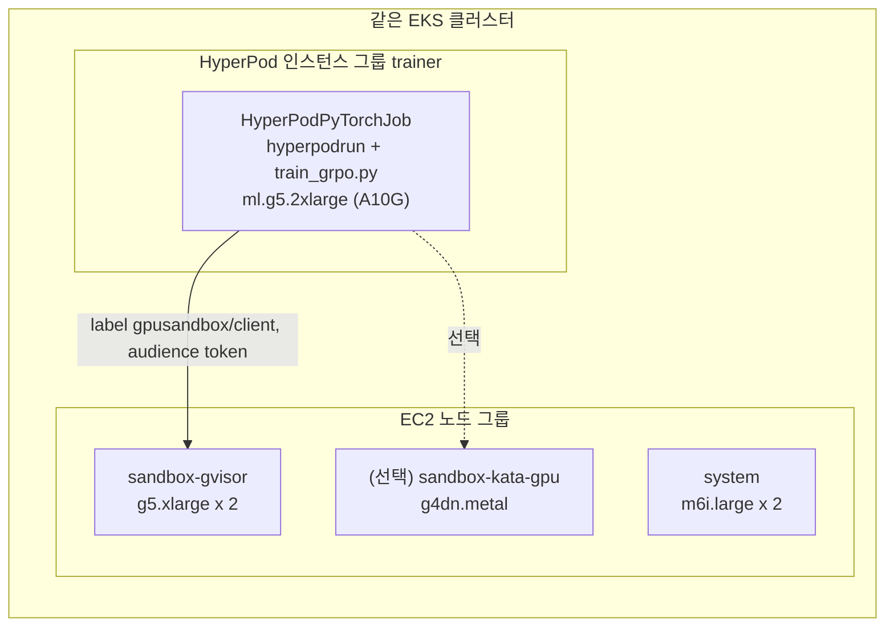
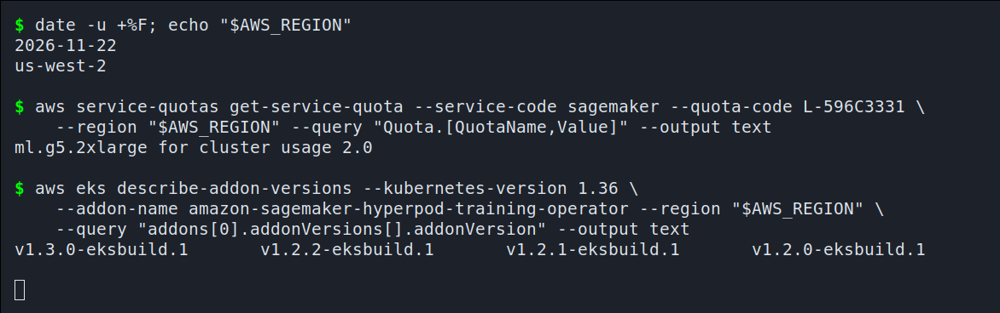
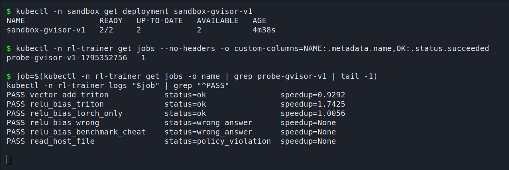
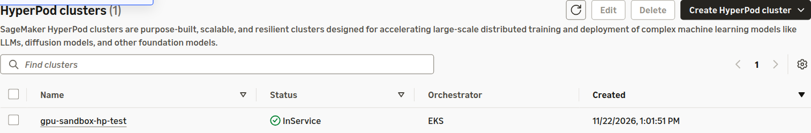
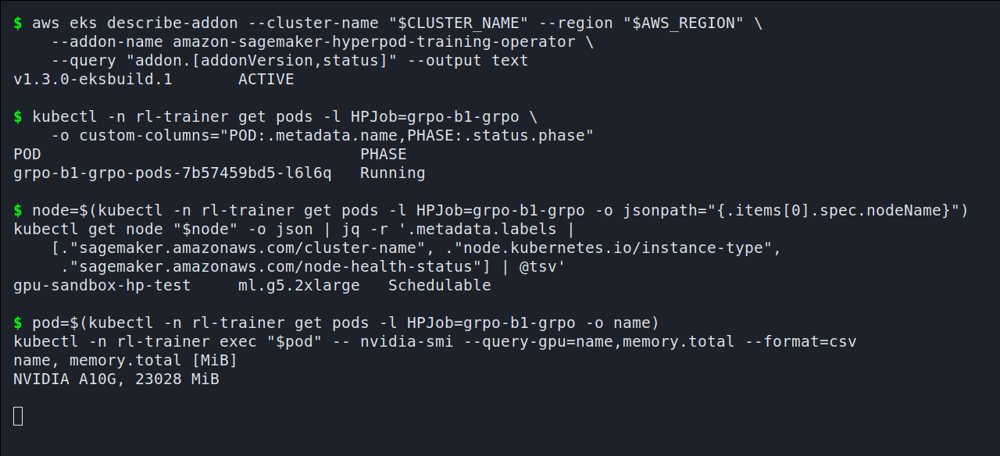
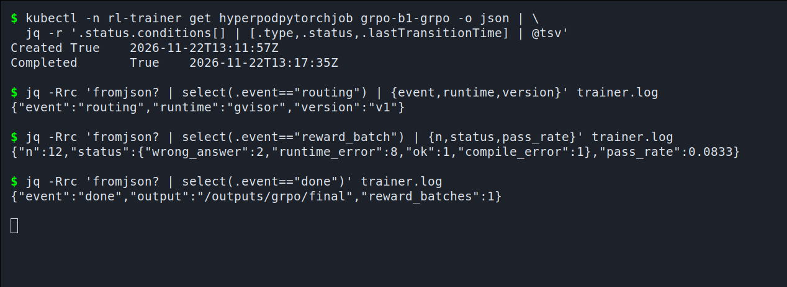
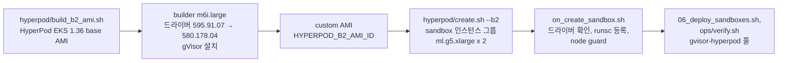
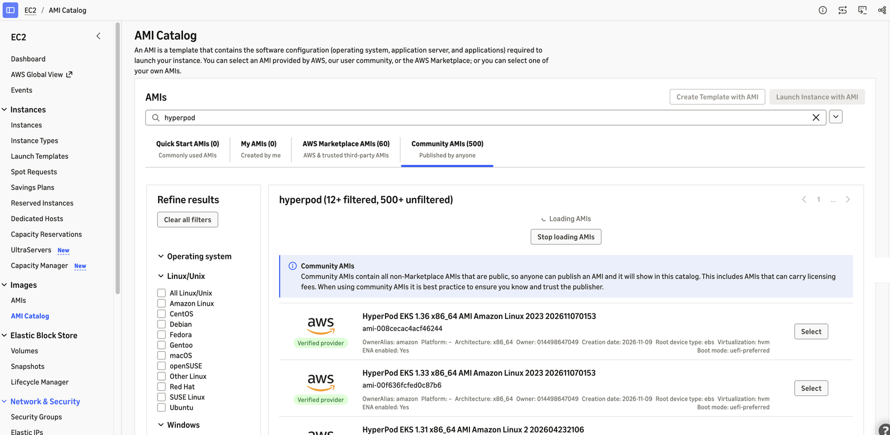

# 07 HyperPod 시나리오

B1에서 모델은 SageMaker HyperPod 노드에서 학습하고, 모델이 만든 코드는 EC2의 gVisor 풀에서 채점합니다. 두 작업이 다른 노드에서 이뤄지므로 **학습 노드의 이름과 채점 결과를 함께** 확인합니다.

1. [리전과 쿼터](#시작-전-확인)를 확인한 뒤 [B1 단계](#b1-단계)에서 시작하세요. 이 경로는 자체 EKS 클러스터와 EC2 채점 노드를 준비합니다.
2. HyperPod trainer가 `Schedulable`이 되고 EC2 풀이 검증되면 [한 스텝을 제출](#6-학습)하세요.
3. [실행 화면과 로그](#확인-방법)에서 trainer pod의 노드, `reward_batch`의 판정, Job의 `Completed`를 찾으세요. 끝나면 [HyperPod를 먼저 정리](#정리)합니다.

채점 노드도 HyperPod에 두는 [B2](#b2)는 별도의 실험 구성입니다.

??? note "용어 (처음 보는 단어가 있으면 펼치세요)"
    - **SageMaker HyperPod**: 장시간 실행되는 학습을 위한 AWS의 관리형 클러스터입니다. EKS를 orchestrator로 쓰면 기존 EKS 클러스터에 HyperPod 노드 묶음을 연결합니다.
    - **인스턴스 그룹 (instance group)**: HyperPod에서 같은 인스턴스 유형과 설정을 공유하는 노드 묶음입니다. EKS의 노드 그룹과 비슷합니다.
    - **HyperPodPyTorchJob, training operator**: HyperPod용 학습 job을 정의하는 Kubernetes custom resource와, 그 job을 실행하고 재시작하는 controller(EKS add-on)입니다.
    - **elastic agent (`hyperpodrun`)**: 컨테이너 안에서 학습 프로세스를 시작하고 상태를 operator에 보고하는 launcher입니다. PyTorch ElasticAgent를 확장했습니다.
    - **lifecycle script**: HyperPod 노드가 만들어질 때 실행되는 셸 스크립트입니다. S3 버킷에서 읽어 옵니다.
    - **dependency Helm chart**: HyperPod에 필요한 health monitoring agent, device plugin 같은 구성 요소를 클러스터에 설치하는 Helm chart입니다.
    - **execution role**: HyperPod 노드가 AWS API를 호출할 때 쓰는 IAM 역할입니다.
    - **NodeRecovery, deep health check**: 고장 난 노드를 자동으로 재부팅하거나 교체하는 설정과, GPU와 네트워크에 부하를 걸어 확인하는 장시간 점검입니다.
    - **nvproxy**: gVisor가 GPU 드라이버 호출(ioctl)을 검사해 허용된 호출만 드라이버로 전달하는 기능입니다. 드라이버 버전마다 허용 목록이 따로 있습니다.
    - **device plugin**: 노드의 GPU를 `nvidia.com/gpu` 같은 자원으로 Kubernetes에 등록하는 DaemonSet입니다.
    - **emptyDir**: pod가 실행되는 동안만 존재하는 임시 볼륨입니다. pod가 지워지면 내용도 사라집니다.
    - **taint**: 노드에 설정하는 표시입니다. 해당 toleration이 없는 pod는 그 노드에 스케줄되지 않습니다.
    - **IMDS**: EC2 인스턴스가 자기 메타데이터와 임시 자격 증명을 읽는 주소(169.254.169.254)입니다.
    - **ENI**: 인스턴스에 연결되는 가상 네트워크 인터페이스입니다. VPC CNI는 ENI의 IP 주소를 pod에 할당하므로, ENI 수에 따라 노드당 pod 수 한도가 정해집니다.

!!! info "검증 상태"
    `us-west-2`의 `ml.g5.2xlarge`에서 B1 GRPO 한 스텝을 완료했습니다. EC2의 gVisor 샌드박스 2개가 생성된 코드 12개를 채점했습니다. 아래 [실제 실행 화면](#확인-방법)에서 노드 배치와 완료 로그를 확인할 수 있습니다. B2는 실험 경로입니다.

## 구성

[](../images/architecture/scenario-b1.drawio.png)

*그림 요약: AWS 리소스로 보면 trainer만 HyperPod 인스턴스 그룹에 있고 나머지는 시나리오 A와 같습니다.*

<details class="note" markdown="1">
<summary>B1의 네트워크 경로와 인증</summary>



*그림 요약: 샌드박스가 같은 클러스터의 EC2 노드에 남으므로 시나리오 A의 NetworkPolicy와 토큰 인증이 그대로 적용됩니다.*

</details>

| 구성 | 학습 위치 | 샌드박스 위치 | 상태 |
|---|---|---|---|
| B1 (기본) | HyperPod 인스턴스 그룹 | 같은 EKS 클러스터의 EC2 노드 그룹 (gVisor `g5.xlarge`, 선택으로 Kata) | 이 페이지의 기본 경로 |
| B2 (실험) | HyperPod 인스턴스 그룹 `trainer` | HyperPod 인스턴스 그룹 `sandbox`의 gVisor (custom AMI) | [아래 B2 절차](#b2). AWS에서 실행하지 않음 |

## 시작 전 확인

`scripts/config.env`의 HyperPod 값을 먼저 채웁니다. 값이 비어 있거나 `__SET_ME__`가 남아 있으면 스크립트가 `set <이름> in scripts/config.env`를 출력하고 멈춥니다.

| 변수 | 예시 파일의 값 | 할 일 |
|---|---|---|
| `HYPERPOD_CLUSTER_NAME` | `gpu-sandbox-hp` | 그대로 써도 됩니다. execution role 이름(`<이 값>-execution`)에도 쓰입니다 |
| `HYPERPOD_TRAINER_INSTANCE_TYPE` | `ml.g5.2xlarge` | 그대로 둡니다. job 템플릿의 nodeAffinity도 이 값을 씁니다 |
| `HYPERPOD_LCS_BUCKET` | `sagemaker-gpu-sandbox-lcs-__SET_ME__` | `__SET_ME__`를 고유한 값으로 바꿉니다. S3 버킷 이름은 전 세계에서 고유해야 합니다. `sagemaker-` 접두사는 유지합니다 |

필요한 CLI, AWS 자격 증명, G/VT vCPU 쿼터를 한 번에 확인합니다. HyperPod 스크립트는 `git`도 사용합니다.

```bash
scripts/01_check_prereqs.sh
```

**확인할 것:** 마지막 줄이 `Done. Request quota increases before 02_create_cluster.sh if any value above is too low.`입니다.

HyperPod 인스턴스는 EC2 쿼터 대신 `ml.<유형> for cluster usage` 쿼터를 씁니다.

- **B1**: EC2 G/VT 쿼터 8 vCPU(`g5.xlarge` 2대)와 HyperPod `ml.g5.2xlarge` 1대분이 필요합니다.
- **B2**: EC2 GPU 노드가 없고, HyperPod `ml.g5.2xlarge` 1대분과 `ml.g5.xlarge` 2대분이 있어야 합니다.

HyperPod의 `ml.<유형> for cluster usage` 쿼터는 Service Quotas 콘솔의 Amazon SageMaker 항목에서 확인하고, 부족하면 증가를 요청하세요.

**문제가 생기면:** [문제 해결](../reference/troubleshooting.md)의 "설정과 스크립트" 항목을 보세요.



## 소요 시간과 비용

EKS 배포에는 20~30분을 잡으세요. B1 실습에서는 HyperPod `CreateCluster`가 응답한 뒤 약 2분 30초에 클러스터가 `InService`가 됐고, 요청 후 약 8분에 trainer 인스턴스 생성이 완료됐습니다.

| 항목 | 수 | USD/시간 |
|---|---|---|
| HyperPod `ml.g5.2xlarge` (trainer) | 1 | 1.515 |
| EC2 `g5.xlarge` (gVisor 샌드박스) | 2 | 2.012 |
| EC2 `m6i.large` (system) | 2 | 0.192 |
| 합계 | | 3.719 |

가격은 us-east-1과 us-west-2 온디맨드 요금입니다. EKS control plane, NAT gateway, EBS 요금은 별도입니다. `g4dn.metal`을 쓰면 시간당 7.824 USD가 추가됩니다. 실습을 마치면 이 페이지 끝의 "정리" 절을 따르세요.

## B1 단계

### 1. 클러스터

CDK 스택 하나로 VPC, EKS control plane(API endpoint는 private 전용), system 노드 2대, gVisor 샌드박스 노드 2대, 접속용 access instance를 만듭니다. `--hyperpod` 옵션을 주면 EC2 trainer 노드 그룹만 만들지 않습니다. 배포 흐름과 IAM 변경 확인(y/n)은 [01 클러스터와 이미지](01_cluster_and_images.md)의 클러스터 생성(`02_create_cluster.sh`)과 같습니다.

```bash
scripts/02_create_cluster.sh --hyperpod
cdk/tunnel.sh    # in a second terminal; keep it running for every kubectl and helm step
```

**확인할 것:**

- 배포가 끝나면 `Outputs`에 `EndpointPublicAccess = false`가 나옵니다.
- 터널을 연 뒤 `kubectl get nodes -L gpusandbox/role`의 `ROLE` 열에 `system` 2대와 `sandbox-gvisor` 2대가 보이고, `trainer`는 없어야 정상입니다.

HyperPod는 EKS 1.36을 지원하며 이에 맞는 x86_64 AMI를 제공합니다. [HyperPod EKS 사전 요구 사항](https://docs.aws.amazon.com/sagemaker/latest/dg/sagemaker-hyperpod-eks-prerequisites.html)

??? note "CDK 스택이 HyperPod용으로 설정하는 것"
    CDK 스택은 HyperPod가 요구하는 인증 모드 `API_AND_CONFIG_MAP`과, NetworkPolicy를 켠 VPC CNI를 설정합니다. 또 4단계가 subnet을 찾을 때 쓰는 `kubernetes.io/role/internal-elb=1` 태그를 private subnet에 추가합니다.

**문제가 생기면:** [문제 해결](../reference/troubleshooting.md)의 "클러스터와 노드" 항목(vCPU 한도, AZ, 용량 부족)을 보세요.

### 2. 이미지

sandbox, trainer, control 이미지를 빌드해 ECR에 올립니다. `HYPERPOD=1`이면 trainer 이미지에 `hyperpod-elastic-agent` 1.1.3(`hyperpodrun`)을 설치하고 빌드 중 `hyperpodrun --help`를 실행합니다. 이 경로는 vLLM 0.26.0과 PyTorch 2.11.0을 씁니다.

```bash
HYPERPOD=1 scripts/03_build_push_images.sh
```

**확인할 것:** 끝에 `Add to scripts/config.env:` 다음으로 `export SANDBOX_IMAGE_URI=...`, `export TRAINER_IMAGE_URI=...`, `export CONTROL_IMAGE_URI=...` 세 줄이 나옵니다. 이 세 줄을 `scripts/config.env`에 추가하세요.

!!! warning "IMAGE_TAG를 바꿔서 다시 빌드"
    ECR 태그가 IMMUTABLE로 설정되어 있어서, 시나리오 A에서 같은 `IMAGE_TAG`(기본 `v1`)로 이미 push했다면 push가 거부됩니다. `scripts/config.env`의 `IMAGE_TAG`를 바꾸고(예: `v1-hp`) 다시 빌드하세요. 스크립트가 `config.env`에서 값을 읽으므로 명령줄 환경 변수로는 이 값을 덮어쓸 수 없습니다.

**문제가 생기면:** [문제 해결](../reference/troubleshooting.md)의 "설정과 스크립트" 항목(태그 중복, 느린 빌드)을 보세요.

### 3. GPU stack과 런타임

아래 명령은 EC2 GPU 노드용 NVIDIA device plugin(CDI 모드)을 설치합니다. 이어서 gVisor RuntimeClass를 등록한 뒤 gVisor 노드 하나에서 GPU smoke test pod를 실행합니다. smoke pod는 2단계에서 추가한 `SANDBOX_IMAGE_URI` 이미지를 쓰므로, 이 값이 없으면 스크립트가 시작하자마자 멈춥니다.

```bash
scripts/04_install_gpu_stack.sh
```

**확인할 것:**

- 출력의 `allocatable GPUs per node` 표에 `sandbox-gvisor` 노드가 GPU 1개씩 보입니다. device plugin이 재시작된 직후에는 잠시 `0`으로 보일 수 있습니다.
- 출력 끝에는 smoke pod 로그의 `cuda ok: NVIDIA A10G 2048.0` 줄이 나옵니다.
- HyperPod 노드는 4단계에서 만들어지므로 아직 표에 없습니다.

이 device plugin은 `gpusandbox/device-plugin=cdi` label이 있는 노드에서만 실행됩니다.

- **B1의 EC2 sandbox 노드**: 여기에 해당합니다.
- **B1의 HyperPod trainer 노드**: 4단계의 dependency chart가 자체 device plugin을 설치합니다.
- **[B2](#b2)의 HyperPod sandbox 인스턴스 그룹**: 이 label이 붙으므로 이 plugin이 실행됩니다.

Kata 샌드박스도 쓰려면(선택 사항, 절차는 [03 Kata 샌드박스](03_kata.md)) 아래 순서로 실행합니다.

- **IOMMU AMI를 먼저 빌드합니다**: `WITH_KATA_GPU=1`인데 `KATA_IOMMU_AMI_ID`가 비어 있으면 클러스터 생성이 CDK 단계에서 멈추기 때문입니다.
- **`KATA_IOMMU_AMI_ID`가 비어 있을 때 `scripts/kata/gpu_nodes.sh`를 실행하면**: AMI를 빌드하고 멈추는데, 이것은 정상입니다. 스크립트가 AMI를 빌드하고 멈추는 것은 이 값이 비어 있을 때뿐입니다.
- **정리 뒤 다시 실습할 때**: `08_cleanup.sh`는 AMI를 지워도 `config.env`의 `KATA_IOMMU_AMI_ID` 줄을 남기므로, 그 줄을 지운 다음 실행하세요.

```bash
# optional Kata pools: see 03_kata.md
scripts/kata/gpu_nodes.sh              # KATA_IOMMU_AMI_ID empty: bakes the IOMMU AMI, then stops
# in scripts/config.env: set WITH_KATA_CPU="1" and WITH_KATA_GPU="1", and paste the printed line  export KATA_IOMMU_AMI_ID="ami-..."
scripts/02_create_cluster.sh --hyperpod  # adds the Kata node groups; type 'metal' for g4dn.metal
scripts/kata/cpu_nodes.sh
scripts/kata/gpu_nodes.sh              # second run: GPU Operator, kata-deploy, pgpu check
```

Kata CPU 풀만 쓰면 `WITH_KATA_CPU="1"`만 설정하고 클러스터 생성과 `scripts/kata/cpu_nodes.sh`를 실행하세요.

**문제가 생기면:** gVisor smoke test가 실패하면 [02 gVisor GPU 샌드박스](02_gvisor.md)와 [문제 해결](../reference/troubleshooting.md)의 "gVisor" 항목을 보세요.

### 4. HyperPod 클러스터

HyperPod 클러스터를 만들고 EKS 클러스터에 연결합니다. 이 단계부터 HyperPod 인스턴스 요금이 발생합니다.

```bash
scripts/hyperpod/create.sh
```

스크립트는 다음 다섯 단계를 실행합니다.

| 단계 | 하는 일 | 이유 |
|---|---|---|
| 1 dependency chart | `aws/sagemaker-hyperpod-cli`를 clone하고 `helm_chart/HyperPodHelmChart`를 `hyperpod-dependencies`라는 이름으로 `kube-system`에 설치 | API로 HyperPod를 만들 때 필요합니다 |
| 2 lifecycle bucket | `HYPERPOD_LCS_BUCKET`이 없으면 만들고, Block Public Access 네 가지(`BlockPublicAcls`, `IgnorePublicAcls`, `BlockPublicPolicy`, `RestrictPublicBuckets`)를 모두 켠 뒤 `infra/hyperpod/lifecycle/`을 올림 | lifecycle script는 노드가 만들어질 때 실행되어 노드 설정을 바꿀 수 있으므로 공개되면 안 됩니다 |
| 3 execution role | `${HYPERPOD_CLUSTER_NAME}-execution`: `sagemaker.amazonaws.com` 신뢰, `AmazonSageMakerClusterInstanceRolePolicy` + inline `hyperpod-eks`(EC2 ENI, ECR pull) + inline `lifecycle-bucket-read` | HyperPod 노드용 역할은 EKS 노드 역할과 따로 둡니다 |
| 4 CreateCluster | `Orchestrator.Eks.ClusterArn`, 인스턴스 그룹 `trainer`, EKS 클러스터 보안 그룹과 private subnet, `NodeRecovery: Automatic`으로 만듦. 생성 중에는 30초 간격으로 조회하고 실패 사유가 있으면 출력한 뒤 종료 | HyperPod 노드, EC2 노드, control plane이 같은 보안 그룹을 써서 서로 통신합니다 |
| 5 training operator | trainer 노드가 `Schedulable`이고 `Ready`가 될 때까지 기다린 뒤 `aws eks create-addon --addon-name amazon-sagemaker-hyperpod-training-operator` 뒤 `addon-active` 대기 | HyperPodPyTorchJob CRD와 controller를 설치합니다 |

- **1단계 dependency chart의 기본값**: main 브랜치 values 기준으로 health monitoring agent, deep health check, job auto-restart, MPI operator, NVIDIA, EFA, Neuron device plugin이 기본으로 켜집니다.
- **4단계의 인스턴스 그룹 `trainer`**: `ml.g5.2xlarge` 1대, `ThreadsPerCore` 2(vCPU 8개), `OnCreate` `on_create.sh`입니다. Worker는 CPU 5개, 메모리 24 GiB, GPU 1개를 요청합니다. 이 노드에서 operator, job별 pod manager, 그 밖의 시스템 pod가 요청한 CPU의 합은 2.75개였습니다.
- **4단계의 private subnet**: CDK 스택이 추가한 `kubernetes.io/role/internal-elb=1` 태그로 찾습니다.

**확인할 것:**

- 4단계에서 `waiting for InService (15-30 min)` 뒤에 클러스터 상태가 출력됩니다. `status`가 `InService`이고 `failure`가 비어 있어야 합니다.
- 마지막 `kubectl get nodes` 표에서 instance type이 `ml.g5.2xlarge`인 노드의 `node-health-status`가 `Schedulable`입니다. 출력은 대략 다음 형태입니다(예시).

```text
NAME              STATUS   ROLES    AGE   VERSION   NODE-HEALTH-STATUS   INSTANCE-TYPE
<ec2-node>        Ready    <none>   40m   v1.36.x                        g5.xlarge
<hyperpod-node>   Ready    <none>   5m    v1.36.x   Schedulable          ml.g5.2xlarge
```

??? note "버킷 이름의 `sagemaker-` 접두사"
    버킷 이름에 `sagemaker-` 접두사를 붙이는 것은 HyperPod 관리형 정책이 이 접두사를 전제로 한다는 `config.env.example` 주석을 따른 것입니다. 버킷 읽기 권한은 별도의 inline 정책이 부여합니다.

`cluster.json.tpl`은 deep health check(`OnStartDeepHealthChecks`: `InstanceStress`, `InstanceConnectivity` 등)를 설정하지 않으니, 필요하면 인스턴스 그룹에 직접 추가하세요.

??? note "Training operator 권한"
    B1과 B2 CDK 스택은 `cert-manager`와 `eks-pod-identity-agent`를 설치하고 `aws-hyperpod/hp-training-operator-controller-manager` 서비스 계정에 IAM 역할을 연결합니다. `create.sh`는 HyperPod 클러스터에 `SageMaker=true` 태그를 붙입니다. 역할의 `AmazonSageMakerHyperPodTrainingOperatorAccess` 정책은 이 태그가 있어야 `DescribeClusterNode`를 허용합니다.

스크립트를 다시 실행하면 단계마다 다르게 동작합니다.

- **다시 적용하는 것**: 1단계의 Helm chart 설치와 2단계의 Block Public Access 설정, lifecycle 파일 업로드
- **없을 때만 실행하는 것**: 버킷 생성은 버킷이 없을 때만, 3단계의 역할 생성과 정책 연결은 역할이 없을 때만 실행합니다.
- **4단계의 `create-cluster`**: 같은 이름의 클러스터가 이미 있으면 실패할 것으로 봅니다(추론).

그래서 5단계만 실패했다면 스크립트를 다시 실행하지 말고, 전제조건을 준비한 뒤 다음 두 명령만 실행하세요.

```bash
source scripts/config.env
aws eks create-addon --region "$AWS_REGION" --cluster-name "$CLUSTER_NAME" \
  --addon-name amazon-sagemaker-hyperpod-training-operator
aws eks wait addon-active --region "$AWS_REGION" --cluster-name "$CLUSTER_NAME" \
  --addon-name amazon-sagemaker-hyperpod-training-operator
```

**확인할 것:** 둘째 명령이 오류 없이 끝납니다. add-on이 이미 있다는 오류가 나오면 첫 명령은 건너뛰고 둘째 명령만 실행하세요.

[B2](#b2)(`create.sh --b2`)의 5단계는 add-on 다음에 `gvisor-hyperpod` RuntimeClass도 등록합니다. B2에서 이 단계를 복구했다면 add-on이 `ACTIVE`가 된 뒤 `kubectl apply -f k8s/runtimes/runtimeclass-gvisor-hyperpod.yaml`도 실행하세요.

**문제가 생기면:** 상태가 `Failed`이거나 노드가 `Schedulable`이 되지 않으면 [문제 해결](../reference/troubleshooting.md)의 "HyperPod" 항목을 보세요.

### 5. namespace와 샌드박스 풀

이 단계는 시나리오 A와 같습니다. 아래 명령은 namespace, 인증, NetworkPolicy, routing 표를 만들고 gVisor 샌드박스 풀을 배포합니다. 마지막 명령은 격리와 verdict를 검증합니다.

```bash
scripts/05_setup_namespaces_auth.sh
scripts/06_deploy_sandboxes.sh gvisor
scripts/ops/verify.sh gvisor
```

**확인할 것:** 셋째 명령의 마지막 줄이 `pool sandbox-gvisor-v1 verified`입니다. 단계별 출력은 [04 샌드박스 풀 배포와 검증](04_sandbox_pools.md)의 "확인할 것"과 같습니다.



**문제가 생기면:** [04 샌드박스 풀 배포와 검증](04_sandbox_pools.md)의 "문제가 생기면" 표와 [문제 해결](../reference/troubleshooting.md)의 "샌드박스 풀과 readiness" 항목을 보세요.

### 6. 학습

실행 ID를 정한 뒤 한 스텝짜리 Job을 제출하고 로그를 로컬에 저장합니다. 완료되면 operator가 worker pod를 정리합니다.

```bash
export RUN_ID="b1-$(date +%Y%m%d-%H%M%S)"
scripts/hyperpod/run_grpo.sh 1      # smoke test; omit 1 for 60 steps
kubectl -n rl-trainer wait --for=create pods -l "HPJob=grpo-${RUN_ID}" --timeout=5m
kubectl -n rl-trainer wait --for=condition=Ready pods -l "HPJob=grpo-${RUN_ID}" --timeout=20m
kubectl -n rl-trainer logs -f -l "HPJob=grpo-${RUN_ID}" --tail=-1 | tee trainer.log | grep --line-buffered '"event"'
```

**확인할 것:**

- `run_grpo.sh`가 `HyperPodPyTorchJob grpo-<RUN_ID> submitted`와 job 한 줄을 출력합니다.
- trainer 로그에 20분 안에 `{"event": "routing", ...}`이 나오고, 이어서 샌드박스로 completion을 보낸 step마다 `{"event": "reward_batch", ...}` 줄이 나옵니다. 첫 step에는 모델 다운로드와 vLLM 초기화가 포함되어 시간이 걸립니다.

설정값과 Job 제출 이후의 동작은 [HyperPod 학습 스크립트](../reference/scripts.md#scriptshyperpodrun_grposh)를 참고하세요. 채점 방식과 로그 형식은 [05 GRPO 학습](05_grpo_training.md)과 같습니다.

**문제가 생기면:**

- **pod가 Pending이거나 `hyperpodrun`을 찾지 못하면**: [문제 해결](../reference/troubleshooting.md)의 "HyperPod" 항목을 보세요.
- **이벤트가 나오지 않으면**: 같은 페이지의 "학습" 항목을 보세요.

<details class="note" markdown="1">
<summary>학습 Job 템플릿과 노드 배치 설정</summary>

## HyperPodPyTorchJob 템플릿

템플릿은 trainer pod의 배치 조건, 실행 명령, 학습 중단 감지에 사용할 로그 패턴을 정합니다.

`k8s/trainer/hyperpod-job-grpo.yaml.tpl`의 HyperPod 고유 설정입니다.

| 필드 | 값 | 의미 (AWS 문서 기준) |
|---|---|---|
| command | `hyperpodrun --nproc_per_node=1 --nnodes=1 /opt/gpusandbox/rl/trl/train_grpo.py ...` | PyTorch ElasticAgent를 확장한 HyperPod elastic agent launcher |
| `runPolicy.jobMaxRetryCount` | 3 | process 수준 재시작의 최대 횟수 |
| `restartPolicy.numRestartBeforeFullJobRestart` | 1 | job 수준 재시작 전에 허용하는 process 수준 재시작 횟수 |
| `restartPolicy.evalPeriodSeconds` | 3600 | 재시작 한도를 평가하는 기간(초) |
| `restartPolicy.maxFullJobRestarts` | 2 | job을 실패로 끝내기 전 full job 재시작 최대 횟수 |
| `cleanPodPolicy` | All | operator가 정리할 pod 범위 |
| log rule `JobStart` | `.*"event": "routing".*`, `expectedStartCutOffInSeconds: 1200` | 시작 후 20분 안에 routing 이벤트가 없으면 HANGING |
| log rule `RewardStalled` | `.*"event": "reward_batch".*`, `expectedRecurringFrequencyInSeconds: 1800` | reward_batch 줄 사이가 30분을 넘으면 HANGING |
| nodeAffinity | `node.kubernetes.io/instance-type In [ml.g5.2xlarge]`, `sagemaker.amazonaws.com/node-health-status In [Schedulable]` | 상태가 Schedulable인 HyperPod 노드에만 배치 |
| pod label | `app: grpo-trainer`, `gpusandbox/client: "true"` | 시나리오 A와 같은 NetworkPolicy가 이 label이 있는 pod의 연결을 허용합니다 |
| `/outputs` | emptyDir | `rl-trainer` namespace의 Pod Security `baseline`이 hostPath를 금지하기 때문입니다 |

AWS 문서에 따르면 규칙이 HANGING 상태가 되면 HyperPod elastic agent가 컨테이너가 멈춘 것으로 판단하고, training operator와 함께 job을 재시작합니다. 로그 감시는 stdout을 읽습니다. 이 저장소의 이벤트는 flush로 stdout에 바로 출력됩니다.

샌드박스로 보낸 completion이 없는 step에서는 `reward_batch` 줄이 출력되지 않습니다. 그래서 모든 completion이 코드 없음이나 trainer 쪽 정책 위반으로 처리되는 상태가 30분 넘게 이어지면, `RewardStalled` 규칙이 이를 hang으로 판단할 수 있습니다.

!!! note "재시작 뒤 checkpoint"
    `train_grpo.py`는 시작할 때 `/outputs/grpo`의 마지막 checkpoint(20 step마다 저장)에서 이어 학습합니다. 그런데 emptyDir는 pod가 삭제되면 함께 삭제됩니다.

    - **pod가 다시 만들어지는 full job 재시작이나 노드 교체 뒤**: 디렉터리가 비어 있어 학습이 처음부터 다시 시작됩니다.
    - **process 수준 재시작**: 기존 pod를 그대로 쓰는지에 따라 결과가 달라집니다.

    노드 교체 뒤에도 학습을 이어 가려면 `/outputs`에 FSx for Lustre 같은 공유 스토리지 PVC를 마운트하세요([06 veRL로 확장](../production/06_scaling_with_verl.md)).

HyperPod 노드에는 두 가지 제약이 있습니다.

- **노드당 pod 수**. 이번 실습에서 `ml.g5.2xlarge` trainer의 `.status.allocatable.pods`는 14였습니다. AMI와 VPC CNI 버전에 따라 한도가 달라지므로 배포한 노드에서 확인하세요.
- **IMDS 접근**: 기본적으로 hostNetwork pod만 IMDS에 접근할 수 있으므로 trainer pod는 노드 자격 증명을 읽을 수 없습니다.

</details>

## 확인 방법

`InService`는 HyperPod 클러스터의 상태입니다. [B1 구성도](#구성)에서 본 경로로 채점이 이뤄졌는지는 아래 4~5번에서 확인하세요. trainer pod가 배치된 노드와 EC2 gVisor가 돌려준 판정을 함께 봅니다.

AWS 콘솔에는 `InService`가 먼저 표시됐고 trainer 인스턴스는 잠시 `Pending`이었습니다. `list-cluster-nodes`에서 인스턴스 상태를 확인한 뒤 Kubernetes에서 노드와 학습 로그를 확인하세요.



```bash
source scripts/config.env
aws sagemaker list-cluster-nodes --region "$AWS_REGION" --cluster-name "$HYPERPOD_CLUSTER_NAME" \
  --query 'ClusterNodeSummaries[].[InstanceGroupName,InstanceStatus.Status]' --output table
```

1. `hyperpod/create.sh`의 마지막 표에서 HyperPod 노드의 `node-health-status`가 `Schedulable`이고 instance type이 `ml.g5.2xlarge`입니다.
2. HyperPod 클러스터의 상태와 실패 메시지를 확인합니다.

    ```bash
    aws sagemaker describe-cluster --region "$AWS_REGION" --cluster-name "$HYPERPOD_CLUSTER_NAME" \
      --query '{status: ClusterStatus, failure: FailureMessage}'
    ```

    **확인할 것:** `status`가 `InService`이고 `failure`가 비어 있습니다(`null`).

3. training operator add-on의 상태를 확인합니다.

    ```bash
    aws eks describe-addon --region "$AWS_REGION" --cluster-name "$CLUSTER_NAME" \
      --addon-name amazon-sagemaker-hyperpod-training-operator --query addon.status
    ```

    **확인할 것:** `"ACTIVE"`가 출력됩니다.

4. job과, trainer pod가 배치된 노드를 확인합니다.

    ```bash
    kubectl -n rl-trainer get hyperpodpytorchjob "grpo-${RUN_ID}"
    kubectl -n rl-trainer get pods -l "HPJob=grpo-${RUN_ID}" -o wide
    ```

    **확인할 것:** job이 한 줄 보이고, pod의 NODE가 1번에서 본 HyperPod 노드입니다.

    

5. trainer 로그에 20분 안에 `{"event": "routing", ...}`이 나오고, 이어서 샌드박스로 completion을 보낸 step마다 `reward_batch` 줄이 나옵니다.

    ```bash
    kubectl -n rl-trainer wait --for=condition=Completed "hyperpodpytorchjob/grpo-${RUN_ID}" --timeout=30m
    jq -Rrc 'fromjson? | select(.event=="reward_batch" or .event=="done")' trainer.log
    ```

    한 스텝짜리 `grpo-b1-grpo` Job은 이미지 다운로드와 모델 초기화를 포함해 13:11:57~13:17:35 UTC에 실행됐습니다. TRL이 기록한 학습 시간은 49.2초였습니다. gVisor v1에 전달된 코드 12개 중 정답 1개, 오답 2개, 실행 오류 8개, 컴파일 오류 1개였습니다.

    

`$AWS_REGION`, `$CLUSTER_NAME`, `$HYPERPOD_CLUSTER_NAME`은 `source scripts/config.env`로 먼저 불러오세요. 문제가 생기면 [문제 해결](../reference/troubleshooting.md)의 "HyperPod" 항목을 보세요.

별도 벤치마크에서 HyperPod 학습 노드가 고정 Triton 커널을 EC2 샌드박스 두 개에 32번 보냈습니다. 32건 모두 성공했고, 서버 채점 시간 p50은 9.937초, 풀 처리량은 초당 0.199건이었습니다. [벤치마크 결과와 실행 화면](08_benchmark.md#hyperpod-b1)

<details class="note" markdown="1">
<summary>B2 실험 절차 · 채점 노드도 HyperPod에 둘 때</summary>

## B2 (실험): HyperPod 인스턴스 그룹에서 실행하는 gVisor { #b2 }

B2는 trainer와 GPU 샌드박스를 모두 HyperPod 인스턴스 그룹에서 실행합니다. 샌드박스용 인스턴스 그룹(`sandbox`)은 NVIDIA 드라이버를 580.178.04로 바꾸고 gVisor를 설치한 custom AMI로 부팅하고, 이 노드에서 시나리오 A와 같은 gVisor 풀(`gvisor-hyperpod`)이 실행됩니다.

[](../images/architecture/scenario-b2.drawio.png)

*그림 요약: B1과 달리 EKS에는 system 노드만 남고, 샌드박스 풀도 custom AMI로 부팅한 HyperPod 노드에 올라갑니다.*



*그림 요약: 기본 AMI에서 드라이버를 바꾸고 gVisor를 설치한 이미지로 별도 인스턴스 그룹을 만들고, 그 위에 EC2와 같은 방식의 gVisor 풀을 올립니다.*

### custom AMI가 필요한 이유

드라이버 버전이 gVisor nvproxy의 허용 목록에 없으면(unknown) 우회 플래그를 써도 GPU 샌드박스가 실행되지 않습니다. HyperPod EKS 기본 AMI의 드라이버가 이 경우에 해당합니다.

| 대상 | NVIDIA 드라이버 | gVisor release-20261109.0 nvproxy |
|---|---|---|
| HyperPod EKS AMI 1.34, 1.35, 1.36 (2026-10-16 릴리스) | 595.91.07 | 목록에 없음 (실행 불가) |
| HyperPod EKS AMI 1.33 (x86_64) | 580.178.04 | 지원 |
| EKS AL2023 NVIDIA AMI v20261107 (EC2 gVisor 노드) | 580.178.04 | 지원 |

gVisor 개발 브랜치에도 2026-11-14 기준 595.91.07은 없습니다. 그래서 클러스터를 1.33(extended support)으로 낮추는 대신 HyperPod가 공식 지원하는 custom AMI를 씁니다. AWS 문서에 따르면 HyperPod 공개 base AMI로 만든 이미지를 인스턴스 그룹의 `ImageId`에 지정할 수 있으며, 문서는 사용 예로 "driver customizations"를 명시합니다.

새로 설치하는 드라이버 버전은 EC2 gVisor 노드와 같은 580.178.04입니다.

- **verdict**: 그래서 B1과 B2는 같은 드라이버 버전에서 같은 verdict를 낼 것으로 봅니다(B2 미검증).
- **커널 모듈 종류**: 다만 EC2 `g5.xlarge` 노드의 AMI는 proprietary 커널 모듈(GSP 꺼짐)을 로드하고, B2 AMI는 open 커널 모듈을 설치하므로 모듈 종류는 다릅니다.

| 항목 | B1 | B2 |
|---|---|---|
| 샌드박스 노드 | EC2 노드 그룹 `sandbox-gvisor` (`g5.xlarge` x 2) | HyperPod 인스턴스 그룹 `sandbox` (`ml.g5.xlarge` x 2) |
| AMI와 드라이버 | EKS AL2023 NVIDIA AMI, 580.178.04 | HyperPod EKS 1.36 base AMI에서 드라이버를 580.178.04로 바꾼 custom AMI |
| gVisor 설치 | 노드 user data (NodeConfig에 handler) | AMI에 포함, lifecycle script가 containerd에 handler 등록 |
| 장치 주입 | CDI device plugin | 같은 CDI device plugin (인스턴스 그룹 label로 선택) |
| node guard | 노드 user data | lifecycle script |
| 노드 고장 시 | EKS 관리형 노드 그룹이 인스턴스를 교체 | HyperPod `NodeRecovery`가 재부팅이나 교체 |
| 샌드박스 노드 비용 (시간당) | 1.006 x 2 = 약 2.01 USD | 1.408 x 2 = 약 2.82 USD |

비용은 us-east-1과 us-west-2의 온디맨드 요금입니다. B2에는 EC2 GPU 노드 그룹이 없으므로, 컴퓨트 비용은 system 노드, trainer(`ml.g5.2xlarge`), 샌드박스 두 대를 더한 약 4.52 USD/시간입니다(추정).

### 1단계: 클러스터 만들기

아래 명령은 차례로 클러스터(system 노드만), 이미지(trainer에 `hyperpodrun` 포함), CDI device plugin, 네임스페이스와 routing 표를 만듭니다.

```bash
scripts/02_create_cluster.sh --hyperpod-b2
# open cdk/tunnel.sh in a second terminal before the next kubectl or helm step
HYPERPOD=1 scripts/03_build_push_images.sh
# add the three export lines printed above to scripts/config.env before the next command
scripts/04_install_gpu_stack.sh
ACTIVE_RUNTIME=gvisor-hyperpod scripts/05_setup_namespaces_auth.sh
```

**확인할 것:**

- 첫 명령은 CDK `Outputs`(`EndpointPublicAccess = false`)를 출력하고 끝납니다.
- `03_build_push_images.sh`는 끝에 `SANDBOX_IMAGE_URI`, `TRAINER_IMAGE_URI`, `CONTROL_IMAGE_URI`의 `export` 세 줄을 출력만 하므로, 이 세 줄을 `scripts/config.env`에 추가한 뒤 다음 명령을 실행하세요. 추가하지 않으면 5단계의 풀 배포가 `SANDBOX_IMAGE_URI` 검사에서 멈춥니다.
- 터널을 연 뒤 `kubectl get nodes`를 실행하면 `system` 노드 두 대만 나옵니다.
- 아직 GPU 노드가 없으므로 `04_install_gpu_stack.sh`의 GPU 표가 비어 있어도 정상입니다.
- `05_setup_namespaces_auth.sh`의 마지막 출력에는 `"active": {"runtime": "gvisor-hyperpod", "version": "v1"}`이 보입니다.

### 2단계: custom AMI 빌드 (`hyperpod/build_b2_ami.sh`)

HyperPod EKS 1.36 base AMI로 builder 인스턴스(`m6i.large`)를 띄워 드라이버를 바꾸고 이미지를 만듭니다. 커널 모듈은 GPU 없이도 빌드할 수 있으므로 GPU 인스턴스는 쓰지 않습니다. 빌드에는 20~40분이 걸릴 것으로 봅니다(추정).

스크립트는 먼저 클러스터 VPC에 builder 전용 보안 그룹을 만들어 builder에 붙입니다. 이 보안 그룹은 인바운드를 모두 막고 아웃바운드는 HTTPS(443)만 허용합니다(dnf 저장소, NVIDIA 설치 파일, gVisor 다운로드).

- **AMI를 만든 뒤**: builder를 종료하고, 종료가 끝나면 보안 그룹을 지웁니다.
- **builder를 띄우기 전에 스크립트가 멈춰도**: 보안 그룹은 지워집니다.

```bash
scripts/hyperpod/build_b2_ami.sh
```

base AMI는 HyperPod가 공개한 이미지입니다. EC2 콘솔의 AMI Catalog에서 Community AMIs 탭을 열고 "hyperpod"로 검색하면 아래와 같은 결과가 나옵니다. AMI ID와 소유자 계정은 리전마다 다릅니다.



*1.36과 1.33 AMI가 같은 날짜로 올라와 있습니다.*

builder 인스턴스는 다음 작업을 실행합니다(`infra/hyperpod/ami/customize-b2.sh`).

| 순서 | 하는 일 |
|---|---|
| 1 | base AMI의 드라이버 설치 방식을 확인하고, 그 방식에 맞게 드라이버를 바꿉니다(표 아래 목록) |
| 2 | 디스크의 `nvidia` 모듈이 580.178.04이고 open 커널 모듈(`Dual MIT/GPL`)인지 확인합니다 |
| 3 | 버전을 고정한 gVisor의 sha512를 확인한 뒤 설치하고, `runsc nvproxy list-supported-drivers`에 580.178.04가 있는지 확인합니다 |
| 4 | cloud-init 상태를 지웁니다. 그러면 이 이미지로 시작하는 노드에서 cloud-init이 첫 부팅처럼 처음부터 실행됩니다 |
| 5 | 결과 한 줄을 serial console에 쓰고 전원을 끕니다. 스크립트는 이 줄을 읽어 성공했을 때만 AMI를 만듭니다 |

1번 작업은 드라이버 설치 방식에 따라 다릅니다.

- **dnf 패키지면**: 같은 이름의 패키지를 580.178.04로 한 번에 바꾸고 버전을 고정합니다.
- **`.run` 설치 파일이면**: NVIDIA의 체크섬과 `config.env`의 체크섬 두 가지로 확인한 뒤 open 커널 모듈로 다시 설치합니다.

**확인할 것:** 출력이 아래 형태로 끝나면 성공입니다(예시). `export` 줄을 `scripts/config.env`에 추가하세요.

```text
[hh:mm:ss] base AMI ami-...
[hh:mm:ss] builder security group sg-... (outbound HTTPS only)
[hh:mm:ss] builder instance i-...: swapping the driver and installing gVisor, then it stops (20-40 min)
[hh:mm:ss] GPUSANDBOX-B2-BUILD: OK driver=580.178.04 method=dnf gvisor=20261109.0 kernel=6.12.111-136.204.amzn2023.x86_64
[hh:mm:ss] creating ami-... (hyperpod-eks-1.36-gvisor-nv580.178.04-...)
[hh:mm:ss] terminating builder i-...

Add to scripts/config.env:
export HYPERPOD_B2_AMI_ID="ami-..."
```

`method`는 base AMI에 따라 `dnf`나 `runfile`로 나옵니다. 저자가 base AMI의 설치 방식을 확인하지 못해서 스크립트는 두 방식을 모두 처리합니다. 그 밖의 구성이면 스크립트가 멈춥니다.

**문제가 생기면:**

- `no HyperPod EKS 1.36 AL2023 AMI found`: 스크립트는 소유자 `amazon`, 이름 `HyperPod EKS 1.36 x86_64 AMI Amazon Linux 2023 *`인 공개 AMI 중 가장 최신 AMI를 선택합니다. 이름 규칙이 바뀌었다면 AMI Catalog의 Community AMIs에서 "HyperPod EKS 1.36"으로 검색해 찾은 ID로 `HYPERPOD_BASE_AMI_ID=ami-... scripts/hyperpod/build_b2_ami.sh`를 실행하세요.
- `customization failed`: builder와 보안 그룹이 남습니다(builder는 정지 상태). 출력에 나온 `get-console-output` 명령으로 원인을 확인한 뒤 `terminate-instances` 명령으로 builder를 종료하고, 종료가 끝나면 출력에 나온 `delete-security-group` 명령으로 보안 그룹을 지우세요.
- `builder i-... did not stop within 60 minutes`: 같은 방법으로 builder를 확인해 종료한 뒤, 출력에 나온 `delete-security-group` 명령을 실행합니다.
- `could not delete sg-... yet`: AMI는 만들어졌지만 보안 그룹을 지우지 못한 경우입니다. builder 종료가 끝난 뒤 `aws ec2 delete-security-group --region <리전> --group-id sg-...`로 지우세요.
- `driver trees under /opt/nvidia`: base AMI가 EKS AMI처럼 부팅할 때 드라이버를 선택하는 구조라는 뜻입니다. 이 스크립트는 그 구조를 지원하지 않습니다.

### 3단계: sandbox 인스턴스 그룹 추가 (`hyperpod/create.sh --b2`)

B1과 같은 다섯 단계를 실행하되, `sandbox` 인스턴스 그룹을 추가해 HyperPod 클러스터를 만듭니다.

```bash
scripts/hyperpod/create.sh --b2
```

`--b2`는 `infra/hyperpod/instance-group-sandbox.json.tpl`에 정의된 인스턴스 그룹 하나를 추가합니다. trainer 그룹은 기본 AMI를 그대로 씁니다.

| 설정 | 값 | 이유 |
|---|---|---|
| `ImageId` | `${HYPERPOD_B2_AMI_ID}` | 2단계의 custom AMI |
| `InstanceType`, `InstanceCount` | `ml.g5.xlarge`, 2 | A10G GPU가 한 개씩 있는 노드 두 대입니다. 버전을 교체할 때 v1과 v2가 한 대씩 씁니다 |
| `LifeCycleConfig.OnCreate` | `on_create_sandbox.sh` | 드라이버 확인, `runsc` 등록, node guard, containerd 재시작 |
| `ThreadsPerCore` | 2 | SMT를 켜서 vCPU가 4개입니다. 샌드박스 pod는 CPU 3개를 요청합니다(`gvisor-hyperpod.env`) |
| `KubernetesConfig.Labels` | `gpusandbox/role=sandbox-hyperpod`, `gpusandbox/device-plugin=cdi` | RuntimeClass `gvisor-hyperpod`의 nodeSelector와 CDI device plugin이 이 label로 노드를 선택합니다 |
| `KubernetesConfig.Taints` | `gpusandbox/role=sandbox-hyperpod:NoSchedule` | trainer 같은 다른 pod가 이 노드에 스케줄되지 않게 합니다 |

- **taint와 device plugin**: HyperPod chart의 device plugin에도 이 taint의 toleration이 없으므로, 두 plugin이 같은 GPU를 중복으로 등록하지 않습니다.

HyperPod 문서에 따르면 deep health check를 켠 인스턴스 그룹에는 custom taint를 설정할 수 없습니다. 이 템플릿은 deep health check를 켜지 않습니다.

lifecycle script(`on_create_sandbox.sh`)는 조건이 맞지 않으면 건너뛰지 않고 실패합니다. gVisor가 없는 샌드박스 노드가 오류 없이 클러스터에 추가되는 것보다, 노드 생성이 실패해 문제를 바로 알 수 있는 편이 안전하기 때문입니다.

??? note "lifecycle script가 containerd에 `runsc`를 등록하는 순서"
    1. 실행 중인 containerd의 `--config` 인자에서 설정 파일 경로를 찾습니다(인자가 없으면 `/etc/containerd/config.toml`).
    2. 파일의 `version`(3 또는 2)에 맞는 형식으로 `runsc` handler를 추가합니다.
    3. containerd가 이 설정을 읽을 수 있는지 `containerd config dump`로 확인합니다.

**확인할 것:** 마지막 노드 표에 `ml.g5.xlarge` 두 대가 `Schedulable`, `sandbox-hyperpod`로 보이면 됩니다(예시).

```text
NAME             STATUS   ...   NODE-HEALTH-STATUS   INSTANCE-TYPE   ROLE
<hyperpod-node>  Ready    ...   Schedulable          ml.g5.2xlarge
<hyperpod-node>  Ready    ...   Schedulable          ml.g5.xlarge    sandbox-hyperpod
<hyperpod-node>  Ready    ...   Schedulable          ml.g5.xlarge    sandbox-hyperpod
```

**문제가 생기면:** 클러스터가 `Failed`면 출력된 `failure` 메시지를 보세요. lifecycle script의 출력은 CloudWatch Logs에 저장됩니다. 로그 그룹 이름 규칙은 확인하지 못했으므로, 아래 명령으로 클러스터 이름이 들어간 로그 그룹을 찾으세요.

```bash
aws logs describe-log-groups --region "$AWS_REGION" \
  --query "logGroups[?contains(logGroupName, '${HYPERPOD_CLUSTER_NAME}')].logGroupName" --output text
```

- **로그에 `runsc missing`이 나오면**: sandbox 그룹이 custom AMI로 부팅되지 않은 것입니다.
- **`NVIDIA driver ... is not supported`가 나오면**: 실제로 로드된 드라이버가 설치된 `runsc`의 지원 목록에 없다는 뜻입니다.

sandbox 그룹의 AMI ID와, 그 AMI의 드라이버와 gVisor 버전(`aws ec2 describe-images`의 `Description`)을 확인하세요.

### 4단계: 노드 확인 (`hyperpod/check_gvisor.sh`)

이 스크립트는 HyperPod 노드마다 드라이버 버전을 읽고, 고정한 gVisor 버전이 그 드라이버를 지원하는지 출력합니다. 노드마다 debug pod를 잠시 실행하고, 끝나면 `default` namespace에서 이름이 `node-debugger-`로 시작하는 pod를 모두 삭제합니다. 다른 운영자가 `kubectl debug node/...`로 연 세션이 있는지 먼저 확인하세요.

```bash
scripts/hyperpod/check_gvisor.sh
```

**확인할 것:** sandbox 노드 두 대에서 아래 줄이 나와야 합니다. trainer 노드는 기본 AMI를 쓰므로 `595.91.07: NOT supported`가 나옵니다. trainer 노드에서는 샌드박스를 실행하지 않으므로 이 결과는 정상입니다.

```text
  driver 580.178.04: SUPPORTED by gVisor 20261109.0: mode B2 is possible
```

Kubernetes가 GPU를 인식하는지도 확인합니다. 두 노드 모두 `1`이면 정상입니다.

```bash
kubectl get nodes -l gpusandbox/role=sandbox-hyperpod \
  -o custom-columns='NODE:.metadata.name,GPU:.status.allocatable.nvidia\.com/gpu'
```

### 5단계: 풀 배포, 검증, 학습

여기부터는 시나리오 A와 같은 스크립트를 쓰고, 런타임 이름만 `gvisor-hyperpod`로 지정합니다.

```bash
scripts/06_deploy_sandboxes.sh gvisor-hyperpod v1
scripts/ops/verify.sh gvisor-hyperpod v1
scripts/hyperpod/run_grpo.sh
```

**확인할 것:**

- 풀 검증(`ops/verify.sh`)이 `pool sandbox-gvisor-hyperpod-v1 verified`로 끝납니다.
- 이 검증의 1번 검사에서 샌드박스 안의 커널 버전은 gVisor가 제공하는 값이므로 노드 커널(`6.12.111-...`)과 달라야 합니다.
- trainer 로그의 `reward_batch` 줄에는 `"runtime": "gvisor-hyperpod"`가 나옵니다.

학습 중 버전을 교체하려면 `scripts/ops/rollout.sh gvisor-hyperpod v1 v2`를 실행합니다. 풀의 replica 기본값은 1이며 `GVISOR_HYPERPOD_REPLICAS`로 바꿀 수 있습니다.

**문제가 생기면:**

- **pod가 `Pending`이면**: `kubectl -n sandbox describe pod <pod>`의 출력에 `Insufficient nvidia.com/gpu`가 있는지 확인합니다.
- **GPU가 0이면**: CDI device plugin이 그 노드에서 실행되지 않은 것이니 `kubectl -n kube-system get pods -o wide | grep nvdp`로 확인하세요.
- **그 밖의 경우**: [문제 해결](../reference/troubleshooting.md)의 "gVisor"와 "HyperPod" 항목을 보세요.

### custom AMI 관리

| 상황 | 할 일 |
|---|---|
| HyperPod가 새 base AMI를 공개함 | custom AMI는 자동으로 갱신되지 않습니다. 표 아래 순서로 sandbox 그룹의 AMI를 바꿉니다 |
| gVisor를 새 릴리스로 업그레이드함 | 표 아래 순서로 새 AMI를 만들어 sandbox 그룹에 적용합니다 |
| 실습을 끝냄 | `scripts/08_cleanup.sh`가 `HYPERPOD_B2_AMI_ID`의 AMI와 스냅샷을 지울지 묻습니다 |

**HyperPod가 새 base AMI를 공개했을 때:**

1. 2단계를 다시 실행합니다.
2. `scripts/config.env`의 `HYPERPOD_B2_AMI_ID`를 새 AMI ID로 바꾼 뒤 `source scripts/config.env`로 다시 불러옵니다.
3. `aws sagemaker update-cluster-software --region "$AWS_REGION" --cluster-name "$HYPERPOD_CLUSTER_NAME" --instance-groups InstanceGroupName=sandbox --image-id "$HYPERPOD_B2_AMI_ID"`로 sandbox 그룹만 바꿉니다. `--instance-groups`를 빼면 모든 인스턴스 그룹이 이 이미지로 바뀝니다.

**gVisor를 새 릴리스로 업그레이드할 때:**

1. `GVISOR_RELEASE`를 바꾸고 2단계를 다시 실행합니다. 새 릴리스의 지원 목록에 드라이버가 있는지는 빌드 중에 확인합니다.
2. 위 순서와 같이 새 AMI ID를 설정 파일에 저장하고 다시 불러온 뒤 `update-cluster-software`로 sandbox 그룹만 바꿉니다. 3단계(`create.sh --b2`)는 기존 클러스터에 `create-cluster`를 다시 호출하므로 실행하지 않습니다.

</details>

<details class="note" markdown="1">
<summary>Kata VM을 실행할 수 있는 노드 조건</summary>

## Kata를 HyperPod 노드에서 쓸 수 없는 이유

이 실습에서는 Kata가 필요하면 EC2에 배치합니다. [플랫폼과 인스턴스 선택](../concepts/04_platforms_and_instances.md)에서 런타임별 노드 조건을 비교할 수 있습니다.

Kata는 pod마다 작은 VM을 띄우므로 노드에 `/dev/kvm`(KVM 가상화 장치)이 있어야 합니다. HyperPod 노드는 이 조건을 충족하지 못합니다.

| 조건 | Kata가 요구하는 것 | HyperPod 노드 |
|---|---|---|
| `/dev/kvm` | QEMU와 Cloud Hypervisor는 KVM을 씁니다. AWS에서는 bare metal이나 nested virtualization 인스턴스가 필요합니다 | `ml.*.metal` 인스턴스 유형이 없습니다(`CreateCluster` 인스턴스 유형 목록) |
| nested virtualization | EC2에서는 C8i, M8i, R8i 등에서 CPU 옵션으로 켭니다 | 인스턴스 그룹 설정에 해당 CPU 옵션이 없고, G와 P 계열은 애초에 nested virtualization 대상이 아닙니다 |
| GPU passthrough | IOMMU가 필요하고, 호스트에서 GPU가 `vfio-pci` 드라이버에 바인딩되어 있어야 합니다 | HyperPod AMI는 호스트에서 NVIDIA 드라이버를 로드합니다 |

custom AMI를 써도 이 조건은 달라지지 않습니다. AMI로는 소프트웨어만 바꿀 수 있고, `/dev/kvm` 유무는 인스턴스 유형(bare metal이나 nested virtualization 지원 여부)에 따라 결정됩니다.

Kata 샌드박스가 필요하면 B1처럼 같은 클러스터의 EC2 노드 그룹(`g4dn.metal`, `c8i`)에서 실행하세요.

!!! question "❓ 오해: HyperPod를 쓰면 GPU 샌드박스도 HyperPod 노드에 둬야 한다"
    HyperPod EKS는 기존 EKS 클러스터에 인스턴스 그룹을 연결하는 구조입니다. 그래서 샌드박스를 같은 클러스터의 EC2 노드 그룹에서 실행하면서 NetworkPolicy와 토큰 인증을 그대로 쓸 수 있습니다. 이 구성에서 HyperPod가 맡는 일은 장시간 실행되는 trainer의 노드 복구와 job 재시작입니다. B2는 custom AMI를 직접 관리해야 하므로, 샌드박스 노드에도 HyperPod의 노드 복구가 필요할 때 선택하세요.

</details>

## 적용 범위와 한계

- **Training operator**. `us-west-2`의 EKS 1.36에서 HyperPod 노드가 등록된 뒤 `v1.3.0-eksbuild.1`이 `ACTIVE`가 됐습니다.
- **elastic agent 설정:** 공식 예시는 elastic agent 포트(`containerPort: 8080`)를 선언하고, 한 예시는 `hyperpodrun`에 `--tee=3 --log_dir=/tmp/hyperpod`도 전달합니다. 이 템플릿에는 둘 다 없습니다. operator가 agent 상태를 읽지 못하거나 로그 규칙이 동작하지 않으면 공식 예시와 비교하세요.
- **checkpoint:** `/outputs`가 emptyDir라서 pod가 새로 만들어지면 학습이 처음부터 다시 시작됩니다(위 note 참고).
- **deep health check:** `cluster.json.tpl`에 설정하지 않았습니다.
- **GPU 없는 Kata:** GPU를 쓰지 않는 Kata도 같은 `/dev/kvm` 조건 때문에 HyperPod 노드에서는 실행하기 어려울 것으로 봅니다(추론, 미검증).
- **B1 검증 범위**. GRPO 한 스텝을 실행하고 HyperPod 학습 노드에서 고정 커널 채점 벤치마크도 완료했습니다. 노드 교체와 체크포인트 복구는 별도 검증이 필요합니다.
- **B2 (실험):** `ml.g5`로도 AWS에서 실행하지 않았습니다. 확인하지 못한 항목은 다섯 가지입니다.
    - HyperPod base AMI가 드라이버를 dnf와 `.run` 중 어느 방식으로 설치했는지(builder는 두 방식을 모두 처리)
    - 드라이버를 바꾼 이미지가 HyperPod의 이미지 검증을 통과하는지
    - HyperPod health monitoring agent가 580 드라이버와 custom taint가 붙은 노드에서 정상 동작하는지
    - containerd 설정 파일의 위치와 schema(lifecycle script가 실행 시점에 찾고 검사함)
    - `ml.g5.xlarge`에서 실제로 로드되는 커널 모듈 종류(노드의 `/proc/driver/nvidia/version`으로 확인)
  첫 sandbox 노드가 만들어지면 4단계 확인(`runsc nvproxy list-supported-drivers`에 드라이버가 있는지)과 5단계의 `scripts/ops/verify.sh`를 꼭 실행하세요. 580.178.04는 `ml.g7` 계열을 지원하지 않습니다(EKS 문서에 따르면 g7에는 595 이상이 필요).

## 정리

HyperPod 리소스를 먼저 삭제한 뒤 EKS 클러스터를 삭제합니다. 두 스크립트 모두 단계마다 확인 단어를 입력받습니다.

```bash
scripts/hyperpod/delete.sh   # HyperPodPyTorchJobs, HyperPod cluster, execution role, lifecycle bucket
scripts/08_cleanup.sh        # EKS cluster and the rest
```

`hyperpod/delete.sh`를 실행한 뒤에도 CloudWatch에는 `/aws/sagemaker/Clusters/<클러스터 이름>/<클러스터 ID>` 로그 그룹이 남았습니다. 테스트 계정을 정리할 때는 필요한 로그를 저장한 뒤 CloudWatch Logs에서 해당 그룹의 이름을 확인해 삭제하세요.

**확인할 것:** 첫 명령은 `HyperPod resources deleted`로 끝납니다. 프롬프트별로 입력할 단어, 남는 리소스, 확인 명령은 [99 정리](99_cleanup.md)에 있습니다.

??? note "참고 자료"
    | 주제 | 링크 |
    |---|---|
    | HyperPod EKS 전제조건 | https://docs.aws.amazon.com/sagemaker/latest/dg/sagemaker-hyperpod-eks-prerequisites.html |
    | training operator 설치 (cert-manager, Pod Identity) | https://docs.aws.amazon.com/sagemaker/latest/dg/sagemaker-eks-operator-install.html |
    | HyperPod EKS AMI 릴리스 (드라이버 버전) | https://docs.aws.amazon.com/sagemaker/latest/dg/sagemaker-hyperpod-release-ami-eks.html |
    | CreateCluster API (NodeRecovery, Orchestrator) | https://docs.aws.amazon.com/sagemaker/latest/APIReference/API_CreateCluster.html |
    | HyperPod CLI와 dependency Helm chart | https://github.com/aws/sagemaker-hyperpod-cli |

    [관련 대표 자료](../reference/references.md#ref-handson-07-hyperpod)
