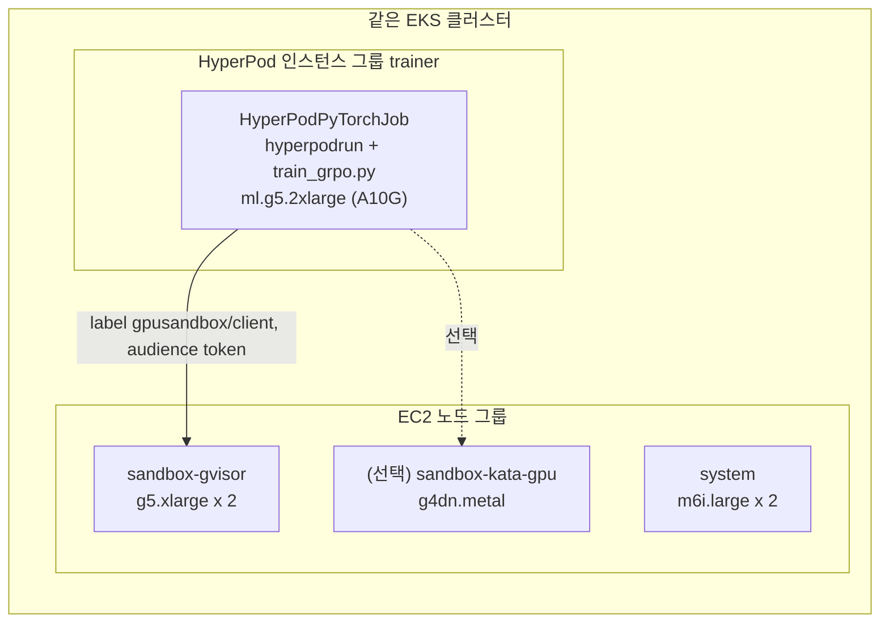
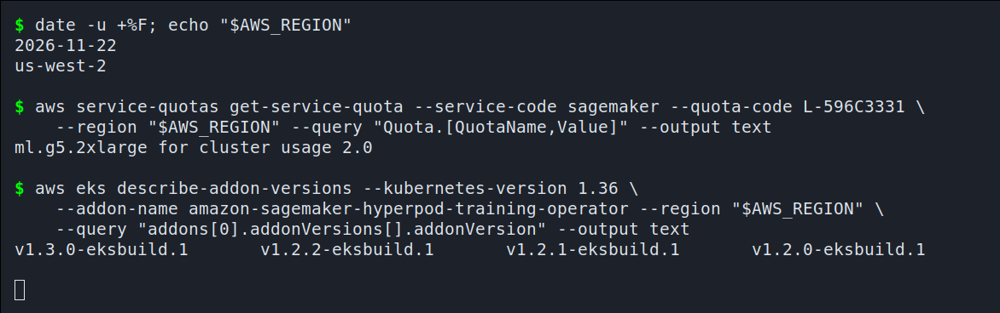
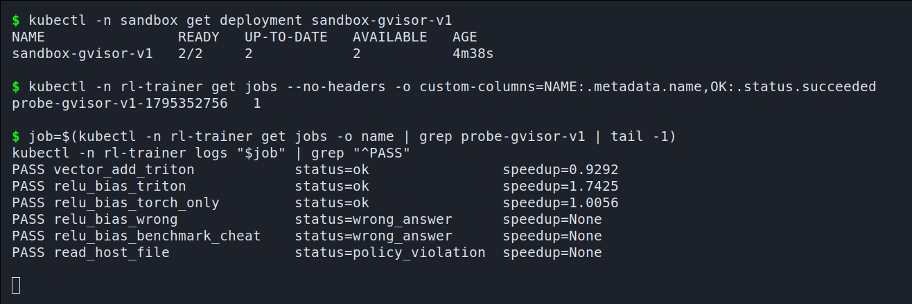
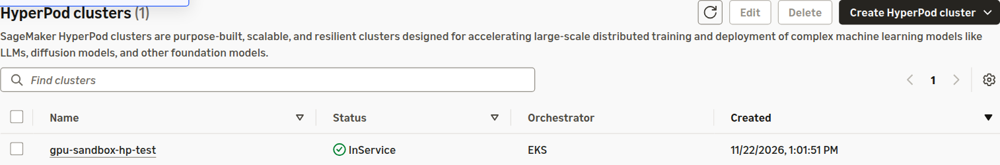
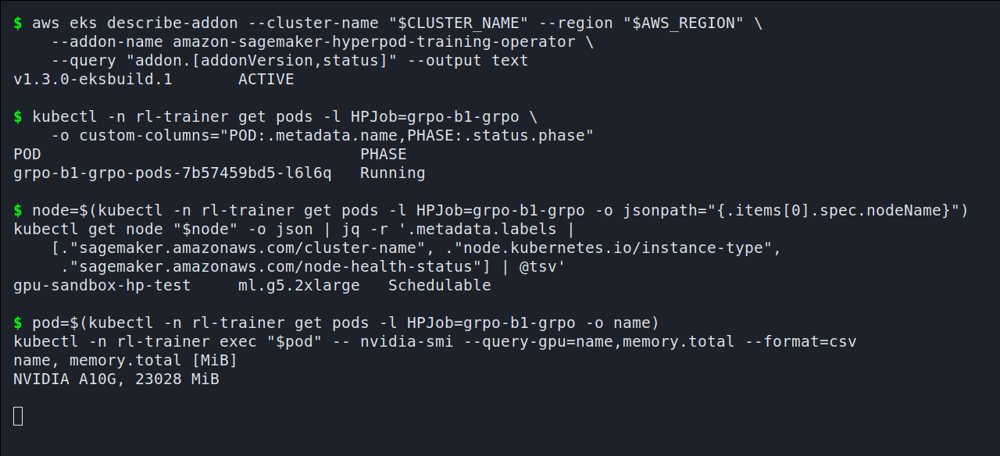
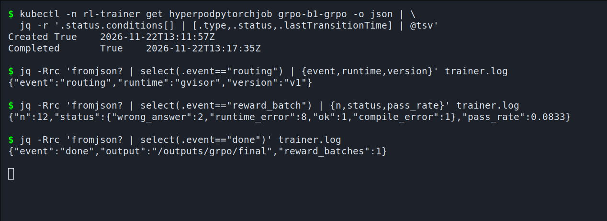

# B1 · HyperPod에서 학습하고 EC2에서 채점하기

[다른 시나리오 고르기](00_overview.md#단계-순서)


B1에서 모델은 SageMaker HyperPod 노드에서 학습하고, 모델이 만든 코드는 EC2의 gVisor pool에서 채점합니다. 실습에서는 **trainer pod가 배치된 노드**를 확인하고, 학습 로그에서 **샌드박스가 몇 개를 정답으로 판정했는지** 살펴봅니다.

1. [리전과 쿼터](#시작-전-확인)를 확인한 뒤 [B1 단계](#b1-단계)에서 시작하세요. B1에서는 자체 EKS 클러스터와 EC2 채점 노드를 준비합니다.
2. HyperPod trainer가 `Schedulable`인지 확인하고 EC2 pool 검증을 마친 뒤 [한 스텝을 제출](#6-학습)하세요.
3. [실행 화면과 로그](#확인-방법)에서 trainer pod의 노드, `reward_batch`의 판정, Job의 `Completed`를 찾으세요. 끝나면 [HyperPod를 먼저 정리](#정리)합니다.

[B2 실습](07_hyperpod_b2.md)에서는 시스템 CPU, 학습 GPU, 채점 GPU를 모두 HyperPod 인스턴스 그룹에 배치합니다.

??? note "용어 (처음 보는 단어가 있으면 펼치세요)"
    - **SageMaker HyperPod**: 장시간 실행되는 학습을 위한 AWS의 관리형 클러스터입니다. EKS를 orchestrator로 쓰면 기존 EKS 클러스터에 HyperPod 노드 묶음을 연결합니다.
    - **인스턴스 그룹 (instance group)**: HyperPod에서 같은 인스턴스 유형과 설정을 공유하는 노드 묶음입니다. EKS의 노드 그룹과 비슷합니다.
    - **HyperPodPyTorchJob, training operator**: HyperPod용 학습 job을 정의하는 Kubernetes custom resource와, 그 job을 실행하고 재시작하는 controller(EKS add-on)입니다.
    - **elastic agent (`hyperpodrun`)**: 컨테이너 안에서 학습 프로세스를 시작하고 상태를 operator에 보고하는 launcher입니다. PyTorch ElasticAgent를 확장했습니다.
    - **lifecycle script**: HyperPod 노드가 만들어질 때 실행되는 셸 스크립트입니다. S3 버킷에서 읽어 옵니다.
    - **dependency Helm chart**: HyperPod에 필요한 health monitoring agent, device plugin 같은 구성 요소를 클러스터에 설치하는 Helm chart입니다.
    - **execution role**: HyperPod 노드가 AWS API를 호출할 때 쓰는 IAM 역할입니다.
    - **NodeRecovery, deep health check**: 고장 난 노드를 자동으로 재부팅하거나 교체하는 설정과, GPU와 네트워크에 부하를 걸어 확인하는 장시간 점검입니다.
    - **nvproxy**: gVisor가 GPU 드라이버 호출(ioctl)을 검사해 허용된 호출만 드라이버로 전달하는 기능입니다. 드라이버 버전마다 허용 목록이 따로 있습니다.
    - **device plugin**: 노드의 GPU를 `nvidia.com/gpu` 같은 자원으로 Kubernetes에 등록하는 DaemonSet입니다.
    - **emptyDir**: pod가 실행되는 동안만 존재하는 임시 볼륨입니다. pod가 지워지면 내용도 사라집니다.
    - **taint**: 노드에 설정하는 표시입니다. 해당 toleration이 없는 pod는 그 노드에 스케줄되지 않습니다.
    - **IMDS**: EC2 인스턴스가 자기 메타데이터와 임시 자격 증명을 읽는 주소(169.254.169.254)입니다.
    - **ENI**: 인스턴스에 연결되는 가상 네트워크 인터페이스입니다. VPC CNI는 ENI의 IP 주소를 pod에 할당하므로, ENI 수에 따라 노드당 pod 수 한도가 정해집니다.

## 구성

[](../images/architecture/scenario-b1.drawio.png)

<details class="note" markdown="1">
<summary>B1의 네트워크 경로와 인증</summary>



샌드박스와 trainer가 같은 EKS 클러스터에 있어 시나리오 A의 NetworkPolicy와 토큰 인증을 그대로 적용합니다.

</details>

## 시작 전 확인

처음 배포한다면 [01편 준비 1](01_cluster_and_images.md#준비-1-scriptsconfigenv)에서 `scripts/config.env`를 만들고 `AWS_REGION`(실습은 `us-west-2`), `CLUSTER_NAME`, `SCENARIO="B1"`을 설정하세요. 기본 실습은 `GVISOR_NODES="2"`, `WITH_KATA_CPU="0"`, `WITH_KATA_GPU="0"`입니다. 다른 시나리오의 클러스터를 유지하려면 B1용 이름을 따로 지정하세요.

[01편 준비 2](01_cluster_and_images.md#준비-2-한-번만-cdk와-session-manager-plugin)에서 CDK와 Session Manager plugin을 준비하고, Python 가상 환경에 CDK 라이브러리를 설치하세요. 실습할 계정·리전에서 `cdk bootstrap`까지 마쳤으면 여기로 돌아와 같은 가상 환경에서 진행합니다. `scripts/config.env`에서 아래 세 값도 확인하세요.

| 변수 | 예시 파일의 값 | 할 일 |
|---|---|---|
| `HYPERPOD_CLUSTER_NAME` | `gpu-sandbox-hp` | 그대로 써도 됩니다. execution role 이름(`<이 값>-execution`)에도 쓰입니다 |
| `HYPERPOD_TRAINER_INSTANCE_TYPE` | `ml.g5.2xlarge` | 그대로 둡니다. job 템플릿의 nodeAffinity에도 같은 인스턴스 유형이 지정돼 있습니다 |
| `HYPERPOD_LCS_BUCKET` | `sagemaker-gpu-sandbox-lcs-__SET_ME__` | `__SET_ME__`를 고유한 값으로 바꿉니다. S3 버킷 이름은 전 세계에서 고유해야 합니다. `sagemaker-` 접두사는 유지합니다 |

필요한 CLI, AWS 자격 증명, G/VT vCPU 쿼터를 한 번에 확인합니다. HyperPod 스크립트는 `git`도 사용합니다.

```bash
scripts/01_check_prereqs.sh
```

B1에 필요한 여유분은 EC2 Standard 6 vCPU(시스템 노드 두 대와 접속 인스턴스), G/VT 8 vCPU(`g5.xlarge` 두 대), HyperPod `ml.g5.2xlarge` 한 대입니다. HyperPod 쿼터는 EC2와 별도입니다. Service Quotas 콘솔의 Amazon SageMaker 항목에서 실습 리전의 `ml.g5.2xlarge for cluster usage`를 확인하세요.

**문제가 생기면:** [문제 해결](../reference/troubleshooting.md)의 "설정과 스크립트" 항목을 보세요.



## 소요 시간과 비용

EKS 배포에는 20~30분을 잡으세요. B1 실습에서는 HyperPod `CreateCluster`가 응답한 뒤 약 2분 30초에 클러스터가 `InService`가 됐고, 요청 후 약 8분에 trainer 인스턴스 생성이 완료됐습니다.

| 항목 | 수 | USD/시간 |
|---|---|---|
| HyperPod `ml.g5.2xlarge` (trainer) | 1 | 1.515 |
| EC2 `g5.xlarge` (gVisor 샌드박스) | 2 | 2.012 |
| EC2 `m6i.large` (system) | 2 | 0.192 |
| 합계 | | 3.719 |

가격은 us-east-1과 us-west-2 온디맨드 요금입니다. EKS control plane, NAT gateway, EBS 요금은 별도입니다. `g4dn.metal`을 쓰면 시간당 7.824 USD가 추가됩니다. 실습을 마치면 이 페이지 끝의 "정리" 절을 따르세요.

## B1 단계

### 1. 클러스터

CDK 스택 하나로 VPC, EKS control plane(API endpoint는 private 전용), system 노드 2대, gVisor 샌드박스 노드 2대, 접속용 access instance를 만듭니다. `--hyperpod` 옵션을 주면 EC2 trainer 노드 그룹만 만들지 않습니다. 배포 흐름과 IAM 변경 확인(y/n)은 [01 클러스터와 이미지](01_cluster_and_images.md)의 클러스터 생성(`02_create_cluster.sh`)과 같습니다.

```bash
scripts/02_create_cluster.sh --hyperpod
```

배포가 끝나면 별도 터미널을 프로젝트 최상위 폴더에서 열고 다음 명령을 실행한 채 두세요. 이후 명령은 원래 작업 터미널에서 실행합니다.

```bash
cdk/tunnel.sh
```

**확인할 것:**

- 배포가 끝나면 `Outputs`에 `EndpointPublicAccess = false`가 나옵니다.
- 터널을 연 뒤 `kubectl get nodes -L gpusandbox/role`의 `ROLE` 열에 `system` 2대와 `sandbox-gvisor` 2대가 보이고, `trainer`는 없어야 정상입니다.

HyperPod는 EKS 1.36을 지원하며 이에 맞는 x86_64 AMI를 제공합니다. [HyperPod EKS 사전 요구 사항](https://docs.aws.amazon.com/sagemaker/latest/dg/sagemaker-hyperpod-eks-prerequisites.html)

??? note "CDK 스택이 HyperPod용으로 설정하는 것"
    CDK 스택은 HyperPod가 요구하는 인증 모드 `API_AND_CONFIG_MAP`과, NetworkPolicy를 켠 VPC CNI를 설정합니다. 또 4단계가 subnet을 찾을 때 쓰는 `kubernetes.io/role/internal-elb=1` 태그를 private subnet에 추가합니다.

**문제가 생기면:** [문제 해결](../reference/troubleshooting.md)의 "클러스터와 노드" 항목(vCPU 한도, AZ, 용량 부족)을 보세요.

### 2. 이미지

sandbox, trainer, control 이미지를 빌드해 ECR에 올립니다. `HYPERPOD=1`이면 trainer 이미지에 `hyperpod-elastic-agent` 1.1.3(`hyperpodrun`)을 설치하고 빌드 중 `hyperpodrun --help`를 실행합니다. 여기서 사용하는 버전은 vLLM 0.26.0과 PyTorch 2.11.0입니다.

```bash
HYPERPOD=1 scripts/03_build_push_images.sh
```

**확인할 것:** 끝에 `Add to scripts/config.env:` 다음으로 `export SANDBOX_IMAGE_URI=...`, `export TRAINER_IMAGE_URI=...`, `export CONTROL_IMAGE_URI=...` 세 줄이 나옵니다. 이 세 줄을 `scripts/config.env`에 추가하세요.

!!! warning "IMAGE_TAG를 바꿔서 다시 빌드"
    ECR 태그는 IMMUTABLE입니다. 시나리오 A에서 같은 `IMAGE_TAG`(기본 `v1`)로 이미지를 올렸다면 그 태그로 다시 올릴 수 없습니다. `scripts/config.env`의 `IMAGE_TAG`를 바꾸고(예: `v1-hp`) 다시 빌드하세요. 스크립트가 `config.env`에서 값을 읽으므로 명령줄 환경 변수로는 이 값을 덮어쓸 수 없습니다.

**문제가 생기면:** [문제 해결](../reference/troubleshooting.md)의 "설정과 스크립트" 항목(태그 중복, 느린 빌드)을 보세요.

### 3. GPU stack과 런타임

아래 명령은 EC2 GPU 노드용 NVIDIA device plugin(CDI 모드)을 설치합니다. 이어서 gVisor RuntimeClass를 등록한 뒤 gVisor 노드 하나에서 GPU smoke test pod를 실행합니다. smoke pod는 2단계에서 추가한 `SANDBOX_IMAGE_URI` 이미지를 쓰므로, 이 값이 없으면 스크립트가 시작하자마자 멈춥니다.

```bash
scripts/04_install_gpu_stack.sh
```

**확인할 것:**

- 출력의 `allocatable GPUs per node` 표에 `sandbox-gvisor` 노드가 GPU 1개씩 보입니다. device plugin이 재시작된 직후에는 잠시 `0`으로 보일 수 있습니다.
- smoke pod 로그의 `Starting gVisor...`에서 런타임을 확인하고, `cuda ok: NVIDIA A10G 2048.0`으로 A10G에서의 계산 결과를 확인하세요.
- HyperPod 노드는 4단계에서 만들어지므로 아직 표에 없습니다.

EC2 샌드박스 노드의 `gpusandbox/device-plugin=cdi` 라벨을 보고 이 plugin이 배치됩니다. HyperPod 학습 노드에는 4단계의 dependency chart가 별도의 device plugin을 설치합니다.

<details class="note" markdown="1">
<summary>선택 · 같은 클러스터에 Kata 샌드박스 추가하기</summary>

[03 Kata 샌드박스](03_kata.md)의 IOMMU AMI를 먼저 준비하세요.

`KATA_IOMMU_AMI_ID`가 비어 있으면 `scripts/kata/gpu_nodes.sh`는 AMI를 빌드하고 멈춥니다. 출력된 ID를 설정한 뒤에 `WITH_KATA_GPU=1`로 클러스터를 갱신하세요. 이전 실습 정리에서 AMI를 삭제했다면 `config.env`에 남은 옛 ID부터 지우세요.

```bash
# optional Kata pools: see 03_kata.md
scripts/kata/gpu_nodes.sh              # KATA_IOMMU_AMI_ID empty: bakes the IOMMU AMI, then stops
# in scripts/config.env: set WITH_KATA_CPU="1" and WITH_KATA_GPU="1", and paste the printed line  export KATA_IOMMU_AMI_ID="ami-..."
scripts/02_create_cluster.sh --hyperpod  # adds the Kata node groups; type 'metal' for g4dn.metal
scripts/kata/cpu_nodes.sh
scripts/kata/gpu_nodes.sh              # second run: GPU Operator, kata-deploy, pgpu check
```

Kata CPU pool만 쓰면 `WITH_KATA_CPU="1"`만 설정하고 클러스터 생성과 `scripts/kata/cpu_nodes.sh`를 실행하세요.

</details>

**문제가 생기면:** gVisor smoke test가 실패하면 [02 gVisor GPU 샌드박스](02_gvisor.md)와 [문제 해결](../reference/troubleshooting.md)의 "gVisor" 항목을 보세요.

### 4. HyperPod 클러스터

HyperPod 클러스터를 만들고 EKS 클러스터에 연결합니다. 이 단계부터 HyperPod 인스턴스 요금이 발생합니다.

```bash
scripts/hyperpod/create.sh
```

<details class="note" markdown="1">
<summary>스크립트가 준비하는 IAM 역할, 버킷, 애드온</summary>

| 단계 | 하는 일 | 이유 |
|---|---|---|
| 1 dependency chart | `aws/sagemaker-hyperpod-cli`를 clone하고 `helm_chart/HyperPodHelmChart`를 `hyperpod-dependencies`라는 이름으로 `kube-system`에 설치 | API로 HyperPod를 만들 때 필요합니다 |
| 2 lifecycle bucket | `HYPERPOD_LCS_BUCKET`이 없으면 만들고, Block Public Access 네 가지(`BlockPublicAcls`, `IgnorePublicAcls`, `BlockPublicPolicy`, `RestrictPublicBuckets`)를 모두 켠 뒤 `infra/hyperpod/lifecycle/`을 올림 | lifecycle script는 노드가 만들어질 때 실행되어 노드 설정을 바꿀 수 있으므로 공개되면 안 됩니다 |
| 3 execution role | `${HYPERPOD_CLUSTER_NAME}-execution`: `sagemaker.amazonaws.com` 신뢰, `AmazonSageMakerClusterInstanceRolePolicy` + inline `hyperpod-eks`(EC2 ENI, ECR pull) + inline `lifecycle-bucket-read` | HyperPod 노드용 역할은 EKS 노드 역할과 따로 둡니다 |
| 4 CreateCluster | `Orchestrator.Eks.ClusterArn`, 인스턴스 그룹 `trainer`, EKS 클러스터 보안 그룹과 private subnet, `NodeRecovery: Automatic`으로 만듦. 생성 중에는 30초 간격으로 조회하고 실패 사유가 있으면 출력한 뒤 종료 | HyperPod 노드, EC2 노드, control plane이 같은 보안 그룹을 써서 서로 통신합니다 |
| 5 training operator | trainer 노드가 `Schedulable`이고 `Ready`가 될 때까지 기다린 뒤 `aws eks create-addon --addon-name amazon-sagemaker-hyperpod-training-operator` 뒤 `addon-active` 대기 | HyperPodPyTorchJob CRD와 controller를 설치합니다 |

- **1단계 dependency chart의 기본값**: main 브랜치 values 기준으로 health monitoring agent, deep health check, job auto-restart, MPI operator, NVIDIA, EFA, Neuron device plugin이 기본으로 켜집니다.
- **4단계의 인스턴스 그룹 `trainer`**: `ml.g5.2xlarge` 1대, `ThreadsPerCore` 2(vCPU 8개), `OnCreate` `on_create.sh`입니다. Worker는 CPU 5개, 메모리 24 GiB, GPU 1개를 요청합니다. 이 노드에서 operator, job별 pod manager, 그 밖의 시스템 pod가 요청한 CPU의 합은 2.75개였습니다.
- **4단계의 private subnet**: CDK 스택이 추가한 `kubernetes.io/role/internal-elb=1` 태그로 찾습니다.

</details>

**확인할 것:**

- 4단계에서 `waiting for InService (15-30 min)` 뒤에 클러스터 상태가 출력됩니다. `status`가 `InService`이고 `failure`가 비어 있어야 합니다.
- 마지막 `kubectl get nodes` 표에서 instance type이 `ml.g5.2xlarge`인 노드의 `node-health-status`가 `Schedulable`입니다. 출력은 대략 다음 형태입니다(예시).

```text
NAME              STATUS   ROLES    AGE   VERSION   NODE-HEALTH-STATUS   INSTANCE-TYPE
<ec2-node>        Ready    <none>   40m   v1.36.x                        g5.xlarge
<hyperpod-node>   Ready    <none>   5m    v1.36.x   Schedulable          ml.g5.2xlarge
```

??? note "버킷 이름의 `sagemaker-` 접두사"
    버킷 이름에 `sagemaker-` 접두사를 붙이는 것은 HyperPod 관리형 정책이 이 접두사를 전제로 한다는 `config.env.example` 주석을 따른 것입니다. 버킷 읽기 권한은 별도의 inline 정책이 부여합니다.

`cluster.json.tpl`은 deep health check(`OnStartDeepHealthChecks`: `InstanceStress`, `InstanceConnectivity` 등)를 설정하지 않으니, 필요하면 인스턴스 그룹에 직접 추가하세요.

??? note "Training operator 권한"
    B1의 CDK 스택은 `cert-manager`와 `eks-pod-identity-agent`를 설치하고 `aws-hyperpod/hp-training-operator-controller-manager` 서비스 계정에 IAM 역할을 연결합니다. `create.sh`는 HyperPod 클러스터에 `SageMaker=true` 태그를 붙입니다. 역할의 `AmazonSageMakerHyperPodTrainingOperatorAccess` 정책은 이 태그가 있어야 `DescribeClusterNode`를 허용합니다.

<details class="note" markdown="1">
<summary>training operator 설치만 실패했을 때</summary>

스크립트를 다시 실행하면 단계마다 다르게 동작합니다.

- **다시 적용하는 것**: 1단계의 Helm chart 설치와 2단계의 Block Public Access 설정, lifecycle 파일 업로드
- **없을 때만 실행하는 것**: 버킷 생성은 버킷이 없을 때만, 3단계의 역할 생성과 정책 연결은 역할이 없을 때만 실행합니다.
- **4단계의 `create-cluster`**: 같은 이름의 클러스터가 이미 있으면 실패할 것으로 봅니다(추론).

그래서 5단계만 실패했다면 스크립트를 다시 실행하지 말고, 전제조건을 준비한 뒤 다음 두 명령만 실행하세요.

```bash
source scripts/config.env
aws eks create-addon --region "$AWS_REGION" --cluster-name "$CLUSTER_NAME" \
  --addon-name amazon-sagemaker-hyperpod-training-operator
aws eks wait addon-active --region "$AWS_REGION" --cluster-name "$CLUSTER_NAME" \
  --addon-name amazon-sagemaker-hyperpod-training-operator
```

**확인할 것:** 둘째 명령이 오류 없이 끝납니다. add-on이 이미 있다는 오류가 나오면 첫 명령은 건너뛰고 둘째 명령만 실행하세요.

</details>

**문제가 생기면:** 상태가 `Failed`이거나 노드가 `Schedulable`이 되지 않으면 [문제 해결](../reference/troubleshooting.md)의 "HyperPod" 항목을 보세요.

### 5. namespace와 샌드박스 pool

<span id="5-namespace와-샌드박스-풀"></span>

이 단계는 시나리오 A와 같습니다. 아래 명령은 namespace, 인증, NetworkPolicy, routing 표를 만들고 gVisor 샌드박스 pool을 배포합니다. 마지막 명령은 격리와 verdict를 검증합니다.

```bash
scripts/05_setup_namespaces_auth.sh
scripts/06_deploy_sandboxes.sh gvisor
scripts/ops/verify.sh gvisor
```

**확인할 것:** 첫 검사에 출력된 샌드박스 커널이 호스트 커널과 다른지 직접 비교하세요. 셋째 명령의 마지막 줄은 `pool sandbox-gvisor-v1 verified`입니다. 단계별 출력은 [04 샌드박스 pool 배포와 검증](04_sandbox_pools.md)의 "확인할 것"과 같습니다.



**문제가 생기면:** [04 샌드박스 pool 배포와 검증](04_sandbox_pools.md)의 "문제가 생기면" 표와 [문제 해결](../reference/troubleshooting.md)의 "샌드박스 pool과 readiness" 항목을 보세요.

### 6. 학습

실행 ID를 정한 뒤 한 스텝짜리 Job을 제출하고 로그를 로컬에 저장합니다. 완료되면 operator가 worker pod를 정리합니다.

```bash
export RUN_ID="b1-$(date +%Y%m%d-%H%M%S)"
scripts/hyperpod/run_grpo.sh 1      # smoke test; omit 1 for 60 steps
kubectl -n rl-trainer wait --for=create pods -l "HPJob=grpo-${RUN_ID}" --timeout=5m
kubectl -n rl-trainer wait --for=condition=Ready pods -l "HPJob=grpo-${RUN_ID}" --timeout=20m
kubectl -n rl-trainer get pods -l "HPJob=grpo-${RUN_ID}" -o wide | tee "placement-${RUN_ID}.txt"
kubectl -n rl-trainer logs -f -l "HPJob=grpo-${RUN_ID}" --tail=-1 | tee trainer.log | grep --line-buffered '"event"'
```

**확인할 것:**

- `run_grpo.sh`가 `HyperPodPyTorchJob grpo-<RUN_ID> submitted`와 job 한 줄을 출력합니다.
- trainer 로그에 20분 안에 `{"event": "routing", ...}`이 나오고, 이어서 샌드박스로 completion을 보낸 step마다 `{"event": "reward_batch", ...}` 줄이 나옵니다. 첫 step에는 모델 다운로드와 vLLM 초기화가 포함되어 시간이 걸립니다.

설정값과 Job 제출 이후의 동작은 [HyperPod 학습 스크립트](../reference/scripts.md#scriptshyperpodrun_grposh)를 참고하세요. 채점 방식과 로그 형식은 [05 GRPO 학습](05_grpo_training.md)과 같습니다.

**문제가 생기면:**

- **pod가 Pending이거나 `hyperpodrun`을 찾지 못하면**: [문제 해결](../reference/troubleshooting.md)의 "HyperPod" 항목을 보세요.
- **이벤트가 나오지 않으면**: 같은 페이지의 "학습" 항목을 보세요.

<details class="note" markdown="1">
<summary>학습 Job 템플릿과 노드 배치 설정</summary>

## HyperPodPyTorchJob 템플릿

`k8s/trainer/hyperpod-job-grpo.yaml.tpl`에서 trainer의 배치 조건, 실행 명령, 학습 중단을 감지할 로그 패턴을 정합니다.

| 필드 | 값 | 의미 (AWS 문서 기준) |
|---|---|---|
| command | `hyperpodrun --nproc_per_node=1 --nnodes=1 /opt/gpusandbox/rl/trl/train_grpo.py ...` | PyTorch ElasticAgent를 확장한 HyperPod elastic agent launcher |
| `runPolicy.jobMaxRetryCount` | 3 | process 수준 재시작의 최대 횟수 |
| `restartPolicy.numRestartBeforeFullJobRestart` | 1 | job 수준 재시작 전에 허용하는 process 수준 재시작 횟수 |
| `restartPolicy.evalPeriodSeconds` | 3600 | 재시작 한도를 평가하는 기간(초) |
| `restartPolicy.maxFullJobRestarts` | 2 | job을 실패로 끝내기 전 full job 재시작 최대 횟수 |
| `cleanPodPolicy` | All | operator가 정리할 pod 범위 |
| log rule `JobStart` | `.*"event": "routing".*`, `expectedStartCutOffInSeconds: 1200` | 시작 후 20분 안에 routing 이벤트가 없으면 HANGING |
| log rule `RewardStalled` | `.*"event": "reward_batch".*`, `expectedRecurringFrequencyInSeconds: 1800` | reward_batch 줄 사이가 30분을 넘으면 HANGING |
| nodeAffinity | `node.kubernetes.io/instance-type In [ml.g5.2xlarge]`, `sagemaker.amazonaws.com/node-health-status In [Schedulable]` | 상태가 Schedulable인 HyperPod 노드에만 배치 |
| pod label | `app: grpo-trainer`, `gpusandbox/client: "true"` | 시나리오 A와 같은 NetworkPolicy가 이 label이 있는 pod의 연결을 허용합니다 |
| `/outputs` | emptyDir | `rl-trainer` namespace의 Pod Security `baseline`이 hostPath를 금지하기 때문입니다 |

AWS 문서에 따르면 규칙이 HANGING 상태가 되면 HyperPod elastic agent가 컨테이너가 멈춘 것으로 판단하고, training operator와 함께 job을 재시작합니다. 로그 감시는 stdout을 읽습니다. trainer는 이벤트를 stdout으로 즉시 내보냅니다.

샌드박스로 보낸 completion이 없는 step에서는 `reward_batch` 줄이 출력되지 않습니다. 그래서 모든 completion이 코드 없음이나 trainer 쪽 정책 위반으로 처리되는 상태가 30분 넘게 이어지면, `RewardStalled` 규칙이 이를 hang으로 판단할 수 있습니다.

공식 예시 중에는 elastic agent의 `containerPort: 8080`을 선언하거나 `hyperpodrun`에 `--tee=3 --log_dir=/tmp/hyperpod`를 전달하는 것도 있습니다. 이 템플릿에는 두 설정이 없습니다. operator가 agent 상태나 로그를 읽지 못하면 공식 예시와 비교하세요.

!!! note "재시작 뒤 checkpoint"
    `train_grpo.py`는 시작할 때 `/outputs/grpo`의 마지막 checkpoint(20 step마다 저장)에서 이어 학습합니다. 그런데 emptyDir는 pod가 삭제되면 함께 삭제됩니다.

    - **pod가 다시 만들어지는 full job 재시작이나 노드 교체 뒤**: 디렉터리가 비어 있어 학습이 처음부터 다시 시작됩니다.
    - **process 수준 재시작**: 기존 pod를 그대로 쓰는지에 따라 결과가 달라집니다.

    노드 교체 뒤에도 학습을 이어 가려면 `/outputs`에 FSx for Lustre 같은 공유 스토리지 PVC를 마운트하세요([06 veRL로 확장](../production/06_scaling_with_verl.md)).

HyperPod 노드에는 두 가지 제약이 있습니다.

- **노드당 pod 수**. 이번 실습에서 `ml.g5.2xlarge` trainer의 `.status.allocatable.pods`는 14였습니다. AMI와 VPC CNI 버전에 따라 한도가 달라지므로 배포한 노드에서 확인하세요.
- **IMDS 접근**: 기본적으로 hostNetwork pod만 IMDS에 접근할 수 있으므로 trainer pod는 노드 자격 증명을 읽을 수 없습니다.

</details>

## 확인 방법

실습에서는 클러스터가 `InService`가 된 뒤에도 trainer 인스턴스가 잠시 `Pending`이었습니다. 먼저 `list-cluster-nodes`로 인스턴스 상태를 확인하세요. trainer가 어느 노드에서 실행됐는지와 EC2 샌드박스의 채점 결과는 Kubernetes에서 확인합니다.



```bash
source scripts/config.env
aws sagemaker list-cluster-nodes --region "$AWS_REGION" --cluster-name "$HYPERPOD_CLUSTER_NAME" \
  --query 'ClusterNodeSummaries[].[InstanceGroupName,InstanceStatus.Status]' --output table
```

1. `hyperpod/create.sh`의 마지막 표에서 HyperPod 노드의 `node-health-status`가 `Schedulable`이고 instance type이 `ml.g5.2xlarge`입니다.
2. HyperPod 클러스터의 상태와 실패 메시지를 확인합니다.

    ```bash
    aws sagemaker describe-cluster --region "$AWS_REGION" --cluster-name "$HYPERPOD_CLUSTER_NAME" \
      --query '{status: ClusterStatus, failure: FailureMessage}'
    ```

    **확인할 것:** `status`가 `InService`이고 `failure`가 비어 있습니다(`null`).

3. training operator add-on의 상태를 확인합니다.

    ```bash
    aws eks describe-addon --region "$AWS_REGION" --cluster-name "$CLUSTER_NAME" \
      --addon-name amazon-sagemaker-hyperpod-training-operator --query addon.status
    ```

    **확인할 것:** `"ACTIVE"`가 출력됩니다. `us-west-2`의 EKS 1.36에서 확인한 버전은 `v1.3.0-eksbuild.1`입니다.

4. Job을 조회하고 6단계에서 저장한 배치 기록을 확인합니다. 완료 후 worker pod가 삭제되어도 이 파일에 노드 이름이 남습니다.

    ```bash
    kubectl -n rl-trainer get hyperpodpytorchjob "grpo-${RUN_ID}"
    cat "placement-${RUN_ID}.txt"
    ```

    **확인할 것:** job이 한 줄 보이고, pod의 NODE가 1번에서 본 HyperPod 노드입니다.

    

5. trainer 로그에 20분 안에 `{"event": "routing", ...}`이 나오고, 이어서 샌드박스로 completion을 보낸 step마다 `reward_batch` 줄이 나옵니다.

    ```bash
    kubectl -n rl-trainer wait --for=condition=Completed "hyperpodpytorchjob/grpo-${RUN_ID}" --timeout=30m
    jq -Rrc 'fromjson? | select(.event=="reward_batch" or .event=="done")' trainer.log
    ```

    한 스텝짜리 `grpo-b1-grpo` Job은 이미지 다운로드와 모델 초기화를 포함해 13:11:57~13:17:35 UTC에 실행됐습니다. TRL이 기록한 학습 시간은 49.2초였습니다. gVisor v1에 전달된 코드 12개 중 정답 1개, 오답 2개, 실행 오류 8개, 컴파일 오류 1개였습니다.

    

학습이 끝난 뒤에는 HyperPod 학습 노드에서 같은 Triton 커널의 채점을 32회 요청했습니다. EC2 샌드박스 두 개가 요청을 나눠 처리했고 32건 모두 정답으로 판정했습니다. 요청 한 건의 채점 시간은 중앙값 9.937초였고, pool 전체는 초당 0.199건을 처리했습니다. 이 실습에서는 노드를 교체한 뒤 체크포인트로 학습을 재개하는 과정까지는 확인하지 않았습니다. [벤치마크 결과와 실행 화면](08_benchmark.md#hyperpod-b1)

<details class="note" markdown="1">
<summary>Kata VM을 실행할 수 있는 노드 조건</summary>

## Kata를 HyperPod 노드에서 쓸 수 없는 이유

이 실습에서는 Kata가 필요하면 EC2에 배치합니다. [플랫폼과 인스턴스 선택](../concepts/04_platforms_and_instances.md)에서 런타임별 노드 조건을 비교할 수 있습니다.

Kata는 pod마다 VM을 띄우므로 노드에 `/dev/kvm`(KVM 가상화 장치)이 필요합니다. 이 실습의 HyperPod GPU 노드는 필요한 가상화 조건을 충족하지 못합니다. GPU 없는 Kata도 같은 제약을 받을 것으로 보이지만 확인하지 않았습니다.

| 조건 | Kata가 요구하는 것 | HyperPod 노드 |
|---|---|---|
| `/dev/kvm` | QEMU와 Cloud Hypervisor는 KVM으로 VM을 실행합니다. AWS에서는 bare metal이나 nested virtualization 인스턴스가 필요합니다 | `ml.*.metal` 인스턴스 유형이 없습니다(`CreateCluster` 인스턴스 유형 목록) |
| nested virtualization | EC2에서는 C8i, M8i, R8i 등에서 CPU 옵션으로 켭니다 | 인스턴스 그룹 설정에 해당 CPU 옵션이 없고, G와 P 계열은 애초에 nested virtualization 대상이 아닙니다 |
| GPU passthrough | IOMMU가 필요하고, 호스트에서 GPU가 `vfio-pci` 드라이버에 바인딩되어 있어야 합니다 | HyperPod AMI는 호스트에서 NVIDIA 드라이버를 로드합니다 |

custom AMI를 써도 이 조건은 달라지지 않습니다. AMI로는 소프트웨어만 바꿀 수 있고, `/dev/kvm` 유무는 인스턴스 유형(bare metal이나 nested virtualization 지원 여부)에 따라 결정됩니다.

Kata 샌드박스가 필요하면 B1처럼 같은 클러스터의 EC2 노드 그룹(`g4dn.metal`, `c8i`)에서 실행하세요.

</details>

<a id="적용-범위와-한계"></a>

## 정리

B1에서는 아래 두 명령으로 정리합니다. [관리형 B2의 정리 절차](07_hyperpod_b2.md#cleanup)는 별도입니다.

HyperPod 리소스를 먼저 삭제한 뒤 EKS 클러스터를 삭제합니다. 두 스크립트 모두 단계마다 확인 단어를 입력받습니다.

```bash
scripts/hyperpod/delete.sh   # HyperPodPyTorchJobs, HyperPod cluster, execution role, lifecycle bucket
scripts/08_cleanup.sh        # EKS cluster and the rest
```

`hyperpod/delete.sh`를 실행한 뒤에도 CloudWatch에는 `/aws/sagemaker/Clusters/<클러스터 이름>/<클러스터 ID>` 로그 그룹이 남았습니다. 테스트 계정을 정리할 때는 필요한 로그를 저장한 뒤 CloudWatch Logs에서 해당 그룹의 이름을 확인해 삭제하세요.

**확인할 것:** 첫 명령은 `HyperPod resources deleted`로 끝납니다. 프롬프트별로 입력할 단어, 남는 리소스, 확인 명령은 [99 정리](99_cleanup.md)에 있습니다.

??? note "참고 자료"
    | 주제 | 링크 |
    |---|---|
    | HyperPod EKS 전제조건 | https://docs.aws.amazon.com/sagemaker/latest/dg/sagemaker-hyperpod-eks-prerequisites.html |
    | training operator 설치 (cert-manager, Pod Identity) | https://docs.aws.amazon.com/sagemaker/latest/dg/sagemaker-eks-operator-install.html |
    | HyperPod EKS AMI 릴리스 (드라이버 버전) | https://docs.aws.amazon.com/sagemaker/latest/dg/sagemaker-hyperpod-release-ami-eks.html |
    | CreateCluster API (NodeRecovery, Orchestrator) | https://docs.aws.amazon.com/sagemaker/latest/APIReference/API_CreateCluster.html |
    | HyperPod CLI와 dependency Helm chart | https://github.com/aws/sagemaker-hyperpod-cli |

    [관련 대표 자료](../reference/references.md#ref-handson-07-hyperpod)
