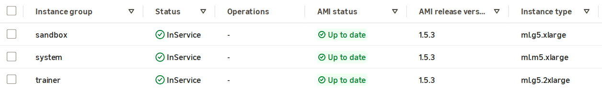
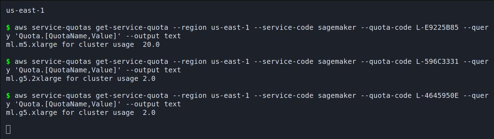
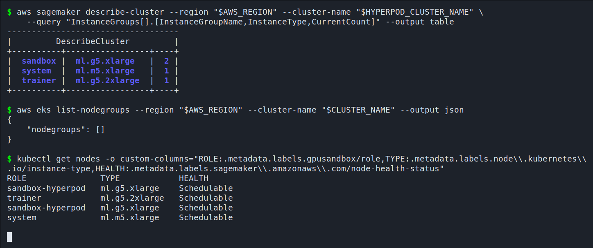
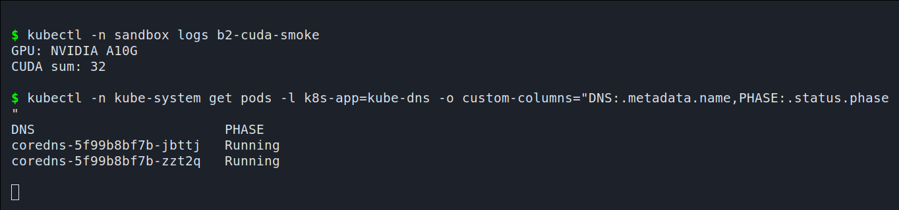
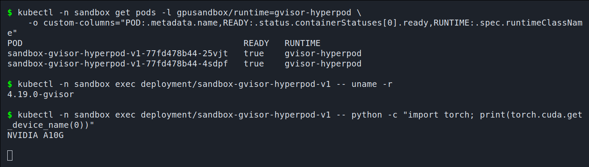
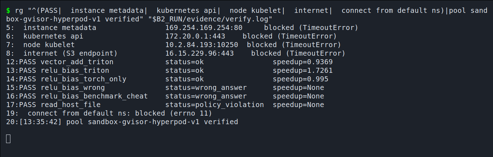
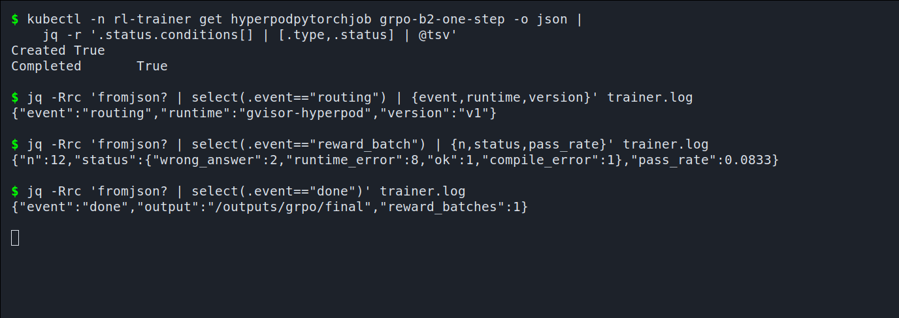
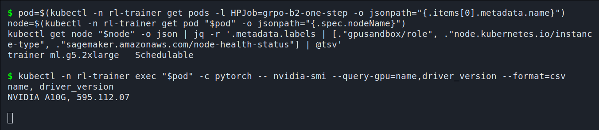

# B2 · Run CPU and GPU workers on HyperPod

The model sends the code it generates to a separate GPU sandbox for grading. In B2, SageMaker HyperPod runs the training workers, the grading workers and the CPU pods that provide cluster services such as DNS. Amazon EKS supplies the Kubernetes API and scheduler.

| HyperPod group | Lab configuration in `us-east-1` | Workload |
|---|---|---|
| `system` | One `ml.m5.xlarge` | CoreDNS and CPU jobs |
| `trainer` | One `ml.g5.2xlarge` | GRPO training on an NVIDIA A10G |
| `sandbox` | Two `ml.g5.xlarge` | One gVisor grading pod per node, each with its own A10G |

[](../images/console/hyperpod-b2-instance-groups.png)

At `us-east-1` on-demand rates the four workers cost **$4.561 per hour** together. EKS, storage and networking have separate charges. [Cost breakdown](../production/08_cost.md)

## Check regional quotas

The SageMaker quotas labeled `for cluster usage` apply separately to each region. This command queries the CPU, training GPU and grading GPU instance types in that order.

```bash
for quota in L-E9225B85 L-596C3331 L-4645950E; do
  aws service-quotas get-service-quota --region us-east-1 --service-code sagemaker \
    --quota-code "$quota" --query 'Quota.[QuotaName,Value]' --output text
done
```

[](../images/terminal/hyperpod-b2-quotas.png)

## Create the cluster through HyperPod

Copy `scripts/config.env.example` to `scripts/config.env` and set the following values. Choose a lifecycle bucket and ECR prefix dedicated to this B2 lab.

```bash
export AWS_REGION="us-east-1"
export SCENARIO="B2"
export K8S_VERSION="1.36"
export CLUSTER_NAME="gpu-sandbox-b2-eks"
export HYPERPOD_CLUSTER_NAME="gpu-sandbox-b2-hp"
export HYPERPOD_AZ_IDS="use1-az1,use1-az2"
export HYPERPOD_SYSTEM_INSTANCE_TYPE="ml.m5.xlarge"
export HYPERPOD_TRAINER_INSTANCE_TYPE="ml.g5.2xlarge"
export HYPERPOD_SANDBOX_INSTANCE_TYPE="ml.g5.xlarge"
export HYPERPOD_SANDBOX_COUNT="2"
export ECR_REPO_PREFIX="gpu-sandbox-b2"
export HYPERPOD_LCS_BUCKET="sagemaker-gpu-sandbox-b2-$(aws sts get-caller-identity --query Account --output text)-use1"
```

The script uses the regional AWS CloudFormation template behind **Create HyperPod cluster → Orchestrated by Amazon EKS** in the SageMaker console. This single stack creates the VPC, the EKS control plane and all three HyperPod groups. The separate `scripts/02_create_cluster.sh` and `cdk/tunnel.sh` commands belong to the CDK path.

```bash
source scripts/config.env
scripts/hyperpod/create_managed.sh
```

Build the images in the same region while the cluster starts. Append the three `export` lines printed at the end to `scripts/config.env`.

```bash
HYPERPOD=1 scripts/03_build_push_images.sh
```

Connect from your workstation when EKS reports `ACTIVE`.

```bash
aws eks update-kubeconfig --region "$AWS_REGION" --name "$CLUSTER_NAME" --alias "$CLUSTER_NAME"
```

## Check the four workers

A group can show `InService` before any of its nodes can run a pod. Compare `CurrentCount` with `TargetCount` for each group and wait for four `Ready` Kubernetes nodes.

```bash
aws sagemaker describe-cluster --region "$AWS_REGION" --cluster-name "$HYPERPOD_CLUSTER_NAME" \
  --query 'InstanceGroups[].[InstanceGroupName,InstanceType,CurrentCount,TargetCount]' --output table
kubectl get nodes -L gpusandbox/role,node.kubernetes.io/instance-type
aws eks list-nodegroups --region "$AWS_REGION" --cluster-name "$CLUSTER_NAME"
```

`list-nodegroups` returns an empty array. The four workers listed by Kubernetes belong to the HyperPod instance groups.

[](../images/terminal/hyperpod-b2-nodes.png)

??? note "A GPU allocation can fail even with quota available"
    During this run, both G5 types initially returned `INSUFFICIENT_CAPACITY_ERROR`. HyperPod retried in `Continuous` mode and eventually allocated all three GPUs in the same availability zone. Look for an `InstanceId` on each pending logical node before submitting another request.

    ```bash
    aws sagemaker list-cluster-nodes --region "$AWS_REGION" --cluster-name "$HYPERPOD_CLUSTER_NAME" \
      --include-node-logical-ids --query 'ClusterNodeSummaries[].[InstanceGroupName,InstanceId,InstanceStatus.Status,InstanceStatus.Message]' --output table
    ```

## Prepare the sandbox drivers and training operator

The stock HyperPod image in this run used NVIDIA `595.112.07`. The lifecycle hook prepares gVisor and the driver tools while the workers join with their stock drivers. Once both are `Ready`, `reboot_sandboxes.sh` installs `580.178.04` on the **two grading nodes** and reboots them through the HyperPod API. This activates the gVisor-compatible driver without unloading a kernel module that HyperPod monitoring is using. The trainer and CPU workers keep their stock configuration.

```bash
scripts/hyperpod/reboot_sandboxes.sh
scripts/hyperpod/prepare_managed.sh
scripts/04_install_gpu_stack.sh
ACTIVE_RUNTIME=gvisor-hyperpod scripts/05_setup_namespaces_auth.sh
kubectl apply -f k8s/runtimes/runtimeclass-gvisor-hyperpod.yaml
```

`prepare_managed.sh` assigns CoreDNS to `system` and enables VPC CNI NetworkPolicy enforcement. In this run the wizard stack completed while the training operator was `CREATE_FAILED`. Installing `cert-manager`, waiting for its webhook and recreating the same operator version brought the add-on to `ACTIVE`.

[](../images/terminal/hyperpod-b2-cuda.png)

If HyperPod replaces a grading worker, wait for the new node to register and run `reboot_sandboxes.sh` before returning it to the pool. The script checks the running and on-disk drivers and skips workers that already run the target version. This lab tested managed reboots of both workers.

## Deploy two graders

```bash
scripts/06_deploy_sandboxes.sh gvisor-hyperpod v1 2
scripts/ops/verify.sh gvisor-hyperpod v1
```

`Ready` tells you the server can answer a readiness probe. Check the kernel and device inside the pod as well. Here `uname -r` returned `4.19.0-gvisor` and PyTorch found `NVIDIA A10G`. The host kernel was `6.12.115-140.210.amzn2023.x86_64`.

[](../images/terminal/hyperpod-b2-pool.png)

??? example "Check the grading and isolation results"
    All six golden cases returned their expected verdicts. Connections from the sandbox to instance metadata, the Kubernetes API, the kubelet and a public S3 address timed out. A pod in `default` could not connect to the sandbox API.

    [](../images/terminal/hyperpod-b2-verify.png)

## Train for one GRPO step

```bash
export RUN_ID="b2-$(date +%Y%m%d-%H%M%S)"
scripts/hyperpod/run_grpo.sh 1
kubectl -n rl-trainer wait --for=condition=Completed "hyperpodpytorchjob/grpo-${RUN_ID}" --timeout=30m
```

The training pod ran on `ml.g5.2xlarge`. Its `reward_batch` reported `gvisor-hyperpod` and all 12 submissions went to v1. One passed, two returned a wrong answer, eight had runtime errors and one failed to compile. `Completed=True` means the training step finished and consumed these verdicts. TRL reported 51.07 seconds of training.

[](../images/terminal/hyperpod-b2-training.png)

??? note "Verify the trainer's GPU"
    The sandbox driver change applies only to `sandbox`. Here the training pod reports the stock driver on its A10G.

    [](../images/terminal/hyperpod-b2-trainer.png)

## Benchmark the same grading pool

```bash
scripts/hyperpod/bench_b2.sh 32
```

The CPU system worker sends the first 32 requests and the trainer sends the next 32. Both jobs use `relu_bias_triton`, the same two graders and one GPU per grader. Training has finished before the benchmark starts. [Benchmark results](08_benchmark.md#hyperpod-b2)

CPU and trainer clients both completed 32/32. Pool throughput was 0.189 and 0.190 eval/s respectively.

## Cleanup { #cleanup }

Save the job logs and benchmark JSONL files before deleting the stack created by the HyperPod wizard. `delete-stack` removes the HyperPod instance groups and their EKS cluster. Wait for deletion before emptying the lifecycle bucket, as the stack also stores a generated template there.

```bash
source scripts/config.env
stack="${HYPERPOD_MANAGED_STACK:-${CLUSTER_NAME}-hyperpod}"
aws cloudformation delete-stack --region "$AWS_REGION" --stack-name "$stack"
aws cloudformation wait stack-delete-complete --region "$AWS_REGION" --stack-name "$stack"
```

For a dedicated lab bucket and ECR prefix, remove the stored objects and images as well.

```bash
aws s3 rm "s3://${HYPERPOD_LCS_BUCKET}/" --recursive --region "$AWS_REGION"
aws s3api delete-bucket --bucket "$HYPERPOD_LCS_BUCKET" --region "$AWS_REGION"
for image in sandbox trainer control; do
  aws ecr delete-repository --repository-name "${ECR_REPO_PREFIX}/${image}" --force --region "$AWS_REGION"
done
```
