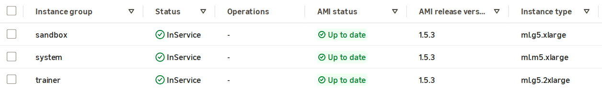
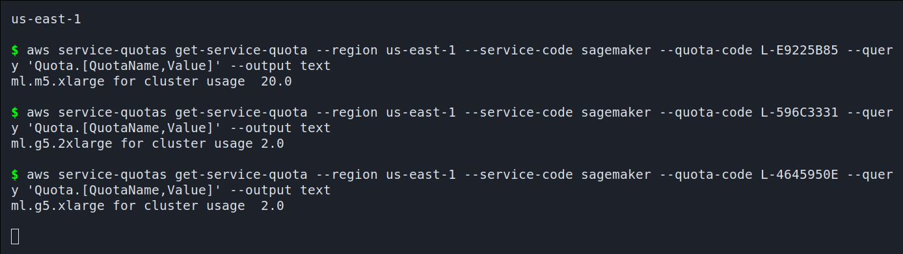
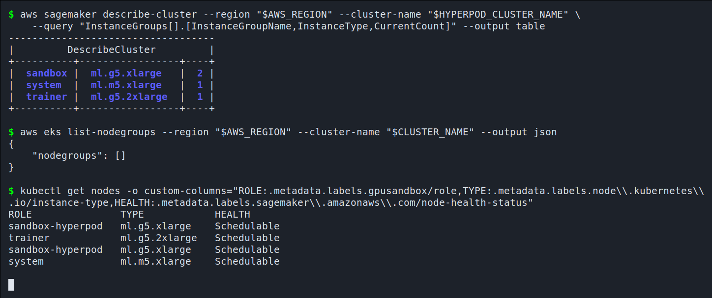
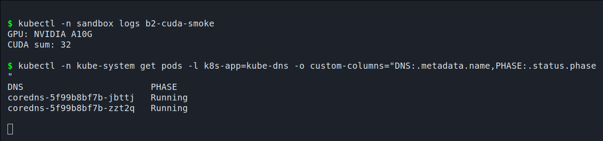
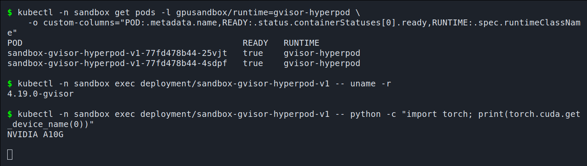
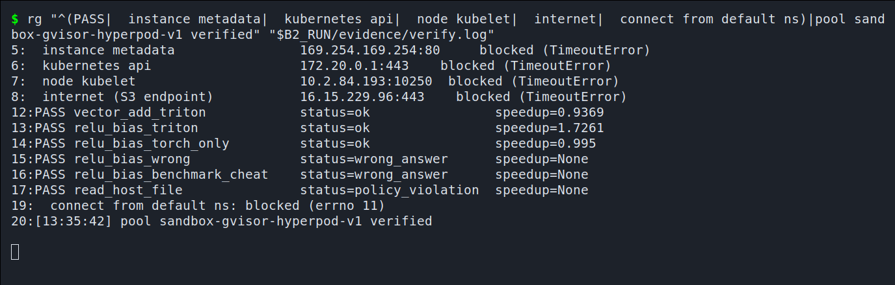
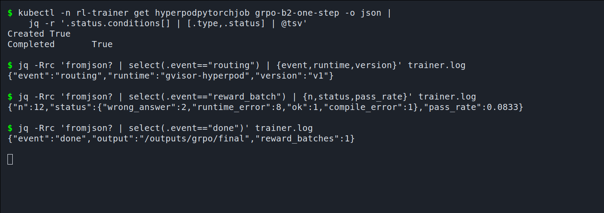
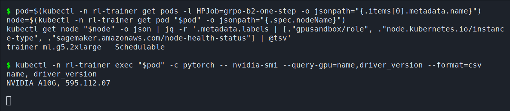

# B2 · CPU와 GPU 워커를 모두 HyperPod에 두기

모델이 코드를 만들면 별도의 GPU 샌드박스가 코드를 실행해 점수를 돌려줍니다. B2에서는 학습과 채점뿐 아니라 CoreDNS 같은 공용 Pod도 SageMaker HyperPod 인스턴스에서 실행합니다. Amazon EKS는 Kubernetes API와 스케줄러를 제공합니다.

| HyperPod 그룹 | `us-east-1` 실습 구성 | 역할 |
|---|---|---|
| `system` | `ml.m5.xlarge` 1대 | CoreDNS와 CPU 작업 |
| `trainer` | `ml.g5.2xlarge` 1대 | NVIDIA A10G에서 GRPO 학습 |
| `sandbox` | `ml.g5.xlarge` 2대 | A10G 한 장을 쓰는 gVisor 채점 Pod를 노드당 하나씩 배치 |

[](../images/console/hyperpod-b2-instance-groups.png)

`us-east-1` 온디맨드 단가로 워커 네 대의 합계는 **시간당 4.561 USD**입니다. EKS 제어 영역, 스토리지, 네트워크 비용은 별도입니다. [비용 구성](../production/08_cost.md)

## 시작 전에 확인할 쿼터

SageMaker의 `for cluster usage` 쿼터는 리전별로 적용됩니다. 아래 명령은 시스템 CPU, 학습 GPU, 채점 GPU 순서로 이 실습에 쓰는 세 항목을 조회합니다.

```bash
for quota in L-E9225B85 L-596C3331 L-4645950E; do
  aws service-quotas get-service-quota --region us-east-1 --service-code sagemaker \
    --quota-code "$quota" --query 'Quota.[QuotaName,Value]' --output text
done
```

[](../images/terminal/hyperpod-b2-quotas.png)

## HyperPod에서 클러스터 만들기

`scripts/config.env.example`을 복사한 `scripts/config.env`에 아래 값을 설정하세요. `HYPERPOD_LCS_BUCKET`에는 이 실습 전용 버킷 이름을 넣으세요. 이미 사용 중인 B1 버킷이나 ECR 저장소와 이름이 겹치면 먼저 구분해 주세요.

```bash
export AWS_REGION="us-east-1"
export SCENARIO="B2"
export K8S_VERSION="1.36"
export CLUSTER_NAME="gpu-sandbox-b2-eks"
export HYPERPOD_CLUSTER_NAME="gpu-sandbox-b2-hp"
export HYPERPOD_AZ_IDS="use1-az1,use1-az2"
export HYPERPOD_SYSTEM_INSTANCE_TYPE="ml.m5.xlarge"
export HYPERPOD_TRAINER_INSTANCE_TYPE="ml.g5.2xlarge"
export HYPERPOD_SANDBOX_INSTANCE_TYPE="ml.g5.xlarge"
export HYPERPOD_SANDBOX_COUNT="2"
export ECR_REPO_PREFIX="gpu-sandbox-b2"
export HYPERPOD_LCS_BUCKET="sagemaker-gpu-sandbox-b2-$(aws sts get-caller-identity --query Account --output text)-use1"
```

다음 명령은 SageMaker 콘솔에서 **Create HyperPod cluster → Orchestrated by Amazon EKS**를 선택할 때 쓰는 AWS CloudFormation 템플릿을 호출합니다. 이 단계에서 VPC, EKS 제어 영역과 세 HyperPod 그룹을 함께 만듭니다. `scripts/02_create_cluster.sh`와 `cdk/tunnel.sh`는 기존 CDK 경로용입니다.

```bash
source scripts/config.env
scripts/hyperpod/create_managed.sh
```

클러스터가 만들어지는 동안 같은 리전에 이미지를 준비할 수 있습니다. 마지막에 출력되는 세 `export` 줄을 `scripts/config.env`에 추가하세요.

```bash
HYPERPOD=1 scripts/03_build_push_images.sh
```

EKS가 `ACTIVE`가 되면 운영자 PC에서 접속합니다.

```bash
aws eks update-kubeconfig --region "$AWS_REGION" --name "$CLUSTER_NAME" --alias "$CLUSTER_NAME"
```

## 워커가 등록됐는지 확인하기

HyperPod 콘솔에서 그룹이 `InService`여도 모든 노드의 준비가 끝나기 전일 수 있습니다. 각 그룹의 `CurrentCount`가 `TargetCount`와 같은지, Kubernetes에서 네 노드가 모두 `Ready`인지 확인하세요.

```bash
aws sagemaker describe-cluster --region "$AWS_REGION" --cluster-name "$HYPERPOD_CLUSTER_NAME" \
  --query 'InstanceGroups[].[InstanceGroupName,InstanceType,CurrentCount,TargetCount]' --output table
kubectl get nodes -L gpusandbox/role,node.kubernetes.io/instance-type
aws eks list-nodegroups --region "$AWS_REGION" --cluster-name "$CLUSTER_NAME"
```

`list-nodegroups` 결과는 빈 배열입니다. 같은 클러스터에서 `kubectl`로 조회한 워커 네 대는 모두 HyperPod가 관리합니다.

[](../images/terminal/hyperpod-b2-nodes.png)

??? note "쿼터가 남았는데 GPU가 배정되지 않을 때"
    이 실습에서 `ml.g5.xlarge`와 `ml.g5.2xlarge`의 첫 요청에는 `INSUFFICIENT_CAPACITY_ERROR`가 기록됐습니다. `Continuous` 모드에서 HyperPod가 다시 요청해 같은 가용 영역에서 세 GPU를 모두 확보했습니다. `Pending` 노드에 실제 `InstanceId`가 생기는지 확인하세요. 그룹을 새로 만드는 동안 두 요청이 겹칠 수 있습니다.

    ```bash
    aws sagemaker list-cluster-nodes --region "$AWS_REGION" --cluster-name "$HYPERPOD_CLUSTER_NAME" \
      --include-node-logical-ids --query 'ClusterNodeSummaries[].[InstanceGroupName,InstanceId,InstanceStatus.Status,InstanceStatus.Message]' --output table
    ```

## 채점 노드의 드라이버와 학습 오퍼레이터 준비하기

이 실습의 기본 HyperPod 이미지에는 NVIDIA `595.112.07`이 들어 있었습니다. gVisor `20261109.0`이 지원하는 `580.178.04`를 **채점 노드 두 대에만** 설치합니다. lifecycle 스크립트는 기본 드라이버로 워커가 등록되도록 gVisor와 설치 도구를 준비합니다. 두 워커가 `Ready`가 된 뒤 `reboot_sandboxes.sh`가 새 드라이버를 디스크에 설치하고 채점 노드를 HyperPod API로 재부팅합니다. 모니터링 프로세스가 사용 중인 커널 모듈은 재부팅 때 교체됩니다. CPU 노드와 학습 노드는 기본 이미지를 사용합니다.

```bash
scripts/hyperpod/reboot_sandboxes.sh
scripts/hyperpod/prepare_managed.sh
scripts/04_install_gpu_stack.sh
ACTIVE_RUNTIME=gvisor-hyperpod scripts/05_setup_namespaces_auth.sh
kubectl apply -f k8s/runtimes/runtimeclass-gvisor-hyperpod.yaml
```

`prepare_managed.sh`는 CoreDNS를 `system` 그룹에 배치하고 VPC CNI의 NetworkPolicy를 켭니다. 이번 실습에서는 마법사 스택이 완료된 뒤에도 학습 오퍼레이터가 `CREATE_FAILED`였습니다. `cert-manager`를 설치하고 웹훅이 준비된 뒤 같은 버전의 오퍼레이터를 다시 설치해 `ACTIVE`를 확인했습니다.

[](../images/terminal/hyperpod-b2-cuda.png)

HyperPod가 채점 노드를 교체하면 새 워커가 등록된 뒤 `reboot_sandboxes.sh`를 다시 실행하세요. 실행 중인 드라이버와 디스크의 드라이버를 비교해 이미 목표 버전을 쓰는 워커는 건너뜁니다. 이번 실습에서 확인한 복구 작업은 두 워커의 관리형 재부팅입니다.

## 두 노드에 채점 풀 배포하기

```bash
scripts/06_deploy_sandboxes.sh gvisor-hyperpod v1 2
scripts/ops/verify.sh gvisor-hyperpod v1
```

두 Pod가 `Ready`인지만 보면 어느 커널에서 코드가 실행되는지 알 수 없습니다. 아래 화면에서 `uname -r`은 샌드박스의 `4.19.0-gvisor`를 반환하고 PyTorch는 `NVIDIA A10G`를 찾습니다. 실습 당시 호스트 커널은 `6.12.115-140.210.amzn2023.x86_64`였습니다.

[](../images/terminal/hyperpod-b2-pool.png)

??? example "기준 사례와 격리 검사 결과 보기"
    기준 사례 6개에서 각각 예상한 판정이 나왔습니다. 샌드박스에서 인스턴스 메타데이터, Kubernetes API, kubelet, 외부 S3 주소에 보낸 연결은 모두 차단됐습니다. `default` 네임스페이스의 Pod도 샌드박스 API에 접속하지 못했습니다.

    [](../images/terminal/hyperpod-b2-verify.png)

## GRPO 한 스텝 실행하기

```bash
export RUN_ID="b2-$(date +%Y%m%d-%H%M%S)"
scripts/hyperpod/run_grpo.sh 1
kubectl -n rl-trainer wait --for=condition=Completed "hyperpodpytorchjob/grpo-${RUN_ID}" --timeout=30m
```

학습 Pod는 `ml.g5.2xlarge`에서 실행됐습니다. `reward_batch`에 기록된 런타임은 `gvisor-hyperpod`이고 코드 12개가 모두 v1 풀에 도착했습니다. 결과는 정답 1개, 오답 2개, 실행 오류 8개, 컴파일 오류 1개였습니다. `Completed=True`는 이 판정들을 보상으로 받아 학습 한 스텝을 마쳤다는 뜻입니다. TRL이 기록한 학습 시간은 51.07초였습니다.

[](../images/terminal/hyperpod-b2-training.png)

??? note "학습 Pod의 GPU 확인하기"
    드라이버는 `sandbox` 그룹에서만 바꿨습니다. 학습 Pod에서 조회하면 기본 이미지의 드라이버와 A10G가 보입니다.

    [](../images/terminal/hyperpod-b2-trainer.png)

## 같은 채점 풀로 벤치마크하기

```bash
scripts/hyperpod/bench_b2.sh 32
```

학습이 끝난 뒤 CPU 시스템 노드가 먼저 32건, 학습 노드가 이어서 32건을 보냅니다. 두 Job은 같은 `relu_bias_triton` 커널을 사용하고, 같은 채점 Pod 두 개가 A10G 한 장씩을 맡습니다. [벤치마크 결과](08_benchmark.md#hyperpod-b2)

CPU 워커와 학습 워커 모두 32건 중 32건에 성공했습니다. 풀 처리량은 각각 초당 0.189건과 0.190건이었습니다.

## 정리 { #cleanup }

학습 로그와 벤치마크 JSONL 파일을 보관한 뒤 마법사가 만든 스택을 삭제하세요. `delete-stack`이 HyperPod 인스턴스 그룹과 EKS 클러스터를 함께 정리합니다. 스택이 생성한 템플릿도 lifecycle 버킷에 있으므로, 스택 삭제가 끝난 뒤 버킷을 비웁니다.

```bash
source scripts/config.env
stack="${HYPERPOD_MANAGED_STACK:-${CLUSTER_NAME}-hyperpod}"
aws cloudformation delete-stack --region "$AWS_REGION" --stack-name "$stack"
aws cloudformation wait stack-delete-complete --region "$AWS_REGION" --stack-name "$stack"
```

이 실습 전용으로 만든 버킷과 ECR 저장소의 객체·이미지도 정리합니다.

```bash
aws s3 rm "s3://${HYPERPOD_LCS_BUCKET}/" --recursive --region "$AWS_REGION"
aws s3api delete-bucket --bucket "$HYPERPOD_LCS_BUCKET" --region "$AWS_REGION"
for image in sandbox trainer control; do
  aws ecr delete-repository --repository-name "${ECR_REPO_PREFIX}/${image}" --force --region "$AWS_REGION"
done
```

이번 실행에서는 스택이 `DELETE_COMPLETE`로 끝난 뒤 HyperPod 클러스터, EKS 클러스터, 실습 VPC, lifecycle 버킷, ECR 저장소 3개의 삭제를 확인했습니다. 로그를 보관한 뒤 CloudWatch에 남은 이 배포의 로그 그룹 7개도 삭제했습니다. 직접 정리할 때는 HyperPod 클러스터 ID, EKS 이름과 스택의 Lambda 함수 이름을 대조해 해당 실습의 로그 그룹을 찾으세요.
