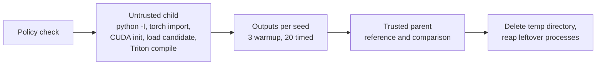

# 08 Runtime benchmark

!!! info "TL;DR"
    Measure cold start, evaluation latency, throughput and speedup of every deployed v1 pool with the same golden kernel, and compare only pools with the same GPU type.

## Pain point

gVisor runs on A10G (`g5.xlarge`) and Kata QEMU on T4 (`g4dn.metal`), so side-by-side numbers mix the runtime difference with the GPU difference. Boot times from blogs and CI use different measurement windows, machines and versions, so they do not carry over to your environment either.

![Two panels. a: the benchmark harness sends relu_bias_triton to the gVisor pool (g5.xlarge, A10G) and the Kata QEMU pool (g4dn.metal, T4), and the difference between the two pools mixes the runtime share and the GPU share, which cannot be separated. b: the same harness sends relu_bias_torch_only to the Kata CLH CPU pool and the Kata QEMU CPU pool on the same c8i.2xlarge node, so with the same node, image and goldens and only the RuntimeClass changed, the difference comes from what the RuntimeClass changes together: the hypervisor and the per-pod reservation (overhead.podFixed). Input seeds are drawn fresh per request and the numbers come from nested virtualization, so use them only as a relative comparison on this node.](../images/figures/handson-08_benchmark.svg)

*Takeaway: The difference between two pools on different GPUs mixes the runtime's share with the GPU's share, so compare runtimes with a pair that shares the node, image and golden, such as Kata CLH CPU and Kata QEMU CPU on the same c8i node.*


## Why

- **Same golden kernel, same harness, same API.** GPU pools get `relu_bias_triton`, CPU pools get `relu_bias_torch_only`.
- **Results land in JSONL.** `bench-<timestamp>.jsonl` at the repository root is easy to turn into a table.
- **Clean comparison axes are kept separate.** Comparisons within one GPU type, and Kata CLH CPU against Kata QEMU CPU on the same `c8i` node.

**Before you start:**

- The pools you want to compare must be deployed with [04 Deploy and verify sandbox pools](04_sandbox_pools.md). `bench.sh` skips any runtime without v1 pods.
- **For Kata**: [03 Kata sandboxes](03_kata.md) prepares the nodes and runtimes, and `scripts/06_deploy_sandboxes.sh` in 04 deploys the v1 pool to measure.
- How the three runtimes differ in structure is in [Isolation runtimes](../concepts/02_isolation_runtimes.md), and terms are in the [Glossary](../reference/glossary.md).

??? note "Terms (expand if a word is new to you)"
    - **Cold start**: on this page, the time from when a pod is created to when it last became Ready.
    - **p50, p95**: when the measurements are sorted from smallest to largest, the values at the 50% and 95% positions. p50 shows typical latency, p95 shows the slow tail.
    - **Throughput**: completed evaluations per second.
    - **Golden submission**: a test answer with a fixed expected verdict. They live in `src/gpusandbox/golden.py`.
    - **Speedup, reference**: how many times faster the candidate kernel is than the trusted PyTorch reference implementation, and that baseline implementation itself.
    - **Hypervisor (QEMU, Cloud Hypervisor)**: the program Kata uses to start a VM per pod. This repository uses QEMU (`kata-qemu`) and Cloud Hypervisor (`kata-clh`).
    - **gVisor Sentry**: the user-space kernel in gVisor that handles the container's system calls.
    - **Nested virtualization, bare metal**: the ability to start a VM inside a VM, and an instance (`.metal`) that gives you the whole physical server without a hypervisor.
    - **`overhead.podFixed`**: a RuntimeClass value: the CPU and memory the scheduler reserves on top of each pod for the runtime.
    - **Pool claim**: taking one sandbox from a pool of sandboxes started in advance (a warm pool).
    - **JSONL**: a file format with one JSON object per line.

!!! warning "The results table is one run in a practice account"
    The values in "Results template" below come from the author's run of this benchmark in a practice account (us-west-2, EKS 1.36) on 2026-11-18. Other node layouts, versions or image cache states give other values, so read them together with the measurement conditions. The "Published reference numbers" are public sources from other machines, other versions and other measurement windows, so do not use them as predictions for this environment.

## Before you begin

List the pods in the `sandbox` namespace with their runtime and version labels.

```bash
kubectl -n sandbox get pods -L gpusandbox/runtime,gpusandbox/version
```

**What to look for:**

- Every runtime you want to measure has pods with VERSION `v1`, and READY is `1/1` for all of them.
- The script silently skips runtimes without v1 pods.

Measure while training is stopped. A sandbox pod evaluates one request at a time, so if training and the benchmark share pods, the time spent waiting for a pod lowers the throughput.

**If it fails:** if READY is `0/1`, see the "Sandbox pools and readiness" section of [Troubleshooting](../reference/troubleshooting.md).

## Running it

Print the cold start of every deployed v1 pool and append the evaluation results to a JSONL file.

```bash
scripts/ops/bench.sh        # 32 evaluations per pool (default)
scripts/ops/bench.sh 64     # more requests per pool
```

| Order | What the script does |
|---|---|
| 1 | Goes through `gvisor`, `gvisor-hyperpod`, `kata-qemu`, `kata-clh`, `gvisor-cpu`, `kata-clh-cpu`, `kata-qemu-cpu` in that order and picks only pools that have `version=v1` pods |
| 2 | For every pod that is Ready now, prints the cold start in seconds: the Ready condition's `lastTransitionTime` minus `creationTimestamp` |
| 3 | Picks `relu_bias_triton` for GPU pools and `relu_bias_torch_only` for pools whose name ends in `-cpu` |
| 4 | Runs `gpusandbox.tools bench` as Job `bench-<runtime>-<epoch>` in `rl-trainer` and appends the one-line JSON result to `bench-<YYYYmmdd-HHMMSS>.jsonl` |

- **Cold start value in step 2**: `lastTransitionTime` is when the pod last became Ready, so a pod that lost readiness and recovered does not show its first startup time.

**What to look for:** each pool prints a block like this (example shape; values differ per environment):

```text
[hh:mm:ss] gvisor: cold start (creationTimestamp -> Ready)
  sandbox-gvisor-v1-<hash>: <N>s
  sandbox-gvisor-v1-<hash>: <N>s
[hh:mm:ss] gvisor: 32 evaluations of relu_bias_triton
[hh:mm:ss] bench  gvisor  ok 32/32  p50 ...s  p95 ...s  ... eval/s  speedup ...
```

- **Last line**: `[hh:mm:ss] results: <repository path>/bench-<YYYYmmdd-HHMMSS>.jsonl`.
- **`bench` line**: the two numbers of `ok 32/32` should match.
- **Terminal and JSONL**: the terminal shows the summary, and the JSONL file keeps the raw JSON with every field. The cold start values go only to the terminal, not to the JSONL, so write them down.
- **Version measured**: the script measures only v1 pools. v2 uses a different number of seeds (5), so its evaluation time can differ; compare within one version.

**If it fails:**

- **If every result of a pool fails (`ok` is 0)**: the bench Job fails and the script stops at that pool (later pools are not measured; behavior of the script code).
- **If `ok` is smaller than `requests`**: the bench JSON does not keep the status or error of the failed requests.
- **To find the cause**: run `scripts/ops/verify.sh <runtime> v1` on the same pool. If the golden requests reproduce the problem, the `FAIL` lines show the status and error; look those strings up in the "Viewing /info with the probe tool" and "Sandbox pools and readiness" sections of [Troubleshooting](../reference/troubleshooting.md).

### bench JSON fields

| Field | Meaning |
|---|---|
| `address`, `golden`, `requests` | Target Service, golden used, number of requests sent |
| `runtime` | The runtime reported by the first `ok` result (the profile name, for example `gvisor`) |
| `ok` | Number of results with status `ok` |
| `throughput_eval_per_s` | Number of `ok` results divided by the total elapsed time (requests are sent to the whole pool at once). The elapsed time includes waiting for a free pod and retries |
| `eval_p50_s`, `eval_p95_s` | p50/p95 of `duration_s` as measured by the sandbox server |
| `speedup_median` | Median of the measured speedups |
| `ref_ms_median` | Median time per iteration (ms) of the trusted PyTorch reference |

`eval_*`, `speedup_median` and `ref_ms_median` are computed from `ok` results only (failed requests stay out of the latency statistics).

## What goes into evaluation latency

`duration_s` is the time from when the server takes a request until it returns the verdict; the kernel run is only part of it. Time the client spent waiting for a pod is not included.

The server creates a fresh process tree per request and goes through the stages below. The stages depend on the golden.

- **`relu_bias_triton` on GPU pools**: CUDA initialization and Triton compilation in the chart apply only to this case.
- **`relu_bias_torch_only`, used on CPU pools**: runs only PyTorch operations on CPU tensors.



*Takeaway: the part that actually runs the kernel is only a slice of C, so runtime differences in `duration_s` are expected to show up mostly in fixed costs such as process creation, imports, CUDA initialization and compilation (inference; confirm with your own measurements).*

The 3 warmup and 20 timed iterations are the server defaults (`HARNESS_WARMUP`, `HARNESS_ITERS`).

## How to interpret the results

| Comparison | Conditions | Metrics to look at |
|---|---|---|
| Kata CLH CPU vs Kata QEMU CPU | Same `c8i.2xlarge` node (nested virtualization), same image, same golden, same profile except the RuntimeClass | Cold start, `eval_p50_s`, `eval_p95_s` |
| Kata QEMU vs Kata CLH GPU (experimental) | Same `g4dn.metal`, same T4 | The metrics above and `ref_ms_median` |
| gVisor (A10G) | This repository has no runc baseline on the same A10G | The values themselves, and the same pool measured at another time |
| gVisor CPU vs Kata CPU | Same `c8i.2xlarge` node, same image, same golden | Cold start, `eval_p50_s`, `eval_p95_s` |
| Pools with different GPU types | A10G vs T4 | Do not use them to compare overhead. Treat speedups as per-GPU numbers only |

- **Kata CLH CPU vs Kata QEMU CPU**: the RuntimeClass sets the hypervisor and the per-pod reservation (`overhead.podFixed`), and the input seeds are drawn fresh per request.
- **Kata CLH GPU (experimental)**: CLH GPU is not supported upstream, and on 2026-11-18 its VM never started, so it was not measured.
- **gVisor CPU vs Kata CPU**: the isolation method (user-space kernel vs VM) and the RuntimeClass settings differ, and the input seeds are drawn fresh per request. Scenario C in [10 CPU-only path on c8i](10_cpu_only.md) brings up all three pools together.

Keep the following in mind as well when you read the results.

- **Throughput depends on the number of Ready pods,** because each pod evaluates one request at a time. The defaults are 2 for `gvisor`, 4 for `kata-qemu`, 2 for `kata-clh` and 2 for each CPU pool. For pools with different replica counts, record the total throughput together with the value divided by the number of Ready pods.
- **Do not make the request count too large.** A pod evaluates one request at a time, so the client waits for a free pod, and a wait beyond 600 seconds (acquire timeout) turns the request into a `sandbox_error` and lowers `ok`.
- **Nested virtualization numbers do not carry over to bare metal.** AWS recommends bare metal for performance-sensitive virtualization workloads. Use the CLH vs QEMU result on `c8i` only as a relative comparison of the two hypervisors.
- **If `ref_ms_median` differs on the same GPU type,** that can be a sign that the runtime adds cost to the kernel launch and synchronization path (inference). This harness times with the host clock around `torch.cuda.synchronize()`, so launch cost is in the result.
- **Do not compare directly with KernelBench numbers.** KernelBench times with an L2 flush and CUDA events; this harness uses the host clock and a different input per iteration.

!!! question "❓ Misconception: putting the gVisor and Kata numbers side by side compares the runtimes"
    In this hands-on the gVisor pool (`g5.xlarge`, A10G) and the Kata GPU pool (`g4dn.metal`, T4) differ in GPU, instance and replica count, so you cannot isolate the runtime's share of the difference. To compare runtimes, use a pair with every other condition fixed, such as Kata CLH CPU and Kata QEMU CPU on the same node.

## Measuring cold start again

The script's cold start (pod creation to the last time it became Ready) includes, by definition, all of the following, plus the wait for the node if the pod was created before its node existed:

- Scheduling and image pull (the CUDA PyTorch images are large)
- Runtime start: the gVisor Sentry, or the Kata VM boot. According to the deployment template comment, a GPU VM pins all guest memory before boot, so the first readiness can take several minutes
- Server start and the GPU probe (torch import and CUDA initialization in a new process)
- The egress denial check (runs in parallel with the GPU probe): when a blocked target drops packets, each target waits for a 2-second timeout, so with IMDS, the API server and the kubelet it takes at most about 6 seconds
- The 5-second readiness probe period and the 1-second resolution of timestamps

To measure again with the image already cached on the node, restart the Deployment while training is not running and rerun the script.

```bash
kubectl -n sandbox rollout restart deployment/sandbox-kata-qemu-v1
kubectl -n sandbox rollout status deployment/sandbox-kata-qemu-v1 --timeout=30m
scripts/ops/bench.sh
```

**What to look for:**

- The second command ends with `deployment "sandbox-kata-qemu-v1" successfully rolled out`.
- The `kata-qemu` cold start lines of the third command show the new pod names.

The values in the results table below (pass 2) were measured after restarting every pool this way.

With `maxSurge: 0`, pods are replaced one at a time, and in a pool with one pod per node, such as gVisor, the new pod starts only after the old one releases the GPU. To measure another pool, replace `kata-qemu` in the Deployment name with that runtime's name (for example `gvisor`).

**If it fails:** if the second command times out, see the "Sandbox pools and readiness" section of [Troubleshooting](../reference/troubleshooting.md), and for Kata also the "Kata" section.

## Results template

The table below holds the values measured in the practice account on 2026-11-18 (pass 2, images cached). When you measure yourself, record the same columns and measurement conditions so the results can be compared later.

| runtime | Instance (GPU) | Ready pods | cold start (s, median over pods) | eval p50 (s) | eval p95 (s) | throughput (eval/s) | throughput per pod | median speedup | median ref_ms |
|---|---|---|---|---|---|---|---|---|---|
| `gvisor` | `g5.2xlarge` (A10G) | 1 | 16 | 9.416 | 9.546 | 0.106 | 0.106 | 1.752 | 0.5797 |
| `kata-qemu` | `g4dn.metal` (T4) | 4 | 30.5 (30, 30, 31, 36) | 12.17 | 13.412 | 0.317 | 0.079 | 1.788 | 1.1533 |
| `kata-clh` (experimental) | `g4dn.metal` (T4) | 0 | not measured: the VM never started (`create container timeout`) | | | | | | |
| `gvisor-cpu` | `c8i.2xlarge` (CPU, systrap) | 1 | 11 | 3.76 | 3.851 | 0.263 | 0.263 | n/a | 0.0062 |
| `kata-clh-cpu` | `c8i.2xlarge` (CPU, nested virt) | 1 | 10 | 4.225 | 4.317 | 0.234 | 0.234 | n/a | 0.0062 |
| `kata-qemu-cpu` | `c8i.2xlarge` (CPU, nested virt) | 1 | 10 | 4.058 | 4.139 | 0.244 | 0.244 | n/a | 0.0061 |

- **The gVisor row ran on `g5.2xlarge`.** The default `g5.xlarge` had no On-Demand capacity at the time, so `g5.2xlarge` was used: the same A10G with more vCPU and memory.
- **Throughput per pod** is the throughput divided by the number of Ready pods (`kata-qemu`: 0.317 / 4 = 0.079).
- **The CPU pools' speedup** has measured values in the JSONL (0.86 to 0.92), but stays n/a, as the template marks it.
- In both passes, each of the five measured pools returned `ok` for 32 of 32 requests. `kata-clh` was left out of both passes.

Measurement conditions (record the same items when you measure):

- **Date and Region:** 2026-11-18, practice account in us-west-2, EKS 1.36
- **Requests and image:** `scripts/ops/bench.sh 32` (32 per pool), `IMAGE_TAG` v1. Golden `relu_bias_triton` for the GPU pools, `relu_bias_torch_only` for the CPU pools
- **Versions:** gVisor `release-20261109.0`, Kata 4.3.1 (kata-deploy chart 4.3.1), GPU Operator v26.7.2, NVIDIA device plugin 0.20.1
- **EKS AMI:** the system, gVisor and Kata CPU nodes ran `1.36.5-20261112` (AL2023, host kernel `6.18.62-127.179.amzn2023`, containerd 2.3.7). The Kata GPU node ran the custom AMI that `infra/kata/build-iommu-ami.sh` baked from the EKS AL2023 1.36 standard AMI with `intel_iommu=on iommu=pt`
- **NVIDIA drivers:** the gVisor host loaded the proprietary module 580.178.04 (GSP off). The Kata guest image is `kata-ubuntu-resolute-nvidia-gpu-615.71.09.image` (guest driver 615.71.09), and the guest kernel reports `6.18.56-nvidia-gpu`
- **Node layout:** gVisor on one `g5.2xlarge` (`GVISOR_NODES=1`), Kata GPU on one `g4dn.metal` (`kata-qemu` with 4 replicas), Kata CPU on one `c8i.2xlarge` (`KATA_CPU_REPLICAS=1`, so 1 replica per CPU pool)
- **Image cache:** pass 2. After pass 1 right after deploy, every pool was restarted with `kubectl -n sandbox rollout restart` and measured with the images already cached on the nodes

**The cold starts of pass 1 (right after deploy) are left out of the table.** The image cache state differed per pool, and time unrelated to the runtime is mixed in.

- `gvisor-cpu` 141 s: includes the first image pull on the c8i node
- `kata-qemu` about 1235 s: includes about 20 minutes of failed VM starts before the `vfio_iommu_type1` fix in [03 Kata sandboxes](03_kata.md)
- `gvisor` 15 s: its image was already on the node from the 04 smoke test
- `kata-clh-cpu` 21 s, `kata-qemu-cpu` 20 s

??? note "Evaluation metrics of pass 1 (for reference)"
    | runtime | eval p50 (s) | eval p95 (s) | throughput (eval/s) | median speedup | median ref_ms |
    |---|---|---|---|---|---|
    | `gvisor` | 9.482 | 9.699 | 0.105 | 1.754 | 0.5796 |
    | `kata-qemu` | 10.694 | 12.469 | 0.342 | 1.791 | 1.1524 |
    | `gvisor-cpu` | 3.691 | 3.75 | 0.267 | 0.859 | 0.0062 |
    | `kata-clh-cpu` | 4.105 | 4.155 | 0.242 | 0.899 | 0.0061 |
    | `kata-qemu-cpu` | 3.902 | 3.987 | 0.254 | 0.92 | 0.0061 |

This command summarizes the JSONL with one line per pool. Replace the file name with the `results:` path from the script's last line.

```bash
python3 - bench-<YYYYmmdd-HHMMSS>.jsonl <<'PY'
import json, sys
for line in open(sys.argv[1]):
    if not line.startswith("{"):
        continue  # skip non-JSON log lines
    r = json.loads(line)
    print(r.get("runtime"), r["ok"], r["requests"], r["eval_p50_s"], r["eval_p95_s"],
          r["throughput_eval_per_s"], r["speedup_median"], r["ref_ms_median"])
PY
```

**What to look for:** one line per measured pool, in the order runtime, ok, requests, p50, p95, throughput, median speedup, median ref_ms. Copy these values into the template above.

### Observations (2026-11-18)

- **Same c8i node, same image and golden:** eval p50 was 3.76 s for `gvisor-cpu`, 4.058 s for `kata-qemu-cpu` and 4.225 s for `kata-clh-cpu`. The cold start with cached images was 10 to 11 s for all three. These come from nested virtualization, so use them only as a relative comparison on this node.
- **Cold start of the GPU pools:** 16 s for gVisor (A10G), 30 to 36 s per pod for Kata QEMU (T4). The GPUs differ (A10G vs T4), so by the rule in "How to interpret the results" this difference is not an overhead comparison.
- **Per-GPU values:** the median `ref_ms` was 0.58 ms on A10G and 1.15 ms on T4, and the speedup was 1.75 on A10G and 1.79 on T4.

## Published reference numbers

| Source | Numbers | Conditions and limits |
|---|---|---|
| Kata metrics CI (3.28.0) | Boot to workload: CLH 0.39 s, QEMU 0.71 s | Different machines, wide tolerance. Measures only the window until the VM is up and the workload starts |
| AWS China blog (2026-07, `c5.metal`, Kata 3.31.0 + CLH, OpenSandbox, Karpenter 1.12.1) | Cold start about 3 s, pool claim about 230 ms | Measured by the blog authors on bare-metal CPU sandboxes. Pool claim appears to be the time to get a sandbox from a pre-warmed pool and differs from cold start |
| Memory numbers from the same blog | CLH about 130 MB, QEMU about 160 MB | They equal the `overhead.podFixed` defaults of Kata 3.31.0, so they are probably not measurements |
| Kata 4.3.1 RuntimeClass `overhead.podFixed` | clh 130Mi/250m, qemu 320Mi/250m, qemu-nvidia-gpu 10240Mi/1 CPU | What the scheduler reserves on top of each pod. Not a measurement of actual usage |

This hands-on starts pods in advance with Deployments, so the counterpart of the blog's pool claim is not the cold start but the time the client takes to get a free pod.

## Scope and limits

- **The results table comes from one deployment.** It was measured twice in the practice account on 2026-11-18, right after deploy (pass 1) and after restarting the pools (pass 2), and the table shows pass 2. The replica counts also differed from the defaults (`gvisor` 1, each CPU pool 1).
- **No runc baseline.** So gVisor's overhead cannot be computed directly.
- **Kata CLH GPU is not supported upstream.** On 2026-11-18 the VM of the experimental `kata-clh` pool never started (`create container timeout`), even with the artifact paths filled in, so it was not measured (stage 3 of [03 Kata sandboxes](03_kata.md)).
- **Nested virtualization results are for relative comparison.**
- **Cold start has a 1-second resolution.** Kubernetes timestamps are in seconds, so sub-second differences are invisible.
- **Only v1 pools are measured.** `v1` is fixed in three places in the script: the pod selector that checks whether the pool exists, the pod selector that reads cold start, and the Service address. Measuring v2 means changing all three.

## Time and cost

The benchmark is one Job per pool.

- **Time**: in pass 2 on 2026-11-18 the evaluation window (computed as 32 ÷ throughput) was about 100 s (`kata-qemu`) to about 300 s (`gvisor`) per pool, and about 13 minutes for all five pools. Job creation, the cold start output and the pool restarts are not included.
- **Cost**: the node charges meanwhile (us-east-1 and us-west-2 On-Demand).
    - `g4dn.metal`: 7.824 USD per hour, the largest.
    - `g5.2xlarge` (used for the gVisor node): 1.212 USD per hour
    - `c8i.2xlarge`: 0.37484 USD per hour

When you are done, scale the GPU node groups to zero or delete them as described in [99 Cleanup](99_cleanup.md).

## How to verify

1. For every pool, `<runtime>: cold start (creationTimestamp -> Ready)` is followed by one `  <pod>: <N>s` line per pod.
2. A `bench` summary line follows, and its two numbers match, as in `ok 32/32`.
3. At the end, `results: <repo>/bench-<timestamp>.jsonl` is printed, and the file has one JSON line per measured pool.
4. Pools that are not deployed are skipped silently, so if a pool is missing, check for v1 pods with `kubectl -n sandbox get pods -L gpusandbox/runtime,gpusandbox/version` from "Before you begin".

??? note "References"
    | Topic | Link |
    |---|---|
    | EC2 nested virtualization (bare metal recommended) | https://docs.aws.amazon.com/AWSEC2/latest/UserGuide/amazon-ec2-nested-virtualization.html |
    | Amazon EC2 accelerated computing instances (A10G, T4) | https://docs.aws.amazon.com/ec2/latest/instancetypes/ac.html |
    | AWS China blog (Kata + CLH, OpenSandbox) | https://aws.amazon.com/cn/blogs/china/amazon-eks-build-security-ai-agent/ |
    | KernelBench (timing method) | https://github.com/ScalingIntelligence/KernelBench |

    All sources: [this page in All references](../reference/references.md#ref-handson-08-benchmark)
