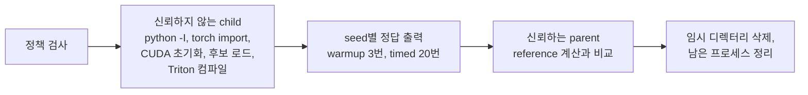

# 08 런타임 벤치마크

**TL;DR** 배포된 v1 풀마다 같은 golden 커널로 cold start, 평가 지연, 처리량, speedup을 측정합니다. 결과는 GPU 종류가 같은 풀끼리만 비교합니다.

## 기존 Pain Point

이 핸즈온에서 gVisor는 A10G(`g5.xlarge`)에서, Kata QEMU는 T4(`g4dn.metal`)에서 실행됩니다. 그래서 두 풀의 측정값을 그대로 비교하면 런타임 차이와 GPU 차이가 섞입니다. 블로그와 CI에 공개된 boot time도 측정 구간, 머신, 버전이 서로 달라서 실습 환경에 그대로 적용할 수 없어요.


*그림 요약: GPU가 다른 두 풀을 비교하면 숫자 차이에 런타임 차이와 GPU 차이가 섞입니다. 런타임만 비교하려면 같은 c8i 노드의 Kata CLH CPU 풀과 Kata QEMU CPU 풀처럼 다른 조건을 모두 고정한 쌍을 씁니다.*


## Why

- **같은 golden 커널, 같은 harness, 같은 API로 측정합니다.** GPU 풀에는 `relu_bias_triton`, CPU 풀에는 `relu_bias_torch_only`를 보냅니다.
- **결과를 JSONL 파일로 저장합니다.** 저장소 루트에 생기는 `bench-<timestamp>.jsonl`의 값을 표로 옮기기 쉬워요.
- **런타임 외의 조건이 같은 비교를 따로 정리합니다.** 같은 GPU 종류 안의 비교와, 같은 `c8i` 노드에서 Kata CLH CPU와 Kata QEMU CPU를 비교하는 경우입니다.

**사전 지식:** 비교할 풀이 [04 샌드박스 풀 배포와 검증](04_sandbox_pools.md)으로 배포되어 있어야 합니다(Kata 풀은 [03 Kata 샌드박스](03_kata.md)에서 만듭니다). 세 런타임의 구조 차이는 [02 격리 런타임 비교](../concepts/02_isolation_runtimes.md)에, 용어는 [용어 사전](../reference/glossary.md)에 있어요.

??? note "용어 (처음 보는 단어가 있으면 펼치세요)"
    - **cold start**: 이 페이지에서는 pod가 만들어진 시각부터 Ready가 된 시각까지를 뜻합니다.
    - **p50, p95**: 측정값을 작은 값부터 정렬했을 때 50%와 95% 위치의 값입니다. p50은 일반적인 지연을, p95는 느린 요청의 지연(tail latency)을 나타냅니다.
    - **처리량 (throughput)**: 초당 완료한 평가 수입니다.
    - **golden 제출물**: 기대 verdict가 정해진 시험용 제출물입니다. `src/gpusandbox/golden.py`에 있습니다.
    - **speedup, reference**: 신뢰하는 PyTorch reference 구현보다 후보 커널이 몇 배 빠른지와, 그 비교 기준이 되는 구현입니다.
    - **hypervisor (QEMU, Cloud Hypervisor)**: Kata가 pod마다 VM을 띄울 때 쓰는 프로그램입니다. 이 저장소는 QEMU(`kata-qemu`)와 Cloud Hypervisor(`kata-clh`)를 씁니다.
    - **gVisor Sentry**: gVisor에서 컨테이너의 시스템 호출을 대신 처리하는 사용자 공간 커널입니다.
    - **nested virtualization, bare metal**: VM 안에서 다시 VM을 띄우는 기능과, 하이퍼바이저 없이 물리 서버 전체를 쓰는 인스턴스(`.metal`)입니다.
    - **`overhead.podFixed`**: RuntimeClass에 지정하는 값으로, 스케줄러가 pod마다 런타임용으로 추가 예약하는 CPU와 메모리입니다.
    - **pool claim**: 미리 띄워 둔 샌드박스 풀(warm pool)에서 샌드박스 하나를 할당받는 작업입니다.
    - **JSONL**: 한 줄에 JSON 객체 하나씩 기록하는 파일 형식입니다.

!!! warning "이 페이지의 수치는 이 저장소의 측정값이 아닙니다"
    저자는 AWS에서 이 벤치마크를 실행하지 않았습니다. 아래 결과 표는 직접 측정한 값을 채우는 빈 양식입니다. 참고 수치는 다른 머신, 다른 버전, 다른 측정 구간에서 나온 공개 자료이므로 이 환경의 예측치로 쓰지 마세요.

## 시작 전 확인

`sandbox` namespace의 pod를 런타임과 버전 label과 함께 확인합니다.

```bash
kubectl -n sandbox get pods -L gpusandbox/runtime,gpusandbox/version
```

**확인할 것:** 측정하려는 런타임마다 VERSION이 `v1`인 pod가 있고, READY가 모두 `1/1`입니다. 스크립트는 v1 pod가 없는 런타임을 별도 메시지 없이 건너뜁니다.

학습이 실행 중이 아닐 때 측정하세요. 샌드박스 pod는 한 번에 평가를 하나만 처리하므로, 학습과 벤치마크가 같은 pod를 함께 쓰면 대기 시간이 측정 결과에 포함됩니다.

**문제가 생기면:** READY가 `0/1`이면 [문제 해결](../reference/troubleshooting.md)의 "샌드박스 풀과 readiness" 항목을 보세요.

## 실행

스크립트는 배포된 v1 풀마다 cold start를 출력하고, 평가 결과를 JSONL 파일 끝에 추가합니다.

```bash
scripts/ops/bench.sh        # 32 evaluations per pool (default)
scripts/ops/bench.sh 64     # more requests per pool
```

| 순서 | 스크립트 동작 |
|---|---|
| 1 | `gvisor`, `kata-qemu`, `kata-clh`, `kata-clh-cpu`, `kata-qemu-cpu` 순서로, `version=v1` pod가 있는 풀만 선택합니다 |
| 2 | pod마다 Ready condition의 `lastTransitionTime`에서 `creationTimestamp`를 뺀 cold start를 초 단위로 출력합니다 |
| 3 | GPU 풀에는 `relu_bias_triton`, 이름이 `-cpu`로 끝나는 풀에는 `relu_bias_torch_only`를 사용합니다 |
| 4 | `gpusandbox.tools bench`를 Job `bench-<runtime>-<epoch>`로 `rl-trainer`에서 실행하고, 결과 JSON 한 줄을 `bench-<YYYYmmdd-HHMMSS>.jsonl`에 추가합니다 |

**확인할 것:** 풀마다 다음과 같은 출력이 나옵니다(예시 형태, 값은 환경마다 다릅니다).

```text
[hh:mm:ss] gvisor: cold start (creationTimestamp -> Ready)
  sandbox-gvisor-v1-<hash>: <N>s
  sandbox-gvisor-v1-<hash>: <N>s
[hh:mm:ss] gvisor: 32 evaluations of relu_bias_triton
{"address": "sandbox-gvisor-v1.sandbox.svc.cluster.local:8000", "golden": "relu_bias_triton", "runtime": "gvisor", "requests": 32, "ok": 32, ...}
```

마지막 줄은 `results: <저장소 경로>/bench-<YYYYmmdd-HHMMSS>.jsonl`입니다. JSON 줄의 `ok`가 `requests`와 같아야 정상이에요.

cold start 값은 터미널에만 출력되고 JSONL에는 저장되지 않으니 따로 기록해 두세요. 스크립트는 v1 풀만 측정합니다. v2는 seed 수(5개)가 달라 평가 시간이 다를 수 있으므로 같은 버전끼리 비교하세요.

**문제가 생기면:** 한 풀의 결과가 모두 실패하면(`ok`가 0) bench Job이 실패하고 스크립트가 그 풀에서 멈춥니다. 스크립트 코드상 그 뒤의 풀은 측정하지 않습니다. `ok`가 `requests`보다 작으면 [문제 해결](../reference/troubleshooting.md)의 "probe 도구로 /info 보기"와 "샌드박스 풀과 readiness" 항목에서 오류 문자열로 원인을 찾으세요.

### bench JSON 필드

| 필드 | 의미 |
|---|---|
| `address`, `golden`, `requests` | 대상 Service, 사용한 golden, 보낸 요청 수 |
| `runtime` | 첫 번째 `ok` 결과가 보고한 runtime(profile 이름, 예: `gvisor`) |
| `ok` | status가 `ok`인 결과 수 |
| `throughput_eval_per_s` | `ok` 개수를 전체 경과 시간으로 나눈 값 (요청은 풀 전체에 동시에 보냄) |
| `eval_p50_s`, `eval_p95_s` | 샌드박스 서버가 측정한 `duration_s`의 p50/p95 |
| `speedup_median` | 측정한 speedup의 중앙값 |
| `ref_ms_median` | 신뢰하는 PyTorch reference의 반복당 시간(ms) 중앙값 |

`eval_*`, `speedup_median`, `ref_ms_median`은 `ok`인 결과만으로 계산합니다. 실패한 요청은 지연 통계에서 제외됩니다.

## 평가 지연에 포함되는 과정

`duration_s`는 커널 실행 시간이 아니라 요청 한 번을 처리한 전체 시간입니다. 서버는 요청마다 새 프로세스 트리를 만들고 아래 과정을 모두 실행합니다.



*그림 요약: 커널을 실제로 실행하는 구간은 C의 일부라서, `duration_s`의 런타임 차이는 프로세스 생성, import, CUDA 초기화, 컴파일 같은 고정 비용 쪽에서 주로 드러날 것으로 봅니다(추론, 직접 측정으로 확인하세요).*

warmup 3번과 timed 20번은 서버 기본값(`HARNESS_WARMUP`, `HARNESS_ITERS`)입니다.

## 해석하는 방법

| 비교 | 조건 | 볼 지표 |
|---|---|---|
| Kata CLH CPU 대 Kata QEMU CPU | 같은 `c8i.2xlarge` 노드(nested virtualization), 같은 이미지, 같은 golden. 다른 것은 hypervisor뿐 | cold start, `eval_p50_s`, `eval_p95_s` |
| Kata QEMU 대 Kata CLH GPU(실험) | 같은 `g4dn.metal`, 같은 T4 | 위 지표와 `ref_ms_median`. CLH GPU는 upstream에서 지원하지 않으므로 측정이 실패할 수 있습니다 |
| gVisor (A10G) | 같은 A10G의 runc 기준선은 이 저장소에 없습니다 | 측정값 자체와, 같은 풀을 다른 시점에 측정한 값 |
| gVisor CPU 대 Kata CPU | 같은 `c8i.2xlarge` 노드, 같은 이미지, 같은 golden. 다른 것은 격리 방식(사용자 공간 커널 대 VM)뿐. 시나리오 C의 [10 c8i 단독 저비용 경로](10_cpu_only.md)에서 세 풀을 함께 띄움 | cold start, `eval_p50_s`, `eval_p95_s` |
| GPU 종류가 다른 풀끼리 | A10G 대 T4 | 오버헤드 비교에 쓰지 않습니다. speedup은 GPU별로 따로 해석합니다 |

- **처리량은 replica 수에 비례합니다.** 기본 replica는 `gvisor` 2, `kata-qemu` 4, `kata-clh` 2이고 CPU 풀은 각 2입니다. 그러니 `throughput_eval_per_s`를 Ready pod 수로 나눈 pod당 값으로 비교하세요.
- **요청 수를 너무 크게 정하지 마세요.** pod는 한 번에 평가를 하나만 처리하므로 클라이언트는 비어 있는 pod를 기다립니다. 대기 시간이 600초(acquire timeout)를 넘으면 그 요청은 `sandbox_error`가 되어 `ok` 수가 줄어요.
- **nested virtualization에서 얻은 숫자는 bare metal에 그대로 적용되지 않습니다.** AWS는 성능이 중요한 가상화 워크로드에 bare metal을 권장합니다. `c8i`의 CLH 대 QEMU 결과는 두 hypervisor의 상대 비교로만 쓰세요.
- **같은 GPU 종류에서 `ref_ms_median`이 다르면** 런타임이 kernel launch와 동기화 과정에 추가 비용을 발생시킨다는 뜻일 수 있습니다(추론). 이 harness는 host clock과 `torch.cuda.synchronize()`로 측정하므로 launch 비용이 결과에 포함돼요.
- **KernelBench 수치와 직접 비교하지 않습니다.** KernelBench는 L2 flush와 CUDA event로 시간을 측정하고, 이 harness는 host clock과 반복마다 다른 입력을 씁니다.

!!! question "❓ 오해: gVisor와 Kata의 숫자를 나란히 놓으면 런타임 비교가 된다"
    이 핸즈온의 gVisor 풀(`g5.xlarge`, A10G)과 Kata GPU 풀(`g4dn.metal`, T4)은 GPU, 인스턴스, replica 수가 모두 달라서, 두 풀의 측정값 차이 중 런타임 때문에 생긴 부분만 따로 구할 수 없어요. 런타임을 비교할 때는 같은 노드의 Kata CLH CPU와 Kata QEMU CPU처럼 런타임 외의 조건이 모두 같은 두 풀을 쓰세요.

## cold start를 다시 측정하는 방법

스크립트가 출력하는 cold start(pod 생성부터 Ready까지)에는 정의상 다음 시간이 모두 포함됩니다. pod가 노드보다 먼저 만들어졌다면 노드가 준비되기를 기다린 시간도 포함돼요.

- 스케줄링과 이미지 pull (CUDA PyTorch 이미지는 큽니다)
- 런타임 시작: gVisor Sentry, 또는 Kata VM 부팅. deployment 템플릿 주석에 따르면 GPU VM은 부팅 전에 guest 메모리를 모두 pin하므로 첫 readiness까지 몇 분이 걸릴 수 있습니다
- 서버 시작과 GPU probe(새 프로세스에서 torch import와 CUDA 초기화)
- egress 차단 확인(GPU probe와 동시에 진행): 차단된 대상으로 보낸 패킷이 drop되면 대상마다 2초 timeout까지 기다리므로, IMDS, API server, kubelet 세 곳을 확인하면 최대 약 6초가 걸립니다
- readiness probe 주기 5초와 timestamp의 1초 해상도

이미지가 노드에 캐시된 상태에서 다시 측정하려면, 학습이 실행 중이 아닐 때 Deployment를 재시작한 뒤 스크립트를 다시 실행하세요.

```bash
kubectl -n sandbox rollout restart deployment/sandbox-kata-qemu-v1
kubectl -n sandbox rollout status deployment/sandbox-kata-qemu-v1 --timeout=30m
scripts/ops/bench.sh
```

**확인할 것:** 둘째 명령이 `deployment "sandbox-kata-qemu-v1" successfully rolled out`으로 끝나고, 셋째 명령의 `kata-qemu` cold start 줄이 새 pod 이름으로 바뀝니다.

`maxSurge: 0`이라서 pod가 하나씩 교체됩니다. gVisor처럼 노드당 pod가 하나인 풀에서는 이전 pod가 GPU를 반환한 뒤에 새 pod가 시작돼요. 다른 풀을 측정하려면 Deployment 이름의 `kata-qemu`를 그 런타임 이름(예: `gvisor`)으로 바꾸세요.

**문제가 생기면:** 둘째 명령이 timeout으로 끝나면 [문제 해결](../reference/troubleshooting.md)의 "샌드박스 풀과 readiness" 항목과, Kata라면 "Kata" 항목을 보세요.

## 결과 기록 양식

직접 측정한 값을 채우고, 나중에 비교할 수 있게 측정 조건도 기록하세요.

| runtime | 인스턴스 (GPU) | Ready pod | cold start (s, pod 중앙값) | eval p50 (s) | eval p95 (s) | 처리량 (eval/s) | pod당 처리량 | speedup 중앙값 | ref_ms 중앙값 |
|---|---|---|---|---|---|---|---|---|---|
| `gvisor` | `g5.xlarge` (A10G) | | | | | | | | |
| `kata-qemu` | `g4dn.metal` (T4) | | | | | | | | |
| `kata-clh` (실험) | `g4dn.metal` (T4) | | | | | | | | |
| `gvisor-cpu` | `c8i.2xlarge` (CPU, systrap) | | | | | | | n/a | |
| `kata-clh-cpu` | `c8i.2xlarge` (CPU, nested virt) | | | | | | | n/a | |
| `kata-qemu-cpu` | `c8i.2xlarge` (CPU, nested virt) | | | | | | | n/a | |

측정 조건: 날짜, 리전, `requests`, `IMAGE_TAG`, gVisor 릴리스, Kata 버전, EKS AMI 버전, 노드의 NVIDIA 드라이버, 이미지가 캐시된 상태였는지.

다음 명령은 JSONL을 풀마다 한 줄로 요약합니다. 파일 이름은 스크립트 마지막 줄의 `results:` 경로로 바꾸세요.

```bash
python3 - bench-<YYYYmmdd-HHMMSS>.jsonl <<'PY'
import json, sys
for line in open(sys.argv[1]):
    if not line.startswith("{"):
        continue  # skip non-JSON log lines
    r = json.loads(line)
    print(r.get("runtime"), r["ok"], r["requests"], r["eval_p50_s"], r["eval_p95_s"],
          r["throughput_eval_per_s"], r["speedup_median"], r["ref_ms_median"])
PY
```

**확인할 것:** 측정한 풀마다 한 줄씩, runtime, ok, requests, p50, p95, 처리량, speedup 중앙값, ref_ms 중앙값 순서로 나옵니다. 이 값을 위 양식에 옮기세요.

## 공개된 참고 수치

| 출처 | 수치 | 조건과 한계 |
|---|---|---|
| Kata metrics CI (3.28.0) | boot to workload: CLH 0.39 s, QEMU 0.71 s | 다른 머신, 넓은 허용 범위. VM 부팅부터 workload 시작까지의 구간만 측정합니다 |
| AWS China 블로그 (2026-07, `c5.metal`, Kata 3.31.0 + CLH, OpenSandbox, Karpenter 1.12.1) | cold start 약 3 s, pool claim 약 230 ms | 블로그 저자가 bare metal CPU 샌드박스에서 측정한 값입니다. pool claim은 미리 띄워 둔 풀에서 샌드박스를 할당받는 시간으로 보이며 cold start와 다릅니다 |
| 같은 블로그의 메모리 수치 | CLH 약 130 MB, QEMU 약 160 MB | Kata 3.31.0의 `overhead.podFixed` 기본값과 같아서 측정값이 아닐 가능성이 큽니다 |
| Kata 4.3.1 RuntimeClass `overhead.podFixed` | clh 130Mi/250m, qemu 320Mi/250m, qemu-nvidia-gpu 10240Mi/1 CPU | 스케줄러가 pod마다 추가로 예약하는 값입니다. 실제 사용량 측정이 아닙니다 |

이 핸즈온은 Deployment로 pod를 미리 띄워 둡니다. 그래서 블로그의 pool claim에 해당하는 값은 cold start가 아니라 클라이언트가 비어 있는 pod를 할당받는 시간입니다.

## 적용 범위와 한계

- **runc 기준선이 없습니다.** 그래서 gVisor의 오버헤드를 직접 계산할 수 없습니다.
- **Kata CLH GPU는 upstream에서 지원하지 않으므로** 실험용 `kata-clh` 풀은 결과가 나오지 않을 수 있습니다.
- **nested virtualization 결과는 상대 비교용입니다.**
- **cold start는 1초 해상도입니다.** Kubernetes timestamp가 초 단위라서 1초 미만의 차이는 측정할 수 없습니다.
- **v1 풀만 측정합니다.** 스크립트의 label selector와 Service 주소에 `v1`이 고정되어 있습니다. v2를 측정하려면 두 곳을 모두 바꿔야 합니다.

## 소요 시간과 비용

벤치마크는 풀마다 Job 하나만 실행하므로, 노드를 띄워 둔 전체 시간에 비하면 짧을 것으로 봅니다(미측정). 비용은 그동안 발생하는 노드 요금입니다. 이 중 `g4dn.metal`이 시간당 7.824 USD로 가장 비쌉니다(us-east-1과 us-west-2 온디맨드 요금). `c8i.2xlarge`는 시간당 0.37484 USD입니다(같은 기준). 측정을 마치면 [99 정리](99_cleanup.md)에 따라 GPU 노드 그룹을 0으로 줄이거나 삭제하세요.

## 확인 방법

1. 풀마다 `<runtime>: cold start (creationTimestamp -> Ready)` 다음에 `  <pod>: <N>s` 줄이 pod 수만큼 나옵니다.
2. 이어서 bench JSON 한 줄이 나오고, `ok`가 `requests`와 같습니다.
3. 마지막에 `results: <repo>/bench-<timestamp>.jsonl`이 출력되고, 파일에 측정한 풀마다 JSON 한 줄이 있습니다.
4. 스크립트는 배포하지 않은 풀을 별도 메시지 없이 건너뜁니다. 결과에 빠진 풀이 있으면 "시작 전 확인"의 `kubectl -n sandbox get pods -L gpusandbox/runtime,gpusandbox/version`으로 v1 pod가 있는지 확인하세요.

??? note "참고 자료"
    | 주제 | 링크 |
    |---|---|
    | EC2 nested virtualization (bare metal 권장) | https://docs.aws.amazon.com/AWSEC2/latest/UserGuide/amazon-ec2-nested-virtualization.html |
    | Amazon EC2 가속 컴퓨팅 인스턴스 (A10G, T4) | https://docs.aws.amazon.com/ec2/latest/instancetypes/ac.html |
    | AWS China 블로그 (Kata + CLH, OpenSandbox) | https://aws.amazon.com/cn/blogs/china/amazon-eks-build-security-ai-agent/ |
    | KernelBench (timing 방식) | https://github.com/ScalingIntelligence/KernelBench |

    전체 출처: [참고 자료 모음의 이 페이지 절](../reference/references.md#ref-handson-08-benchmark)
