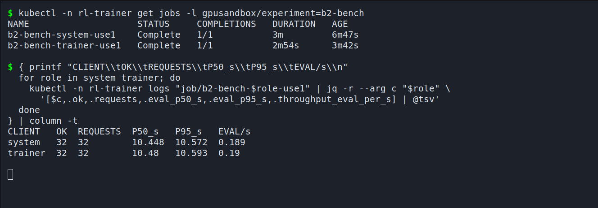
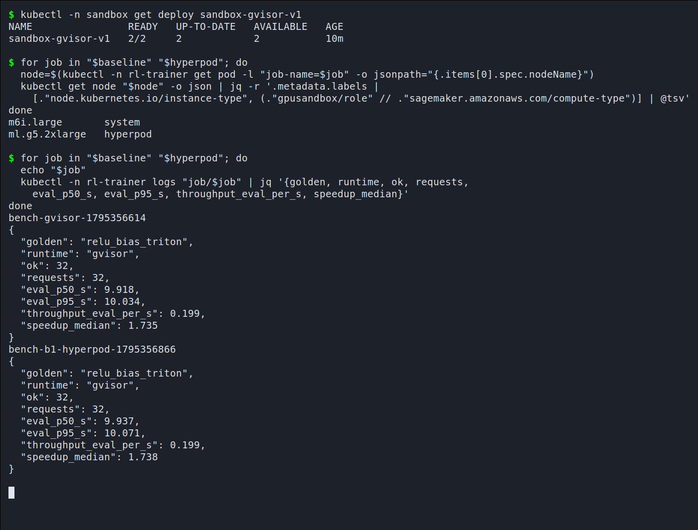
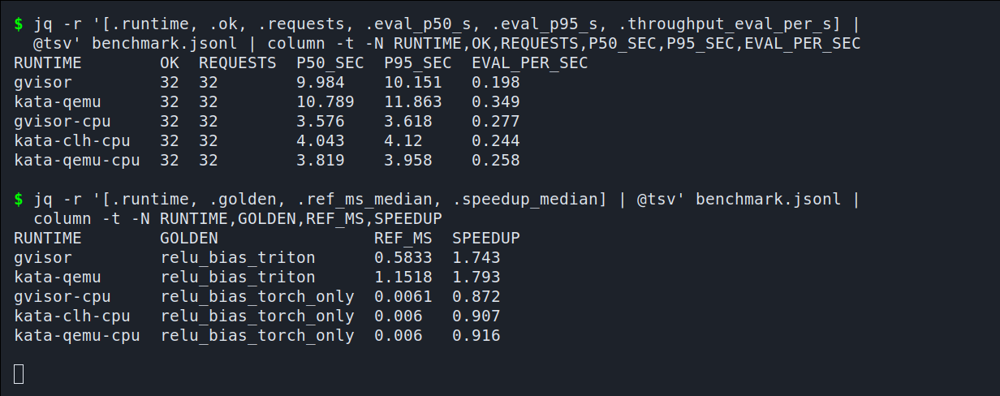
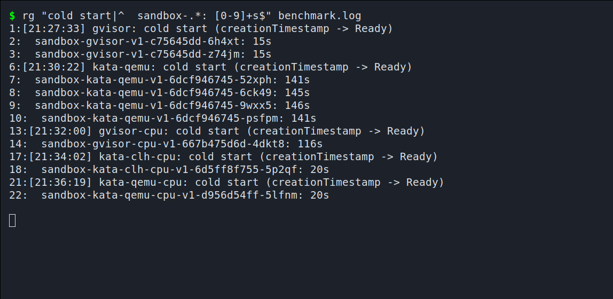

# 08 채점 벤치마크

EKS에서 샌드박스가 요청 한 건을 채점하는 데 걸린 시간과 채점 pool 전체가 초당 처리한 요청 수를 비교합니다. B2와 B1에서는 같은 pool에 요청을 보내는 워커를 바꿨고, A에서는 EC2 채점 런타임 다섯 개를 비교했습니다.

## 구성별 결과 { #runtime-results }

아홉 번의 실행에서 각각 32건을 보냈고 **288건 모두 성공**했습니다. GPU에 보낸 코드는 `relu_bias_triton`, CPU에 보낸 코드는 `relu_bias_torch_only`입니다.

<div class="bench-scroll" role="region" tabindex="0" aria-labelledby="runtime-results">
<table class="bench-results" aria-labelledby="runtime-results">
<thead><tr><th scope="col">요청 노드 / 런타임</th><th scope="col">성공/요청</th><th scope="col">p50 <small>(초)</small></th><th scope="col">p95 <small>(초)</small></th><th scope="col">처리량 <small>(건/초)</small></th></tr></thead>
<tbody id="hyperpod-b2">
<tr><th scope="rowgroup" colspan="5">B2 · HyperPod에서 채점<small>ml.g5.xlarge · A10G · gvisor-hyperpod · Pod 2개</small></th></tr>
<tr><th scope="row">시스템 워커<small>ml.m5.xlarge</small></th><td>32/32</td><td>10.448</td><td>10.572</td><td>0.189</td></tr>
<tr><th scope="row">학습 워커<small>ml.g5.2xlarge</small></th><td>32/32</td><td>10.480</td><td>10.593</td><td>0.190</td></tr>
</tbody>
<tbody id="hyperpod-b1">
<tr><th scope="rowgroup" colspan="5">B1 · EC2에서 채점<small>g5.xlarge · A10G · gvisor · Pod 2개</small></th></tr>
<tr><th scope="row">시스템 워커<small>m6i.large</small></th><td>32/32</td><td>9.918</td><td>10.034</td><td>0.199</td></tr>
<tr><th scope="row">학습 워커<small>ml.g5.2xlarge</small></th><td>32/32</td><td>9.937</td><td>10.071</td><td>0.199</td></tr>
</tbody>
<tbody id="ec2-runtimes">
<tr><th scope="rowgroup" colspan="5">A · EC2 런타임 비교<small>EKS 1.36 · 이미지 a20261120b</small></th></tr>
<tr><th scope="row">gvisor<small>g5.xlarge · A10G · Pod 2개</small></th><td>32/32</td><td>9.984</td><td>10.151</td><td>0.198</td></tr>
<tr><th scope="row">kata-qemu<small>g4dn.metal · T4 · Pod 4개</small></th><td>32/32</td><td>10.789</td><td>11.863</td><td>0.349</td></tr>
<tr><th scope="row">gvisor-cpu<small>c8i.2xlarge · CPU · Pod 1개</small></th><td>32/32</td><td>3.576</td><td>3.618</td><td>0.277</td></tr>
<tr><th scope="row">kata-clh-cpu<small>c8i.2xlarge · CPU · Pod 1개</small></th><td>32/32</td><td>4.043</td><td>4.120</td><td>0.244</td></tr>
<tr><th scope="row">kata-qemu-cpu<small>c8i.2xlarge · CPU · Pod 1개</small></th><td>32/32</td><td>3.819</td><td>3.958</td><td>0.258</td></tr>
</tbody>
</table>
</div>

**표 읽기**　p50과 p95는 성공한 요청의 서버 채점 시간입니다. 처리량에는 클라이언트가 빈 Pod를 기다린 시간도 들어갑니다. 예를 들어 B2의 시스템 워커에서 보낸 요청의 p50은 10.448초이고, 채점 Pod 두 개를 합친 처리량은 초당 0.189건입니다. GPU 종류와 Pod 수가 다른 행을 런타임 성능 순위로 해석하기는 어렵습니다.

[데모에서 같은 표 보기](https://dohbsn4kn34ya.cloudfront.net/#runtime-results)

<details class="note" markdown="1">
<summary id="b2-conditions">B2 · HyperPod 채점 노드, 실행 화면과 원본</summary>

`us-east-1`의 EKS 1.36에서 `ml.g5.xlarge` 두 대에 `gvisor-hyperpod` v1 Pod를 하나씩 띄웠습니다. 각 Pod에는 A10G 한 장이 있습니다. GRPO 학습이 끝난 뒤 CPU 시스템 노드와 학습 노드가 차례로 `relu_bias_triton`을 32번씩 제출했습니다. 두 Job은 차례로 실행했습니다.

p50과 p95는 성공한 요청의 서버 채점 시간(`duration_s`)입니다. pool 처리량은 성공 건수를 클라이언트가 한 배치를 마칠 때까지 걸린 시간으로 나눈 값입니다. Pod 생성부터 `Ready`까지는 앞선 CUDA 검사로 이미지가 캐시된 노드에서 10초, 다른 노드에서 110초가 걸렸습니다.

[](../images/terminal/hyperpod-b2-benchmark.png)

```bash
scripts/hyperpod/bench_b2.sh 32
```

[실행 기록 JSON](data/hyperpod-b2.json) · [공개 데모의 B2 결과](https://dohbsn4kn34ya.cloudfront.net/#hyperpod-b2) · [B2 구성과 GRPO 실습](07_hyperpod_b2.md)

</details>

<details class="note" markdown="1">
<summary id="b1-conditions">B1 · EC2 채점 노드, 실행 화면과 원본</summary>

EKS 1.36에서 EC2 `g5.xlarge` 두 대에 A10G 한 장씩을 배정해 `gvisor/v1` 샌드박스 두 개를 띄웠습니다. 이미지 태그는 `a20261120b`입니다. 같은 pool을 두 건으로 예열한 뒤, 학습을 멈춘 상태에서 아래 순서대로 각 클라이언트가 `relu_bias_triton` 32건을 한 배치로 보냈습니다.

두 샌드박스 pod가 생성된 뒤 Ready가 되기까지 각각 15, 120초가 걸렸습니다. p50과 p95는 성공한 요청을 서버가 처리한 시간이고, 처리량에는 클라이언트가 빈 pod를 기다린 시간도 들어갑니다. 클라이언트별로 한 번씩 측정했으므로 두 행의 차이만으로 배치 위치의 효과를 판단하기는 어렵습니다.



[실행 기록 JSON](data/hyperpod-b1.json) · [공개 데모](https://dohbsn4kn34ya.cloudfront.net/#hyperpod-b1)

??? example "B1에서 같은 조건으로 다시 측정하기"
    [07 HyperPod](07_hyperpod.md)의 B1 설정과 Ready 상태인 샌드박스 두 개를 사용합니다. 기본 Job은 이번 실행에서 EKS 시스템 노드에 배치됐습니다. 마지막 Job은 클라이언트를 HyperPod 학습 노드에 지정합니다.

    ```bash
    scripts/ops/bench.sh 2
    scripts/ops/bench.sh 32

    source scripts/lib.sh
    job="bench-b1-hyperpod-$(date +%s)"
    client_spec=$(jq -nc --arg cluster "$HYPERPOD_CLUSTER_NAME" --arg type "$HYPERPOD_TRAINER_INSTANCE_TYPE" '
      {spec:{template:{spec:{nodeSelector:{"sagemaker.amazonaws.com/cluster-name":$cluster,
          "node.kubernetes.io/instance-type":$type, "sagemaker.amazonaws.com/node-health-status":"Schedulable"},
        tolerations:[{key:"nvidia.com/gpu", operator:"Exists", effect:"NoSchedule"}]}}}}')
    render k8s/probe/job-probe.yaml.tpl JOB_NAME="$job" \
      TOOL_ARGS='["bench","--address","sandbox-gvisor-v1.sandbox.svc.cluster.local:8000","--requests","32","--golden","relu_bias_triton"]' \
      | kubectl patch --local -f - --type=merge -p "$client_spec" -o yaml | kubectl create -f -
    kubectl -n rl-trainer wait --for=condition=Complete "job/$job" --timeout=15m
    kubectl -n rl-trainer logs "job/$job"
    ```

</details>

<details class="note" markdown="1">
<summary id="a-conditions">A · EC2 런타임 다섯 개의 실행 화면과 원본</summary>

시나리오 A에서 학습과 롤백을 마친 뒤 EKS 1.36, 이미지 `a20261120b`로 실행했습니다.



[실행 조건](data/runtime-benchmark-2026-11-22.meta.json) · [원본 JSONL](data/runtime-benchmark-2026-11-22.jsonl)

</details>

**시작 전에**

- 먼저 [04 샌드박스 pool 배포와 검증](04_sandbox_pools.md)에 따라 비교할 pool을 배포하세요. v1 pod가 없는 런타임은 `bench.sh`가 건너뜁니다.
- **Kata일 때**: [03 Kata 샌드박스](03_kata.md)에서 노드와 런타임을 준비하고, 04의 `scripts/06_deploy_sandboxes.sh`로 측정할 v1 pool을 배포합니다.
- 세 런타임의 구조 차이는 [02 격리 런타임 비교](../concepts/02_isolation_runtimes.md)에, 용어는 [용어 사전](../reference/glossary.md)에 있습니다.

??? note "용어 (처음 보는 단어가 있으면 펼치세요)"
    - **cold start**: 이 페이지에서는 pod가 만들어진 시각부터 마지막으로 Ready가 된 시각까지를 뜻합니다.
    - **p50, p95**: 측정값을 작은 값부터 정렬했을 때 50%와 95% 위치의 값입니다. p50은 일반적인 지연을, p95는 느린 요청의 지연(tail latency)을 나타냅니다.
    - **처리량 (throughput)**: 초당 완료한 평가 수입니다.
    - **golden 제출물**: 기대 verdict가 정해진 시험용 제출물입니다. `src/gpusandbox/golden.py`에 있습니다.
    - **speedup, reference**: reference는 정답과 실행 시간을 비교할 때 기준으로 삼는 신뢰할 수 있는 PyTorch 구현입니다. speedup은 이 기준 구현의 실행 시간을 후보 커널의 실행 시간으로 나눈 값입니다.
    - **hypervisor (QEMU, Cloud Hypervisor)**: Kata에서 pod마다 VM을 실행하는 프로그램입니다. `kata-qemu`의 hypervisor는 QEMU이고 `kata-clh`는 Cloud Hypervisor입니다.
    - **gVisor Sentry**: gVisor에서 컨테이너의 시스템 호출을 대신 처리하는 사용자 공간 커널입니다.
    - **nested virtualization, bare metal**: VM 안에서 다시 VM을 띄우는 기능과, 하이퍼바이저 없이 물리 서버 전체를 쓰는 인스턴스(`.metal`)입니다.
    - **`overhead.podFixed`**: RuntimeClass에 지정하는 값으로, 스케줄러가 pod마다 런타임용으로 추가 예약하는 CPU와 메모리입니다.
    - **pool claim**: 미리 띄워 둔 샌드박스 pool(warm pool)에서 샌드박스 하나를 할당받는 작업입니다.
    - **JSONL**: 한 줄에 JSON 객체 하나씩 기록하는 파일 형식입니다.


## 시작 전 확인

`sandbox` namespace의 pod를 런타임과 버전 label과 함께 확인합니다.

```bash
kubectl -n sandbox get pods -L gpusandbox/runtime,gpusandbox/version
```

**확인할 것:**

- 측정하려는 런타임마다 VERSION이 `v1`인 pod가 있고, READY가 모두 `1/1`입니다.
- 스크립트는 v1 pod가 없는 런타임을 별도 메시지 없이 건너뜁니다.

학습이 실행 중이 아닐 때 측정하세요. 샌드박스 pod는 한 번에 평가를 하나만 처리하므로, 학습과 벤치마크가 같은 pod를 함께 쓰면 pod를 기다린 시간이 처리량을 떨어뜨립니다.

**문제가 생기면:** READY가 `0/1`이면 [문제 해결](../reference/troubleshooting.md)의 "샌드박스 pool과 readiness" 항목을 보세요.

## 실행

스크립트는 각 pod가 생성된 뒤 마지막으로 Ready 상태가 되기까지 걸린 시간을 보여 줍니다. 이어서 v1 pool마다 같은 제출물을 32번씩 보내고 결과 파일 경로를 출력합니다.

```bash
scripts/ops/bench.sh 32
```

64건을 비교하려면 다음 실행에서 인자를 `64`로 바꾸세요.

| 순서 | 스크립트 동작 |
|---|---|
| 1 | `gvisor`, `gvisor-hyperpod`, `kata-qemu`, `kata-clh`, `gvisor-cpu`, `kata-clh-cpu`, `kata-qemu-cpu` 순서로, `version=v1` pod가 있는 pool만 선택합니다 |
| 2 | 현재 Ready인 pod마다 Ready condition의 `lastTransitionTime`에서 `creationTimestamp`를 뺀 cold start를 초 단위로 출력합니다 |
| 3 | GPU pool에는 `relu_bias_triton`, 이름이 `-cpu`로 끝나는 pool에는 `relu_bias_torch_only`를 사용합니다 |
| 4 | `gpusandbox.tools bench`를 Job `bench-<runtime>-<epoch>`로 `rl-trainer`에서 실행하고, 결과 JSON 한 줄을 `bench-<YYYYmmdd-HHMMSS>.jsonl`에 추가합니다 |

- **2단계의 cold start 값**: `lastTransitionTime`은 마지막으로 Ready가 된 시각이라서, 중간에 readiness를 잃었다가 회복한 pod는 첫 기동 시간이 아닌 값을 냅니다.

**확인할 것:** pool마다 다음과 같은 출력이 나옵니다(예시 형태, 값은 환경마다 다릅니다).

```text
[hh:mm:ss] gvisor: cold start (creationTimestamp -> Ready)
  sandbox-gvisor-v1-<hash>: <N>s
  sandbox-gvisor-v1-<hash>: <N>s
[hh:mm:ss] gvisor: 32 evaluations of relu_bias_triton
[hh:mm:ss] bench  gvisor  ok 32/32  p50 ...s  p95 ...s  ... eval/s  speedup ...
```

- **마지막 줄**: `[hh:mm:ss] results: <저장소 경로>/bench-<YYYYmmdd-HHMMSS>.jsonl`입니다.
- **`bench` 줄**: `ok 32/32`처럼 두 수가 같아야 정상입니다.
- **터미널과 JSONL**: 터미널에는 요약이 보이고, JSONL 파일에는 모든 필드가 담긴 원래 JSON이 저장됩니다. cold start 값은 터미널에만 출력되고 JSONL에는 저장되지 않으니 따로 기록해 두세요.
- **측정 버전**: 스크립트는 v1 pool만 측정합니다. v2는 seed 수(5개)가 달라 평가 시간이 다를 수 있으므로 같은 버전끼리 비교하세요.

**문제가 생기면:**

- **한 pool의 결과가 모두 실패하면(`ok`가 0)**: bench Job이 실패하고 스크립트가 그 pool에서 멈춥니다. 스크립트 코드상 그 뒤의 pool은 측정하지 않습니다.
- **`ok`가 `requests`보다 작을 때**: bench JSON에는 실패한 요청의 status나 오류가 남지 않습니다.
- **원인을 찾으려면**: 같은 pool에 `scripts/ops/verify.sh <runtime> v1`을 실행하세요. golden 요청에서 문제가 재현되면 `FAIL` 줄에 status와 오류가 나오니, 그 문자열로 [문제 해결](../reference/troubleshooting.md)의 "probe 도구로 /info 보기"와 "샌드박스 pool과 readiness" 항목을 찾아보세요.

<details class="note" markdown="1">
<summary>원본 JSON에서 지표 찾기</summary>

### bench JSON 필드

| 필드 | 의미 |
|---|---|
| `address`, `golden`, `requests` | 대상 Service, 사용한 golden, 보낸 요청 수 |
| `runtime` | 첫 번째 `ok` 결과가 보고한 runtime(profile 이름, 예: `gvisor`) |
| `ok` | status가 `ok`인 결과 수 |
| `throughput_eval_per_s` | `ok` 개수를 전체 경과 시간으로 나눈 값 (요청은 pool 전체에 동시에 보냄). 경과 시간에는 비어 있는 pod를 기다린 시간과 재시도 시간이 들어갑니다 |
| `eval_p50_s`, `eval_p95_s` | 샌드박스 서버가 측정한 `duration_s`의 p50/p95 |
| `speedup_median` | 측정한 speedup의 중앙값 |
| `ref_ms_median` | 신뢰하는 PyTorch reference의 반복당 시간(ms) 중앙값 |

`eval_*`, `speedup_median`, `ref_ms_median`은 `ok`인 결과만으로 계산합니다. 실패한 요청은 지연 통계에서 제외됩니다.

</details>

## 평가 지연에 포함되는 과정

`eval_p50_s`와 `eval_p95_s`는 샌드박스가 요청을 맡은 뒤 채점과 프로세스 정리에 쓴 시간으로 계산합니다. 클라이언트가 빈 pod를 기다리고 요청을 보내는 데 걸린 시간은 pool 처리량에 반영됩니다.

??? note "평가 지연에 포함되는 과정"
    `duration_s`는 서버가 요청 하나를 맡은 뒤 verdict를 낼 때까지 걸린 시간으로, 커널 실행 외의 과정도 모두 들어갑니다. 클라이언트가 pod를 기다린 시간은 들어가지 않습니다.

    서버는 요청마다 새 프로세스 트리를 만들고 아래 과정을 실행합니다. golden에 따라 실행하는 과정이 다릅니다.

    - **GPU pool의 `relu_bias_triton`**: 그림의 CUDA 초기화와 Triton 컴파일은 이 경우에만 해당합니다.
    - **CPU pool에서 쓰는 `relu_bias_torch_only`**: CPU 텐서에 PyTorch 연산만 실행합니다.

    ```mermaid
    flowchart LR
        A["정책 검사"] --> B["신뢰하지 않는 child<br/>python -I, torch import,<br/>CUDA 초기화, 후보 로드,<br/>Triton 컴파일"]
        B --> C["seed별 정답 출력<br/>warmup 3번, timed 20번"]
        C --> D["신뢰하는 parent<br/>reference 계산과 비교"]
        D --> E["임시 디렉터리 삭제,<br/>남은 프로세스 정리"]
    ```

    *그림 요약: 커널을 실제로 실행하는 구간은 C의 일부라서, `duration_s`의 런타임 차이는 프로세스 생성, import, CUDA 초기화, 컴파일 같은 고정 비용 쪽에서 주로 드러날 것으로 봅니다(추론, 직접 측정으로 확인하세요).*

    warmup 3번과 timed 20번은 서버 기본값(`HARNESS_WARMUP`, `HARNESS_ITERS`)입니다.

## 해석하는 방법

표에서 gVisor는 한 건을 채점하는 데 p50이 9.984초이고 Kata QEMU는 10.789초입니다. pool 전체 처리량은 Kata QEMU가 초당 0.349건으로 더 높습니다. 동시에 일한 pod가 각각 두 개와 네 개이고 GPU도 달랐기 때문에, 처리량만으로 런타임 하나의 속도를 판단하기 어렵습니다.

표를 읽을 때는 런타임별로 몇 건이 성공했는지 먼저 보세요. 실패가 많거나 GPU 종류가 다르면 p50이 낮은 이유를 런타임에서만 찾기 어렵습니다. 같은 GPU에서 같은 입력을 채점한 성공 건끼리 걸린 시간을 비교하세요.

| 비교 | 조건 | 볼 지표 |
|---|---|---|
| Kata CLH CPU 대 Kata QEMU CPU | 같은 `c8i.2xlarge` 노드(nested virtualization), 같은 이미지, 같은 golden, RuntimeClass만 다른 같은 profile | cold start, `eval_p50_s`, `eval_p95_s` |
| Kata QEMU 대 Kata CLH GPU(실험) | 같은 `g4dn.metal`, 같은 T4 | 위 지표와 `ref_ms_median` |
| gVisor (A10G) | 같은 A10G의 runc 기준선은 이 저장소에 없습니다 | 측정값 자체와, 같은 pool을 다른 시점에 측정한 값 |
| gVisor CPU 대 Kata CPU | 같은 `c8i.2xlarge` 노드, 같은 이미지, 같은 golden | cold start, `eval_p50_s`, `eval_p95_s` |
| GPU 종류가 다른 pool끼리 | A10G 대 T4 | 오버헤드 비교에 쓰지 않습니다. speedup은 GPU별로 따로 해석합니다 |

- **Kata CLH CPU 대 Kata QEMU CPU**: RuntimeClass에 따라 hypervisor와 pod당 예약량(`overhead.podFixed`)이 다르고, 입력 seed는 요청마다 새로 뽑습니다.
- **Kata CLH GPU(실험)**: CLH GPU는 upstream에서 지원하지 않으며, 2026-11-18에는 VM이 시작되지 않아 측정하지 못했습니다.
- **gVisor CPU 대 Kata CPU**: 격리 방식(사용자 공간 커널 대 VM)과 RuntimeClass 설정이 다르고, 입력 seed는 요청마다 새로 뽑습니다. 시나리오 C의 [10 c8i 단독 저비용 경로](10_cpu_only.md)에서 세 pool을 함께 띄웁니다.

결과를 읽을 때는 다음도 함께 고려하세요.

- **처리량은 Ready pod 수에 따라 달라집니다.** pod 하나가 한 번에 평가 하나만 처리하기 때문입니다. 기본 replica는 `gvisor` 2, `kata-qemu` 4, `kata-clh` 2이고 CPU pool은 각 2입니다. replica 수가 다른 pool은 전체 처리량과 함께 Ready pod 수로 나눈 pod당 값도 기록해 비교하세요.
- **요청 수를 너무 크게 정하지 마세요.** pod는 한 번에 평가를 하나만 처리하므로 클라이언트는 비어 있는 pod를 기다립니다. 대기 시간이 600초(acquire timeout)를 넘으면 그 요청은 `sandbox_error`가 되어 `ok` 수가 줄어듭니다.
- **nested virtualization에서 얻은 숫자는 bare metal에 그대로 적용되지 않습니다.** AWS는 성능이 중요한 가상화 워크로드에 bare metal을 권장합니다. `c8i`의 CLH 대 QEMU 결과는 두 hypervisor의 상대 비교로만 쓰세요.
- **같은 GPU 종류에서 `ref_ms_median`이 다르면** 런타임에 따라 커널 실행을 요청하거나 동기화하는 데 걸리는 시간이 다를 수 있습니다(추론). 이 harness는 host clock과 `torch.cuda.synchronize()`로 측정하므로 launch 비용이 결과에 포함됩니다.
- **KernelBench 수치와 직접 비교하지 않습니다.** KernelBench는 L2 flush와 CUDA event로 시간을 측정하고, 이 harness는 매번 입력을 바꿔 가며 host clock으로 시간을 잽니다.

!!! question "❓ 오해: gVisor와 Kata의 숫자를 나란히 놓으면 런타임 비교가 된다"
    이 핸즈온의 gVisor pool(`g5.xlarge`, A10G)과 Kata GPU pool(`g4dn.metal`, T4)은 GPU, 인스턴스, replica 수가 모두 달라서, 두 pool의 측정값 차이 중 런타임 때문에 생긴 부분만 따로 구할 수 없습니다. 런타임을 비교할 때는 같은 노드의 Kata CLH CPU와 Kata QEMU CPU처럼 런타임 외의 조건이 모두 같은 두 pool을 쓰세요.

### 같은 실행에서 pod가 Ready가 되기까지 { #ready-times }

벤치마크가 각 v1 pod의 생성 시각과 마지막 Ready 전환 시각을 읽어 출력한 값입니다. 이미지 pull과 캐시 상태도 이 시간에 영향을 줍니다.

`gvisor` 15, 15 s · `kata-qemu` 141, 145, 146, 141 s · `gvisor-cpu` 116 s · `kata-clh-cpu` 20 s · `kata-qemu-cpu` 20 s



<details class="note" markdown="1">
<summary>선택 실습 · pod 시작 시간을 다시 재려면</summary>

## cold start를 다시 측정하는 방법

스크립트가 출력하는 cold start(pod 생성부터 마지막으로 Ready가 된 시각까지)에는 정의상 다음 시간이 모두 포함됩니다. pod가 노드보다 먼저 만들어졌다면 노드가 준비되기를 기다린 시간까지 들어갑니다.

- 스케줄링과 이미지 pull (CUDA PyTorch 이미지는 큽니다)
- 런타임 시작: gVisor Sentry, 또는 Kata VM 부팅. deployment 템플릿 주석에 따르면 GPU VM은 부팅 전에 guest 메모리를 모두 pin하므로 첫 readiness까지 몇 분이 걸릴 수 있습니다
- 서버 시작과 GPU probe(새 프로세스에서 torch import와 CUDA 초기화)
- egress 차단 확인(GPU probe와 동시에 진행): 차단된 대상으로 보낸 패킷이 drop되면 대상마다 2초 timeout까지 기다리므로, IMDS, API server, kubelet 세 곳을 확인하면 최대 약 6초가 걸립니다
- readiness probe 주기 5초와 timestamp의 1초 해상도

이미지가 노드에 캐시된 상태에서 다시 측정하려면, 학습이 실행 중이 아닐 때 Deployment를 재시작한 뒤 스크립트를 다시 실행하세요.

```bash
kubectl -n sandbox rollout restart deployment/sandbox-kata-qemu-v1
kubectl -n sandbox rollout status deployment/sandbox-kata-qemu-v1 --timeout=30m
scripts/ops/bench.sh
```

**확인할 것:**

- 둘째 명령이 `deployment "sandbox-kata-qemu-v1" successfully rolled out`으로 끝납니다.
- 셋째 명령의 `kata-qemu` cold start 줄이 새 pod 이름으로 바뀝니다.

아래 결과 표의 값(2차 측정)은 이 방법으로 모든 pool을 재시작한 뒤 측정했습니다.

`maxSurge: 0`이라서 pod가 하나씩 교체됩니다. gVisor처럼 노드당 pod가 하나인 pool에서는 이전 pod가 GPU를 반환한 뒤에 새 pod가 시작됩니다. 다른 pool을 측정하려면 Deployment 이름의 `kata-qemu`를 그 런타임 이름(예: `gvisor`)으로 바꾸세요.

**문제가 생기면:** 둘째 명령이 timeout으로 끝나면 [문제 해결](../reference/troubleshooting.md)의 "샌드박스 pool과 readiness" 항목과, Kata라면 "Kata" 항목을 보세요.

</details>

## 첫 배포와 이미지 캐시 후 비교 { #results-20261118 }

<details class="note" markdown="1">
<summary>캐시 전후의 실행 조건과 상세 수치 펼치기</summary>

2026-11-18에 이미지를 노드에 캐시한 뒤 v1 pool을 다시 시작해 측정한 두 번째 실행입니다. GPU 종류와 replica 수는 아래 표와 같습니다.

| runtime | 인스턴스 (GPU) | Ready pod | cold start (s, pod 중앙값) | eval p50 (s) | eval p95 (s) | 처리량 (eval/s) | pod당 처리량 | speedup 중앙값 | ref_ms 중앙값 |
|---|---|---|---|---|---|---|---|---|---|
| `gvisor` | `g5.2xlarge` (A10G) | 1 | 16 | 9.416 | 9.546 | 0.106 | 0.106 | 1.752 | 0.5797 |
| `kata-qemu` | `g4dn.metal` (T4) | 4 | 30.5 (30, 30, 31, 36) | 12.17 | 13.412 | 0.317 | 0.079 | 1.788 | 1.1533 |
| `gvisor-cpu` | `c8i.2xlarge` (CPU, systrap) | 1 | 11 | 3.76 | 3.851 | 0.263 | 0.263 | n/a | 0.0062 |
| `kata-clh-cpu` | `c8i.2xlarge` (CPU, nested virt) | 1 | 10 | 4.225 | 4.317 | 0.234 | 0.234 | n/a | 0.0062 |
| `kata-qemu-cpu` | `c8i.2xlarge` (CPU, nested virt) | 1 | 10 | 4.058 | 4.139 | 0.244 | 0.244 | n/a | 0.0061 |

??? note "당시 측정 환경과 1차 실행"

    - **gVisor 행은 `g5.2xlarge`에서 측정했습니다.** 기본값 `g5.xlarge`에 그때 On-Demand 용량이 없어서, 같은 A10G에 vCPU와 메모리가 더 많은 `g5.2xlarge`를 썼습니다.
    - **pod당 처리량**은 처리량을 Ready pod 수로 나눈 값입니다(`kata-qemu`: 0.317 / 4 = 0.079).
    - **CPU pool의 speedup**은 JSONL에 측정값(0.86에서 0.92)이 있습니다. 이 열은 GPU 커널을 비교하므로 CPU 행은 n/a입니다.
    - 측정한 다섯 pool은 1차와 2차 모두 32개 요청 중 32개를 `ok`로 반환했습니다.

    측정 조건 (직접 측정할 때도 같은 항목을 기록하세요):

    - **날짜와 리전:** 2026-11-18, 실습 계정 us-west-2, EKS 1.36
    - **요청 수와 이미지:** `scripts/ops/bench.sh 32`(pool마다 32개), `IMAGE_TAG` v1. golden은 GPU pool `relu_bias_triton`, CPU pool `relu_bias_torch_only`
    - **버전:** gVisor `release-20261109.0`, Kata 4.3.1(kata-deploy chart 4.3.1), GPU Operator v26.7.2, NVIDIA device plugin 0.20.1
    - **EKS AMI:** system, gVisor, Kata CPU 노드는 `1.36.5-20261112`(AL2023, 호스트 커널 `6.18.62-127.179.amzn2023`, containerd 2.3.7). Kata GPU 노드는 `infra/kata/build-iommu-ami.sh`가 EKS AL2023 1.36 standard AMI에 `intel_iommu=on iommu=pt`를 넣어 만든 custom AMI
    - **NVIDIA 드라이버:** gVisor 호스트는 proprietary 모듈 580.178.04(GSP 꺼짐). Kata guest 이미지는 `kata-ubuntu-resolute-nvidia-gpu-615.71.09.image`(guest 드라이버 615.71.09)이고, guest 커널은 `6.18.56-nvidia-gpu`
    - **노드 구성:** gVisor `g5.2xlarge` 1대(`GVISOR_NODES=1`), Kata GPU `g4dn.metal` 1대(`kata-qemu` replica 4), Kata CPU `c8i.2xlarge` 1대(`KATA_CPU_REPLICAS=1`, CPU pool마다 replica 1)
    - **이미지 캐시:** 2차 측정. 배포 직후 1차 측정을 한 뒤, 모든 pool을 `kubectl -n sandbox rollout restart`로 재시작하고 이미지가 노드에 캐시된 상태에서 측정

    **1차 측정(배포 직후)의 cold start는 표에 넣지 않았습니다.** pool마다 이미지 캐시 상태가 달랐고, 런타임과 무관한 시간이 섞여 있습니다.

    - `gvisor-cpu` 141 s: c8i 노드의 첫 이미지 pull 포함
    - `kata-qemu` 약 1235 s: [03 Kata 샌드박스](03_kata.md)의 `vfio_iommu_type1` 수정 전까지 약 20분 동안 VM 시작에 실패한 시간 포함
    - `gvisor` 15 s: 04의 smoke test 때 받은 이미지가 이미 노드에 있었음
    - `kata-clh-cpu` 21 s, `kata-qemu-cpu` 20 s

    ??? note "1차 측정의 평가 지표 (참고용)"
        | runtime | eval p50 (s) | eval p95 (s) | 처리량 (eval/s) | speedup 중앙값 | ref_ms 중앙값 |
        |---|---|---|---|---|---|
        | `gvisor` | 9.482 | 9.699 | 0.105 | 1.754 | 0.5796 |
        | `kata-qemu` | 10.694 | 12.469 | 0.342 | 1.791 | 1.1524 |
        | `gvisor-cpu` | 3.691 | 3.75 | 0.267 | 0.859 | 0.0062 |
        | `kata-clh-cpu` | 4.105 | 4.155 | 0.242 | 0.899 | 0.0061 |
        | `kata-qemu-cpu` | 3.902 | 3.987 | 0.254 | 0.92 | 0.0061 |

    다음 명령은 JSONL을 pool마다 한 줄로 요약합니다. 파일 이름은 스크립트 마지막 줄의 `results:` 경로로 바꾸세요.

    ```bash
    python3 - bench-<YYYYmmdd-HHMMSS>.jsonl <<'PY'
    import json, sys
    for line in open(sys.argv[1]):
        if not line.startswith("{"):
            continue  # skip non-JSON log lines
        r = json.loads(line)
        print(r.get("runtime"), r["ok"], r["requests"], r["eval_p50_s"], r["eval_p95_s"],
              r["throughput_eval_per_s"], r["speedup_median"], r["ref_ms_median"])
    PY
    ```

    **확인할 것:** 측정한 pool마다 한 줄씩, runtime, ok, requests, p50, p95, 처리량, speedup 중앙값, ref_ms 중앙값 순서로 나옵니다. 이 값을 위 양식에 옮기세요.

### 관찰 (2026-11-18)

- **같은 c8i 노드, 같은 이미지와 golden:** eval p50은 `gvisor-cpu` 3.76 s, `kata-qemu-cpu` 4.058 s, `kata-clh-cpu` 4.225 s였고, 이미지가 캐시된 상태의 cold start는 세 pool 모두 10에서 11 s였습니다. nested virtualization 환경에서 얻은 값이므로 같은 노드에서 실행한 세 런타임을 비교할 때만 참고하세요.
- **GPU pool의 cold start:** gVisor(A10G)는 16 s, Kata QEMU(T4)는 pod마다 30에서 36 s였습니다. GPU가 다르므로(A10G 대 T4) "해석하는 방법"의 규칙대로 이 차이는 오버헤드 비교가 아닙니다.
- **GPU별 값:** `ref_ms` 중앙값은 A10G 0.58 ms, T4 1.15 ms였고, speedup은 A10G 1.75, T4 1.79였습니다.


</details>

<details class="note" markdown="1">
<summary>다른 환경에서 발표한 참고 수치</summary>

## 공개된 참고 수치

| 출처 | 수치 | 조건과 한계 |
|---|---|---|
| Kata metrics CI (3.28.0) | boot to workload: CLH 0.39 s, QEMU 0.71 s | 다른 머신, 넓은 허용 범위. VM 부팅부터 workload 시작까지의 구간만 측정합니다 |
| AWS China 블로그 (2026-07, `c5.metal`, Kata 3.31.0 + CLH, OpenSandbox, Karpenter 1.12.1) | cold start 약 3 s, pool claim 약 230 ms | 블로그 저자가 bare metal CPU 샌드박스에서 측정한 값입니다. pool claim은 미리 띄워 둔 pool에서 샌드박스를 할당받는 시간으로 보이며 cold start와 다릅니다 |
| 같은 블로그의 메모리 수치 | CLH 약 130 MB, QEMU 약 160 MB | Kata 3.31.0의 `overhead.podFixed` 기본값과 같아서 측정값이 아닐 가능성이 큽니다 |
| Kata 4.3.1 RuntimeClass `overhead.podFixed` | clh 130Mi/250m, qemu 320Mi/250m, qemu-nvidia-gpu 10240Mi/1 CPU | 스케줄러가 pod마다 추가로 예약하는 값입니다. 실제 사용량 측정이 아닙니다 |

이 핸즈온은 Deployment로 pod를 미리 띄워 둡니다. 그래서 블로그의 pool claim에 해당하는 값은 cold start가 아니라 클라이언트가 비어 있는 pod를 할당받는 시간입니다.

</details>

## 적용 범위와 한계

- **11월 18일 표의 측정 조건.** 2026-11-18 실습 계정에서 배포 직후(1차)와 pool 재시작 뒤(2차) 두 번 측정했고, 표는 2차입니다. replica 수도 기본값과 달랐습니다(`gvisor` 1, CPU pool 각 1).
- **runc 기준선이 없습니다.** 그래서 gVisor의 오버헤드를 직접 계산할 수 없습니다.
- **Kata CLH GPU는 upstream에서 지원하지 않습니다.** 2026-11-18 실행에서는 artifact 경로를 채운 뒤에도 실험용 `kata-clh` pool의 VM이 시작되지 않아(`create container timeout`) 측정하지 못했습니다([03 Kata 샌드박스](03_kata.md)의 3단계).
- **nested virtualization 결과는 상대 비교용입니다.**
- **cold start는 1초 해상도입니다.** Kubernetes timestamp가 초 단위라서 1초 미만의 차이는 측정할 수 없습니다.
- **v1 pool만 측정합니다.** 스크립트에는 pool이 있는지 확인하는 pod selector, cold start를 읽는 pod selector, Service 주소 세 곳에 `v1`이 고정되어 있습니다. v2를 측정하려면 세 곳을 모두 바꿔야 합니다.

## 소요 시간과 비용

벤치마크는 pool마다 Job 하나만 실행합니다.

- **시간**: 2026-11-18 2차 측정에서 평가 구간(32 ÷ 처리량으로 계산)은 pool마다 약 100 s(`kata-qemu`)에서 약 300 s(`gvisor`)였고, 다섯 pool을 합하면 약 13분이었습니다. Job 생성, cold start 출력, pool 재시작 시간은 이 값에 들어 있지 않습니다.
- **비용**: 그동안 발생하는 노드 요금입니다(us-east-1과 us-west-2 온디맨드 요금 기준).
    - `g4dn.metal`: 시간당 7.824 USD로 가장 비쌉니다.
    - `g5.2xlarge`(gVisor 노드로 씀): 시간당 1.212 USD
    - `c8i.2xlarge`: 시간당 0.37484 USD

측정을 마치면 [99 정리](99_cleanup.md)에 따라 GPU 노드 그룹을 0으로 줄이거나 삭제하세요.

## 확인 방법

1. pool마다 `<runtime>: cold start (creationTimestamp -> Ready)` 다음에 `  <pod>: <N>s` 줄이 pod 수만큼 나옵니다.
2. 이어서 `bench` 요약 한 줄이 나오고, `ok 32/32`처럼 두 수가 같습니다.
3. 마지막에 `results: <repo>/bench-<timestamp>.jsonl`이 출력되고, 파일에 측정한 pool마다 JSON 한 줄이 있습니다.
4. 스크립트는 배포하지 않은 pool을 별도 메시지 없이 건너뜁니다. 결과에 빠진 pool이 있으면 "시작 전 확인"의 `kubectl -n sandbox get pods -L gpusandbox/runtime,gpusandbox/version`으로 v1 pod가 있는지 확인하세요.

??? note "참고 자료"
    | 주제 | 링크 |
    |---|---|
    | EC2 nested virtualization (bare metal 권장) | https://docs.aws.amazon.com/AWSEC2/latest/UserGuide/amazon-ec2-nested-virtualization.html |
    | Amazon EC2 가속 컴퓨팅 인스턴스 (A10G, T4) | https://docs.aws.amazon.com/ec2/latest/instancetypes/ac.html |
    | AWS China 블로그 (Kata + CLH, OpenSandbox) | https://aws.amazon.com/cn/blogs/china/amazon-eks-build-security-ai-agent/ |
    | KernelBench (timing 방식) | https://github.com/ScalingIntelligence/KernelBench |

    [관련 대표 자료](../reference/references.md#ref-handson-08-benchmark)
