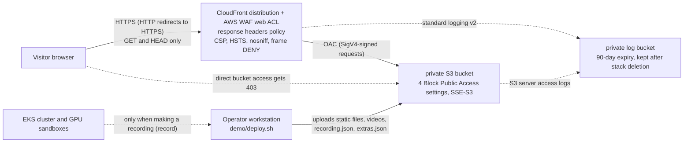

# 09 Demo site (CloudFront)

**TL;DR** Publish a static demo that replays an execution record (JSON) from the cluster, served from a private S3 bucket through CloudFront. Visitors never reach the cluster or a GPU.

## Pain point

A live demo that sends visitor input to GPU sandboxes opens an execution path for untrusted code to the internet, and its GPU nodes bill while they are up and stop the demo when scaled down. Static hosting alone does not fix this: a public bucket or an S3 website endpoint (no OAC, per the CloudFront documentation) creates a path that bypasses CloudFront. The error messages and policy violations in a record are strings produced by evaluated code, so inserted as HTML they become script.

![Two panels. a: visitors reach a GPU sandbox that is billed while it is up through a live demo API open to the internet, reach the S3 bucket around CloudFront through a public bucket or website endpoint, and error and policy violation strings from the record run as script when inserted into the demo page as HTML. b: replaying a record means visitors reach only CloudFront and the GPU sandbox is needed only to record, OAC and AWS:SourceArn make direct bucket access return 403, and the page inserts record strings as text only with a CSP that allows only its own origin.](../images/figures/handson-09_demo_site.svg)

*Takeaway: A live demo lets visitors reach a GPU, and misconfigured static hosting bypasses CloudFront or turns record strings into script, but replaying a record, OAC with AWS:SourceArn, and text-only insertion close the three paths one by one.*


## Why

- **Replay a record.** Visitors reach only CloudFront; the cluster and the GPUs are needed only while you make the record.
- **Keep the bucket private and let only this distribution read it.** OAC and an `AWS:SourceArn` condition do this, and `deploy.sh` checks that direct bucket access returns 403.
- **Narrow the browser side too.** The CSP allows scripts, styles and connections only from the page's own origin, and the page inserts strings from the record as text only.

**Before you start:** you need the local Python environment (section 2 of [Getting started](../getting_started.md)), and a GPU recording needs the pools deployed in [04](04_sandbox_pools.md). The GRPO chart in section 4 needs the training log from [05](05_grpo_training.md); the version switch chart can come from a training log that went through the switch in [06](06_sandbox_update.md) or from the CPU simulation log in [10](10_cpu_only.md). What the verdicts and rewards mean is in [03 On-policy RL with sandboxes](../concepts/03_onpolicy_rl_with_sandboxes.md).

??? note "Terms (expand if a word is new to you)"
    - **Static site**: a site that serves only HTML, CSS and JavaScript files, with no server-side code.
    - **Amazon CloudFront**: a CDN that caches files at edge locations around the world. One distribution serves one domain.
    - **OAC (Origin Access Control)**: the way CloudFront sends signed requests to S3. It lets CloudFront read a bucket that is not public.
    - **S3 Block Public Access**: four settings that stop a bucket from becoming public through bucket policies or ACLs.
    - **Service principal**: the name an AWS service uses as a principal in policies. For CloudFront it is `cloudfront.amazonaws.com`.
    - **`AWS:SourceArn`**: a policy key that conditions access on the ARN of the AWS resource that sent the request. Here it means "only requests from this distribution".
    - **CSP (Content-Security-Policy)**: a response header that tells the browser where the page may load scripts, styles and data from.
    - **HSTS (Strict-Transport-Security)**: a response header that makes the browser use only HTTPS for that domain for a set period.
    - **ACM (AWS Certificate Manager)**: the service that issues and manages TLS certificates.
    - **Invalidation**: a request that clears CloudFront's cache so that new files are served.
    - **Golden**: a test submission whose expected verdict is fixed in advance.

    More detail is in the [Glossary](../reference/glossary.md).

## What the demo shows

| Section | What it shows | Data |
|---|---|---|
| Top | Key numbers (GPU runtimes, goldens matching their expected verdict, connections blocked in the two pools' `verify.sh` transcripts, benchmark requests answered ok) and a tour video (about 2 minutes, no sound) | `recording.json`, `extras.json`, `media/tour-ko.mp4` and `tour-en.mp4` |
| 1. Architecture | A diagram whose components open a description and measurements when clicked. The play button shows the order in which one reward request passes the trainer, the reward function, the routing table and a sandbox pool | Text in the page and measurements from `extras.json` |
| 2. Try scoring | Pick a golden submission (correct, wrong, code that turns wrong only during the benchmark, reading a host file, and so on) and press play: a progress bar fills for each pool based on its recorded evaluation time (`duration_s`) (4x speed by default; real time or result only can also be picked), then the verdict, reward components (format, correctness, speedup, total) and the reason appear | Golden evaluation results in `recording.json`, and rewards computed with the same `score_verdict` as the trainer |
| 3. Attacks blocked | For each pool, the kernel inside the sandbox and the node kernel, the GPU and egress status. Eight cards of isolation and scoring checks (IMDS, Kubernetes API, kubelet and internet tried from inside the sandbox, a connection into the sandbox from the `default` namespace, the kernel inside the sandbox compared with the node's, and the golden host-file read and benchmark cheat), and a terminal replay that highlights the matching line when a card is clicked | `/info` in `recording.json`, terminal transcripts in `extras.json` (verify.sh, the gVisor smoke test, rollout.sh) |
| 4. Training | A chart of the verdict mix, pass rate and mean reward per GRPO batch with step playback, and a chart of a version switch during training | `training` (GRPO Job logs) and `simulation` in `extras.json` (or `training` in `recording.json` when absent) |
| 5. Benchmark | Bar charts of eval p50, p95, cold start, throughput per pod and speedup per runtime, for cached images or as deployed | `bench` in `extras.json` (output of `scripts/ops/bench.sh`) |
| Architecture patterns (`architecture.html`) | Scenarios A, B1, B2 and C drawn with AWS icons. Each pattern replays "Setup and deploy", "One training step" and "Switching versions" step by step, with requests and results moving along the lines. Korean by default; `?lang=en` or the `EN` button switches to English | Static data in the page (`arch.js`); no data file is read |

What is published is HTML, CSS, JavaScript, AWS architecture icons (SVG), the tour videos (MP4) with their thumbnails (JPG), and two recording JSON files (`data/recording.json`, `data/extras.json`). The repository's `recording.json` sample is a laptop CPU pool recording; replace it with a GPU recording made on your cluster. The GPU recording published on 2026-11-18 is in `demo/recordings/2026-11-18-eks-gpu.json`, The GRPO chart and the benchmark in `extras.json` were built from the logs of the same day's EKS run (us-west-2), and the version switch chart uses the log of a CPU simulation run on 2026-11-17 with golden submissions instead of a model. The progress bar in section 2 is the recorded total evaluation time; per-stage times are not recorded, so the stages are filled in from the verdict once the evaluation ends.



*Takeaway: visitor requests end at CloudFront, and the cluster and GPUs are used only while the operator makes a recording.*

## Time and cost

- **The local preview and regenerating the sample** cost nothing on AWS.
- **Deployment** is mostly waiting for the stack and for CloudFront to propagate, and the script waits for 200 for up to about 10 minutes (step 7 in section 4). The actual duration was not measured.
- **Site cost**: usually small for a small static site, but it depends on traffic, so check [CloudFront pricing](https://aws.amazon.com/cloudfront/pricing/) and [S3 pricing](https://aws.amazon.com/s3/pricing/).
- **WAF cost**: about 5 USD per month for the web ACL, 1 USD per rule per month (5 rules), and 0.60 USD per million requests ([AWS WAF pricing](https://aws.amazon.com/waf/pricing/)). While the stack exists, the fixed part (about 10 USD per month) bills even without traffic.
- **Video transfer cost**: each tour video is about 5.5 MB. Transfer bills per [CloudFront pricing](https://aws.amazon.com/cloudfront/pricing/), and WAF limits `/media/` requests to 100 per 5 minutes per IP, which caps the transfer one client can cause. If you expect heavy use, set an AWS Budgets alert.
- **Log cost**: only S3 storage for the log bucket. Objects expire after 90 days, and the bucket stays after cleanup (section 6).
- **GPU recording cost**: the GPU sandbox nodes must be up while you record (`g5.2xlarge` 1.212 USD per hour, `g5.xlarge` 1.006 USD, `g4dn.metal` 7.824 USD, us-east-1 and us-west-2 On-Demand). The recorder pod runs on a system node without a GPU; recording from a trainer pod also needs the trainer node. Once you have the recording, scale the GPU nodes down with [99 Cleanup](99_cleanup.md).

## 1. Preview locally

Run it from the repository root. On the loopback address, other machines cannot connect.

```bash
# Serve demo/site on loopback only (Ctrl-C stops it)
python3 -m http.server 8080 --bind 127.0.0.1 -d demo/site
```

Open http://127.0.0.1:8080 in a browser. Opening the file directly (`file://`) can make the browser block `fetch`, so the recording would not load.

The page opens in Korean; `?lang=en` opens it in English. The `EN` button at the top right switches to English and becomes `KO`, which switches back. The choice stays in the address, so a reload keeps it.

**What to look for:**

- At the top, the recording source line shows text starting with `Local CPU smoke run on a laptop (127.0.0.1, no gVisor or Kata, no GPU).` and the recording time.
- There are three key-number tiles: `8/8` (goldens matching their expected verdict), `10/10` (the tile label is "access attempts from inside a sandbox, blocked", but it also counts the checks of connections coming in from outside. It counts the lines that contain `blocked` in the two pools' `verify.sh` transcripts: 8 outbound checks and 2 checks of connections coming in from the `default` namespace. The denominator shows the same line count) and `160/160` (benchmark requests answered ok). The sample has no GPU pool, so the GPU runtime tile does not appear.
- Section 2 has four submission cards (PyTorch only, Missing ReLU, Benchmark cheat, Read a host file), and playing fills two lanes, `local-cpu v1` and `local-cpu v2`. Code is shown with syntax colors and line numbers.
- Section 3 has eight attack cards and four terminal tabs (verify.sh gvisor, verify.sh kata-qemu, gVisor GPU smoke test, rollout.sh v1 → v2).
- The summary under the lower chart in section 4 starts with "All 30 batches were scored. At step 8 the pool changed from kata-clh-cpu/v1 to kata-clh-cpu/v2".
- In section 5, `kata-clh` is one of six bars and shows "not measured".
- The `EN`/`KO` button switches the language, and the terminal logs a 200 response for each file.

These items were checked on 2026-11-18 with Chromium (Playwright) on Linux. The pool cards in section 3 read `recording.json`; the attack cards and terminals in section 3 and sections 4 and 5 come from the repository's `extras.json`, and each chart shows its source. In the published copy the GRPO training and the benchmark are from the 2026-11-18 EKS run, and the version switch is the 2026-11-17 CPU simulation.

**If it fails:** on `Address already in use`, use another port (for example `8081`) and its address. If `failed to load recording:` appears where the recording source should be, check that `demo/site/data/recording.json` exists and is valid JSON. Without `data/extras.json`, the blocked and benchmark tiles at the top and the terminal output disappear. Section 5 keeps its heading and an empty chart area. The attack cards in section 3 and the GRPO chart in section 4 show "This recording has no data for this part.", and the version switch chart in section 4 is drawn from the training events in `recording.json`. For anything else, see [Troubleshooting](../reference/troubleshooting.md).

## 2. Make a GPU recording on the cluster

`python -m gpusandbox.tools record` collects the following for each pool and writes them into one JSON file.

- `/info` of the first Ready pod: runtime, sandbox version, kernel version, GPU name, egress status
- Verdicts of the golden set (6 with `--device cuda`): status, correct, custom_kernel, speedup, reference and candidate ms, flags, policy violations (up to 3), error (last 400 characters), duration, version
- Reward components computed with the same `score_verdict` as the trainer
- With `--training-events`, the `reward_batch` and `sandbox_version_switch` events from that file

Pod IPs and endpoint addresses are not stored as fields of their own, and tokens are left out (according to the list of fields that `record` keeps). The `error` of a connection failure can still hold an endpoint address. Before uploading, `deploy.sh` looks for IP addresses with `demo/build_extras.py --check`. It allows `127.0.0.1`, `0.0.0.0` and `169.254.169.254` and stops on any other IP address, so check this in 2.5 first. The command must run inside the cluster, in a pod that meets all of the following.

| Requirement | Why |
|---|---|
| `rl-trainer` namespace and the label `gpusandbox/client: "true"` | The sandbox NetworkPolicy admits only such pods |
| A projected token with audience `gpu-sandbox`, and `SANDBOX_TOKEN_FILE` | Authentication to the sandbox API |
| A ServiceAccount on the allowlist (`grpo-trainer` or `sandbox-probe`) | The sandbox checks the token's subject |
| An image with torch and httpx | `record` loads the task modules to put task descriptions and reference code into the recording, and the task modules import torch |

Two kinds of pod meet all four.

| Pod | When to use it | Training events in the recording |
|---|---|---|
| Recorder pod (`demo/recorder-pod.yaml.tpl`) | Recording without a running training Job | empty |
| A running trainer pod | Recording the training events too. The events file `/outputs/grpo/sandbox_metrics.jsonl` is in this pod | filled |

The recorder pod runs only `sleep` in the trainer image (`rl-trainer`). It has the label `gpusandbox/client: "true"`, the ServiceAccount `grpo-trainer`, a projected token with audience `gpu-sandbox` and Pod Security restricted (uid 2000), and runs on a system node without a GPU. The golden set runs in the sandbox pools.

??? info "Why not record with the probe Job template (`k8s/probe/job-probe.yaml.tpl`)"
    The probe Job has the `rl-trainer` namespace, the client label and the audience token, but it cannot create or hand over a recording file.

    - The control image (`gateway/Dockerfile`, based on `python:3.14-slim`) has no torch. In a local environment with torch imports blocked, the same code path stopped with `ModuleNotFoundError` in `get_task`.
    - The root filesystem is read-only and there is no writable volume, so there is nowhere to write the `--out` file.
    - `kubectl cp` uses `tar` inside a running container, so it cannot copy the file out once the Job finishes and the pod terminates.

    `probe`, `parity` and `bench` do not load the task modules, so they run unchanged on the control image.

### 2.1 Pick the moment to record

- **Without a training Job, record from the recorder pod (2.2).** The recording then has no training events. The version switch chart in section 4 uses `simulation` in `extras.json` first and the recording's training events only when that is missing; with neither, the chart is not shown.
- **When you record from a trainer pod, run it while the training Job is Running.** Once it ends, the container stops and the events file in the emptyDir can no longer be copied out ([05 On-policy GRPO training](05_grpo_training.md)).
- **To get a version switch into the training events**, switch routing with `scripts/ops/rollout.sh gvisor v1 v2` from [06](06_sandbox_update.md) and record after `sandbox_version_switch` appears in the trainer log. `record` reads only the events that are in the `--training-events` file when it runs. The addresses passed with `--pool` are where the goldens run, so to record the goldens of both pools as well, record before you scale v1 down with `--finish` and pass the v1 and v2 addresses as separate `--pool` options, as in the example in 2.3. In B2, the Service name uses `gvisor-hyperpod` (`sandbox-gvisor-hyperpod-v1`). The chart in section 4 uses `simulation` in `extras.json` first, so to show your own switch, leave out `--simulation-log` when you build `extras.json` in 2.6.
- **Training can slow down briefly.** Recording uses the same pools and a pod evaluates one request at a time, so the golden evaluations slot in between the reward evaluations.

### 2.2 Find the trainer pod

Store the name of the running trainer pod in a variable.

```bash
# Name of the running trainer pod (scenarios A and B both label it app=grpo-trainer)
POD="$(kubectl -n rl-trainer get pods -l app=grpo-trainer \
  --field-selector=status.phase=Running -o jsonpath='{.items[0].metadata.name}')"
echo "${POD}"
```

**What to look for:** one pod name is printed (in scenario A, `grpo-<RUN_ID>-<suffix>`). If it is empty, no training is running; start with [05](05_grpo_training.md), or use the recorder pod below.

**To record without a training Job,** create the recorder pod. The template is rendered with `TRAINER_IMAGE_URI` and `SANDBOX_AUDIENCE` from `scripts/config.env`.

```bash
# Recorder pod: trainer image, client label, grpo-trainer ServiceAccount, no GPU (runs on a system node)
source scripts/config.env
python3 scripts/render.py demo/recorder-pod.yaml.tpl | kubectl apply -f -
kubectl -n rl-trainer wait --for=condition=Ready pod/demo-recorder --timeout=10m
POD=demo-recorder
```

**What to look for:** `pod/demo-recorder created` and `pod/demo-recorder condition met`. The recorder pod's container is named `recorder`, so replace `-c trainer` with `-c recorder` in 2.3 and 2.4, and drop the `--training-events` line in 2.3. The pod exits after three hours (`sleep 10800`); delete it with `kubectl -n rl-trainer delete pod demo-recorder` once you have copied the recording.

### 2.3 Run record inside the trainer pod

Run the golden set on each GPU pool and write the recording to `/tmp/rec.json` in the pod. `--pool` takes `label=address`, and the label becomes the card title on the page.

```bash
# Run the golden set on each GPU pool and write the recording inside the trainer pod.
# Container name: trainer in scenario A, pytorch in scenario B (HyperPod).
kubectl -n rl-trainer exec "${POD}" -c trainer --\
  python -m gpusandbox.tools record \
  --pool gvisor=sandbox-gvisor-v1.sandbox.svc.cluster.local:8000 \
  --pool kata-qemu=sandbox-kata-qemu-v1.sandbox.svc.cluster.local:8000 \
  --device cuda \
  --source "EKS us-west-2, gVisor on g5.xlarge (A10G), Kata QEMU on g4dn.metal (T4)" \
  --training-events /outputs/grpo/sandbox_metrics.jsonl \
  --out /tmp/rec.json
```

- The `--\` at the end of the first line continues the line right after kubectl's argument separator `--` (the same notation as in [Troubleshooting](../reference/troubleshooting.md)).
- **Include only pools you have deployed.** For an address with no Ready pods, each golden waits up to 600 seconds (the client's acquire timeout) and is recorded as `sandbox_error`, and the empty `/info` makes the page show egress as "open".
- **To include v1 and v2 together**, put the version in the label, for example `--pool "gvisor v1=sandbox-gvisor-v1.sandbox.svc.cluster.local:8000" --pool "gvisor v2=sandbox-gvisor-v2.sandbox.svc.cluster.local:8000"`.
- **`--source` appears verbatim in the recording source line.** Write the conditions of the recording, such as Region, instances and date.

**What to look for:** the last line is JSON like the following. `training_events` depends on how many batches have run by then, and is 0 on the recorder pod (the 2026-11-18 recording: `goldens: 6`, `training_events: 0`).

```text
{"event": "recorded", "out": "/tmp/rec.json", "pools": ["gvisor", "kata-qemu"], "goldens": 6, "training_events": <N>}
```

**If it fails:** a `sandbox_error` with `HTTP 401` or `HTTP 403` is a token or allowlist problem; see the "401, 403 responses" section of [Troubleshooting](../reference/troubleshooting.md), or its "NetworkPolicy" section if the connection itself fails.

### 2.4 Copy the recording out

Copy it to your workstation and run the schema check that `deploy.sh` also runs.

```bash
# Copy the recording to your workstation (kubectl cp runs tar inside the container)
# Container name: trainer in scenario A, pytorch in scenario B (HyperPod), recorder for the recorder pod
kubectl -n rl-trainer cp -c trainer "${POD}:/tmp/rec.json" /tmp/rec.json
# The same schema check that deploy.sh runs first
python3 -c "import json,sys; d=json.load(open(sys.argv[1])); assert d['schema'] == 1 and d['pools']" /tmp/rec.json
```

**What to look for:** `kubectl cp` may print one `tar` warning; the copy is fine. The schema check prints nothing and exits with code 0.

### 2.5 Review before publishing

The page shows the recording verbatim, so check the following before publishing.

| Item | What to check |
|---|---|
| `source` | Text you wrote. Make sure it contains no account details or personal names |
| `pools[].info.egress_blocked` | `true` for every pool. A missing or `false` value shows as "open" on the page; do not publish it that way, fix the pool first |
| `pools[].results[].status` and `expected_status` | Equal for every golden. A difference means a verdict went against expectations; find the cause first with the pool verification (`scripts/ops/verify.sh`) in [04](04_sandbox_pools.md) |
| `pools[].results[].error`, `violations` | Strings produced by evaluated code or by connection errors (last 400 characters of the error, up to 3 violations). Make sure they contain no pod addresses, internal paths or host names |
| `training` | Only `reward_batch` and `sandbox_version_switch` events go in. Make sure the version names and routing revisions are fine to publish |

The following script prints a summary.

```bash
python3 - /tmp/rec.json <<'PY'
import json, sys
rec = json.load(open(sys.argv[1]))
print("source:", rec["source"])
for pool in rec["pools"]:
    info = pool["info"]
    print(pool["runtime"], "egress_blocked:", info.get("egress_blocked"), "gpu:", info.get("gpu"))
    for name, v in pool["results"].items():
        mark = "as expected" if v["status"] == v["expected_status"] else "DIFFERS FROM EXPECTED"
        print("   ", name, v["status"], mark)
print("training events:", len(rec["training"]))
PY
```

**What to look for:** every pool shows `egress_blocked: True`, and every golden line says `as expected`. In the 2026-11-18 recording both pools had `egress_blocked: True`, all 12 verdicts matched `expected_status`, and the file contained no IPs, account IDs or host names. Run against the repository's sample recording, it prints `local-cpu v1` and `local-cpu v2` with four goldens each and `training events: 7` (checked locally).

To view it in a browser, copy the site to a temporary folder and serve it.

```bash
# Preview your recording without overwriting the shipped sample
mkdir -p /tmp/demo-preview && cp -R demo/site/. /tmp/demo-preview/
cp /tmp/rec.json /tmp/demo-preview/data/recording.json
python3 -m http.server 8080 --bind 127.0.0.1 -d /tmp/demo-preview
```

### 2.6 Build the training, benchmark and terminal data (extras.json)

`demo/build_extras.py` builds `extras.json` from the output of commands run against the cluster. Every input is a text file saved on the operator workstation.

| Data | How to make it | Options |
|---|---|---|
| Benchmark | Save the output of `scripts/ops/bench.sh 32` to `bench.log` with `tee`. `bench.sh` prints no separator, so if you measured twice, put a `=== run 1` and a `=== run 2` line before each run's output yourself. The page shows `pass2` by default, so for a single run use `--bench-log pass2=bench.log` | `--bench-log pass1=bench.log --bench-pass pass2`, node details with `--node` (see the example) |
| GRPO training | `kubectl -n rl-trainer logs job/<job> > grpo.log`. It reads the reward function's `reward_batch` JSON lines and the trainer's metric lines (`{'loss': ...}`) | `--training-log grpo.log --model <model-id>` |
| Version switch | Save the output of `scripts/ops/simulate.sh 30 20` to `simulate.log`, and switch the version with `rollout.sh` from [06](06_sandbox_update.md) meanwhile | `--simulation-log simulate.log` |
| Terminal output | Save the output of commands such as `scripts/ops/verify.sh gvisor v1` to a file. A first line `$ <command>` shows as the command line, and lines starting with `[HH:MM:SS]` set the replay timing | `--transcript verify-gvisor=verify-gvisor.txt` (repeatable) |

```bash
# Build data/extras.json from the saved command output (paths are examples)
python3 demo/build_extras.py --out demo/site/data/extras.json \
  --source "Amazon EKS 1.36, us-west-2, 2026-11-18" \
  --bench-log pass1=bench.log --bench-pass pass2 \
  --node 'gvisor=g5.2xlarge|NVIDIA A10G' --node 'kata-qemu=g4dn.metal|Tesla T4' \
  --unmeasured 'kata-clh=g4dn.metal|Tesla T4' \
  --training-log grpo.log --model Qwen/Qwen2.5-Coder-1.5B-Instruct --training-source "..." \
  --simulation-log simulate.log --simulation-source "..." \
  --transcript verify-gvisor=verify-gvisor.txt --transcript verify-kata-qemu=verify-kata-qemu.txt
```

The script strips ANSI color codes and shell prompts from every string, and replaces IP addresses (IPv4, IPv6, pod DNS forms such as `10-0-12-34`) with `<private-ip>`, `<public-ip>` or `<ipv6>`, node names with `<node>`, and `*.amazonaws.com` hosts (EKS API endpoint, OIDC, ELB and so on) with `<aws-endpoint>`. Account IDs, ARNs, EC2 resource IDs and tokens (access keys, Hugging Face, GitHub, JWT) become placeholders too. Addresses that are the same for everyone, such as `169.254.169.254` (IMDS), stay. If any of these, an `*.internal` host, a `user@host` or a home path (`/home`, `/root`, `/Users`) is still there afterwards, it refuses to write the file.

**What to look for:** the last line of the command above shows `"transcripts": 2`. Below is the output for the published file, built from the 2026-11-18 logs with four transcripts (`verify-gvisor`, `verify-kata-qemu`, `smoke-gvisor`, `rollout`).

```text
{"event": "extras", "out": "demo/site/data/extras.json", "transcripts": 4, "bench": true, "training": true, "simulation": true}
```

The page shows terminal output verbatim, so read it once more with the same criteria as 2.5. `python3 demo/build_extras.py --check <file>...` runs the same scan on existing files, and `deploy.sh` runs it before uploading.

### 2.7 Re-record the tour video (optional)

`demo/record_tour.py` opens the page in Chromium, plays its features in turn and records the screen into `media/tour-ko.mp4`, `tour-en.mp4` and thumbnails. Captions and a click marker are drawn on top only while recording; the site files do not change. The page is served on `127.0.0.1` only while recording. Before recording, it runs the scan from 2.6 on the data files in `--site` and refuses to record on any finding. The hashes of the data it recorded go to `media/tour-data.json`, and `deploy.sh` warns when the published data differs (that file is not uploaded).

```bash
# Playwright and ffmpeg are needed on the workstation only (not project dependencies)
pip install playwright && playwright install chromium
# Stage the files you will publish, then record both languages into demo/site/media
mkdir -p /tmp/demo-stage && cp -R demo/site/. /tmp/demo-stage/
cp /tmp/rec.json /tmp/demo-stage/data/recording.json
python3 demo/record_tour.py --site /tmp/demo-stage --out demo/site/media
```

**What to look for:** a `[tour] demo/site/media/tour-ko.mp4 (<size> KiB)` line per language. With the 2026-11-18 data each video was about 2 minutes long. The captions contain numbers from that day's recording (for example, the Triton kernel's speedup of about 1.78x), so edit `CAPTIONS` in `record_tour.py` when you record another one.

### 2.8 Check the patterns page drawings (optional)

After changing the drawings of `architecture.html` (the coordinates in `arch.js`), check them with `demo/check_arch_layout.py`. It opens the four patterns in Korean and in English and, in every step of every flow, checks that each arrow starts and ends on the edge of the box drawn around an icon, that no line or arrowhead overlaps a text, an icon or another line, and that no label or badge touches a box border. The page is served on `127.0.0.1` only while it checks.

```bash
# Playwright is needed on the workstation only, as for record_tour.py
python3 demo/check_arch_layout.py                    # lists the problems and exits 1 if there are any
python3 demo/check_arch_layout.py --shots /tmp/arch  # also saves one PNG per pattern and language
```

**What to look for:** the last line is `ok`. Text sizes vary a little with the fonts; this was checked on 2026-11-19 with Chromium on Linux.

## 3. Regenerate the sample recording (local, no AWS)

Regenerate the sample `demo/site/data/recording.json` on a laptop, with no GPU.

!!! warning "On a Linux host, run it inside a container"
    `record_local.py` starts the sandbox servers inside its own process, and after every evaluation a server sends SIGKILL to every process visible in `/proc` except itself and its ancestors, so on a Linux host it can kill other processes of the same user (the same reason as the warning in [Getting started](../getting_started.md)). Run it inside a container with its own PID namespace (off on macOS, which has no `/proc`).

```bash
# Regenerate the shipped sample (repo root, local venv; on Linux inside a container with its own PID namespace)
python demo/record_local.py
```

The script does the following.

- Starts two CPU sandbox servers (v1 and v2) on `127.0.0.1`. The v2 harness uses 5 seeds and a 10x speedup cap, and authentication is the loopback-only test bypass.
- Sends the golden set (4 goldens on CPU) to both servers through the same code path the cluster uses.
- Runs six reward batches through `KernelRewards`, with golden submissions standing in for model completions, and switches routing from v1 to v2 after the third batch.
- Writes the result to `demo/site/data/recording.json` (the default `--out`), with the source text "Local CPU smoke run on a laptop" marking it as a laptop recording.

**What to look for:** a `{"event": "reward_batch", ...}` line appears for each batch, and the last line is the following (checked locally on macOS).

```text
{"event": "recorded", "out": "demo/site/data/recording.json", "pools": ["local-cpu v1", "local-cpu v2"], "goldens": 4, "training_events": 7}
```

After regenerating, check the schema and reward consistency with `python -m pytest -q tests/test_demo.py`.

**If it fails:** `ModuleNotFoundError` means the virtual environment is not active or an install step was missed; run section 2 of [Getting started](../getting_started.md) again.

## 4. Deploy (demo/deploy.sh)

`demo/deploy.sh` creates one CloudFormation stack (site bucket, log bucket, OAC, response headers policy, WAF web ACL, CloudFront distribution and its log delivery, bucket policies), uploads the static files and the recording, and checks the public state.

```bash
# Publish the shipped sample recording (always us-east-1)
demo/deploy.sh
# Publish your GPU recording instead (EXTRAS defaults to demo/site/data/extras.json)
RECORDING=/tmp/rec.json demo/deploy.sh
# The 2026-11-18 public demo
RECORDING=demo/recordings/2026-11-18-eks-gpu.json demo/deploy.sh
```

**The Region is fixed to us-east-1,** because a WAF web ACL for CloudFront and CloudFront log delivery are us-east-1 resources. The script reads neither `AWS_REGION` nor `scripts/config.env`, and the template's `Rules` reject a deployment in any other Region (`Deploy the demo stack in us-east-1 ...`). The cluster can be in another Region (on 2026-11-18 the cluster was in us-west-2 and the demo in us-east-1). It needs permission to create CloudFormation, S3, CloudFront, AWS WAF and CloudWatch Logs (log delivery) resources; in a shared or production account, a dedicated demo account or a least-privilege role is safer.

| Variable | Default | Meaning |
|---|---|---|
| Region | `us-east-1` (fixed) | Region for the stack, the buckets and the WAF web ACL. `AWS_REGION` is ignored |
| `RECORDING` | `demo/site/data/recording.json` | The recording to upload. It is stored in S3 as `data/recording.json` |
| `EXTRAS` | `demo/site/data/extras.json` | Benchmark, training and terminal data (2.6). If the file is missing it is not uploaded. An earlier `data/extras.json` in S3 is not deleted, so delete that object too to take the old data down |
| `DEMO_STACK_NAME` | `gpu-sandbox-demo` | CloudFormation stack name |
| `DEMO_DOMAIN`, `DEMO_CERT_ARN` | empty | Custom domain and an ACM certificate in us-east-1. Both are needed for it to apply |

| Step | What the script does |
|---|---|
| 1 | Checks the recording (`schema` is 1 and `pools` is not empty; `extras.json` has `schema` `extras-1`). Then `demo/build_extras.py --check` scans both files for IP addresses (except the allowed `127.0.0.1`, `0.0.0.0` and `169.254.169.254`), node names, account IDs, ARNs and tokens, and stops on any finding |
| 2 | Deploys `demo/infra/site.yaml` to us-east-1 with `aws cloudformation deploy` (no failure when nothing changed) |
| 3 | Reads the stack outputs `BucketName`, `DistributionId` and `DistributionDomainName` |
| 4 | Uploads only the allow-listed files (`index.html`, `app.js`, `style.css`, `architecture.html`, `arch.js`, `icons/*.svg`, `media/tour-*.mp4`, `media/tour-*.jpg`) with `aws s3 sync --delete`, and uploads the data as `data/recording.json` and `data/extras.json` (`application/json`, `no-cache`). Before that, it warns if the videos were recorded with other data than what it publishes |
| 5 | Creates a CloudFront invalidation (`/*`) and checks that the distribution's `WebACLId` is a WAF web ACL ARN, stopping with an error if not |
| 6 | Sends an anonymous request to `https://<bucket>.s3.us-east-1.amazonaws.com/index.html` and stops with an error unless it gets 403 |
| 7 | Checks every 20 seconds, up to 30 times, until the public URL returns 200, then stops with an error if the response lacks the CSP or HSTS header, or if an `http://` request does not return 301 |
| 8 | Prints `[demo] live: <URL>` |

**What to look for:** the following lines appear in this order, with AWS CLI output in between.

```text
[check] 2 file(s), 0 problem(s)
[demo] deploying stack gpu-sandbox-demo in us-east-1
[demo] uploading site to s3://<bucket>
[demo] checking that the distribution has the WAF web ACL
[demo] checking that the bucket itself is not readable anonymously
[demo] checking the public URL and its security headers (the distribution may take minutes)
[demo] live: https://<id>.cloudfront.net/
```

Step 7 moves on to the header check even if 200 never arrives, so open the final URL in a browser to confirm the page loads.

**If it fails:**

- `the data files above would leak details. Fix before publishing.`: the `[check]` lines just above name the file and the place. Remove or mask that line in the input logs and rebuild `extras.json` (2.6). The stack has not been changed yet.
- `no WAF web ACL on <distribution>. Fix before sharing.`: no web ACL is attached to the distribution. Check the `WebAcl` resource in the stack events, and do not share the URL until it is fixed.
- `direct S3 access returned <code>, expected 403`: check whether the bucket policy or the Block Public Access settings changed, and do not share the URL until it is fixed.
- `CSP header missing` or `HSTS header missing`: the distribution may still be propagating; run the same command again a few minutes later (rerunning is safe).
- `http:// returned <code>, expected a 301 redirect to https`: check that the distribution's `ViewerProtocolPolicy` is `redirect-to-https`; if it is still propagating, run it again a few minutes later.
- Stack creation failed: find the failed resource and the reason with `aws cloudformation describe-stack-events --region us-east-1 --stack-name gpu-sandbox-demo`. Cleanup and cost issues are in the "Cleanup and cost" section of [Troubleshooting](../reference/troubleshooting.md).

## 5. Custom domain (optional)

With the default `*.cloudfront.net` certificate the viewer security policy is TLSv1 and cannot be raised (per the CloudFront documentation), and the default domain of the 2026-11-18 deployment accepted TLS 1.0 and 1.1 handshakes (it also offers TLS 1.2 and 1.3). To accept only TLS 1.2 and later, use a custom domain with an ACM certificate. When both values are set, the template applies `sni-only` and `TLSv1.2_2021`.

```bash
# Custom domain with an ACM certificate in us-east-1 (required by CloudFront)
DEMO_DOMAIN=demo.example.com \
DEMO_CERT_ARN=arn:aws:acm:us-east-1:<account-id>:certificate/<certificate-id> \
demo/deploy.sh
```

- **The certificate must be in us-east-1.** The ACM certificate must be requested or imported in US East (N. Virginia), and its SAN must cover `DEMO_DOMAIN` (per the CloudFront documentation).
- **Create the DNS record yourself.** Without a CNAME (or a Route 53 alias) pointing `DEMO_DOMAIN` to the stack output `DistributionDomainName`, the header check in step 7 fails; create the record and run the same command again.
- **Use a dedicated subdomain (for example `demo.example.com`).** HSTS is sent with a `max-age` of two years (63072000 seconds) and `includeSubDomains`, so on an apex domain (`example.com`) it would force HTTPS on every subdomain for two years.

List the stack outputs with the following command.

```bash
aws cloudformation describe-stacks --region us-east-1 --stack-name gpu-sandbox-demo \
  --query "Stacks[0].Outputs" --output table
```

**What to look for:** five rows, `BucketName`, `DistributionId`, `DistributionDomainName`, `LogBucketName` and `WebAclArn`.

## Security design

The settings live in [`demo/infra/site.yaml`](https://github.com/daekeun-ml/gpu-sandbox-on-aws/blob/main/demo/infra/site.yaml) and [`demo/site`](https://github.com/daekeun-ml/gpu-sandbox-on-aws/tree/main/demo/site).

| Layer | Setting | What it prevents |
|---|---|---|
| Bucket | All four Block Public Access settings (`BlockPublicAcls`, `IgnorePublicAcls`, `BlockPublicPolicy`, `RestrictPublicBuckets`) turned on | The bucket or its objects becoming public through a policy or an ACL |
| Bucket | Object Ownership `BucketOwnerEnforced` (ACLs disabled) | Permissions leaking through ACLs. This is the setting the OAC documentation recommends |
| Bucket | Default encryption with SSE-S3 (`AES256`) | Stored objects left unencrypted |
| Bucket policy | `s3:GetObject` allowed only for `cloudfront.amazonaws.com`, and only when `AWS:SourceArn` is this distribution's ARN | Other CloudFront distributions (including those in other accounts) reading this bucket |
| Bucket policy | Deny every `s3:*` request where `aws:SecureTransport` is `false` | Accessing the bucket over plain HTTP |
| OAC | `SigningBehavior: always`, `sigv4` | Unsigned origin requests. With every origin request signed (`always`), traffic between CloudFront and S3 also uses HTTPS only (CloudFront documentation) |
| CloudFront | `ViewerProtocolPolicy: redirect-to-https` | Viewing the page over plain HTTP |
| CloudFront | `AllowedMethods: [GET, HEAD]` | Write requests such as PUT, POST and DELETE |
| CloudFront | `DefaultRootObject: index.html` | Exposing the distribution's contents on a request for the root URL |
| WAF | A web ACL attached to the distribution (scope `CLOUDFRONT`, default action Allow): a rate limit that blocks an IP above 1000 requests per 5 minutes, a separate limit of 100 requests per 5 minutes per IP on the video path (`/media/`), and the AWS managed rule groups `AWSManagedRulesAmazonIpReputationList`, `AWSManagedRulesCommonRuleSet` and `AWSManagedRulesKnownBadInputsRuleSet` | Excessive requests from one IP and transfer cost from repeated video downloads, IPs on the reputation list, common web attack patterns and known bad inputs |
| Access logs | CloudFront standard logging v2 (CloudWatch Logs vended delivery: `AWS::Logs::DeliverySource`, `DeliveryDestination`, `Delivery`) into the log bucket | No record of access to the public endpoint |
| Access logs | S3 server access logs of the site bucket into the same log bucket under the `s3-access/` prefix | No record of bucket access |
| Log bucket | All four Block Public Access settings, `BucketOwnerEnforced`, SSE-S3, 90-day expiration, non-TLS requests denied, writes allowed only for this account's log delivery services (`logging.s3.amazonaws.com`, `delivery.logs.amazonaws.com`), `DeletionPolicy: Retain` | Logs becoming public or piling up forever, and logs disappearing with the stack |
| Response headers | CSP `default-src 'none'; script-src 'self'; style-src 'self'; img-src 'self' data:; media-src 'self'; connect-src 'self'; base-uri 'none'; form-action 'none'; frame-ancestors 'none'` | External scripts, styles, media, connections, form submissions, and framing by other sites |
| Response headers | HSTS `max-age` 63072000, `includeSubDomains` | Downgrading to HTTP |
| Response headers | `X-Content-Type-Options: nosniff`, `X-Frame-Options: DENY`, `Referrer-Policy: strict-origin-when-cross-origin`, `Permissions-Policy: camera=(), microphone=(), geolocation=(), payment=()` | MIME sniffing, clickjacking, referrer leaks, use of browser features |
| Page | `index.html` loads only `style.css` and `app.js`, and `app.js` fetches only `data/recording.json` and `data/extras.json` from the same origin. The videos also play from `media/` on the same origin. Every value from the data goes in as a text node (charts are SVG elements with text nodes); no HTML insertion such as `innerHTML` is used | Strings in the data (error tails and policy violations produced by evaluated code, terminal output) running as HTML or script |
| Published data | `build_extras.py` masks IP addresses (IPv4, IPv6, pod DNS form), node names, AWS endpoint hosts, account IDs, ARNs, EC2 resource IDs and tokens, and `deploy.sh` runs the same scan (`--check`) again before uploading. `record_tour.py` runs the same scan before recording and keeps the hashes of the data it recorded, so `deploy.sh` warns when the published data differs | Internal addresses and identifiers in cluster logs becoming public, and unscanned data showing up in the videos |
| Upload | `aws s3 sync` uploads only an allow list (`index.html`, `app.js`, `style.css`, `architecture.html`, `arch.js`, `icons/*.svg`, `media/tour-*.mp4`, `media/tour-*.jpg`), and only the two scanned data files are uploaded separately | Leftover or unscanned files in `demo/site` becoming public |

Every response header uses `Override: true`, so the policy value wins over the same header sent by the origin. The bucket policy's `AWS:SourceArn` condition is a fixed value, so S3 does not consider the policy public and it applies with `BlockPublicPolicy` turned on (the definition of "public" in the S3 documentation).

!!! warning "This page is public"
    The demo is public by design and the template has no authentication or access control; WAF only blocks abnormal requests with a rate limit and managed rules. Anyone with the URL can view it, so go through the review in 2.5 before uploading.

!!! warning "Residual risk: TLS 1.0 and 1.1 with the default certificate"
    With the default `*.cloudfront.net` certificate the viewer security policy is fixed at TLSv1, and on 2026-11-18 the endpoint accepted TLS 1.0 and 1.1 handshakes (it also offers TLS 1.2 and 1.3). `TLSv1.2_2021` is available only with a custom domain and an ACM certificate in us-east-1 (`DEMO_DOMAIN`, `DEMO_CERT_ARN`); see section 5. This practice account has no Route 53 hosted zone, so the default certificate was used.

!!! note "Validation status"
    Locally, the eleven tests in `tests/test_demo.py`, `cfn-lint demo/infra/site.yaml` and `node --check demo/site/app.js` pass. Every feature was clicked through in Chromium against a local server that sends the same CSP header as the deployment, with no CSP violation. The tests check the four Block Public Access settings on the bucket, that the only Allow statement is for the CloudFront service principal with an `AWS:SourceArn` condition, the denial of non-TLS access, `redirect-to-https`, GET and HEAD only, the CSP directives (including `media-src 'self'`) and HSTS of at least one year, that the page loads nothing external, uses no HTML insertion such as `innerHTML` and fetches only `data/recording.json` and `data/extras.json`, that each verdict in the sample and in `demo/recordings/` matches its expected status and its reward equals `score_verdict`, that no published data file contains an IP address, node name, account ID, ARN or token while the masking keeps the IMDS address, that `extras.json` has the expected benchmark, training, version switch and transcript structure, that WAF limits `/media/` requests per IP while `deploy.sh` uploads only an allow list and runs `--check` first, and that the architecture patterns page loads nothing external, injects no HTML and fetches nothing, with icon SVGs free of scripts and external references.

    The stack was deployed to us-east-1, and an external check after the deploy found the following ([run record](../reference/sources.md#aws-run-record)):

    - **Headers:** CSP, HSTS (max-age 63072000, includeSubDomains), `X-Frame-Options: DENY`, nosniff, `Referrer-Policy: strict-origin-when-cross-origin`, Permissions-Policy
    - **Requests:** POST, PUT and DELETE return 403, a missing path returns 403, `http://` returns 301; only GET and HEAD are allowed
    - **Buckets:** both buckets have Block Public Access on and a policy status that is not public, and both use SSE-S3
    - **Logging:** the log delivery to S3 exists

## How to verify

After deploying, check the following in order.

1. The last line of `deploy.sh` is `[demo] live: https://...`.
2. Opening that URL in a browser shows your own `--source` text in the recording source line, and every pool card in section 3 shows egress "verified" ("외부 연결 차단: 확인됨" in the Korean view). This shows the server's `egress_blocked` value, so for a GPU cluster recording, compare it with the blocked lines in that pool's `verify.sh` transcript. The local CPU sample has no egress targets and shows "verified" without running the check. Check that the video at the top plays as well (`curl -sI https://<distribution-domain>/media/tour-en.mp4` returns `content-type: video/mp4`).
3. The six security headers are present.

    ```bash
    # Security headers on the public URL
    curl -sI https://<distribution-domain>/ \
      | grep -iE '^(content-security-policy|strict-transport-security|x-content-type-options|x-frame-options|referrer-policy|permissions-policy):'
    ```

4. A direct request to the bucket is refused.

    ```bash
    # Direct bucket access must be refused
    curl -s -o /dev/null -w '%{http_code}\n' https://<bucket>.s3.us-east-1.amazonaws.com/index.html
    ```

    **What to look for:** `403` is printed.

5. A request over `http://` returns a 301 whose `Location` starts with `https://` (`curl -sI http://<distribution-domain>/`).
6. Write requests are refused, and the distribution has a WAF web ACL.

    ```bash
    # Write methods are refused (403), and the distribution has a web ACL (an ARN)
    curl -s -o /dev/null -w '%{http_code}\n' -X POST https://<distribution-domain>/
    aws cloudfront get-distribution-config --id <distribution-id> \
      --query 'DistributionConfig.WebACLId' --output text
    ```

    **What to look for:** the first command prints `403`, and the second an ARN starting with `arn:aws:wafv2:us-east-1:`.

## 6. Cleanup (demo/teardown.sh)

Empties the site bucket with `aws s3 rm --recursive`, deletes the CloudFormation stack in us-east-1 and waits until the deletion finishes. The files in the site bucket, the CloudFront distribution and the WAF web ACL are deleted, and the URL stops working (deleting the distribution can take a while). **The log bucket stays, because it has `DeletionPolicy: Retain`.**

```bash
demo/teardown.sh
```

**What to look for:** the script continues only after you answer `Delete demo stack gpu-sandbox-demo and all files in its bucket? Type 'gpu-sandbox-demo':` with the stack name, and the deletion output ends with the two lines below. If you used another stack name, pass `DEMO_STACK_NAME` as well.

```text
deleted gpu-sandbox-demo
kept the access log bucket <log-bucket>; when you no longer need the logs: aws s3 rb s3://<log-bucket> --force
```

The log objects expire after 90 days, but the bucket itself stays. When you no longer need the logs, delete the log bucket with the printed `aws s3 rb` command.

GPU node and cluster cleanup are in [99 Cleanup](99_cleanup.md).

## Scope and limits

- **Run on AWS.** A GPU recording (gVisor A10G, Kata QEMU T4) was made with `record` in the recorder pod, published to us-east-1 with `deploy.sh`, and checked from outside (the validation status under "Security design"). The published recording comes from real GPU pools and has no training events. The GRPO chart in section 4 comes from the five-step scenario A training log, and the version switch chart from the scenario C simulation (golden submissions stood in for model outputs; no training). The dated run record is in [Verified facts and sources](../reference/sources.md#aws-run-record).
- **Visitors cannot run code.** Section 2 replays records, and per-stage times are not recorded. The attack cards in section 3 are limited to what `verify.sh` actually tried and to the golden submissions.
- **`record` runs in a trainer-image pod.** Training events in the recording go in only when you record from a trainer pod while training runs (section 2).
- **Waiting for 200 is not treated as a failure** (step 7 of `deploy.sh`).
- **DNS for a custom domain is not created automatically** (section 5).
- **With the default `*.cloudfront.net` certificate, the viewer TLS policy stays at TLSv1.** TLS 1.0 and 1.1 handshakes succeeded on the 2026-11-18 deployment, and `TLSv1.2_2021` needs a custom domain (section 5).
- **WAF has a fixed cost even without traffic** ("Time and cost"), and the log bucket stays after cleanup (section 6).
- **The template uses `PriceClass_100`.** It is narrower than the default (all edge locations), so check the price class that fits where most viewers are on [CloudFront pricing](https://aws.amazon.com/cloudfront/pricing/).
- **The repository's sample recording (`demo/site/data/recording.json`) is still the laptop CPU recording.** Its numbers say nothing about GPU sandbox performance, as the page footer notes.

??? note "References"
    | Topic | Link |
    |---|---|
    | CloudFront: restricting access to an S3 origin (OAC, bucket policy examples) | https://docs.aws.amazon.com/AmazonCloudFront/latest/DeveloperGuide/private-content-restricting-access-to-s3.html |
    | CloudFront distribution settings (security policy, TLSv1 with the default certificate, default root object, price class) | https://docs.aws.amazon.com/AmazonCloudFront/latest/DeveloperGuide/DownloadDistValuesGeneral.html |
    | CloudFront response headers policies | https://docs.aws.amazon.com/AmazonCloudFront/latest/DeveloperGuide/understanding-response-headers-policies.html |
    | S3 Block Public Access (including the definition of "public") | https://docs.aws.amazon.com/AmazonS3/latest/userguide/access-control-block-public-access.html |
    | cfn-lint | https://github.com/aws-cloudformation/cfn-lint |

    All sources: [this page in All references](../reference/references.md#ref-handson-09-demo-site)
