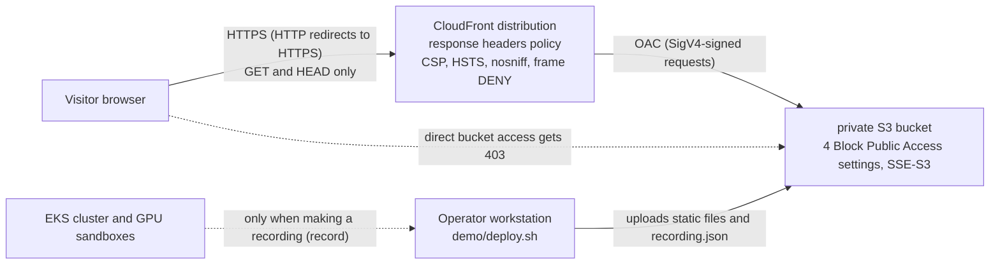

# 09 Demo site (CloudFront)

**TL;DR** Publish a static demo that replays an execution record (JSON) from the cluster, served from a private S3 bucket through CloudFront. Visitors never reach the cluster or a GPU.

## Pain point

A live demo that sends visitor input to GPU sandboxes opens an execution path for untrusted code to the internet, and its GPU nodes bill while they are up and stop the demo when scaled down. Static hosting alone does not fix this: a public bucket or an S3 website endpoint (no OAC, per the CloudFront documentation) creates a path that bypasses CloudFront. The error messages and policy violations in a record are strings produced by evaluated code, so inserted as HTML they become script.

![Two panels. a: visitors reach a GPU sandbox that is billed while it is up through a live demo API open to the internet, reach the S3 bucket around CloudFront through a public bucket or website endpoint, and error and policy violation strings from the record run as script when inserted into the demo page as HTML. b: replaying a record means visitors reach only CloudFront and the GPU sandbox is needed only to record, OAC and AWS:SourceArn make direct bucket access return 403, and the page inserts record strings as text only with a CSP that allows only its own origin.](../images/figures/handson-09_demo_site.svg)

*Takeaway: A live demo lets visitors reach a GPU, and misconfigured static hosting bypasses CloudFront or turns record strings into script, but replaying a record, OAC with AWS:SourceArn, and text-only insertion close the three paths one by one.*


## Why

- **Replay a record.** Visitors reach only CloudFront; the cluster and the GPUs are needed only while you make the record.
- **Keep the bucket private and let only this distribution read it.** OAC and an `AWS:SourceArn` condition do this, and `deploy.sh` checks that direct bucket access returns 403.
- **Narrow the browser side too.** The CSP allows scripts, styles and connections only from the page's own origin, and the page inserts strings from the record as text only.

**Before you start:** you need the local Python environment (section 2 of [Getting started](../getting_started.md)), and a GPU recording needs the pools and the training run from [04](04_sandbox_pools.md), [05](05_grpo_training.md) and [06](06_sandbox_update.md). What the verdicts and rewards mean is in [03 On-policy RL with sandboxes](../concepts/03_onpolicy_rl_with_sandboxes.md).

??? note "Terms (expand if a word is new to you)"
    - **Static site**: a site that serves only HTML, CSS and JavaScript files, with no server-side code.
    - **Amazon CloudFront**: a CDN that caches files at edge locations around the world. One distribution serves one domain.
    - **OAC (Origin Access Control)**: the way CloudFront sends signed requests to S3. It lets CloudFront read a bucket that is not public.
    - **S3 Block Public Access**: four settings that stop a bucket from becoming public through bucket policies or ACLs.
    - **Service principal**: the name an AWS service uses as a principal in policies. For CloudFront it is `cloudfront.amazonaws.com`.
    - **`AWS:SourceArn`**: a policy key that conditions access on the ARN of the AWS resource that sent the request. Here it means "only requests from this distribution".
    - **CSP (Content-Security-Policy)**: a response header that tells the browser where the page may load scripts, styles and data from.
    - **HSTS (Strict-Transport-Security)**: a response header that makes the browser use only HTTPS for that domain for a set period.
    - **ACM (AWS Certificate Manager)**: the service that issues and manages TLS certificates.
    - **Invalidation**: a request that clears CloudFront's cache so that new files are served.
    - **Golden**: a test submission whose expected verdict is fixed in advance.

    More detail is in the [Glossary](../reference/glossary.md).

## What the demo shows

| Section | What it shows | Where the data comes from |
|---|---|---|
| 1. Isolation runtimes and evidence | For each pool, the kernel version, GPU name and egress status as seen from inside the sandbox. gVisor reports its own kernel version; Kata reports the guest VM kernel | `/info` of the first Ready pod of each pool |
| 2. Replay a submission | Pick a golden submission (correct, wrong, code that turns wrong once the benchmark starts, reading a host file, and so on) to see each pool's verdict and reward components (format, correctness, speedup, total) | Golden evaluation results, and rewards computed with the same `score_verdict` as the trainer |
| 3. Updating the sandbox during training | Which sandbox version scored each reward batch, the pass rate, and when the version switched | The `sandbox_metrics.jsonl` passed with `--training-events` |

What is published is HTML, CSS, JavaScript and one recording JSON of runs that have already finished. The repository's sample is a laptop CPU pool recording; replace it with a GPU recording made on your cluster.



*Takeaway: visitor requests end at CloudFront, and the cluster and GPUs are used only while the operator makes a recording.*

## Time and cost

- **The local preview and regenerating the sample** cost nothing on AWS.
- **Deployment** is mostly waiting for the stack and for CloudFront to propagate, and the script waits for 200 for up to about 10 minutes (step 7 in section 4). The actual duration was not measured.
- **Site cost**: usually small for a small static site, but it depends on traffic, so check [CloudFront pricing](https://aws.amazon.com/cloudfront/pricing/) and [S3 pricing](https://aws.amazon.com/s3/pricing/).
- **GPU recording cost**: the trainer and the GPU sandbox nodes must be up while you record (`g5.2xlarge` 1.212 USD per hour, `g5.xlarge` 1.006 USD, `g4dn.metal` 7.824 USD, us-east-1 and us-west-2 On-Demand). Once you have the recording, scale the GPU nodes down with [99 Cleanup](99_cleanup.md).

## 1. Preview locally

Run it from the repository root. On the loopback address, other machines cannot connect.

```bash
# Serve demo/site on loopback only (Ctrl-C stops it)
python3 -m http.server 8080 --bind 127.0.0.1 -d demo/site
```

Open http://127.0.0.1:8080 in a browser. Opening the file directly (`file://`) can make the browser block `fetch`, so the recording would not load.

The page opens in Korean. The `EN` button at the top right changes the title to "GPU Sandbox on AWS replay demo" and becomes `KO`, which switches back; the choice is not saved, so a reload shows Korean again.

**What to look for:**

- Under the title "GPU Sandbox on AWS 재생 데모", the "기록 출처:" (recording source) line shows text starting with `Local CPU smoke run on a laptop (127.0.0.1, no gVisor or Kata, no GPU).` and the recording time.
- Section 1 has two cards, `local-cpu v1` and `local-cpu v2`; GPU shows "없음 (CPU)" and egress shows "확인됨" ("none (CPU)" and "verified" in the English view).
- The submission list in section 2 has four entries: `relu_bias_torch_only`, `relu_bias_wrong`, `relu_bias_benchmark_cheat`, `read_host_file`.
- Section 3 shows six reward batches and a version switch line where `local-cpu/v1` changes to `local-cpu/v2` at step 4.
- The `EN` button switches to the English view, and the terminal logs a 200 response for each file.

**If it fails:** on `Address already in use`, use another port (for example `8081`) and its address. If `failed to load recording:` appears where the recording source should be, check that `demo/site/data/recording.json` exists and is valid JSON; for anything else, see [Troubleshooting](../reference/troubleshooting.md).

## 2. Make a GPU recording on the cluster

`python -m gpusandbox.tools record` collects the following for each pool and writes them into one JSON file.

- `/info` of the first Ready pod: runtime, sandbox version, kernel version, GPU name, egress status
- Verdicts of the golden set (6 with `--device cuda`): status, correct, custom_kernel, speedup, reference and candidate ms, flags, policy violations (up to 3), error (last 400 characters), duration, version
- Reward components computed with the same `score_verdict` as the trainer
- With `--training-events`, the `reward_batch` and `sandbox_version_switch` events from that file

Pod IPs, endpoint addresses and tokens are left out (according to the list of fields that `record` keeps). The command must run inside the cluster, in a pod that meets all of the following.

| Requirement | Why |
|---|---|
| `rl-trainer` namespace and the label `gpusandbox/client: "true"` | The sandbox NetworkPolicy admits only such pods |
| A projected token with audience `gpu-sandbox`, and `SANDBOX_TOKEN_FILE` | Authentication to the sandbox API |
| A ServiceAccount on the allowlist (`grpo-trainer` or `sandbox-probe`) | The sandbox checks the token's subject |
| An image with torch and httpx | `record` loads the task modules to put task descriptions and reference code into the recording, and the task modules import torch |

The place that meets all four is a running trainer pod, which also holds the training events file `/outputs/grpo/sandbox_metrics.jsonl`.

??? info "Why not record with the probe Job template (`k8s/probe/job-probe.yaml.tpl`)"
    The probe Job has the `rl-trainer` namespace, the client label and the audience token, but it cannot create or hand over a recording file.

    - The control image (`gateway/Dockerfile`, based on `python:3.14-slim`) has no torch. In a local environment with torch imports blocked, the same code path stopped with `ModuleNotFoundError` in `get_task`.
    - The root filesystem is read-only and there is no writable volume, so there is nowhere to write the `--out` file.
    - `kubectl cp` uses `tar` inside a running container, so it cannot copy the file out once the Job finishes and the pod terminates.

    `probe`, `parity` and `bench` do not load the task modules, so they run unchanged on the control image.

### 2.1 Pick the moment to record

- **Run it while the training Job is Running.** Once it ends, the container stops and the events file in the emptyDir can no longer be copied out ([05 On-policy GRPO training](05_grpo_training.md)).
- **To show a version switch in section 3**, record after you switch routing with `scripts/ops/rollout.sh gvisor v1 v2` from [06](06_sandbox_update.md) and before you scale v1 down with `--finish`, so that both pools go in.
- **Training can slow down briefly.** Recording uses the same pools and a pod evaluates one request at a time, so the golden evaluations slot in between the reward evaluations.

### 2.2 Find the trainer pod

Store the name of the running trainer pod in a variable.

```bash
# Name of the running trainer pod (scenarios A and B both label it app=grpo-trainer)
POD="$(kubectl -n rl-trainer get pods -l app=grpo-trainer \
  --field-selector=status.phase=Running -o jsonpath='{.items[0].metadata.name}')"
echo "${POD}"
```

**What to look for:** one pod name is printed (in scenario A, `grpo-<RUN_ID>-<suffix>`). If it is empty, no training is running; start with [05](05_grpo_training.md).

### 2.3 Run record inside the trainer pod

Run the golden set on each GPU pool and write the recording to `/tmp/rec.json` in the pod. `--pool` takes `label=address`, and the label becomes the card title on the page.

```bash
# Run the golden set on each GPU pool and write the recording inside the trainer pod.
# Container name: trainer in scenario A, pytorch in scenario B (HyperPod).
kubectl -n rl-trainer exec "${POD}" -c trainer --\
  python -m gpusandbox.tools record \
  --pool gvisor=sandbox-gvisor-v1.sandbox.svc.cluster.local:8000 \
  --pool kata-qemu=sandbox-kata-qemu-v1.sandbox.svc.cluster.local:8000 \
  --device cuda \
  --source "EKS us-west-2, gVisor on g5.xlarge (A10G), Kata QEMU on g4dn.metal (T4)" \
  --training-events /outputs/grpo/sandbox_metrics.jsonl \
  --out /tmp/rec.json
```

- The `--\` at the end of the first line continues the line right after kubectl's argument separator `--` (the same notation as in [Troubleshooting](../reference/troubleshooting.md)).
- **Include only pools you have deployed.** For an address with no Ready pods, each golden waits up to 600 seconds (the client's acquire timeout) and is recorded as `sandbox_error`, and the empty `/info` makes the page show egress as "open".
- **To include v1 and v2 together**, put the version in the label, for example `--pool "gvisor v1=sandbox-gvisor-v1.sandbox.svc.cluster.local:8000" --pool "gvisor v2=sandbox-gvisor-v2.sandbox.svc.cluster.local:8000"`.
- **`--source` appears verbatim in the recording source line.** Write the conditions of the recording, such as Region, instances and date.

**What to look for:** the last line is JSON like the following. `training_events` depends on how many batches have run by then.

```text
{"event": "recorded", "out": "/tmp/rec.json", "pools": ["gvisor", "kata-qemu"], "goldens": 6, "training_events": <N>}
```

**If it fails:** a `sandbox_error` with `HTTP 401` or `HTTP 403` is a token or allowlist problem; see the "401, 403 responses" section of [Troubleshooting](../reference/troubleshooting.md), or its "NetworkPolicy" section if the connection itself fails.

### 2.4 Copy the recording out

Copy it to your workstation and run the schema check that `deploy.sh` also runs.

```bash
# Copy the recording to your workstation (kubectl cp runs tar inside the container)
kubectl -n rl-trainer cp -c trainer "${POD}:/tmp/rec.json" /tmp/rec.json
# The same schema check that deploy.sh runs first
python3 -c "import json,sys; d=json.load(open(sys.argv[1])); assert d['schema'] == 1 and d['pools']" /tmp/rec.json
```

**What to look for:** `kubectl cp` may print one `tar` warning; the copy is fine. The schema check prints nothing and exits with code 0.

### 2.5 Review before publishing

The page shows the recording verbatim, so check the following before publishing.

| Item | What to check |
|---|---|
| `source` | Text you wrote. Make sure it contains no account details or personal names |
| `pools[].info.egress_blocked` | `true` for every pool. A missing or `false` value shows as "open" on the page; do not publish it that way, fix the pool first |
| `pools[].results[].status` and `expected_status` | Equal for every golden. A difference means a verdict went against expectations; find the cause first with the pool verification (`scripts/ops/verify.sh`) in [04](04_sandbox_pools.md) |
| `pools[].results[].error`, `violations` | Strings produced by evaluated code (last 400 characters of the error, up to 3 violations). Make sure they contain no internal paths or host names |
| `training` | Only `reward_batch` and `sandbox_version_switch` events go in. Make sure the version names and routing revisions are fine to publish |

The following script prints a summary.

```bash
python3 - /tmp/rec.json <<'PY'
import json, sys
rec = json.load(open(sys.argv[1]))
print("source:", rec["source"])
for pool in rec["pools"]:
    info = pool["info"]
    print(pool["runtime"], "egress_blocked:", info.get("egress_blocked"), "gpu:", info.get("gpu"))
    for name, v in pool["results"].items():
        mark = "as expected" if v["status"] == v["expected_status"] else "DIFFERS FROM EXPECTED"
        print("   ", name, v["status"], mark)
print("training events:", len(rec["training"]))
PY
```

**What to look for:** every pool shows `egress_blocked: True`, and every golden line says `as expected`. Run against the repository's sample recording, it prints `local-cpu v1` and `local-cpu v2` with four goldens each and `training events: 7` (checked locally).

To view it in a browser, copy the site to a temporary folder and serve it.

```bash
# Preview your recording without overwriting the shipped sample
mkdir -p /tmp/demo-preview && cp -R demo/site/. /tmp/demo-preview/
cp /tmp/rec.json /tmp/demo-preview/data/recording.json
python3 -m http.server 8080 --bind 127.0.0.1 -d /tmp/demo-preview
```

## 3. Regenerate the sample recording (local, no AWS)

Regenerate the sample `demo/site/data/recording.json` on a laptop, with no GPU.

```bash
# Regenerate the shipped sample (run from the repo root inside the local venv)
python demo/record_local.py
```

The script does the following.

- Starts two CPU sandbox servers (v1 and v2) on `127.0.0.1`. The v2 harness uses 5 seeds and a 10x speedup cap, and authentication is the loopback-only test bypass.
- Sends the golden set (4 goldens on CPU) to both servers through the same code path the cluster uses.
- Runs six reward batches through `KernelRewards`, with golden submissions standing in for model completions, and switches routing from v1 to v2 after the third batch.
- Writes the result to `demo/site/data/recording.json` (the default `--out`), with the source text "Local CPU smoke run on a laptop" marking it as a laptop recording.

**What to look for:** a `{"event": "reward_batch", ...}` line appears for each batch, and the last line is the following (checked locally on macOS).

```text
{"event": "recorded", "out": "demo/site/data/recording.json", "pools": ["local-cpu v1", "local-cpu v2"], "goldens": 4, "training_events": 7}
```

After regenerating, check the schema and reward consistency with `python -m pytest -q tests/test_demo.py`.

!!! warning "On a Linux host, run it inside a container"
    `record_local.py` starts the sandbox servers inside its own process, and after every evaluation a server sends SIGKILL to every process visible in `/proc` except itself and its ancestors, so on a Linux host it can kill other processes of the same user (the same reason as the warning in [Getting started](../getting_started.md)). Run it inside a container with its own PID namespace (off on macOS, which has no `/proc`).

**If it fails:** `ModuleNotFoundError` means the virtual environment is not active or an install step was missed; run section 2 of [Getting started](../getting_started.md) again.

## 4. Deploy (demo/deploy.sh)

`demo/deploy.sh` creates one CloudFormation stack (bucket, OAC, response headers policy, CloudFront distribution, bucket policy), uploads the static files and the recording, and checks the public state.

```bash
# Publish the shipped sample recording
AWS_REGION=us-west-2 demo/deploy.sh
# Publish your GPU recording instead
AWS_REGION=us-west-2 RECORDING=/tmp/rec.json demo/deploy.sh
```

It does not read `scripts/config.env`, so pass `AWS_REGION` on the command line. It needs permission to create CloudFormation, S3 and CloudFront resources; in a shared or production account, a dedicated demo account or a least-privilege role is safer.

| Variable | Default | Meaning |
|---|---|---|
| `AWS_REGION` | none (required) | Region for the stack and the bucket |
| `RECORDING` | `demo/site/data/recording.json` | The recording to upload. It is stored in S3 as `data/recording.json` |
| `DEMO_STACK_NAME` | `gpu-sandbox-demo` | CloudFormation stack name |
| `DEMO_DOMAIN`, `DEMO_CERT_ARN` | empty | Custom domain and an ACM certificate in us-east-1. Both are needed for it to apply |

| Step | What the script does |
|---|---|
| 1 | Checks the recording (`schema` is 1 and `pools` is not empty) |
| 2 | Deploys `demo/infra/site.yaml` with `aws cloudformation deploy` (no failure when nothing changed) |
| 3 | Reads the stack outputs `BucketName`, `DistributionId` and `DistributionDomainName` |
| 4 | Uploads `demo/site` to the bucket with `aws s3 sync --delete` (excluding `data/*`) and uploads the recording as `data/recording.json` (`application/json`, `no-cache`) |
| 5 | Creates a CloudFront invalidation (`/*`) |
| 6 | Sends an anonymous request to `https://<bucket>.s3.<region>.amazonaws.com/index.html` and stops with an error unless it gets 403 |
| 7 | Checks every 20 seconds, up to 30 times, until the public URL returns 200, then stops with an error if the response lacks the CSP or HSTS header |
| 8 | Prints `[demo] live: <URL>` |

**What to look for:** the following lines appear in this order, with AWS CLI output in between.

```text
[demo] deploying stack gpu-sandbox-demo in us-west-2
[demo] uploading site to s3://<bucket>
[demo] checking that the bucket itself is not readable anonymously
[demo] checking the public URL and its security headers (the distribution may take minutes)
[demo] live: https://<id>.cloudfront.net/
```

Step 7 moves on to the header check even if 200 never arrives, so open the final URL in a browser to confirm the page loads.

**If it fails:**

- `direct S3 access returned <code>, expected 403`: check whether the bucket policy or the Block Public Access settings changed, and do not share the URL until it is fixed.
- `CSP header missing` or `HSTS header missing`: the distribution may still be propagating; run the same command again a few minutes later (rerunning is safe).
- Stack creation failed: find the failed resource and the reason with `aws cloudformation describe-stack-events --region <region> --stack-name gpu-sandbox-demo`. Cleanup and cost issues are in the "Cleanup and cost" section of [Troubleshooting](../reference/troubleshooting.md).

## 5. Custom domain (optional)

With the default `*.cloudfront.net` certificate the viewer security policy is TLSv1 and cannot be raised (per the CloudFront documentation), so to accept only TLS 1.2 and later, use a custom domain with an ACM certificate. When both values are set, the template applies `sni-only` and `TLSv1.2_2021`.

```bash
# Custom domain with an ACM certificate in us-east-1 (required by CloudFront)
AWS_REGION=us-west-2 DEMO_DOMAIN=demo.example.com \
DEMO_CERT_ARN=arn:aws:acm:us-east-1:<account-id>:certificate/<certificate-id> \
demo/deploy.sh
```

- **The certificate must be in us-east-1.** The ACM certificate must be requested or imported in US East (N. Virginia), and its SAN must cover `DEMO_DOMAIN` (per the CloudFront documentation).
- **Create the DNS record yourself.** Without a CNAME (or a Route 53 alias) pointing `DEMO_DOMAIN` to the stack output `DistributionDomainName`, the header check in step 7 fails; create the record and run the same command again.
- **Use a dedicated subdomain (for example `demo.example.com`).** HSTS is sent with a `max-age` of two years (63072000 seconds) and `includeSubDomains`, so on an apex domain (`example.com`) it would force HTTPS on every subdomain for two years.

List the stack outputs with the following command.

```bash
aws cloudformation describe-stacks --region us-west-2 --stack-name gpu-sandbox-demo \
  --query "Stacks[0].Outputs" --output table
```

**What to look for:** three rows, `BucketName`, `DistributionId` and `DistributionDomainName`.

## Security design

The settings live in [`demo/infra/site.yaml`](https://github.com/daekeun-ml/gpu-sandbox-on-aws/blob/main/demo/infra/site.yaml) and [`demo/site`](https://github.com/daekeun-ml/gpu-sandbox-on-aws/tree/main/demo/site).

| Layer | Setting | What it prevents |
|---|---|---|
| Bucket | All four Block Public Access settings (`BlockPublicAcls`, `IgnorePublicAcls`, `BlockPublicPolicy`, `RestrictPublicBuckets`) turned on | The bucket or its objects becoming public through a policy or an ACL |
| Bucket | Object Ownership `BucketOwnerEnforced` (ACLs disabled) | Permissions leaking through ACLs. This is the setting the OAC documentation recommends |
| Bucket | Default encryption with SSE-S3 (`AES256`) | Stored objects left unencrypted |
| Bucket policy | `s3:GetObject` allowed only for `cloudfront.amazonaws.com`, and only when `AWS:SourceArn` is this distribution's ARN | Other CloudFront distributions (including those in other accounts) reading this bucket |
| Bucket policy | Deny every `s3:*` request where `aws:SecureTransport` is `false` | Accessing the bucket over plain HTTP |
| OAC | `SigningBehavior: always`, `sigv4` | Unsigned origin requests. With every origin request signed (`always`), traffic between CloudFront and S3 also uses HTTPS only (CloudFront documentation) |
| CloudFront | `ViewerProtocolPolicy: redirect-to-https` | Viewing the page over plain HTTP |
| CloudFront | `AllowedMethods: [GET, HEAD]` | Write requests such as PUT, POST and DELETE |
| CloudFront | `DefaultRootObject: index.html` | Exposing the distribution's contents on a request for the root URL |
| Response headers | CSP `default-src 'none'; script-src 'self'; style-src 'self'; img-src 'self' data:; connect-src 'self'; base-uri 'none'; form-action 'none'; frame-ancestors 'none'` | External scripts, styles, connections, form submissions, and framing by other sites |
| Response headers | HSTS `max-age` 63072000, `includeSubDomains` | Downgrading to HTTP |
| Response headers | `X-Content-Type-Options: nosniff`, `X-Frame-Options: DENY`, `Referrer-Policy: strict-origin-when-cross-origin`, `Permissions-Policy: camera=(), microphone=(), geolocation=(), payment=()` | MIME sniffing, clickjacking, referrer leaks, use of browser features |
| Page | `index.html` loads only `style.css` and `app.js`, and `app.js` fetches only `data/recording.json` from the same origin. Every value from the recording goes in as a text node; no HTML insertion such as `innerHTML` is used | Strings in the recording (error tails and policy violations produced by evaluated code) running as HTML or script |

Every response header uses `Override: true`, so the policy value wins over the same header sent by the origin. The bucket policy's `AWS:SourceArn` condition is a fixed value, so S3 does not consider the policy public and it applies with `BlockPublicPolicy` turned on (the definition of "public" in the S3 documentation).

!!! warning "This page is public"
    The demo is public by design and the template has no access control, so anyone with the URL can view it. Go through the review in 2.5 before uploading.

!!! note "Validation status"
    Locally, the four tests in `tests/test_demo.py`, `cfn-lint demo/infra/site.yaml` and `node --check demo/site/app.js` pass, and the local preview served every file. The tests check the four Block Public Access settings on the bucket, that the only Allow statement is for the CloudFront service principal with an `AWS:SourceArn` condition, the denial of non-TLS access, `redirect-to-https`, GET and HEAD only, the CSP directives and HSTS of at least one year, that the page loads nothing external, uses no HTML insertion such as `innerHTML` and fetches only `data/recording.json`, and that each verdict in the recording matches its expected status and its reward equals `score_verdict`. The CloudFront deployment was not run.

## How to verify

After deploying, check the following in order.

1. The last line of `deploy.sh` is `[demo] live: https://...`.
2. Opening that URL in a browser shows your own `--source` text in the recording source line, and every card in section 1 shows egress "확인됨" ("verified" in the English view).
3. The six security headers are present.

    ```bash
    # Security headers on the public URL
    curl -sI https://<distribution-domain>/ \
      | grep -iE '^(content-security-policy|strict-transport-security|x-content-type-options|x-frame-options|referrer-policy|permissions-policy):'
    ```

4. A direct request to the bucket is refused.

    ```bash
    # Direct bucket access must be refused
    curl -s -o /dev/null -w '%{http_code}\n' https://<bucket>.s3.<region>.amazonaws.com/index.html
    ```

    **What to look for:** `403` is printed.

5. A request over `http://` returns a redirect whose `Location` starts with `https://` (`curl -sI http://<distribution-domain>/`).

## 6. Cleanup (demo/teardown.sh)

Empties the bucket with `aws s3 rm --recursive`, deletes the CloudFormation stack and waits until the deletion finishes. Every file in the bucket and the CloudFront distribution are deleted, and the URL stops working (deleting the distribution can take a while).

```bash
AWS_REGION=us-west-2 demo/teardown.sh
```

**What to look for:** the script continues only after you answer `Delete demo stack gpu-sandbox-demo and all files in its bucket? Type 'gpu-sandbox-demo':` with the stack name, and the deletion output ends with `deleted gpu-sandbox-demo`. If you used another stack name, pass `DEMO_STACK_NAME` as well.

GPU node and cluster cleanup are in [99 Cleanup](99_cleanup.md).

## Scope and limits

- **Not run on AWS.** Verify `deploy.sh`, `teardown.sh` and `record` inside the cluster with the checks on this page.
- **`record` can run only in a trainer-image pod, and only while training runs** (section 2).
- **Waiting for 200 is not treated as a failure** (step 7 of `deploy.sh`).
- **DNS for a custom domain is not created automatically** (section 5).
- **With the default `*.cloudfront.net` certificate, the viewer TLS policy stays at TLSv1** (section 5).
- **The template uses `PriceClass_100`.** It is narrower than the default (all edge locations), so check the price class that fits where most viewers are on [CloudFront pricing](https://aws.amazon.com/cloudfront/pricing/).
- **The sample recording is a laptop CPU recording.** Its numbers say nothing about GPU sandbox performance, as the page footer notes.

??? note "References"
    | Topic | Link |
    |---|---|
    | CloudFront: restricting access to an S3 origin (OAC, bucket policy examples) | https://docs.aws.amazon.com/AmazonCloudFront/latest/DeveloperGuide/private-content-restricting-access-to-s3.html |
    | CloudFront distribution settings (security policy, TLSv1 with the default certificate, default root object, price class) | https://docs.aws.amazon.com/AmazonCloudFront/latest/DeveloperGuide/DownloadDistValuesGeneral.html |
    | CloudFront response headers policies | https://docs.aws.amazon.com/AmazonCloudFront/latest/DeveloperGuide/understanding-response-headers-policies.html |
    | S3 Block Public Access (including the definition of "public") | https://docs.aws.amazon.com/AmazonS3/latest/userguide/access-control-block-public-access.html |
    | cfn-lint | https://github.com/aws-cloudformation/cfn-lint |

    All sources: [this page in All references](../reference/references.md#ref-handson-09-demo-site)
