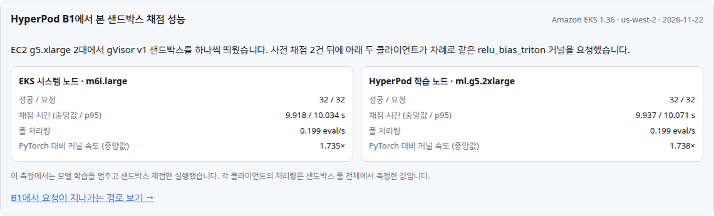
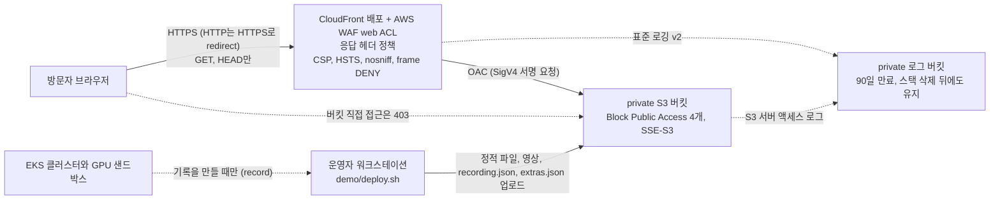

# 09 데모 사이트 (CloudFront)

!!! info "TL;DR"
    실습 중 수집한 평가 결과를 브라우저에서 재생합니다. 샘플을 먼저 미리 보고, GPU 기록이 있으면 이를 검토한 뒤 CloudFront에 배포할 수 있습니다. 사이트는 private S3 버킷과 CloudFront에서 제공하는 정적 페이지입니다.

    **완료 기준** 로컬에서 기록의 내용과 재생 동작을 확인하세요. 공개 배포까지 했다면 CloudFront 주소에서도 같은 화면을 확인합니다.

**시작 전에**

- 로컬 Python 환경([시작하기](../getting_started.md) 2장)이 필요합니다.
- **GPU 기록**: [04](04_sandbox_pools.md)에서 배포한 풀이 필요합니다.
- **4절의 GRPO 차트**: [05](05_grpo_training.md)의 학습 로그가 필요합니다.
- **4절의 버전 전환 차트**: [06](06_sandbox_update.md)의 전환을 거친 학습 로그나 [10](10_cpu_only.md)의 CPU 시뮬레이션 로그로 만들 수 있습니다.
- verdict와 reward의 의미는 [03 On-policy RL과 샌드박스](../concepts/03_onpolicy_rl_with_sandboxes.md)에서 설명합니다.

??? note "용어 (처음 보는 단어가 있으면 펼치세요)"
    - **정적 사이트**: 서버 쪽 코드 없이 HTML, CSS, JavaScript 파일만 제공하는 사이트입니다.
    - **Amazon CloudFront**: 전 세계 edge location에서 파일을 캐시해 제공하는 CDN입니다. 배포(distribution) 하나가 도메인 하나를 담당합니다.
    - **OAC (Origin Access Control)**: CloudFront가 S3에 서명된 요청을 보내는 방식입니다. 버킷을 공개하지 않고 CloudFront만 버킷을 읽도록 설정할 수 있습니다.
    - **S3 Block Public Access**: 버킷 정책이나 ACL로 버킷이 공개되는 것을 막는 설정 네 가지입니다.
    - **service principal**: AWS 서비스가 권한 주체로 쓰는 이름입니다. CloudFront는 `cloudfront.amazonaws.com`입니다.
    - **`AWS:SourceArn`**: 요청을 보낸 AWS 리소스의 ARN을 조건으로 거는 정책 키입니다. 여기서는 이 CloudFront 배포가 보낸 요청만 허용하는 조건으로 씁니다.
    - **CSP (Content-Security-Policy)**: 페이지가 어디서 스크립트, 스타일, 데이터를 불러올 수 있는지 브라우저에 알려 주는 응답 헤더입니다.
    - **HSTS (Strict-Transport-Security)**: 브라우저가 정해진 기간 동안 그 도메인에 HTTPS로만 접속하게 하는 응답 헤더입니다.
    - **ACM (AWS Certificate Manager)**: TLS 인증서를 발급하고 관리하는 서비스입니다.
    - **invalidation**: CloudFront 캐시를 지워 새 파일을 제공하게 하는 요청입니다.
    - **golden**: 기대 verdict가 미리 정해진 시험용 제출물입니다.

    더 자세한 설명은 [용어 사전](../reference/glossary.md)에 있습니다.

## 데모가 보여 주는 것

| 절 | 보여 주는 것 | 데이터 |
|---|---|---|
| 맨 위 | 핵심 수치와 둘러보기 영상(한국어 2분 40초, 무음) | `recording.json`, `extras.json`, `media/tour-ko.mp4`와 `tour-en.mp4` |
| 1. 아키텍처 | 구성 요소를 누르면 설명과 측정값이 열리는 구성도와 재생 버튼 | 페이지의 설명과 `extras.json`의 측정값 |
| 2. 채점 체험 | golden 제출물을 골라 재생하면 진행 막대가 차고 verdict, reward 구성 요소, 판정 이유가 나옵니다 | `recording.json`의 golden 평가 결과와, trainer와 같은 `score_verdict`로 계산한 reward |
| 3. 공격 차단 | 풀마다 샌드박스 안 커널과 노드 커널, GPU, egress 차단 여부. 격리와 채점 검증 결과 카드 8개와 터미널 출력 재생 | `recording.json`의 `/info`, `extras.json`의 터미널 기록(verify.sh, gVisor 스모크 테스트, rollout.sh) |
| 4. 학습 | EC2와 HyperPod B1의 GRPO 실행을 고르면 배치별 판정과 점수를 볼 수 있습니다. 아래 차트는 CPU 모의 실행에서의 버전 전환입니다. | `extras.json`의 `training`, `b1.training`, `simulation` |
| 5. 벤치마크 | B1에서 요청을 보낸 두 노드의 채점 지연과 풀 전체 처리량을 보여 줍니다. 이어지는 런타임별 차트에서는 pod당 처리량과 시작 시간도 볼 수 있습니다. | `extras.json`의 `b1.bench`, `bench` |
| 패턴별 아키텍처 (`architecture.html`) | 시나리오 A, B1, B2, C를 AWS 아이콘으로 그린 구성도 | 페이지에 들어 있는 정적 데이터(`arch.js`). 데이터 파일을 읽지 않습니다 |

- **맨 위의 핵심 수치**: GPU 런타임 수, 기대 판정과 일치한 golden 수, 두 풀의 `verify.sh` 기록에서 막힌 연결 수, 벤치마크 정상 응답 수입니다.
- **1절의 재생 버튼**: reward 요청 한 건이 trainer, reward 함수, 라우팅 표, 샌드박스 풀을 지나는 순서를 보여 줍니다.
- **2절의 채점 체험**: golden 제출물은 정답, 오답, 벤치마크 구간에서만 틀리는 코드, 호스트 파일 읽기 등입니다. 진행 막대는 풀마다 기록된 평가 시간(`duration_s`)을 기준으로 차고(기본 4배속, 실제 속도나 결과만 보기도 선택 가능), reward 구성 요소는 format, correctness, speedup, 합계입니다.
- **3절의 카드 8개**: 샌드박스 안에서 시도한 IMDS, Kubernetes API, kubelet, 인터넷 연결, `default` namespace에서 샌드박스로 들어오는 연결, 샌드박스 안과 노드의 커널 비교, golden 제출물의 호스트 파일 읽기와 벤치마크 치팅입니다. 카드를 누르면 터미널 출력 재생에서 그 줄을 강조합니다.
- **패턴별 아키텍처**: 패턴마다 "준비와 배포", "학습 한 step", "버전 바꾸기" 흐름을 단계별로 재생하고, 요청과 결과가 선을 따라 움직입니다. 기본 한국어이고 `?lang=en`이나 `EN` 버튼으로 영어로 바뀝니다.

공개되는 데이터와 기록은 다음과 같습니다.

- **공개되는 파일**: HTML, CSS, JavaScript, AWS 아키텍처 아이콘(SVG), 둘러보기 영상(MP4)과 썸네일(JPG), 기록 JSON 두 개(`data/recording.json`, `data/extras.json`)뿐입니다.
- **저장소의 `recording.json` 샘플**: 노트북의 CPU 풀에서 만든 기록이니, 클러스터에서 만든 GPU 기록으로 교체해 쓰세요.
- 공개 데모는 `demo/recordings/2026-11-18-eks-gpu.json`으로 GPU 채점을 재생합니다. EC2 5스텝 학습과 런타임별 비교는 11월 18일, CPU 버전 전환은 11월 17일 기록입니다. 11월 22일에는 B1에서 GRPO 한 스텝과 고정 커널 벤치마크 두 번을 실행했습니다. [B1 측정 결과](08_benchmark.md#hyperpod-b1)
- **2절의 진행 막대**: 기록된 전체 평가 시간입니다. 단계별 시간은 기록에 없어서 단계 표시는 평가가 끝난 뒤 판정에 맞춰 채워집니다.

[공개 데모에서 B1 벤치마크 열기](https://dohbsn4kn34ya.cloudfront.net/#hyperpod-b1)





*그림 요약: 방문자의 요청은 CloudFront에서 끝나고, 클러스터와 GPU는 운영자가 기록을 만들 때만 쓰입니다.*

## 소요 시간과 비용

- **로컬 미리보기와 샘플 재생성**은 AWS 비용이 들지 않습니다.
- **배포** 시간은 대부분 스택 생성과 CloudFront 전파를 기다리는 시간입니다. 스크립트가 200 응답을 기다리는 시간은 최대 약 10분입니다(4절 7번 단계). 실제 소요 시간은 측정하지 않았습니다.
- **사이트 비용**: 작은 정적 사이트의 비용은 보통 크지 않지만 트래픽에 따라 달라지므로 [CloudFront 요금](https://aws.amazon.com/cloudfront/pricing/)과 [S3 요금](https://aws.amazon.com/s3/pricing/)을 확인하세요.
- **WAF 비용**: web ACL 월 약 5 USD, 규칙마다 월 1 USD(규칙 5개), 요청 100만 건마다 0.60 USD입니다([AWS WAF 요금](https://aws.amazon.com/waf/pricing/)). 스택이 있는 동안은 트래픽이 없어도 고정 비용(월 약 10 USD)이 나옵니다.
- **영상 전송 비용**: 한국어 영상은 6.1 MiB, 영어 영상은 6.8 MiB입니다. 전송량은 [CloudFront 요금](https://aws.amazon.com/cloudfront/pricing/)에 따라 과금되고, WAF가 IP마다 `/media/` 요청을 5분에 100건으로 제한해 한 클라이언트가 만들 수 있는 전송량에 상한을 둡니다. 예상보다 많이 쓰일 것 같으면 AWS Budgets 알림을 걸어 두세요.
- **로그 비용**: 로그 버킷의 S3 저장 요금만 듭니다. 객체는 90일 뒤 만료되고, 버킷은 정리 뒤에도 남습니다(6절).
- **GPU 기록 비용**: 기록하는 동안 GPU 샌드박스 노드가 실행 중이어야 합니다(`g5.2xlarge` 시간당 1.212 USD, `g5.xlarge` 1.006 USD, `g4dn.metal` 7.824 USD, us-east-1과 us-west-2 온디맨드 요금). recorder pod는 system 노드에서 GPU 없이 실행되고, trainer pod로 기록하면 trainer 노드도 실행 중이어야 합니다. 기록을 만든 뒤에는 [99 정리](99_cleanup.md)에 따라 GPU 노드를 줄이세요.

## 1. 로컬에서 미리 보기

저장소 루트에서 실행합니다. 서버가 loopback 주소에만 bind하므로 다른 컴퓨터에서는 접속할 수 없습니다.

```bash
# Serve demo/site on loopback only (Ctrl-C stops it)
python3 -m http.server 8080 --bind 127.0.0.1 -d demo/site
```

브라우저에서 <http://127.0.0.1:8080>을 엽니다. 파일을 직접 열면(`file://`) 브라우저가 `fetch`를 차단해 기록을 불러오지 못할 수 있습니다.

**확인할 것:**

- 맨 위 "기록 출처:" 줄에 `Local CPU smoke run on a laptop (127.0.0.1, no gVisor or Kata, no GPU).`로 시작하는 문구와 기록 시각이 보입니다.
- 핵심 수치 타일은 세 개입니다. 샘플 기록에는 GPU 풀이 없어서 GPU 격리 방식 타일은 나오지 않습니다.
    - `8/8`: 예상대로 나온 채점 결과
    - `10/10`: 타일 이름은 "샌드박스 안에서 막힌 접근 시도"이지만 바깥에서 들어오는 연결 검사도 포함합니다. 두 풀의 `verify.sh` 기록에서 `blocked`가 들어간 줄을 센 값으로, 송신 검사 8줄과 `default` namespace에서 들어오는 연결 검사 2줄입니다. 분모에도 같은 줄 수를 표시합니다.
    - `160/160`: 성능 측정 요청 중 성공
- 2절에 제출 코드 카드 네 개(PyTorch만 사용, ReLU 빠뜨린 오답, 속도 측정 속이기, 서버 파일 읽기)가 있고, 재생하면 `local-cpu v1`, `local-cpu v2` 두 줄이 채워집니다. 코드는 문법 색상과 줄 번호로 표시됩니다.
- 3절에 공격 카드 여덟 개와 터미널 탭 네 개(verify.sh gvisor, verify.sh kata-qemu, gVisor GPU 동작 확인, rollout.sh v1 → v2)가 있습니다.
- 4절 아래 차트의 요약이 "배치 30개가 하나도 빠지지 않고 채점됐습니다. step 8에서 kata-clh-cpu/v1에서 kata-clh-cpu/v2로 바뀌었고"로 시작합니다.
- 5절 막대 여섯 개 중 `kata-clh`는 "측정 못 함: VM이 시작되지 않음"으로 나옵니다.
- 기본 언어는 한국어입니다. 주소에 `?lang=en`을 붙이거나 오른쪽 위 `EN` 버튼을 누르면 영어로 바뀌고, 고른 언어는 주소에 남아 새로고침해도 유지됩니다.
- 터미널에는 파일마다 200 응답 로그가 출력됩니다.

??? note "확인한 환경과 각 절의 데이터 출처"
    11월 22일에 공개 사이트를 Chromium에서 한국어와 영어로 확인했습니다. 풀 카드는 golden 채점 기록을, 학습·벤치마크·터미널 재생은 `extras.json`을 읽습니다. 패턴별 아키텍처 페이지에는 각 구성에서 확인한 실행 범위가 표시됩니다.

**문제가 생기면:**

- **`Address already in use`가 나오면**: 다른 포트(예: `8081`)로 실행하고 브라우저에서도 그 포트의 주소를 여세요.
- **"기록 출처" 자리에 `failed to load recording:`이 나오면**: `demo/site/data/recording.json`이 있는지, 올바른 JSON인지 확인하세요.
- `data/extras.json`이 없으면 벤치마크 섹션과 GRPO 실행 선택기가 숨겨집니다. golden 채점 기록은 계속 재생할 수 있습니다.
- **그 밖의 경우**: [문제 해결](../reference/troubleshooting.md)을 보세요.

## 2. 클러스터에서 GPU 기록 만들기

`python -m gpusandbox.tools record`는 풀마다 다음 정보를 모아 JSON 파일 하나에 저장합니다.

- 첫 Ready pod의 `/info`: runtime, 샌드박스 버전, 커널 버전, GPU 이름, egress 차단 여부
- golden set의 verdict(`--device cuda`면 6개): status, correct, custom_kernel, speedup, 기준과 후보의 ms, flags, 정책 위반(최대 3개), 오류(끝 400자), 소요 시간, 버전
- trainer와 같은 `score_verdict`로 계산한 reward 구성 요소
- `--training-events`를 주면 그 파일의 `reward_batch`, `sandbox_version_switch` 이벤트

pod IP와 endpoint 주소는 별도 필드로 저장하지 않고, 토큰도 넣지 않습니다(`record`가 저장하는 필드 목록 기준). 다만 연결 오류의 `error`에는 endpoint 주소가 남을 수 있습니다.

`deploy.sh`는 업로드 전에 `demo/build_extras.py --check`로 IP 주소를 찾습니다. `127.0.0.1`, `0.0.0.0`, `169.254.169.254`는 허용하고, 그 밖의 IP 주소가 남아 있으면 멈추니 2.5에서 미리 확인하세요.

`python -m gpusandbox.tools record`는 클러스터 안에서, 다음 조건을 모두 갖춘 pod에서 실행해야 합니다.

| 조건 | 이유 |
|---|---|
| `rl-trainer` 네임스페이스와 label `gpusandbox/client: "true"` | 샌드박스의 NetworkPolicy가 이 pod의 연결만 허용합니다 |
| audience `gpu-sandbox`인 projected token과 `SANDBOX_TOKEN_FILE` | 샌드박스 API 인증 |
| 허용 목록에 있는 ServiceAccount (`grpo-trainer` 또는 `sandbox-probe`) | 샌드박스가 토큰의 subject를 확인합니다 |
| torch와 httpx가 있는 이미지 | `record`는 태스크 설명과 기준 구현을 기록에 넣기 위해 태스크 모듈을 불러오고, 태스크 모듈은 torch를 import합니다 |

네 조건을 갖춘 pod는 두 가지입니다.

| pod | 쓰는 경우 | 기록의 학습 이벤트 |
|---|---|---|
| recorder pod (`demo/recorder-pod.yaml.tpl`) | 실행 중인 학습 Job 없이 기록할 때 | 비어 있음 |
| 학습 중인 trainer pod | 학습 이벤트까지 기록할 때. 이벤트 파일 `/outputs/grpo/sandbox_metrics.jsonl`이 이 pod 안에 있음 | 채워짐 |

recorder pod는 trainer 이미지(`rl-trainer`)로 `sleep`만 실행하는 pod입니다.

- **갖춘 설정**: label `gpusandbox/client: "true"`, ServiceAccount `grpo-trainer`, audience `gpu-sandbox`인 projected token, Pod Security restricted(uid 2000)
- **실행 위치**: GPU 없이 system 노드에서 실행되고, golden set은 샌드박스 풀에서 실행됩니다.

??? info "probe Job 템플릿(`k8s/probe/job-probe.yaml.tpl`)으로 기록하지 않는 이유"
    probe Job은 `rl-trainer` 네임스페이스, client label, audience 토큰 조건은 갖췄지만, 기록 파일을 만들거나 밖으로 복사할 수 없습니다.

    - control 이미지(`gateway/Dockerfile`, `python:3.14-slim` 기반)에는 torch가 없습니다. 로컬 환경에서 torch import를 차단하고 실행하자 같은 코드 경로가 `get_task`의 `ModuleNotFoundError`로 실패했습니다.
    - root filesystem이 읽기 전용이고 쓸 수 있는 볼륨이 없어 `--out` 파일을 저장할 위치가 없습니다.
    - `kubectl cp`는 실행 중인 컨테이너 안의 `tar`를 사용합니다. Job이 끝나면 pod가 종료되므로 파일을 복사할 수 없습니다.

    `probe`, `parity`, `bench`는 태스크 모듈을 불러오지 않으므로 control 이미지에서 그대로 실행됩니다.

### 2.1 기록할 시점 고르기

- **학습 Job이 없으면 recorder pod로 기록합니다(2.2).** 이때 기록에는 학습 이벤트가 들어가지 않습니다. 4절의 버전 전환 차트는 `extras.json`의 `simulation`을 먼저 쓰고, 없을 때만 기록의 학습 이벤트를 씁니다. 둘 다 없으면 이 차트는 표시되지 않습니다.
- **trainer pod로 기록할 때는 학습 Job이 Running인 동안 실행합니다.** Job이 끝나면 컨테이너가 종료되어 emptyDir에 있는 이벤트 파일을 복사할 수 없습니다([05 On-policy GRPO 학습](05_grpo_training.md)).
- **학습 이벤트에 버전 전환을 넣으려면** [06](06_sandbox_update.md)의 `scripts/ops/rollout.sh gvisor v1 v2`로 routing을 바꾸고, trainer 로그에 `sandbox_version_switch`가 나온 뒤 기록하세요. `record`는 기록할 때 `--training-events` 파일에 있는 이벤트만 읽습니다.
    - **두 풀의 golden도 기록하려면**: `--pool`로 넘긴 주소는 golden을 실행할 대상이라, `--finish`로 v1을 줄이기 전에 2.3의 예처럼 v1과 v2 주소를 각각 `--pool`로 넘기세요.
    - **B2에서는**: Service 이름에 `gvisor-hyperpod`를 씁니다(`sandbox-gvisor-hyperpod-v1`).
    - **4절 차트에 내 전환을 표시하려면**: 4절 차트는 `extras.json`의 `simulation`을 먼저 쓰므로, 2.6에서 `extras.json`을 만들 때 `--simulation-log`를 빼세요.
- **학습이 잠깐 느려질 수 있습니다.** 기록과 학습이 같은 풀을 쓰고 pod는 한 번에 평가를 하나만 처리하므로, golden 평가가 reward 평가 사이에 추가로 실행됩니다.

### 2.2 trainer pod 찾기

실행 중인 trainer pod의 이름을 변수에 저장합니다.

```bash
# Name of the running trainer pod (scenarios A and B both label it app=grpo-trainer)
POD="$(kubectl -n rl-trainer get pods -l app=grpo-trainer \
  --field-selector=status.phase=Running -o jsonpath='{.items[0].metadata.name}')"
echo "${POD}"
```

**확인할 것:**

- pod 이름 한 줄이 출력됩니다(시나리오 A에서는 `grpo-<RUN_ID>-<접미사>` 형태).
- **비어 있으면**: 학습이 실행 중이 아닌 것이니 [05](05_grpo_training.md)부터 실행하거나, 아래 recorder pod를 쓰세요.

**학습 Job 없이 기록하려면** recorder pod를 만듭니다. `scripts/config.env`의 `TRAINER_IMAGE_URI`와 `SANDBOX_AUDIENCE`로 템플릿을 렌더링합니다.

```bash
# Recorder pod: trainer image, client label, grpo-trainer ServiceAccount, no GPU (runs on a system node)
source scripts/config.env
python3 scripts/render.py demo/recorder-pod.yaml.tpl | kubectl apply -f -
kubectl -n rl-trainer wait --for=condition=Ready pod/demo-recorder --timeout=10m
POD=demo-recorder
```

**확인할 것:** `pod/demo-recorder created`와 `pod/demo-recorder condition met`이 나옵니다.

- **2.3과 2.4에서**: recorder pod의 컨테이너 이름은 `recorder`이므로 2.3과 2.4의 `-c trainer`를 `-c recorder`로 바꾸고, 2.3에서 `--training-events` 줄을 빼세요.
- **pod 정리**: pod는 3시간(`sleep 10800`) 뒤 종료되며, 기록을 복사한 뒤 `kubectl -n rl-trainer delete pod demo-recorder`로 지웁니다.

### 2.3 trainer pod 안에서 record 실행

GPU 풀마다 golden set을 실행하고 결과를 pod의 `/tmp/rec.json`에 저장합니다. `--pool`은 `라벨=주소` 형식이며, 라벨은 페이지의 카드 제목으로 그대로 쓰입니다.

```bash
# Run the golden set on each GPU pool and write the recording inside the trainer pod.
# Container name: trainer in scenario A, pytorch in scenario B (HyperPod).
kubectl -n rl-trainer exec "${POD}" -c trainer --\
  python -m gpusandbox.tools record \
  --pool gvisor=sandbox-gvisor-v1.sandbox.svc.cluster.local:8000 \
  --pool kata-qemu=sandbox-kata-qemu-v1.sandbox.svc.cluster.local:8000 \
  --device cuda \
  --source "EKS us-west-2, gVisor on g5.xlarge (A10G), Kata QEMU on g4dn.metal (T4)" \
  --training-events /outputs/grpo/sandbox_metrics.jsonl \
  --out /tmp/rec.json
```

- 첫 줄 끝의 `--\`는 kubectl 인자 구분자 `--` 뒤에서 줄을 이은 표기입니다([문제 해결](../reference/troubleshooting.md)과 같은 방식).
- **배포한 풀만 넣으세요.** Ready pod가 없는 주소를 넣으면 golden마다 최대 600초(클라이언트의 acquire timeout)를 기다린 뒤 `sandbox_error`로 기록됩니다. `/info`도 비어 있어서 페이지에 egress가 "열림"으로 표시됩니다.
- **v1과 v2를 함께 넣으려면** 라벨에 버전을 붙입니다. 예: `--pool "gvisor v1=sandbox-gvisor-v1.sandbox.svc.cluster.local:8000" --pool "gvisor v2=sandbox-gvisor-v2.sandbox.svc.cluster.local:8000"`.
- **`--source`는 "기록 출처" 줄에 그대로 나옵니다.** 리전, 인스턴스, 날짜 같은 기록 조건을 적으세요.

**확인할 것:** 마지막 줄에 다음과 같은 JSON이 나옵니다.

```text
{"event": "recorded", "out": "/tmp/rec.json", "pools": ["gvisor", "kata-qemu"], "goldens": 6, "training_events": <N>}
```

- `training_events`는 그 시점까지 기록된 배치 수에 따라 다릅니다.
- **recorder pod에서는**: `training_events`가 0입니다(2026-11-18 기록: `goldens: 6`, `training_events: 0`).

**문제가 생기면:**

- **`HTTP 401`이나 `HTTP 403`이 포함된 `sandbox_error`**: 토큰이나 허용 목록 설정 때문에 생깁니다. [문제 해결](../reference/troubleshooting.md)의 "401, 403 응답" 항목을 보세요.
- **연결 자체가 되지 않으면**: 같은 페이지의 "NetworkPolicy" 항목을 보세요.

### 2.4 기록 파일 복사하기

기록 파일을 워크스테이션으로 복사하고, `deploy.sh`와 같은 스키마 검사를 실행합니다.

```bash
# Copy the recording to your workstation (kubectl cp runs tar inside the container)
# Container name: trainer in scenario A, pytorch in scenario B (HyperPod), recorder for the recorder pod
kubectl -n rl-trainer cp -c trainer "${POD}:/tmp/rec.json" /tmp/rec.json
# The same schema check that deploy.sh runs first
python3 -c "import json,sys; d=json.load(open(sys.argv[1])); assert d['schema'] == 1 and d['pools']" /tmp/rec.json
```

**확인할 것:**

- `kubectl cp`가 `tar` 경고를 한 줄 출력할 수 있지만 복사는 정상적으로 됩니다.
- 스키마 검사는 아무것도 출력하지 않고 종료 코드 0으로 끝납니다.

### 2.5 공개하기 전에 검토하기

페이지는 기록을 그대로 보여 주므로 공개 전에 다음을 확인하세요.

| 항목 | 확인할 것 |
|---|---|
| `source` | 직접 쓴 설명입니다. 계정 정보나 사람 이름이 들어 있지 않은지 |
| `pools[].info.egress_blocked` | 모든 풀이 `true`인지 |
| `pools[].results[].status`와 `expected_status` | golden마다 같은지 |
| `pools[].results[].error`, `violations` | 평가된 코드나 연결 오류가 만든 문자열(오류 끝 400자, 위반 최대 3개)입니다. pod 주소, 내부 경로, 호스트 이름이 들어 있지 않은지 |
| `training` | `reward_batch`와 `sandbox_version_switch` 이벤트만 들어갑니다. 버전 이름과 routing revision을 공개해도 되는지 |

- **`egress_blocked` 값이 없거나 `false`면**: 페이지에 "열림"으로 나옵니다. 그대로 공개하지 말고 풀부터 고치세요.
- **status와 `expected_status`가 다르면**: verdict가 기대값과 다른 것이니 [04](04_sandbox_pools.md)의 풀 검증(`scripts/ops/verify.sh`)으로 원인부터 찾습니다.

다음 스크립트가 요약을 출력합니다.

```bash
python3 - /tmp/rec.json <<'PY'
import json, sys
rec = json.load(open(sys.argv[1]))
print("source:", rec["source"])
for pool in rec["pools"]:
    info = pool["info"]
    print(pool["runtime"], "egress_blocked:", info.get("egress_blocked"), "gpu:", info.get("gpu"))
    for name, v in pool["results"].items():
        mark = "as expected" if v["status"] == v["expected_status"] else "DIFFERS FROM EXPECTED"
        print("   ", name, v["status"], mark)
print("training events:", len(rec["training"]))
PY
```

**확인할 것:**

- 풀마다 `egress_blocked: True`이고, golden 줄이 모두 `as expected`입니다.
- **2026-11-18 기록에서는**: 두 풀 모두 `egress_blocked: True`였고, verdict 12개가 모두 `expected_status`와 같았으며, 파일에 IP, 계정 ID, 호스트 이름이 없었습니다.
- **저장소의 샘플 기록으로 실행하면**: `local-cpu v1`, `local-cpu v2`와 golden 4개씩, `training events: 7`이 나옵니다(로컬 확인).

브라우저로 확인하려면 사이트를 임시 폴더에 복사한 뒤 로컬 서버로 실행합니다.

```bash
# Preview your recording without overwriting the shipped sample
mkdir -p /tmp/demo-preview && cp -R demo/site/. /tmp/demo-preview/
cp /tmp/rec.json /tmp/demo-preview/data/recording.json
python3 -m http.server 8080 --bind 127.0.0.1 -d /tmp/demo-preview
```

### 2.6 학습, 벤치마크, 터미널 기록 만들기 (extras.json)

`demo/build_extras.py`는 클러스터에서 실행한 명령의 출력을 모아 `extras.json`을 만듭니다. 모든 입력은 운영자 워크스테이션에 저장한 텍스트 파일입니다.

| 데이터 | 만드는 방법 | 옵션 |
|---|---|---|
| 벤치마크 | `scripts/ops/bench.sh 32`의 출력을 `tee`로 `bench.log`에 저장 | `--bench-log pass1=bench.log --bench-pass pass2`, 노드 정보는 `--node` (아래 예시) |
| GRPO 학습 | `kubectl -n rl-trainer logs job/<job> > grpo.log`. reward 함수의 `reward_batch` JSON 줄과 trainer의 metric 줄(`{'loss': ...}`)을 읽습니다 | `--training-log grpo.log --model <model-id>` |
| HyperPod B1 | 공개용 B1 학습 로그 요약과 고정 커널 벤치마크 실측값 | `--b1-record docs/handson/data/hyperpod-b1.json` |
| 버전 전환 | `scripts/ops/simulate.sh 30 20`의 출력을 `simulate.log`에 저장하고, 그동안 [06](06_sandbox_update.md)의 `rollout.sh`로 버전을 바꿉니다 | `--simulation-log simulate.log` |
| 터미널 출력 | `scripts/ops/verify.sh gvisor v1` 같은 명령의 출력을 파일로 저장 | `--transcript verify-gvisor=verify-gvisor.txt` (반복 가능) |

- **벤치마크를 두 번 측정했다면**: `bench.sh`는 구분 줄을 출력하지 않으므로, 각 실행 출력 앞에 `=== run 1`, `=== run 2` 줄을 직접 넣습니다.
- **벤치마크를 한 번만 측정했다면**: 페이지는 `pass2`를 기본으로 보여 주므로, `--bench-log pass2=bench.log`로 지정하세요.
- **터미널 출력 파일**: 첫 줄에 `$ <명령>`을 쓰면 명령 줄로 표시되고, `[HH:MM:SS]`로 시작하는 줄이 재생 시간을 정합니다.

```bash
# Build data/extras.json from the saved command output (paths are examples)
python3 demo/build_extras.py --out demo/site/data/extras.json \
  --source "Amazon EKS 1.36, us-west-2, 2026-11-18" \
  --b1-record docs/handson/data/hyperpod-b1.json \
  --bench-log pass1=bench.log --bench-pass pass2 \
  --node 'gvisor=g5.2xlarge|NVIDIA A10G' --node 'kata-qemu=g4dn.metal|Tesla T4' \
  --unmeasured 'kata-clh=g4dn.metal|Tesla T4' \
  --training-log grpo.log --model Qwen/Qwen2.5-Coder-1.5B-Instruct --training-source "..." \
  --simulation-log simulate.log --simulation-source "..." \
  --transcript verify-gvisor=verify-gvisor.txt --transcript verify-kata-qemu=verify-kata-qemu.txt
```

스크립트는 모든 문자열을 다음과 같이 처리합니다.

- ANSI 색 코드와 shell prompt를 지웁니다.
- IP 주소(IPv4, IPv6, `10-0-12-34` 같은 pod DNS 형식)를 `<private-ip>`, `<public-ip>`, `<ipv6>`로, 노드 이름을 `<node>`로, `*.amazonaws.com` 호스트(EKS API endpoint, OIDC, ELB 등)를 `<aws-endpoint>`로 바꿉니다.
- 계정 ID, ARN, EC2 리소스 ID, 토큰(access key, Hugging Face, GitHub, JWT)도 자리 표시로 대체합니다.
- `169.254.169.254`(IMDS)처럼 누구에게나 같은 주소는 그대로 둡니다.
- **바꾼 뒤에도 남아 있으면**: 이런 값이나 `*.internal` 호스트, `user@host`, home 경로(`/home`, `/root`, `/Users`)가 남아 있으면 파일을 쓰지 않고 실패합니다.

**확인할 것:** 위 명령의 마지막 줄에는 `"transcripts": 2`가 나옵니다. 아래는 2026-11-18 로그로 터미널 기록 4개(`verify-gvisor`, `verify-kata-qemu`, `smoke-gvisor`, `rollout`)를 넣어 만든 공개본의 출력입니다.

```text
{"event": "extras", "out": "demo/site/data/extras.json", "transcripts": 4, "bench": true, "training": true, "simulation": true}
```

터미널 출력은 페이지에 그대로 나오므로, 2.5와 같은 기준으로 한 번 더 읽어 보세요. `python3 demo/build_extras.py --check <파일>...`은 같은 검사를 기존 파일에 실행하고, `deploy.sh`도 업로드 전에 이 검사를 실행합니다.

### 2.7 둘러보기 영상 다시 만들기 (선택)

`demo/record_tour.py`는 Chromium으로 페이지를 열어 기능을 차례로 재생하고, 화면을 녹화해 `media/tour-ko.mp4`, `tour-en.mp4`와 썸네일을 만듭니다. 자막과 클릭 위치 표시는 녹화할 때만 겹쳐 그리며, 사이트 파일은 바뀌지 않습니다.

- **페이지 제공**: 페이지는 녹화하는 동안만 `127.0.0.1`에서 제공됩니다.
- **녹화 전 검사**: `--site`의 데이터 파일에 2.6과 같은 검사를 하고, 문제가 있으면 녹화하지 않습니다.
- **데이터 해시**: 녹화에 쓴 데이터의 해시는 `media/tour-data.json`에 남아서, `deploy.sh`가 게시할 데이터와 다르면 경고합니다(이 파일은 업로드하지 않음).

```bash
# Playwright and ffmpeg are needed on the workstation only (not project dependencies)
pip install playwright && playwright install chromium
# Stage the files you will publish, then record both languages into demo/site/media
mkdir -p /tmp/demo-stage && cp -R demo/site/. /tmp/demo-stage/
cp /tmp/rec.json /tmp/demo-stage/data/recording.json
python3 demo/record_tour.py --site /tmp/demo-stage --out demo/site/media
```

**확인할 것:**

- 언어마다 `[tour] demo/site/media/tour-ko.mp4 (<크기> KiB)` 줄이 나옵니다. 2026-11-18 데이터로는 언어마다 약 2분 길이였습니다.
- **다른 기록으로 녹화할 때**: 자막에는 그날 기록의 수치(예: Triton 커널의 speedup 약 1.78배)가 들어 있으니, `record_tour.py`의 `CAPTIONS`도 고치세요.

### 2.8 패턴 페이지 그림 검사하기 (선택)

`architecture.html`의 그림(`arch.js`의 좌표)을 고쳤다면 `demo/check_arch_layout.py`로 겹침을 확인하세요. 네 패턴을 한국어와 영어로 열고, 흐름의 모든 단계에서 다음을 확인합니다.

- 화살표가 아이콘을 둘러싼 상자의 가장자리에서 시작하고 끝나는지
- 선이나 화살촉이 글자, 아이콘, 다른 선과 겹치지 않는지
- 라벨과 배지가 상자 테두리에 닿지 않는지

페이지는 검사하는 동안만 `127.0.0.1`에서 제공됩니다.

```bash
# Playwright is needed on the workstation only, as for record_tour.py
python3 demo/check_arch_layout.py                    # lists the problems and exits 1 if there are any
python3 demo/check_arch_layout.py --shots /tmp/arch  # also saves one PNG per pattern and language
```

**확인할 것:** 마지막 줄이 `ok`입니다. 글자 크기는 글꼴에 따라 조금씩 달라지며, 2026-11-19에 Linux의 Chromium으로 확인했습니다.

## 3. 샘플 기록 다시 만들기 (로컬, AWS 없음)

샘플 `demo/site/data/recording.json`을 GPU 없이 노트북에서 다시 만듭니다.

!!! warning "Linux 호스트에서는 컨테이너 안에서 실행하세요"
    `record_local.py`가 같은 프로세스 안에서 실행하는 샌드박스 서버는 평가마다 `/proc`에 보이는 프로세스 중 자신과 조상 프로세스를 제외한 모든 프로세스에 SIGKILL을 보냅니다. 그래서 Linux 호스트에서는 같은 사용자의 다른 프로세스까지 종료될 수 있습니다([시작하기](../getting_started.md)의 경고와 같은 이유). 별도 PID namespace를 쓰는 컨테이너에서 실행하세요. `/proc`가 없는 macOS에서는 이 동작이 꺼집니다.

```bash
# Regenerate the shipped sample (repo root, local venv; on Linux inside a container with its own PID namespace)
python demo/record_local.py
```

스크립트는 다음 작업을 실행합니다.

- `127.0.0.1`에 CPU 샌드박스 서버 두 개(v1, v2)를 띄웁니다. v2 harness는 seed 5개와 speedup 상한 10배를 쓰고, 인증에는 loopback 전용 test bypass를 씁니다.
- 클러스터와 같은 코드 경로로 golden set(CPU에서는 4개)을 두 서버에 보냅니다.
- 모델 completion 대신 golden 제출물을 써서 reward 배치 6개를 `KernelRewards`로 계산하고, 3번째 배치 뒤에 routing을 v1에서 v2로 바꿉니다.
- 결과를 `demo/site/data/recording.json`(기본 `--out`)에 저장합니다. 출처 문구 "Local CPU smoke run on a laptop"으로 노트북에서 만든 기록임을 표시합니다.

**확인할 것:** 배치마다 `{"event": "reward_batch", ...}` 줄이 나오고, 마지막 줄은 다음과 같습니다(로컬 macOS에서 확인).

```text
{"event": "recorded", "out": "demo/site/data/recording.json", "pools": ["local-cpu v1", "local-cpu v2"], "goldens": 4, "training_events": 7}
```

다시 만든 뒤에는 `python -m pytest -q tests/test_demo.py`로 스키마와 reward 일관성을 확인하세요.

**문제가 생기면:** `ModuleNotFoundError`가 나오면 가상 환경을 활성화하지 않았거나 패키지 설치를 빠뜨린 것이니 [시작하기](../getting_started.md) 2장을 다시 실행하세요.

## 4. 배포 (demo/deploy.sh)

공개 사이트에는 이 단계에서 선택한 기록이 올라갑니다. 샘플을 배포할지, 클러스터에서 가져온 기록을 배포할지 먼저 정하고 브라우저에서 보일 파일을 확인하세요.

`demo/deploy.sh`는 CloudFormation 스택 하나(사이트 버킷, 로그 버킷, OAC, 응답 헤더 정책, WAF web ACL, CloudFront 배포와 로그 전송, 버킷 정책)를 만들고 정적 파일과 기록을 업로드한 뒤 공개 상태를 확인합니다.

```bash
# Publish the shipped sample recording (always us-east-1)
demo/deploy.sh
# Publish your GPU recording instead (EXTRAS defaults to demo/site/data/extras.json)
RECORDING=/tmp/rec.json demo/deploy.sh
# The 2026-11-18 public demo
RECORDING=demo/recordings/2026-11-18-eks-gpu.json demo/deploy.sh
```

**리전은 us-east-1로 고정됩니다.** CloudFront용 WAF web ACL과 CloudFront 로그 전송이 us-east-1 리소스이기 때문입니다.

- **리전 설정**: 스크립트는 `AWS_REGION`과 `scripts/config.env`를 읽지 않고, 템플릿의 `Rules`도 다른 리전의 배포를 거부합니다(`Deploy the demo stack in us-east-1 ...`).
- **클러스터 리전**: 클러스터가 다른 리전에 있어도 됩니다(2026-11-18에는 클러스터 us-west-2, 데모 us-east-1).
- **필요한 권한**: CloudFormation, S3, CloudFront, AWS WAF, CloudWatch Logs(로그 전송) 리소스를 만들 권한이 필요합니다.
- **공유 계정이나 production 계정이라면**: 데모 전용 계정이나 최소 권한 역할을 쓰는 편이 안전합니다.

| 변수 | 기본값 | 의미 |
|---|---|---|
| 리전 | `us-east-1` (고정) | 스택, 버킷, WAF web ACL을 만드는 리전. `AWS_REGION`은 무시합니다 |
| `RECORDING` | `demo/site/data/recording.json` | 업로드할 기록. S3에는 `data/recording.json`으로 업로드됩니다 |
| `EXTRAS` | `demo/site/data/extras.json` | 벤치마크, 학습, 터미널 기록(2.6). 파일이 없으면 업로드하지 않습니다 |
| `DEMO_STACK_NAME` | `gpu-sandbox-demo` | CloudFormation 스택 이름 |
| `DEMO_DOMAIN`, `DEMO_CERT_ARN` | 비어 있음 | custom domain과 us-east-1의 ACM 인증서. 둘 다 있어야 적용됩니다 |

- **`EXTRAS` 파일이 없을 때 이전에 배포한 `data/extras.json`**: 업로드를 건너뛰고 이전에 배포한 S3의 `data/extras.json`은 지우지 않으므로, 이전 기록까지 내리려면 그 객체도 삭제하세요.

| 순서 | 스크립트 동작 |
|---|---|
| 1 | 기록을 검사합니다(`schema`가 1이고 `pools`가 비어 있지 않음, `extras.json`은 `schema`가 `extras-1`). 그다음 `demo/build_extras.py --check`로 두 파일을 검사합니다 |
| 2 | `aws cloudformation deploy`로 `demo/infra/site.yaml`을 us-east-1에 배포합니다(바뀐 것이 없어도 실패하지 않음) |
| 3 | 스택 출력 `BucketName`, `DistributionId`, `DistributionDomainName`을 읽습니다 |
| 4 | 허용 목록의 파일만 `aws s3 sync --delete`로 업로드하고, 데이터를 `data/recording.json`과 `data/extras.json`으로 업로드합니다(`application/json`, `no-cache`) |
| 5 | CloudFront invalidation(`/*`)을 만들고, 배포의 `WebACLId`가 WAF web ACL ARN인지 확인합니다. 아니면 오류를 내고 멈춥니다 |
| 6 | `https://<bucket>.s3.us-east-1.amazonaws.com/index.html`에 익명 요청을 보내고, 응답이 403이 아니면 오류를 내고 멈춥니다 |
| 7 | 공개 URL이 200을 반환할 때까지 20초 간격으로 최대 30번 확인합니다. 그 뒤 응답에 CSP와 HSTS 헤더가 없거나, `http://` 요청이 301을 반환하지 않으면 오류를 내고 멈춥니다 |
| 8 | `[demo] live: <URL>`을 출력합니다 |

- **1단계의 `--check`**: 두 파일에 IP 주소(허용된 `127.0.0.1`, `0.0.0.0`, `169.254.169.254` 제외), 노드 이름, 계정 ID, ARN, 토큰이 없는지 확인하고, 하나라도 있으면 멈춥니다.
- **4단계의 허용 목록**: `index.html`, `app.js`, `style.css`, `architecture.html`, `arch.js`, `icons/*.svg`, `media/tour-*.mp4`, `media/tour-*.jpg`입니다. 영상을 녹화할 때의 데이터와 게시할 데이터가 다르면 업로드 전에 경고를 출력합니다.

**확인할 것:** 다음 줄이 순서대로 나옵니다. 그 사이에 AWS CLI 출력도 함께 나옵니다.

```text
[check] 2 file(s), 0 problem(s)
[demo] deploying stack gpu-sandbox-demo in us-east-1
[demo] uploading site to s3://<bucket>
[demo] checking that the distribution has the WAF web ACL
[demo] checking that the bucket itself is not readable anonymously
[demo] checking the public URL and its security headers (the distribution may take minutes)
[demo] live: https://<id>.cloudfront.net/
```

7번 단계는 정해진 횟수만큼 확인하는 동안 200 응답이 오지 않아도 헤더 검사로 넘어갑니다. 그러니 마지막에 출력된 URL을 브라우저로 열어 페이지를 직접 확인하세요.

**문제가 생기면:**

- **`the data files above would leak details. Fix before publishing.`**: 바로 위의 `[check]` 줄이 문제가 된 파일과 위치를 알려 줍니다. 입력 로그에서 그 줄을 지우거나 가린 뒤 `extras.json`을 다시 만드세요(2.6). 스택은 아직 바뀌지 않았습니다.
- **`no WAF web ACL on <distribution>. Fix before sharing.`**: 배포에 web ACL이 연결되지 않았습니다. 스택 이벤트에서 `WebAcl` 리소스를 확인하고, 고칠 때까지 URL을 공유하지 마세요.
- **`direct S3 access returned <code>, expected 403`**: 버킷 정책이나 Block Public Access 설정이 바뀌었는지 확인하고, 설정을 고칠 때까지 URL을 공유하지 마세요.
- **`CSP header missing` 또는 `HSTS header missing`**: 배포가 아직 전파되는 중일 수 있으니 몇 분 뒤 같은 명령을 다시 실행하세요. 다시 실행해도 안전합니다.
- **`http:// returned <code>, expected a 301 redirect to https`**: 배포의 `ViewerProtocolPolicy`가 `redirect-to-https`인지 확인하세요. 전파 중이라면 몇 분 뒤 다시 실행합니다.
- **스택 생성이 실패하면**: `aws cloudformation describe-stack-events --region us-east-1 --stack-name gpu-sandbox-demo`로 실패한 리소스와 이유를 확인합니다. 정리와 비용 문제는 [문제 해결](../reference/troubleshooting.md)의 "정리와 비용" 항목에 있습니다.

## 5. custom domain (선택)

기본 `*.cloudfront.net` 인증서를 쓰면 viewer security policy가 TLSv1로 고정되고 더 높은 버전으로 바꿀 수 없습니다(CloudFront 문서 기준). 2026-11-18 배포의 기본 도메인도 TLS 1.0과 1.1 handshake를 받아들였습니다(TLS 1.2와 1.3도 제공). TLS 1.2 이상의 연결만 허용하려면 custom domain과 ACM 인증서를 쓰세요. 두 값을 모두 지정하면 템플릿이 `sni-only`와 `TLSv1.2_2021`을 적용합니다.

```bash
# Custom domain with an ACM certificate in us-east-1 (required by CloudFront)
DEMO_DOMAIN=demo.example.com \
DEMO_CERT_ARN=arn:aws:acm:us-east-1:<account-id>:certificate/<certificate-id> \
demo/deploy.sh
```

- **인증서는 us-east-1에 있어야 합니다.** US East (N. Virginia)에서 요청하거나 가져온 ACM 인증서여야 하고, SAN이 `DEMO_DOMAIN`을 포괄해야 합니다(CloudFront 문서 기준).
- **DNS 레코드는 직접 만듭니다.** `DEMO_DOMAIN`을 스택 출력의 `DistributionDomainName`으로 연결하는 CNAME(또는 Route 53 alias)이 없으면 7번 단계의 헤더 검사가 실패합니다. 레코드를 만든 뒤 같은 명령을 다시 실행하세요.
- **전용 하위 도메인을 쓰세요(예: `demo.example.com`).** 이 템플릿의 HSTS는 `max-age`가 2년(63072000초)이고 `includeSubDomains`를 포함합니다. 그래서 apex 도메인(`example.com`)에 적용하면 모든 하위 도메인에 2년 동안 HTTPS가 강제됩니다.

스택 출력은 다음 명령으로 확인합니다.

```bash
aws cloudformation describe-stacks --region us-east-1 --stack-name gpu-sandbox-demo \
  --query "Stacks[0].Outputs" --output table
```

**확인할 것:** `BucketName`, `DistributionId`, `DistributionDomainName`, `LogBucketName`, `WebAclArn` 다섯 행이 나옵니다.

## 보안 설계

CloudFront는 S3에 올린 기록만 제공합니다. 배포 전 2.5단계에서 공개할 파일을 확인하세요.

??? note "상세 설명"
    설정은 [`demo/infra/site.yaml`](https://github.com/daekeun-ml/gpu-sandbox-on-aws/blob/main/demo/infra/site.yaml)과 [`demo/site`](https://github.com/daekeun-ml/gpu-sandbox-on-aws/tree/main/demo/site)에 있습니다.

    | 계층 | 설정 | 방지하는 것 |
    |---|---|---|
    | 버킷 | Block Public Access 네 가지(`BlockPublicAcls`, `IgnorePublicAcls`, `BlockPublicPolicy`, `RestrictPublicBuckets`)를 모두 켬 | 버킷이나 객체가 정책이나 ACL로 공개되는 것 |
    | 버킷 | Object Ownership `BucketOwnerEnforced` (ACL 비활성) | ACL을 통해 의도하지 않은 권한이 부여되는 경로. OAC 문서가 권장하는 설정입니다 |
    | 버킷 | SSE-S3(`AES256`) 기본 암호화 | 저장된 객체가 암호화되지 않은 채 남는 것 |
    | 버킷 정책 | `s3:GetObject`를 `cloudfront.amazonaws.com`에만 허용하고, `AWS:SourceArn`이 이 배포의 ARN일 때만 허용 | 다른 CloudFront 배포(다른 계정의 배포 포함)가 이 버킷을 읽는 것 |
    | 버킷 정책 | `aws:SecureTransport`가 `false`인 모든 `s3:*` 요청 거부 | 평문 HTTP로 버킷에 접근하는 것 |
    | OAC | `SigningBehavior: always`, `sigv4` | 서명 없는 origin 요청 |
    | CloudFront | `ViewerProtocolPolicy: redirect-to-https` | 평문 HTTP로 페이지에 접속하는 것 |
    | CloudFront | `AllowedMethods: [GET, HEAD]` | PUT, POST, DELETE 같은 쓰기 요청 |
    | CloudFront | `DefaultRootObject: index.html` | 루트 URL을 요청했을 때 배포의 내용이 노출되는 것 |
    | WAF | 배포에 연결한 web ACL(scope `CLOUDFRONT`, 기본 동작 Allow): rate limit, 영상 경로 제한, AWS managed rule group 세 개 | 한 IP의 과도한 요청과 영상 반복 다운로드로 생기는 전송 비용, 평판 목록에 있는 IP, 일반적인 웹 공격 패턴과 알려진 악성 입력 |
    | 접근 로그 | CloudFront 표준 로깅 v2(CloudWatch Logs vended delivery: `AWS::Logs::DeliverySource`, `DeliveryDestination`, `Delivery`)를 로그 버킷으로 전송 | 공개 엔드포인트의 접근 기록이 남지 않는 것 |
    | 접근 로그 | 사이트 버킷의 S3 서버 액세스 로그를 같은 로그 버킷의 `s3-access/` 접두사로 전송 | 버킷 접근 기록이 남지 않는 것 |
    | 로그 버킷 | Block Public Access 네 가지, `BucketOwnerEnforced`, SSE-S3, 90일 뒤 만료, TLS가 아닌 요청 거부, 쓰기 제한, `DeletionPolicy: Retain` | 로그가 공개되거나 무기한 쌓이는 것, 스택을 지울 때 로그가 함께 사라지는 것 |
    | 응답 헤더 | CSP `default-src 'none'; script-src 'self'; style-src 'self'; img-src 'self' data:; media-src 'self'; connect-src 'self'; base-uri 'none'; form-action 'none'; frame-ancestors 'none'` | 외부 스크립트, 스타일, 영상, 연결, 폼 전송, 다른 사이트의 프레임 삽입 |
    | 응답 헤더 | HSTS `max-age` 63072000, `includeSubDomains` | HTTPS 대신 HTTP로 접속하는 것 |
    | 응답 헤더 | `X-Content-Type-Options: nosniff`, `X-Frame-Options: DENY`, `Referrer-Policy: strict-origin-when-cross-origin`, `Permissions-Policy: camera=(), microphone=(), geolocation=(), payment=()` | MIME sniffing, clickjacking, referrer 유출, 브라우저 기능 사용 |
    | 페이지 | 기록의 값은 모두 text node로 삽입하고(차트는 SVG 요소와 text node로 그림) `innerHTML` 같은 HTML 삽입을 쓰지 않습니다 | 기록 안의 문자열(평가된 코드가 만든 오류 메시지의 끝부분, 정책 위반, 터미널 출력)이 HTML이나 스크립트로 실행되는 것 |
    | 공개 데이터 | `build_extras.py`가 내부 주소와 식별자를 가리고, `deploy.sh`가 업로드 전에 같은 검사(`--check`)를 다시 실행 | 클러스터 로그에 들어 있는 내부 주소와 식별자가 공개되는 것, 영상에 검사하지 않은 데이터가 찍히는 것 |
    | 업로드 | `aws s3 sync`가 허용 목록만 올리고, 데이터는 검사를 거친 두 파일만 따로 업로드 | `demo/site`에 남은 임시 파일이나 검사하지 않은 파일이 공개되는 것 |

    - **OAC의 `always`**: 모든 origin 요청에 서명하도록(`always`) 설정하면 CloudFront와 S3 사이도 HTTPS로만 통신합니다(CloudFront 문서).
    - **WAF 규칙**: IP마다 5분에 1000건을 넘는 요청 차단(rate limit), 영상 경로(`/media/`)는 IP마다 5분에 100건으로 따로 제한, AWS managed rule group `AWSManagedRulesAmazonIpReputationList`, `AWSManagedRulesCommonRuleSet`, `AWSManagedRulesKnownBadInputsRuleSet`입니다.
    - **로그 버킷의 쓰기 제한**: 쓰기는 이 계정의 로그 전송 서비스(`logging.s3.amazonaws.com`, `delivery.logs.amazonaws.com`)만 허용합니다.
    - **페이지가 불러오는 파일**: `index.html`은 `style.css`와 `app.js`만 불러오고, `app.js`는 같은 origin의 `data/recording.json`과 `data/extras.json`만 `fetch`합니다. 영상도 같은 origin의 `media/`에서 재생합니다.
    - **공개 데이터에서 가리는 값**: IP 주소(IPv4, IPv6, pod DNS 형식), 노드 이름, AWS endpoint 호스트, 계정 ID, ARN, EC2 리소스 ID, 토큰입니다. `record_tour.py`도 녹화 전에 같은 검사를 하고, 녹화에 쓴 데이터의 해시를 남겨 `deploy.sh`가 게시할 데이터와 다르면 경고합니다.
    - **업로드 허용 목록**: `index.html`, `app.js`, `style.css`, `architecture.html`, `arch.js`, `icons/*.svg`, `media/tour-*.mp4`, `media/tour-*.jpg`입니다.

    응답 헤더는 모두 `Override: true`로 설정되어 있어서, origin이 보낸 같은 이름의 헤더보다 정책 값이 우선합니다. 버킷 정책의 `AWS:SourceArn` 조건은 고정값이므로 S3는 이 정책을 public으로 판단하지 않습니다. 그래서 `BlockPublicPolicy`를 켠 상태에서도 이 정책을 적용할 수 있습니다(S3 문서의 "public" 정의).

    !!! warning "누구나 볼 수 있는 공개 페이지입니다"
        이 데모는 의도적으로 공개하므로 템플릿에 인증이나 접근 제어가 없습니다. WAF는 rate limit과 managed rule로 비정상 요청만 차단합니다. URL을 아는 사람은 누구나 볼 수 있으니, 업로드하기 전에 2.5의 검토 항목을 확인하세요.

    !!! warning "남은 위험: 기본 인증서의 TLS 1.0과 1.1"
        기본 `*.cloudfront.net` 인증서에서는 viewer security policy가 TLSv1로 고정됩니다. 2026-11-18 배포에서 이 엔드포인트는 TLS 1.0과 1.1 handshake를 받아들였습니다(TLS 1.2와 1.3도 제공). `TLSv1.2_2021`은 us-east-1의 ACM 인증서를 쓰는 custom domain(`DEMO_DOMAIN`, `DEMO_CERT_ARN`)에서만 적용할 수 있으니 5절을 보세요. 이 실습 계정에는 Route 53 hosted zone이 없어 기본 인증서로 배포했습니다.

    !!! note "검증 상태"
        로컬에서 `tests/test_demo.py`의 테스트 11개, `cfn-lint demo/infra/site.yaml`, `node --check demo/site/app.js`가 통과했습니다. 배포와 같은 CSP 헤더를 붙인 로컬 서버에서 Chromium으로 모든 기능을 눌러 봤고, CSP 위반은 없었습니다. 테스트가 확인하는 항목은 다음과 같습니다.

        - 버킷의 Block Public Access 네 가지 설정
        - 허용 문(statement)이 CloudFront service principal 하나뿐이고 `AWS:SourceArn` 조건이 있는지
        - TLS가 아닌 요청 거부, `redirect-to-https`, GET과 HEAD만 허용
        - CSP 지시문과 1년 이상의 HSTS
        - 외부 리소스와 `innerHTML` 같은 HTML 삽입이 없고, `fetch` 대상이 `data/recording.json`과 `data/extras.json`뿐인지, CSP에 `media-src 'self'`가 있는지
        - 샘플과 `demo/recordings/`의 기록마다 verdict가 기대값과 같고, reward가 `score_verdict`의 계산 결과와 같은지
        - 공개 데이터 파일에 IP 주소, 노드 이름, 계정 ID, ARN, 토큰이 없고, 가림 규칙이 IMDS 주소는 그대로 두는지
        - `extras.json`의 벤치마크, 학습, 버전 전환, 터미널 기록이 기대한 구조인지
        - WAF가 `/media/` 요청을 IP마다 제한하고, `deploy.sh`가 허용 목록으로만 업로드하며 업로드 전에 `--check`를 실행하는지
        - 패턴별 아키텍처 페이지도 외부 리소스와 HTML 삽입이 없고 아무것도 `fetch`하지 않는지, 아이콘 SVG에 스크립트나 외부 참조가 없는지

        us-east-1에 실제로 배포한 뒤 외부에서 다음을 확인했습니다([실행 기록](../reference/sources.md#aws-실행-기록)).

        - **헤더:** CSP, HSTS(max-age 63072000, includeSubDomains), `X-Frame-Options: DENY`, nosniff, `Referrer-Policy: strict-origin-when-cross-origin`, Permissions-Policy
        - **요청:** POST, PUT, DELETE는 403, 없는 경로는 403, `http://`는 301. GET과 HEAD만 허용
        - **버킷:** 두 버킷 모두 Block Public Access가 켜져 있고 policy status가 public이 아니며, 둘 다 SSE-S3
        - **로깅:** S3로 가는 로그 전송(delivery)이 있음

## 확인 방법

배포한 뒤 다음을 순서대로 확인합니다.

1. `deploy.sh`의 마지막 줄이 `[demo] live: https://...`입니다.
2. 그 URL을 브라우저로 열면 "기록 출처" 줄에 직접 쓴 `--source` 문구가 보이고, 3절의 모든 풀 카드에서 외부 연결 차단이 "확인됨"입니다. 이 표시는 서버의 `egress_blocked` 값입니다.
    - **GPU 클러스터 기록이면**: 해당 풀의 `verify.sh` 차단 기록과 대조하세요.
    - **로컬 CPU 샘플은**: egress 검사 대상이 없어 검사를 하지 않아도 "확인됨"으로 표시됩니다.
    - 맨 위 영상이 재생되는지도 확인하세요(`curl -sI https://<distribution-domain>/media/tour-ko.mp4`의 `content-type`이 `video/mp4`).
3. 응답에 보안 헤더 여섯 개가 있습니다.

    ```bash
    # Security headers on the public URL
    curl -sI https://<distribution-domain>/ \
      | grep -iE '^(content-security-policy|strict-transport-security|x-content-type-options|x-frame-options|referrer-policy|permissions-policy):'
    ```

4. 버킷에 직접 요청하면 거부됩니다.

    ```bash
    # Direct bucket access must be refused
    curl -s -o /dev/null -w '%{http_code}\n' https://<bucket>.s3.us-east-1.amazonaws.com/index.html
    ```

    **확인할 것:** `403`이 출력됩니다.

5. `http://`로 요청하면 `Location`이 `https://`로 시작하는 301 응답이 옵니다(`curl -sI http://<distribution-domain>/`).
6. 쓰기 요청은 거부되고, 배포에 WAF web ACL이 연결되어 있습니다.

    ```bash
    # Write methods are refused (403), and the distribution has a web ACL (an ARN)
    curl -s -o /dev/null -w '%{http_code}\n' -X POST https://<distribution-domain>/
    aws cloudfront get-distribution-config --id <distribution-id> \
      --query 'DistributionConfig.WebACLId' --output text
    ```

    **확인할 것:** 첫 명령은 `403`을, 둘째 명령은 `arn:aws:wafv2:us-east-1:`로 시작하는 ARN을 출력합니다.

## 6. 정리 (demo/teardown.sh)

이 스크립트는 `aws s3 rm --recursive`로 사이트 버킷을 비우고 us-east-1의 CloudFormation 스택을 삭제한 뒤, 삭제가 끝날 때까지 기다립니다. 사이트 버킷의 파일, CloudFront 배포, WAF web ACL이 삭제되고 URL은 더 이상 동작하지 않습니다. CloudFront 배포 삭제에는 시간이 걸릴 수 있습니다. **로그 버킷은 `DeletionPolicy: Retain`이라 남습니다.**

```bash
demo/teardown.sh
```

**확인할 것:**

- `Delete demo stack gpu-sandbox-demo and all files in its bucket? Type 'gpu-sandbox-demo':` 질문에 스택 이름을 그대로 입력해야 삭제가 진행됩니다.
- **다른 스택 이름을 썼다면**: `DEMO_STACK_NAME`도 함께 지정하세요.
- 삭제 출력 뒤에 다음 두 줄이 나옵니다.

    ```text
    deleted gpu-sandbox-demo
    kept the access log bucket <log-bucket>; when you no longer need the logs: aws s3 rb s3://<log-bucket> --force
    ```

로그 객체는 90일 뒤 만료되지만 버킷은 남습니다. 로그가 더 필요 없으면 출력된 `aws s3 rb` 명령으로 로그 버킷을 지우세요.

GPU 노드와 클러스터 정리는 [99 정리](99_cleanup.md)에 있습니다.

## 적용 범위와 한계

- **AWS에서 실행했습니다.** recorder pod에서 `record`로 GPU 기록(gVisor A10G, Kata QEMU T4)을 만들고, `deploy.sh`로 us-east-1에 공개한 뒤 외부 점검까지 했습니다("보안 설계"의 검증 상태). 날짜별 실행 기록은 [검증된 사실과 출처](../reference/sources.md#aws-실행-기록)에 있습니다.
    - 공개한 기록은 실제 GPU 풀의 기록이며, 학습 이벤트는 들어 있지 않습니다.
    - 4절의 GRPO 차트는 시나리오 A의 5 step 학습 로그에서, 버전 전환 차트는 시나리오 C의 시뮬레이션(golden 제출물이 모델 출력을 대신함, 학습 아님)에서 나옵니다.
- **방문자가 코드를 실행해 볼 수는 없습니다.** 2절은 기록을 재생하는 것이고, 단계별 시간은 기록에 없습니다. 3절의 공격 카드는 `verify.sh`가 실제로 시도한 항목과 golden 제출물로 한정됩니다.
- **`record`는 trainer 이미지로 만든 pod에서 실행합니다.** 기록의 학습 이벤트는 학습 중인 trainer pod에서 기록할 때만 들어갑니다(2절).
- **200 응답 대기가 시간 초과되어도 실패로 처리하지 않습니다**(`deploy.sh`의 7번 단계).
- **custom domain의 DNS는 자동으로 만들지 않습니다**(5절).
- **기본 `*.cloudfront.net` 인증서에서는 viewer TLS 정책이 TLSv1로 고정됩니다.** 2026-11-18 배포에서 TLS 1.0과 1.1 handshake가 성공했습니다. `TLSv1.2_2021`은 custom domain에서만 적용됩니다(5절).
- **WAF는 트래픽이 없어도 고정 비용이 듭니다**("소요 시간과 비용"). 로그 버킷은 정리 뒤에도 남습니다(6절).
- **`PriceClass_100`을 씁니다.** 기본값(모든 edge location)보다 범위가 좁으므로, 방문자가 많은 지역에 맞는 price class를 [CloudFront 요금](https://aws.amazon.com/cloudfront/pricing/)에서 확인하세요.
- **저장소의 샘플 기록(`demo/site/data/recording.json`)은 여전히 노트북의 CPU 풀에서 만든 기록입니다.** 샘플의 수치는 GPU 샌드박스 성능과 관계가 없으며, 페이지 footer에도 이 내용이 적혀 있습니다.

??? note "참고 자료"
    | 주제 | 링크 |
    |---|---|
    | CloudFront: S3 origin 접근 제한 (OAC, 버킷 정책 예시) | https://docs.aws.amazon.com/AmazonCloudFront/latest/DeveloperGuide/private-content-restricting-access-to-s3.html |
    | CloudFront 배포 설정 (security policy, 기본 인증서의 TLSv1, default root object, price class) | https://docs.aws.amazon.com/AmazonCloudFront/latest/DeveloperGuide/DownloadDistValuesGeneral.html |
    | CloudFront 응답 헤더 정책 | https://docs.aws.amazon.com/AmazonCloudFront/latest/DeveloperGuide/understanding-response-headers-policies.html |
    | S3 Block Public Access ("public" 정의 포함) | https://docs.aws.amazon.com/AmazonS3/latest/userguide/access-control-block-public-access.html |
    | cfn-lint | https://github.com/aws-cloudformation/cfn-lint |

    [관련 대표 자료](../reference/references.md#ref-handson-09-demo-site)
