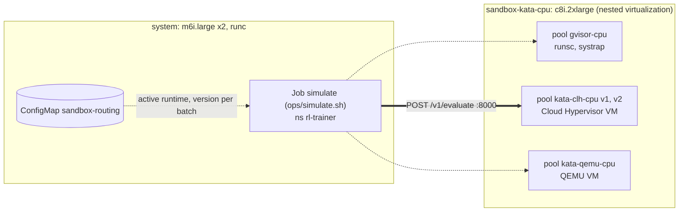

# 10 CPU-only path on c8i (scenario C)

**TL;DR** Without any GPU, put gVisor and Kata (Cloud Hypervisor, QEMU) on one `c8i.2xlarge` (nested virtualization) and swap the sandbox from v1 to v2 during a reward loop without a model (compute about 0.57 USD per hour, estimate, On-Demand list price).

## Pain points

Scenario A needs GPU nodes, and many accounts have a `Running On-Demand G and VT instances` quota of 0, so you cannot even start while the quota request is pending. Even the minimal path costs about 3.42 USD per hour for compute alone, and adding Kata GPU takes it past 11 USD. gVisor runs on `g5.xlarge` (A10G) and Kata GPU on `g4dn.metal` (T4), so it is also hard to isolate the runtime's effect. Many people postpone Kata because it supposedly needs bare metal, but only Kata + GPU passthrough needs `.metal`.

![Two panels. a: with a G and VT quota of 0 you wait for approval and cannot start; once approved, scenario A (about 3.42 USD per hour, over 11 USD with Kata GPU) puts the gVisor pool on g5.xlarge, A10G and the Kata GPU pool on g4dn.metal, T4, so with different nodes and GPUs the runtime effect is hard to isolate. b: scenario C needs only the Standard quota (about 0.57 USD per hour, a sixth of A, estimate) and puts the gVisor, Kata CLH and Kata QEMU pools on one c8i.2xlarge, so with the same CPU, memory and kernel the differences are easier to pin on the runtime.](../images/figures/handson-10_cpu_only.svg)

*Takeaway: Scenario A cannot start without GPU quota, costs more, and puts the two runtimes on different nodes and GPUs, while scenario C runs all three runtimes on one c8i.2xlarge at about a sixth of the compute cost and compares them under the same conditions.*


## Why

- **All three runtimes on the same node.** The three pools share one node with the same CPU, memory and kernel, so differences in boot time and evaluation latency are easier to attribute to the runtime.
- **The sandbox side is the same code as the GPU path.** Image, `/v1/evaluate` API, authentication, NetworkPolicy and verification script (`scripts/ops/verify.sh`) stay; only `device=cpu` and the RuntimeClass change.
- **A reward loop instead of training.** The reward loop simulation (`scripts/ops/simulate.sh`) scores the golden submissions batch by batch with the trainer's own reward functions (`KernelRewards`), which is enough to watch a version swap during training (`scripts/ops/rollout.sh`).

**Before you start:** read the architecture in [00 Overview](00_overview.md) and run the local smoke test in [Getting started](../getting_started.md). Runtime differences are in [02 Isolation runtimes](../concepts/02_isolation_runtimes.md), and why version pinning matters is in [03 On-policy RL with sandboxes](../concepts/03_onpolicy_rl_with_sandboxes.md).

??? note "Terms (expand if a word is new)"
    - **Nested virtualization**: running a VM inside a VM. Since 2026-02, EC2 exposes `/dev/kvm` on some virtual instances such as C8i, M8i and R8i. Kata uses it to start a small VM per pod.
    - **systrap**: the gVisor platform that intercepts system calls without KVM. gVisor therefore runs without nested virtualization; it shares this node only so that all three runtimes are compared under the same conditions.
    - **nvproxy**: the gVisor feature that forwards GPU driver calls. This node has no GPU, so it is installed with nvproxy off.
    - **Launch template**: a bundle of EC2 launch settings. Here it turns on nested virtualization, restricts IMDS and carries the node boot script (user data); the CDK stack creates it.
    - **SSM tunnel (`cdk/tunnel.sh`)**: the connection that links `127.0.0.1:8443` on your PC to the API through SSM Session Manager, so that kubectl and helm reach a cluster with only a private API endpoint.
    - **Golden submission**: a test answer whose verdict is known in advance. There is one correct answer, one wrong answer, one benchmark cheat and one policy violation.
    - **Reward batch**: the group of completions the trainer sends for scoring at once. The routing table is read once per batch, which pins the version.

    More terms are in the [Glossary](../reference/glossary.md).

!!! warning "Verification status"
    On 2026-11-14 cluster creation (`02_create_cluster.sh`, CDK deploy and delete, twice) and the Kata CPU node add (`kata/cpu_nodes.sh`) ran in a practice account (us-west-2); the node layout and duration in step 2 and the smoke pod output in step 4 are from those runs. In scenario C the image build (`03_build_push_images.sh`), namespace and auth setup (`05_setup_namespaces_auth.sh`), pool deploy (`06_deploy_sandboxes.sh`), pool verification (`ops/verify.sh`), reward loop simulation (`ops/simulate.sh`), version swap (`ops/rollout.sh`) and benchmark (`ops/bench.sh`) were not run on AWS (the image build, namespace and auth setup, and the gVisor GPU pool deploy and verification ran in scenario A in the practice account on 2026-11-18), so their "What to look for" output is the shape the scripts print; verify them yourself. Only the sample output of the reward loop simulation (`ops/simulate.sh`) is a real run, done locally (CPU, two loopback servers) and also covered by a test (`test_simulate_reports_a_version_switch_between_batches`).

## Architecture


*Takeaway: In AWS resources there is no GPU node, and one c8i.2xlarge serves as the sandbox node group. The diagram below shows the same layout by pods.*



*Takeaway: three kinds of sandbox pools share one c8i node, and the routing ConfigMap decides which pool is called.*

| Component in scenario A | In scenario C | Same? |
|---|---|---|
| GRPO trainer (`g5.2xlarge`, vLLM generation, gradients) | none; the `simulate` Job puts golden submissions where completions would be | different (no training) |
| Reward functions `KernelRewards` | same code, `require_triton=False` | same |
| Version pinning with one routing snapshot per batch | same code | same |
| Sandbox image, API, authentication, NetworkPolicy | the same | same |
| Sandbox runtimes | `gvisor-cpu`, `kata-clh-cpu`, `kata-qemu-cpu` | only the RuntimeClass differs |
| Harness measurement | CPU timing (`device=cpu`), no Triton | different (no GPU timing) |

## Preparation

1. Create `scripts/config.env` as in "Preparation 1" of [01 Cluster and images](01_cluster_and_images.md), and do the one-time CDK preparation (Node.js, CDK CLI, Session Manager plugin, `cdk/requirements.txt`, `cdk bootstrap`) as in "Preparation 2" of 01. It needs `AWS_REGION`, `CLUSTER_NAME`, `K8S_VERSION`, `GVISOR_RELEASE`, `KATA_VERSION`, `KATA_CPU_INSTANCE_TYPE` (default `c8i.2xlarge`) and `SANDBOX_AUDIENCE`; GPU-related values can stay as they are. With `export SCENARIO="C"`, rerunning cluster creation (`02_create_cluster.sh`) without an option still deploys scenario C.
2. Add this line to `scripts/config.env`. With one replica per pool, the v2 pool fits on the same node too.

    ```bash
    export KATA_CPU_REPLICAS="1"
    ```

    Each pod requests 1 CPU and 2Gi of memory, and a Kata pod adds the VM's share (overhead) of 250m CPU and 130Mi (CLH) or 320Mi (QEMU). Four pools (three v1 and one v2) come to about 4.75 CPUs and 8.6Gi, which fits an 8 vCPU, 16 GiB node with the system DaemonSets (estimate; check the real allocatable amount with `kubectl describe node`).

3. **Quota:** `Running On-Demand Standard (A, C, D, H, I, M, R, T, Z) instances` must be at least 14 vCPUs (`m6i.large` 2x 2 = 4, `c8i.2xlarge` 8, the access instance `t4g.nano` 2, computed from the instance specs). The documented default can be 5; the G and VT quota is not needed.

    

    *An example from a practice account (2026-11-14, ap-south-1). Quotas are per Region; check them in `AWS_REGION`.*

## Step 1: Prerequisites (`01_check_prereqs.sh`)

Read-only checks of tools, AWS identity, quotas and nested virtualization support.

```bash
scripts/01_check_prereqs.sh
```

**What to look for:** the Standard quota is 14 or more, and the feature list of `c8i.2xlarge` contains `nested-virtualization`. Ignore the G and VT quota and the AZ list of the GPU types.

**If it fails:** if nested virtualization is missing, the Region does not support it; switch to `us-east-1` or `us-west-2`, or see the "Kata" section of [Troubleshooting](../reference/troubleshooting.md).

## Step 2: A cluster without GPUs, with the c8i node (`02_create_cluster.sh`)

One CDK stack creates the VPC, the EKS control plane (private API endpoint only), add-ons, system nodes (2x `m6i.large`), the Kata CPU node (1x `c8i.2xlarge`, nested virtualization) and an access instance, but no trainer node and no gVisor GPU nodes.

```bash
scripts/02_create_cluster.sh --cpu-only
```

**What to look for:** check that the IAM and security group changes have no `0.0.0.0/0` inbound rule and answer `y` to `Do you wish to deploy these changes (y/n)?`. It took about 20 minutes in the practice account and ends with `Outputs` (including `EndpointPublicAccess = false`) and the `Next:` guidance. What each part means is in the cluster creation (`02_create_cluster.sh`) section of [01 Cluster and images](01_cluster_and_images.md).

Keep the tunnel running in a second terminal. From the Kata CPU node add (`kata/cpu_nodes.sh`) in step 4 on, kubectl and helm all go through it.

```bash
cdk/tunnel.sh
```

Check the nodes from the first terminal.

```bash
kubectl get nodes -L gpusandbox/role,node.kubernetes.io/instance-type
```

**What to look for:** two `system` nodes (`m6i.large`) and one `sandbox-kata` node (`c8i.2xlarge`) are `Ready`. The cluster page of the EKS console shows 3 nodes, 2 node groups and 4 add-ons.


*Scenario C deployed in a practice account (2026-11-14, us-west-2, account and resource identifiers masked).*

**If it fails:** if it stops with `set ... in scripts/config.env`, fill in that value. Deploy errors are under "If it fails" of cluster creation (`02_create_cluster.sh`) in [01](01_cluster_and_images.md) and under "Cluster and nodes" in [Troubleshooting](../reference/troubleshooting.md); tunnel errors are in the "Open the tunnel" section of 01.

## Step 3: Build only two images (`03_build_push_images.sh`)

Build and push only the sandbox and control images, skipping the trainer image (the largest one, with vLLM).

```bash
scripts/03_build_push_images.sh --no-trainer
```

**What to look for:** two export lines at the end. Paste them into `scripts/config.env`.

```text
Add to scripts/config.env:
export SANDBOX_IMAGE_URI="<account>.dkr.ecr.<region>.amazonaws.com/gpu-sandbox/sandbox:v1"
export CONTROL_IMAGE_URI="<account>.dkr.ecr.<region>.amazonaws.com/gpu-sandbox/control:v1"
```

The sandbox image is based on the PyTorch CUDA runtime and is used unchanged on CPU. If your workstation is arm64, build on an x86_64 host.

**Skip `04_install_gpu_stack.sh`.** It installs the NVIDIA device plugin and gVisor on the GPU nodes; on this path the c8i node created by `02_create_cluster.sh` already installed gVisor through its user data at boot.

## Step 4: Three runtimes on the c8i node (`kata/cpu_nodes.sh`)

The c8i node exists from cluster creation (`02_create_cluster.sh`), so run the Kata CPU node add (`scripts/kata/cpu_nodes.sh`) once. It checks for the `sandbox-kata-cpu` node group, installs kata-deploy and the RuntimeClasses, and starts one smoke pod per runtime.

```bash
scripts/kata/cpu_nodes.sh    # kata-deploy, RuntimeClasses, smoke pods
```

The user data in the c8i node's launch template (CDK stack) does the following at boot.

| User data part | What it does |
|---|---|
| NodeConfig | registers the containerd drop-in import for kata-deploy and the `runsc` handler for gVisor |
| gVisor install | downloads `GVISOR_RELEASE`, checks it with sha512 and installs it without nvproxy (`GVISOR_NVPROXY=false`) |
| node guard | blocks connections from pods to host services such as the node's kubelet port |

To check that the CPU option (`NestedVirtualization: enabled`) actually reached the node, use the `describe-instances` command in stage 1 of [03 Kata sandboxes](03_kata.md).

**What to look for:** below is the end of the output actually seen in the practice account on 2026-11-14 (versions differ by environment). It took about 14 minutes, mostly for the kata-deploy install.

```text
gvisor-cpu: kernel seen inside: 4.19.0-gvisor #1 SMP Sun Jan 10 15:06:54 PST 2016
kata-clh: kernel seen inside: 6.18.56 #1 SMP Fri Oct 16 18:41:32 UTC 2026
kata-qemu: kernel seen inside: 6.18.56 #1 SMP Fri Oct 16 18:41:32 UTC 2026
[23:10:36] host kernel for comparison: 6.18.56-125.164.amzn2023.x86_64
```

All three kernels must differ from the host kernel on the last line (a plain runc container would show the host kernel). Under gVisor the user-space kernel Sentry, which answers system calls, reports a version of its own choosing; under Kata you see the guest kernel inside the VM.

**If it fails:** on `no sandbox-kata-cpu node group: ...`, check that you ran cluster creation (`02_create_cluster.sh`) with `--cpu-only`; on `kata runtime classes missing` or a smoke pod that does not finish, see the "Kata" section of [Troubleshooting](../reference/troubleshooting.md). If only the `gvisor-cpu` smoke pod fails, check the gVisor install step in the node's user data log (`/var/log/cloud-init-output.log`).

## Step 5: Namespaces and the routing table (`05_setup_namespaces_auth.sh`)

The routing table's default active runtime is `gvisor` (a GPU pool), so set a CPU pool.

```bash
ACTIVE_RUNTIME=kata-clh-cpu scripts/05_setup_namespaces_auth.sh
```

**What to look for:** the beginning of the last output shows `"active": {"runtime": "kata-clh-cpu", "version": "v1"}`.

## Step 6: Deploy and verify three pools (`06_deploy_sandboxes.sh`, `ops/verify.sh`)

Create and verify one v1 pool per runtime. The pool verification (`ops/verify.sh`) checks isolation evidence, egress denial, golden verdicts and the NetworkPolicy in turn.

```bash
for rt in gvisor-cpu kata-clh-cpu kata-qemu-cpu; do
  scripts/06_deploy_sandboxes.sh "${rt}" v1
  scripts/ops/verify.sh "${rt}" v1
done
```

**What to look for:** each pool ends with `pool sandbox-<runtime>-v1 verified`. All four CPU golden verdicts must be `PASS` (the correct answer is `ok`, the wrong answer and the benchmark cheat are `wrong_answer`, reading a host file is `policy_violation`).

**If it fails:** if a pod is `Pending`, look for `Insufficient cpu` or `Insufficient memory` in `kubectl -n sandbox describe pod <pod>` and check that `KATA_CPU_REPLICAS=1` is in effect. Everything else is under "Sandbox pools and readiness" in [Troubleshooting](../reference/troubleshooting.md).

## Step 7: A reward loop without a model, and a version swap (`ops/simulate.sh`, `ops/rollout.sh`)

Use two terminals. The reward loop in the first scores 30 batches, one every 20 seconds (about 10 minutes).

```bash
# terminal 1
scripts/ops/simulate.sh 30 20
```

A few batches in, swap `kata-clh-cpu` from v1 to v2 in the second terminal. `ops/rollout.sh` starts the v2 pool next to v1 (1), verifies it (2), checks with parity that it gives the same verdicts as v1 (3) and switches the routing table to v2 (4).

```bash
# terminal 2
scripts/ops/rollout.sh kata-clh-cpu v1 v2
```

**What to look for:** events like these in the first terminal (the local real run from the verification status, shortened). On a cluster the ConfigMap takes up to about a minute to reach the pod (kubelet sync), so the switch can appear a few batches after `ops/rollout.sh` finishes.

```text
{"event": "simulate", "steps": 4, "device": "cpu", "note": "golden submissions stand in for model completions; this is not training"}
{"event": "reward_batch", "batch": 2, "global_step": 2, "runtime": "kata-clh-cpu", "version": "v1", "served_versions": {"v1": 3}, "routing_revision": 1, "n": 3, "status": {"ok": 1, "wrong_answer": 2}, "pass_rate": 0.3333, ...}
{"event": "sandbox_version_switch", "from": "kata-clh-cpu/v1", "to": "kata-clh-cpu/v2", "routing_revision": 2, "global_step": 3, ...}
{"event": "reward_batch", "batch": 3, "global_step": 3, "runtime": "kata-clh-cpu", "version": "v2", "served_versions": {"v2": 3}, "routing_revision": 2, "n": 3, "status": {"ok": 1, "wrong_answer": 2}, "pass_rate": 0.3333, ...}
```

- **`sandbox_version_switch` appears once, at a batch boundary.** Batches up to 2 ran on v1, batches from 3 on v2.
- **`served_versions` holds a single version.** The verdicts of one batch did not mix v1 and v2, which on-policy training needs to compute one batch's advantages against one standard.
- **`status` and `pass_rate` are the same before and after.** On the golden set v2 gives the same verdicts as v1, as the parity step of `ops/rollout.sh` checked beforehand.

`n` is 3, not 4, because the trainer-side AST check rejects the policy-violating answer (reading a host file) before it reaches a sandbox. `mean_speedup` moves from batch to batch with CPU timing noise (between 0.66 and 1.65 in the local run), so do not compare runtimes with it.

Once v2 is active, scale v1 to zero. The Deployment stays, so you can roll back at once.

```bash
scripts/ops/rollout.sh kata-clh-cpu v1 v2 --finish
```

**If it fails:** if `ops/simulate.sh` stops with `no routing table`, run `05_setup_namespaces_auth.sh` from step 5 again. If `ops/rollout.sh` stops at parity, v2 receives no traffic and v1 stays active (more in [06 Updating the sandbox during training](06_sandbox_update.md)).

## Step 8 (optional): Compare the three runtimes (`ops/bench.sh`)

Measure cold start (pod creation to Ready) and evaluation latency for each v1 pool.

```bash
scripts/ops/bench.sh 16
```

**What to look for:** one JSON line per pool (`eval_p50_s`, `eval_p95_s`, `throughput_eval_per_s`), also appended to `bench-<timestamp>.jsonl`. How to read the numbers is in [08 Runtime benchmark](08_benchmark.md).

## Step 9 (optional): Extend to Agent Sandbox

On the same node you can also try one sandbox per episode. These commands install the controller and create a warm pool from the `kata-clh-cpu` template, then take one claim, print its address and release it.

```bash
scripts/extensions/agent_sandbox.sh install
scripts/extensions/agent_sandbox.sh pool kata-clh-cpu 1
scripts/extensions/agent_sandbox.sh claim kata-clh-cpu
```

The concept and the output are in [06 Extending with Agent Sandbox](../concepts/06_agent_sandbox.md).

## Cleanup (`08_cleanup.sh`)

Delete the pools, Jobs and the CDK stack (cluster, node groups, VPC, access instance). The script proceeds only after you type the cluster name. Add `--images` to delete the ECR repositories too, after the confirmation word `images`.

```bash
scripts/08_cleanup.sh
```

**What to look for:** the last table (instances tagged `project=gpu-sandbox-on-aws`) is empty. More in [99 Cleanup](99_cleanup.md).

## Cost

These are **estimates** from On-Demand list prices, not measured bills (us-east-1 and us-west-2).

| Resource | Count | Unit price (USD/hour) | Subtotal |
|---|---|---|---|
| `m6i.large` (system) | 2 | 0.096 | 0.192 |
| `c8i.2xlarge` (three runtimes) | 1 | 0.37484 | 0.37484 |
| **Compute total** | | | **about 0.57** |
| EKS control plane (standard support) | 1 | 0.10 | 0.10 |

- In the Seoul Region (ap-northeast-2) `c8i.2xlarge` is 0.42336 USD per hour.
- Not included above: the access instance (`t4g.nano`), the secrets KMS key, CloudWatch logs, NAT gateway (hourly and per-GB charges), EBS volumes (system 50 GB x2, c8i 100 GB), data transfer and ECR storage.
- That is about one sixth of the compute of scenario A's minimal path (about 3.42 USD per hour).

## Scope and limits

- **No GPU and no Triton.** nvproxy, VFIO passthrough, GPU timing (device-wide synchronize) and Triton compilation are covered only by the GPU paths ([02](02_gvisor.md), [03](03_kata.md)).
- **This is not training.** The reward loop simulation (`ops/simulate.sh`) has no model generation and no gradients; the reward path and version pinning are the trainer's own code, but the timing of real training, where vLLM generation sets the gap between batches, is not reproduced.
- **Nested virtualization performance does not represent bare metal.** The Kata VM starts inside a VM, so boot time and latency can be longer than on bare metal, and AWS also recommends bare metal for performance-sensitive virtualization workloads (per the official documentation). Use the numbers only to compare runtimes on the same node.

## Next steps

- Once you have GPU quota, move to scenario A in [00 Overview](00_overview.md) and run real GRPO training (`07_run_grpo.sh`). Change to `export SCENARIO="A"` and `export WITH_KATA_CPU="1"` and run `CHANGE_SCENARIO=1 scripts/02_create_cluster.sh`: the c8i node stays as the CPU pool and the trainer and gVisor node groups are added. Without `CHANGE_SCENARIO=1` the deploy stops so that a scenario never changes by accident.
- Using the CPU tier in production is covered in [Production 01 Capacity and nodes](../production/01_capacity_and_nodes.md).

??? note "References"
    | Topic | Link |
    |---|---|
    | EC2 nested virtualization | https://docs.aws.amazon.com/AWSEC2/latest/UserGuide/amazon-ec2-nested-virtualization.html |
    | EC2 On-Demand pricing | https://aws.amazon.com/ec2/pricing/on-demand/ |
    | Reward loop simulator (`simulate`) | https://github.com/daekeun-ml/gpu-sandbox-on-aws/blob/main/src/gpusandbox/tools.py |
    | CDK stack (c8i node group and launch template) | https://github.com/daekeun-ml/gpu-sandbox-on-aws/blob/main/cdk/gpusandbox_cdk/stack.py |
    | Kata Containers | https://github.com/kata-containers/kata-containers |

    All sources: [this page in All references](../reference/references.md#ref-handson-10-cpu-only)
