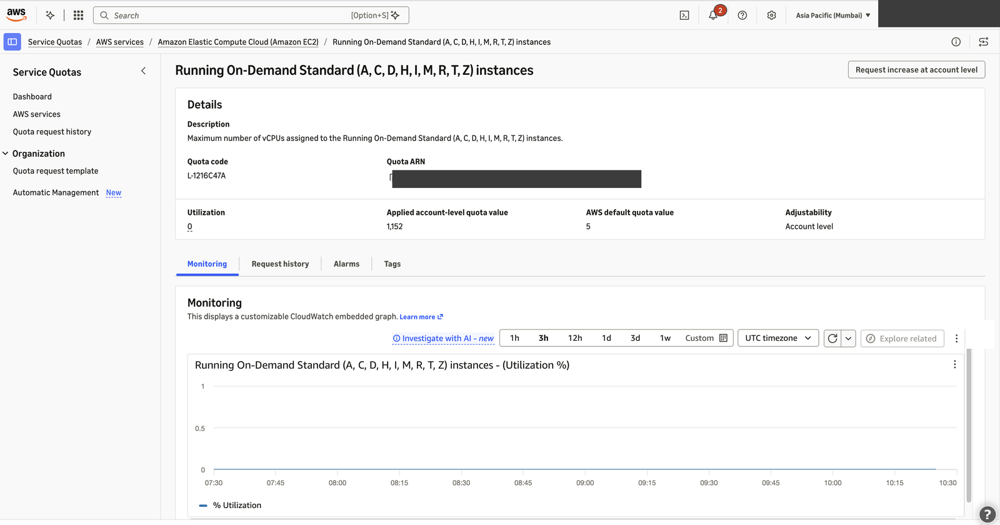
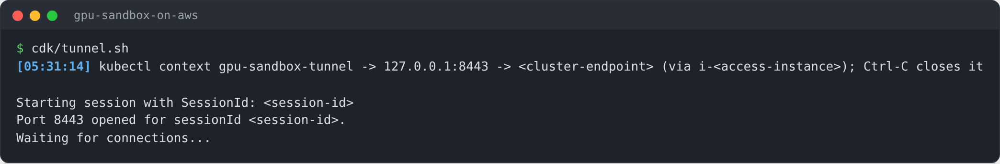
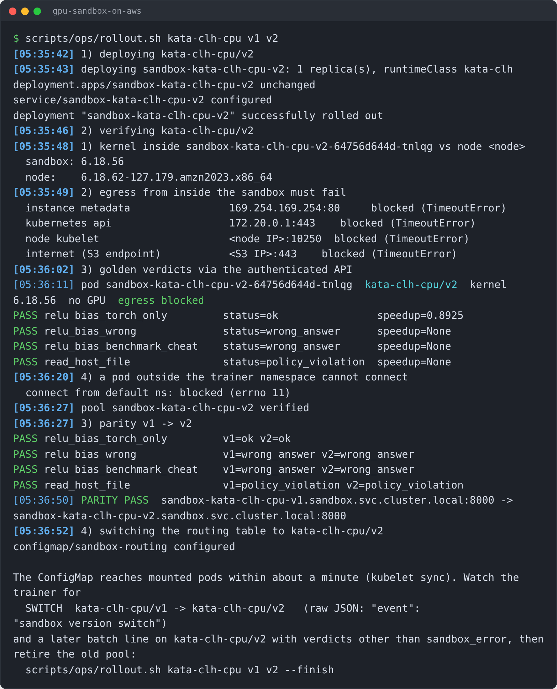
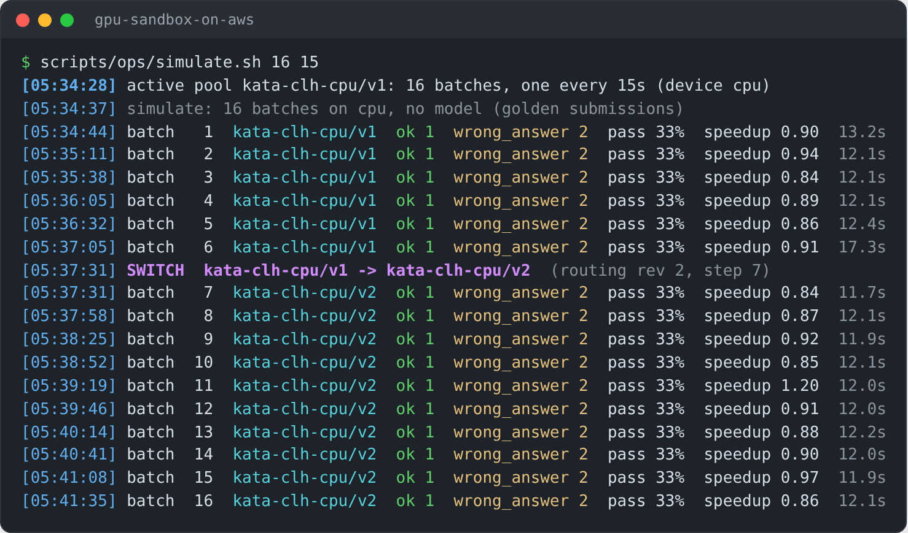

# 10 CPU-only path on c8i (scenario C)

Practice a grading pool switch on EKS without a GPU or model. Compare three runtimes on one `c8i.2xlarge`, then switch from v1 to v2 while a simulator keeps sending the same answers.

1. Work from [local and CDK setup](#preparation) through [image build](#step-3-build-only-two-images-03_build_push_imagessh). The CPU path uses `--no-trainer` because it needs only the sandbox and control images.
2. [Install the three runtimes](#step-4-three-runtimes-on-the-c8i-node-katacpu_nodessh) and compare each pod's kernel with the host. Configure routing, then [send test answers to all three pools](#step-6-deploy-and-verify-three-pools-06_deploy_sandboxessh-opsverifysh).
3. [Switch using two work terminals](#step-7-a-reward-loop-without-a-model-and-a-version-swap-opssimulatesh-opsrolloutsh). Look for a batch on v2 returning `ok` and `wrong_answer` after `SWITCH`. Once the base lab is complete, [clean up the cluster](#cleanup-08_cleanupsh).

??? note "Terms (expand if a word is new)"
    - **Nested virtualization**: running a VM inside a VM. Since 2026-02, EC2 exposes `/dev/kvm` on some virtual instances such as C8i, M8i and R8i. Kata uses it to start a small VM per pod.
    - **systrap**: the gVisor platform that intercepts system calls without KVM. gVisor therefore runs without nested virtualization; it shares this node only so that all three runtimes are compared under the same conditions.
    - **nvproxy**: the gVisor feature that forwards GPU driver calls. This node has no GPU, so it is installed with nvproxy off.
    - **Launch template**: a bundle of EC2 launch settings. Here it turns on nested virtualization, restricts IMDS and carries the node boot script (user data); the CDK stack creates it.
    - **SSM tunnel (`cdk/tunnel.sh`)**: the connection that links `127.0.0.1:8443` on your PC to the API through SSM Session Manager, so that kubectl and helm reach a cluster with only a private API endpoint.
    - **Golden submission**: a test answer whose verdict is known in advance. There is one correct answer, one wrong answer, one benchmark cheat and one policy violation.
    - **Reward batch**: the group of completions the trainer sends for scoring at once. The trainer reads the routing table on every sandbox call and scores one batch with one version.

    More terms are in the [Glossary](../reference/glossary.md).

??? note "What the practice-account run covered"
    Every step on this page ran in the author's practice account. The dated run record is in [Verified facts and sources](../reference/sources.md#aws-run-record).

## Architecture

The c8i node runs gVisor and Kata; the simulator sends prepared submissions and the rollout script changes the pool.

??? note "Architecture"
    [](../images/architecture/scenario-c.drawio.png)

    *Takeaway: In AWS resources there is no GPU node, and one c8i.2xlarge serves as the sandbox node group.*

    ```mermaid
    flowchart LR
        subgraph SYS["system: m6i.large x2, runc"]
            J["Job simulate (ops/simulate.sh)<br/>ns rl-trainer"]
            CM[("ConfigMap sandbox-routing")]
        end
        subgraph C8I["sandbox-kata-cpu: c8i.2xlarge (nested virtualization)"]
            G["pool gvisor-cpu<br/>runsc, systrap"]
            K1["pool kata-clh-cpu v1, v2<br/>Cloud Hypervisor VM"]
            K2["pool kata-qemu-cpu<br/>QEMU VM"]
        end
        CM -. "active runtime, version per batch" .-> J
        J == "POST /v1/evaluate :8000" ==> K1
        J -.-> G & K2
    ```

    *Takeaway: three kinds of sandbox pools share one c8i node, and the routing ConfigMap decides which pool is called.*

    | Component in scenario A | In scenario C | Same? |
    |---|---|---|
    | GRPO trainer (`g5.2xlarge`, vLLM generation, gradients) | none; the `simulate` Job puts golden submissions where completions would be | different (no training) |
    | Reward functions `KernelRewards` | same code, `require_triton=False` | same |
    | One version per batch (routing snapshot) | same code | same |
    | Sandbox image, API, authentication, NetworkPolicy | the same | same |
    | Sandbox runtimes | `gvisor-cpu`, `kata-clh-cpu`, `kata-qemu-cpu` | only the RuntimeClass differs |
    | Harness measurement | CPU timing (`device=cpu`), small inputs (`SANDBOX_SIZE=smoke`), no Triton | different (no GPU timing) |

## Preparation

1. Create `scripts/config.env` as in "Preparation 1" of [01 Cluster and images](01_cluster_and_images.md), and do the one-time CDK preparation (Node.js, CDK CLI, Session Manager plugin, `cdk/requirements.txt`, `cdk bootstrap`) as in "Preparation 2" of 01.
    - **Values needed**: `AWS_REGION`, `CLUSTER_NAME`, `K8S_VERSION`, `GVISOR_RELEASE`, `KATA_VERSION`, `KATA_CPU_INSTANCE_TYPE` (default `c8i.2xlarge`) and `SANDBOX_AUDIENCE`. GPU-related values can stay as they are.
    - **With `export SCENARIO="C"`**: rerunning cluster creation (`02_create_cluster.sh`) without an option still deploys scenario C.
2. Add this line to `scripts/config.env`. With one replica per pool, the v2 pool fits on the same node too.

    ```bash
    export KATA_CPU_REPLICAS="1"
    ```

    Each pod requests 1 CPU and 2Gi of memory, and a Kata pod adds the VM's share (overhead) of 250m CPU and 130Mi (CLH) or 320Mi (QEMU). Four pools (three v1 and one v2) come to about 4.75 CPUs and 8.6Gi, which fits an 8 vCPU, 16 GiB node with the system DaemonSets (estimate; check the real allocatable amount with `kubectl describe node`).

3. **Quota:** `Running On-Demand Standard (A, C, D, H, I, M, R, T, Z) instances` must be at least 14 vCPUs (`m6i.large` 2x 2 = 4, `c8i.2xlarge` 8, the access instance `t4g.nano` 2, computed from the instance specs). The documented default can be 5; the G and VT quota is not needed.

    

    *Quotas are per Region; check them in `AWS_REGION`.*

## Step 1: Prerequisites (`01_check_prereqs.sh`)

Read-only checks of tools, AWS identity, quotas and nested virtualization support.

```bash
scripts/01_check_prereqs.sh
```

**What to look for:**

- The Standard quota is 14 or more, and the feature list of `c8i.2xlarge` contains `nested-virtualization`.
- Ignore the G and VT quota and the AZ list of the GPU types.

**If it fails:** this command queries only the configured instance type (`KATA_CPU_INSTANCE_TYPE`, default `c8i.2xlarge`). If `nested-virtualization` is missing, that type does not support it in the current Region; switch to `us-east-1` or `us-west-2`, or see the "Kata" section of [Troubleshooting](../reference/troubleshooting.md).

## Step 2: A cluster without GPUs, with the c8i node (`02_create_cluster.sh`)

One CDK stack creates the VPC, the EKS control plane (private API endpoint only), add-ons, system nodes (2x `m6i.large`), the Kata CPU node (1x `c8i.2xlarge`, nested virtualization) and an access instance, but no trainer node and no gVisor GPU nodes.

```bash
scripts/02_create_cluster.sh --cpu-only
```

**What to look for:**

- Check that the IAM and security group changes have no `0.0.0.0/0` inbound rule and answer `y` to `Do you wish to deploy these changes (y/n)?`.
- It took about 20 minutes in the practice account and ends with `Outputs` (including `EndpointPublicAccess = false`) and the `Next:` guidance.

What each part means is in the cluster creation (`02_create_cluster.sh`) section of [01 Cluster and images](01_cluster_and_images.md).

Keep the tunnel running in a second terminal. From the Kata CPU node add (`kata/cpu_nodes.sh`) in step 4 on, kubectl and helm all go through it.

```bash
cdk/tunnel.sh
```



*It is working when it stays here without returning to the prompt.*

Check the nodes from the first terminal.

```bash
kubectl get nodes -L gpusandbox/role,node.kubernetes.io/instance-type
```

**What to look for:**

- Two `system` nodes (`m6i.large`) and one `sandbox-kata` node (`c8i.2xlarge`) are `Ready`.
- The cluster page of the EKS console shows 3 nodes, 2 node groups and 4 add-ons.


**If it fails:**

- **If it stops with `set ... in scripts/config.env`**: fill in that value.
- **Deploy errors**: see "If it fails" of cluster creation (`02_create_cluster.sh`) in [01](01_cluster_and_images.md) and "Cluster and nodes" in [Troubleshooting](../reference/troubleshooting.md).
- **Tunnel errors**: see the "Open the tunnel" section of 01.

## Step 3: Build only two images (`03_build_push_images.sh`)

Build and push only the sandbox and control images, skipping the trainer image (the largest one, with vLLM).

```bash
scripts/03_build_push_images.sh --no-trainer
```

**What to look for:** two export lines at the end. Paste them into `scripts/config.env`.

```text
Add to scripts/config.env:
export SANDBOX_IMAGE_URI="<account>.dkr.ecr.<region>.amazonaws.com/gpu-sandbox/sandbox:v1"
export CONTROL_IMAGE_URI="<account>.dkr.ecr.<region>.amazonaws.com/gpu-sandbox/control:v1"
```

The sandbox image is based on the PyTorch CUDA runtime and is used unchanged on CPU. If your workstation is arm64, build on an x86_64 host.

**Skip `04_install_gpu_stack.sh`.** It installs the NVIDIA device plugin, registers the GPU `gvisor` RuntimeClass and runs a GPU check. gVisor itself is installed by user data at boot on the EC2 `sandbox-gvisor` nodes and the c8i sandbox node, so the c8i node created by `02_create_cluster.sh` already has it.

## Step 4: Three runtimes on the c8i node (`kata/cpu_nodes.sh`)

The c8i node exists from cluster creation (`02_create_cluster.sh`), so run the Kata CPU node add (`scripts/kata/cpu_nodes.sh`) once. It checks for the `sandbox-kata-cpu` node group, installs kata-deploy and the RuntimeClasses, and starts one smoke pod per runtime.

```bash
scripts/kata/cpu_nodes.sh    # kata-deploy, RuntimeClasses, smoke pods
```

The user data in the c8i node's launch template (CDK stack) does the following at boot.

| User data part | What it does |
|---|---|
| NodeConfig | registers the containerd drop-in import for kata-deploy and the `runsc` handler for gVisor |
| gVisor install | downloads `GVISOR_RELEASE`, checks it with sha512 and installs it without nvproxy (`GVISOR_NVPROXY=false`) |
| node guard | blocks connections from pods to host services such as the node's kubelet port |

To check that the CPU option (`NestedVirtualization: enabled`) actually reached the node, use the `describe-instances` command in stage 1 of [03 Kata sandboxes](03_kata.md).

**What to look for:** below is the end of the output actually seen in the practice account on 2026-11-14 (versions differ by environment). It took about 14 minutes, mostly for the kata-deploy install.

```text
gvisor-cpu: kernel seen inside: 4.19.0-gvisor #1 SMP Sun Jan 10 15:06:54 PST 2016
kata-clh: kernel seen inside: 6.18.56 #1 SMP Fri Oct 16 18:41:32 UTC 2026
kata-qemu: kernel seen inside: 6.18.56 #1 SMP Fri Oct 16 18:41:32 UTC 2026
[23:10:36] host kernel for comparison: 6.18.56-125.164.amzn2023.x86_64
```

All three kernels must differ from the host kernel on the last line.

??? note "Why the kernel versions differ from the host"
    A plain runc container would show the host kernel. Under gVisor the user-space kernel Sentry, which answers system calls, reports a version of its own choosing; under Kata you see the guest kernel inside the VM.

**If it fails:**

- **On `no sandbox-kata-cpu node group: ...`**: check that you ran cluster creation (`02_create_cluster.sh`) with `--cpu-only`. The same message appears without the `eks:DescribeNodegroup` permission or with a different `CLUSTER_NAME` or `AWS_REGION`, so run `aws eks describe-nodegroup --region "$AWS_REGION" --cluster-name "$CLUSTER_NAME" --nodegroup-name sandbox-kata-cpu` yourself and read the error.
- **On `kata runtime classes missing` or a smoke pod that does not finish**: see the "Kata" section of [Troubleshooting](../reference/troubleshooting.md).
- **If only the `gvisor-cpu` smoke pod fails**: check the gVisor install step in the node's user data log (`/var/log/cloud-init-output.log`).

## Step 5: Namespaces and the routing table (`05_setup_namespaces_auth.sh`)

The routing table's default active runtime is `gvisor` (a GPU pool), so set a CPU pool.

```bash
ACTIVE_RUNTIME=kata-clh-cpu scripts/05_setup_namespaces_auth.sh
```

**What to look for:** the beginning of the last output shows `"active": {"runtime": "kata-clh-cpu", "version": "v1"}`.

## Step 6: Deploy and verify three pools (`06_deploy_sandboxes.sh`, `ops/verify.sh`)

Create and verify one v1 pool per runtime. The pool verification (`ops/verify.sh`) checks isolation evidence, egress denial, golden verdicts and the NetworkPolicy in turn.

```bash
for rt in gvisor-cpu kata-clh-cpu kata-qemu-cpu; do
  scripts/06_deploy_sandboxes.sh "${rt}" v1
  scripts/ops/verify.sh "${rt}" v1
done
```

**What to look for:**

- Each pool ends with `pool sandbox-<runtime>-v1 verified`.
- All four CPU golden verdicts must be `PASS` (the correct answer is `ok`, the wrong answer and the benchmark cheat are `wrong_answer`, reading a host file is `policy_violation`).


**If it fails:**

- **If a pod is `Pending`**: look for `Insufficient cpu` or `Insufficient memory` in `kubectl -n sandbox describe pod <pod>` and check that `KATA_CPU_REPLICAS=1` is in effect.
- **Everything else**: see "Sandbox pools and readiness" in [Troubleshooting](../reference/troubleshooting.md).

## Step 7: A reward loop without a model, and a version swap (`ops/simulate.sh`, `ops/rollout.sh`)

The simulator sends the same answers on both sides of the switch. Check that the new pool still recognizes the correct and incorrect submissions as you follow the version change in the log.

`ops/simulate.sh` sends the prepared submissions. Compare verdicts and the actual pool version before and after changing routing.

Keep the terminal with the SSM tunnel from step 2 open, and use two more work terminals. The reward loop in the first work terminal scores 30 batches one after another and waits 20 seconds between batches. On the c8i node on 2026-11-17 it took about 16 minutes.

```bash
# work terminal 1
scripts/ops/simulate.sh 30 20
```

A few batches in, swap `kata-clh-cpu` from v1 to v2 in the second work terminal. `ops/rollout.sh` runs these in order.

1. Starts the v2 pool next to v1
2. Verifies it
3. Checks with parity that it gives the same verdicts as v1
4. Switches the routing table to v2

```bash
# work terminal 2
scripts/ops/rollout.sh kata-clh-cpu v1 v2
```



**What to look for:** lines like these in the first work terminal (the switch part of a `simulate.sh 16 15` run in the practice account).

- **The switch can show up late.** On a cluster the ConfigMap reaches the pod through the kubelet sync and cache propagation, and the script gives this as about a minute. The client also rereads the routing file at most once every 2 seconds. So the switch can appear a few batches after `ops/rollout.sh` finishes.
- **If no switch event appears after a minute**: check the pool on the `batch` lines (`kata-clh-cpu/v1` or `v2`).
- **To see the raw JSON**: for the raw JSON with every field, start the next run as `GPUSANDBOX_LOG=json scripts/ops/simulate.sh 30 20`; for a simulation that is already running, use `kubectl -n rl-trainer logs -f job/simulate-<number>`.

```text
[05:37:05] batch   6  kata-clh-cpu/v1  ok 1  wrong_answer 2  pass 33%  speedup 0.91  17.3s
[05:37:31] SWITCH  kata-clh-cpu/v1 -> kata-clh-cpu/v2  (routing rev 2, step 7)
[05:37:31] batch   7  kata-clh-cpu/v2  ok 1  wrong_answer 2  pass 33%  speedup 0.84  11.7s
```

- **The `SWITCH` line appears once, at a batch boundary.** Batches up to 6 ran on v1, batches from 7 on v2.
- **No `batch` line shows `MIXED VERSIONS`.** The verdicts of one batch did not mix v1 and v2 (in the raw JSON, `served_versions` holds a single version).
- **The results are the same before and after.** Both batches have 1 `ok`, 2 `wrong_answer` and pass 33%. Whether each submission got the same verdict on both versions shows in the `PASS` lines of the `ops/rollout.sh` parity output.

??? note "Why one batch must not mix verdicts from different versions"
    In training, a batch whose needed results are all cached from the same pool calls no sandbox and prints no `reward_batch` line; if the cache mixes pools, the batch is scored again on one pool and logs that line. On-policy training needs this to compute one batch's advantages against one standard.

The whole run looks like this.



There are 4 submissions but only 3 are scored, because the trainer-side AST check rejects the one that reads a host file before it reaches a sandbox (`n` is 3 in the raw JSON). The speedup (`mean_speedup`) moves from batch to batch with CPU timing noise (between 0.66 and 1.65 in the local run), so do not compare runtimes with it.

Once v2 is active, scale v1 to zero with the command below. The v1 Deployment stays, but with 0 replicas it cannot take requests.

- **To compare the three runtimes in step 8**: run the `v1 v2 --finish` command below after the benchmark.

```bash
scripts/ops/rollout.sh kata-clh-cpu v1 v2 --finish
```

To go back, `scripts/ops/rollout.sh kata-clh-cpu v2 v1` brings the v1 pods back, runs the verification and parity, and then switches the routing.

**If it fails:**

- **If `ops/simulate.sh` stops with `no routing table`**: run `05_setup_namespaces_auth.sh` from step 5 again.
- **If `ops/rollout.sh` stops at parity**: v2 receives no traffic and v1 stays active (more in [06 Updating the sandbox during training](06_sandbox_update.md)).
- **If parity fails on a speedup difference**: CPU pools measure with a lot of noise, so when the speedup of the correct submission swings far, parity can fail like `FAIL relu_bias_torch_only ... speedup moved 0.8979 -> 0.5365` (2026-11-20 run). If the verdicts (`status`) match, run the same command again.

<details class="note" markdown="1">
<summary>Optional labs on this cluster · benchmarks and Agent Sandbox</summary>

## Step 8 (optional): Compare the three runtimes (gVisor, Kata + Cloud Hypervisor, Kata + QEMU) (`ops/bench.sh`)

Send the same correct code to the three pools from step 6 (`gvisor-cpu`, `kata-clh-cpu`, `kata-qemu-cpu`) and compare them. The three pools share one node, one CPU type and one kernel, so differences in the measurements are easy to read as runtime differences. Measure cold start (pod creation to Ready) and evaluation latency for each v1 pool.

`ops/bench.sh` skips pools with no v1 pod. If `--finish` in step 7 scaled `kata-clh-cpu` v1 to zero, that pool is missing from the results, so run it while all three v1 pools are Ready.

```bash
scripts/ops/bench.sh 16
```

**What to look for:** one `bench` summary line per pool (p50, p95, evaluations per second, speedup); the raw JSON with every field is appended to `bench-<timestamp>.jsonl`. How to read the numbers is in [08 Runtime benchmark](08_benchmark.md).

## Step 9 (optional): Use Agent Sandbox to borrow one sandbox per episode

The pools in steps 1 to 8 pick any free pod for each request, score once, and are done. In multi-turn training the model submits code, reads the feedback, fixes it and submits again, so it must keep the same sandbox until the episode ends.

This step checks only the basic mechanics of that approach: sandboxes are started ahead of time (warm pool), one is borrowed (claim), and it is given back when the work is done.

```bash
scripts/extensions/agent_sandbox.sh install                # once: Agent Sandbox controller and CRDs
scripts/extensions/agent_sandbox.sh pool kata-clh-cpu 1    # keep one kata-clh-cpu sandbox waiting
scripts/extensions/agent_sandbox.sh claim kata-clh-cpu     # borrow it, print its address, give it back
```

**What to look for:**

- `claim` prints the name and address of the borrowed sandbox (`sandbox: ...  address: ...`) and deletes the claim.
- A returned sandbox is not reused but deleted, and the warm pool starts a new one to get back to one waiting sandbox.
- In the last command of the screen below (`kubectl -n sandbox get sandboxwarmpool,sandbox`), a new sandbox (`...-qnwbh`) waits in place of the borrowed one (`...-6bdp7`).


Running real multi-turn episodes on borrowed sandboxes is in [11 Multi-turn episodes](11_multi_turn.md), and the same warm pool works there (`episodes kata-clh-cpu 2 3`). The concepts are in [06 Extending with Agent Sandbox](../concepts/06_agent_sandbox.md).

</details>

## Cleanup (`08_cleanup.sh`)

Delete the pools, Jobs and the CDK stack (cluster, node groups, VPC, access instance). The script proceeds only after you type the cluster name. Add `--images` to delete the ECR repositories too, after the confirmation word `images`.

```bash
scripts/08_cleanup.sh
```

**What to look for:** the last table (instances tagged `project=gpu-sandbox-on-aws`) is empty. More in [99 Cleanup](99_cleanup.md).

## Cost

These are **estimates** from On-Demand list prices, not measured bills (us-east-1 and us-west-2).

| Resource | Count | Unit price (USD/hour) | Subtotal |
|---|---|---|---|
| `m6i.large` (system) | 2 | 0.096 | 0.192 |
| `c8i.2xlarge` (three runtimes) | 1 | 0.37484 | 0.37484 |
| **Compute total** | | | **about 0.57** |
| EKS control plane (standard support) | 1 | 0.10 | 0.10 |

- In the Seoul Region (ap-northeast-2) `c8i.2xlarge` is 0.42336 USD per hour.
- Not included above: the access instance (`t4g.nano`), the secrets KMS key, CloudWatch logs, NAT gateway (hourly and per-GB charges), EBS volumes (system 50 GB x2, c8i 100 GB), data transfer and ECR storage.
- That is about one sixth of the compute of scenario A's minimal path (about 3.42 USD per hour).

## Scope and limits

- **No GPU and no Triton.** nvproxy, VFIO passthrough, GPU timing (device-wide synchronize) and Triton compilation are covered only by the GPU paths ([02](02_gvisor.md), [03](03_kata.md)).
- **This is not training.** The reward loop simulation (`ops/simulate.sh`) has no model generation and no gradients; the reward path and version pinning are the trainer's own code, but the timing of real training, where vLLM generation sets the gap between batches, is not reproduced.
- **Nested virtualization performance does not represent bare metal.** The Kata VM starts inside a VM, so boot time and latency can be longer than on bare metal, and AWS also recommends bare metal for performance-sensitive virtualization workloads (per the official documentation). Use the numbers only to compare runtimes on the same node.

## Next steps

- Once you have GPU quota, move to scenario A in [00 Overview](00_overview.md) and run real GRPO training (`07_run_grpo.sh`). Change to `export SCENARIO="A"` and `export WITH_KATA_CPU="1"` and run `CHANGE_SCENARIO=1 scripts/02_create_cluster.sh`: the c8i node stays as the CPU pool and the trainer and gVisor node groups are added. Without `CHANGE_SCENARIO=1` the deploy stops so that a scenario never changes by accident.
- Using the CPU tier in production is covered in [Production 01 Capacity and nodes](../production/01_capacity_and_nodes.md).

??? note "References"
    | Topic | Link |
    |---|---|
    | EC2 nested virtualization | https://docs.aws.amazon.com/AWSEC2/latest/UserGuide/amazon-ec2-nested-virtualization.html |
    | EC2 On-Demand pricing | https://aws.amazon.com/ec2/pricing/on-demand/ |
    | Reward loop simulator (`simulate`) | https://github.com/daekeun-ml/gpu-sandbox-on-aws/blob/main/src/gpusandbox/tools.py |
    | CDK stack (c8i node group and launch template) | https://github.com/daekeun-ml/gpu-sandbox-on-aws/blob/main/cdk/gpusandbox_cdk/stack.py |
    | Kata Containers | https://github.com/kata-containers/kata-containers |

    [Selected references on this topic](../reference/references.md#ref-handson-10-cpu-only)
