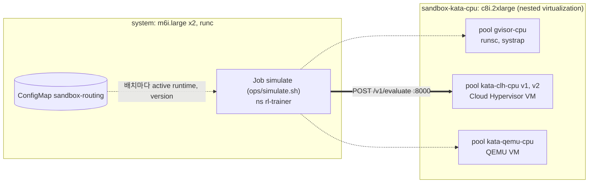
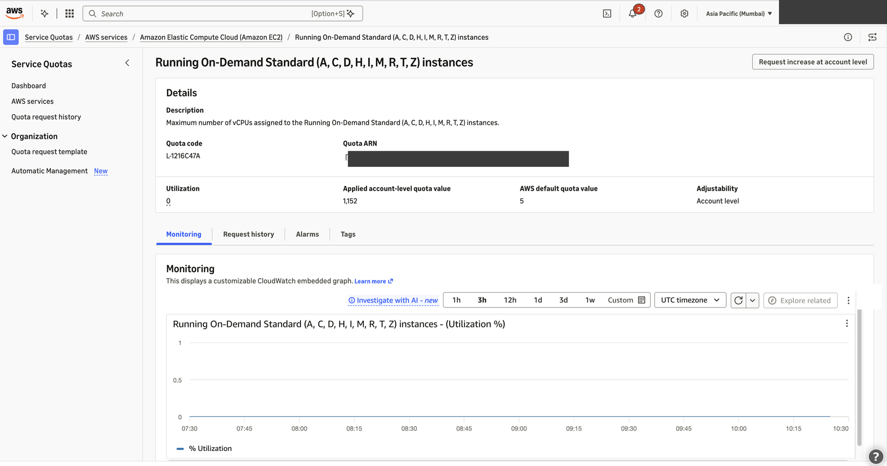
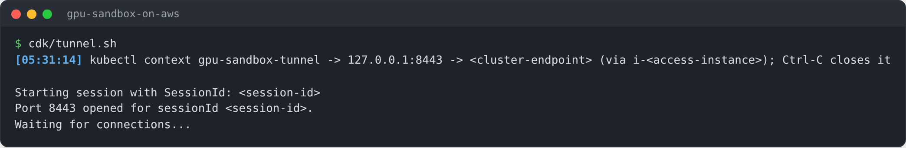
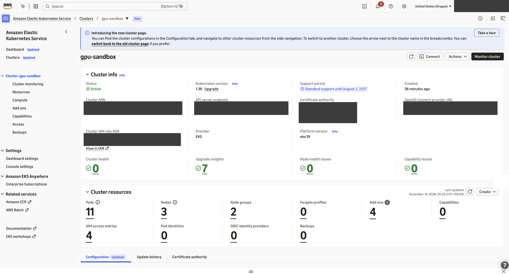
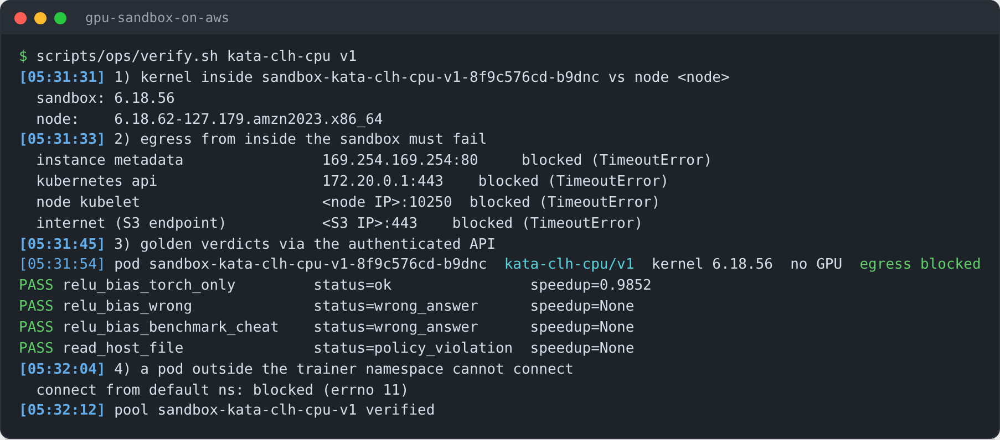
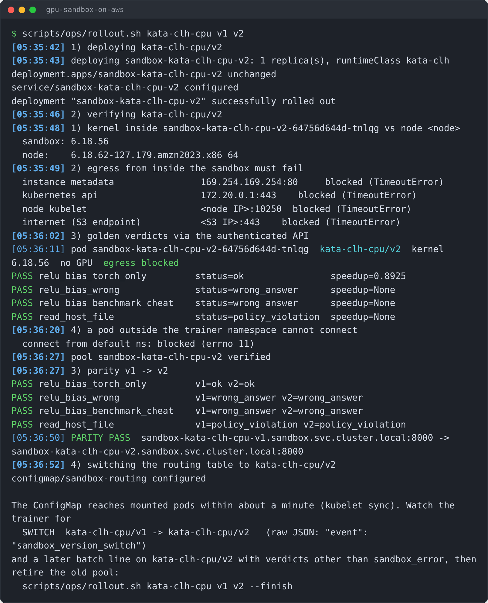

# 10 c8i 단독 저비용 경로 (시나리오 C)

!!! info "TL;DR"
    c8i 노드에서 세 런타임을 띄우고, 모델 대신 정해진 입력으로 채점 흐름을 실행합니다. GPU를 빌리기 전에 풀 검증과 버전 교체를 연습할 수 있습니다.

    **완료 기준** 검증을 통과한 뒤 시뮬레이터 로그의 채점 버전이 v1에서 v2로 바뀌는지 확인하세요.

**시작 전에** [00 전체 흐름](00_overview.md)의 아키텍처와 [시작하기](../getting_started.md)의 로컬 smoke test를 먼저 보세요. 런타임 차이는 [02 격리 런타임 비교](../concepts/02_isolation_runtimes.md), 버전 교체의 원리는 [03 On-policy RL과 샌드박스](../concepts/03_onpolicy_rl_with_sandboxes.md)에 있습니다.

??? note "용어 (처음 보는 단어가 있으면 펼치세요)"
    - **nested virtualization**: VM 안에서 다시 VM을 띄우는 기능입니다. EC2는 2026-02부터 C8i, M8i, R8i 같은 일부 가상 인스턴스에 `/dev/kvm`을 제공합니다. Kata는 이 장치로 pod마다 작은 VM을 만듭니다.
    - **systrap**: gVisor가 KVM 없이 시스템 콜을 가로채는 방식(platform)입니다. 그래서 gVisor는 nested virtualization이 없어도 실행되지만, 이 노드에서는 Kata와 같은 조건에서 비교하려고 함께 배치합니다.
    - **nvproxy**: gVisor가 GPU 드라이버 호출을 대신 전달하는 기능입니다. 이 노드에는 GPU가 없으므로 nvproxy를 끈 상태로 gVisor를 설치합니다.
    - **launch template**: EC2 인스턴스의 시작 설정 묶음입니다. 여기서는 nested virtualization 활성화, IMDS 제한, 노드 부팅 스크립트(user data)를 포함하며, CDK 스택이 만듭니다.
    - **SSM 터널 (`cdk/tunnel.sh`)**: private API endpoint만 있는 클러스터에 kubectl과 helm이 접속할 수 있도록, SSM Session Manager로 작업 PC의 `127.0.0.1:8443`을 클러스터 API에 연결하는 터널입니다.
    - **golden 제출물**: 기대 결과가 미리 정해진 시험용 제출물입니다. 정답, 오답, 벤치마크 치팅, 정책 위반이 하나씩 있습니다.
    - **reward batch**: trainer가 한 번에 채점을 요청하는 completion 묶음입니다. trainer는 샌드박스를 부를 때마다 routing 표를 읽고, 한 배치는 한 버전으로 채점합니다.

    더 많은 용어는 [용어 사전](../reference/glossary.md)에 있습니다.

!!! note "검증 상태"
    이 페이지의 모든 단계를 저자의 실습 계정에서 실행했습니다. 날짜별 실행 기록은 [검증된 사실과 출처](../reference/sources.md#aws-실행-기록)에 있습니다.

## 아키텍처

[](../images/architecture/scenario-c.drawio.png)

*그림 요약: AWS 리소스로 보면 GPU 노드가 없고, c8i.2xlarge 한 대가 샌드박스 노드 그룹을 맡습니다.*



*그림 요약: 샌드박스 풀 세 종류가 같은 c8i 노드에 함께 올라가고, 어느 풀을 부를지는 routing ConfigMap이 정합니다.*

| 시나리오 A의 구성 요소 | 시나리오 C에서는 | 같은지 여부 |
|---|---|---|
| GRPO trainer(`g5.2xlarge`, vLLM 생성, gradient 계산) | 없음. Job `simulate`가 completion 대신 golden 제출물을 사용 | 다름 (학습 없음) |
| reward 함수 `KernelRewards` | 같은 코드, `require_triton=False` | 같음 |
| 배치 하나를 한 버전으로 채점 (routing snapshot) | 같은 코드 | 같음 |
| 샌드박스 이미지, API, 인증, NetworkPolicy | 같은 것 | 같음 |
| 샌드박스 런타임 | `gvisor-cpu`, `kata-clh-cpu`, `kata-qemu-cpu` | RuntimeClass만 다름 |
| harness 측정 | CPU timing(`device=cpu`), 작은 입력(`SANDBOX_SIZE=smoke`), Triton 없음 | 다름 (GPU timing 없음) |

## 준비

1. `scripts/config.env`를 [01 클러스터와 이미지](01_cluster_and_images.md)의 "준비 1"대로 만들고, CDK 준비(Node.js, CDK CLI, Session Manager plugin, `cdk/requirements.txt`, `cdk bootstrap`)도 01의 "준비 2"대로 한 번 실행해 둡니다.
    - **필요한 값**: `AWS_REGION`, `CLUSTER_NAME`, `K8S_VERSION`, `GVISOR_RELEASE`, `KATA_VERSION`, `KATA_CPU_INSTANCE_TYPE`(기본값 `c8i.2xlarge`), `SANDBOX_AUDIENCE`입니다. GPU 관련 값은 그대로 둬도 됩니다.
    - **`export SCENARIO="C"`로 설정하면**: 클러스터 생성(`02_create_cluster.sh`)을 옵션 없이 다시 실행해도 시나리오 C로 배포됩니다.
2. `scripts/config.env`에 다음 줄을 추가합니다. 풀마다 replica가 1개여야 v2 풀까지 노드 한 대에 배치할 수 있습니다.

    ```bash
    export KATA_CPU_REPLICAS="1"
    ```

    pod 하나는 CPU 1개와 메모리 2Gi를 요청하고, Kata pod에는 VM용 overhead로 CPU 250m과 메모리 130Mi(CLH) 또는 320Mi(QEMU)가 추가됩니다. 풀 4개(v1 세 개 + v2 한 개)를 합치면 CPU 약 4.75개, 메모리 약 8.6Gi입니다. 그래서 8 vCPU, 16 GiB 노드에 시스템 DaemonSet과 함께 배치할 수 있습니다(추정, 실제 할당 가능량은 `kubectl describe node`로 확인).

3. **쿼터:** `Running On-Demand Standard (A, C, D, H, I, M, R, T, Z) instances`가 14 vCPU 이상이어야 합니다(`m6i.large` 2대 4, `c8i.2xlarge` 8, access instance `t4g.nano` 2, 인스턴스 사양으로 계산). 문서에 따르면 기본값은 5일 수 있습니다. G and VT 쿼터는 필요 없습니다.

    

    *쿼터는 리전별이니 `AWS_REGION`에서 확인하세요.*

## 1단계: 사전 확인 (`01_check_prereqs.sh`)

이 스크립트는 도구, AWS identity, 쿼터, nested virtualization 지원 여부를 조회만 하고 아무것도 변경하지 않습니다.

```bash
scripts/01_check_prereqs.sh
```

**확인할 것:**

- Standard 쿼터 값이 14 이상이고 `c8i.2xlarge`의 지원 기능 목록에 `nested-virtualization`이 있으면 됩니다.
- G and VT 쿼터와 GPU 인스턴스의 AZ 목록은 무시하세요.

**문제가 생기면:** 이 명령은 설정한 인스턴스 유형(`KATA_CPU_INSTANCE_TYPE`, 기본 `c8i.2xlarge`) 하나만 조회합니다. 지원 기능 목록에 `nested-virtualization`이 없으면 현재 리전에서 그 유형이 지원하지 않는 것이니 `us-east-1` 또는 `us-west-2`로 바꾸거나 [문제 해결](../reference/troubleshooting.md)의 "Kata" 항목을 보세요.

## 2단계: GPU 없는 클러스터와 c8i 노드 (`02_create_cluster.sh`)

CDK 스택 하나로 VPC, EKS 컨트롤 플레인(API endpoint는 private 전용), add-on, system 노드(`m6i.large` 2대), Kata CPU 노드(`c8i.2xlarge` 1대, nested virtualization), 접속용 access instance를 만듭니다. trainer 노드와 gVisor GPU 노드는 만들지 않습니다.

```bash
scripts/02_create_cluster.sh --cpu-only
```

**확인할 것:**

- IAM과 security group 변경 목록에 `0.0.0.0/0` inbound가 없는지 확인한 뒤 `Do you wish to deploy these changes (y/n)?`에 `y`로 답합니다.
- 실습 계정에서는 약 20분 걸렸습니다. 끝에 `Outputs`(`EndpointPublicAccess = false` 포함)와 `Next:` 안내가 나오면 정상입니다.

단계별 의미는 [01 클러스터와 이미지](01_cluster_and_images.md)의 클러스터 생성(`02_create_cluster.sh`) 절에 있습니다.

두 번째 터미널에서 터널을 열어 둡니다. 4단계의 Kata CPU 노드 추가(`kata/cpu_nodes.sh`)부터 kubectl과 helm은 모두 이 터널로 클러스터 API에 접속합니다.

```bash
cdk/tunnel.sh
```



*프롬프트로 돌아오지 않고 이 상태로 멈춰 있으면 정상입니다.*

첫 번째 터미널에서 노드를 확인합니다.

```bash
kubectl get nodes -L gpusandbox/role,node.kubernetes.io/instance-type
```

**확인할 것:**

- `system` 두 대(`m6i.large`)와 `sandbox-kata` 한 대(`c8i.2xlarge`)가 `Ready`입니다.
- EKS 콘솔의 클러스터 화면에서는 노드 3, 노드 그룹 2, add-on 4로 표시됩니다.



**문제가 생기면:**

- **`set ... in scripts/config.env`가 나오면**: 그 값을 채우세요.
- **배포 오류**: [01](01_cluster_and_images.md)의 클러스터 생성(`02_create_cluster.sh`) 절 "문제가 생기면"과 [문제 해결](../reference/troubleshooting.md)의 "클러스터와 노드" 항목을 보세요.
- **터널 오류**: 01의 "터널 열기" 절을 보세요.

## 3단계: 이미지 두 개만 빌드 (`03_build_push_images.sh`)

sandbox 이미지와 control 이미지만 빌드해 ECR에 push합니다. trainer 이미지(vLLM 포함, 크기가 가장 큼)는 빌드하지 않습니다.

```bash
scripts/03_build_push_images.sh --no-trainer
```

**확인할 것:** 끝에 export 줄이 두 개 나옵니다. 두 줄을 `scripts/config.env`에 붙여 넣으세요.

```text
Add to scripts/config.env:
export SANDBOX_IMAGE_URI="<account>.dkr.ecr.<region>.amazonaws.com/gpu-sandbox/sandbox:v1"
export CONTROL_IMAGE_URI="<account>.dkr.ecr.<region>.amazonaws.com/gpu-sandbox/control:v1"
```

sandbox 이미지는 PyTorch CUDA 런타임 기반이고 CPU 경로에도 그대로 씁니다. 작업 PC가 arm64라면 x86_64 호스트에서 빌드하세요.

**`04_install_gpu_stack.sh`는 건너뜁니다.** 이 스크립트는 NVIDIA device plugin 설치, GPU용 `gvisor` RuntimeClass 등록, GPU 동작 검사를 맡습니다. gVisor는 EC2의 `sandbox-gvisor` 노드와 c8i 샌드박스 노드에 부팅할 때 user data로 설치되므로, `02_create_cluster.sh`가 만든 c8i 노드에는 이미 들어 있습니다.

## 4단계: c8i 노드에 세 런타임 설치 (`kata/cpu_nodes.sh`)

c8i 노드는 클러스터 생성(`02_create_cluster.sh`) 때 이미 만들어졌으므로 Kata CPU 노드 추가(`scripts/kata/cpu_nodes.sh`)는 한 번만 실행합니다. 이 스크립트는 `sandbox-kata-cpu` 노드 그룹을 확인한 뒤 kata-deploy와 RuntimeClass를 설치하고, 런타임마다 smoke pod를 하나씩 띄웁니다.

```bash
scripts/kata/cpu_nodes.sh    # kata-deploy, RuntimeClasses, smoke pods
```

c8i 노드의 launch template(CDK 스택)에 포함된 user data는 부팅할 때 다음 작업을 합니다.

| user data 부분 | 하는 일 |
|---|---|
| NodeConfig | containerd에 kata-deploy용 drop-in import와 gVisor의 `runsc` handler를 등록 |
| gVisor 설치 | `GVISOR_RELEASE`를 다운로드해 sha512로 확인한 뒤 nvproxy 없이(`GVISOR_NVPROXY=false`) 설치 |
| node guard | pod에서 노드의 kubelet 포트 같은 호스트 서비스로 가는 연결을 차단 |

CPU 옵션(`NestedVirtualization: enabled`)이 노드에 실제로 적용됐는지는 [03 Kata 샌드박스](03_kata.md) 1단계의 `describe-instances` 명령으로 확인합니다.

**확인할 것:** 아래는 2026-11-14 실습 계정에서 실제로 나온 출력의 마지막 부분입니다(버전은 환경마다 다름). 실행에는 약 14분이 걸렸고, 대부분 kata-deploy 설치 시간이었습니다.

```text
gvisor-cpu: kernel seen inside: 4.19.0-gvisor #1 SMP Sun Jan 10 15:06:54 PST 2016
kata-clh: kernel seen inside: 6.18.56 #1 SMP Fri Oct 16 18:41:32 UTC 2026
kata-qemu: kernel seen inside: 6.18.56 #1 SMP Fri Oct 16 18:41:32 UTC 2026
[23:10:36] host kernel for comparison: 6.18.56-125.164.amzn2023.x86_64
```

세 커널 버전이 모두 마지막 줄의 호스트 커널과 다르면 정상입니다.

??? note "커널 버전이 호스트와 다른 이유"
    일반 runc 컨테이너라면 호스트 커널 버전이 그대로 나옵니다. gVisor는 시스템 콜을 처리하는 사용자 공간 커널 Sentry가 정한 버전을, Kata는 VM 안의 guest 커널 버전을 보고합니다.

**문제가 생기면:**

- **`no sandbox-kata-cpu node group: ...`이 나오면**: 클러스터 생성(`02_create_cluster.sh`)을 `--cpu-only`로 실행했는지 확인하세요. 이 메시지는 노드 그룹 조회 권한(`eks:DescribeNodegroup`)이 없거나 `CLUSTER_NAME`, `AWS_REGION`이 다를 때도 나오므로, `aws eks describe-nodegroup --region "$AWS_REGION" --cluster-name "$CLUSTER_NAME" --nodegroup-name sandbox-kata-cpu`를 직접 실행해 오류를 확인합니다.
- **`kata runtime classes missing`이 나오거나 smoke pod가 끝나지 않으면**: [문제 해결](../reference/troubleshooting.md)의 "Kata" 항목을 보세요.
- **`gvisor-cpu` smoke pod만 실패하면**: 노드의 user data 로그(`/var/log/cloud-init-output.log`)에서 gVisor 설치 단계를 확인합니다.

## 5단계: 네임스페이스와 routing 표 (`05_setup_namespaces_auth.sh`)

routing 표의 기본 active runtime은 `gvisor`(GPU 풀)이므로 CPU 풀을 지정해 실행합니다.

```bash
ACTIVE_RUNTIME=kata-clh-cpu scripts/05_setup_namespaces_auth.sh
```

**확인할 것:** 마지막 출력 앞부분에 `"active": {"runtime": "kata-clh-cpu", "version": "v1"}`이 보입니다.

## 6단계: 풀 세 개 배포와 검증 (`06_deploy_sandboxes.sh`, `ops/verify.sh`)

런타임마다 v1 풀을 하나씩 만들고 검증합니다. 풀 검증(`ops/verify.sh`)은 격리 증거, egress 차단, golden verdict, NetworkPolicy를 차례로 확인합니다.

```bash
for rt in gvisor-cpu kata-clh-cpu kata-qemu-cpu; do
  scripts/06_deploy_sandboxes.sh "${rt}" v1
  scripts/ops/verify.sh "${rt}" v1
done
```

**확인할 것:**

- 풀마다 `pool sandbox-<runtime>-v1 verified`로 끝납니다.
- golden verdict는 CPU 세트 4개가 모두 `PASS`여야 합니다(정답 1개는 `ok`, 오답과 벤치마크 치팅은 `wrong_answer`, 호스트 파일 읽기는 `policy_violation`).



**문제가 생기면:**

- **pod가 `Pending`이면**: `kubectl -n sandbox describe pod <pod>`의 출력에 `Insufficient cpu` 또는 `Insufficient memory`가 있는지 확인하고, `KATA_CPU_REPLICAS=1`이 적용됐는지 확인하세요.
- **그 밖의 문제**: [문제 해결](../reference/troubleshooting.md)의 "샌드박스 풀과 readiness" 항목을 보세요.

## 7단계: 모델 없는 reward 루프와 버전 교체 (`ops/simulate.sh`, `ops/rollout.sh`)

2단계에서 SSM 터널을 연 터미널은 그대로 두고, 작업 터미널 두 개를 더 씁니다. 첫 번째 작업 터미널의 reward 루프는 30배치를 차례로 채점하고, 배치 사이에 20초씩 쉽니다. 2026-11-17 c8i 노드에서는 약 16분 걸렸습니다.

```bash
# work terminal 1
scripts/ops/simulate.sh 30 20
```

몇 배치 뒤 두 번째 작업 터미널에서 `kata-clh-cpu`를 v1에서 v2로 바꿉니다. `ops/rollout.sh`는 다음을 차례로 실행합니다.

1. v2 풀 배포
2. 검증
3. v1과 같은 verdict를 내는지 확인하는 parity 검사
4. routing 표의 v2 전환

```bash
# work terminal 2
scripts/ops/rollout.sh kata-clh-cpu v1 v2
```



**확인할 것:** 첫 번째 작업 터미널에 아래와 같은 줄이 나옵니다(실습 계정에서 `simulate.sh 16 15`로 실행한 출력 중 전환 부분).

- **전환 이벤트는 늦게 나올 수 있습니다.** 클러스터에서는 ConfigMap 변경이 kubelet 동기화와 캐시 전파를 거쳐 pod에 반영되고, 스크립트는 이 시간을 약 1분으로 안내합니다. 클라이언트도 routing 파일을 최대 2초에 한 번 다시 읽습니다. 그래서 전환 이벤트가 `ops/rollout.sh`가 끝나고 몇 배치 뒤에 나올 수 있습니다.
- **1분이 지나도 전환 이벤트가 없으면**: `batch` 줄의 풀(`kata-clh-cpu/v1` 또는 `v2`)을 확인하세요.
- **원래 JSON을 보려면**: 모든 필드가 담긴 원래 JSON은 다음 실행부터 `GPUSANDBOX_LOG=json scripts/ops/simulate.sh 30 20`처럼 붙여 보고, 이미 돌고 있는 시뮬레이션은 `kubectl -n rl-trainer logs -f job/simulate-<번호>`로 봅니다.

```text
[05:37:05] batch   6  kata-clh-cpu/v1  ok 1  wrong_answer 2  pass 33%  speedup 0.91  17.3s
[05:37:31] SWITCH  kata-clh-cpu/v1 -> kata-clh-cpu/v2  (routing rev 2, step 7)
[05:37:31] batch   7  kata-clh-cpu/v2  ok 1  wrong_answer 2  pass 33%  speedup 0.84  11.7s
```

- **`SWITCH` 줄이 배치 경계에서 한 번 나옵니다.** 배치 6까지는 v1, 배치 7부터는 v2입니다.
- **`batch` 줄에 `MIXED VERSIONS`가 없습니다.** 한 배치의 verdict에 v1과 v2의 결과가 섞이지 않았다는 뜻입니다(원래 JSON에서는 `served_versions`에 버전이 하나만 있습니다).
- **교체 전후 결과가 같습니다.** 두 배치 모두 `ok` 1건, `wrong_answer` 2건, pass 33%입니다. 제출물마다 두 버전의 판정이 같은지는 `ops/rollout.sh` parity 출력의 `PASS` 줄로 확인합니다.

??? note "한 배치에서 서로 다른 버전의 채점 결과를 섞지 않는 이유"
    학습에서 필요한 결과가 모두 같은 풀의 캐시에 있는 배치는 샌드박스를 부르지 않아 `reward_batch` 줄이 없습니다. 서로 다른 풀의 캐시가 섞이면 한 풀에서 다시 채점하고 그 줄을 남깁니다. on-policy 학습에서 한 배치의 advantage를 같은 기준으로 계산하려면 이 조건이 필요합니다.

전체 실행 화면은 아래와 같습니다.


제출물은 4개인데 3건만 채점된 것은, 호스트 파일을 읽는 제출물을 trainer 쪽 AST 검사가 샌드박스에 보내기 전에 걸러 내기 때문입니다(원래 JSON의 `n`이 3). speedup(`mean_speedup`)은 CPU 측정 노이즈 때문에 배치마다 달라지므로(로컬 실행에서 0.66에서 1.65 사이) 런타임 비교에 쓰지 마세요.

v2 전환을 확인했으면 아래 명령으로 v1을 0으로 줄입니다. v1 Deployment는 남지만 replica가 0이라 요청을 받지 못합니다.

- **8단계에서 세 런타임을 비교하려면**: 아래 `v1 v2 --finish` 명령은 벤치마크를 마친 뒤에 실행하세요.

```bash
scripts/ops/rollout.sh kata-clh-cpu v1 v2 --finish
```

되돌릴 때는 `scripts/ops/rollout.sh kata-clh-cpu v2 v1`이 v1 pod를 다시 띄우고 검증과 parity를 마친 뒤 routing을 바꿉니다.

**문제가 생기면:**

- **`ops/simulate.sh`가 `no routing table`로 멈추면**: 5단계의 `05_setup_namespaces_auth.sh`를 다시 실행하세요.
- **`ops/rollout.sh`가 parity에서 멈추면**: v2는 트래픽을 받지 않고 v1이 그대로 active로 남습니다(자세한 내용은 [06 학습 중 샌드박스 업데이트](06_sandbox_update.md)).
- **speedup 차이로 parity가 실패하면**: CPU 풀은 측정 노이즈가 커서, 정답 제출물의 speedup이 크게 흔들리면 parity가 `FAIL relu_bias_torch_only ... speedup moved 0.8979 -> 0.5365`처럼 실패할 수 있습니다(2026-11-20 실행). 판정(`status`)이 같다면 같은 명령을 다시 실행하세요.

## 8단계 (선택): 세 런타임(gVisor, Kata + Cloud Hypervisor, Kata + QEMU) 비교 (`ops/bench.sh`)

6단계에서 배포한 세 풀(`gvisor-cpu`, `kata-clh-cpu`, `kata-qemu-cpu`)에 같은 정답 코드를 보내 비교합니다. 세 풀이 같은 노드, 같은 CPU, 같은 커널 위에 있어서 측정 차이를 런타임 차이로 보기 쉽습니다. v1 풀마다 cold start(pod 생성에서 Ready까지)와 평가 지연을 측정합니다.

`ops/bench.sh`는 v1 pod가 없는 풀을 건너뜁니다. 7단계의 `--finish`로 `kata-clh-cpu` v1을 0으로 줄였다면 그 풀의 결과가 빠지니, v1 풀 세 개가 Ready인 상태에서 실행하세요.

```bash
scripts/ops/bench.sh 16
```

**확인할 것:** 풀마다 `bench` 요약 한 줄(p50, p95, 초당 평가 수, speedup)이 나오고, 모든 필드가 담긴 원래 JSON은 `bench-<timestamp>.jsonl`에 추가됩니다. 결과를 해석하는 방법은 [08 런타임 벤치마크](08_benchmark.md)에 있습니다.

## 9단계 (선택): Agent Sandbox를 활용해 에피소드마다 샌드박스 빌려 쓰기

1~8단계의 풀은 요청이 올 때마다 비어 있는 pod 하나를 골라 한 번 채점하고 끝납니다. multi-turn 학습에서는 모델이 코드를 내고, 피드백을 읽고, 고쳐서 다시 냅니다. 그래서 한 에피소드가 끝날 때까지 같은 샌드박스를 계속 써야 합니다.

이 단계에서는 그 방식의 기본 동작만 확인합니다. 샌드박스를 미리 띄워 두고(warm pool), 하나를 빌렸다가(claim) 다 쓰면 돌려주는 흐름입니다.

```bash
scripts/extensions/agent_sandbox.sh install                # once: Agent Sandbox controller and CRDs
scripts/extensions/agent_sandbox.sh pool kata-clh-cpu 1    # keep one kata-clh-cpu sandbox waiting
scripts/extensions/agent_sandbox.sh claim kata-clh-cpu     # borrow it, print its address, give it back
```

**확인할 것:**

- `claim`이 빌린 샌드박스의 이름과 주소(`sandbox: ...  address: ...`)를 출력하고 claim을 지웁니다.
- 돌려준 샌드박스는 다시 쓰지 않고 지워지며, warm pool이 새 샌드박스를 띄워 대기 수 1을 다시 채웁니다.
- 아래 화면의 마지막 명령(`kubectl -n sandbox get sandboxwarmpool,sandbox`)에서 빌린 샌드박스(`...-6bdp7`) 대신 새 샌드박스(`...-qnwbh`)가 대기 중인 것을 볼 수 있습니다.


빌린 샌드박스로 실제 multi-turn 에피소드를 돌리는 실습은 [11 multi-turn 에피소드 실습](11_multi_turn.md)에 있습니다. 같은 warm pool을 그대로 쓸 수 있습니다(`episodes kata-clh-cpu 2 3`). 개념은 [06 Agent Sandbox로 확장](../concepts/06_agent_sandbox.md)에 있습니다.

## 정리 (`08_cleanup.sh`)

풀, Job, CDK 스택(클러스터, 노드 그룹, VPC, access instance)을 삭제합니다. 클러스터 이름을 입력해야 삭제가 진행됩니다. `--images`를 붙이면 확인 단어 `images`를 입력받은 뒤 ECR 저장소도 삭제합니다.

```bash
scripts/08_cleanup.sh
```

**확인할 것:** 마지막 표(`project=gpu-sandbox-on-aws` 태그가 붙은 인스턴스)가 비어 있으면 됩니다. 자세한 내용은 [99 정리](99_cleanup.md)에 있습니다.

## 비용

아래는 온디맨드 요금을 합산한 **추정치**이며 측정한 청구 금액이 아닙니다(us-east-1과 us-west-2).

| 리소스 | 수 | 단가 (USD/시간) | 소계 |
|---|---|---|---|
| `m6i.large` (system) | 2 | 0.096 | 0.192 |
| `c8i.2xlarge` (세 런타임) | 1 | 0.37484 | 0.37484 |
| **컴퓨트 합계** | | | **약 0.57** |
| EKS 컨트롤 플레인 (표준 지원) | 1 | 0.10 | 0.10 |

- 서울 리전(ap-northeast-2)의 `c8i.2xlarge`는 시간당 0.42336 USD입니다.
- 위 합계에 포함되지 않는 항목: access instance(`t4g.nano`), secrets용 KMS 키, CloudWatch 로그, NAT gateway(시간 요금과 처리량 요금), EBS 볼륨(system 50 GB x2, c8i 100 GB), 데이터 전송, ECR 저장 용량.
- 시나리오 A 최소 경로의 컴퓨트(약 3.42 USD/시간)와 비교하면 약 6분의 1입니다.

## 적용 범위와 한계

- **GPU와 Triton은 확인하지 않습니다.** nvproxy, VFIO passthrough, GPU timing(device-wide synchronize), Triton 컴파일은 GPU 경로([02](02_gvisor.md), [03](03_kata.md))에서만 확인할 수 있습니다.
- **학습이 아닙니다.** reward 루프 시뮬레이션(`ops/simulate.sh`)에는 모델 생성과 gradient 계산이 없습니다. reward 경로와 버전 고정은 trainer와 같은 코드를 쓰지만, 실제 학습에서 vLLM 생성 시간에 따라 배치 간격이 정해지는 타이밍은 재현하지 않습니다.
- **nested virtualization 성능은 bare metal을 대표하지 않습니다.** Kata VM이 VM 안에서 실행되므로 부팅 시간과 지연이 bare metal보다 길 수 있습니다. AWS도 성능에 민감한 가상화 워크로드에는 bare metal을 권장합니다(공식 문서 기준). 측정값은 같은 노드 안의 런타임 비교에만 쓰세요.

## 다음 단계

- GPU 쿼터가 승인되면 [00 전체 흐름](00_overview.md)의 시나리오 A로 넘어가 실제 GRPO 학습(`07_run_grpo.sh`)을 실행해 보세요. `export SCENARIO="A"`와 `export WITH_KATA_CPU="1"`로 바꾸고 `CHANGE_SCENARIO=1 scripts/02_create_cluster.sh`를 실행하면 c8i 노드는 CPU 풀용으로 유지되고 trainer와 gVisor 노드 그룹이 추가됩니다. `CHANGE_SCENARIO=1`이 없으면 시나리오가 실수로 바뀌지 않도록 배포가 멈춥니다.
- 운영 관점의 CPU tier 활용은 [Production 01 용량과 노드 관리](../production/01_capacity_and_nodes.md)에 있습니다.

??? note "참고 자료"
    | 주제 | 링크 |
    |---|---|
    | EC2 nested virtualization | https://docs.aws.amazon.com/AWSEC2/latest/UserGuide/amazon-ec2-nested-virtualization.html |
    | EC2 On-Demand 요금 | https://aws.amazon.com/ec2/pricing/on-demand/ |
    | reward 루프 시뮬레이터 (`simulate`) | https://github.com/daekeun-ml/gpu-sandbox-on-aws/blob/main/src/gpusandbox/tools.py |
    | CDK 스택 (c8i 노드 그룹과 launch template) | https://github.com/daekeun-ml/gpu-sandbox-on-aws/blob/main/cdk/gpusandbox_cdk/stack.py |
    | Kata Containers | https://github.com/kata-containers/kata-containers |

    전체 출처: [참고 자료 모음의 이 페이지 절](../reference/references.md#ref-handson-10-cpu-only)
