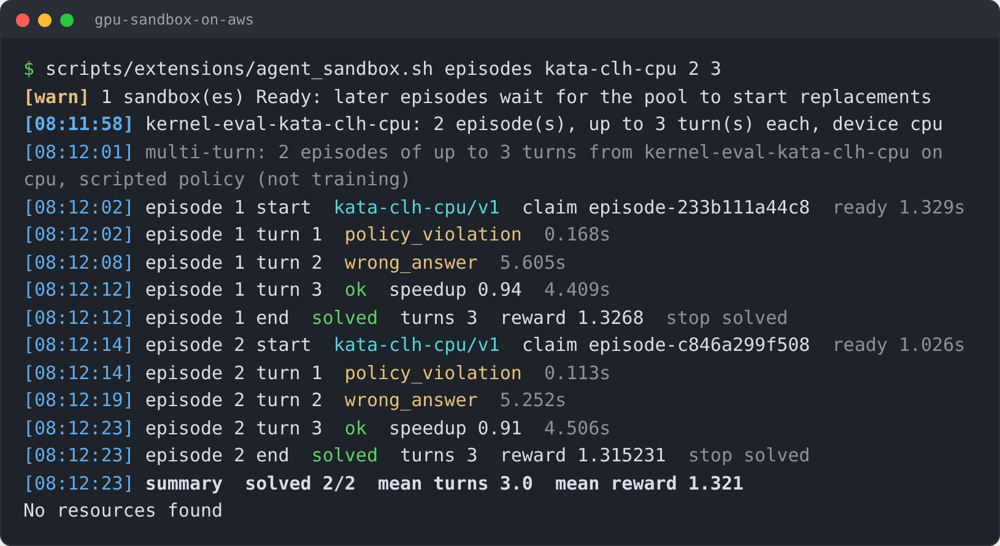

# 11 multi-turn 에피소드 실습

!!! info "TL;DR"
    에피소드마다 warm pool에서 샌드박스를 하나 빌립니다. 여러 턴의 제출이 같은 샌드박스로 가는지 확인합니다. 채점 서버는 제출마다 작업 디렉터리를 정리합니다.

    **완료 기준** 여러 턴에서 같은 인스턴스를 사용하고 에피소드가 끝나면 claim이 삭제되는지 확인하세요.

**시작 전에** [10 c8i 단독 저비용 경로](10_cpu_only.md)의 시나리오 C 클러스터가 필요하고, 개념은 [초심자 06 multi-turn 에이전트와 Agent Sandbox](../beginner/06_multi_turn_agent.md)와 [개념 06 Agent Sandbox로 확장](../concepts/06_agent_sandbox.md)에 있습니다.

??? note "용어 (처음 보는 단어가 있으면 펼치세요)"
    - **에피소드(episode)**: 모델이 과제 하나를 여러 turn에 걸쳐 푸는 한 번의 시도입니다. 이 실습의 과제는 `relu_bias`입니다.
    - **turn**: 코드를 한 번 제출하고 verdict를 받는 한 차례입니다.
    - **scripted policy (`ScriptedPolicy`)**: 모델 대신 golden 제출물을 정해진 순서로 제출하는 policy입니다. 피드백을 읽지 않으므로 학습을 하지 않고, 에피소드의 동작(claim 하나, turn 사이의 피드백, 조기 종료, 마지막 제출 채점)만 확인합니다.
    - **피드백(feedback)**: 에이전트가 다음 turn 전에 읽는 verdict 요약입니다. 상태, flag, speedup, 오류 메시지의 마지막 줄을 240자 이내로 담습니다. veRL이 tool 응답을 기본 256자에서 자르기 때문에 그보다 짧게 만듭니다.
    - **episode reward**: 에피소드의 마지막 제출을 `score_verdict`로 채점한 값입니다. 앞선 turn의 실패는 피드백으로만 쓰입니다.
    - **`single_turn_reward`, `first_turn_reward`**: 각 제출을 단독으로 채점한 값(single-turn 채점과 같은 계산)과, 그중 첫 turn의 값입니다.
    - **SandboxWarmPool, SandboxClaim**: 미리 실행해 둔 샌드박스 묶음과, 그 묶음에서 샌드박스 하나를 할당받는 요청입니다.
    - **`shutdownTime`**: claim이 만료되는 시각입니다. 이 시각이 지나면 controller가 claim과 샌드박스를 삭제합니다. 이 실습의 CLI는 claim을 만든 시각에서 3600초 뒤로 지정합니다.

    더 많은 용어는 [용어 사전](../reference/glossary.md)에 있습니다.

!!! note "검증 상태"
    이 페이지의 `install`, `pool`, `episodes`는 시나리오 C 클러스터의 `kata-clh-cpu` warm pool로 실행해 3단계의 다섯 조건을 확인했습니다. `gvisor-cpu` warm pool, GPU 절, veRL 절은 실행하지 않았습니다. 날짜별 실행 기록은 [검증된 사실과 출처](../reference/sources.md#aws-실행-기록)에 있습니다.

## 에피소드 하나의 흐름

실행기는 에피소드마다 `SandboxClaim`을 만들고, 턴을 같은 샌드박스로 보낸 뒤 claim을 지웁니다. [Agent Sandbox 개념](../concepts/06_agent_sandbox.md)에서 claim과 warm pool의 관계를 볼 수 있습니다.

??? note "상세 설명"
    Job `episodes-<unix 시각>`은 `rl-trainer` 네임스페이스에서 ServiceAccount `sandbox-episode`로 실행되고, 에피소드를 하나씩 차례로 실행합니다. 에피소드 하나는 다음 순서로 진행됩니다.

    ```mermaid
    sequenceDiagram
        participant J as Job episodes (rl-trainer)
        participant API as Kubernetes API와 agent-sandbox controller
        participant P as SandboxWarmPool kernel-eval-gvisor-cpu
        participant S as 할당된 샌드박스 (gvisor-cpu)
        J->>API: SandboxClaim 생성 (warmPoolRef, shutdownTime)
        API->>P: 대기 중인 샌드박스 하나를 claim에 할당
        P->>P: replicas를 맞추려고 새 샌드박스 시작
        API-->>J: claim Ready, status.sandbox.serviceFQDN
        J->>S: GET /info (런타임, 버전, pod)
        loop turn 1부터 최대 max_turns까지
            J->>S: POST /v1/evaluate (audience 토큰)
            S-->>J: verdict
            J->>J: 피드백 작성, 종료 조건 확인
        end
        J->>API: SandboxClaim 삭제
        API->>S: 샌드박스와 pod 삭제
    ```

    *그림 요약: 에피소드 하나는 claim 하나로 샌드박스 하나를 할당받아 모든 turn을 그 샌드박스로 보내고, 끝나면 claim을 삭제합니다. 다음 에피소드는 새 claim으로 다른 샌드박스를 할당받습니다.*

    에피소드는 다음 중 하나가 되면 끝납니다.

    - 정답이 나올 때(`solved`)
    - `max_turns`번 제출했을 때
    - verdict가 `sandbox_error`일 때. `sandbox_error`로 끝난 에피소드는 reward가 `None`이 되어 평균에서 제외됩니다.

    | 구성 요소 | 이 실습에서 | 파일 |
    |---|---|---|
    | Job `episodes-<unix 시각>` | `rl-trainer` 네임스페이스, ServiceAccount `sandbox-episode`. Kubernetes API 토큰은 이 Job의 pod에만 마운트하고, sandbox audience 토큰과 label `gpusandbox/client=true`를 함께 씁니다 | `k8s/extensions/agent-sandbox/job-multiturn.yaml.tpl` |
    | ServiceAccount `sandbox-episode` | 토큰 자동 마운트는 기본으로 꺼져 있습니다 | `k8s/base/trainer-rbac.yaml` |
    | Role과 RoleBinding `sandbox-claims` | `sandbox` 네임스페이스의 `sandboxclaims`에 create, get, list, watch, delete 권한만 부여합니다 | `k8s/extensions/agent-sandbox/trainer-claims-rbac.yaml` |
    | SandboxTemplate과 SandboxWarmPool `kernel-eval-gvisor-cpu` | 프로필 `gvisor-cpu`(CPU 1개, 메모리 2Gi, c8i 노드). ingress는 `rl-trainer`의 `gpusandbox/client=true` pod에서 오는 TCP 8000만 허용하고, egress는 모두 차단합니다 | `k8s/extensions/agent-sandbox/template.yaml.tpl` |
    | 에피소드 실행기 | `python -m gpusandbox.tools multiturn`. 에피소드마다 `EpisodeSandbox`로 claim을 만들고, turn마다 `/v1/evaluate`를 호출합니다 | `src/gpusandbox/multiturn.py`, `src/gpusandbox/agent_sandbox.py`, `src/gpusandbox/tools.py` |

## 준비

1. **시나리오 C 클러스터:** [10](10_cpu_only.md)의 1단계부터 5단계까지 실행해 둡니다. 다음이 필요합니다.

    - 클러스터 생성(`scripts/02_create_cluster.sh --cpu-only`)
    - 터널(`cdk/tunnel.sh`)
    - Kata CPU 노드 추가(`scripts/kata/cpu_nodes.sh`, `gvisor-cpu` RuntimeClass 포함)
    - 네임스페이스와 인증 설정(`ACTIVE_RUNTIME=kata-clh-cpu scripts/05_setup_namespaces_auth.sh`)

    10의 6단계 Deployment 풀은 이 실습에 필요하지 않습니다.

2. **control 이미지:** Job은 control 이미지(`CONTROL_IMAGE_URI`)에서 `python -m gpusandbox.tools multiturn`을 실행합니다. `multiturn` 하위 명령이 추가되기 전에 이미지를 빌드했다면 다시 빌드하세요. ECR 저장소는 태그를 덮어쓸 수 없게(`IMMUTABLE`) 만들어지므로, 먼저 `scripts/config.env`의 `IMAGE_TAG`를 새 값으로 바꿉니다.

    ```bash
    # scripts/config.env: a new tag, because the ECR repositories reject an existing one
    export IMAGE_TAG="<new-tag>"
    ```

    ```bash
    scripts/03_build_push_images.sh --no-trainer
    ```

    **확인할 것:**

    - 끝에 나오는 `SANDBOX_IMAGE_URI`와 `CONTROL_IMAGE_URI` 두 줄의 태그가 새 값입니다. 두 줄을 `scripts/config.env`에 붙여 넣으세요.
    - 새 sandbox 이미지는 2단계에서 만드는 warm pool에만 쓰이고, 10에서 배포한 Deployment 풀은 이전 이미지를 그대로 씁니다.

3. **설정 값:** `scripts/config.env`에 `SANDBOX_IMAGE_URI`, `CONTROL_IMAGE_URI`, `SANDBOX_AUDIENCE`가 있어야 합니다. `pool`은 `SANDBOX_IMAGE_URI`와 `SANDBOX_AUDIENCE`를, `episodes`는 `CONTROL_IMAGE_URI`와 `SANDBOX_AUDIENCE`를 읽습니다.

## 1단계: Agent Sandbox 설치 (`extensions/agent_sandbox.sh install`)

controller와 CRD를 고정 버전(기본 v1.0.11)으로 설치하고, ServiceAccount `sandbox-episode`와 claim 권한(Role `sandbox-claims`)을 적용합니다. [10](10_cpu_only.md)의 9단계에서 이미 설치했더라도 다시 실행하세요. 같은 값이 다시 적용되고, `sandbox-episode`가 없던 클러스터에는 이 계정이 추가됩니다.

```bash
scripts/extensions/agent_sandbox.sh install
```

**확인할 것:**

- CRD 목록에 `sandboxclaims.extensions.agents.x-k8s.io`, `sandboxes.agents.x-k8s.io`, `sandboxtemplates.extensions.agents.x-k8s.io`, `sandboxwarmpools.extensions.agents.x-k8s.io`가 있습니다.
- `serviceaccount/sandbox-episode`, `role.rbac.authorization.k8s.io/sandbox-claims`, `rolebinding.rbac.authorization.k8s.io/sandbox-claims`가 `created` 또는 `unchanged`로 출력됩니다.

에피소드 계정의 권한을 확인합니다.

```bash
# The episode account may create claims in the sandbox namespace, and nothing else
kubectl auth can-i create sandboxclaims.extensions.agents.x-k8s.io -n sandbox \
  --as=system:serviceaccount:rl-trainer:sandbox-episode
kubectl auth can-i get pods -n sandbox --as=system:serviceaccount:rl-trainer:sandbox-episode
```

**확인할 것:** 첫 명령은 `yes`, 두 번째 명령은 `no`를 출력합니다. Role에는 `sandboxclaims` 권한만 있기 때문입니다.

**문제가 생기면:**

- **CRD가 없으면**: `kubectl get pods -A`로 controller pod가 Running인지 확인하세요.
- **스크립트 공통 오류(`scripts/config.env` 누락 등)**: [문제 해결](../reference/troubleshooting.md)의 "설정과 스크립트" 항목에 있습니다.

## 2단계: CPU warm pool 만들기 (`extensions/agent_sandbox.sh pool`)

`gvisor-cpu` 프로필로 SandboxTemplate과 SandboxWarmPool `kernel-eval-gvisor-cpu`를 만들고 대기 샌드박스 2개를 실행합니다. 3단계에서 에피소드 2개를 실행하므로 2개로 맞춥니다.

```bash
scripts/extensions/agent_sandbox.sh pool gvisor-cpu 2
```

허용 subject의 기본값에는 `system:serviceaccount:rl-trainer:sandbox-episode`가 포함됩니다. warm 샌드박스는 시작할 때 받은 환경 변수를 계속 쓰므로(`updateStrategy: OnReplenish`), 허용 목록은 샌드박스가 시작될 때 정해집니다.

**확인할 것:**

- 스크립트가 `warm pool kernel-eval-gvisor-cpu: 2 sandbox(es); each holds its accelerator while idle` 로그와 `kubectl get sandboxwarmpool` 결과 한 줄을 출력합니다.
- 대기 pod 두 개가 READY `1/1`이 됩니다. 샌드박스 서버는 egress 차단을 확인한 뒤에 Ready가 됩니다.

    ```bash
    # Warm sandbox pods created by the controller (labels come from the template); Ctrl-C to stop
    kubectl -n sandbox get pods -l gpusandbox/managed-by=agent-sandbox -L gpusandbox/runtime -w
    ```

- 3단계의 사전 검사가 읽는 값(`status.readyReplicas`)이 2입니다.

    ```bash
    kubectl -n sandbox get sandboxwarmpool kernel-eval-gvisor-cpu -o jsonpath='{.status.readyReplicas}{"\n"}'
    ```

**문제가 생기면:**

- **pod가 `Pending`이면**: `kubectl -n sandbox describe pod <pod>`의 출력에 `Insufficient cpu` 또는 `Insufficient memory`가 있는지 확인하세요. pod 하나는 CPU 1개와 메모리 2Gi를 요청합니다.
- **에피소드가 실행되는 동안**: warm pool이 claim된 샌드박스를 대신할 샌드박스를 새로 시작하므로, `gvisor-cpu` pod가 3개(대기 2개와 claim된 1개)까지 실행될 수 있습니다(코드 기준 추론).
- **10의 Deployment 풀이 같은 노드에서 실행 중이라 CPU가 부족하면**: 그 풀을 0으로 줄이거나(`kubectl -n sandbox scale deployment/sandbox-<runtime>-<version> --replicas=0`) warm pool을 1로 줄이세요(`pool gvisor-cpu 1`).
- **Ready가 되지 않으면**: 서버 로그의 `egress is open` 줄을 확인합니다.
- **원인별 대처**: [문제 해결](../reference/troubleshooting.md)의 "샌드박스 풀과 readiness", "NetworkPolicy" 항목에 있습니다.

!!! note "Kata(Cloud Hypervisor) VM으로 실행하려면"
    2단계부터 4단계까지 `gvisor-cpu` 대신 `kata-clh-cpu`를 쓰면 같은 c8i 노드의 Kata VM에서 같은 실습을 실행합니다(`pool kata-clh-cpu 2`, `episodes kata-clh-cpu 2 3`).

    - **VM용 overhead**: Kata pod에는 CPU 250m과 메모리 130Mi가 추가됩니다.
    - **claim을 삭제할 때마다**: 그 샌드박스의 VM도 삭제되고, pool이 새 VM을 시작합니다.
    - **10의 9단계에서 만든 `kernel-eval-kata-clh-cpu` pool이 있다면**: `pool kata-clh-cpu 2`를 다시 실행해 template과 replica 수를 갱신하세요.

## 3단계: multi-turn 에피소드 실행 (`extensions/agent_sandbox.sh episodes`)

에피소드 2개를 실행하고, 에피소드마다 최대 3 turn까지 제출합니다. 이 단계는 이벤트의 필드(`claim`, `address`, `feedback`, `released` 등)를 직접 대조하므로, 터미널 요약 대신 원래 JSON이 나오도록 `GPUSANDBOX_LOG=json`을 붙여 실행합니다.

```bash
GPUSANDBOX_LOG=json scripts/extensions/agent_sandbox.sh episodes gvisor-cpu 2 3
```

진행만 볼 때는 `GPUSANDBOX_LOG=json`을 빼고 실행하세요. 에피소드 시작, turn(`episode 1 turn 2  wrong_answer ...`), 에피소드 끝이 한 줄씩 나오고 마지막에 전체 요약이 나옵니다.

아래는 시나리오 C 클러스터에서 `kata-clh-cpu` warm pool(대기 1대)로 실행한 요약 화면입니다.

- **경고**: 대기 샌드박스가 1대라 경고가 나오지만, 에피소드 2는 warm pool이 새로 채운 샌드박스를 받아 이어서 실행됩니다.
- **마지막 `No resources found`**: 남은 claim을 지우는 정리 단계에서 지울 claim이 없었다는 뜻입니다.



스크립트는 다음 순서로 실행됩니다.

| 순서 | 하는 일 |
|---|---|
| 사전 검사 | CRD, ServiceAccount `sandbox-episode`, claim 생성 권한, warm pool의 Ready 샌드박스 수(1 이상), 대기 샌드박스의 허용 목록에 `sandbox-episode`가 있는지 확인합니다 |
| device 결정 | 런타임 이름이 `-cpu`로 끝나면 `cpu`, 아니면 `cuda`입니다 |
| Job 실행 | `job-multiturn.yaml.tpl`로 Job `episodes-<unix 시각>`을 만들고 로그를 따라갑니다. Job은 `python -m gpusandbox.tools multiturn --warm-pool kernel-eval-gvisor-cpu --episodes 2 --max-turns 3 --device cpu --run-id episodes-<unix 시각>`을 실행합니다 |
| 남은 claim 삭제 | Job이 끝나면 label `gpusandbox/run=<Job 이름>`이 붙은 claim을 삭제합니다. Job이 에피소드마다 claim을 삭제하므로, 이 단계는 Job의 pod가 중간에 종료된 경우를 위한 정리입니다 |
| 종료 코드 | Job의 성공 여부를 그대로 반환합니다 |

- **사전 검사의 세부**: claim 생성 권한은 `kubectl auth can-i ... --as`로, Ready 샌드박스 수는 `status.readyReplicas`로 확인합니다. Ready 샌드박스가 에피소드 수보다 적으면 경고를 출력합니다.

CPU에서 scripted policy는 `read_host_file`(정책 위반), `relu_bias_wrong`(오답), `relu_bias_torch_only`(정답) 순서로 제출하고, 정답이 나오면(`solved`) 에피소드를 끝냅니다. Job이 종료 신호(SIGTERM)를 받아도 정상 종료 경로로 빠져나가므로, 실행 중인 claim은 `shutdownTime`을 기다리지 않고 바로 삭제됩니다.

10의 2단계에서 SSM 터널을 연 터미널은 그대로 두세요. `episodes`를 실행한 터미널과 별도로 작업 터미널을 하나 더 열면, claim이 하나씩 만들어지고 삭제되는 과정을 볼 수 있습니다.

```bash
# Episode claims appear and disappear one at a time; Ctrl-C to stop
kubectl -n sandbox get sandboxclaims -l gpusandbox/episode=true -w
```

**확인할 것:**

- 아래와 같은 이벤트가 한 줄에 하나씩 출력됩니다.
- 첫 두 줄은 스크립트와 CLI 코드가 출력하는 형태이고, 나머지는 로컬 실행(loopback CPU 샌드박스 서버) 출력을 줄인 것입니다.
- claim, 샌드박스, pod 이름과 speedup은 실행마다 다릅니다.

```text
[hh:mm:ss] kernel-eval-gvisor-cpu: 2 episode(s), up to 3 turn(s) each, device cpu
{"event": "multiturn", "warm_pool": "kernel-eval-gvisor-cpu", "episodes": 2, "max_turns": 3, "device": "cpu", "task_id": "relu_bias", "policy": "scripted", "script": ["read_host_file", "relu_bias_wrong", "relu_bias_torch_only"], ...}
{"event": "episode_start", "episode": 1, "claim": "episode-ca28ce346b27", "warm_pool": "kernel-eval-gvisor-cpu", "sandbox": "sb-episode-ca28ce346b27", "runtime": "gvisor-cpu", "version": "v1", "pod": "kernel-eval-gvisor-cpu-0", ...}
{"event": "turn", "episode": 1, "turn": 1, "claim": "episode-ca28ce346b27", "pod": "kernel-eval-gvisor-cpu-0", "status": "policy_violation", "feedback": "status: policy_violation; violation: line 4: builtin 'open' is not allowed", "single_turn_reward": 0.1, ...}
{"event": "turn", "episode": 1, "turn": 2, ..., "status": "wrong_answer", "feedback": "status: wrong_answer; error: values differ beyond tolerance", "single_turn_reward": 0.3, ...}
{"event": "turn", "episode": 1, "turn": 3, ..., "status": "ok", "speedup": 0.9104, "feedback": "status: ok; speedup: 0.91x", "single_turn_reward": 1.316143, ...}
{"event": "episode_end", "episode": 1, "turns_used": 3, "stop_reason": "solved", "final_status": "ok", "reward": 1.316143, "first_turn_reward": 0.1, "released": true, ...}
...
{"event": "multiturn_summary", "episodes": 2, "solved": 2, "mean_reward": 1.3752, "mean_first_turn_reward": 0.1, "claims": 2, "distinct_sandboxes": 2, "one_sandbox_per_episode": true, ..., "unexpected": []}
```

이벤트에서 다음 다섯 가지를 확인합니다.

| 확인할 조건 | 볼 값 |
|---|---|
| 한 에피소드의 모든 turn이 claim 하나와 샌드박스 하나를 씁니다 | 에피소드 1의 `turn` 이벤트 3개에서 `claim`, `address`, `pod`가 모두 `episode_start`의 값과 같습니다. `multiturn_summary`의 `one_sandbox_per_episode`가 `true`입니다 |
| 에피소드마다 다른 샌드박스를 씁니다 | 에피소드 1과 2의 `episode_start`에서 `claim`과 `sandbox`가 다릅니다. `claims`와 `distinct_sandboxes`가 모두 2입니다 |
| turn마다 피드백을 받습니다 | `feedback`이 `status: policy_violation`, `status: wrong_answer`, `status: ok` 순서로 바뀝니다. 오답 turn의 피드백에는 오류 메시지의 마지막 줄이 들어 있습니다 |
| episode reward는 마지막 제출로 정해집니다 | `episode_end`의 `reward`(예시 1.316143)가 마지막 turn의 `single_turn_reward`와 같고, `first_turn_reward`(0.1)보다 큽니다. `multiturn_summary`의 `mean_reward`와 `mean_first_turn_reward`도 같은 관계입니다 |
| 에피소드가 끝나면 claim이 삭제됩니다 | `episode_end`의 `released`가 `true`이고, 아래 명령의 출력에 claim이 없습니다 |

```bash
kubectl -n sandbox get sandboxclaims -l gpusandbox/run=<Job 이름>
```

**확인할 것:**

- `No resources found in sandbox namespace.`가 출력됩니다.
- warm pool은 삭제된 샌드박스 대신 새 샌드박스를 시작하므로, 잠시 뒤 `readyReplicas`가 다시 대기 수(기본 2, `pool gvisor-cpu 1`로 줄였다면 1)가 됩니다.
- 스크립트의 종료 코드는 `episodes` 명령이 끝난 터미널에서 다른 명령을 실행하기 전에 `echo $?`로 확인하세요. 0이어야 합니다. 위 claim 조회는 별도로 연 작업 터미널에서 실행하면 종료 코드를 덮어쓰지 않습니다.

turn마다 기록되는 `single_turn_reward`는 `0.1 × format + 1.0 × correctness + 0.5 × speedup 점수`입니다.

- **정책 위반**: 코드가 구문 오류 없이 `ModelNew`를 정의하면 format 점수 0.1만 받고, 그렇지 않으면 0점입니다.
- **오답**: 0.1과 correctness 0.2를 합친 0.3을 받습니다.
- **정답**: CPU 경로는 Triton을 요구하지 않으므로(`require_triton=False`) 정답의 correctness가 1.0이고, speedup 점수는 CPU 측정 노이즈 때문에 실행마다 달라집니다.

CLI는 다음 경우에 종료 코드 1로 끝납니다.

- 어느 turn의 verdict가 golden의 기대값과 다를 때(`unexpected`에 기록)
- `sandbox_error`가 있을 때
- 한 에피소드의 turn을 pod 두 개 이상이 처리했을 때

**문제가 생기면:**

- **사전 검사 메시지**(`agent-sandbox CRDs not found`, `ServiceAccount rl-trainer/sandbox-episode not found`, `... may not create SandboxClaims`, `warm pool ... not found`, `... has no Ready sandbox`, `sandboxes started without ... in their allowlist`): [문제 해결](../reference/troubleshooting.md)의 "Agent Sandbox와 multi-turn 에피소드" 항목에 원인과 해결 방법이 있습니다. 10의 9단계에서 `sandbox-episode`가 허용 목록에 없을 때 시작한 샌드박스가 남아 있으면 마지막 메시지가 나옵니다.
- **Job 로그에 `invalid choice: 'multiturn'`이 나오면**: control 이미지가 `multiturn` 하위 명령이 추가되기 전의 이미지입니다. 준비 2를 따라 새 태그로 다시 빌드하세요.
- **`job episodes-<unix 시각> did not start`가 나오면**: Job의 pod가 10분 안에 시작되지 않은 것입니다. `kubectl -n rl-trainer describe pods -l job-name=<Job 이름>`의 이벤트에서 이미지 pull 오류나 스케줄링 오류를 확인하세요.
- **`episode_error` 이벤트에 `TimeoutError: claim ... not Ready in 600.0s`가 있으면**: claim이 600초 안에 샌드박스를 할당받지 못한 것입니다. CLI는 이 오류를 내기 전에 claim 삭제를 요청하므로, 오류를 본 뒤에는 claim이 이미 없을 수 있습니다. Ready 대기가 길어지면 기다리는 동안 별도로 연 작업 터미널에서 `kubectl -n sandbox describe sandboxclaim <name>`의 이벤트와 2단계의 pod 상태를 확인하세요.
- **turn의 `status`가 `sandbox_error`이면**: 피드백에 `infrastructure failure, not caused by your code`가 붙습니다. 401과 403 응답의 원인은 [문제 해결](../reference/troubleshooting.md)의 "401, 403 응답" 항목에 있습니다.
- **스크립트를 Ctrl-C로 중단해도**: Job은 클러스터에서 계속 실행되고, 에피소드마다 claim을 삭제합니다. Job의 pod가 강제로 종료되어 claim이 남았다면 `kubectl -n sandbox delete sandboxclaim -l gpusandbox/run=<Job 이름>`으로 삭제하세요. 삭제하지 않아도 claim은 `shutdownTime`(생성 후 3600초)에 만료됩니다.

## 4단계: single-turn 기준선 (`episodes gvisor-cpu 2 1`)

같은 warm pool에서 `max_turns`만 1로 바꿔 실행합니다. 3단계에서 claim된 샌드박스는 삭제되었으므로, `readyReplicas`가 다시 대기 수(기본 2, `pool gvisor-cpu 1`로 줄였다면 1)가 된 뒤 실행하세요.

```bash
GPUSANDBOX_LOG=json scripts/extensions/agent_sandbox.sh episodes gvisor-cpu 2 1
```

**확인할 것:**

- 에피소드마다 turn이 하나입니다.
- 첫 제출(정책 위반)의 점수가 그대로 episode reward가 됩니다.

아래는 코드와 테스트를 기준으로 쓴 예상 형태입니다.

```text
{"event": "episode_end", "episode": 1, "turns_used": 1, "stop_reason": "max_turns", "final_status": "policy_violation", "solved": false, "reward": 0.1, "first_turn_reward": 0.1, "released": true, ...}
...
{"event": "multiturn_summary", "episodes": 2, "solved": 0, "stop_reasons": {"max_turns": 2}, "mean_turns": 1.0, "mean_reward": 0.1, "mean_first_turn_reward": 0.1, "claims": 2, "distinct_sandboxes": 2, "one_sandbox_per_episode": true, ..., "unexpected": []}
```

| 실행 | `turns_used` | `stop_reason` | episode `reward` | `first_turn_reward` |
|---|---|---|---|---|
| `episodes gvisor-cpu 2 3` (multi-turn) | 3 | `solved` | 1.1 이상 (예시 1.316143, CPU speedup에 따라 달라짐) | 0.1 |
| `episodes gvisor-cpu 2 1` (single-turn 기준선) | 1 | `max_turns` | 0.1 | 0.1 |

multi-turn 에피소드는 피드백을 받은 뒤 다시 제출할 수 있으므로 마지막 제출의 점수를 받습니다. 다만 scripted policy는 피드백을 읽지 않고 정해진 순서로 제출하므로, 이 차이는 에피소드 채점 방식에서 생긴 것이며 모델이 학습한 결과가 아닙니다. single-turn 기준선도 에피소드마다 claim을 하나씩 만들므로 `claims`와 `distinct_sandboxes`는 2입니다.

## 선택: GPU warm pool에서 실행 (시나리오 A)

GPU 쿼터가 있다면 시나리오 A의 gVisor GPU 노드(`g5.xlarge`, A10G)에서 같은 명령을 실행할 수 있습니다. 이 절도 클러스터에서 실행하지 않았습니다.

!!! warning "대기 중인 GPU 샌드박스도 GPU를 점유합니다"
    warm pool의 샌드박스는 평가를 처리하지 않는 동안에도 GPU 하나를 계속 점유합니다.

    - **gVisor 프로필**: `g5.xlarge` 한 대에 샌드박스 하나를 실행하므로, 대기 샌드박스 하나가 시간당 1.006 USD인 노드 한 대를 점유합니다(us-east-1과 us-west-2 온디맨드 요금).
    - **claim을 삭제하면**: 그 샌드박스도 삭제되므로 에피소드마다 샌드박스가 교체되고, pool은 GPU 초기화부터 다시 하는 새 샌드박스를 시작합니다.
    - **Kata GPU 프로필**: 이 교체가 새 Kata GPU VM의 시작이라 첫 Ready까지 몇 분이 걸릴 수 있습니다.

    실습이 끝나면 바로 pool을 0으로 줄이세요.

시나리오 A의 기본 구성에서는 Deployment 풀(`sandbox-gvisor-v1`, replica 2)이 `g5.xlarge` 2대의 GPU를 모두 쓰므로, warm 샌드박스는 GPU가 해제될 때까지 `Pending` 상태입니다. 다음 중 하나를 하세요.

- 학습(05)을 실행하지 않는 동안 Deployment 풀을 0으로 줄입니다.
- [06](06_sandbox_update.md)의 준비 절 명령으로 노드 그룹을 늘립니다(노드마다 시간당 1.006 USD 추가).

아래 블록의 첫 줄은 학습을 실행하지 않는 동안 Deployment 풀을 0으로 줄일 때만 실행하세요. 노드 그룹을 늘렸다면 둘째 줄만 실행하세요.

```bash
# Free the GPUs of the Deployment pool while no training runs (nodes still bill)
kubectl -n sandbox scale deployment/sandbox-gvisor-v1 --replicas=0
scripts/extensions/agent_sandbox.sh pool gvisor 1
```

`pool`은 객체를 적용하고 상태를 한 번 출력한 뒤 끝납니다. 아래 명령의 값이 1이 될 때까지 기다리세요. 0이면 `episodes`가 claim을 기다리지 않고 사전 검사에서 멈춥니다.

```bash
kubectl -n sandbox get sandboxwarmpool kernel-eval-gvisor -o jsonpath='{.status.readyReplicas}{"\n"}'
```

그다음 에피소드를 실행합니다.

```bash
GPUSANDBOX_LOG=json scripts/extensions/agent_sandbox.sh episodes gvisor 2 3
```

- **device는 `cuda`입니다.** scripted policy는 `read_host_file`, `relu_bias_wrong`, `relu_bias_triton` 순서로 제출하고, 정답 판정(`solved`)에는 custom Triton kernel이 필요합니다(`require_triton`).
- **Job은 에피소드를 하나씩 실행하므로 pool 1로 실행할 수 있습니다.** 이때 스크립트는 `1 sandbox(es) Ready: later episodes wait for the pool to start replacements` 경고를 출력하고, 에피소드 2는 pool이 시작한 새 샌드박스가 Ready가 될 때까지 기다립니다(최대 600초, `EpisodeSandbox`의 `ready_timeout_s`).

**확인할 것:**

- 3단계의 다섯 가지 조건이 같습니다.
- 추가로 `episode_start`의 `gpu`에 샌드박스가 보고한 GPU 이름이 기록됩니다.
- 각 에피소드의 마지막 turn이 `status: ok`입니다.
- `multiturn_summary`의 `solved`가 2입니다.

실습이 끝나면 warm pool을 0으로 줄이고 Deployment 풀을 원래 replica 수(기본 2)로 되돌립니다.

```bash
# Patch only replicas; "pool <runtime> 0" would also re-apply the template with VERSION_FILE (default v1).
kubectl -n sandbox patch sandboxwarmpool kernel-eval-gvisor --type merge -p '{"spec":{"replicas":0}}'
kubectl -n sandbox scale deployment/sandbox-gvisor-v1 --replicas=2
```

Kata GPU 프로필(`kata-qemu`, `g4dn.metal`의 T4)도 같은 명령으로 실행할 수 있지만, SandboxTemplate 안의 Kata GPU 설정(`kata-qemu-nvidia-gpu` + `nvidia.com/pgpu`)은 검증하지 않았습니다. T4 하나는 `g4dn.metal`(시간당 7.824 USD, T4 8개)을 단순 나눗셈하면 시간당 약 0.978 USD입니다(us-east-1과 us-west-2 온디맨드 요금).

## 선택: veRL multi-turn rollout에 연결

!!! warning "veRL로 실행하지 않았습니다"
    이 절의 `rl/verl/sandbox_tool.py`와 `rl/verl/sandbox_tool_config.yaml`은 veRL v0.9.1 소스(github.com/verl-project/verl, tag v0.9.1)를 읽고 작성했지만 veRL로 실행한 적이 없습니다. 로컬 테스트는 veRL을 설치하지 않은 상태에서 tool 클래스의 claim 유지와 반납, reward 계산만 확인했습니다.

`KernelSandboxTool`은 모델이 호출하는 tool `submit_kernel(code=...)`입니다.

- **첫 호출**: warm pool의 샌드박스 하나를 claim합니다.
- **같은 trajectory의 이후 호출**: 모두 그 샌드박스에서 채점합니다.
- **verdict**: `format_feedback`으로 만든 피드백이 되어 tool 응답으로 모델에 전달됩니다.
- **에피소드 끝**: 정답, `max_turns`번 제출, `sandbox_error` 중 하나가 되면 에피소드가 끝나고 claim이 삭제됩니다.

| veRL v0.9.1의 동작 | `sandbox_tool.py`의 대응 |
|---|---|
| `ToolAgentLoop`는 tool 호출마다 create, execute, release를 모두 실행합니다(`tool_agent_loop.py`). tool 인스턴스는 trajectory 하나가 아니라 호출 하나 동안만 유지됩니다 | 에피소드를 trajectory별 key로 따로 보관하고, key는 `agent_data.extra_fields`에 저장합니다. release는 trajectory의 claim을 삭제하지 않습니다 |
| full determinism에서는 `request_id`가 `det-<priority>`가 되고 step마다 같은 값이 반복됩니다 | `request_id`를 key로 쓰지 않습니다 |
| `calc_reward`는 `base_tool.py`에만 정의되어 있고, v0.9.1에서는 아무 코드도 호출하지 않습니다 | 에피소드 요약을 `agent_data.extra_fields["gpusandbox_episode"]`에 기록합니다. reward 함수 `compute_score`는 이 값을 `extra_info`에서 읽습니다 |
| execute가 반환하는 metrics 값은 사용되지 않습니다 | turn별 reward는 0.0을 반환하고, metrics에는 turn, 상태, claim, pod를 참고용으로만 넣습니다 |
| `ToolAgentLoop`에는 trajectory가 끝날 때 tool을 부르는 hook이 없습니다 | `SandboxToolAgentLoop`(`sandbox_tool_agent`로 등록)가 trajectory가 끝나면 claim을 삭제합니다 |
| tool 응답은 `multi_turn.max_tool_response_length`(기본 256자)에서 잘립니다 | 피드백을 `max_feedback_chars`(240자) 이내로 만듭니다 |

- **`extra_fields` 전달 범위**: `extra_fields`가 `extra_info`로 전달되는 것은 reward-loop manager(`naive`, `remote`, `limited`)에서만 확인했습니다.
- **기본 `tool_agent` loop에서는**: 다음 tool 인스턴스를 만들 때(`create()`) 600초(`idle_release_s`) 넘게 호출이 없던 claim을 정리합니다. 이후 tool 호출이 전혀 없으면 이 정리도 실행되지 않으므로, claim은 `shutdownTime`(생성 후 3600초)에 controller가 삭제합니다.

tool 설정 파일은 `tools[].class_name`, `config.type: native`, `tool_schema` 형식을 따릅니다(v0.9.1의 `tests/tools/test_mixed_tools_on_cpu.py`와 같은 형식). veRL에 연결하는 설정 키는 `sandbox_tool.py`의 docstring에 있습니다.

```bash
# veRL 0.9.1 keys, from the docstring of rl/verl/sandbox_tool.py (never run with veRL)
actor_rollout_ref.rollout.multi_turn.enable=True
actor_rollout_ref.rollout.multi_turn.tool_config_path=/opt/gpusandbox/rl/verl/sandbox_tool_config.yaml
actor_rollout_ref.rollout.multi_turn.max_assistant_turns=4     # >= max_turns submissions
actor_rollout_ref.rollout.agent.default_agent_loop=sandbox_tool_agent
reward.custom_reward_function.path=pkg://sandbox_tool
reward.custom_reward_function.name=compute_score
```

- **reward:** `compute_score`는 마지막 제출의 점수(3단계의 episode reward와 같은 규칙)를 반환합니다. 에피소드가 `sandbox_error`로 끝나면 format 점수(0.1)만 주고 `sandbox_error` flag를 1로 기록하며, 제출이 없으면 0입니다.
- **동시 trajectory 수:** trajectory 하나는 첫 제출부터 에피소드가 끝날 때까지 샌드박스 하나(GPU 풀이면 GPU 하나)를 점유합니다. 대기 샌드박스 수만큼의 trajectory는 바로 시작하고, 그 뒤의 trajectory는 pool이 보충한 샌드박스가 Ready가 될 때까지 기다립니다. GPU 풀에서는 실행 중인 샌드박스마다 GPU를 하나씩 쓰므로 GPU 수가 상한입니다.

확인하지 않은 항목(코드의 `# TODO verify`)은 다음과 같습니다.

- `SandboxToolAgentLoop`의 등록과 tool 전체의 동작. veRL로 실행한 적이 없습니다.
- `rl/verl` 디렉터리를 Ray worker의 `PYTHONPATH`에 넣는 방법(pod env 또는 `ray job submit --runtime-env-json`의 `env_vars`).
- rollout worker의 준비 사항. `k8s/production/raycluster-verl.yaml.tpl`은 다음을 제공하지 않습니다.
    - Kubernetes API 토큰 마운트(worker의 ServiceAccount `grpo-trainer`는 `sandbox-claims` Role에 바인딩되어 있지만 `automountServiceAccountToken: false`)
    - `kubernetes` Python 패키지
    - sandbox audience 토큰(지금의 `SANDBOX_TOKEN_FILE`은 gateway audience 토큰)

    worker에는 이미 label `gpusandbox/client=true`가 있고, `grpo-trainer`는 warm pool의 기본 허용 목록에 들어 있습니다.

## 정리

warm pool을 0으로 줄이면 대기 샌드박스가 삭제됩니다. pool과 template까지 지우려면 아래 두 명령을 이어서 실행하세요. `kata-clh-cpu`로도 실행했다면 같은 명령을 `kata-clh-cpu`로 한 번 더 실행합니다.

```bash
# Hold no idle sandbox: scale the warm pool to zero (claimed sandboxes are not touched).
# Patch only replicas; "pool <runtime> 0" would also re-apply the template with VERSION_FILE (default v1).
kubectl -n sandbox patch sandboxwarmpool kernel-eval-gvisor-cpu --type merge -p '{"spec":{"replicas":0}}'
# Remove the pool and its template
kubectl -n sandbox delete sandboxwarmpool kernel-eval-gvisor-cpu
kubectl -n sandbox delete sandboxtemplate kernel-eval-gvisor-cpu
# Claims left behind, for example by a pod that was killed before it could delete them
kubectl -n sandbox get sandboxclaims
```

**확인할 것:**

- `kubectl -n sandbox get pods -l gpusandbox/managed-by=agent-sandbox,gpusandbox/runtime=gvisor-cpu`의 출력에 pod가 없습니다.
- `kubectl -n sandbox get sandboxclaims -l gpusandbox/run=<Job 이름>`도 비어 있습니다.
- 다른 런타임 pool의 대기 pod와 다른 실행의 claim은 그 런타임과 Job 이름으로 따로 확인하세요.
- 완료된 Job `episodes-<unix 시각>`은 1시간 뒤 자동으로 삭제됩니다(`ttlSecondsAfterFinished: 3600`).

클러스터를 더 쓰지 않는다면 [10](10_cpu_only.md)의 정리 절대로 `scripts/08_cleanup.sh`를 실행해 풀, Job, CDK 스택을 삭제합니다. 자세한 내용은 [99 정리](99_cleanup.md)에 있습니다.

## 비용

warm pool과 Job은 [10](10_cpu_only.md)에서 만든 노드에서 실행되므로, 노드를 추가하지 않았다면 컴퓨트 비용은 10과 같습니다. 아래는 10의 비용 표이며, 온디맨드 요금을 합산한 **추정치**이고 측정한 청구 금액이 아닙니다(us-east-1과 us-west-2).

| 리소스 | 수 | 단가 (USD/시간) | 소계 |
|---|---|---|---|
| `m6i.large` (system) | 2 | 0.096 | 0.192 |
| `c8i.2xlarge` (세 런타임) | 1 | 0.37484 | 0.37484 |
| **컴퓨트 합계** | | | **약 0.57** |
| EKS 컨트롤 플레인 (표준 지원) | 1 | 0.10 | 0.10 |

- 합계에 포함되지 않는 항목(access instance, KMS 키, CloudWatch 로그, NAT gateway, EBS, 데이터 전송, ECR 저장 용량)은 10의 비용 절에 있습니다. 새 태그로 다시 빌드한 이미지는 ECR 저장 용량에 추가됩니다.
- GPU warm pool은 위 "선택: GPU warm pool에서 실행" 절의 경고를 보세요.

## 적용 범위와 한계

- **학습이 아닙니다.** scripted policy는 피드백을 읽지 않고 정해진 golden 제출물을 순서대로 제출합니다. 이 실습은 claim 하나, turn 사이의 피드백, 조기 종료, 마지막 제출 채점, claim 삭제가 동작하는지만 확인합니다.
- **GPU와 Triton은 확인하지 않습니다.** CPU 경로는 `require_triton=False`로 채점하고 speedup은 CPU timing입니다. GPU 경로의 동작은 위 선택 절에서 직접 확인해야 합니다.
- **에피소드는 차례로 실행됩니다.** Job은 에피소드를 하나씩 실행하므로 동시 에피소드에서 생기는 경합(claim 대기, 노드 자원 부족)은 이 실습에서 재현되지 않습니다. 대기 없이 동시에 시작하려는 에피소드 수만큼 대기 샌드박스를 준비하세요. GPU 풀에서는 실행 중인 샌드박스마다 GPU 하나를 점유하므로 GPU 수가 상한입니다.
- **Kubernetes API 토큰은 이 Job만 마운트합니다.** `sandbox-claims` RoleBinding에는 `sandbox-episode`와 `grpo-trainer`가 모두 들어 있지만, 기본 trainer Job은 토큰 자동 마운트를 끕니다. 기본 GRPO trainer에는 sandbox audience 토큰과 claim 권한이 이미 있습니다.
    - **trainer에서 `EpisodeSandbox`를 직접 쓰려면**: Kubernetes API 토큰을 마운트하고 `kubernetes` 패키지를 준비하세요. trainer 이미지가 설치하는 `.[client]` extra에는 이 패키지가 없습니다([개념 06](../concepts/06_agent_sandbox.md)의 조건 표).
    - **RBAC 파일의 주석**: GPU trainer에 API 권한을 주는 대신 claim만 처리하는 작은 broker를 두도록 권장합니다.

## 다음 단계

- Agent Sandbox의 template 설정과 `EpisodeSandbox` 사용법은 [개념 06 Agent Sandbox로 확장](../concepts/06_agent_sandbox.md)에 있습니다.
- veRL로 학습을 확장하는 운영 구성은 [Production 06 veRL로 확장](../production/06_scaling_with_verl.md)에 있습니다.
- GPU 쿼터가 승인되면 [00 전체 흐름](00_overview.md)의 시나리오 A에서 GPU warm pool로 같은 실습을 실행해 보세요.

??? note "참고 자료"
    | 주제 | 링크 |
    |---|---|
    | Agent Sandbox 저장소와 릴리스 (v1.0.11) | https://github.com/kubernetes-sigs/agent-sandbox , https://github.com/kubernetes-sigs/agent-sandbox/releases |
    | SandboxClaim, SandboxWarmPool 타입 (v1.0.11) | https://github.com/kubernetes-sigs/agent-sandbox/blob/v1.0.11/extensions/api/v1beta1/sandboxclaim_types.go , https://github.com/kubernetes-sigs/agent-sandbox/blob/v1.0.11/extensions/api/v1beta1/sandboxwarmpool_types.go |
    | veRL `ToolAgentLoop`, `BaseTool`, tool registry (v0.9.1) | https://github.com/verl-project/verl/blob/v0.9.1/verl/experimental/agent_loop/tool_agent_loop.py , https://github.com/verl-project/verl/blob/v0.9.1/verl/tools/base_tool.py , https://github.com/verl-project/verl/blob/v0.9.1/verl/tools/tool_registry.py |
    | 완료된 Job의 자동 삭제 (`ttlSecondsAfterFinished`) | https://kubernetes.io/docs/concepts/workloads/controllers/ttlafterfinished/ |
    | EC2 nested virtualization | https://docs.aws.amazon.com/AWSEC2/latest/UserGuide/amazon-ec2-nested-virtualization.html |

    전체 출처: [참고 자료 모음의 이 페이지 절](../reference/references.md#ref-handson-11-multi-turn)
