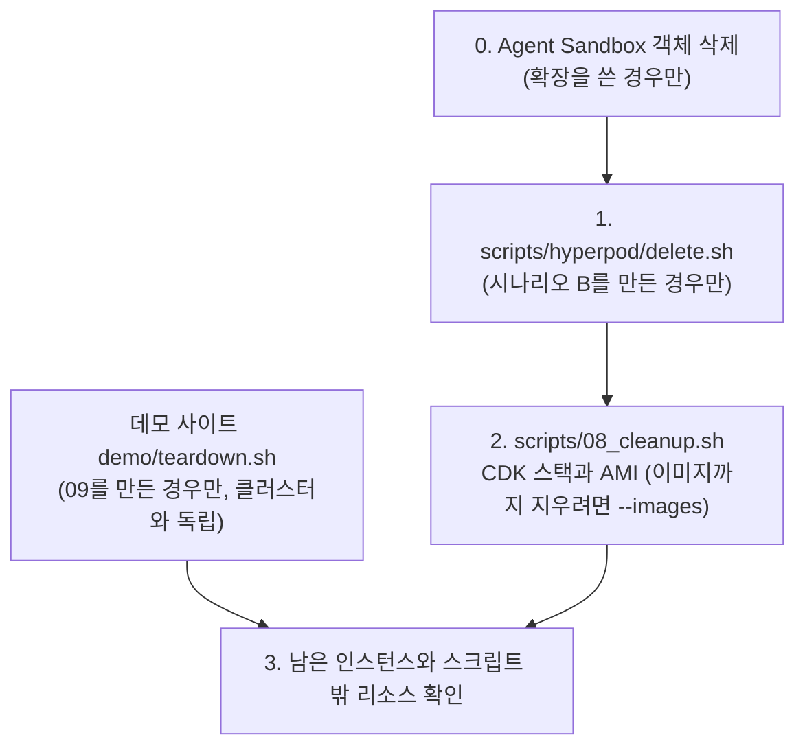

# 99 정리

**TL;DR** GPU 노드는 삭제할 때까지 요금이 발생하므로, 만든 리소스를 Agent Sandbox 확장, 데모 사이트, HyperPod, EKS 클러스터(CDK 스택) 순으로 삭제하고 남은 리소스를 조회합니다. 잠시 사용을 멈출 때는 노드 그룹을 0으로 줄입니다.

## 기존 Pain Point

`g4dn.metal`은 시간당 7.824 USD여서 이 노드 그룹 하나만 남아 있어도 하루에 약 188 USD가 청구됩니다(us-east-1과 us-west-2 온디맨드 요금). HyperPod는 EKS 클러스터를 orchestrator로 쓰므로, 정리 스크립트는 HyperPod를 먼저 삭제했다고 가정합니다. Agent Sandbox warm pool의 GPU 샌드박스는 처리할 요청이 없어도 GPU를 계속 점유해요. 데모 사이트는 별도의 CloudFormation stack이라 `08_cleanup.sh`가 삭제하지 않습니다. AMI와 snapshot, ECR 이미지, HyperPod의 S3 버킷과 IAM 역할, CDK bootstrap 스택도 CDK 스택을 삭제한 뒤에 남습니다.


*그림 요약: CDK 스택을 삭제하면 스택이 만든 리소스만 삭제되고, 스택 밖의 이미지, 버킷, 역할, 다른 stack은 남습니다. 이 페이지는 남는 리소스마다 삭제 명령을 따로 제공하고, CDKToolkit은 다음 배포에 쓰도록 남겨 둡니다.*


## Why

- **단계마다 확인 단어를 입력받습니다.** 다른 클러스터나 stack을 실수로 삭제할 위험을 줄여요.
- **리소스를 만든 단계마다 삭제 명령이 따로 있습니다.** 확장, 데모, HyperPod, 클러스터를 각각 삭제하므로 무엇이 삭제되는지 분명합니다. 인프라는 CDK 스택 하나로 만들었으므로 `cdk destroy`를 한 번 실행하면 됩니다.
- **마지막에 남은 인스턴스를 보여 줍니다.** `project=gpu-sandbox-on-aws` 태그가 붙은 인스턴스가 남았는지 표로 출력합니다.

**사전 지식:** 무엇을 만들었는지 확인하세요. 클러스터와 이미지는 [01 클러스터와 이미지](01_cluster_and_images.md), HyperPod는 [07 HyperPod 시나리오](07_hyperpod.md), 데모 사이트는 [09 데모 사이트 (CloudFront)](09_demo_site.md), Agent Sandbox 확장은 [06 Agent Sandbox로 확장](../concepts/06_agent_sandbox.md)에서 만들었어요.

??? note "용어 (처음 보는 단어가 있으면 펼치세요)"
    - **CloudFormation stack**: 여러 AWS 리소스를 한 묶음으로 만들고 지우는 단위입니다. 클러스터 생성(`02_create_cluster.sh`)이 만드는 CDK 스택(`<CLUSTER_NAME>-cdk`)과 데모 사이트는 각각 별도의 stack입니다.
    - **CDKToolkit**: `cdk bootstrap`이 만드는 stack입니다. CDK가 배포에 쓰는 S3 버킷, ECR 저장소, 배포 역할이 들어 있어요.
    - **노드 그룹 (node group)**: 같은 인스턴스 유형과 설정을 쓰는 EKS 노드 묶음입니다. 노드 수(`desiredSize`)를 바꿔 늘리고 줄입니다.
    - **scale to zero**: 노드 그룹의 노드 수를 0으로 줄여 인스턴스 요금이 발생하지 않게 하면서, 설정은 남겨 두는 방법입니다.
    - **launch template**: EC2 인스턴스를 시작할 때 쓰는 설정 묶음입니다. 이 저장소에서는 CDK 스택이 노드 그룹마다 하나씩 만들고, Kata CPU 노드의 nested virtualization 옵션도 여기에 포함됩니다.
    - **KMS 키 삭제 대기 기간**: KMS 키는 삭제를 요청해도 바로 삭제되지 않습니다. 지정한 기간(여기서는 7일) 동안 `Pending deletion` 상태로 남은 뒤 삭제됩니다.
    - **AMI, snapshot**: 인스턴스를 시작할 때 쓰는 디스크 이미지와, 그 이미지의 데이터를 저장한 EBS 사본입니다. AMI를 등록 해제해도 snapshot은 남을 수 있습니다.
    - **ECR 리포지토리**: 컨테이너 이미지를 저장하는 AWS 레지스트리의 저장 단위입니다.
    - **SandboxClaim, SandboxWarmPool, SandboxTemplate**: Agent Sandbox 확장에서 샌드박스 하나를 할당받는 요청, 미리 띄워 두는 샌드박스 풀, 그 샌드박스의 pod 설정입니다.
    - **warm pool**: 요청이 오기 전에 미리 띄워 둔 샌드박스 묶음입니다. 요청이 오면 바로 할당할 수 있지만, 대기 중에도 자원(GPU 포함)을 점유합니다.
    - **NAT gateway, Elastic IP**: private subnet의 노드가 인터넷에 접속할 때 거치는 관리형 게이트웨이와, 그 게이트웨이에 연결된 고정 공인 IP입니다. 둘 다 시간 단위로 과금됩니다.

    더 자세한 설명은 [용어 사전](../reference/glossary.md)에 있습니다.

!!! warning "검증 상태와 안전"
    시나리오 C의 CDK 스택은 2026-11-14 실습 계정에서 배포하고 삭제해 봤습니다. 하지만 `08_cleanup.sh`의 AMI와 ECR 단계, `hyperpod/delete.sh`, `demo/teardown.sh`는 shellcheck만 통과했고 AWS에서 끝까지 실행하지 않았어요. 공유 계정이나 production 계정이라면 삭제 전에 이름, 태그, 생성 시각으로 이 실습의 리소스인지 확인하세요. 가능하면 이 실습 전용 계정이나 역할에서 실행하세요. 아래 확인 명령은 조회만 하고 리소스를 변경하지 않습니다.

## 순서



*그림 요약: 클러스터 안의 것(Agent Sandbox 객체, HyperPod)을 먼저, 클러스터를 나중에 지웁니다. 데모 stack은 독립이라 아무 때나 지워도 되지만 3단계 확인 전에는 끝내세요.*

## 소요 시간과 비용

CDK 스택 삭제(`cdk destroy`)는 노드 그룹, 클러스터, NAT gateway를 차례로 삭제하므로 시간이 걸립니다. HyperPod 삭제 스크립트는 클러스터가 삭제될 때까지 30초 간격으로 기다립니다. 두 작업 모두 소요 시간은 측정하지 않았습니다. 데모 stack 삭제에도 CloudFront 배포 삭제가 포함되어 시간이 걸릴 수 있어요. 정리한 뒤에는 GPU 노드 요금이 더 발생하지 않지만, 남겨 둔 ECR 이미지와 AMI snapshot에는 저장 요금이 계속 발생합니다. secrets용 KMS 키는 7일 삭제 대기 기간이 지난 뒤 삭제됩니다.

`$AWS_REGION`, `$CLUSTER_NAME` 같은 변수는 먼저 `source scripts/config.env`로 불러오세요. 클러스터 안의 리소스(Agent Sandbox 객체, HyperPodPyTorchJob, 샌드박스 풀)는 kubectl로 삭제하므로, 정리가 끝날 때까지 두 번째 터미널에서 `cdk/tunnel.sh`를 실행해 두세요.

## 0. Agent Sandbox 확장 (쓴 경우만)

`08_cleanup.sh`는 `sandbox` namespace의 Deployment와 Service만 먼저 삭제하고 Agent Sandbox 객체는 삭제하지 않습니다. 그러니 클러스터를 삭제하기 전에 이 객체를 먼저 삭제해 GPU를 반환하게 하세요.

멀티턴 에피소드 실행(`scripts/extensions/agent_sandbox.sh episodes`)은 끝날 때 자신이 만든 claim을 삭제합니다. Job pod가 claim을 삭제하기 전에 종료되면, 스크립트가 Job이 끝난 뒤 run label(`gpusandbox/run=episodes-<epoch>`)로 남은 claim을 삭제해요. 그래도 남은 claim에는 이 label이 붙어 있으므로 `kubectl -n sandbox get sandboxclaims -L gpusandbox/run`으로 어느 실행에서 남은 claim인지 확인할 수 있습니다.

아래 명령은 남은 claim, warm pool, template을 이 순서로 모두 삭제합니다.

```bash
kubectl -n sandbox delete sandboxclaims,sandboxwarmpools,sandboxtemplates --all
```

**확인할 것:** 삭제된 객체마다 `... deleted` 줄이 나옵니다. 몇 분 뒤 다음 명령이 `No resources found in sandbox namespace.`를 출력하면 샌드박스 pod가 모두 종료된 것입니다.

```bash
kubectl -n sandbox get pods -l gpusandbox/managed-by=agent-sandbox
```

확장을 설치하지 않았다면 첫 명령이 `the server doesn't have a resource type "sandboxclaims"` 같은 오류를 냅니다. 이 경우 이 단계를 건너뛰세요.

**문제가 생기면:** pod가 남아 있으면 [06 Agent Sandbox로 확장](../concepts/06_agent_sandbox.md)의 "정리와 scale to zero" 절과 [문제 해결](../reference/troubleshooting.md)의 "pod 상태, 이벤트, 로그" 항목을 보세요.

## 데모 사이트 (09를 만든 경우)

데모 stack과 버킷의 모든 파일을 삭제합니다(아래 표). CloudFront 배포도 삭제되므로 데모 URL은 더 이상 동작하지 않아요.

```bash
AWS_REGION=us-west-2 demo/teardown.sh
# if you deployed with another stack name
AWS_REGION=us-west-2 DEMO_STACK_NAME=<stack-name> demo/teardown.sh
```

`AWS_REGION`은 데모를 만든 리전으로 바꾸세요. 스크립트는 `scripts/config.env`를 읽지 않습니다. 하지만 셸에서 `source scripts/config.env`를 실행했다면 그 `AWS_REGION` 값을 쓰므로, 데모가 다른 리전에 있으면 명령줄에서 리전을 지정해야 합니다.

| 프롬프트 | 입력할 단어 | 지우는 것 |
|---|---|---|
| `Delete demo stack <stack> and all files in its bucket? Type '<stack>':` | stack 이름 (기본 `gpu-sandbox-demo`) | 버킷의 모든 객체(`aws s3 rm --recursive`), 그다음 stack 전체(버킷, CloudFront 배포, Origin Access Control, 응답 헤더 정책, 버킷 정책). `stack-delete-complete`까지 기다립니다 |

**확인할 것:** 마지막 줄이 `deleted gpu-sandbox-demo`(또는 지정한 stack 이름)입니다. 다른 단어를 입력하면 `aborted`를 출력하고 아무것도 지우지 않습니다.

**문제가 생기면:** stack이 `DELETE_FAILED`로 끝나면 실패한 리소스가 남습니다(CloudFormation 문서 기준). 콘솔에서 원인을 확인한 뒤 다시 삭제하세요. 데모 구성은 [09 데모 사이트 (CloudFront)](09_demo_site.md)의 "6. 정리" 절에 있습니다.

## 1. HyperPod 먼저 (시나리오 B)

HyperPodPyTorchJob, HyperPod 클러스터, execution role, lifecycle 버킷을 지우고 EKS 클러스터는 남겨 둡니다.

```bash
scripts/hyperpod/delete.sh
```

각 프롬프트 끝에는 `Type '<단어>' to continue:`가 출력됩니다.

| 프롬프트 | 입력할 단어 | 지우는 것 |
|---|---|---|
| `This deletes HyperPod cluster ${HYPERPOD_CLUSTER_NAME} and its instances.` | HyperPod 클러스터 이름 (기본 `gpu-sandbox-hp`) | `rl-trainer`의 HyperPodPyTorchJob 전체, HyperPod 클러스터(삭제될 때까지 대기), execution role `${HYPERPOD_CLUSTER_NAME}-execution`(관리형 정책 분리, inline 정책 `hyperpod-eks`와 `lifecycle-bucket-read` 삭제, 역할 삭제) |
| `Empty and delete s3://${HYPERPOD_LCS_BUCKET}?` | `bucket` | lifecycle 버킷의 객체와 버킷 |

**확인할 것:** `waiting for the cluster to disappear`, `deleted role <이름>-execution` 뒤에 마지막 줄 `HyperPod resources deleted`가 나옵니다.

HyperPod dependency Helm release와 training operator add-on은 EKS 클러스터 안에 있으므로 2단계에서 클러스터와 함께 삭제됩니다. 버킷 프롬프트에서 다른 단어를 입력하면 스크립트가 `aborted`로 멈추고 버킷만 남습니다. 이때 HyperPod 클러스터와 역할은 이미 삭제된 상태예요.

**문제가 생기면:** training operator add-on이 없어도 스크립트는 멈추지 않습니다. 스크립트는 `HyperPodPyTorchJob` CRD가 있을 때만 Job을 삭제하고 다음 단계로 넘어갑니다. 클러스터 삭제가 오래 걸리면 SageMaker 콘솔에서 상태를 확인하세요. 그 밖의 증상은 [문제 해결](../reference/troubleshooting.md)의 "정리와 비용" 항목을 보세요.

## 2. EKS 클러스터(CDK 스택)와 나머지

터널이 열려 있으면 스크립트는 샌드박스 풀과 학습 Job을 먼저 삭제합니다. 그래야 노드를 종료하기 전에 GPU와 VFIO 장치가 반환됩니다. 그다음 CDK 스택(클러스터, 노드 그룹, launch template, VPC, NAT gateway, access instance, 로그 그룹)을 삭제하고, AMI를 삭제할지 묻습니다.

```bash
scripts/08_cleanup.sh            # pools, Jobs, the CDK stack, AMIs (asks)
scripts/08_cleanup.sh --images   # also the ECR repositories
```

| 순서 | 프롬프트 | 입력할 단어 | 지우는 것 |
|---|---|---|---|
| 1 | `This deletes EKS cluster ${CLUSTER_NAME} in ${AWS_REGION} and its node groups.` | 클러스터 이름 (기본 `gpu-sandbox`). 이 단계에서 한 번만 묻습니다 | `cdk/destroy.sh --yes`를 실행합니다. 터널을 통해 `sandbox` namespace에 접근할 수 있으면 `rl-trainer`의 Job 전체와 `sandbox`의 Deployment, Service 전체를 먼저 지우고, `cdk destroy ${CLUSTER_NAME}-cdk --force`로 스택 전체를 지웁니다. 이어서 스택 밖에 생긴 로그 그룹 `/aws/lambda/${CLUSTER_NAME}-cdk-...`가 있으면 프롬프트 없이 지웁니다 |
| 2 | `Deregister AMI ${KATA_IOMMU_AMI_ID} and delete its snapshot?` | `ami` | `config.env`에 `KATA_IOMMU_AMI_ID`가 있을 때만: AMI 등록 해제와 첫 번째 block device의 snapshot 삭제 |
| 3 | `Deregister the B2 HyperPod AMI ${HYPERPOD_B2_AMI_ID} and delete its snapshot?` | `ami` | `config.env`에 `HYPERPOD_B2_AMI_ID`가 있을 때만: B2 custom AMI 등록 해제와 snapshot 삭제. HyperPod 클러스터를 먼저 지운 뒤에 실행하세요 |
| 4 | `Delete the ECR repositories ${ECR_REPO_PREFIX}/{sandbox,trainer,control} and all images?` | `images` | `--images`일 때만: 세 리포지토리를 `--force`로 삭제 |
| 끝 | 없음 | | `project=gpu-sandbox-on-aws` 태그가 붙은 pending, running, stopping, stopped 인스턴스 목록 |

**확인할 것:** 터널이 열려 있으면 `deleting sandbox pools and training jobs first`가, 닫혀 있으면 `cluster API not reachable (is cdk/tunnel.sh running?); the stack deletion removes the nodes anyway` 경고가 나옵니다. 그 뒤로 `cdk destroy` 진행 출력, (있으면) `deleting leftover log group /aws/lambda/<CLUSTER_NAME>-cdk-...`, 첫 번째 인스턴스 표가 차례로 나와요. `cdk/destroy.sh`가 끝에 `ECR repositories are kept. To delete them:`와 삭제 명령을 안내하더라도, `--images`로 실행했다면 뒤 단계에서 ECR 리포지토리를 삭제하므로 무시하세요. 마지막 `remaining instances tagged project=gpu-sandbox-on-aws (should be none):` 아래 표가 비어 있어야 합니다. `--images`를 썼다면 `deleted gpu-sandbox/sandbox` 같은 줄이 세 번 나옵니다.

bootstrap 스택 `CDKToolkit`은 다음 배포에 다시 쓰므로 남겨 둡니다. 더는 쓰지 않을 계정이라면 그 S3 버킷을 비운 뒤 `CDKToolkit` 스택을 삭제하세요.

프롬프트에서 다른 단어를 입력하면 스크립트가 그 자리에서 `aborted`로 끝나고, 뒤 단계(마지막 인스턴스 목록 포함)는 실행되지 않습니다. 그래서 AMI를 일부러 남기려면 프롬프트에서 거절하지 말고, 실행 전에 `config.env`에서 `KATA_IOMMU_AMI_ID`를 지우고 `WITH_KATA_GPU`를 `"0"`으로 바꾸세요. `WITH_KATA_GPU=1`인데 AMI ID가 비어 있으면 `cdk destroy` 전에 실행되는 synth가 `set KATA_IOMMU_AMI_ID in scripts/config.env ...` 오류를 내고 멈춥니다(코드 기준).

**문제가 생기면:** `cdk destroy`가 실패하거나 오래 걸리면 CloudFormation 콘솔에서 `<CLUSTER_NAME>-cdk` 스택의 이벤트로 실패한 리소스를 찾으세요. [문제 해결](../reference/troubleshooting.md)의 "정리와 비용" 항목도 참고하세요(HyperPod가 남아 VPC를 계속 쓰는 경우 포함).

!!! question "❓ 오해: CDK 스택을 지우면 실습 리소스가 모두 지워진다"
    CDK 스택을 삭제하면 그 스택이 만든 리소스(클러스터, 노드 그룹, launch template, VPC, NAT gateway, access instance, KMS 키, 스택의 로그 그룹)만 삭제됩니다. IOMMU AMI와 B2 AMI, 그 snapshot, ECR 리포지토리(`03_build_push_images.sh`가 만듦), HyperPod의 S3 버킷과 IAM 역할, 데모 stack, `CDKToolkit`은 스택 밖에서 만들어졌으므로 이 페이지의 다른 단계에서 처리합니다.

## 일시 정지: 노드 그룹을 0으로 줄이기

며칠 뒤 다시 쓸 예정이라면 스택은 그대로 두고 GPU 노드 그룹만 0으로 줄일 수 있습니다. CDK 스택에서 이 노드 그룹들의 최소 크기는 0입니다. 아래 명령은 `maxSize`를 스택의 값과 같게 유지합니다. AWS API만 호출하므로 터널이 없어도 돼요.

```bash
source scripts/config.env
aws eks update-nodegroup-config --region "$AWS_REGION" --cluster-name "$CLUSTER_NAME" \
  --nodegroup-name sandbox-kata-gpu --scaling-config minSize=0,maxSize=1,desiredSize=0
aws eks update-nodegroup-config --region "$AWS_REGION" --cluster-name "$CLUSTER_NAME" \
  --nodegroup-name sandbox-gvisor --scaling-config minSize=0,maxSize=4,desiredSize=0
aws eks update-nodegroup-config --region "$AWS_REGION" --cluster-name "$CLUSTER_NAME" \
  --nodegroup-name trainer --scaling-config minSize=0,maxSize=1,desiredSize=0
# optional: the Kata CPU node (c8i)
aws eks update-nodegroup-config --region "$AWS_REGION" --cluster-name "$CLUSTER_NAME" \
  --nodegroup-name sandbox-kata-cpu --scaling-config minSize=0,maxSize=2,desiredSize=0
```

**확인할 것:** 명령마다 `"status": "InProgress"`, `"type": "ConfigUpdate"`가 포함된 JSON이 반환됩니다. 몇 분 뒤 터널을 연 상태에서 `kubectl get nodes -L gpusandbox/role`를 실행하면 `system` 노드 2대만 나옵니다(시나리오 B라면 HyperPod 노드도 나옵니다).

- 만들지 않은 노드 그룹의 명령은 건너뛰세요. 실행하면 그 명령만 오류로 끝납니다. 시나리오 B에는 `trainer` 노드 그룹이 없고, 시나리오 C에는 `sandbox-kata-cpu`만 있습니다.
- 학습 중에는 노드 수를 줄이지 마세요. trainer Job은 `backoffLimit: 0`이라 노드가 종료되면 실패합니다. 결과도 emptyDir에 있으므로 학습을 처음부터 다시 시작해야 합니다.
- Agent Sandbox 확장을 썼다면 먼저 warm pool을 0으로 줄이세요(예: `scripts/extensions/agent_sandbox.sh pool gvisor 0`).
- 다시 쓸 때는 같은 명령에서 `desiredSize`만 바꿔 실행합니다. `trainer`, `sandbox-kata-gpu`, `sandbox-kata-cpu`는 1로, `sandbox-gvisor`는 `$GVISOR_NODES`(기본 2)로 설정하세요. 새 노드는 부팅할 때 gVisor 설치와 node guard 설정을 다시 실행하고, kata-deploy(DaemonSet)도 새 Kata 노드에 설치됩니다. 샌드박스 Deployment는 replica 수를 유지하므로, 노드가 다시 준비되면 pod가 다시 스케줄됩니다.
- 이 명령은 CloudFormation을 거치지 않고 노드 수만 바꿉니다. 그러니 클러스터 생성(`02_create_cluster.sh`)을 다시 실행하기 전에 원래 값으로 되돌려 두세요. 되돌리지 않고 다시 배포했을 때의 동작은 확인하지 않았습니다.

**문제가 생기면:** 노드가 줄지 않거나 다시 늘지 않으면 [문제 해결](../reference/troubleshooting.md)의 "AWS 쪽 확인 (노드 그룹, 인스턴스)" 항목을 보세요.

!!! question "❓ 오해: 노드 그룹을 0으로 줄이면 과금이 멈춘다"
    이 방법으로는 GPU 노드 요금만 더 발생하지 않습니다. EKS control plane, NAT gateway, 최소 크기가 2인 system 노드 그룹(`m6i.large` 2대, 시간당 0.192 USD), access instance(`t4g.nano`), KMS 키, CloudWatch 로그, ECR 저장소, AMI snapshot, S3 버킷, 데모의 CloudFront와 S3는 계속 과금됩니다. HyperPod 인스턴스도 이 명령으로는 종료되지 않아요. `CreateCluster` API는 인스턴스 그룹의 `InstanceCount` 최솟값으로 0을 허용합니다. 하지만 이 저장소는 그 방법을 스크립트로 제공하거나 검증하지 않았으므로, HyperPod를 쓰지 않을 때는 `hyperpod/delete.sh`로 삭제하기를 권합니다.

## 3. 남은 리소스 확인

### 인스턴스

다음은 스크립트 마지막 단계와 같은 명령으로, `project=gpu-sandbox-on-aws` 태그가 붙은 인스턴스를 표로 출력해요.

```bash
aws ec2 describe-instances --region "$AWS_REGION" \
  --filters "Name=tag:project,Values=gpu-sandbox-on-aws" "Name=instance-state-name,Values=pending,running,stopping,stopped" \
  --query 'Reservations[].Instances[].[InstanceId,InstanceType,State.Name]' --output table
```

**확인할 것:** 표가 비어 있거나 아무것도 출력되지 않습니다.

이 태그는 AMI 빌더 인스턴스, CDK 스택의 모든 노드(launch template의 `TagSpecifications`), access instance(스택 태그)에 설정됩니다. HyperPod 인스턴스나 다른 도구로 만든 인스턴스에는 이 태그가 없습니다. 그러니 아래 명령으로 이 실습의 인스턴스 유형과 이름 태그를 한 번 더 확인하세요.

```bash
aws ec2 describe-instances --region "$AWS_REGION" \
  --filters "Name=instance-type,Values=${TRAINER_INSTANCE_TYPE},${GVISOR_INSTANCE_TYPE},${KATA_GPU_INSTANCE_TYPE},${KATA_CPU_INSTANCE_TYPE},${SYSTEM_INSTANCE_TYPE},t4g.nano" \
            "Name=instance-state-name,Values=pending,running,stopping,stopped" \
  --query 'Reservations[].Instances[].[InstanceId,InstanceType,State.Name,Tags[?Key==`Name`]|[0].Value]' --output table
```

**확인할 것:** 이 실습의 노드 이름(클러스터 이름이 들어간 이름)이 붙은 인스턴스가 없습니다. 공유 계정에서는 같은 유형의 다른 워크로드도 함께 나오니, 이름과 태그로 이 실습의 인스턴스인지 확인한 뒤에만 조치하세요.

다음 명령은 리전의 HyperPod 클러스터 목록을 보여 줍니다.

```bash
aws sagemaker list-clusters --region "$AWS_REGION" \
  --query 'ClusterSummaries[].[ClusterName,ClusterStatus]' --output table
```

**확인할 것:** 목록에 `${HYPERPOD_CLUSTER_NAME}`(기본 `gpu-sandbox-hp`)이 없습니다.

### 스크립트 밖에서 확인할 것

아래 표에서 "정상"인 결과는 그 리소스가 삭제되었다는 뜻입니다.

| 리소스 | 만드는 곳 | 자동 정리 | 확인 명령 (조회만) |
|---|---|---|---|
| ECR 리포지토리 `${ECR_REPO_PREFIX}/sandbox`, `trainer`, `control` | `scripts/03_build_push_images.sh` | `--images`일 때만 | `aws ecr describe-repositories --region "$AWS_REGION" --query "repositories[?starts_with(repositoryName, '${ECR_REPO_PREFIX}/')].repositoryName" --output text` (빈 출력이 정상) |
| IOMMU AMI | `infra/kata/build-iommu-ami.sh` (`scripts/kata/gpu_nodes.sh` 첫 실행) | `KATA_IOMMU_AMI_ID`가 있을 때만 | `aws ec2 describe-images --region "$AWS_REGION" --owners self --filters "Name=tag:project,Values=gpu-sandbox-on-aws" --query 'Images[].[ImageId,Name]' --output table` |
| B2 HyperPod AMI | `infra/hyperpod/ami/build-b2-ami.sh` (`scripts/hyperpod/build_b2_ami.sh`) | `HYPERPOD_B2_AMI_ID`가 있을 때만 | 위 IOMMU AMI와 같은 명령(같은 `project` 태그). 빌드가 실패했다면 정지된 builder 인스턴스가 마지막 인스턴스 목록에 나옵니다 |
| AMI의 snapshot | AMI를 만들 때 함께 생김 | 위 AMI 단계와 같이 | `aws ec2 describe-snapshots --region "$AWS_REGION" --owner-ids self --filters "Name=description,Values=*<ami-id>*" --query 'Snapshots[].[SnapshotId,Description]' --output table` |
| CDK 스택 `${CLUSTER_NAME}-cdk` (VPC, NAT gateway, 클러스터, 노드 그룹, launch template, access instance) | `scripts/02_create_cluster.sh` (`cdk/deploy.sh`) | 예 (`cdk/destroy.sh`). 삭제가 실패하면 남음 | `aws cloudformation describe-stacks --region "$AWS_REGION" --stack-name "${CLUSTER_NAME}-cdk"` (stack이 없다는 오류가 정상) |
| secrets용 KMS 키 | CDK 스택 | 예 (7일 삭제 대기 뒤) | KMS 콘솔의 고객 관리형 키에서 설명이 `EKS secrets encryption for <CLUSTER_NAME>`인 키가 `Pending deletion` 상태 |
| bootstrap 스택 `CDKToolkit` (S3 버킷, ECR 저장소, 배포 역할) | `cdk bootstrap` (01의 준비 2) | 아니요 (다음 배포에 재사용) | `aws cloudformation describe-stacks --region "$AWS_REGION" --stack-name CDKToolkit --query 'Stacks[0].StackStatus' --output text` (남아 있는 것이 정상. 지우려면 S3 버킷을 비운 뒤 stack 삭제) |
| S3 버킷 `${HYPERPOD_LCS_BUCKET}` | `scripts/hyperpod/create.sh` | `hyperpod/delete.sh`의 `bucket` 프롬프트 | `aws s3api head-bucket --bucket "$HYPERPOD_LCS_BUCKET"` (404가 정상) |
| IAM 역할 `${HYPERPOD_CLUSTER_NAME}-execution` | `scripts/hyperpod/create.sh` | `hyperpod/delete.sh` | `aws iam get-role --role-name "${HYPERPOD_CLUSTER_NAME}-execution"` (NoSuchEntity가 정상) |
| training operator용 IAM 역할 | 07의 안내대로 직접 만든 경우 | 아니요 | IAM 콘솔에서 만든 역할 이름으로 확인 |
| 데모 stack `gpu-sandbox-demo` (버킷, CloudFront 배포 포함) | `demo/deploy.sh` | `demo/teardown.sh` | `aws cloudformation describe-stacks --region "$AWS_REGION" --stack-name gpu-sandbox-demo` (stack이 없다는 오류가 정상. 다른 이름을 썼다면 그 이름으로) |
| CloudWatch 로그 그룹 | EKS control plane 로그(`/aws/eks/<CLUSTER_NAME>/cluster`)와 VPC flow log는 CDK 스택, `/aws/lambda/<CLUSTER_NAME>-cdk-...`는 스택의 custom resource Lambda, 그 밖에 HyperPod 클러스터 로그 | 스택의 로그 그룹은 스택과 함께, Lambda 로그 그룹은 `cdk/destroy.sh`가 지움. HyperPod 로그는 아니요 | `aws logs describe-log-groups --region "$AWS_REGION" --log-group-name-prefix /aws/sagemaker/ --query 'logGroups[].logGroupName' --output text` 와 `--log-group-name-prefix "/aws/eks/${CLUSTER_NAME}"`, `--log-group-name-prefix "/aws/lambda/${CLUSTER_NAME}-cdk-"` |

CDK 스택이 `DELETE_FAILED`로 남았다면 NAT gateway와 Elastic IP도 남아 요금이 계속 발생할 수 있습니다. CloudFormation 콘솔에서 실패 원인을 확인한 뒤 `cdk/destroy.sh`를 다시 실행하세요.

AMI를 수동으로 삭제할 때는 snapshot도 삭제해야 저장 요금이 더 발생하지 않습니다. EC2 문서에 따르면 AMI를 등록 해제해도 기본적으로 snapshot은 남습니다. 아래 명령은 AMI와 snapshot을 한 번에 삭제하므로, `<ami-id>`가 맞는지 위 표의 조회 결과로 확인한 뒤 실행하세요.

```bash
aws ec2 deregister-image --region "$AWS_REGION" --image-id <ami-id> --delete-associated-snapshots
```

**확인할 것:** 위 표의 AMI와 snapshot 조회 명령이 빈 결과를 반환합니다.

로컬에 남는 파일과 설정(`bench-*.jsonl`, kubeconfig의 클러스터 항목과 context `<CLUSTER_NAME>-tunnel`)은 과금과 관계가 없으니 필요하면 정리하세요.

## 적용 범위와 한계

- **태그 범위:** `project=gpu-sandbox-on-aws` 태그가 없는 HyperPod 인스턴스는 유형과 이름으로 찾아야 합니다(3단계).
- **로그 그룹 이름:** HyperPod의 로그 그룹 이름 규칙은 확인하지 못했으니 직접 확인하세요. EKS control plane 로그 그룹 `/aws/eks/<CLUSTER_NAME>/cluster`는 실습 계정에서 확인했어요.
- **KMS 키:** 7일 삭제 대기 동안 키가 계정에 남습니다(KMS 문서에 따르면 실제 삭제는 최대 24시간 늦어질 수 있습니다). 대기 기간의 요금은 확인하지 않았으니 KMS 요금 페이지를 보세요.
- **HyperPod scale to zero:** 이 저장소에는 스크립트가 없습니다(위 ❓ 노트).
- **Agent Sandbox 객체:** `08_cleanup.sh`는 이 객체를 삭제하지 않습니다(0단계 참고). 클러스터와 함께 삭제되기 전까지 warm pool이 GPU를 계속 점유합니다.

## 확인 방법

1. `08_cleanup.sh` 마지막 표가 비어 있습니다.
2. 다음 명령의 목록에 `${CLUSTER_NAME}`이 없고, CDK 스택 조회(위 표)가 stack이 없다는 오류를 반환합니다.

    ```bash
    aws eks list-clusters --region "$AWS_REGION" --output text
    ```

3. `aws sagemaker list-clusters` 목록에 `${HYPERPOD_CLUSTER_NAME}`이 없습니다(시나리오 B).
4. 데모를 만들었다면 `demo/teardown.sh`가 `deleted <stack>`으로 끝났고, 데모 stack 조회가 stack이 없다는 오류를 반환합니다.
5. 위 표의 확인 명령이 "없음"을 뜻하는 결과(빈 목록, NotFound, 404)를 반환합니다. 일부러 남긴 리소스만 예외입니다.

어느 항목이든 남아 있으면 [문제 해결](../reference/troubleshooting.md)의 "정리와 비용" 항목을 보세요.

??? note "참고 자료"
    | 주제 | 링크 |
    |---|---|
    | AWS CLI `update-nodegroup-config` (관리형 노드 그룹 크기 변경) | https://docs.aws.amazon.com/cli/latest/reference/eks/update-nodegroup-config.html |
    | AWS CDK `cdk destroy` | https://docs.aws.amazon.com/cdk/v2/guide/ref-cli-cmd-destroy.html |
    | CloudFormation stack 삭제 (`DELETE_FAILED`, 재시도) | https://docs.aws.amazon.com/AWSCloudFormation/latest/UserGuide/cfn-console-delete-stack.html |
    | HyperPod DeleteCluster API | https://docs.aws.amazon.com/sagemaker/latest/APIReference/API_DeleteCluster.html |
    | Agent Sandbox 저장소 (SandboxClaim, SandboxWarmPool, SandboxTemplate) | https://github.com/kubernetes-sigs/agent-sandbox |

    전체 출처: [참고 자료 모음의 이 페이지 절](../reference/references.md#ref-handson-99-cleanup)
