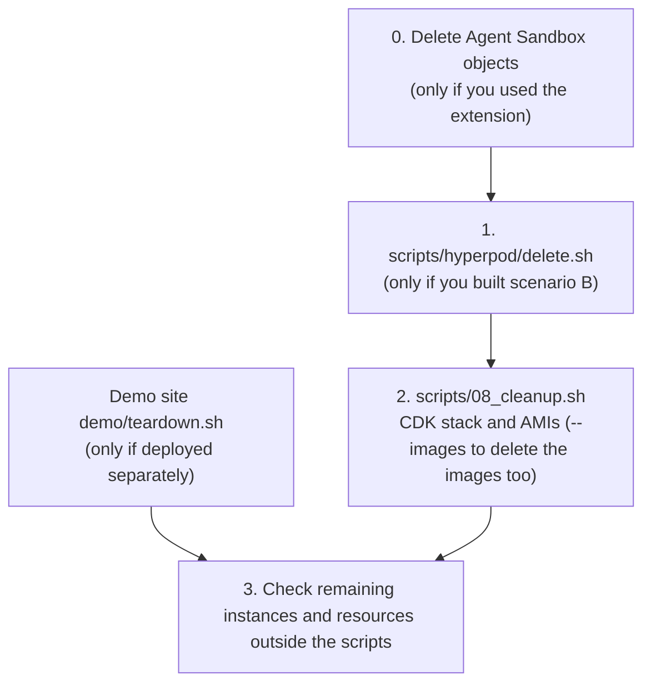

# Clean up lab resources

<span id="99-cleanup"></span>

## Delete a cluster deployed with Quickstart { #quickstart }

From the project directory you used for the lab, run the command for your scenario. The script reads `.quickstart/<scenario>/config.env` from the deployment. Check the AWS account, Region and cluster name it prints before confirming deletion.

If you deployed with `scripts/config.env`, follow [cleanup with individual scripts](#manual-cleanup). If you also used the Agent Sandbox extension, remove any [remaining claims and warm pools](#0-agent-sandbox-extension-only-if-you-used-it) first.

=== "A (EC2 GPU)"

    ```bash
    ./scripts/quickstart.sh A cleanup
    ```

    Keep the SSM tunnel open. The script deletes the EKS cluster and its EC2 node groups.

=== "B1 (HyperPod + EC2)"

    ```bash
    ./scripts/quickstart.sh B1 cleanup
    ```

    Keep the SSM tunnel open. The script deletes the HyperPod training cluster first, then the EKS cluster and its EC2 node groups.

=== "B2 (HyperPod)"

    ```bash
    ./scripts/quickstart.sh B2 cleanup
    ```

    Enter the stack name when prompted. Deleting the HyperPod wizard stack removes the EKS cluster and the HyperPod workers together. Wait for it to finish before [cleaning up the S3 bucket and logs](scenarios/b/b2.md#retained-resources).

=== "C (CPU)"

    ```bash
    ./scripts/quickstart.sh C cleanup
    ```

    Keep the SSM tunnel open. The script deletes the EKS cluster and its CPU node groups.

All four commands keep the ECR images. To [check what remains](#3-check-what-remains), load the same `.quickstart/<scenario>/config.env` into your shell.

## Clean up with individual scripts { #manual-cleanup }

For the HyperPod-managed B2 cluster, follow the [dedicated B2 workflow](scenarios/b/b2.md#cleanup). The CDK commands on this page apply to A, B1, C and the earlier custom AMI option.

Check the AWS account, `AWS_REGION`, `CLUSTER_NAME` and your current `kubectl` context against the lab cluster you intend to remove. Leave the tunnel open. Follow the steps for the resources you created.

1. **If you ran episodes**, clean up remaining [claims and warm pools](#0-agent-sandbox-extension-only-if-you-used-it). **If you used HyperPod**, [delete its cluster](#1-hyperpod-first-scenario-b) while EKS is still available.
2. When you [delete the EKS stack](#2-eks-cluster-cdk-stack-and-the-rest), choose whether to keep its images. A [demo site you deployed](#demo-site-only-if-you-built-09) has its own stack.
3. [Check remaining resources](#3-check-what-remains), including tagged instances and resources created outside the stack. If you [scale nodes to zero](#pausing-scale-node-groups-to-zero) between labs, EKS and NAT gateway charges continue.

??? note "Terms (expand if a word is new to you)"
    - **CloudFormation stack**: a unit that creates and deletes several AWS resources together. The CDK stack from cluster creation (`02_create_cluster.sh`, `<CLUSTER_NAME>-cdk`) and the demo site are separate stacks.
    - **CDKToolkit**: the stack `cdk bootstrap` creates. It holds the S3 bucket, ECR repository and deployment roles CDK uses.
    - **Node group**: a set of EKS nodes that use the same instance type and settings. You grow and shrink it by changing the node count (`desiredSize`).
    - **Scale to zero**: setting a node group's node count to zero, which stops the instance charges but keeps the configuration.
    - **Launch template**: a set of settings used to launch EC2 instances. In this repository the CDK stack creates one per node group, and the nested virtualization option of the Kata CPU node lives in one too.
    - **KMS key waiting period**: a deleted KMS key does not disappear right away; it stays in the `Pending deletion` state for a set period (7 days here) and is deleted after that.
    - **AMI, snapshot**: the disk image an instance boots from, and the EBS copy where that image is actually stored. The snapshot can remain after the AMI is deregistered.
    - **ECR repository**: the storage unit of the AWS container image registry.
    - **SandboxClaim, SandboxWarmPool, SandboxTemplate**: in the Agent Sandbox extension, a request to borrow one sandbox, a pool of sandboxes started in advance, and the pod settings of those sandboxes.
    - **Warm pool**: a set of sandboxes started before any request arrives. You get one quickly, but they hold resources (including GPUs) while waiting.
    - **NAT gateway, Elastic IP**: the managed gateway that nodes in private subnets use to reach the internet, and the static public IP attached to it. Both are billed by the hour.

    More detail is in the [Glossary](../reference/glossary.md).

!!! warning "Validation status and safety"
    - **What ran**: deleting the scenario C CDK stack and `08_cleanup.sh --images` on a scenario A cluster ran in a practice account; the record does not say whether the AMI step ran ([run record](../reference/sources.md#aws-run-record)).
    - **What has not run end to end**: `demo/teardown.sh` passed shellcheck only. The B1 run exercised `hyperpod/delete.sh` through deletion of the execution role and lifecycle bucket.
    - **In a shared or production account**: confirm by name, tags and creation time that a resource belongs to this hands-on before deleting it (ideally, run from an account or role dedicated to this hands-on).
    - **Check commands**: the check commands below only read.

## Order



*Takeaway: delete what lives inside the cluster (Agent Sandbox objects, HyperPod) first, then the cluster. The demo stack is independent and can go at any time, but finish it before the checks in step 3.*

## Time and cost

- **Deleting the CDK stack (`cdk destroy`)**: it removes the node groups, the cluster and the NAT gateway in turn, so it takes a while.
- **HyperPod deletion script**: it polls every 30 seconds until the cluster is gone.
- **Deleting the demo stack**: it includes a CloudFront distribution, which can also take a while to delete.
- **Charges after cleanup**: GPU node charges stop, but ECR images and AMI snapshots you keep incur storage charges. The secrets KMS key is deleted after a 7-day waiting period.

Neither the CDK stack deletion nor the HyperPod deletion was timed.

Before you start cleanup, prepare the following.

1. Load variables such as `$AWS_REGION` and `$CLUSTER_NAME` with `source scripts/config.env` first.
2. Things inside the cluster (Agent Sandbox objects, HyperPodPyTorchJobs, sandbox pools) are deleted with kubectl, so keep `cdk/tunnel.sh` running in a second terminal until cleanup is done.
3. kubectl deletes in the cluster of the current context, so before you start, check that `kubectl config current-context` is `<CLUSTER_NAME>-tunnel` of the cluster you are cleaning up.

## 0. Agent Sandbox extension (only if you used it)

For a Quickstart deployment, point `KUBECONFIG` at the scenario's kubeconfig in the shell where you run `kubectl`. For example, for A, run `export KUBECONFIG="$PWD/.quickstart/A/kubeconfig"` from the project directory.

`08_cleanup.sh` first deletes only the Deployments and Services in the `sandbox` namespace and leaves the Agent Sandbox objects alone, so delete them before the cluster to release their GPUs.

Multi-turn episode runs (`scripts/extensions/agent_sandbox.sh episodes`) delete their own claims at the end. If the Job pod is killed before it can, the script deletes the leftover claims by their run label (`gpusandbox/run=episodes-<epoch>`) after the Job. Any claim still left carries that label, so `kubectl -n sandbox get sandboxclaims -L gpusandbox/run` shows which run left it.

This command deletes all remaining claims, warm pools and templates, in that order.

```bash
kubectl -n sandbox delete sandboxclaims,sandboxwarmpools,sandboxtemplates --all
```

**What to look for:**

- One `... deleted` line per deleted object.
- A few minutes later, when this command prints `No resources found in sandbox namespace.`, all pods managed by the Agent Sandbox extension are gone.

    ```bash
    kubectl -n sandbox get pods -l gpusandbox/managed-by=agent-sandbox
    ```

- Sandbox pools created as Deployments are deleted in step 2.

If you never installed the extension, the first command fails with an error such as `the server doesn't have a resource type "sandboxclaims"`; skip this step.

**If it fails:** if pods remain, see the "Cleanup and scale to zero" section of [06 Extending with Agent Sandbox](../concepts/06_agent_sandbox.md) and the "Pod status, events and logs" section of [Troubleshooting](../reference/troubleshooting.md).

## Demo site you deployed { #demo-site-only-if-you-built-09 }

Delete the demo stack and every file in its bucket (table below). The CloudFront distribution goes too, and the demo URL stops working.

```bash
demo/teardown.sh
```

If you deployed under a custom stack name, set `DEMO_STACK_NAME` to that name when running this command.

The script does not read `scripts/config.env` and, like `demo/deploy.sh`, fixes the Region to `us-east-1`. It ignores `AWS_REGION` in your shell.

| Prompt | Word to type | What it deletes |
|---|---|---|
| `Delete demo stack <stack> and all files in its bucket? Type '<stack>':` | The stack name (default `gpu-sandbox-demo`) | Every object in the site bucket (`aws s3 rm --recursive`), then the whole stack |

- **What the whole stack holds**: site bucket, CloudFront distribution, Origin Access Control, response headers policy, bucket policy.
- **Waiting for deletion**: it waits for `stack-delete-complete`.
- **Access log bucket**: it has `DeletionPolicy: Retain` and stays.

**What to look for:**

- `deleted gpu-sandbox-demo` (or the stack name you gave), followed by `kept the access log bucket <log bucket>; when you no longer need the logs: aws s3 rb s3://<log bucket> --force`.
- The site bucket is deleted and the log bucket stays. Log objects expire after 90 days; delete the bucket with the printed command when you no longer need the logs.
- **If you type a different word**: it prints `aborted` and deletes nothing.

**If it fails:** if the stack ends in `DELETE_FAILED`, the resources that failed remain (per the CloudFormation documentation); check the cause in the console and delete again. The demo setup is described in section "6. Cleanup" of [CloudFront demo deployment](../reference/demo_site.md).

## 1. HyperPod first (scenario B)

<span id="cleanup-hyperpod"></span>

Delete the HyperPodPyTorchJobs, the HyperPod cluster, the execution role and the lifecycle bucket; the EKS cluster stays.

```bash
scripts/hyperpod/delete.sh
```

Each prompt ends with `Type '<word>' to continue:`.

| Prompt | Word to type | What it deletes |
|---|---|---|
| `This deletes HyperPod cluster ${HYPERPOD_CLUSTER_NAME} and its instances.` | The HyperPod cluster name (default `gpu-sandbox-hp`) | All HyperPodPyTorchJobs in `rl-trainer`, the HyperPod cluster (waits until it is gone), the execution role `${HYPERPOD_CLUSTER_NAME}-execution` |
| `Empty and delete s3://${HYPERPOD_LCS_BUCKET}?` | `bucket` | The objects in the lifecycle bucket and the bucket |

- **Deleting the execution role**: it detaches the managed policy, deletes the inline policies `hyperpod-eks` and `lifecycle-bucket-read`, then deletes the role.

**What to look for:** after `waiting for the cluster to disappear` and `deleted role <name>-execution`, the last line is `HyperPod resources deleted`.

- **The HyperPod dependency Helm release and the training operator add-on**: they live inside the EKS cluster, so they go with it in step 2.
- **If you type a different word at the bucket prompt**: the script stops with `aborted` and leaves only the bucket; the HyperPod cluster and the role are already deleted by then.

**If it fails:**

- **Without the training operator add-on**: the script does not stop. It deletes the Jobs when the `HyperPodPyTorchJob` CRD exists and skips the Job deletion when it does not. Either way it moves on to the next step.
- **If the cluster deletion takes long**: check its status in the SageMaker console.
- **For other symptoms**: see the "Cleanup and cost" section of [Troubleshooting](../reference/troubleshooting.md).

## 2. EKS cluster (CDK stack) and the rest

<span id="cleanup-cdk"></span>

The script works in this order.

1. If the current kubectl context can read the `sandbox` namespace, it deletes the sandbox pools and training Jobs first, so that GPUs and VFIO devices are released before the nodes go down.
2. It deletes the CDK stack (cluster, node groups, launch templates, VPC, NAT gateway, access instance, log groups).
3. It asks whether to delete the AMIs.

Choose one tab. The default keeps ECR images. With `--images`, cleanup deletes the `sandbox`, `trainer` and `control` repositories under `ECR_REPO_PREFIX`, including their images. Check what uses those repositories if the prefix is shared.

=== "Keep ECR images"

    ```bash
    scripts/08_cleanup.sh
    ```

=== "Also delete ECR images"

    ```bash
    scripts/08_cleanup.sh --images
    ```

| Order | Prompt | Word to type | What it deletes |
|---|---|---|---|
| 1 | `This deletes EKS cluster ${CLUSTER_NAME} in ${AWS_REGION} and its node groups.` | The cluster name (default `gpu-sandbox`), asked only this once | Runs `cdk/destroy.sh --yes` (list below the table) |
| 2 | `Deregister AMI ${KATA_IOMMU_AMI_ID} and delete its snapshot?` | `ami` | Only if `KATA_IOMMU_AMI_ID` is set in `config.env`: deregisters the AMI and deletes the snapshot of its first block device |
| 3 | `Deregister the B2 HyperPod AMI ${HYPERPOD_B2_AMI_ID} and delete its snapshot?` | `ami` | Only if `HYPERPOD_B2_AMI_ID` is set in `config.env`: deregisters the B2 custom AMI and deletes its snapshot. Delete the HyperPod cluster first |
| 4 | `Delete the ECR repositories ${ECR_REPO_PREFIX}/{sandbox,trainer,control} and all images?` | `images` | Only with `--images`: deletes the three repository names one by one with `--force`. A repository that does not exist prints an error and is skipped |
| End | None | | Lists pending, running, stopping and stopped instances tagged `project=gpu-sandbox-on-aws` |

In step 1, `cdk/destroy.sh --yes` deletes in this order.

1. If the current kubectl context can read the `sandbox` namespace, it first deletes all Jobs in `rl-trainer` and all Deployments and Services in `sandbox` of that context. The script does not check that the context belongs to the cluster you typed (see the `kubectl config current-context` check above).
2. Then `cdk destroy ${CLUSTER_NAME}-cdk --force`, selected by `CLUSTER_NAME` and `AWS_REGION`, deletes the whole stack.
3. After that, the log groups `/aws/lambda/${CLUSTER_NAME}-cdk-...` created outside the stack are deleted without a prompt if they exist.

**What to look for:**

- **If the current kubectl context can read the `sandbox` namespace**: you see `deleting sandbox pools and training jobs first`.
- **If that lookup fails**: you see the warning `cluster API not reachable (is cdk/tunnel.sh running?); the stack deletion removes the nodes anyway`.
- Then come the `cdk destroy` progress output, `deleting leftover log group /aws/lambda/<CLUSTER_NAME>-cdk-...` (if any) and a first instance table.
- **If `cdk/destroy.sh` ends with `ECR repositories are kept. To delete them:` and a delete command**: ignore it when you ran with `--images`; a later step deletes them.
- A line such as `deleted gpu-sandbox/sandbox` appears once for each repository deleted successfully (for example, two lines, sandbox and control, if there is no trainer repository).
- The table under the final `remaining instances tagged project=gpu-sandbox-on-aws (should be none):` must be empty.

The bootstrap stack `CDKToolkit` stays, because the next deployment reuses it (if you will not use the account again, empty its S3 bucket and then delete the `CDKToolkit` stack).

If you type a different word at a prompt, the script ends with `aborted` right there and the later steps (including the final instance list) do not run. So to keep the AMI on purpose, do not decline at the prompt; follow these steps instead.

1. Write the AMI ID down.
2. Before running, remove `KATA_IOMMU_AMI_ID` (for the B2 AMI, `HYPERPOD_B2_AMI_ID`) from `config.env`.
3. If you loaded `config.env` into your shell, also run `unset KATA_IOMMU_AMI_ID` (or `unset HYPERPOD_B2_AMI_ID`).

The script then skips that AMI step. You do not need to change `WITH_KATA_GPU`: `cdk/destroy.sh` sets both Kata switches to 0 before synth.

**If it fails:** if `cdk destroy` fails or takes very long, find the failed resource in the events of the `<CLUSTER_NAME>-cdk` stack in the CloudFormation console, and see the "Cleanup and cost" section of [Troubleshooting](../reference/troubleshooting.md) (including a remaining HyperPod cluster that holds on to the VPC).

!!! question "❓ Misconception: deleting the CDK stack removes everything from the hands-on"
    The CDK stack deletes only what it created (cluster, node groups, launch templates, VPC, NAT gateway, access instance, KMS key, the stack's log groups). The IOMMU AMI and the B2 AMI with their snapshots, the ECR repositories (created by `03_build_push_images.sh`), HyperPod's S3 bucket and IAM role, the demo stack and `CDKToolkit` are outside the stack, so other steps on this page handle them.

<details class="note" markdown="1">
<summary>Scale down nodes between lab sessions</summary>

## Pausing: scale node groups to zero

If you plan to come back in a few days, you can keep the stack and scale only the GPU node groups to zero (minimum size 0 in the CDK stack). These commands keep `maxSize` at the stack's value and use only the AWS API, so they work without the tunnel.

```bash
source scripts/config.env
aws eks update-nodegroup-config --region "$AWS_REGION" --cluster-name "$CLUSTER_NAME" \
  --nodegroup-name sandbox-kata-gpu --scaling-config minSize=0,maxSize=1,desiredSize=0
aws eks update-nodegroup-config --region "$AWS_REGION" --cluster-name "$CLUSTER_NAME" \
  --nodegroup-name sandbox-gvisor --scaling-config minSize=0,maxSize=4,desiredSize=0
aws eks update-nodegroup-config --region "$AWS_REGION" --cluster-name "$CLUSTER_NAME" \
  --nodegroup-name trainer --scaling-config minSize=0,maxSize=1,desiredSize=0
# optional: the Kata CPU node (c8i)
aws eks update-nodegroup-config --region "$AWS_REGION" --cluster-name "$CLUSTER_NAME" \
  --nodegroup-name sandbox-kata-cpu --scaling-config minSize=0,maxSize=2,desiredSize=0
```

**What to look for:**

- Each command returns JSON with `"status": "InProgress"` and `"type": "ConfigUpdate"`.
- A few minutes later, with the tunnel open, `kubectl get nodes -L gpusandbox/role` shows only the two `system` nodes (plus the HyperPod node in scenario B).

Keep the following in mind while you pause.

- **Node groups you did not create**: skip their commands (a command for a missing one just ends with an error). Scenario B has no `trainer` node group, and scenario C has only `sandbox-kata-cpu`.
- **During training**: do not scale down. The trainer Job has `backoffLimit: 0`, so it fails when its node disappears, and its results live in an emptyDir, so training has to start over.
- **If you used the Agent Sandbox extension**: scale the warm pool to zero first (for example `kubectl -n sandbox patch sandboxwarmpool kernel-eval-gvisor --type merge -p '{"spec":{"replicas":0}}'`). `agent_sandbox.sh pool <runtime> 0` also re-applies the template, which goes back to the v1 settings unless `VERSION_FILE` is set.
- **To resume**: run the same commands with `desiredSize` set to 1 for `trainer`, `sandbox-kata-gpu` and `sandbox-kata-cpu`, and to `$GVISOR_NODES` (default 2) for `sandbox-gvisor`. New nodes rerun their node group's boot setup.
    - `sandbox-gvisor` and `sandbox-kata-cpu`: get gVisor and the node guard again.
    - `sandbox-kata-gpu`: gets the node guard.
    - New Kata nodes: kata-deploy (a DaemonSet) installs the Kata runtime.
    - `trainer`: nodes have no extra boot setup.
    - The sandbox Deployments keep their replica counts, so their pods are scheduled again once the nodes are back.
- **Before you rerun cluster creation**: these commands change only the node count, without CloudFormation, so set the values back before you rerun cluster creation (`02_create_cluster.sh`). What happens if you redeploy without setting them back was not checked.

**If it fails:** if nodes do not scale down or back up, see the "Checking on the AWS side (node groups, instances)" section of [Troubleshooting](../reference/troubleshooting.md).

!!! question "❓ Misconception: scaling the node groups to zero stops all charges"
    Only the GPU node charges stop. These keep billing:

    - the EKS control plane, the NAT gateway
    - the system node group with a minimum size of 2 (two `m6i.large`, 0.192 USD per hour), the access instance (`t4g.nano`)
    - the KMS key, CloudWatch logs, ECR storage, AMI snapshots, the S3 bucket
    - the demo's CloudFront and S3

    These commands do not stop HyperPod instances either. The `CreateCluster` API allows 0 as the minimum `InstanceCount` of an instance group, but this repository neither scripts nor verifies that path, so when you are not using HyperPod, deleting it with `hyperpod/delete.sh` is the recommended option.

</details>

## 3. Check what remains

<span id="scope-and-limits"></span>

HyperPod instances do not carry the `project=gpu-sandbox-on-aws` tag; check them by type and cluster name. Check retained CloudWatch groups by actual resource names. The EKS control-plane group `/aws/eks/<CLUSTER_NAME>/cluster` was verified in the practice account. KMS leaves the key in the account during its seven-day wait; final deletion can take another 24 hours, and charges during the wait were not verified.

For a pause, this project provides no HyperPod scale-to-zero script. If you used Agent Sandbox, remove the warm pool and claims in step 0 before running `08_cleanup.sh`. Otherwise those objects can hold GPUs until the cluster itself is deleted.

The final instance table queries EC2 instances with the lab tag. Once it is empty, use the checks below for any separately created volumes, snapshots or log buckets you used.

After deletion, query the account for remaining resources. Check separately created deployments such as HyperPod and the demo site, along with AMIs and snapshots.

### Instances

The same command as the script's last step lists instances tagged `project=gpu-sandbox-on-aws` in a table.

```bash
aws ec2 describe-instances --region "$AWS_REGION" \
  --filters "Name=tag:project,Values=gpu-sandbox-on-aws" "Name=instance-state-name,Values=pending,running,stopping,stopped" \
  --query 'Reservations[].Instances[].[InstanceId,InstanceType,State.Name]' --output table
```

**What to look for:** the table is empty or nothing is printed.

The tag is set on the AMI builder instance, on every node of the CDK stack (the launch template's `TagSpecifications`) and on the access instance (stack tags). HyperPod instances and instances created with other tools do not carry it, so check once more by this hands-on's instance types, with their Name tag.

```bash
aws ec2 describe-instances --region "$AWS_REGION" \
  --filters "Name=instance-type,Values=${TRAINER_INSTANCE_TYPE},${GVISOR_INSTANCE_TYPE},${KATA_GPU_INSTANCE_TYPE},${KATA_CPU_INSTANCE_TYPE},${SYSTEM_INSTANCE_TYPE},t4g.nano" \
            "Name=instance-state-name,Values=pending,running,stopping,stopped" \
  --query 'Reservations[].Instances[].[InstanceId,InstanceType,State.Name,Tags[?Key==`Name`]|[0].Value]' --output table
```

**What to look for:**

- No instance has a name from this hands-on (a name that contains the cluster name).
- **In a shared account**: other workloads of the same types show up too, so act only after confirming by name and tags that an instance belongs to this hands-on.

This command lists the HyperPod clusters in the Region.

```bash
aws sagemaker list-clusters --region "$AWS_REGION" \
  --query 'ClusterSummaries[].[ClusterName,ClusterStatus]' --output table
```

**What to look for:** `${HYPERPOD_CLUSTER_NAME}` (default `gpu-sandbox-hp`) is not in the list.

### What to check outside the scripts

Check each resource against the expected state in the table. Most should be gone, but right after the stack deletion the KMS key is in its 7-day pending-deletion state, and `CDKToolkit` stays for the next deployment.

| Resource | Created by | Cleaned up automatically | Check command (read-only) |
|---|---|---|---|
| ECR repositories `${ECR_REPO_PREFIX}/sandbox`, `trainer`, `control` | `scripts/03_build_push_images.sh` | Only with `--images` | `aws ecr describe-repositories --region "$AWS_REGION" --query "repositories[?starts_with(repositoryName, '${ECR_REPO_PREFIX}/')].repositoryName" --output text` |
| IOMMU AMI | `infra/kata/build-iommu-ami.sh` (first run of `scripts/kata/gpu_nodes.sh`) | Only if `KATA_IOMMU_AMI_ID` is set | `aws ec2 describe-images --region "$AWS_REGION" --owners self --filters "Name=tag:project,Values=gpu-sandbox-on-aws" --query 'Images[].[ImageId,Name]' --output table` |
| B2 HyperPod AMI | `infra/hyperpod/ami/build-b2-ami.sh` (`scripts/hyperpod/build_b2_ami.sh`) | Only if `HYPERPOD_B2_AMI_ID` is set | The same command as for the IOMMU AMI (same `project` tag) |
| B2 builder security group `${CLUSTER_NAME}-b2-ami-builder-<timestamp>` | `infra/hyperpod/ami/build-b2-ami.sh` | The script deletes it after terminating the builder when the build succeeds. `08_cleanup.sh` does not delete it | `aws ec2 describe-security-groups --region "$AWS_REGION" --filters "Name=tag:project,Values=gpu-sandbox-on-aws" "Name=group-name,Values=${CLUSTER_NAME}-b2-ami-builder-*" --query 'SecurityGroups[].[GroupId,GroupName]' --output table` (empty is expected) |
| The AMI's snapshot | Created with the AMI | Together with the AMI step above | `aws ec2 describe-snapshots --region "$AWS_REGION" --owner-ids self --filters "Name=description,Values=*<ami-id>*" --query 'Snapshots[].[SnapshotId,Description]' --output table` |
| CDK stack `${CLUSTER_NAME}-cdk` (VPC, NAT gateway, cluster, node groups, launch templates, access instance) | `scripts/02_create_cluster.sh` (`cdk/deploy.sh`) | Yes (`cdk/destroy.sh`); it remains if deletion fails | `aws cloudformation describe-stacks --region "$AWS_REGION" --stack-name "${CLUSTER_NAME}-cdk"` (an error saying the stack does not exist is expected) |
| Secrets KMS key | CDK stack | Yes (after the 7-day waiting period) | In the KMS console under customer managed keys, the key with the description `EKS secrets encryption for <CLUSTER_NAME>` is in the `Pending deletion` state |
| Bootstrap stack `CDKToolkit` (S3 bucket, ECR repository, deployment roles) | `cdk bootstrap` (preparation 2 of 01) | No (reused by the next deployment) | `aws cloudformation describe-stacks --region "$AWS_REGION" --stack-name CDKToolkit --query 'Stacks[0].StackStatus' --output text` (it is expected to remain; to delete it, empty the S3 bucket and then delete the stack) |
| S3 bucket `${HYPERPOD_LCS_BUCKET}` | `scripts/hyperpod/create.sh` | The `bucket` prompt of `hyperpod/delete.sh` | `aws s3api head-bucket --bucket "$HYPERPOD_LCS_BUCKET"` (404 is expected) |
| IAM role `${HYPERPOD_CLUSTER_NAME}-execution` | `scripts/hyperpod/create.sh` | `hyperpod/delete.sh` | `aws iam get-role --role-name "${HYPERPOD_CLUSTER_NAME}-execution"` (NoSuchEntity is expected) |
| IAM role for the training operator | If you created it yourself as described in 07 | No | Check in the IAM console under the name you used |
| Demo stack `gpu-sandbox-demo` (including the bucket and CloudFront distribution) | `demo/deploy.sh` | `demo/teardown.sh` | `aws cloudformation describe-stacks --region us-east-1 --stack-name "${DEMO_STACK_NAME:-gpu-sandbox-demo}"` (an error saying the stack does not exist is expected) |
| CloudWatch log groups | CDK stack, the stack's custom resource Lambda, HyperPod cluster (list below the table) | The stack's log groups go with the stack, and `cdk/destroy.sh` deletes the Lambda log groups. HyperPod logs: no | `aws logs describe-log-groups --region "$AWS_REGION" --log-group-name-prefix /aws/sagemaker/ --query 'logGroups[].logGroupName' --output text` and `--log-group-name-prefix "/aws/eks/${CLUSTER_NAME}"`, `--log-group-name-prefix "/aws/lambda/${CLUSTER_NAME}-cdk-"` |

- **ECR repositories**: after `--images`, `sandbox`, `trainer` and `control` are gone from the list; other repositories with the same prefix, such as `verl` for veRL, remain.
- **B2 HyperPod AMI**: if a build failed, the stopped builder instance shows up in the final instance list.
- **If a B2 builder security group is left**: terminate the builder, then delete it with `aws ec2 delete-security-group --region "$AWS_REGION" --group-id <sg-id>`. It sits in the cluster VPC, so clean it up before deleting the CDK stack.
- **Demo stack**: the demo lives in `us-east-1` whatever the cluster Region. The retained access log bucket stays separately.
- **Where the CloudWatch log groups come from**: the EKS control plane logs (`/aws/eks/<CLUSTER_NAME>/cluster`) and the VPC flow log come from the CDK stack, `/aws/lambda/<CLUSTER_NAME>-cdk-...` from the stack's custom resource Lambda, plus HyperPod cluster logs.

If the CDK stack is left in `DELETE_FAILED`, its NAT gateway and Elastic IP may remain and keep billing; check the cause in the CloudFormation console and run `cdk/destroy.sh` again.

When you delete an AMI by hand, delete its snapshot too, or the storage charges continue (per the EC2 documentation, deregistering alone keeps the snapshots by default). This command does both in one go, so confirm `<ami-id>` with the query in the table above first.

```bash
aws ec2 deregister-image --region "$AWS_REGION" --image-id <ami-id> --delete-associated-snapshots
```

**What to look for:** the AMI and snapshot queries in the table above return empty results.

Local leftovers (`bench-*.jsonl`, the cluster entry and the `<CLUSTER_NAME>-tunnel` context in your kubeconfig) cost nothing; clean them up if you like.

## How to verify

1. The final table of `08_cleanup.sh` is empty.
2. `${CLUSTER_NAME}` is not in the list of this command, and the CDK stack query (table above) returns an error saying the stack does not exist:

    ```bash
    aws eks list-clusters --region "$AWS_REGION" --output text
    ```

3. `${HYPERPOD_CLUSTER_NAME}` is not in the `aws sagemaker list-clusters` list (scenario B).
4. If you built the demo, `demo/teardown.sh` printed `deleted <stack>` and the note about the kept log bucket, and the demo stack query in `us-east-1` returns an error saying the stack does not exist.
5. Each resource matches the expected state in the table above. Right after deletion the KMS key is `Pending deletion` and `CDKToolkit` remains, both as expected. With `--images`, the three repositories drop out of the ECR list; other repositories with the same prefix remain.

If a resource you chose to delete does not match the expected state in the table, see the "Cleanup and cost" section of [Troubleshooting](../reference/troubleshooting.md).

??? note "References"
    | Topic | Link |
    |---|---|
    | AWS CLI `update-nodegroup-config` (resizing a managed node group) | https://docs.aws.amazon.com/cli/latest/reference/eks/update-nodegroup-config.html |
    | AWS CDK `cdk destroy` | https://docs.aws.amazon.com/cdk/v2/guide/ref-cli-cmd-destroy.html |
    | Deleting a CloudFormation stack (`DELETE_FAILED`, retry) | https://docs.aws.amazon.com/AWSCloudFormation/latest/UserGuide/cfn-console-delete-stack.html |
    | HyperPod DeleteCluster API | https://docs.aws.amazon.com/sagemaker/latest/APIReference/API_DeleteCluster.html |
    | Agent Sandbox repository (SandboxClaim, SandboxWarmPool, SandboxTemplate) | https://github.com/kubernetes-sigs/agent-sandbox |

    [Selected references on this topic](../reference/references.md#ref-handson-99-cleanup)
