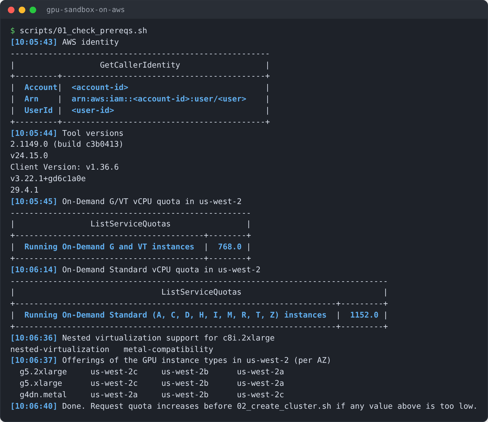
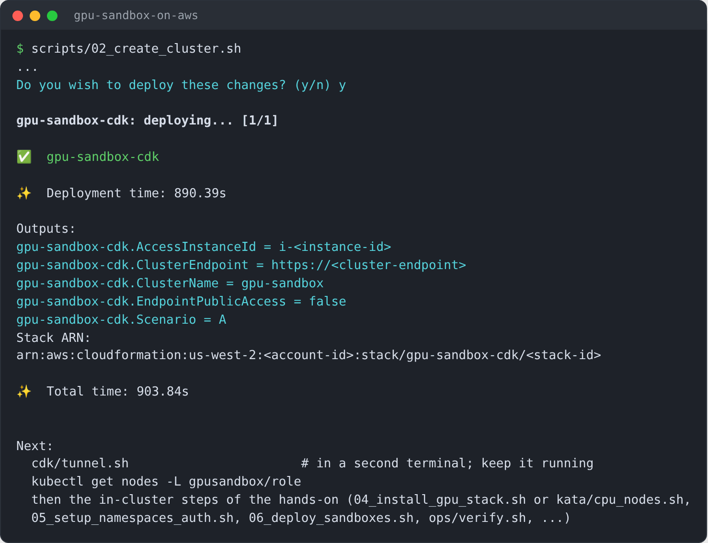
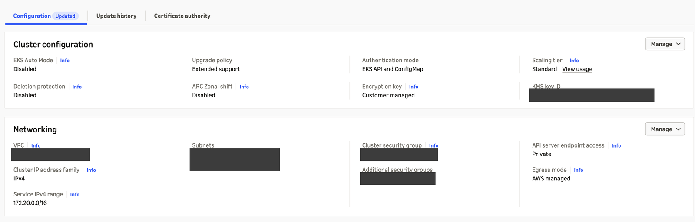
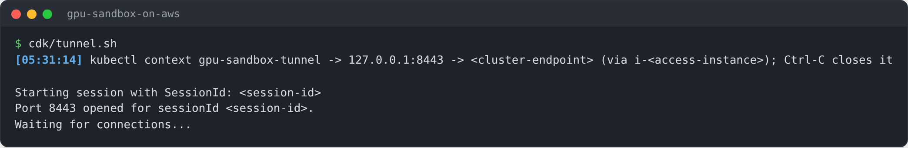
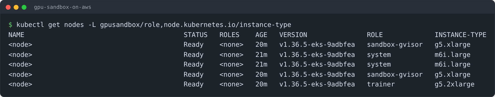
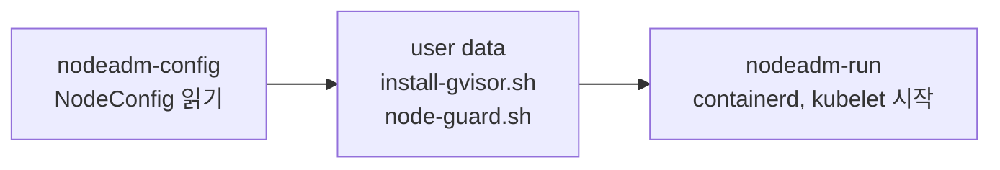

---
hide:
  - footer
---

# CDK로 EKS 클러스터와 이미지 준비하기

<span id="01-클러스터와-이미지"></span>

HyperPod 마법사로 만드는 관리형 B2는 [B2 프로비저닝](hyperpod.md)를 따르세요. 이 페이지의 CDK 명령은 A, B1, C와 기존 custom AMI 경로에 적용됩니다.

내 PC에서 EKS 노드를 조회하고 샌드박스 컨테이너 이미지를 ECR에 올립니다. 처음 배포한다면 [준비물](../../start.md#준비물)과 [경로별 쿼터](../../index.md#사전-준비)를 먼저 확인하세요.

1. [계정과 리전 설정](#준비-1-scriptsconfigenv)부터 [배포 전 점검](#사전-확인-01_check_prereqssh)까지 진행합니다. 선택한 시나리오에 따라 생성할 노드 구성이 달라집니다.
2. [클러스터를 만든 뒤](#클러스터-생성-cdk-02_create_clustersh) 두 번째 터미널에 [SSM 터널](#터널-열기-cdktunnelsh)을 열어 두세요. 원래 터미널의 `kubectl get nodes`에서 실습 노드가 `Ready`인지 봅니다.
3. [이미지를 빌드하고](#이미지-빌드와-push-03_build_push_imagessh) 출력된 URI를 `scripts/config.env`에 저장하세요. 런타임 검사 pod가 이 주소에서 샌드박스 이미지를 받습니다.

??? note "용어 (처음 보는 단어가 있으면 펼치세요)"
    - **AWS CDK, 스택, synth**: 코드(여기서는 Python)로 AWS 인프라를 정의해 CloudFormation으로 배포하는 도구, 함께 만들고 함께 지우는 리소스 묶음, 코드를 CloudFormation 템플릿으로 변환하는 단계입니다.
    - **bootstrap**: CDK가 배포에 쓰는 S3 버킷과 IAM 역할(스택 `CDKToolkit`)을 계정과 리전마다 한 번 만드는 작업입니다.
    - **cdk-nag**: CDK 코드를 AWS 모범 사례 규칙으로 검사하는 오픈소스 도구입니다. 규칙을 일부러 지키지 않을 때는 이유를 적어 인정(acknowledge)합니다.
    - **관리형 노드 그룹(managed node group)**: EC2 Auto Scaling 그룹을 EKS가 대신 관리하는 노드 그룹입니다.
    - **IMDS, hop limit**: IMDS는 인스턴스 메타데이터 서비스(노드 자격 증명을 제공하는 주소 `169.254.169.254`)이고, hop limit은 그 응답이 거칠 수 있는 네트워크 hop 수입니다. 1이면 pod 안에서는 응답을 받지 못합니다.
    - **public, private endpoint**: 인터넷에서 접근할 수 있는 EKS API 서버 주소와 VPC 안에서만 접근할 수 있는 주소입니다.
    - **SSM Session Manager 포트 포워딩, access instance**: SSM agent가 있는 인스턴스를 거쳐 내 PC의 로컬 포트를 VPC 안의 주소로 연결하는 기능과, 그 경유지로 쓰는 작은 인스턴스입니다. inbound 포트나 공인 IP가 없어도 됩니다.
    - **access entry**: 어떤 IAM 역할이 EKS 클러스터에서 어떤 권한을 갖는지 정하는 EKS 리소스입니다.
    - **NAT gateway**: private 서브넷의 노드가 보내는 outbound 요청(이미지 pull 등)만 인터넷으로 전달하는 구성 요소입니다.
    - **VPC CNI**: EKS pod에 VPC IP를 할당하는 네트워크 플러그인입니다. 여기서는 NetworkPolicy 적용도 담당합니다.
    - **NodeConfig, nodeadm**: EKS AL2023 노드의 설정 문서와, 부팅할 때마다 그 설정을 적용하는 도구입니다.
    - **user data, MIME multipart**: 인스턴스가 처음 부팅할 때 실행되는 스크립트와, 여러 부분(NodeConfig, 셸 스크립트)을 user data 하나에 담는 형식입니다.
    - **containerd handler, shim**: containerd에 등록한 런타임 이름(`runsc`)과, 그 런타임을 실제로 실행하는 작은 프로그램(`containerd-shim-runsc-v1`)입니다.
    - **device plugin**: 노드의 GPU를 `nvidia.com/gpu` 같은 Kubernetes 리소스로 등록하는 구성 요소입니다.
    - **ECR tag immutability**: 이미 push한 이미지 태그를 다른 이미지로 덮어쓰지 못하게 하는 ECR 설정입니다.
    - **iptables, conntrack**: Linux의 패킷 필터 규칙과, 연결 상태(새 연결인지 응답인지)를 추적하는 기능입니다.

## 준비 1: `scripts/config.env`

<span id="lab-config"></span>

[시작하기](../../start.md)에서 만든 파일이 있으면 그대로 쓰고, 없을 때만 예시 파일을 복사합니다.

```bash
test -f scripts/config.env || cp scripts/config.env.example scripts/config.env
```

**확인할 것:** `scripts/config.env`가 있고 `AWS_REGION`, `CLUSTER_NAME`, `SCENARIO`가 원하는 값인지 확인하세요. 예시값 그대로면 `02_create_cluster.sh`가 시나리오 A를 만듭니다.

모든 스크립트는 `scripts/lib.sh`를 통해 이 파일을 읽습니다. 필요한 값이 비었거나 `__SET_ME__`를 포함하면 `require_vars`가 `set <VAR> in scripts/config.env`를 출력하고 스크립트를 멈춥니다. `cdk/deploy.sh`도 같은 파일을 읽으므로 스크립트와 CDK가 쓰는 인스턴스 유형과 고정 버전이 일치합니다.

| 변수 | 기본값 | 의미 |
|---|---|---|
| `AWS_REGION` | `us-west-2` | 클러스터, ECR 이미지, HyperPod 리소스를 만드는 리전 |
| `CLUSTER_NAME` | `gpu-sandbox` | EKS 클러스터 이름. CDK 스택 이름(`<CLUSTER_NAME>-cdk`), kubectl context(`<CLUSTER_NAME>-tunnel`), AMI 빌더 인스턴스 이름에도 쓰임. AMI 이름에는 쓰이지 않음 |
| `K8S_VERSION` | `1.36` | EKS standard support(2027-08-02까지)와 HyperPod EKS AMI 릴리스 노트의 지원 버전 안 |
| `SCENARIO` | `A` | `02_create_cluster.sh`가 만드는 구성(A, B1, B2, C). `02_create_cluster.sh`에 옵션(`--hyperpod` 등)을 주면 옵션이 우선 |
| `WITH_KATA_CPU`, `WITH_KATA_GPU` | `0`, `0` | `1`이면 Kata CPU 노드(`c8i.2xlarge`)와 Kata GPU 노드(`g4dn.metal`, `KATA_IOMMU_AMI_ID` 필요)를 어느 시나리오에든 추가함 ([Kata 샌드박스](../02_runtimes/kata.md)) |
| `ADMIN_PRINCIPAL_ARN` | 빈 값 | 클러스터 관리자 access entry를 받을 IAM 역할 또는 사용자 ARN(쉼표로 여러 개) |
| `EKS_PUBLIC_ACCESS_CIDR` | 없음 (주석 처리됨) | public endpoint를 허용할 때만 작업 PC의 IPv4 주소 하나를 `/32`로. 다른 범위는 설정 단계에서 거부 |
| `ECR_REPO_PREFIX`, `IMAGE_TAG` | `gpu-sandbox`, `v1` | ECR 리포지토리 접두사와 이미지 태그 |
| `GVISOR_RELEASE` | `20261109.0` | gVisor 노드에 설치할 릴리스 |
| `GVISOR_NODES` | `2` | gVisor 노드 수 (노드당 샌드박스 1개) |

- **CloudFront 데모 배포**: `demo/deploy.sh`는 `AWS_REGION` 값과 관계없이 `us-east-1`에 배포합니다.
- **`ADMIN_PRINCIPAL_ARN`을 비우면**: `cdk/deploy.sh`는 IAM 사용자로 실행하면 현재 사용자 ARN을 선택합니다. 역할 세션에서는 세션 정보로 역할 ARN을 추정합니다.
- **역할에 path가 있다면(예: IAM Identity Center가 만든 역할)**: 전체 ARN을 직접 지정합니다. `aws iam get-role --role-name <역할> --query Role.Arn --output text`로 얻은 ARN을 `ADMIN_PRINCIPAL_ARN`에 적으세요.

역할의 path 유무와 관계없이 access entry에는 STS 세션 ARN을 지정할 수 없습니다.

!!! note "config.env 값이 명령줄 환경변수보다 우선합니다"
    `lib.sh`가 `config.env`를 `source`하므로 그 안의 변수(`IMAGE_TAG`, `GVISOR_NODES`, `SCENARIO` 등)는 `IMAGE_TAG=v2 scripts/...`처럼 전달해도 config.env 값으로 덮어써집니다. 이런 값은 config.env에서 수정하고, config.env에 없는 변수(`HYPERPOD`, `ACTIVE_RUNTIME`, `ENABLE_EXPERIMENTAL_CLH_GPU`, `KATA_QEMU_REPLICAS` 등)는 명령줄로 전달하세요.

## 준비 2 (한 번만): CDK와 Session Manager plugin

<span id="cdk-tools"></span>

1. **Node.js와 CDK CLI.** Node.js 22 또는 24 LTS와 CDK CLI를 설치합니다. `cdk/requirements.txt`의 `aws-cdk-lib` 2.276.0을 사용하려면 CLI 2.1148.1 이상이 필요합니다.

    ```bash
    node --version            # expect v22.x or v24.x
    npm install -g aws-cdk
    cdk --version             # expect 2.1148.1 or later
    ```

    **확인할 것:** `cdk --version`이 버전 번호를 출력합니다.

2. **Session Manager plugin.** `cdk/tunnel.sh`가 쓰는 AWS CLI 플러그인입니다. 운영체제별 설치 방법은 [AWS 문서](https://docs.aws.amazon.com/systems-manager/latest/userguide/session-manager-working-with-install-plugin.html)를 따르세요.

    ```bash
    session-manager-plugin --version
    ```

    **확인할 것:** 버전 번호가 나옵니다(AWS 문서 권장 1.2.764.0 이상).

3. **Python 라이브러리.** 프로젝트 폴더의 가상 환경에 CDK 라이브러리를 설치합니다. `cdk/cdk.json`이 `python3 app.py`를 실행하므로 `02_create_cluster.sh`도 이 환경을 활성화한 셸에서 실행하세요.

    ```bash
    test -x .venv/bin/python || uv venv --python 3.14 .venv
    source .venv/bin/activate
    uv pip install -r cdk/requirements.txt
    ```

    **확인할 것:** `aws-cdk-lib`, `constructs`, `cdk-nag` 설치가 오류 없이 끝납니다.

4. **bootstrap.** 계정과 리전마다 한 번, 스택 `CDKToolkit`(S3 버킷, ECR 리포지토리, IAM 역할)을 만듭니다.

    ```bash
    source scripts/config.env
    cdk bootstrap "aws://$(aws sts get-caller-identity --query Account --output text)/$AWS_REGION"
    ```

    **확인할 것:** CloudFormation 콘솔의 `AWS_REGION` 리전에서 `CDKToolkit` 스택이 `CREATE_COMPLETE`(이미 있었다면 기존 상태)로 표시됩니다.

    CDK 기본값에서는 CloudFormation 실행 역할에 `AdministratorAccess`가 연결됩니다(권한을 줄이는 방법은 [Production 09 CDK](../../../production/09_cdk.md)의 준비 절). 다음 배포에서도 `CDKToolkit`을 재사용하므로 정리 스크립트(`08_cleanup.sh`)는 이 스택을 삭제하지 않습니다.

## 사전 확인: `01_check_prereqs.sh`

<span id="preflight"></span>

읽기 전용 점검입니다.

- **1번 검사를 통과하면**: 아무것도 출력하지 않고, 2번부터 차례로 출력합니다.
- **빠진 도구나 변수가 있으면**: `missing tool: <이름>`이나 `set <VAR> in scripts/config.env`를 출력하고 멈춥니다.

```bash
scripts/01_check_prereqs.sh
```

1. 로컬 도구(`aws`, `cdk`, `node`, `kubectl`, `helm`, `docker`, `python3`, `jq`, `session-manager-plugin`)와 필수 변수(`AWS_REGION`, `CLUSTER_NAME`, `K8S_VERSION`) 검사
2. 현재 AWS identity(`aws sts get-caller-identity`)
3. cdk, node, kubectl, helm, docker 버전
4. `Running On-Demand G and VT instances` 쿼터 (vCPU)
5. `Running On-Demand Standard (A, C, D, H, I, M, R, T, Z) instances` 쿼터 (vCPU)
6. Kata CPU 노드용 `KATA_CPU_INSTANCE_TYPE`(`c8i.2xlarge`)의 `SupportedFeatures`
7. trainer, gVisor, Kata GPU 인스턴스 타입이 제공되는 AZ 목록 (없으면 `NOT OFFERED`)

**확인할 것:** 마지막 로그는 `Done. Request quota increases before 02_create_cluster.sh if any value above is too low.`입니다. 만들 노드를 기준으로 아래 조건을 확인하세요.

| 출력 | 통과 조건 |
|---|---|
| 4번 G and VT 쿼터 | 시나리오 A 최소 경로 16 이상(버전 교체 중 24), 전체 경로 112 이상(버전 교체 중 120) |
| 5번 Standard 쿼터 | 최소 경로 6 이상(system 노드 4, access instance 2), 시나리오 C는 14, 전체 경로는 최대 16 |
| 6번 `SupportedFeatures` | Kata CPU 노드를 쓰면 `nested-virtualization`이 있음 |
| 7번 AZ 목록 | 쓸 GPU 타입이 스택의 두 private subnet이 있는 AZ 중 한 곳 이상에 나옴 |

- **4번, 시나리오 C**: GPU 노드가 없어 G and VT 쿼터가 필요 없지만, Kata GPU(`g4dn.metal`)를 추가하면 96 이상이어야 합니다.
- **7번의 두 AZ**: CDK가 조회한 리전 AZ 목록의 앞 두 곳입니다.
- **7번, 쓰지 않는 타입**: `NOT OFFERED`여도 됩니다(예: gVisor만 쓸 때의 `g4dn.metal`).

부족하면 Service Quotas 콘솔에서 증가를 요청하세요(vCPU 계산은 [전체 흐름](../../index.md)의 사전 준비 절).



**문제가 생기면:** `missing tool`이나 `set ... in scripts/config.env`가 나오면 [문제 해결](../../../reference/troubleshooting.md)의 "설정과 스크립트" 항목을 보세요.

## 클러스터 생성 (CDK): `02_create_cluster.sh`

<span id="cdk-cluster"></span>

<!-- Scenario walkthroughs deep-link to these CDK and image-build tab inputs. Keep their links in sync when reordering tabs. -->

A, B1, C는 해당 탭의 명령으로 CDK 스택을 배포합니다. A는 `scripts/config.env`에 `SCENARIO=A`를 설정한 경우입니다.

=== "A (EC2)"

    ```bash
    scripts/02_create_cluster.sh
    ```

=== "B1 (HyperPod)"

    ```bash
    scripts/02_create_cluster.sh --hyperpod
    ```

=== "B2 (HyperPod)"

    [HyperPod에서 클러스터 만들기](hyperpod.md#hyperpod에서-클러스터-만들기)로 이동하세요. 마법사 스택이 EKS 제어 영역과 세 워커 그룹을 함께 만듭니다.

=== "C (CPU)"

    ```bash
    scripts/02_create_cluster.sh --cpu-only
    ```

옵션을 고르면 `cdk/deploy.sh`가 `scripts/config.env`를 읽고 스택을 배포합니다. `WITH_KATA_GPU=1`이면 추가 비용을 안내한 뒤 `metal`을 입력해야 진행합니다. cdk-nag 검사에서 해결하지 않은 항목이 나오면 배포가 중단됩니다.

**확인할 것:**

1. `ADMIN_PRINCIPAL_ARN`을 비웠을 때는 실행한 주체에 따라 다릅니다.
    - **역할 세션(STS assumed-role)으로 실행하면**: 시작할 때 `using arn:aws:iam::<account>:role/<role>; if the role has a path, set ADMIN_PRINCIPAL_ARN from: ...` 경고가 나옵니다.
    - **IAM 사용자로 실행하면**: 현재 사용자 ARN을 선택하며 경고는 표시하지 않습니다.
    - **역할에 path가 있다면**: CDK의 권한 변경 승인 질문에 `n`으로 답하고, 경고에 나온 `aws iam get-role` 명령으로 얻은 ARN을 `ADMIN_PRINCIPAL_ARN`에 넣은 뒤 다시 실행하세요.
2. IAM과 security group 변경 목록에서 inbound 규칙이 `0.0.0.0/0`에 열려 있지 않은지 확인하고 `y`를 입력합니다. 스택이 만드는 inbound 규칙은 access instance에서 control plane으로 향하는 443 포트 규칙 하나뿐입니다.
3. 끝나면 `Outputs` 아래에 `ClusterName`, `ClusterEndpoint`, `AccessInstanceId`, `EndpointPublicAccess = false`가 나오고, 이어서 다음 안내가 출력됩니다.

```text
Next:
  cdk/tunnel.sh                       # in a second terminal; keep it running
  kubectl get nodes -L gpusandbox/role
  then the in-cluster steps of the hands-on (04_install_gpu_stack.sh or kata/cpu_nodes.sh,
  05_setup_namespaces_auth.sh, 06_deploy_sandboxes.sh, ops/verify.sh, ...)
```



EKS 콘솔의 클러스터 Networking 탭에서는 API server endpoint access가 `Private`으로 표시되어야 합니다.



배포 오류가 나면 아래에서 메시지별 대응 방법을 확인하세요.

<details class="note" markdown="1">
<summary>클러스터 배포 오류와 GPU 용량 부족 해결 방법</summary>

- `Has the environment been bootstrapped?` 같은 bootstrap 오류는 준비 2의 4번으로 해결합니다.
- `ValidationFailed`는 cdk-nag의 새 지적입니다. 출력된 규칙 ID와 리소스를 확인해 코드를 수정하고, 이유 없이 인정(acknowledge)하지 마세요.
- `ADMIN_PRINCIPAL_ARN must list IAM role or user ARNs, not sts assumed-role ARNs`가 나오면 `arn:aws:iam::<계정>:role/<역할>` 형식으로 직접 적으세요.
- `Cloud assembly schema version mismatch`는 CLI가 라이브러리보다 오래됐다는 뜻이니 준비 2의 1번으로 CLI를 업그레이드하세요.
- vCPU 한도 오류, AZ 미지원, 노드 그룹 생성 실패는 [문제 해결](../../../reference/troubleshooting.md)의 "클러스터와 노드" 항목을 보세요.
- 스택을 처음 만들 때 GPU 노드 그룹이 인스턴스를 시작하지 못하면(`InsufficientInstanceCapacity`), CloudFormation은 약 30분을 기다린 뒤 스택 생성 작업 전체를 롤백합니다. 이럴 때는 GPU 노드 그룹 없이 클러스터를 먼저 만들고 업데이트로 추가하세요. 업데이트가 실패하면 그 업데이트만 롤백됩니다. 아래는 실습 계정에서 A 클러스터를 만든 순서입니다. 마지막 명령은 `SCENARIO=A`일 때 실행하세요.

    ```bash
    scripts/02_create_cluster.sh --hyperpod-b2                  # system nodes only, no GPU node groups
    CHANGE_SCENARIO=1 scripts/02_create_cluster.sh --hyperpod   # adds the gVisor nodes (B1)
    CHANGE_SCENARIO=1 scripts/02_create_cluster.sh              # adds the trainer (A)
    ```

    용량은 인스턴스 하나를 시작했다가 바로 종료해서 확인하세요. On-Demand Capacity Reservation 요청은 실제 시작이 성공하는 상황에서도 용량이 없다고 응답할 수 있습니다. 다른 인스턴스 타입으로 재시도하려면 `scripts/config.env`에서 지정하세요(예: 용량이 있을 때는 `g6`).

</details>

### 터널 열기 (cdk/tunnel.sh)

<span id="ssm-tunnel"></span>

두 번째 터미널에서 터널을 열고 `kubectl`과 Helm을 사용하는 동안 열어 두세요. 스크립트가 `<CLUSTER_NAME>-tunnel` 컨텍스트를 만들고 SSM 접속 인스턴스를 거쳐 EKS API에 연결합니다.

```bash
cdk/tunnel.sh
```

**확인할 것:** `kubectl context <CLUSTER_NAME>-tunnel -> 127.0.0.1:8443 -> <endpoint> (via i-...); Ctrl-C closes it` 로그 뒤에 `Waiting for connections...`가 나옵니다. 터널은 작업 PC의 `127.0.0.1`에서만 열리며 `--tls-server-name`으로 실제 EKS endpoint의 인증서를 검증합니다.



첫 번째 터미널로 돌아가 노드를 확인하세요.

```bash
kubectl get nodes -L gpusandbox/role,node.kubernetes.io/instance-type
```

**확인할 것:** 시나리오 A라면 아래처럼 노드 다섯 대가 `Ready`입니다.



B1(`--hyperpod`)은 trainer 줄이 없고, 기존 CDK B2는 system 두 대, C는 system 두 대와 `sandbox-kata` 한 대(`c8i.2xlarge`, 실습 계정에서 확인)입니다.

<details class="note" markdown="1">
<summary>터널이 열리지 않거나 kubectl 접속이 실패할 때</summary>

- `TargetNotConnected`는 access instance의 SSM agent가 아직 등록되지 않았다는 뜻입니다. 인스턴스 ID는 `tunnel.sh`가 출력하는 `via i-...` 값입니다.
    1. 배포 직후라면 몇 분 뒤 다시 실행하세요.
    2. 10분이 지나도 같으면 아래 명령으로 상태를 확인하세요.

        ```bash
        aws ssm describe-instance-information --region "$AWS_REGION" --filters Key=InstanceIds,Values=<instance-id> --query 'InstanceInformationList[0].PingStatus' --output text
        ```

    3. `ConnectionLost`이면 `aws ec2 reboot-instances --region "$AWS_REGION" --instance-ids <instance-id>`로 재부팅하고, `Online`으로 돌아온 뒤 다시 실행합니다.

- kubectl이 `TLS handshake timeout`으로 실패하면 이전 클러스터의 터널이 아직 `127.0.0.1:8443`을 쓰고 있을 수 있습니다. 예전 터널을 띄운 터미널을 Ctrl-C로 닫고 다시 실행하세요.
- `missing tool: session-manager-plugin`이면 준비 2의 2번을 진행하세요.
- `stack <CLUSTER_NAME>-cdk has no outputs; run cdk/deploy.sh first`가 나오면 클러스터 생성(`02_create_cluster.sh`)을 먼저 끝내세요.
- `Unable to connect to the server`라면 터널이 열려 있는지 확인하고, 다른 클러스터의 context를 쓰고 있었다면 `kubectl config use-context <CLUSTER_NAME>-tunnel`로 전환하세요.

</details>

<details class="note" markdown="1">
<summary>노드 구성, 부팅 순서와 매니페스트 렌더링</summary>

### CDK 스택이 만드는 것

스택 코드는 `cdk/gpusandbox_cdk/stack.py`에 있고, 아래 보안 기본값은 `cdk/tests`가 synth한 템플릿에서 확인합니다. 인증 모드와 VPC CNI 설정이 처음부터 HyperPod 요구 사항에 맞으므로 시나리오 B에도 클러스터를 다시 만들 필요가 없습니다.

| 리소스 | 값 | 이유 |
|---|---|---|
| VPC | AZ 2개, NAT gateway 1개, public subnet(NAT만 두고 공인 IP 자동 할당 끔)과 private subnet | 노드는 private subnet에 둠 |
| EKS 버전 | `${K8S_VERSION}` (1.36) | EKS 표준 지원 안 |
| API endpoint | private만. `EKS_PUBLIC_ACCESS_CIDR`을 줄 때만 public을 /32 하나로 | 클러스터 API를 인터넷에 열지 않음 |
| 인증 | 모드 `API_AND_CONFIG_MAP`, `ADMIN_PRINCIPAL_ARN`에 access entry(`AmazonEKSClusterAdminPolicy`) | HyperPod는 `API` 또는 `API_AND_CONFIG_MAP`을 요구. CloudFormation 실행 역할에는 클러스터 관리자 권한을 주지 않음 |
| secrets 암호화, 로그 | KMS 키(자동 교체)로 Kubernetes secrets 암호화, control plane 로그 5종(api, audit, authenticator, controllerManager, scheduler, 30일 보존), VPC flow log(거부된 트래픽) | 감사와 사고 조사 |
| service CIDR | `172.20.0.0/16` | Kata GPU 노드의 NodeConfig에 이 값을 직접 적어야 해서 명시 |
| add-on | `vpc-cni`(`{"enableNetworkPolicy": "true"}`), `kube-proxy`, `coredns`, `eks-pod-identity-agent` | eBPF 기반 NetworkPolicy, VPC CNI 1.21+ 필요 (HyperPod 요구는 1.18.3+) |
| access instance | `t4g.nano`, private subnet, inbound 규칙 없음, HTTPS egress만, IMDSv2 | SSM 터널의 경유지 |
| `system` 관리형 노드 그룹 | `m6i.large` x2 (최소 2, 최대 3), 50 GB, label `gpusandbox/role=system` | CoreDNS와 add-on |
| 모든 노드의 launch template | IMDSv2 필수, hop limit 1, 암호화된 gp3 root 볼륨, 인스턴스 태그 `project=gpu-sandbox-on-aws` | pod가 노드 자격 증명을 읽지 못하게 함. 정리 스크립트(`08_cleanup.sh`)가 이 태그로 남은 인스턴스를 찾음 |

- **private subnet의 태그**: `kubernetes.io/role/internal-elb=1`, `karpenter.sh/discovery=<CLUSTER_NAME>` 태그가 붙습니다. HyperPod 스크립트([시나리오 B1](../../scenarios/b/b1.md))는 internal-elb 태그로, Production의 Karpenter EC2NodeClass는 discovery 태그로 subnet을 찾습니다.
- **add-on의 self-managed 사본**: 같은 구성 요소의 self-managed 사본은 설치하지 않습니다(`BootstrapSelfManagedAddons: false`).

### 시나리오별 노드 그룹

| 시나리오 (`02_create_cluster.sh` 옵션) | 만드는 노드 그룹 |
|---|---|
| A (옵션 없음) | `system`, `trainer`, `sandbox-gvisor` |
| B1 (`--hyperpod`) | `system`, `sandbox-gvisor` |
| 기존 CDK B2 (`--hyperpod-b2`) | `system` |
| C (`--cpu-only`) | `system`, `sandbox-kata-cpu` |
| 어느 시나리오든 | `WITH_KATA_CPU=1`이면 `sandbox-kata-cpu`, `WITH_KATA_GPU=1`과 `KATA_IOMMU_AMI_ID`가 있으면 `sandbox-kata-gpu`를 추가함 |

!!! warning "`02_create_cluster.sh`를 다시 실행할 때는 처음과 같은 옵션을 주세요"
    옵션을 빠뜨리면 config.env의 `SCENARIO`(기본 `A`)가 적용됩니다. 시나리오가 바뀌면 y/n 질문 없이 노드 그룹 구성이 전부 바뀝니다(예: C에서 A로 바꾸면 Kata CPU 노드 그룹이 삭제되고 GPU 노드 그룹이 생김). 그래서 `cdk/deploy.sh`는 지정한 시나리오가 스택에 기록된 시나리오(Outputs의 `Scenario`)와 다르면 멈춥니다. 시나리오는 config.env의 `SCENARIO`에 적어 두고, 일부러 바꿀 때만 `CHANGE_SCENARIO=1`을 붙이세요.

### trainer와 gVisor 노드 그룹

| 항목 | `trainer` (시나리오 A만) | `sandbox-gvisor` (A, B1) |
|---|---|---|
| 인스턴스 | `${TRAINER_INSTANCE_TYPE}` (`g5.2xlarge`, A10G 1개) | `${GVISOR_INSTANCE_TYPE}` (`g5.xlarge`, A10G 1개) |
| AMI | `AmiType: AL2023_x86_64_NVIDIA` (EKS AL2023 NVIDIA AMI) | 같음 |
| 크기 | desired 1, min 0, max 1, 200 GB | desired `${GVISOR_NODES}`(2), min 0, max 4, 100 GB |
| 네트워크, IMDS | private subnet, launch template에서 IMDSv2와 hop limit 1 | 같음 |
| label | `gpusandbox/role=trainer`, `gpusandbox/device-plugin=cdi`, `nvidia.com/gpu.deploy.operands=false` | `gpusandbox/role=sandbox-gvisor`, `gpusandbox/device-plugin=cdi`, `nvidia.com/gpu.deploy.operands=false` |
| taint | `gpusandbox/role=trainer:NoSchedule` | `gpusandbox/role=sandbox-gvisor:NoSchedule` |
| user data | 없음 | MIME multipart: NodeConfig(containerd에 `runsc` runtime handler 추가), `install-gvisor.sh`, `node-guard.sh` |
| 컨테이너 런타임 | runc (신뢰하는 학습 코드) | runsc (모델이 생성한 코드) |

`gpusandbox/device-plugin=cdi` label은 `04_install_gpu_stack.sh`가 설치하는 device plugin이 실행될 노드를 지정합니다. `nvidia.com/gpu.deploy.operands=false`는 Kata GPU 노드 추가(`scripts/kata/gpu_nodes.sh`)가 설치하는 GPU Operator가 이 노드에 operand를 배포하지 않게 합니다.

gVisor 노드 그룹의 user data는 `infra/eks/userdata.py`가 만듭니다.

??? note "user data가 병합되는 방식"
    - launch template에 AMI를 지정하지 않으므로, EKS가 노드를 클러스터에 join시키는 bootstrap 설정을 이 user data에 병합합니다(EKS launch template 문서 기준).
    - nodeadm은 user data의 첫 부분인 NodeConfig를 부팅할 때마다 병합하므로, 재부팅 뒤에도 `runsc` handler 설정이 유지됩니다.

다음 명령은 이 user data를 AWS 접속 없이 로컬에서 출력합니다.

```bash
source scripts/config.env
python3 infra/eks/userdata.py gvisor-gpu "$GVISOR_RELEASE" | head -23
```

**확인할 것:** 예시 설정값으로 로컬에서 실행하면 처음 23줄은 다음과 같습니다.

```text
MIME-Version: 1.0
Content-Type: multipart/mixed; boundary="GPUSANDBOX"

--GPUSANDBOX
Content-Type: application/node.eks.aws

apiVersion: node.eks.aws/v1alpha1
kind: NodeConfig
spec:
  containerd:
    config: |
      [plugins.'io.containerd.cri.v1.runtime'.containerd.runtimes.runsc]
        runtime_type = 'io.containerd.runsc.v1'
      [plugins.'io.containerd.cri.v1.runtime'.containerd.runtimes.runsc.options]
        TypeUrl = 'io.containerd.runsc.v1.options'
        ConfigPath = '/etc/containerd/runsc.toml'

--GPUSANDBOX
Content-Type: text/x-shellscript; charset="us-ascii"

#!/bin/bash
export GVISOR_RELEASE="20261109.0"
export GVISOR_NVPROXY="true"
```

AMI에 설치된 containerd(2.3.7)의 설정 스키마는 v3입니다. `04_install_gpu_stack.sh`가 등록하는 RuntimeClass는 위 설정의 `runtimes.runsc` 키에 맞춰 `handler: runsc`를 지정합니다.

### gVisor 노드가 부팅하는 순서



*그림 요약: user data가 containerd와 kubelet보다 먼저 실행되므로, 노드가 pod를 받을 때는 `runsc`와 node guard가 이미 준비돼 있습니다.*

### install-gvisor.sh

노드가 부팅할 때 `install-gvisor.sh`가 runsc와 containerd 설정을 준비합니다.

`infra/gvisor/install-gvisor.sh`는 고정한 gVisor 릴리스를 내려받아 설치합니다(release-20260831부터 tarball로만 배포).

1. user data 앞부분이 export한 `GVISOR_RELEASE`와 `uname -m`으로 URL을 만듭니다: `https://storage.googleapis.com/gvisor/releases/release/${GVISOR_RELEASE}/${ARCH}`
2. `bzip2`가 없으면 설치하고 `gvisor.tar.bz2`와 `gvisor.tar.bz2.sha512`를 내려받습니다.
3. `sha512sum -c gvisor.tar.bz2.sha512`로 무결성을 확인하고, 실패하면 `set -euo pipefail` 설정에 따라 스크립트가 바로 종료됩니다.
4. tarball의 압축을 풀어 `runsc`, `containerd-shim-runsc-v1`, `gvisor-bin/`을 `/usr/local/bin`에 설치합니다(`gvisor-bin/`은 `runsc`와 같은 디렉터리에 있어야 함).
5. `/etc/containerd/runsc.toml`을 작성하고([gVisor GPU 샌드박스](../02_runtimes/gvisor.md)에서 설명), 로드된 NVIDIA 드라이버 버전이 `runsc nvproxy list-supported-drivers` 목록에 없으면 경고를 출력합니다.

### node-guard.sh

샌드박스 노드(gVisor, Kata CPU, Kata GPU)에만 설치되는 iptables 규칙입니다. VPC CNI의 network policy agent는 kubelet probe를 위해 pod와 그 pod가 실행 중인 노드 IP 사이의 트래픽을 항상 허용합니다(policy agent 소스 기준). 그래서 default-deny NetworkPolicy가 있어도 후보 코드가 노드의 로컬 데몬(kubelet, hostNetwork 서비스, 메트릭 포트)에 접속할 수 있습니다. 아래 규칙은 스크립트가 노드에 설치합니다(직접 실행하지 않음).

```bash
iptables -w -N GPUSANDBOX-GUARD 2>/dev/null || iptables -w -F GPUSANDBOX-GUARD
iptables -w -A GPUSANDBOX-GUARD -m conntrack --ctstate ESTABLISHED,RELATED -j RETURN
iptables -w -A GPUSANDBOX-GUARD -j DROP
iptables -w -C INPUT -i eni+ -j GPUSANDBOX-GUARD 2>/dev/null \
  || iptables -w -I INPUT 1 -i eni+ -j GPUSANDBOX-GUARD
```

이 규칙은 pod veth 인터페이스(VPC CNI의 접두사 `eni`)에서 노드로 들어오는 새 연결을 차단(DROP)하고, 노드가 먼저 연 연결의 응답(kubelet probe)은 허용합니다. 규칙은 systemd unit `gpusandbox-node-guard.service`(oneshot, `Before=kubelet.service`)로 등록돼 부팅할 때마다 적용됩니다. pod에서 노드로 가는 새 연결이 실제로 차단되는지는 샌드박스 pod의 readiness 자가 점검과 pool 검증(`scripts/ops/verify.sh`)이 확인합니다([샌드박스 pool 배포와 검증](../03_pools/details.md)).

### 매니페스트 렌더링 (render.py)

`04_install_gpu_stack.sh` 이후 스크립트는 `scripts/render.py`로 `k8s/` 아래 템플릿(`*.tpl`)에 값을 채운 뒤 적용합니다. `${VAR}`는 환경변수와 `KEY=VALUE` 인자 값으로 치환됩니다.

- **템플릿이 참조한 변수 이름이 환경이나 인자에 없으면**: envsubst와 달리 렌더링이 중단됩니다. 따라서 변수 이름에 오타가 있으면 이미지 이름이나 네임스페이스가 빈 매니페스트를 배포하기 전에 오류가 납니다.
- **이미 정의된 빈 문자열(예: `ACTIVE_RUNTIME=`)**: 그대로 들어갑니다.
- **`$$`(리터럴 `$`)와 `@@include path@@` 문법**: 설명은 [프로젝트 구조](../../../reference/repository_map.md)에 있습니다.

아래 명령으로 작업 PC에서 렌더링 결과를 확인하세요. AWS 접속은 필요 없습니다.

```bash
source scripts/config.env
python3 scripts/render.py k8s/base/routing.json.tpl ACTIVE_RUNTIME=gvisor ACTIVE_VERSION=v1 | head -3
```

**확인할 것:** `05_setup_namespaces_auth.sh`가 만드는 routing 표의 앞부분이 출력됩니다.

```text
{
  "active": {"runtime": "gvisor", "version": "v1"},
  "pools": {
```

**문제가 생기면:**

- **`render: <template>: missing variable 'X'`가 나오면**: 렌더러가 환경변수나 `KEY=VALUE` 인자로 `X`를 받지 못했다는 뜻입니다. `config.env`나 셸에 값이 있어도 `export`하지 않았으면 렌더러에 전달되지 않으니, `export X=...`로 적었는지 확인하거나 `render.py` 명령에 `X=...` 인자를 주세요.
- **그래도 안 되면**: [문제 해결](../../../reference/troubleshooting.md)의 "설정과 스크립트" 항목을 보세요.

</details>

## 이미지 빌드와 push: `03_build_push_images.sh`

<span id="build-images"></span>

클러스터와 같은 시나리오를 선택하세요. B1과 B2의 trainer에는 `hyperpodrun`이 필요하고, C는 sandbox와 control 이미지만 사용합니다.

=== "A (EC2)"

    ```bash
    scripts/03_build_push_images.sh
    ```

=== "B1 / B2 (HyperPod)"

    ```bash
    HYPERPOD=1 scripts/03_build_push_images.sh
    ```

=== "C (CPU)"

    ```bash
    scripts/03_build_push_images.sh --no-trainer
    ```

스크립트는 ECR에 로그인한 뒤 없는 리포지토리를 `scanOnPush=true`, `--image-tag-mutability IMMUTABLE` 설정으로 만듭니다. 그다음 이미지를 하나씩 `docker buildx build --platform linux/amd64 ... --push`로 빌드해 push합니다.

**확인할 것:** 출력된 `export` 줄을 `scripts/config.env`에 붙여 넣으세요. A와 B는 아래 세 줄, C는 `TRAINER_IMAGE_URI`를 제외한 두 줄입니다.

```text
Add to scripts/config.env:
export SANDBOX_IMAGE_URI="<account>.dkr.ecr.<region>.amazonaws.com/gpu-sandbox/sandbox:v1"
export TRAINER_IMAGE_URI="<account>.dkr.ecr.<region>.amazonaws.com/gpu-sandbox/trainer:v1"
export CONTROL_IMAGE_URI="<account>.dkr.ecr.<region>.amazonaws.com/gpu-sandbox/control:v1"
```

**문제가 생기면:** 빌드가 매우 느리거나 push가 실패하면 [문제 해결](../../../reference/troubleshooting.md)의 "설정과 스크립트" 항목을 보세요.

!!! warning "태그는 덮어쓸 수 없습니다 (IMMUTABLE)"
    이미 있는 태그를 push하면 `ImageTagAlreadyExistsException` 오류가 납니다. 한 태그가 여러 이미지를 가리키면 어떤 샌드박스 버전이 reward를 계산했는지 추적할 수 없으므로, 리포지토리를 IMMUTABLE로 설정해 태그 덮어쓰기를 막았습니다. 다시 빌드하려면 `scripts/config.env`의 `IMAGE_TAG`를 새 값으로 바꾸고(예: `v2`) 다시 실행한 뒤, 출력된 URI로 config.env를 갱신하세요.

베이스 이미지(PyTorch, vLLM)가 커서 디스크와 시간이 많이 듭니다. arm64 작업 PC라면 디스크 100 GB 이상인 x86_64 호스트에서 빌드하세요.

<details class="note" markdown="1">
<summary>이미지 구성과 trainer 버전 고정</summary>

### 이미지 세 개의 내용

| 이미지 | Dockerfile | 베이스 이미지 | 들어 있는 것 | 실행 사용자 |
|---|---|---|---|---|
| `sandbox` | `sandbox/Dockerfile` | `pytorch/pytorch:2.14.1-cuda12.6-cudnn9-runtime` | `gcc`, `libc6-dev`(Triton launcher 컴파일), `tini`(PID 1), `gpusandbox[server]`(FastAPI, uvicorn, prometheus-client, PyJWT) | uid 10001 |
| `trainer` | `trainer/Dockerfile` | `vllm/vllm-openai:v0.33.0` (A), `v0.26.0` (HyperPod) | TRL 1.18.0, PEFT 0.21.3, `datasets>=4.7`, `gpusandbox[client]`, `rl/`, (`HYPERPOD=1`일 때) `hyperpod-elastic-agent` | 베이스 이미지 기본값 |
| `control` | `gateway/Dockerfile` | `public.ecr.aws/docker/library/python:3.14-slim` | `gpusandbox[gateway]`, gateway와 operator 도구(`python -m gpusandbox.tools`의 `probe`, `parity`, `bench`, `sync-jwks`), torch와 GPU 없음 | uid 10001 |

gVisor와 Kata에서 실행할 샌드박스 이미지는 같습니다.

- **이미지에 든 것**: 자격 증명과 NVIDIA 커널 드라이버가 없고, PyTorch wheel에 포함된 CUDA user-space 라이브러리만 들어 있습니다.
- **드라이버**: gVisor는 nvproxy를 거쳐 호스트 드라이버에 GPU 요청을 전달합니다. Kata에서는 guest VM 안의 드라이버가 요청을 처리합니다.
- **CUDA 12.6 빌드**: Kata의 T4(sm_75)를 지원하고, CUDA 13 빌드보다 낮은 드라이버 버전에서도 동작합니다.
- **pod 스펙**: `runAsNonRoot`와 읽기 전용 root filesystem을 강제하고, `/work`와 `/tmp`에만 emptyDir를 마운트합니다.

### trainer 이미지의 버전 고정

| 구성 요소 | 버전 | 고정하는 곳 |
|---|---|---|
| vLLM | 0.33.0 | 베이스 이미지 `vllm/vllm-openai:v0.33.0` |
| TRL | 1.18.0 | `ARG TRL_VERSION`, TRL은 `vllm>=0.23.0,<0.34.0`을 허용 |
| torch | 2.14.0 | vLLM 0.33.0이 고정 |
| transformers | `>=5.16.1,<5.21` | vLLM 0.33.0이 고정 |
| PEFT | 0.21.3 | `ARG PEFT_VERSION` |

Dockerfile은 `pip freeze` 출력에서 torch, transformers, vllm, triton 버전을 추출해 constraints 파일을 만들고, 이후 모든 `pip install`에 `-c /tmp/constraints.txt`를 붙입니다. 그래서 TRL이나 PEFT를 설치하는 동안 pip이 torch나 vLLM 버전을 임의로 업그레이드하지 못합니다. 마지막 단계의 `python -c "import trl, peft, vllm, gpusandbox.rewards; ..."`가 빌드 중에 import 호환성을 확인합니다.

두 이미지의 torch 버전(sandbox 2.14.1, trainer 2.14.0)은 달라도 됩니다. 두 이미지는 HTTP로 JSON만 주고받고, reference 커널의 실행 시간은 샌드박스 이미지의 torch로 측정합니다.

</details>

## 확인 방법

ECR에 이미지가 올라갔는지 확인하세요.

```bash
source scripts/config.env
aws ecr describe-images --region "$AWS_REGION" --repository-name "$ECR_REPO_PREFIX/sandbox" \
  --query 'imageDetails[].imageTags' --output text
```

**확인할 것:** `IMAGE_TAG` 값(기본 `v1`)이 출력됩니다. `sandbox`를 `control`로 바꿔 확인하고, trainer 이미지도 빌드했다면 `trainer` 태그까지 확인하세요.

다음 단계의 gVisor smoke pod가 ECR의 샌드박스 이미지를 받습니다. GPU 노드에 드라이버가 설치돼 있어도 `nvidia.com/gpu`가 표시되려면 [gVisor GPU 검사의 device plugin 설치](../02_runtimes/gvisor.md)가 필요합니다.

## 소요 시간과 비용

| 스크립트 | 예상 시간 | 과금 |
|---|---|---|
| `01_check_prereqs.sh` | 짧음 (조회만) | 없음 |
| `02_create_cluster.sh` | 20~30분(스크립트 안내값), 실습 계정 시나리오 C 약 20분 | EKS 컨트롤 플레인 0.10 USD/시간, NAT gateway, `m6i.large` x2 (0.192), access instance `t4g.nano`, KMS 키, 로그, `g5.xlarge` x2 (2.012, A와 B1), `g5.2xlarge` (1.212, A) |
| `03_build_push_images.sh` | 빌드 호스트와 네트워크에 따라 다름 | ECR 저장 용량, 빌드 호스트 |

`02_create_cluster.sh`를 실행한 뒤부터 시나리오 A의 온디맨드 컴퓨트 비용만 시간당 약 3.42 USD로 추정됩니다. 실습을 잠시 쉴 때는 GPU 노드 그룹을 0으로 줄여 두세요(`maxSize`는 스택 값 그대로).

```bash
source scripts/config.env
aws eks update-nodegroup-config --region "$AWS_REGION" --cluster-name "$CLUSTER_NAME" \
  --nodegroup-name sandbox-gvisor --scaling-config minSize=0,maxSize=4,desiredSize=0
aws eks update-nodegroup-config --region "$AWS_REGION" --cluster-name "$CLUSTER_NAME" \
  --nodegroup-name trainer --scaling-config minSize=0,maxSize=1,desiredSize=0
# resume later: the same commands with desiredSize=2 (sandbox-gvisor) and desiredSize=1 (trainer)
```

**확인할 것:**

- 명령마다 `"status": "InProgress"`, `"type": "ConfigUpdate"`가 포함된 JSON이 출력됩니다.
- 몇 분 뒤 터널을 연 상태에서 `kubectl get nodes -L gpusandbox/role`을 실행해 system 노드 두 대만 나오면 됩니다.
- 터널 없이 확인하려면 `aws eks describe-nodegroup --region "$AWS_REGION" --cluster-name "$CLUSTER_NAME" --nodegroup-name sandbox-gvisor --query nodegroup.scalingConfig`를 쓰세요.

실습을 마치면 [정리](../../cleanup.md)로 스택 전체를 삭제합니다.

!!! note "CDK 스택 밖에서 바꾸는 값입니다"
    이 명령은 CloudFormation을 거치지 않으므로 노드 수가 스택의 desired 값(sandbox-gvisor 2, trainer 1)과 달라집니다. `02_create_cluster.sh`를 다시 실행하기 전에 같은 명령으로 노드 수를 원래 값으로 되돌려 두세요. 되돌리지 않고 배포할 때 CloudFormation이 노드 수를 어떻게 처리하는지는 확인하지 않았습니다.

## 다음 단계

이미지 URI를 저장하고 [02 샌드박스 런타임 준비](../02_runtimes/index.md)에서 같은 시나리오를 고르세요. A, B1, C는 SSM 터널을 계속 열어 둡니다.

??? note "참고 자료"
    | 주제 | 링크 |
    |---|---|
    | EKS cluster API server endpoint (public, private, CIDR) | https://docs.aws.amazon.com/eks/latest/userguide/cluster-endpoint.html |
    | EKS managed node group launch templates (user data 병합, hop limit) | https://docs.aws.amazon.com/eks/latest/userguide/launch-templates.html |
    | AWS CDK 시작하기 (CLI 설치) | https://docs.aws.amazon.com/cdk/v2/guide/getting-started.html |
    | Session Manager plugin 설치 | https://docs.aws.amazon.com/systems-manager/latest/userguide/session-manager-working-with-install-plugin.html |
    | CDK 스택 (stack.py) | https://github.com/daekeun-ml/gpu-sandbox-on-aws/blob/main/cdk/gpusandbox_cdk/stack.py |

    [관련 대표 자료](../../../reference/references.md#ref-handson-01-cluster-and-images)
