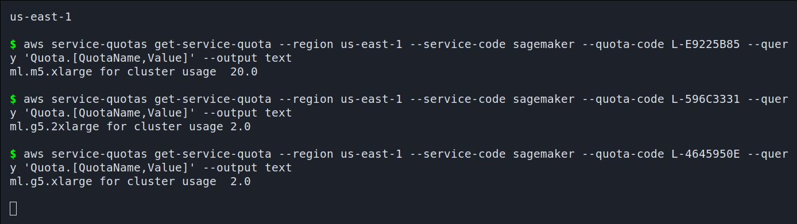
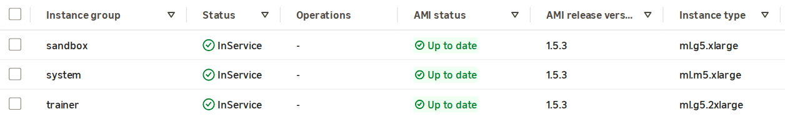
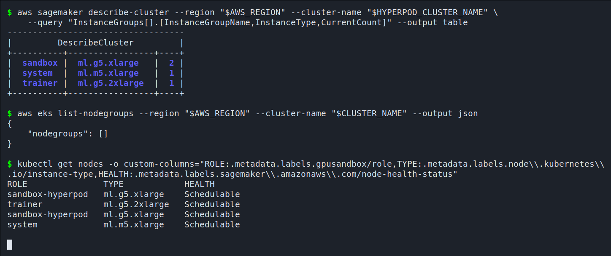

---
hide:
  - footer
---

# Provision EKS and workers through HyperPod (B2)

Check the regional SageMaker quotas, then run the deployment script to create the EKS cluster and its four HyperPod workers.

## Check regional quotas { #check-regional-quotas }

The SageMaker quotas labeled `for cluster usage` apply separately to each region. Check that the quotas below allow at least one system CPU worker, one training GPU worker and two grading GPU workers, in that order.

```bash
for quota in L-E9225B85 L-596C3331 L-4645950E; do
  aws service-quotas get-service-quota --region us-east-1 --service-code sagemaker \
    --quota-code "$quota" --query 'Quota.[QuotaName,Value]' --output text
done
```

[](../../../images/terminal/hyperpod-b2-quotas.png)

## Create the cluster through HyperPod { #create-the-cluster-through-hyperpod }

If `scripts/config.env` is missing, create it with `cp scripts/config.env.example scripts/config.env`. Set the entries below and keep the other version defaults. Use a dedicated lifecycle bucket and ECR prefix so cleanup affects only this lab.

```bash
export AWS_REGION="us-east-1"
export SCENARIO="B2"
export K8S_VERSION="1.36"
export CLUSTER_NAME="gpu-sandbox-b2-eks"
export HYPERPOD_CLUSTER_NAME="gpu-sandbox-b2-hp"
export HYPERPOD_AZ_IDS="use1-az1,use1-az2"
export HYPERPOD_SYSTEM_INSTANCE_TYPE="ml.m5.xlarge"
export HYPERPOD_TRAINER_INSTANCE_TYPE="ml.g5.2xlarge"
export HYPERPOD_SANDBOX_INSTANCE_TYPE="ml.g5.xlarge"
export HYPERPOD_SANDBOX_COUNT="2"
export ECR_REPO_PREFIX="gpu-sandbox-b2"
export HYPERPOD_LCS_BUCKET="sagemaker-gpu-sandbox-b2-$(aws sts get-caller-identity --query Account --output text)-use1"
```

The script uses the regional AWS CloudFormation template behind **Create HyperPod cluster → Orchestrated by Amazon EKS** in the SageMaker console. This single stack creates the VPC, the EKS control plane and all three HyperPod groups. The separate `scripts/02_create_cluster.sh` and `cdk/tunnel.sh` commands belong to the CDK path.

```bash
source scripts/config.env
scripts/hyperpod/create_managed.sh
```

While the stack is being created, use the **B1 / B2** tab in [image build](cdk.md#__tabbed_2_2){ target="_blank" rel="noopener" } to push the sandbox, trainer and control images to `us-east-1`. Build with `HYPERPOD=1`, save all three URIs in the configuration file, then return here.

When EKS is `ACTIVE`, update kubeconfig on your workstation. `kubectl` and Helm will connect directly to the B2 cluster.

```bash
aws eks update-kubeconfig --region "$AWS_REGION" --name "$CLUSTER_NAME" --alias "$CLUSTER_NAME"
```

## Check the four workers { #check-the-four-workers }

A group can show `InService` before any of its nodes can run a pod. Compare `CurrentCount` with `TargetCount` for each group and wait for four `Ready` Kubernetes nodes.

```bash
aws sagemaker describe-cluster --region "$AWS_REGION" --cluster-name "$HYPERPOD_CLUSTER_NAME" \
  --query 'InstanceGroups[].[InstanceGroupName,InstanceType,CurrentCount,TargetCount]' --output table
kubectl get nodes -L gpusandbox/role,node.kubernetes.io/instance-type
aws eks list-nodegroups --region "$AWS_REGION" --cluster-name "$CLUSTER_NAME"
```

`list-nodegroups` returns an empty array. The four workers listed by Kubernetes belong to the HyperPod instance groups.

[](../../../images/console/hyperpod-b2-instance-groups.png)

[](../../../images/terminal/hyperpod-b2-nodes.png)

??? note "A GPU allocation can fail even with quota available"
    During this run, both G5 types initially returned `INSUFFICIENT_CAPACITY_ERROR`. HyperPod retried in `Continuous` mode and eventually allocated all three GPUs in the same availability zone. Look for an `InstanceId` on each pending logical node before submitting another request.

    ```bash
    aws sagemaker list-cluster-nodes --region "$AWS_REGION" --cluster-name "$HYPERPOD_CLUSTER_NAME" \
      --include-node-logical-ids --query 'ClusterNodeSummaries[].[InstanceGroupName,InstanceId,InstanceStatus.Status,InstanceStatus.Message]' --output table
    ```


Once all four workers are `Ready` and the three image URIs are set, continue to [02 Prepare the sandbox runtime](../02_runtimes/index.md#__tabbed_1_3).
