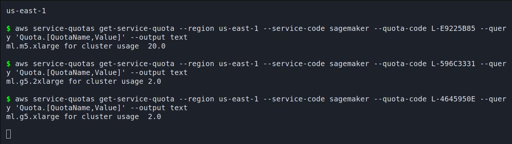
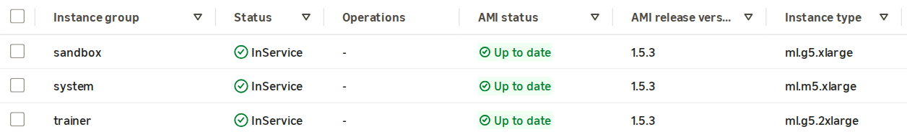
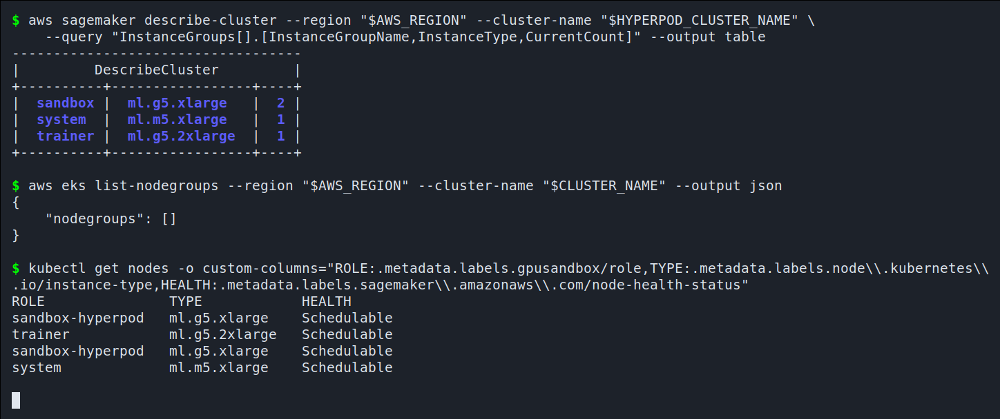

---
hide:
  - footer
---

# HyperPod로 EKS와 워커 만들기 (B2)

실습 리전에서 SageMaker 쿼터를 확인한 뒤 마법사 스택 하나로 제어 영역과 워커 네 대를 만듭니다.

## 시작 전에 확인할 쿼터 { #시작-전에-확인할-쿼터 }

SageMaker의 `for cluster usage` 쿼터는 리전별로 적용됩니다. 아래 세 항목에서 시스템 CPU가 1대, 학습 GPU가 1대, 채점 GPU가 2대 이상인지 순서대로 확인하세요.

```bash
for quota in L-E9225B85 L-596C3331 L-4645950E; do
  aws service-quotas get-service-quota --region us-east-1 --service-code sagemaker \
    --quota-code "$quota" --query 'Quota.[QuotaName,Value]' --output text
done
```

[](../../../images/terminal/hyperpod-b2-quotas.png)

## HyperPod에서 클러스터 만들기 { #hyperpod에서-클러스터-만들기 }

`scripts/config.env`가 없으면 `cp scripts/config.env.example scripts/config.env`로 만드세요. 이 파일에서 아래 항목을 설정하고 다른 버전 기본값은 유지합니다. 나중에 B2 리소스만 지울 수 있도록 lifecycle 버킷 이름과 ECR 리포지토리 접두사는 B2 전용으로 정하세요.

```bash
export AWS_REGION="us-east-1"
export SCENARIO="B2"
export K8S_VERSION="1.36"
export CLUSTER_NAME="gpu-sandbox-b2-eks"
export HYPERPOD_CLUSTER_NAME="gpu-sandbox-b2-hp"
export HYPERPOD_AZ_IDS="use1-az1,use1-az2"
export HYPERPOD_SYSTEM_INSTANCE_TYPE="ml.m5.xlarge"
export HYPERPOD_TRAINER_INSTANCE_TYPE="ml.g5.2xlarge"
export HYPERPOD_SANDBOX_INSTANCE_TYPE="ml.g5.xlarge"
export HYPERPOD_SANDBOX_COUNT="2"
export ECR_REPO_PREFIX="gpu-sandbox-b2"
export HYPERPOD_LCS_BUCKET="sagemaker-gpu-sandbox-b2-$(aws sts get-caller-identity --query Account --output text)-use1"
```

다음 명령은 SageMaker 콘솔에서 **Create HyperPod cluster → Orchestrated by Amazon EKS**를 선택했을 때와 같은 AWS CloudFormation 템플릿으로 스택을 생성합니다. 이 단계에서 VPC, EKS 제어 영역과 세 HyperPod 그룹을 함께 만듭니다. `scripts/02_create_cluster.sh`와 `cdk/tunnel.sh`는 기존 CDK 경로용입니다.

```bash
source scripts/config.env
scripts/hyperpod/create_managed.sh
```

스택이 생성되는 동안 [이미지 빌드](cdk.md#__tabbed_2_2){ target="_blank" rel="noopener" }의 **B1 / B2** 탭으로 sandbox, trainer, control 이미지를 `us-east-1`에 올리세요. `HYPERPOD=1`로 빌드한 세 이미지의 URI를 설정 파일에 저장하면 이 페이지로 돌아오세요.

EKS가 `ACTIVE`가 되면 작업 PC에서 kubeconfig를 갱신합니다. 이후 `kubectl`과 Helm은 B2 클러스터에 직접 접속합니다.

```bash
aws eks update-kubeconfig --region "$AWS_REGION" --name "$CLUSTER_NAME" --alias "$CLUSTER_NAME"
```

## 워커가 등록됐는지 확인하기 { #워커가-등록됐는지-확인하기 }

HyperPod 콘솔에서 그룹이 `InService`여도 모든 노드의 준비가 끝나기 전일 수 있습니다. 각 그룹의 `CurrentCount`가 `TargetCount`와 같은지, Kubernetes에서 네 노드가 모두 `Ready`인지 확인하세요.

```bash
aws sagemaker describe-cluster --region "$AWS_REGION" --cluster-name "$HYPERPOD_CLUSTER_NAME" \
  --query 'InstanceGroups[].[InstanceGroupName,InstanceType,CurrentCount,TargetCount]' --output table
kubectl get nodes -L gpusandbox/role,node.kubernetes.io/instance-type
aws eks list-nodegroups --region "$AWS_REGION" --cluster-name "$CLUSTER_NAME"
```

`list-nodegroups` 결과는 빈 배열입니다. 같은 클러스터에서 `kubectl`로 조회한 워커 네 대는 모두 HyperPod가 관리합니다.

[](../../../images/console/hyperpod-b2-instance-groups.png)

[](../../../images/terminal/hyperpod-b2-nodes.png)

??? note "쿼터가 남았는데 GPU가 배정되지 않을 때"
    이 실습에서 `ml.g5.xlarge`와 `ml.g5.2xlarge`의 인스턴스를 처음 요청했을 때 `INSUFFICIENT_CAPACITY_ERROR`가 기록됐습니다. `Continuous` 모드에서 HyperPod가 다시 요청해 같은 가용 영역에서 세 GPU를 모두 확보했습니다. `Pending` 노드에 `InstanceId`가 할당되는지 확인하세요. 그룹을 새로 만드는 동안 두 요청이 겹칠 수 있습니다.

    ```bash
    aws sagemaker list-cluster-nodes --region "$AWS_REGION" --cluster-name "$HYPERPOD_CLUSTER_NAME" \
      --include-node-logical-ids --query 'ClusterNodeSummaries[].[InstanceGroupName,InstanceId,InstanceStatus.Status,InstanceStatus.Message]' --output table
    ```


워커 네 대가 `Ready`이고 이미지 URI 세 개를 저장했으면 [02 샌드박스 런타임 준비](../02_runtimes/index.md#__tabbed_1_3)로 가세요.
