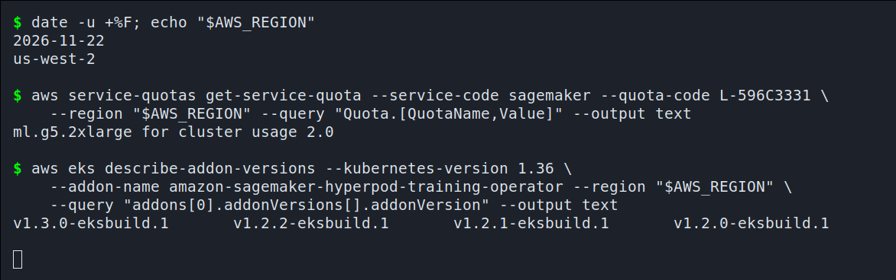
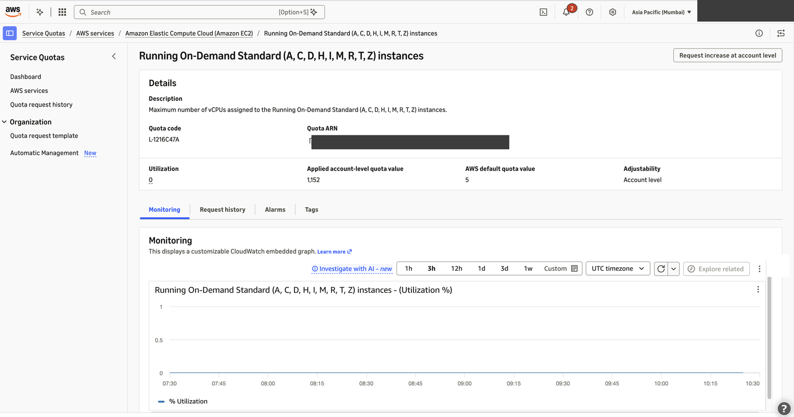

---
hide:
  - footer
---

# 01 Provision the cluster

Run each script from the `gpu-sandbox-on-aws` directory. The scripts read `scripts/config.env`. [Install the required tools](../../start.md#what-you-need) and check the AWS account you will use. The following command copies the example only if the configuration file is missing.

```bash
test -f scripts/config.env || cp scripts/config.env.example scripts/config.env
aws sts get-caller-identity
```

Choose one tab and **save its settings in the file** before running the commands in order. Charges start when you provision the cluster and workers.

=== "A (EC2 GPU)"

    For a sample configuration and the expected EKS deployment output, see the [CDK deployment guide](cdk.md).

    1. **Set the configuration and check quotas**

        Set `SCENARIO=A` and `GVISOR_NODES=2`. The base lab needs 6 free EC2 Standard vCPUs and 16 G/VT vCPUs. Allow 24 G/VT vCPUs for a live pool switch.

        ```bash
        source scripts/config.env
        scripts/01_check_prereqs.sh
        ```

    2. **Provision the EKS cluster with CDK**

        Activate the project virtual environment and install the CDK libraries. Run `cdk bootstrap` once per account and Region.

        ```bash
        test -x .venv/bin/python || uv venv --python 3.14 .venv
        source .venv/bin/activate
        uv pip install -r cdk/requirements.txt
        cdk bootstrap "aws://$(aws sts get-caller-identity --query Account --output text)/$AWS_REGION"
        ```

        ```bash
        scripts/02_create_cluster.sh
        ```

    3. **Open the SSM tunnel in a second terminal**

        Use the same project directory and AWS profile. Leave this terminal open once port `8443` is listening.

        ```bash
        cdk/tunnel.sh
        ```

    4. **Check nodes and build images in the original terminal**

        ```bash
        kubectl get nodes -L gpusandbox/role,node.kubernetes.io/instance-type
        ```

        Check for two `system` nodes, one `trainer` and two `sandbox-gvisor` nodes, all `Ready`, then build the images.

        ```bash
        scripts/03_build_push_images.sh
        ```

        Save the printed `export` lines for `SANDBOX_IMAGE_URI`, `TRAINER_IMAGE_URI`, `CONTROL_IMAGE_URI` in `scripts/config.env`, then [prepare the runtime](../02_runtimes/index.md#__tabbed_1_1).

=== "B1 (HyperPod + EC2)"

    For a sample configuration and the expected EKS deployment output, see the [CDK deployment guide](cdk.md).

    1. **Set the configuration and check quotas**

        Set `SCENARIO=B1`, choose a `HYPERPOD_CLUSTER_NAME` and set `HYPERPOD_LCS_BUCKET` to a unique name beginning with `sagemaker-`. Allow 6 free EC2 Standard vCPUs, 8 G/VT vCPUs and one SageMaker `ml.g5.2xlarge for cluster usage`.

        ```bash
        source scripts/config.env
        scripts/01_check_prereqs.sh
        aws service-quotas get-service-quota --region "$AWS_REGION" --service-code sagemaker \
          --quota-code L-596C3331 --query 'Quota.[QuotaName,Value]' --output text
        ```

    2. **Provision the EKS cluster with CDK**

        Activate the project virtual environment and install the CDK libraries. Run `cdk bootstrap` once per account and Region.

        ```bash
        test -x .venv/bin/python || uv venv --python 3.14 .venv
        source .venv/bin/activate
        uv pip install -r cdk/requirements.txt
        cdk bootstrap "aws://$(aws sts get-caller-identity --query Account --output text)/$AWS_REGION"
        ```

        ```bash
        scripts/02_create_cluster.sh --hyperpod
        ```

    3. **Open the SSM tunnel in a second terminal**

        Use the same project directory and AWS profile. Leave this terminal open once port `8443` is listening.

        ```bash
        cdk/tunnel.sh
        ```

    4. **Check nodes and build images in the original terminal**

        ```bash
        kubectl get nodes -L gpusandbox/role,node.kubernetes.io/instance-type
        ```

        Check for two `system` nodes and two `sandbox-gvisor` nodes, all `Ready`, then build the images. You will attach the HyperPod trainer in step 02.

        ```bash
        HYPERPOD=1 scripts/03_build_push_images.sh
        ```

        Save the printed `export` lines for `SANDBOX_IMAGE_URI`, `TRAINER_IMAGE_URI`, `CONTROL_IMAGE_URI` in `scripts/config.env`, then [prepare the runtime](../02_runtimes/index.md#__tabbed_1_2).

    ??? example "HyperPod quota check"
        

=== "B2 (HyperPod)"

    For quota requirements and screenshots of all four registered workers, see the [HyperPod provisioning guide](hyperpod.md).

    1. **Configure B2 and check HyperPod quotas**

        The lab runs in `us-east-1`. Apply the settings below to the file, then check the quotas for one system CPU worker, one training GPU worker and two grading GPU workers.

        ??? note "B2 settings for scripts/config.env"
            ```bash
            export AWS_REGION="us-east-1"
            export SCENARIO="B2"
            export K8S_VERSION="1.36"
            export CLUSTER_NAME="gpu-sandbox-b2-eks"
            export HYPERPOD_CLUSTER_NAME="gpu-sandbox-b2-hp"
            export HYPERPOD_AZ_IDS="use1-az1,use1-az2"
            export HYPERPOD_SYSTEM_INSTANCE_TYPE="ml.m5.xlarge"
            export HYPERPOD_TRAINER_INSTANCE_TYPE="ml.g5.2xlarge"
            export HYPERPOD_SANDBOX_INSTANCE_TYPE="ml.g5.xlarge"
            export HYPERPOD_SANDBOX_COUNT="2"
            export ECR_REPO_PREFIX="gpu-sandbox-b2"
            export HYPERPOD_LCS_BUCKET="sagemaker-gpu-sandbox-b2-$(aws sts get-caller-identity --query Account --output text)-use1"
            ```

        ```bash
        source scripts/config.env
        for quota in L-E9225B85 L-596C3331 L-4645950E; do
          aws service-quotas get-service-quota --region "$AWS_REGION" --service-code sagemaker \
            --quota-code "$quota" --query 'Quota.[QuotaName,Value]' --output text
        done
        ```

    2. **Create EKS and the HyperPod workers**

        One wizard stack provisions the EKS control plane and all three worker groups. When the script prints the stack name, start building the images while provisioning continues.

        ```bash
        scripts/hyperpod/create_managed.sh
        ```

    3. **Build the HyperPod images**

        ```bash
        HYPERPOD=1 scripts/03_build_push_images.sh
        ```

        Save the three printed `export` lines for `SANDBOX_IMAGE_URI`, `TRAINER_IMAGE_URI` and `CONTROL_IMAGE_URI` in `scripts/config.env`.

    4. **Wait for the stack and connect directly to EKS**

        ```bash
        aws cloudformation wait stack-create-complete --region "$AWS_REGION" \
          --stack-name "${HYPERPOD_MANAGED_STACK:-${CLUSTER_NAME}-hyperpod}"
        ```

        When the wait succeeds, run these in the same terminal.

        ```bash
        aws eks update-kubeconfig --region "$AWS_REGION" --name "$CLUSTER_NAME" --alias "$CLUSTER_NAME"
        aws sagemaker describe-cluster --region "$AWS_REGION" --cluster-name "$HYPERPOD_CLUSTER_NAME" \
          --query 'InstanceGroups[].[InstanceGroupName,InstanceType,CurrentCount,TargetCount]' --output table
        kubectl get nodes -L gpusandbox/role,node.kubernetes.io/instance-type
        ```

        When `CurrentCount` matches `TargetCount` in each group and all four workers are `Ready`, [prepare the runtime](../02_runtimes/index.md#__tabbed_1_3). [Worker registration and capacity troubleshooting](hyperpod.md#check-the-four-workers)

=== "C (CPU)"

    For a sample configuration and the expected EKS deployment output, see the [CDK deployment guide](cdk.md).

    1. **Set the configuration and check quotas**

        Set `SCENARIO=C` and `WITH_KATA_GPU=0`, then add `export KATA_CPU_REPLICAS=1`. Check for 14 free EC2 Standard vCPUs and `nested-virtualization` among the supported features of `c8i.2xlarge`.

        ```bash
        source scripts/config.env
        scripts/01_check_prereqs.sh
        ```

    2. **Provision the EKS cluster with CDK**

        Activate the project virtual environment and install the CDK libraries. Run `cdk bootstrap` once per account and Region.

        ```bash
        test -x .venv/bin/python || uv venv --python 3.14 .venv
        source .venv/bin/activate
        uv pip install -r cdk/requirements.txt
        cdk bootstrap "aws://$(aws sts get-caller-identity --query Account --output text)/$AWS_REGION"
        ```

        ```bash
        scripts/02_create_cluster.sh --cpu-only
        ```

    3. **Open the SSM tunnel in a second terminal**

        Use the same project directory and AWS profile. Leave this terminal open once port `8443` is listening.

        ```bash
        cdk/tunnel.sh
        ```

    4. **Check nodes and build images in the original terminal**

        ```bash
        kubectl get nodes -L gpusandbox/role,node.kubernetes.io/instance-type
        ```

        Check for two `system` nodes and one `c8i.2xlarge`, all `Ready`, then build the images.

        ```bash
        scripts/03_build_push_images.sh --no-trainer
        ```

        Save the printed `export` lines for `SANDBOX_IMAGE_URI`, `CONTROL_IMAGE_URI` in `scripts/config.env`, then [prepare the runtime](../02_runtimes/index.md#__tabbed_1_4).

    ??? example "CPU quota and EKS nodes"
        

        
