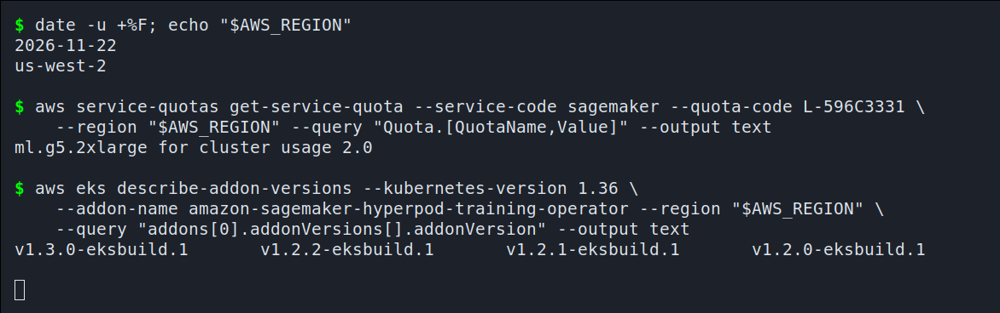
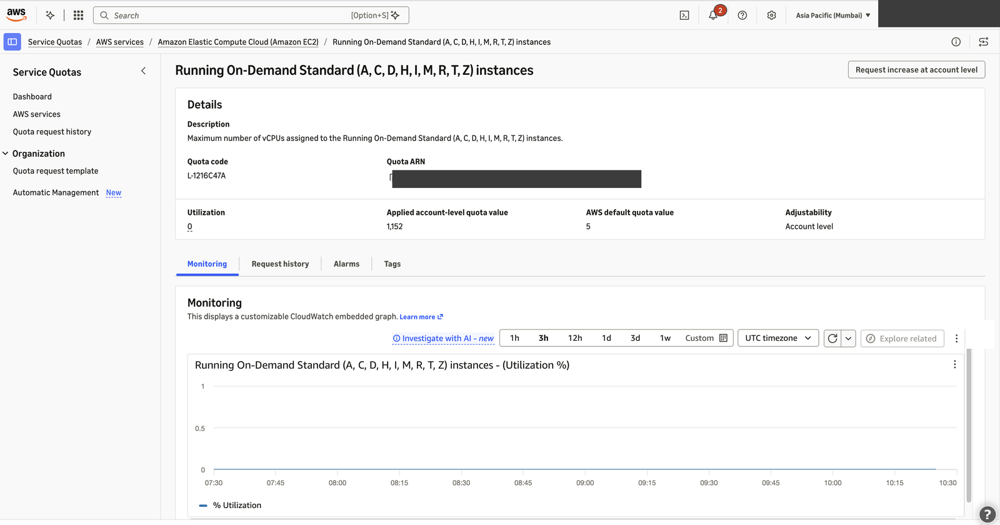

---
hide:
  - footer
---

# 01 클러스터 프로비저닝

각 스크립트는 `gpu-sandbox-on-aws` 폴더에서 실행하며 설정은 `scripts/config.env`에서 읽습니다. [필요한 도구](../../start.md#준비물)를 준비하고 AWS CLI에서 실습 계정을 확인하세요. 아래 명령은 설정 파일이 없을 때만 예시를 복사합니다.

```bash
test -f scripts/config.env || cp scripts/config.env.example scripts/config.env
aws sts get-caller-identity
```

탭 하나를 골라 설정값을 **파일에 저장한 뒤** 순서대로 실행하세요. 클러스터와 워커를 만들면 요금이 발생합니다.

=== "A (EC2 GPU)"

    설정 파일 예시부터 EKS 배포 결과까지 보려면 [CDK 배포 상세 가이드](cdk.md)를 참고하세요.

    1. **설정과 쿼터 확인**

        `SCENARIO=A`, `GVISOR_NODES=2`로 설정하세요. 기본 구성에는 EC2 Standard 6 vCPU와 G/VT 16 vCPU의 여유가 필요합니다. 학습 중 pool을 교체하려면 G/VT 24 vCPU를 확보하세요.

        ```bash
        source scripts/config.env
        scripts/01_check_prereqs.sh
        ```

    2. **CDK로 EKS 클러스터 배포**

        프로젝트 가상 환경을 활성화하고 CDK 라이브러리를 설치하세요. `cdk bootstrap`은 계정과 리전마다 처음 한 번 실행합니다.

        ```bash
        test -x .venv/bin/python || uv venv --python 3.14 .venv
        source .venv/bin/activate
        uv pip install -r cdk/requirements.txt
        cdk bootstrap "aws://$(aws sts get-caller-identity --query Account --output text)/$AWS_REGION"
        ```

        ```bash
        scripts/02_create_cluster.sh
        ```

    3. **두 번째 터미널에서 SSM 터널 열기**

        같은 프로젝트 폴더와 AWS 프로필을 사용하세요. 포트 `8443`이 열리면 이 터미널을 열어 둡니다.

        ```bash
        cdk/tunnel.sh
        ```

    4. **원래 터미널에서 노드 확인과 이미지 빌드**

        ```bash
        kubectl get nodes -L gpusandbox/role,node.kubernetes.io/instance-type
        ```

        `system` 두 대, `trainer` 한 대, `sandbox-gvisor` 두 대가 모두 `Ready`이면 이미지를 빌드하세요.

        ```bash
        scripts/03_build_push_images.sh
        ```

        출력된 `SANDBOX_IMAGE_URI`, `TRAINER_IMAGE_URI`, `CONTROL_IMAGE_URI`의 `export` 줄을 `scripts/config.env`에 저장하고 [02 런타임 준비](../02_runtimes/index.md#__tabbed_1_1)로 가세요.

=== "B1 (HyperPod + EC2)"

    설정 파일 예시부터 EKS 배포 결과까지 보려면 [CDK 배포 상세 가이드](cdk.md)를 참고하세요.

    1. **설정과 쿼터 확인**

        `SCENARIO=B1`로 설정하고 `HYPERPOD_CLUSTER_NAME`과 `sagemaker-`로 시작하는 고유한 `HYPERPOD_LCS_BUCKET` 이름을 지정하세요. EC2 Standard 6 vCPU, G/VT 8 vCPU와 SageMaker `ml.g5.2xlarge for cluster usage` 한 대분이 필요합니다.

        ```bash
        source scripts/config.env
        scripts/01_check_prereqs.sh
        aws service-quotas get-service-quota --region "$AWS_REGION" --service-code sagemaker \
          --quota-code L-596C3331 --query 'Quota.[QuotaName,Value]' --output text
        ```

    2. **CDK로 EKS 클러스터 배포**

        프로젝트 가상 환경을 활성화하고 CDK 라이브러리를 설치하세요. `cdk bootstrap`은 계정과 리전마다 처음 한 번 실행합니다.

        ```bash
        test -x .venv/bin/python || uv venv --python 3.14 .venv
        source .venv/bin/activate
        uv pip install -r cdk/requirements.txt
        cdk bootstrap "aws://$(aws sts get-caller-identity --query Account --output text)/$AWS_REGION"
        ```

        ```bash
        scripts/02_create_cluster.sh --hyperpod
        ```

    3. **두 번째 터미널에서 SSM 터널 열기**

        같은 프로젝트 폴더와 AWS 프로필을 사용하세요. 포트 `8443`이 열리면 이 터미널을 열어 둡니다.

        ```bash
        cdk/tunnel.sh
        ```

    4. **원래 터미널에서 노드 확인과 이미지 빌드**

        ```bash
        kubectl get nodes -L gpusandbox/role,node.kubernetes.io/instance-type
        ```

        `system` 두 대와 `sandbox-gvisor` 두 대가 모두 `Ready`이면 이미지를 빌드하세요. HyperPod 학습 노드는 02에서 연결합니다.

        ```bash
        HYPERPOD=1 scripts/03_build_push_images.sh
        ```

        출력된 `SANDBOX_IMAGE_URI`, `TRAINER_IMAGE_URI`, `CONTROL_IMAGE_URI`의 `export` 줄을 `scripts/config.env`에 저장하고 [02 런타임 준비](../02_runtimes/index.md#__tabbed_1_2)로 가세요.

    ??? example "HyperPod 쿼터 확인 화면"
        

=== "B2 (HyperPod)"

    필요한 쿼터와 워커 네 대가 등록된 화면은 [HyperPod 배포 상세 가이드](hyperpod.md)에서 확인하세요.

    1. **설정과 HyperPod 쿼터 확인**

        실습 리전은 `us-east-1`입니다. 아래 설정을 파일에 반영한 뒤 시스템 CPU, 학습 GPU, 채점 GPU 쿼터가 각각 1대, 1대, 2대 이상인지 확인하세요.

        ??? note "scripts/config.env에 넣을 B2 설정"
            ```bash
            export AWS_REGION="us-east-1"
            export SCENARIO="B2"
            export K8S_VERSION="1.36"
            export CLUSTER_NAME="gpu-sandbox-b2-eks"
            export HYPERPOD_CLUSTER_NAME="gpu-sandbox-b2-hp"
            export HYPERPOD_AZ_IDS="use1-az1,use1-az2"
            export HYPERPOD_SYSTEM_INSTANCE_TYPE="ml.m5.xlarge"
            export HYPERPOD_TRAINER_INSTANCE_TYPE="ml.g5.2xlarge"
            export HYPERPOD_SANDBOX_INSTANCE_TYPE="ml.g5.xlarge"
            export HYPERPOD_SANDBOX_COUNT="2"
            export ECR_REPO_PREFIX="gpu-sandbox-b2"
            export HYPERPOD_LCS_BUCKET="sagemaker-gpu-sandbox-b2-$(aws sts get-caller-identity --query Account --output text)-use1"
            ```

        ```bash
        source scripts/config.env
        for quota in L-E9225B85 L-596C3331 L-4645950E; do
          aws service-quotas get-service-quota --region "$AWS_REGION" --service-code sagemaker \
            --quota-code "$quota" --query 'Quota.[QuotaName,Value]' --output text
        done
        ```

    2. **EKS와 HyperPod 워커 생성**

        마법사 스택 하나로 EKS 제어 영역과 세 인스턴스 그룹을 만듭니다. 스크립트가 스택 이름을 출력하면 생성이 진행되는 동안 이미지를 빌드하세요.

        ```bash
        scripts/hyperpod/create_managed.sh
        ```

    3. **HyperPod 이미지 빌드**

        ```bash
        HYPERPOD=1 scripts/03_build_push_images.sh
        ```

        출력된 `SANDBOX_IMAGE_URI`, `TRAINER_IMAGE_URI`, `CONTROL_IMAGE_URI`의 `export` 세 줄을 `scripts/config.env`에 저장하세요.

    4. **스택 완료 후 EKS API에 직접 접속**

        ```bash
        aws cloudformation wait stack-create-complete --region "$AWS_REGION" \
          --stack-name "${HYPERPOD_MANAGED_STACK:-${CLUSTER_NAME}-hyperpod}"
        ```

        대기가 성공하면 같은 터미널에서 실행하세요.

        ```bash
        aws eks update-kubeconfig --region "$AWS_REGION" --name "$CLUSTER_NAME" --alias "$CLUSTER_NAME"
        aws sagemaker describe-cluster --region "$AWS_REGION" --cluster-name "$HYPERPOD_CLUSTER_NAME" \
          --query 'InstanceGroups[].[InstanceGroupName,InstanceType,CurrentCount,TargetCount]' --output table
        kubectl get nodes -L gpusandbox/role,node.kubernetes.io/instance-type
        ```

        각 그룹의 `CurrentCount`와 `TargetCount`가 같고 워커 네 대가 모두 `Ready`이면 [02 런타임 준비](../02_runtimes/index.md#__tabbed_1_3)로 가세요. [워커 등록 화면과 용량 부족 해결 방법](hyperpod.md#워커가-등록됐는지-확인하기)

=== "C (CPU)"

    설정 파일 예시부터 EKS 배포 결과까지 보려면 [CDK 배포 상세 가이드](cdk.md)를 참고하세요.

    1. **설정과 쿼터 확인**

        `SCENARIO=C`, `WITH_KATA_GPU=0`으로 설정하고 `export KATA_CPU_REPLICAS=1`을 추가하세요. 출력에서 EC2 Standard 14 vCPU의 여유를 확인하고 `c8i.2xlarge`의 지원 기능에 `nested-virtualization`이 있는지 보세요.

        ```bash
        source scripts/config.env
        scripts/01_check_prereqs.sh
        ```

    2. **CDK로 EKS 클러스터 배포**

        프로젝트 가상 환경을 활성화하고 CDK 라이브러리를 설치하세요. `cdk bootstrap`은 계정과 리전마다 처음 한 번 실행합니다.

        ```bash
        test -x .venv/bin/python || uv venv --python 3.14 .venv
        source .venv/bin/activate
        uv pip install -r cdk/requirements.txt
        cdk bootstrap "aws://$(aws sts get-caller-identity --query Account --output text)/$AWS_REGION"
        ```

        ```bash
        scripts/02_create_cluster.sh --cpu-only
        ```

    3. **두 번째 터미널에서 SSM 터널 열기**

        같은 프로젝트 폴더와 AWS 프로필을 사용하세요. 포트 `8443`이 열리면 이 터미널을 열어 둡니다.

        ```bash
        cdk/tunnel.sh
        ```

    4. **원래 터미널에서 노드 확인과 이미지 빌드**

        ```bash
        kubectl get nodes -L gpusandbox/role,node.kubernetes.io/instance-type
        ```

        `system` 두 대와 `c8i.2xlarge` 한 대가 모두 `Ready`이면 이미지를 빌드하세요.

        ```bash
        scripts/03_build_push_images.sh --no-trainer
        ```

        출력된 `SANDBOX_IMAGE_URI`, `CONTROL_IMAGE_URI`의 `export` 줄을 `scripts/config.env`에 저장하고 [02 런타임 준비](../02_runtimes/index.md#__tabbed_1_4)로 가세요.

    ??? example "CPU 쿼터와 EKS 노드 확인 화면"
        

        
