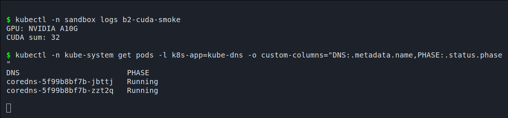

---
hide:
  - footer
---

# Prepare the HyperPod grading workers (B2)

## Prepare the sandbox drivers and training operator { #prepare-the-sandbox-drivers-and-training-operator }

The stock HyperPod image in this run used NVIDIA `595.112.07`. The lifecycle hook prepares gVisor and the driver tools while the workers join with their stock drivers. Once both are `Ready`, `reboot_sandboxes.sh` installs `580.178.04` on the **two grading nodes** and reboots them through the HyperPod API. This activates the gVisor-compatible driver without unloading a kernel module that HyperPod monitoring is using. The trainer and CPU workers keep their stock configuration.

```bash
scripts/hyperpod/reboot_sandboxes.sh
scripts/hyperpod/prepare_managed.sh
scripts/04_install_gpu_stack.sh
kubectl apply -f k8s/runtimes/runtimeclass-gvisor-hyperpod.yaml
```

`prepare_managed.sh` assigns CoreDNS to `system` and enables VPC CNI NetworkPolicy enforcement. In this run the wizard stack completed while the training operator was `CREATE_FAILED`. Installing `cert-manager`, waiting for its webhook and recreating the same operator version brought the add-on to `ACTIVE`.

[](../../../images/terminal/hyperpod-b2-cuda.png)

If HyperPod replaces a grading worker, wait for the new node to register and run `reboot_sandboxes.sh` before returning it to the pool. The script checks the running and on-disk drivers and skips workers that already run the target version. This lab tested managed reboots of both workers.


Once the operator is `ACTIVE` and the `gvisor-hyperpod` RuntimeClass is registered, continue to [03 Deploy and verify grading pools](../03_pools/index.md#__tabbed_1_3).
