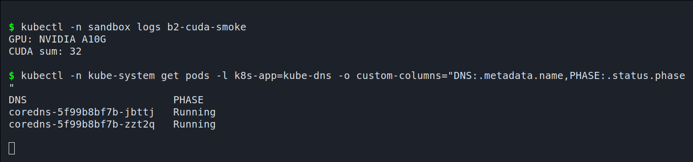

---
hide:
  - footer
---

# HyperPod 채점 워커 준비하기 (B2)

## 채점 노드의 드라이버와 학습 오퍼레이터 준비하기 { #채점-노드의-드라이버와-학습-오퍼레이터-준비하기 }

이 실습의 기본 HyperPod 이미지에는 NVIDIA `595.112.07`이 들어 있었습니다. gVisor `20261109.0`이 지원하는 `580.178.04`를 **채점 노드 두 대에만** 설치합니다. lifecycle 스크립트는 기본 드라이버로 워커가 등록되도록 gVisor와 설치 도구를 준비합니다. 두 워커가 `Ready`가 된 뒤 `reboot_sandboxes.sh`가 새 드라이버를 디스크에 설치하고 채점 노드를 HyperPod API로 재부팅합니다. 모니터링 프로세스가 사용 중인 커널 모듈은 재부팅 때 교체됩니다. CPU 노드와 학습 노드는 기본 이미지를 사용합니다.

```bash
scripts/hyperpod/reboot_sandboxes.sh
scripts/hyperpod/prepare_managed.sh
scripts/04_install_gpu_stack.sh
kubectl apply -f k8s/runtimes/runtimeclass-gvisor-hyperpod.yaml
```

`prepare_managed.sh`는 CoreDNS를 `system` 그룹에 배치하고 VPC CNI의 NetworkPolicy를 켭니다. 이번 실습에서는 마법사 스택이 완료된 뒤에도 학습 오퍼레이터가 `CREATE_FAILED`였습니다. `cert-manager`를 설치하고 웹훅이 준비된 뒤 같은 버전의 오퍼레이터를 다시 설치해 `ACTIVE`를 확인했습니다.

[](../../../images/terminal/hyperpod-b2-cuda.png)

HyperPod가 채점 노드를 교체하면 새 워커가 등록된 뒤 `reboot_sandboxes.sh`를 다시 실행하세요. 실행 중인 드라이버와 디스크의 드라이버를 비교해 이미 목표 버전을 쓰는 워커는 건너뜁니다. 이번 실습에서 확인한 복구 작업은 두 워커의 관리형 재부팅입니다.


오퍼레이터가 `ACTIVE`이고 `gvisor-hyperpod` RuntimeClass를 등록했으면 [03 채점 pool 배포와 검증](../03_pools/index.md#__tabbed_1_3)으로 가세요.
