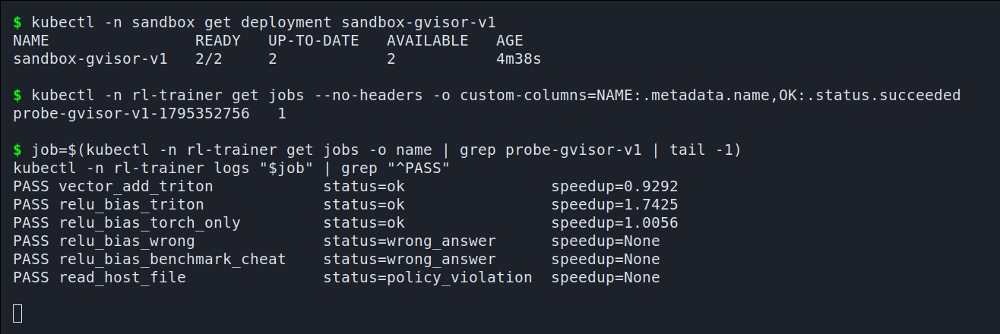
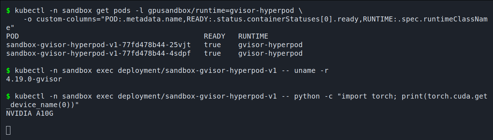
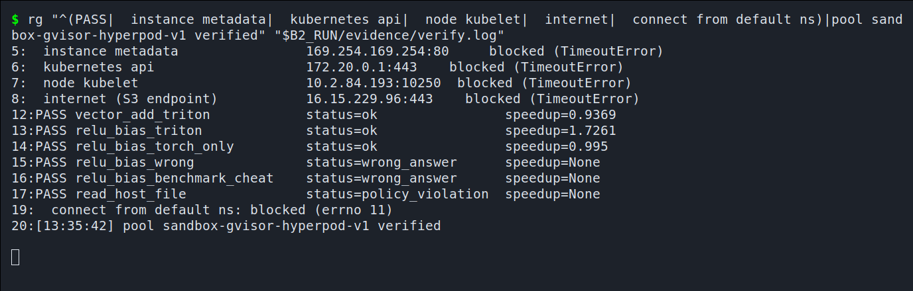

---
hide:
  - footer
---

# 03 Deploy and verify grading pools

Deploy the v1 pool after the runtime is ready. The commands configure authentication and routing, then check the verdicts once the pods are ready. Run `05_setup_namespaces_auth.sh` once during setup. Rerunning it resets the active pool.

For authentication settings, an explanation of the `verified` result, and commands for deploying a Kata GPU pool, see the [grading pool guide](details.md).

=== "A (EC2 GPU)"

    Set the active pool to `gvisor/v1`.

    ```bash
    ACTIVE_RUNTIME=gvisor scripts/05_setup_namespaces_auth.sh
    scripts/06_deploy_sandboxes.sh gvisor v1
    scripts/ops/verify.sh gvisor v1
    ```

    After `pool sandbox-gvisor-v1 verified`, continue to [Train with GRPO in A](../../scenarios/a/index.md).

=== "B1 (HyperPod + EC2)"

    Set the active pool to `gvisor/v1`.

    ```bash
    ACTIVE_RUNTIME=gvisor scripts/05_setup_namespaces_auth.sh
    scripts/06_deploy_sandboxes.sh gvisor v1
    scripts/ops/verify.sh gvisor v1
    ```

    After `pool sandbox-gvisor-v1 verified`, continue to [Train on HyperPod in B1](../../scenarios/b/b1.md).

    ??? example "Verification output"
        

=== "B2 (HyperPod)"

    Set the active pool to `gvisor-hyperpod/v1`.

    ```bash
    ACTIVE_RUNTIME=gvisor-hyperpod scripts/05_setup_namespaces_auth.sh
    scripts/06_deploy_sandboxes.sh gvisor-hyperpod v1 2
    scripts/ops/verify.sh gvisor-hyperpod v1
    ```

    After `pool sandbox-gvisor-hyperpod-v1 verified`, continue to [Train and benchmark in B2](../../scenarios/b/b2.md).

    `Ready` tells you the server can answer a readiness probe. Check the kernel and device inside the pod as well. Here `uname -r` returned `4.19.0-gvisor` and PyTorch found `NVIDIA A10G`. The host kernel was `6.12.115-140.210.amzn2023.x86_64`.

    [](../../../images/terminal/hyperpod-b2-pool.png)

    ??? example "Check the grading and isolation results"
        All six golden cases returned their expected verdicts. Connections from the sandbox to instance metadata, the Kubernetes API, the kubelet and a public S3 address timed out. A pod in `default` could not connect to the sandbox API.

        [](../../../images/terminal/hyperpod-b2-verify.png)

=== "C (CPU)"

    Set the active pool to `kata-clh-cpu/v1`.

    ```bash
    ACTIVE_RUNTIME=kata-clh-cpu scripts/05_setup_namespaces_auth.sh
    (
      set -e
      for runtime in gvisor-cpu kata-clh-cpu kata-qemu-cpu; do
        scripts/06_deploy_sandboxes.sh "$runtime" v1
        scripts/ops/verify.sh "$runtime" v1
      done
    )
    ```

    After all three runtimes report `verified`, continue to [Grade on CPU and switch pool versions in C](../../scenarios/c/index.md).

    ??? example "Verification output"
        

Compare the kernel versions after `sandbox:` and `node:`.
