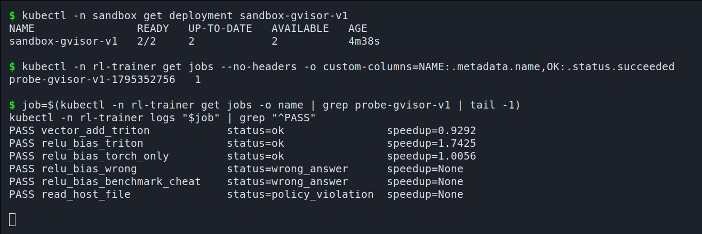
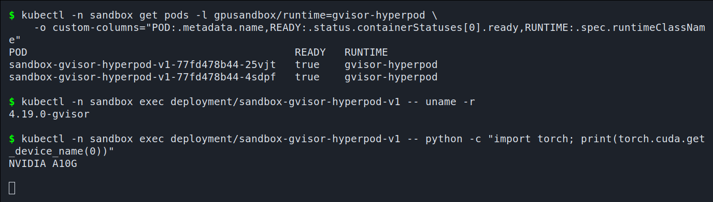
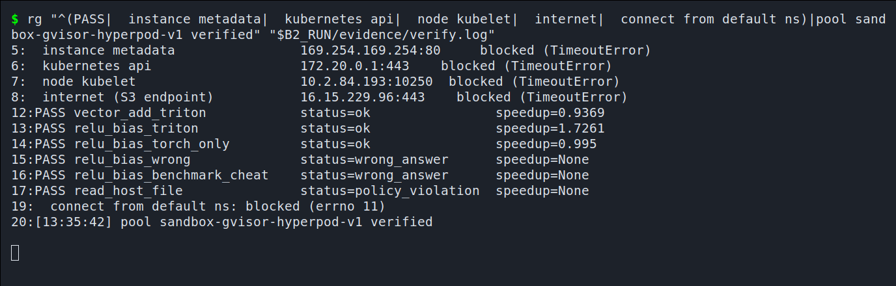
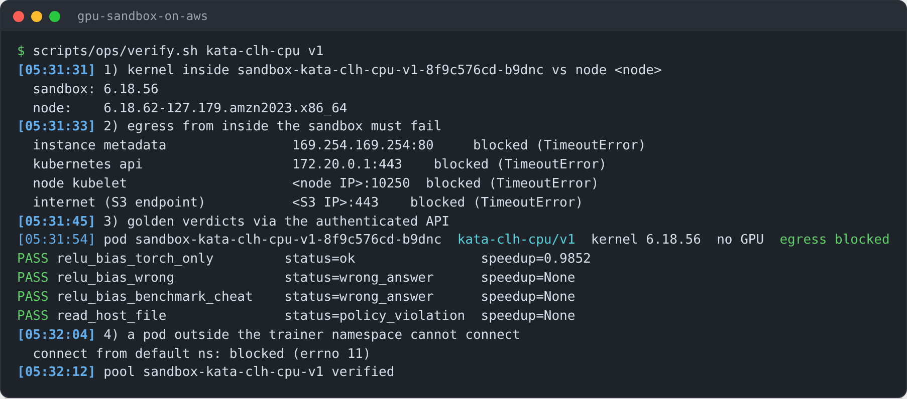

---
hide:
  - footer
---

# 03 채점 pool 배포와 검증

런타임 준비를 마쳤다면 채점 요청을 받을 v1 pool을 배포하세요. 아래 명령은 인증과 라우팅을 설정하고, pod가 준비되면 시험 답안의 판정을 확인합니다. `05_setup_namespaces_auth.sh`를 다시 실행하면 활성 pool이 바뀌므로 처음 배포할 때 한 번 실행하세요.

인증 설정이나 `verified` 판정 기준이 궁금하다면 [채점 pool 상세 가이드](details.md)를 보세요. Kata GPU용 pool 배포 명령도 같은 가이드에 있습니다.

=== "A (EC2 GPU)"

    활성 pool을 `gvisor/v1`로 지정하세요.

    ```bash
    ACTIVE_RUNTIME=gvisor scripts/05_setup_namespaces_auth.sh
    scripts/06_deploy_sandboxes.sh gvisor v1
    scripts/ops/verify.sh gvisor v1
    ```

    `pool sandbox-gvisor-v1 verified`를 확인하면 [A에서 GRPO 학습하기](../../scenarios/a/index.md)로 이어가세요.

=== "B1 (HyperPod + EC2)"

    활성 pool을 `gvisor/v1`로 지정하세요.

    ```bash
    ACTIVE_RUNTIME=gvisor scripts/05_setup_namespaces_auth.sh
    scripts/06_deploy_sandboxes.sh gvisor v1
    scripts/ops/verify.sh gvisor v1
    ```

    `pool sandbox-gvisor-v1 verified`를 확인하면 [B1에서 HyperPod 학습하기](../../scenarios/b/b1.md)로 이어가세요.

    ??? example "검증 결과 화면"
        

=== "B2 (HyperPod)"

    활성 pool을 `gvisor-hyperpod/v1`로 지정하세요.

    ```bash
    ACTIVE_RUNTIME=gvisor-hyperpod scripts/05_setup_namespaces_auth.sh
    scripts/06_deploy_sandboxes.sh gvisor-hyperpod v1 2
    scripts/ops/verify.sh gvisor-hyperpod v1
    ```

    `pool sandbox-gvisor-hyperpod-v1 verified`를 확인하면 [B2에서 학습하고 벤치마크하기](../../scenarios/b/b2.md)로 이어가세요.

    두 Pod가 `Ready`인지만 보면 어느 커널에서 코드가 실행되는지 알 수 없습니다. 아래 화면에서 `uname -r`은 샌드박스의 `4.19.0-gvisor`를 반환하고 PyTorch는 `NVIDIA A10G`를 찾습니다. 실습 당시 호스트 커널은 `6.12.115-140.210.amzn2023.x86_64`였습니다.

    [](../../../images/terminal/hyperpod-b2-pool.png)

    ??? example "기준 사례와 격리 검사 결과 보기"
        기준 사례 6개가 모두 예상대로 채점됐습니다. 샌드박스에서 인스턴스 메타데이터, Kubernetes API, kubelet, 외부 S3 주소로 접속을 시도했지만 모두 차단됐습니다. `default` 네임스페이스의 Pod도 샌드박스 API에 접속하지 못했습니다.

        [](../../../images/terminal/hyperpod-b2-verify.png)

=== "C (CPU)"

    활성 pool을 `kata-clh-cpu/v1`로 지정하세요.

    ```bash
    ACTIVE_RUNTIME=kata-clh-cpu scripts/05_setup_namespaces_auth.sh
    (
      set -e
      for runtime in gvisor-cpu kata-clh-cpu kata-qemu-cpu; do
        scripts/06_deploy_sandboxes.sh "$runtime" v1
        scripts/ops/verify.sh "$runtime" v1
      done
    )
    ```

    세 런타임에서 각각 `verified`를 확인하면 [C에서 CPU 채점과 버전 교체하기](../../scenarios/c/index.md)로 이어가세요.

    ??? example "검증 결과 화면"
        

`sandbox:`와 `node:`의 커널 버전도 직접 비교하세요.
