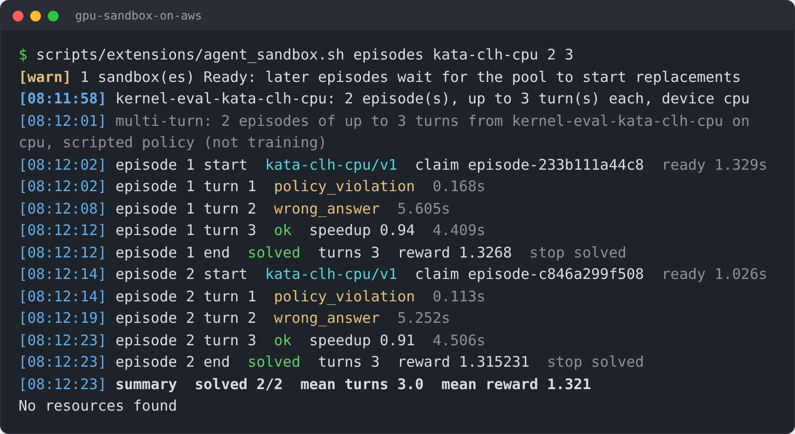

---
hide:
  - footer
---

# Grade multi-turn episodes

<span id="11-grade-multi-turn-episodes-c-a"></span>

<span id="11-multi-turn-episodes"></span>

When an agent submits three answers to one problem, which sandbox gets them? In this exercise each episode (one attempt at a problem) borrows one sandbox. A script submits answers in a fixed order so you can inspect each turn and how resources are released without running a model.

=== "C (CPU)"

    Start with the existing CPU cluster. Follow [preparation](#preparation) and steps 1–4 with `gvisor-cpu`. Compare `claim` and `pod` across turns, then check for `released: true` and [remove the warm pool](#cleanup).

=== "A (GPU)"

    Start with the [verified EC2 pool in A](../common/03_pools/index.md#__tabbed_1_1) and current sandbox and control images. [Install Agent Sandbox](#step-1-install-agent-sandbox-extensionsagent_sandboxsh-install), then go directly to the [GPU warm pool](#gpu-episodes) to free a GPU, run episodes and restore the grading pool.

??? note "Terms (expand if a word is new)"
    - **Episode**: one attempt by a model to solve one task over several turns. The task in this lab is `relu_bias`.
    - **Turn**: one submission of code and the verdict it gets.
    - **Scripted policy (`ScriptedPolicy`)**: a policy that submits golden submissions in a fixed order instead of a model. It does not read the feedback, so nothing is learned; it exercises the episode mechanics only (one claim, feedback between turns, early stop, final-submission grading).
    - **Feedback**: the verdict summary the agent reads before its next turn: status, flags, speedup and the last line of the error message, within 240 characters. veRL cuts tool responses at 256 characters by default, so the feedback stays shorter.
    - **Episode reward**: the episode's final submission graded with `score_verdict`. Failures in earlier turns are used only as feedback.
    - **`single_turn_reward`, `first_turn_reward`**: each submission graded on its own (the same computation as single-turn grading), and that value for the first turn.
    - **SandboxWarmPool, SandboxClaim**: a set of sandboxes started ahead of time, and a request that takes one sandbox from that set.
    - **`shutdownTime`**: the time at which a claim expires. After it, the controller deletes the claim and its sandbox. The CLI in this lab sets it 3600 seconds after the claim is created.

    More terms are in the [Glossary](../../reference/glossary.md).

??? note "What the practice-account run covered"
    `install`, `pool` and `episodes` on this page ran with the `kata-clh-cpu` warm pool on a scenario C cluster, and the five conditions of step 3 held. The `gvisor-cpu` warm pool, the GPU section and the veRL section were not run. The dated run record is in [Verified facts and sources](../../reference/sources.md#aws-run-record).

## One episode, step by step

The runner creates a claim, sends each turn to the same sandbox, and deletes the claim at episode end.

??? note "One episode, step by step"
    The Job `episodes-<unix time>` runs in the `rl-trainer` namespace as the ServiceAccount `sandbox-episode` and runs its episodes one after another. One episode goes like this.

    ```mermaid
    sequenceDiagram
        participant J as Job episodes (rl-trainer)
        participant API as Kubernetes API and agent-sandbox controller
        participant P as SandboxWarmPool kernel-eval-gvisor-cpu
        participant S as assigned sandbox (gvisor-cpu)
        J->>API: create SandboxClaim (warmPoolRef, shutdownTime)
        API->>P: assign one waiting sandbox to the claim
        P->>P: start a new sandbox to keep replicas
        API-->>J: claim Ready, status.sandbox.serviceFQDN
        J->>S: GET /info (runtime, version, pod)
        loop from turn 1 up to max_turns
            J->>S: POST /v1/evaluate (audience token)
            S-->>J: verdict
            J->>J: write feedback, check stop condition
        end
        J->>API: delete SandboxClaim
        API->>S: delete sandbox and pod
    ```

    *Takeaway: one episode takes one sandbox through one claim, sends every turn to that sandbox and deletes the claim at the end. The next episode gets another sandbox through a new claim.*

    An episode ends on any of these.

    - The kernel is solved (`solved`)
    - After `max_turns` submissions
    - On a `sandbox_error` verdict. An episode that ends on `sandbox_error` has the reward `None` and is left out of the means.

    | Component | In this lab | File |
    |---|---|---|
    | Job `episodes-<unix time>` | namespace `rl-trainer`, ServiceAccount `sandbox-episode`. A Kubernetes API token is mounted only in this Job's pod, next to the sandbox-audience token and the label `gpusandbox/client=true` | `k8s/extensions/agent-sandbox/job-multiturn.yaml.tpl` |
    | ServiceAccount `sandbox-episode` | token automount is off by default | `k8s/base/trainer-rbac.yaml` |
    | Role and RoleBinding `sandbox-claims` | only create, get, list, watch and delete on `sandboxclaims` in the `sandbox` namespace | `k8s/extensions/agent-sandbox/trainer-claims-rbac.yaml` |
    | SandboxTemplate and SandboxWarmPool `kernel-eval-gvisor-cpu` | profile `gvisor-cpu` (1 CPU, 2Gi of memory, c8i node). Ingress only from `gpusandbox/client=true` pods in `rl-trainer` on TCP 8000; all egress denied | `k8s/extensions/agent-sandbox/template.yaml.tpl` |
    | Episode runner | `python -m gpusandbox.tools multiturn`. Claims through `EpisodeSandbox` per episode and calls `/v1/evaluate` per turn | `src/gpusandbox/multiturn.py`, `src/gpusandbox/agent_sandbox.py`, `src/gpusandbox/tools.py` |

## Preparation

1. **CPU cluster and permissions.** Prepare the cluster, tunnel and images in [shared step 01 for C](../common/01_provision/index.md#__tabbed_1_4), then [install the CPU runtimes](../common/02_runtimes/kata.md#kata-cpu). Set up namespaces and authentication in [shared step 03 for C](../common/03_pools/index.md#__tabbed_1_4). Agent Sandbox creates its own warm pool for this exercise.

2. **Control image:** the Job runs `python -m gpusandbox.tools multiturn` from the control image (`CONTROL_IMAGE_URI`). If you built the images before the `multiturn` subcommand existed, rebuild them. The ECR repositories are created with immutable tags (`IMMUTABLE`), so first set `IMAGE_TAG` in `scripts/config.env` to a new value.

    ```bash
    # scripts/config.env: a new tag, because the ECR repositories reject an existing one
    export IMAGE_TAG="<new-tag>"
    ```

    ```bash
    scripts/03_build_push_images.sh --no-trainer
    ```

    **What to look for:**

    - The two lines at the end, `SANDBOX_IMAGE_URI` and `CONTROL_IMAGE_URI`, carry the new tag. Paste them into `scripts/config.env`.
    - The new sandbox image is used only by the warm pool of step 2; the Deployment pools deployed in scenario C keep their old image.

3. **Settings:** `scripts/config.env` needs `SANDBOX_IMAGE_URI`, `CONTROL_IMAGE_URI` and `SANDBOX_AUDIENCE`. `pool` reads `SANDBOX_IMAGE_URI` and `SANDBOX_AUDIENCE`; `episodes` reads `CONTROL_IMAGE_URI` and `SANDBOX_AUDIENCE`.

## Step 1: Install Agent Sandbox (`extensions/agent_sandbox.sh install`)

Install the controller and CRDs at a pinned release (default v1.0.11) and apply the ServiceAccount `sandbox-episode` with its claim permission (Role `sandbox-claims`). Run it again even if you installed it in step 9 of [Scenario C](../scenarios/c/index.md): the same objects are applied again, and a cluster without `sandbox-episode` gets that account.

```bash
scripts/extensions/agent_sandbox.sh install
```

**What to look for:**

- The CRD list contains `sandboxclaims.extensions.agents.x-k8s.io`, `sandboxes.agents.x-k8s.io`, `sandboxtemplates.extensions.agents.x-k8s.io` and `sandboxwarmpools.extensions.agents.x-k8s.io`.
- `serviceaccount/sandbox-episode`, `role.rbac.authorization.k8s.io/sandbox-claims` and `rolebinding.rbac.authorization.k8s.io/sandbox-claims` print as `created` or `unchanged`.

Check the permissions of the episode account.

```bash
# The episode account may create claims in the sandbox namespace, and nothing else
kubectl auth can-i create sandboxclaims.extensions.agents.x-k8s.io -n sandbox \
  --as=system:serviceaccount:rl-trainer:sandbox-episode
kubectl auth can-i get pods -n sandbox --as=system:serviceaccount:rl-trainer:sandbox-episode
```

**What to look for:** the first command prints `yes` and the second `no`, because the Role holds only `sandboxclaims` permissions.

**If it fails:**

- **If the CRDs are missing**: check with `kubectl get pods -A` that the controller pod is Running.
- **Common script errors (a missing `scripts/config.env` and the like)**: they are under "Configuration and scripts" in [Troubleshooting](../../reference/troubleshooting.md).

## 2. Create a CPU warm pool (C) { #step-2-create-a-cpu-warm-pool-extensionsagent_sandboxsh-pool }

The commands below use `gvisor-cpu`. To follow the Kata run in the screenshots, use `kata-clh-cpu` consistently for pool creation, episodes and cleanup.

Create the SandboxTemplate and SandboxWarmPool `kernel-eval-gvisor-cpu` from the `gvisor-cpu` profile and start 2 waiting sandboxes. Step 3 runs 2 episodes, so the pool has 2.

```bash
scripts/extensions/agent_sandbox.sh pool gvisor-cpu 2
```

The default allowed subjects include `system:serviceaccount:rl-trainer:sandbox-episode`. A warm sandbox keeps the environment variables it started with (`updateStrategy: OnReplenish`), so its allowlist is fixed when it starts.

**What to look for:**

- The script logs `warm pool kernel-eval-gvisor-cpu: 2 sandbox(es); each holds its accelerator while idle` and prints one line of `kubectl get sandboxwarmpool`.
- Two waiting pods reach READY `1/1`. The sandbox server becomes Ready only after it confirmed that egress is blocked.

    ```bash
    # Warm sandbox pods created by the controller (labels come from the template); Ctrl-C to stop
    kubectl -n sandbox get pods -l gpusandbox/managed-by=agent-sandbox -L gpusandbox/runtime -w
    ```

- The value that the step 3 preflight reads (`status.readyReplicas`) is 2.

    ```bash
    kubectl -n sandbox get sandboxwarmpool kernel-eval-gvisor-cpu -o jsonpath='{.status.readyReplicas}{"\n"}'
    ```

**If it fails:**

- **If a pod is `Pending`**: look for `Insufficient cpu` or `Insufficient memory` in `kubectl -n sandbox describe pod <pod>`. Each pod requests 1 CPU and 2Gi of memory.
- **While an episode runs**: the warm pool starts a sandbox to replace the claimed one, so up to 3 `gvisor-cpu` pods can run (2 waiting and 1 claimed; inferred from the code).
- **If the Deployment pools from scenario C run on the same node and CPU runs short**: scale those pools to zero (`kubectl -n sandbox scale deployment/sandbox-<runtime>-<version> --replicas=0`) or the warm pool to 1 (`pool gvisor-cpu 1`).
- **If pods never become Ready**: look for the `egress is open` line in the server log.
- **Causes and fixes**: they are under "Sandbox pools and readiness" and "NetworkPolicy" in [Troubleshooting](../../reference/troubleshooting.md).

!!! note "To run it in Kata (Cloud Hypervisor) VMs"
    Use `kata-clh-cpu` instead of `gvisor-cpu` in steps 2 to 4 to run the same lab in Kata VMs on the same c8i node (`pool kata-clh-cpu 2`, `episodes kata-clh-cpu 2 3`).

    - **VM overhead**: a Kata pod adds 250m CPU and 130Mi of memory.
    - **Each time a claim is deleted**: the VM of that sandbox is deleted too and the pool starts a new VM.
    - **If you created the `kernel-eval-kata-clh-cpu` pool in an earlier CPU lab**: run `pool kata-clh-cpu 2` again to update the template and the replica count.

??? example "Claim and release on the Kata CPU pool"
    

## 3. Run a multi-turn episode (C) { #step-3-run-multi-turn-episodes-extensionsagent_sandboxsh-episodes }

Even when three turns share a `claim` and `pod`, each submission starts with a clean working directory. What carries across turns in this lab is the sandbox allocation.

Run 2 episodes with up to 3 turns each. This step compares event fields (`claim`, `address`, `feedback`, `released` and others) directly, so run it with `GPUSANDBOX_LOG=json` to get the raw JSON instead of the terminal summary.

```bash
GPUSANDBOX_LOG=json scripts/extensions/agent_sandbox.sh episodes gvisor-cpu 2 3
```

To follow progress only, leave out `GPUSANDBOX_LOG=json`. You then get a line for each episode start, turn (`episode 1 turn 2  wrong_answer ...`) and episode end, followed by the overall summary.

Below is the summary view from a scenario C cluster with the `kata-clh-cpu` warm pool (one waiting sandbox).

- **Warning**: with one waiting sandbox the script warns, but episode 2 takes the sandbox the warm pool started in its place and carries on.
- **The final `No resources found`**: the cleanup step that deletes leftover claims found none.



The script runs in this order.

| Order | What it does |
|---|---|
| Preflight | checks the CRDs, the ServiceAccount `sandbox-episode`, the claim permission, the warm pool's Ready count (at least 1), and that the waiting sandboxes have `sandbox-episode` in their allowlist |
| Device | `cpu` if the runtime name ends in `-cpu`, otherwise `cuda` |
| Job | creates the Job `episodes-<unix time>` from `job-multiturn.yaml.tpl` and follows its log. The Job runs `python -m gpusandbox.tools multiturn --warm-pool kernel-eval-gvisor-cpu --episodes 2 --max-turns 3 --device cpu --run-id episodes-<unix time>` |
| Leftover claims | after the Job, deletes the claims labelled `gpusandbox/run=<Job name>`. The Job deletes each episode's claim itself, so this covers a Job pod that was killed before it could |
| Exit code | the Job's result |

- **Preflight details**: the claim permission is checked with `kubectl auth can-i ... --as`, and the Ready count with `status.readyReplicas`. The script warns when fewer sandboxes are Ready than there are episodes.

On CPU the scripted policy submits `read_host_file` (policy violation), `relu_bias_wrong` (wrong answer) and `relu_bias_torch_only` (correct answer) in that order and ends the episode when the kernel is solved (`solved`). If the Job receives a termination signal (SIGTERM), it leaves through the normal exit path, so the open claim is deleted at once instead of at `shutdownTime`.

Keep the terminal with the SSM tunnel from shared step 01 for C open. In one more work terminal, separate from the one running `episodes`, you can watch the claims being created and deleted one at a time.

```bash
# Episode claims appear and disappear one at a time; Ctrl-C to stop
kubectl -n sandbox get sandboxclaims -l gpusandbox/episode=true -w
```

**What to look for:**

- Events like these, one per line.
- The first two lines are the shape the script and the CLI code print; the rest is a shortened local run (loopback CPU sandbox servers).
- Claim, sandbox and pod names and the speedup differ from run to run.

```text
[hh:mm:ss] kernel-eval-gvisor-cpu: 2 episode(s), up to 3 turn(s) each, device cpu
{"event": "multiturn", "warm_pool": "kernel-eval-gvisor-cpu", "episodes": 2, "max_turns": 3, "device": "cpu", "task_id": "relu_bias", "policy": "scripted", "script": ["read_host_file", "relu_bias_wrong", "relu_bias_torch_only"], ...}
{"event": "episode_start", "episode": 1, "claim": "episode-ca28ce346b27", "warm_pool": "kernel-eval-gvisor-cpu", "sandbox": "sb-episode-ca28ce346b27", "runtime": "gvisor-cpu", "version": "v1", "pod": "kernel-eval-gvisor-cpu-0", ...}
{"event": "turn", "episode": 1, "turn": 1, "claim": "episode-ca28ce346b27", "pod": "kernel-eval-gvisor-cpu-0", "status": "policy_violation", "feedback": "status: policy_violation; violation: line 4: builtin 'open' is not allowed", "single_turn_reward": 0.1, ...}
{"event": "turn", "episode": 1, "turn": 2, ..., "status": "wrong_answer", "feedback": "status: wrong_answer; error: values differ beyond tolerance", "single_turn_reward": 0.3, ...}
{"event": "turn", "episode": 1, "turn": 3, ..., "status": "ok", "speedup": 0.9104, "feedback": "status: ok; speedup: 0.91x", "single_turn_reward": 1.316143, ...}
{"event": "episode_end", "episode": 1, "turns_used": 3, "stop_reason": "solved", "final_status": "ok", "reward": 1.316143, "first_turn_reward": 0.1, "released": true, ...}
...
{"event": "multiturn_summary", "episodes": 2, "solved": 2, "mean_reward": 1.3752, "mean_first_turn_reward": 0.1, "claims": 2, "distinct_sandboxes": 2, "one_sandbox_per_episode": true, ..., "unexpected": []}
```

Check these five things in the events.

| Condition | Where to look |
|---|---|
| All turns of one episode use one claim and one sandbox | in the three `turn` events of episode 1, `claim`, `address` and `pod` all equal the values in `episode_start`. `one_sandbox_per_episode` in `multiturn_summary` is `true` |
| Each episode uses a different sandbox | `claim` and `sandbox` differ between the `episode_start` events of episodes 1 and 2. `claims` and `distinct_sandboxes` are both 2 |
| Every turn gets feedback | `feedback` goes from `status: policy_violation` to `status: wrong_answer` to `status: ok`. The feedback of the wrong-answer turn carries the last line of the error message |
| The final submission sets the episode reward | `reward` in `episode_end` (1.316143 in the sample) equals the last turn's `single_turn_reward` and is higher than `first_turn_reward` (0.1). `mean_reward` and `mean_first_turn_reward` in `multiturn_summary` relate the same way |
| The claim is deleted when the episode ends | `released` in `episode_end` is `true`, and the command below lists no claim |

```bash
kubectl -n sandbox get sandboxclaims -l gpusandbox/run=<Job name>
```

**What to look for:**

- `No resources found in sandbox namespace.`
- The warm pool starts new sandboxes in place of the deleted ones, so `readyReplicas` returns to the warm count a little later (2 by default, 1 if you ran `pool gvisor-cpu 1`).
- Check the script's exit code with `echo $?` in the terminal where the `episodes` command ran, before you run anything else there. It should be 0. Run the claim query above in the extra work terminal so that it does not overwrite the exit code.

The `single_turn_reward` of each turn is `0.1 × format + 1.0 × correctness + 0.5 × speedup score`.

- **Policy violation**: it gets only the format score of 0.1 if the code parses and defines `ModelNew`, and 0 otherwise.
- **Wrong answer**: it gets 0.1 plus a correctness of 0.2, which is 0.3.
- **Correct answer**: the CPU path does not require Triton (`require_triton=False`), so a correct answer has a correctness of 1.0, and the speedup score changes from run to run with CPU timing noise.

The CLI exits with 1 in these cases.

- A turn's verdict differs from what its golden expects (recorded in `unexpected`)
- A `sandbox_error` occurred
- More than one pod answered the turns of one episode

**If it fails:**

- **Preflight messages** (`agent-sandbox CRDs not found`, `ServiceAccount rl-trainer/sandbox-episode not found`, `... may not create SandboxClaims`, `warm pool ... not found`, `... has no Ready sandbox`, `sandboxes started without ... in their allowlist`): their causes and fixes are under "Agent Sandbox and multi-turn episodes" in [Troubleshooting](../../reference/troubleshooting.md). The last one appears when sandboxes from an earlier CPU lab that started before `sandbox-episode` was on the allowlist are still waiting.
- **If the Job log shows `invalid choice: 'multiturn'`**: the control image predates the `multiturn` subcommand. Rebuild it with a new tag as in preparation 2.
- **On `job episodes-<unix time> did not start`**: the Job's pod did not start within 10 minutes. Look for image pull or scheduling errors in the events of `kubectl -n rl-trainer describe pods -l job-name=<Job name>`.
- **On an `episode_error` event with `TimeoutError: claim ... not Ready in 600.0s`**: the claim got no sandbox within 600 seconds. The CLI asks to delete the claim before it raises this error, so the claim may already be gone when you read it. If the wait for Ready runs long, check the events of `kubectl -n sandbox describe sandboxclaim <name>` and the pod state from step 2 in the extra work terminal while it waits.
- **If a turn's `status` is `sandbox_error`**: its feedback ends with `infrastructure failure, not caused by your code`. Causes of 401 and 403 responses are under "401 and 403 responses" in [Troubleshooting](../../reference/troubleshooting.md).
- **Stopping the script with Ctrl-C**: it does not stop the Job, which keeps running in the cluster and deletes each episode's claim. If the Job's pod was killed and claims were left, delete them with `kubectl -n sandbox delete sandboxclaim -l gpusandbox/run=<Job name>`. Otherwise they expire at `shutdownTime` (3600 seconds after creation).

## 4. Compare with single-turn scoring (C) { #step-4-single-turn-baseline-episodes-gvisor-cpu-2-1 }

The preceding exercise checks that turns share a claim and end with `released: true`. This baseline keeps the same submission sequence and stops after the first turn.

Run the same warm pool again with `max_turns` set to 1. The sandboxes claimed in step 3 were deleted, so wait until `readyReplicas` is back at the warm count (2 by default, 1 if you ran `pool gvisor-cpu 1`).

```bash
GPUSANDBOX_LOG=json scripts/extensions/agent_sandbox.sh episodes gvisor-cpu 2 1
```

**What to look for:**

- Each episode has one turn.
- The score of the first submission (a policy violation) becomes the episode reward.

Below is the shape expected from the code and the tests.

```text
{"event": "episode_end", "episode": 1, "turns_used": 1, "stop_reason": "max_turns", "final_status": "policy_violation", "solved": false, "reward": 0.1, "first_turn_reward": 0.1, "released": true, ...}
...
{"event": "multiturn_summary", "episodes": 2, "solved": 0, "stop_reasons": {"max_turns": 2}, "mean_turns": 1.0, "mean_reward": 0.1, "mean_first_turn_reward": 0.1, "claims": 2, "distinct_sandboxes": 2, "one_sandbox_per_episode": true, ..., "unexpected": []}
```

| Run | `turns_used` | `stop_reason` | episode `reward` | `first_turn_reward` |
|---|---|---|---|---|
| `episodes gvisor-cpu 2 3` (multi-turn) | 3 | `solved` | 1.1 or more (1.316143 in the sample; depends on the CPU speedup) | 0.1 |
| `episodes gvisor-cpu 2 1` (single-turn baseline) | 1 | `max_turns` | 0.1 | 0.1 |

A multi-turn episode can submit again after reading the feedback, so it gets the score of its final submission. The scripted policy does not read the feedback and submits in a fixed order, though, so this difference comes from how episodes are graded, not from anything a model learned. The single-turn baseline still creates one claim per episode, so `claims` and `distinct_sandboxes` are 2.

<span id="optional-run-it-on-a-gpu-warm-pool-scenario-a"></span>

## Optional: Run it on a GPU warm pool (scenario A) { #gpu-episodes }

With GPU quota you can run the same commands on the gVisor GPU nodes of scenario A (`g5.xlarge`, A10G). This section was not run on a cluster either.

!!! warning "A waiting GPU sandbox holds its GPU"
    A warm pool sandbox holds one GPU even while it evaluates nothing.

    - **gVisor profile**: it runs one sandbox per `g5.xlarge`, so one waiting sandbox holds a node at 1.006 USD per hour (On-Demand pricing in us-east-1 and us-west-2).
    - **Deleting a claim**: it also deletes its sandbox, so every episode's sandbox is replaced, and the pool starts a new sandbox that initialises its GPU from scratch.
    - **Kata GPU profile**: that replacement is a new Kata GPU VM, which can take minutes to reach its first Ready.

    Scale the pool to zero as soon as you are done.

In the default scenario A layout the Deployment pool (`sandbox-gvisor-v1`, 2 replicas) uses the GPUs of both `g5.xlarge` nodes, so a warm sandbox stays `Pending` until a GPU is free. Do one of these.

- While no training (05) runs, scale the Deployment pool to zero.
- Add nodes to the node group with the command in the preparation section of [switching grading pools](../scenarios/a/pool_update.md) (1.006 USD per hour per added node).

Run the first line of the block below only when you scale the Deployment pool to zero while no training runs. If you added nodes instead, run only the second line.

```bash
# Free the GPUs of the Deployment pool while no training runs (nodes still bill)
kubectl -n sandbox scale deployment/sandbox-gvisor-v1 --replicas=0
scripts/extensions/agent_sandbox.sh pool gvisor 1
```

`pool` applies the objects, prints the status once and exits. Wait until the command below prints 1. At 0, `episodes` stops at its pre-checks instead of waiting for a claim.

```bash
kubectl -n sandbox get sandboxwarmpool kernel-eval-gvisor -o jsonpath='{.status.readyReplicas}{"\n"}'
```

Then run the episodes.

```bash
GPUSANDBOX_LOG=json scripts/extensions/agent_sandbox.sh episodes gvisor 2 3
```

- **The device is `cuda`.** The scripted policy submits `read_host_file`, `relu_bias_wrong` and `relu_bias_triton` in that order, and a solved kernel needs a custom Triton kernel (`require_triton`).
- **The Job runs one episode at a time, so a pool of 1 works.** The script then warns `1 sandbox(es) Ready: later episodes wait for the pool to start replacements`, and episode 2 waits until the sandbox the pool started is Ready (up to 600 seconds, `ready_timeout_s` of `EpisodeSandbox`).

**What to look for:**

- The same five conditions as in step 3.
- In addition, `gpu` in `episode_start` holds the GPU name the sandbox reports.
- The last turn of each episode is `status: ok`.
- `solved` in `multiturn_summary` is 2.

When you are done, scale the warm pool to zero and return the Deployment pool to its original replica count (2 by default).

```bash
# Patch only replicas; "pool <runtime> 0" would also re-apply the template with VERSION_FILE (default v1).
kubectl -n sandbox patch sandboxwarmpool kernel-eval-gvisor --type merge -p '{"spec":{"replicas":0}}'
kubectl -n sandbox scale deployment/sandbox-gvisor-v1 --replicas=2
```

The Kata GPU profile (`kata-qemu`, a T4 of `g4dn.metal`) takes the same commands, but the Kata GPU settings inside the SandboxTemplate (`kata-qemu-nvidia-gpu` + `nvidia.com/pgpu`) are not verified. One T4 comes to about 0.978 USD per hour by simple division of `g4dn.metal` (7.824 USD per hour, 8 T4s, On-Demand pricing in us-east-1 and us-west-2).


<details class="note" markdown="1">
<summary>veRL integration and what has been tested</summary>

## Optional: Connect to veRL multi-turn rollouts

!!! note "veRL integration has not been run end to end"
    `rl/verl/sandbox_tool.py` and `rl/verl/sandbox_tool_config.yaml` in this section were written against the veRL v0.9.1 source (github.com/verl-project/verl, tag v0.9.1) but have never been run with veRL. The local tests, without veRL installed, cover only how the tool class keeps and releases claims and how it computes the reward.

`KernelSandboxTool` is the tool `submit_kernel(code=...)` that the model calls.

- **First call**: it claims one sandbox from the warm pool.
- **Later calls of the same trajectory**: every one is graded in that sandbox.
- **Verdict**: it becomes feedback through `format_feedback` and reaches the model as the tool response.
- **End of the episode**: the episode ends, and the claim is deleted, when the kernel is solved, after `max_turns` submissions, or on a `sandbox_error`.

| veRL v0.9.1 behaviour | What `sandbox_tool.py` does |
|---|---|
| `ToolAgentLoop` runs create, execute and release for every tool call (`tool_agent_loop.py`), so a tool instance lasts one call, not one trajectory | keeps episodes by a per-trajectory key, stored in `agent_data.extra_fields`. Release does not delete the trajectory's claim |
| under full determinism `request_id` becomes `det-<priority>` and repeats every step | does not use `request_id` as the key |
| `calc_reward` is defined only in `base_tool.py`, and nothing in v0.9.1 calls it | writes the episode summary to `agent_data.extra_fields["gpusandbox_episode"]`; the reward function `compute_score` reads it from `extra_info` |
| the metrics value that execute returns is not used | returns a per-turn reward of 0.0 and puts turn, status, claim and pod in the metrics for reference only |
| `ToolAgentLoop` has no hook that tells a tool the trajectory ended | `SandboxToolAgentLoop` (registered as `sandbox_tool_agent`) deletes the claim when the trajectory ends |
| tool responses are cut at `multi_turn.max_tool_response_length` (256 characters by default) | keeps the feedback within `max_feedback_chars` (240 characters) |

- **How far `extra_fields` reach**: that `extra_fields` reach `extra_info` is confirmed only for the reward-loop managers (`naive`, `remote`, `limited`).
- **Under the plain `tool_agent` loop**: the next tool instance it creates (`create()`) releases claims with no call for more than 600 seconds (`idle_release_s`). If no tool call comes at all, that cleanup does not run either, and the controller deletes the claim at `shutdownTime` (3600 seconds after creation).

The tool config file follows the `tools[].class_name`, `config.type: native`, `tool_schema` format (the same format as `tests/tools/test_mixed_tools_on_cpu.py` in v0.9.1). The keys that connect it to veRL are in the docstring of `sandbox_tool.py`.

```bash
# veRL 0.9.1 keys, from the docstring of rl/verl/sandbox_tool.py (never run with veRL)
actor_rollout_ref.rollout.multi_turn.enable=True
actor_rollout_ref.rollout.multi_turn.tool_config_path=/opt/gpusandbox/rl/verl/sandbox_tool_config.yaml
actor_rollout_ref.rollout.multi_turn.max_assistant_turns=4     # >= max_turns submissions
actor_rollout_ref.rollout.agent.default_agent_loop=sandbox_tool_agent
reward.custom_reward_function.path=pkg://sandbox_tool
reward.custom_reward_function.name=compute_score
```

- **Reward:** `compute_score` returns the score of the final submission (the same rule as the episode reward in step 3). An episode that ends on `sandbox_error` gets only the format score (0.1) with the `sandbox_error` flag set to 1, and a trajectory without a submission gets 0.
- **Concurrent trajectories:** a trajectory holds one sandbox (one GPU on GPU pools) from its first submission to the end of its episode. As many trajectories as there are waiting sandboxes start at once; later ones wait until a sandbox the pool starts as a replacement is Ready. On GPU pools each running sandbox uses one GPU, so the GPU count is the limit.

Not confirmed (`# TODO verify` in the code):

- The registration of `SandboxToolAgentLoop` and the tool as a whole; it was never run with veRL.
- How to put the `rl/verl` directory on the `PYTHONPATH` of the Ray workers (pod env, or `env_vars` of `ray job submit --runtime-env-json`).
- What the rollout workers need. `k8s/production/raycluster-verl.yaml.tpl` does not provide the following.
    - a mounted Kubernetes API token (the workers' ServiceAccount `grpo-trainer` is bound to the `sandbox-claims` Role, but `automountServiceAccountToken` is `false`)
    - the `kubernetes` Python package
    - a sandbox-audience token (the current `SANDBOX_TOKEN_FILE` is a gateway-audience token)

    The workers already have the label `gpusandbox/client=true`, and `grpo-trainer` is on the warm pool's default allowlist.

</details>

## Cleanup

Scaling the warm pool to zero deletes the waiting sandboxes. To remove the pool and the template too, run the next two commands. If you also used `kata-clh-cpu`, repeat them with `kata-clh-cpu`.

```bash
# Hold no idle sandbox: scale the warm pool to zero (claimed sandboxes are not touched).
# Patch only replicas; "pool <runtime> 0" would also re-apply the template with VERSION_FILE (default v1).
kubectl -n sandbox patch sandboxwarmpool kernel-eval-gvisor-cpu --type merge -p '{"spec":{"replicas":0}}'
# Remove the pool and its template
kubectl -n sandbox delete sandboxwarmpool kernel-eval-gvisor-cpu
kubectl -n sandbox delete sandboxtemplate kernel-eval-gvisor-cpu
# Claims left behind, for example by a pod that was killed before it could delete them
kubectl -n sandbox get sandboxclaims
```

**What to look for:**

- `kubectl -n sandbox get pods -l gpusandbox/managed-by=agent-sandbox,gpusandbox/runtime=gvisor-cpu` lists no pods.
- `kubectl -n sandbox get sandboxclaims -l gpusandbox/run=<Job name>` is empty.
- Check the idle pods of other runtimes' pools and the claims of other runs separately, by that runtime and Job name.
- A finished Job `episodes-<unix time>` is deleted automatically after one hour (`ttlSecondsAfterFinished: 3600`).

If you no longer need the cluster, run `scripts/08_cleanup.sh` as in the cleanup section of [Scenario C](../scenarios/c/index.md) to delete the pools, Jobs and the CDK stack. More in [Cleanup](../cleanup.md).

## Cost

The warm pool and the Job run on the nodes created in [Scenario C](../scenarios/c/index.md), so unless you added nodes the compute cost is the same as in scenario C. Below is the cost table of 10: **estimates** from On-Demand pricing, not measured bills (us-east-1 and us-west-2).

| Resource | Count | Unit price (USD/hour) | Subtotal |
|---|---|---|---|
| `m6i.large` (system) | 2 | 0.096 | 0.192 |
| `c8i.2xlarge` (three runtimes) | 1 | 0.37484 | 0.37484 |
| **Compute total** | | | **about 0.57** |
| EKS control plane (standard support) | 1 | 0.10 | 0.10 |

- Items not in the total (access instance, KMS key, CloudWatch logs, NAT gateway, EBS, data transfer, ECR storage) are listed in the cost section of scenario C. Images rebuilt under a new tag add to the ECR storage.
- For a GPU warm pool, see the warning in "Optional: Run it on a GPU warm pool" above.

<span id="scope-and-limits"></span>

??? note "Moving from single episodes to a trainer"
    The scripted policy submits known answers. The CPU run checks claims, turn feedback, stopping, final grading and release, with `require_triton=False`. It does not test GPU timing or concurrent episodes. To start several episodes without waiting, provision one warm sandbox per concurrent episode; each active GPU sandbox holds one GPU.

    `sandbox-episode` and `grpo-trainer` both have claim permissions, but only the episode Job mounts a Kubernetes API token. To use `EpisodeSandbox` from a trainer, supply the API token and `kubernetes` package (`.[client]` omits it), or let a broker handle claims as the RBAC example recommends. [Trainer requirements](../../concepts/06_agent_sandbox.md)

## Next steps

- The template settings of Agent Sandbox and how to use `EpisodeSandbox` are in [Concepts 06 Extending with Agent Sandbox](../../concepts/06_agent_sandbox.md).
- The production setup for scaling training with veRL is in [Production 06 Scaling with veRL](../../production/06_scaling_with_verl.md).
- Once you have GPU quota, run the same lab on a GPU warm pool in scenario A of [Overview](../index.md).

??? note "References"
    | Topic | Link |
    |---|---|
    | Agent Sandbox repository and releases (v1.0.11) | https://github.com/kubernetes-sigs/agent-sandbox , https://github.com/kubernetes-sigs/agent-sandbox/releases |
    | SandboxClaim and SandboxWarmPool types (v1.0.11) | https://github.com/kubernetes-sigs/agent-sandbox/blob/v1.0.11/extensions/api/v1beta1/sandboxclaim_types.go , https://github.com/kubernetes-sigs/agent-sandbox/blob/v1.0.11/extensions/api/v1beta1/sandboxwarmpool_types.go |
    | veRL `ToolAgentLoop`, `BaseTool`, tool registry (v0.9.1) | https://github.com/verl-project/verl/blob/v0.9.1/verl/experimental/agent_loop/tool_agent_loop.py , https://github.com/verl-project/verl/blob/v0.9.1/verl/tools/base_tool.py , https://github.com/verl-project/verl/blob/v0.9.1/verl/tools/tool_registry.py |
    | Automatic cleanup of finished Jobs (`ttlSecondsAfterFinished`) | https://kubernetes.io/docs/concepts/workloads/controllers/ttlafterfinished/ |
    | EC2 nested virtualization | https://docs.aws.amazon.com/AWSEC2/latest/UserGuide/amazon-ec2-nested-virtualization.html |

    [Selected references on this topic](../../reference/references.md#ref-handson-11-multi-turn)
