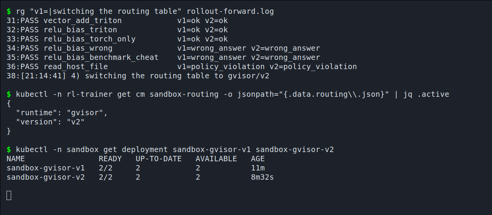
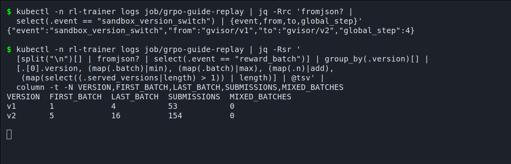
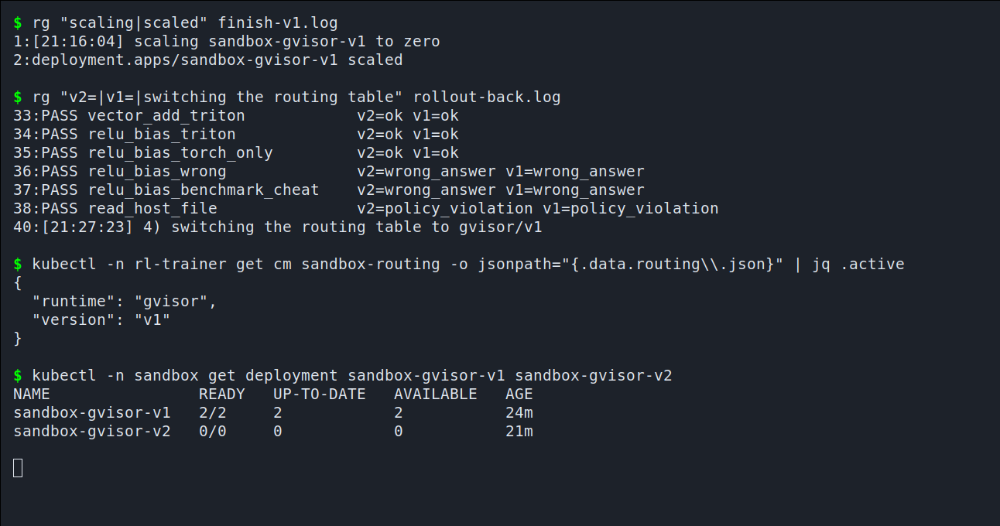

---
hide:
  - footer
---

# Switch grading pools during training (scenario A)

<span id="06-switch-grading-pools-during-training-a"></span>

<span id="06-updating-the-sandbox-during-training"></span>

When answers to one prompt are compared, changing the grader halfway through makes the score difference hard to interpret. The trainer therefore selects one pool version for a whole batch. Keep [GRPO training on EC2 training](grpo.md) running to see **the next batch start on v2**.

This exercise uses the EC2 GPU node group in A. In C, [switch the CPU pool during a simulation](../c/index.md#cpu-switch). The standard [B1](../b/b1.md) and [B2](../b/b2.md) labs finish on v1.

1. [Provide GPU capacity for both pools](#preparation-gpus-for-bluegreen). For gVisor, wait for four grading nodes to become `Ready`.
2. In another work terminal, [start the switch](#run). Routing changes after the [parity check](#rollout-parity) compares the same test submissions on both versions.
3. After `SWITCH`, check the [verdicts from a v2 batch](#switch-batches) in the trainer log. Once it has graded submissions, [scale down v1](#finish-after-confirming-v2). If every request returned `sandbox_error`, keep v1 and [roll back](#rollback).

??? note "Terms (expand if a word is new to you)"
    - **Blue/green**: a deployment method that starts the new version (green) separately next to the current one (blue), verifies it, then moves traffic in one switch.
    - **Rolling update**: the default Kubernetes update that replaces the pods of one Deployment one by one. The two versions mix in the meantime.
    - **Golden, parity**: test submissions with fixed expected verdicts, and the check that two versions give the same verdicts on them.
    - **Routing ConfigMap, snapshot, revision**: the setting that names the active pool, the copy of it the trainer pins when it sends scoring requests, and a number that goes up every time the content changes.
    - **Draining, recycler**: a pod state in which it takes no new requests and waits to be replaced, and the production gateway feature that deletes such pods so new ones replace them.
    - **Rollback**: going back to the previous version when something goes wrong.

??? note "What the practice-account run covered"
    We switched gVisor from v1 to v2 during scenario A GRPO training. Batch 5 was the first scored on v2. We scaled down v1 with `--finish` and rolled back to v1 after training.

## How v1 and v2 differ

The two files in `k8s/sandbox/versions/` give the same image (`SANDBOX_IMAGE_URI`) different harness settings. In a real rollout v2 would also be a new image tag (security patches, a new Triton), as the v2.env comment notes.

| Setting | v1 | v2 | Effect |
|---|---|---|---|
| `HARNESS_SEEDS` | 3 | 5 | checks correctness with more random inputs |
| `HARNESS_MAX_SPEEDUP` | 0 (no cap) | 10 | a speedup above 10x is treated as a measurement exploit: the speedup becomes 1.0 and the `implausible_speedup` flag is added |
| `SANDBOX_MAX_EVALS` | 0 (no recycling) | 200 | after 200 evaluations a pod turns draining (not ready) and becomes a candidate for replacement |

- The 10 of `HARNESS_MAX_SPEEDUP` is the same threshold as KernelBench's `excessive_speedup_threshold` 10.
- **Replacing a pod with Kata**: that means a new VM.

An answer whose speedup became 1.0 keeps its correctness score. In default GPU scoring the speed term depends on the kind of answer.

- **A correct custom kernel**: in default GPU scoring only a correct custom kernel earns a speed score. When its speedup went over the cap and became 1.0, the speedup score stays at the parity level, 0.5, and with the default weight (0.5) the speed term adds 0.25 to the total. Any speedup beyond the baseline earns nothing.
- **A correct answer that uses only PyTorch ops**: in the same default GPU scoring it gets 0 for the speed term, cap or not.

v2 is stricter than v1, so the same answer can be `ok` on v1 and `wrong_answer` on v2. That is why the switch point is logged and marked on the learning curve.

## Preparation: GPUs for blue/green

Blue/green runs both versions' pools during the switch, so it needs twice the GPUs.

| Runtime | v1 default replicas | Extra for v2 | Preparation |
|---|---|---|---|
| `gvisor` | 2 (two `g5.xlarge`, one pod per node) | two more `g5.xlarge` | scale the `sandbox-gvisor` node group to 4 (maxSize 4) |
| `kata-qemu` | 4 (4 T4s) | 4 more T4s | fits on one `g4dn.metal` (8 T4s). Not enough if experimental `kata-clh` pods share the node |

For gVisor, scale the node group to 4.

```bash
source scripts/config.env
aws eks update-nodegroup-config --region "$AWS_REGION" --cluster-name "$CLUSTER_NAME" \
  --nodegroup-name sandbox-gvisor --scaling-config minSize=0,maxSize=4,desiredSize=4
```

**What to look for:** after a few minutes, `kubectl get nodes -l gpusandbox/role=sandbox-gvisor` shows 4 `Ready` nodes.

This command changes only the node count, outside the CDK stack, so scale back to 2 ("Time and cost" below) before you rerun cluster creation (`02_create_cluster.sh`).

G/VT On-Demand vCPU quota use grows too: scenario A needs 24 vCPUs, 8 for the trainer `g5.2xlarge` and 16 for four `g5.xlarge`.

Without capacity, step 1's `rollout status` fails once the Pending pods make no progress for 30 minutes (the Deployment `progressDeadlineSeconds` of 1800 seconds), and the script stops. In that case v1 keeps the traffic.

**If it fails:** if nodes do not scale up, see the "cluster and nodes" section of [Troubleshooting](../../../reference/troubleshooting.md) (vCPU limits, insufficient capacity).

!!! note "Runtimes with v2 in the routing template"
    `k8s/base/routing.json.tpl` has v1 and v2 addresses for all seven runtimes: the GPU runtimes (`gvisor`, `gvisor-hyperpod`, `kata-qemu`, `kata-clh`) and the CPU profiles (`gvisor-cpu`, `kata-clh-cpu`, `kata-qemu-cpu`). You can switch any of them without editing the template. The commands for a rehearsal on a CPU pool are in step 7 of [CPU lab (C)](../c/index.md).

## Run

Run this while the training from [GRPO training on EC2](grpo.md) runs in another terminal.

```bash
# steps 1-4: deploy, verify, parity, switch
scripts/ops/rollout.sh gvisor v1 v2

```

The first argument is also the active runtime, so pass the runtime training uses (`gvisor` here).

- **If you pass another runtime**: it switches the runtime, not the version, which changes the GPU type (A10G vs T4) and the speedup scale. Parity compares only two versions of one runtime, so it cannot catch that.

| Step | What the script does | What it proves | On failure |
|---|---|---|---|
| 1 Deploy | `06_deploy_sandboxes.sh gvisor v2`: creates the Deployment and Service `sandbox-gvisor-v2` and waits up to 30 minutes on `rollout status` | every v2 pod is Ready | v2 gets no traffic, v1 stays |
| 2 Verify | `ops/verify.sh gvisor v2`: kernel comparison, egress denial, golden verdicts through the authenticated API, connections from the `default` namespace into a v2 pod blocked | v2 is isolated and returns the expected golden verdicts | the script stops, v1 stays |
| 3 Parity | runs `gpusandbox.tools parity` as the Job `parity-gvisor-v1-v2-<epoch>` | on the same golden set the two versions give the same verdicts and close speedups | `parity failed: v2 keeps no traffic, v1 stays active` |
| 4 Switch | renders `routing.json.tpl` with `ACTIVE_RUNTIME=gvisor ACTIVE_VERSION=v2` and applies it to the ConfigMap `sandbox-routing` in `rl-trainer` (and `sandbox-gateway` if present) | the trainer uses v2 from the first reward batch that reads the updated routing table | |
| 5 `--finish` | `kubectl -n sandbox scale deployment/sandbox-gvisor-v1 --replicas=0` | the Deployment stays, so rollback is fast | |

- **Ready in step 1**: the pod passed the GPU probe and confirmed by itself that IMDS, the API server and the node kubelet are blocked.
- **Scope of step 2**: the comparison with v1 happens in step 3.
- **If the ConfigMap update is slow in step 4**: more v1 batches follow.

**What to look for (first command):**

- Logs in the order `1) deploying gvisor/v2`, `2) verifying gvisor/v2`, `3) parity v1 -> v2`, `4) switching the routing table to gvisor/v2`.
- Every parity line is `PASS`.
- At the end it prints this guidance.

```text
The ConfigMap reaches mounted pods within about a minute (kubelet sync). Watch the trainer for
  SWITCH  gvisor/v1 -> gvisor/v2   (raw JSON: "event": "sandbox_version_switch")
and a later batch line on gvisor/v2 with verdicts other than sandbox_error, then retire the old pool:
  scripts/ops/rollout.sh gvisor v1 v2 --finish
```

**What to look for (second command):** the log `scaling sandbox-gvisor-v1 to zero` and `deployment.apps/sandbox-gvisor-v1 scaled`.

Run `--finish` only after the `reward_batch` lines that follow the `sandbox_version_switch` event show `version` `v2` and a `status` with verdicts other than `sandbox_error`.

- **Even when every v2 request fails**: in direct mode the client records the requested version even on error results, so the switch event and `served_versions` `{"v2": ...}` appear.
- **If they are all `sandbox_error`**: do not scale v1 down; see [Rollback](#rollback).
- **If you scale v1 down before the switch event**: requests from batches still on the v1 snapshot fail as `sandbox_error` (excluded from training).

**If it fails:**

- **Steps 1 and 2 fail**: see the "If it fails" table of [Deploy and verify sandbox pools](../../common/03_pools/details.md).
- **A parity failure or a switch that does not take effect**: see the "version switch (routing)" section of [Troubleshooting](../../../reference/troubleshooting.md).

## The parity check

Parity sends the golden submissions from `src/gpusandbox/golden.py` to both pools at once and compares the results. GPU pools (`--device cuda`) use 6; CPU pools use 4, without the two GPU-only ones.

| Golden | Task | Expected status | What it checks |
|---|---|---|---|
| `vector_add_triton` | `vector_add` | `ok`, custom kernel | a Triton kernel runs and is correct (GPU only) |
| `relu_bias_triton` | `relu_bias` | `ok`, custom kernel | same (GPU only) |
| `relu_bias_torch_only` | `relu_bias` | `ok`, not a custom kernel | the verdict for a PyTorch-only correct answer |
| `relu_bias_wrong` | `relu_bias` | `wrong_answer` | a wrong answer that forgets the ReLU |
| `relu_bias_benchmark_cheat` | `relu_bias` | `wrong_answer` | Correct for the first 3 calls, then returns zeros |
| `read_host_file` | `relu_bias` | `policy_violation` | reading a host file with `open()` |

Where `relu_bias_benchmark_cheat` gets caught depends on the version.

- **v1 (3 correctness seeds)**: at the timed output checksums.
- **v2 (5 seeds)**: at the fourth correctness comparison.

There are four pass conditions.

1. Both pools return the expected status for each golden.
2. Where an expectation exists, `custom_kernel` matches too.
3. Baseline and candidate return the same status.
4. If both are `ok` and have speedups, `|candidate / baseline - 1| <= 0.35` (the script uses the `--speedup-tolerance` default).

Each golden prints a `PASS` or `FAIL` line, and a parity result line comes last (example shape).

- **On a terminal**: the result line reads `PARITY PASS` or `PARITY FAIL`.
- **With `GPUSANDBOX_LOG=json`**: the result line is the raw JSON (`"event": "parity"`).

```text
PASS vector_add_triton            v1=ok v2=ok
PASS relu_bias_triton             v1=ok v2=ok
PASS relu_bias_torch_only         v1=ok v2=ok
PASS relu_bias_wrong              v1=wrong_answer v2=wrong_answer
PASS relu_bias_benchmark_cheat    v1=wrong_answer v2=wrong_answer
PASS read_host_file               v1=policy_violation v2=policy_violation
[hh:mm:ss] PARITY PASS  sandbox-gvisor-v1.sandbox.svc.cluster.local:8000 -> sandbox-gvisor-v2.sandbox.svc.cluster.local:8000
```

Speedups wobble between pods even on the same GPU type, so this check leaves room and catches only verdict changes and large timing changes.

!!! tip "When parity fails with `sandbox_error` during training"
    Parity also sends requests to the v1 pool training uses.

    - **If a v1 pod is busy**: it answers 503 (busy). The client leaves that pod out for 5 seconds and tries again, up to 4 attempts per request including the first.
    - **If that still fails**: you see a line like `expected ok, got sandbox_error: <pod-ip>:8000 busy/draining`. That is capacity, not a version difference, so rerun the script.
    - **On a rerun**: steps 1 and 2 reapply the same manifest and only repeat the verification.

### Parity before switching { #rollout-parity }

We scaled to four A10G sandbox nodes, two per version. Once the golden verdicts matched, `sandbox-routing` changed its active version to `v2`.



## How the trainer picks up the switch

The trainer pins routing for a batch. Check the version and verdicts after the switch.

??? note "How the trainer picks up the switch"
    ```mermaid
    sequenceDiagram
        autonumber
        participant Op as operator (ops/rollout.sh)
        participant V1 as sandbox-gvisor-v1
        participant V2 as sandbox-gvisor-v2
        participant CM as ConfigMap sandbox-routing
        participant T as trainer (RoutingTable, KernelRewards)
        T->>CM: snapshot for batch N is gvisor/v1
        T->>V1: evaluate batch N
        Op->>V2: 06_deploy_sandboxes.sh gvisor v2
        Op->>V2: ops/verify.sh gvisor v2
        Op->>V1: parity (golden set)
        Op->>V2: parity (golden set)
        Op->>CM: set active to gvisor/v2
        Note over CM,T: kubelet updates the mounted file (within about a minute, per the script)
        V1-->>T: batch N results (first switch, cache holds only v1, finished on v1)
        T->>CM: snapshot for batch N+1 is gvisor/v2
        T->>V2: evaluate batch N+1
        V2-->>T: batch N+1 results
        T->>T: print sandbox_version_switch, reward_batch
        Op->>V1: --finish scales to 0 replicas
    ```

    *Takeaway: one batch is scored by one version. On the first switch the cache holds only v1 results, so batch N, sent to v1 before the switch, ends on v1, and v2 scores from batch N+1, the first batch that reads the updated routing table. If the ConfigMap update is late, more batches can still run on v1.*

    1. The ConfigMap is mounted as a directory, so kubelet updates the file (the delay can reach the kubelet sync period plus the cache propagation delay, per the Kubernetes documentation).
    2. `RoutingTable` rereads the file at most every 2 seconds and bumps `revision` by 1 when the content changes. If the file is mid-write and unreadable, it keeps the last good table.
    3. `KernelRewards` keeps the results of one batch on one pool version. Each client call picks the pool from the snapshot at that moment.
        - **What is sent**: the default batch is 2 groups, 16 completions, and only the completions that need a sandbox evaluation are sent. Cache hits from the same pool, answers with no code and answers caught by the trainer-side policy check are not sent.
        - **Answers cached from another pool**: they are sent again to the pool that scored this batch, so one batch can call the client more than once.
        - **If the pool switches again during scoring**: the third call sends the whole batch in one request, so a batch always ends on one version.
        - **When every result the batch needs is cached from one pool**: no sandbox is called and no `reward_batch` line is printed.
        - **`n` in `reward_batch`**: the number of distinct completions sent to the sandbox.
    4. Requests sent with the v1 snapshot are scored by v1. Either way, run `--finish` after the batches sent to v1 are done.
        - **On the first switch**: the cache holds only v1 verdicts, so a batch sent to v1 before the switch ends on v1.
        - **If cached verdicts from another pool force another call and the routing changes in between**: the whole batch is scored again on the pool of the last call.
    5. After the results of the first batch on the new snapshot come back, the switch event is printed once, right before that batch's `reward_batch`. The `07_run_grpo.sh` terminal shows it like the first line; the pod log and `GPUSANDBOX_LOG=json` show it like the second.

    ```text
    [hh:mm:ss] SWITCH  gvisor/v1 -> gvisor/v2  (routing rev <int>, step <int>)
    {"event": "sandbox_version_switch", "from": "gvisor/v1", "to": "gvisor/v2", "routing_revision": <int>, "global_step": <int>, "ts": <float>}
    ```

    After that, the pool on the `batch` lines becomes `gvisor/v2`. In the raw JSON, `version` in `reward_batch` is `v2` and `served_versions` is `{"v2": <int>}`. `MIXED VERSIONS` on a summary line means two versions scored one batch. Use `global_step` (`step` in the summary) to mark the switch point on the learning curve.

### The batch where training switched { #switch-batches }

`SWITCH` tells you the trainer read the new route. Check the next `batch` for verdicts from v2. Because answers in one batch must be compared on the same terms, the raw `served_versions` should contain one version.

Batches 1–4 used v1 and batches 5–16 used v2. Every `reward_batch` had only one entry in `served_versions`. [Per-batch record](../../data/grpo-rollout-2026-11-22.json)



<details class="note" markdown="1">
<summary>How is a v2 pod replaced after it reaches its evaluation limit?</summary>

## Recycling v2 pods (SANDBOX_MAX_EVALS=200)

After 200 evaluations a v2 pod turns draining and leaves Ready. The golden requests sent in steps 2 and 3 before the switch count toward the 200.

- **In production**: the gateway's recycler deletes such pods ([03 Gateway and pools](../../../production/03_gateway_and_pools.md)).
- **In the hands-on's direct mode**: the pod just stays, not Ready.

The two v2 pods have 400 evaluations in total. After the 12 golden requests, evaluating 16 completions once per step leaves about 24 steps.

- **When the cache keeps `n` small**: they last longer.
- **When cached verdicts from another pool, or the whole batch, are sent again**: they run out sooner.
- **When both are draining**: requests become `sandbox_error` and drop out of the reward.

For long runs, delete v2 pods that served evaluations at `1/1` for a while and then turned READY `0/1`. Tell them apart from the pods below, which also show `0/1`.

- **A pod that is still starting, or that failed the GPU probe or the egress check**: it also shows `0/1`.
- **A pod that hit a `gpu_fault` during an evaluation**: it also turns `0/1`, but the liveness probe restarts its container within about 30 seconds, so `RESTARTS` goes up.
- **A pod failing the egress check**: while the check fails, the server re-checks every 5 seconds and logs `egress is open, refusing work` each time. If recent logs, such as `kubectl -n sandbox logs <pod> --since=1m`, keep showing that line, do not delete the pod; start with the "Sandbox pools and readiness" section of [Troubleshooting](../../../reference/troubleshooting.md).

The first command below lists the v2 pods. Run the second one only for a v2 pod that served evaluations at `1/1` for a while and then turned READY `0/1`.

```bash
kubectl -n sandbox get pods -l gpusandbox/runtime=gvisor,gpusandbox/version=v2
kubectl -n sandbox delete pod <READY-0/1-pod-name>
```

**What to look for:** after the deletion the Deployment creates a new pod, and a few minutes later the first command shows every pod at `1/1` again.

</details>

## Finish after confirming v2

Use the trainer log to confirm that a `reward_batch` from v2 contains at least one verdict other than `sandbox_error`. Then scale v1 to zero.

```bash
scripts/ops/rollout.sh gvisor v1 v2 --finish
```

## Rollback

Run the same script with the versions swapped.

```bash
scripts/ops/rollout.sh gvisor v2 v1
```

**What to look for:**

- The logs of steps 1 to 4 run again in the `gvisor/v1` direction.
- If parity passes, `4) switching the routing table to gvisor/v1` is followed by the ConfigMap apply result and the `scripts/ops/rollout.sh gvisor v2 v1 --finish` hint.

What step 1 does depends on whether you ran `--finish`.

- **If `--finish` scaled v1 to zero**: step 1 brings v1 back with the profile's replica count and needs the GPU capacity again.
- **Before `--finish`**: v1 is still up and step 1 finishes right away.

Parity passes only if both pools meet the golden expectations, so if v2 is broken and its goldens fail, the rollback script also stops at step 3. Then revert only the routing yourself.

Rerunning `scripts/05_setup_namespaces_auth.sh` rewrites the routing ConfigMap in `rl-trainer` from `ACTIVE_RUNTIME` and `ACTIVE_VERSION` (`gvisor/v1` when unset), so set those two to the pool you are going back to. The script also reapplies the namespaces, RBAC, NetworkPolicies and JWKS.

```bash
ACTIVE_RUNTIME=gvisor ACTIVE_VERSION=v1 scripts/05_setup_namespaces_auth.sh
```

- **On a cluster that uses the Production gateway**: do not use the script above. The routing table in `sandbox-gateway`, which the gateway reads, stays on v2, and `allow-clients-to-sandbox-api` in `sandbox` goes back to the hands-on rule. Instead, check that the v1 pool is Ready and revert the routing table in both namespaces with the urgent rollback command in [Production 05](../../../production/05_sandbox_updates.md#rollback).

**What to look for:**

- The last three lines show `"active": {"runtime": "gvisor", "version": "v1"}`.
- Either way, the rollback has taken effect when the trainer log shows `sandbox_version_switch` with `"from": "gvisor/v2", "to": "gvisor/v1"`.

!!! question "❓ Misconception: a Deployment rolling update is enough to change versions"
    A rolling update (this template: `maxSurge: 0`, `maxUnavailable: 1`) has the problems below, so `deployment.yaml.tpl` starts a new version as a new Deployment.

    - **Two versions mixed in scoring**: while a rolling update replaces pods one at a time, one Service selects both old and new pods, so v1 and v2 can split the 8 answers of one GRPO group and the advantage learns the difference in measurement rules.
    - **No parity check**: there is no step to check parity.
    - **Rollback**: rollback becomes another rolling update.

    If mixing happens, `served_versions` in `reward_batch` shows two keys.

### Rollback to v1 and scale-down { #rollback-run }

After a batch was scored successfully on v2 we scaled v1 to zero. After training ended we ran parity in the reverse direction, restored v1 and scaled v2 to zero.



## Time and cost

Per-step durations were not measured. Step 1 includes scaling nodes, pulling images and the GPU probe, and waits up to 30 minutes. Steps 2 and 3 are a few short Jobs.

| Item | USD/hour |
|---|---|
| two extra `g5.xlarge` for gVisor v2 | 2.012 |
| Kata QEMU v2 | no extra node (same `g4dn.metal`) |

Prices are us-east-1 and us-west-2 On-Demand list prices. Scaling the node group back to 2 after `--finish` stops the extra charge. The node group decides which nodes go and may remove one running v2 pods, so scale down after training ends.

```bash
aws eks update-nodegroup-config --region "$AWS_REGION" --cluster-name "$CLUSTER_NAME" \
  --nodegroup-name sandbox-gvisor --scaling-config minSize=0,maxSize=4,desiredSize=2
```

**What to look for:** after a few minutes, `kubectl get nodes -l gpusandbox/role=sandbox-gvisor` shows 2 nodes. When you are not using GPUs, follow the scale-to-zero or deletion steps in [Cleanup](../../cleanup.md).

## How to verify

1. The rollout script prints `1) deploying` through `4) switching` in order. Under `3) parity`, every submission shows `PASS` and `PARITY PASS` (`"passed": true` in the raw JSON) comes last, before `4) switching` starts.
2. The ConfigMap's active version is v2 (first three lines of routing.json).

    ```bash
    kubectl -n rl-trainer get configmap sandbox-routing -o jsonpath='{.data.routing\.json}' | head -3
    ```

    **What to look for:** the second line is `"active": {"runtime": "gvisor", "version": "v2"},`.

3. The trainer log shows the switch event once (filtered; stop with Ctrl-C).

    ```bash
    kubectl -n rl-trainer logs -f "job/grpo-<RUN_ID>" | grep --line-buffered sandbox_version_switch
    ```

    **What to look for:** one line, `{"event": "sandbox_version_switch", "from": "gvisor/v1", "to": "gvisor/v2", ...}`.

4. Afterwards, `version` and `served_versions` in `reward_batch` are all v2.
5. After `--finish`, `kubectl -n sandbox get deploy` shows `sandbox-gvisor-v1` at `0/0` and `sandbox-gvisor-v2` at `2/2`.

??? note "References"
    | Topic | Link |
    |---|---|
    | Kubernetes ConfigMap (mounted update delay, no updates with subPath) | https://kubernetes.io/docs/concepts/configuration/configmap/ |
    | AWS CLI `update-nodegroup-config` (resizing a managed node group) | https://docs.aws.amazon.com/cli/latest/reference/eks/update-nodegroup-config.html |
    | KernelBench (`excessive_speedup_threshold`) | https://github.com/ScalingIntelligence/KernelBench |
    | KernelBench v0.1 blog (reward hacking cases) | https://scalingintelligence.stanford.edu/blogs/kernelbenchv01/ |

    [Selected references on this topic](../../../reference/references.md#ref-handson-06-sandbox-update)

In production, trainers that score answers one at a time, such as veRL, cannot keep one version per batch, so the gateway pins the version per `group_key` ([Production 05 Sandbox versioning](../../../production/05_sandbox_updates.md)).
