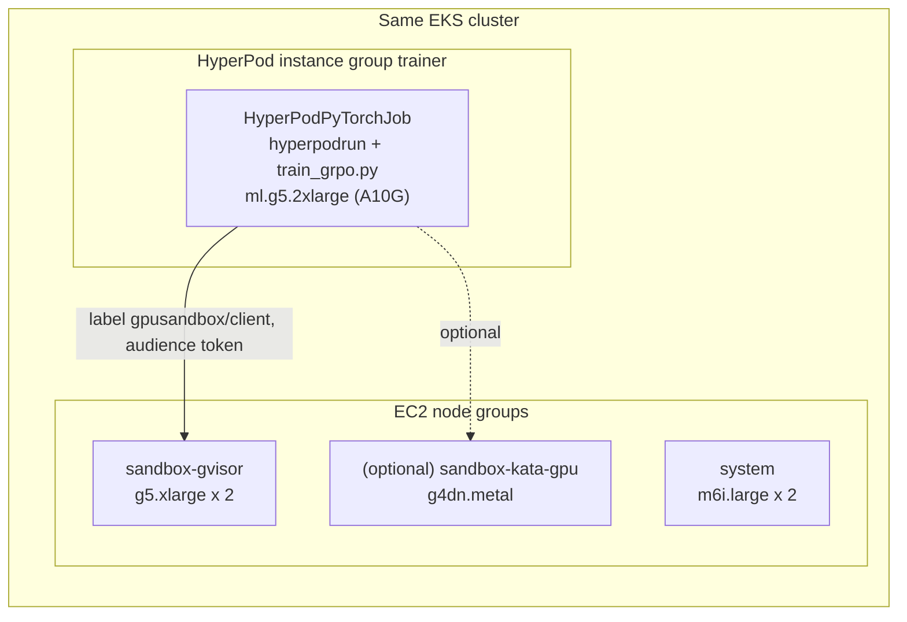
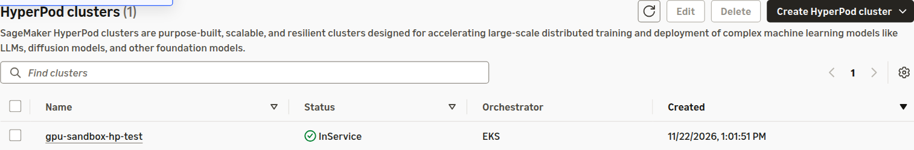
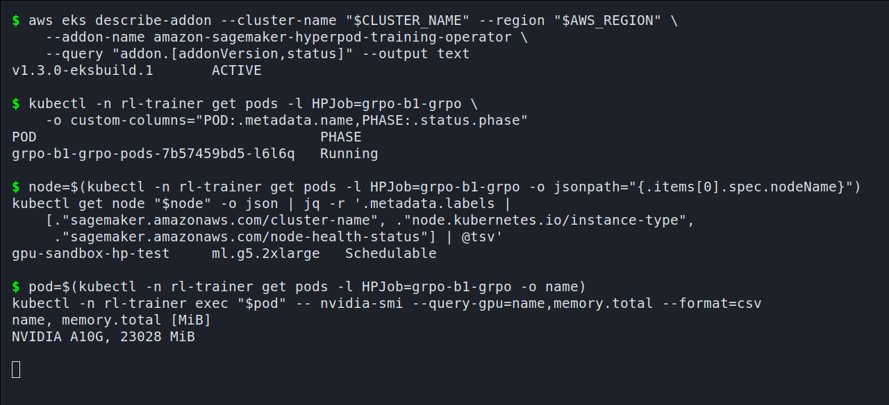
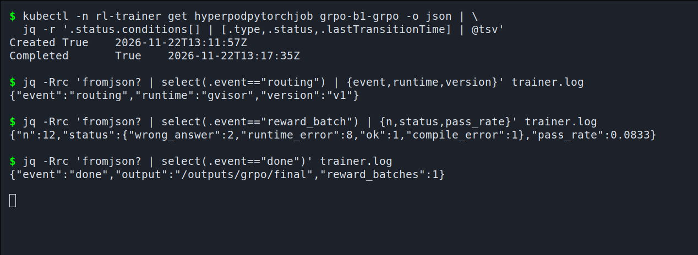

---
hide:
  - footer
---

# Train on HyperPod and grade on EC2 (B1)

<span id="b1--train-on-hyperpod-and-grade-on-ec2"></span>

[Choose another scenario](../../index.md#step-order)


In B1 the model trains on a SageMaker HyperPod node and its generated code is graded by a gVisor pool on EC2. Check **both the training node's identity and the grading results** to trace work across the two.

**Before training**　[Verify the EC2 grading pool in shared step 03](../../common/03_pools/index.md#__tabbed_1_2) and check that the HyperPod trainer is `Schedulable`.

The [B2 lab](b2.md) puts the CPU system worker, GPU trainer and GPU graders in HyperPod instance groups.

??? note "Terms (expand if a word is new to you)"
    - **SageMaker HyperPod**: an AWS managed cluster for long-running training. With EKS as the orchestrator, it attaches groups of nodes to an existing EKS cluster.
    - **Instance group**: a set of HyperPod nodes that share an instance type and settings. It is similar to an EKS node group.
    - **HyperPodPyTorchJob, training operator**: the Kubernetes custom resource that describes a training job for HyperPod, and the controller (an EKS add-on) that runs and restarts that job.
    - **Elastic agent (`hyperpodrun`)**: the launcher that starts the training processes inside the container and reports their state to the operator. It extends the PyTorch ElasticAgent.
    - **Lifecycle script**: a shell script that runs when a HyperPod node is created. It is read from an S3 bucket.
    - **Dependency Helm chart**: the Helm chart that installs the components HyperPod needs, such as the health monitoring agent and device plugins, into the cluster.
    - **Execution role**: the IAM role HyperPod nodes use to call AWS APIs.
    - **NodeRecovery, deep health check**: the setting that automatically reboots or replaces a faulty node, and a long check that puts load on the GPUs and the network.
    - **nvproxy**: the gVisor feature that filters GPU driver calls (ioctl) and passes them on. Each driver version has its own allowlist.
    - **Device plugin**: a DaemonSet that advertises a node's GPUs to Kubernetes as a resource such as `nvidia.com/gpu`.
    - **emptyDir**: a temporary volume that exists only while its pod lives. Its content disappears when the pod is deleted.
    - **Taint**: a mark on a node. Pods without a matching toleration are not scheduled onto that node.
    - **IMDS**: the address (169.254.169.254) where an EC2 instance reads its own metadata and temporary credentials.
    - **ENI**: a virtual network interface attached to an instance. The VPC CNI hands out the ENI's IP addresses to pods, so the number of ENIs sets the per-node pod limit.


## Layout

[](../../../images/architecture/scenario-b1.drawio.png)

*Takeaway: In AWS resources, only the trainer sits on a HyperPod instance group and the rest is the same as scenario A.*

<details class="note" markdown="1">
<summary>B1 network path and authentication</summary>



*Takeaway: the sandboxes stay on EC2 nodes in the same cluster, so the NetworkPolicy and token authentication of scenario A apply unchanged.*

</details>

<span id="time-and-cost"></span>

??? note "Time and cost"
    Allow 20–30 minutes for EKS deployment. In the B1 run, the HyperPod cluster reached `InService` about 2½ minutes after `CreateCluster` returned. The trainer instance finished provisioning about 8 minutes after the request.

    | Item | Count | USD/hour |
    |---|---|---|
    | HyperPod `ml.g5.2xlarge` (trainer) | 1 | 1.515 |
    | EC2 `g5.xlarge` (gVisor sandboxes) | 2 | 2.012 |
    | EC2 `m6i.large` (system) | 2 | 0.192 |
    | Total | | 3.719 |

    Prices are us-east-1 and us-west-2 On-Demand list prices. EKS control plane, NAT gateway and EBS are extra, and `g4dn.metal` adds 7.824 USD per hour. When you are done, follow "Cleanup" at the end.

## Run one GRPO step { #6-training }

Set a run ID, submit a one-step job and save its output locally. The operator removes the worker pod on completion.

```bash
export RUN_ID="b1-$(date +%Y%m%d-%H%M%S)"
scripts/hyperpod/run_grpo.sh 1      # smoke test; omit 1 for 60 steps
kubectl -n rl-trainer wait --for=create pods -l "HPJob=grpo-${RUN_ID}" --timeout=5m
kubectl -n rl-trainer wait --for=condition=Ready pods -l "HPJob=grpo-${RUN_ID}" --timeout=20m
kubectl -n rl-trainer get pods -l "HPJob=grpo-${RUN_ID}" -o wide | tee "placement-${RUN_ID}.txt"
kubectl -n rl-trainer logs -f -l "HPJob=grpo-${RUN_ID}" --tail=-1 | tee trainer.log | grep --line-buffered '"event"'
```

**What to look for:**

- `run_grpo.sh` prints `HyperPodPyTorchJob grpo-<RUN_ID> submitted` and one line for the job.
- In the trainer log, `{"event": "routing", ...}` appears within 20 minutes, followed by a `{"event": "reward_batch", ...}` line for every step that sent completions to the sandboxes. The first step includes the model download and vLLM initialization, so it takes a while.

See the [HyperPod training script](../../../reference/scripts.md#scriptshyperpodrun_grposh) for configuration and what happens after submission. Rewards and log formats match the [GRPO exercise](../a/grpo.md).

**If it fails:**

- **If the pod is Pending or cannot find `hyperpodrun`**: see the "HyperPod" section of [Troubleshooting](../../../reference/troubleshooting.md).
- **If no events appear**: see the "Training" section of the same page.

<details class="note" markdown="1">
<summary>Training job template and node placement</summary>

## The HyperPodPyTorchJob template

The template sets placement, the trainer command, and log patterns used to detect a stalled job.

The HyperPod-specific settings in `k8s/trainer/hyperpod-job-grpo.yaml.tpl`:

| Field | Value | Meaning (per the AWS documentation) |
|---|---|---|
| command | `hyperpodrun --nproc_per_node=1 --nnodes=1 /opt/gpusandbox/rl/trl/train_grpo.py ...` | Launcher of the HyperPod elastic agent, an extension of the PyTorch ElasticAgent |
| `runPolicy.jobMaxRetryCount` | 3 | Maximum number of restarts at the process level |
| `restartPolicy.numRestartBeforeFullJobRestart` | 1 | Process-level restarts allowed before the operator restarts at the job level |
| `restartPolicy.evalPeriodSeconds` | 3600 | Period, in seconds, over which the restart limit is evaluated |
| `restartPolicy.maxFullJobRestarts` | 2 | Maximum full job restarts before the job fails |
| `cleanPodPolicy` | All | Which pods the operator cleans up |
| log rule `JobStart` | `.*"event": "routing".*`, `expectedStartCutOffInSeconds: 1200` | HANGING if no routing event appears within 20 minutes of the start |
| log rule `RewardStalled` | `.*"event": "reward_batch".*`, `expectedRecurringFrequencyInSeconds: 1800` | HANGING if more than 30 minutes pass between reward_batch lines |
| nodeAffinity | `node.kubernetes.io/instance-type In [ml.g5.2xlarge]`, `sagemaker.amazonaws.com/node-health-status In [Schedulable]` | Only healthy HyperPod nodes |
| pod labels | `app: grpo-trainer`, `gpusandbox/client: "true"` | Admitted by the same NetworkPolicy as in scenario A |
| `/outputs` | emptyDir | Pod Security `baseline` in the `rl-trainer` namespace forbids hostPath |

Per the AWS documentation, when a rule evaluates to HANGING, the HyperPod elastic agent treats the container as stuck and restarts the job with the training operator. Log monitoring reads stdout, where this repository prints its events with a flush.

A step that sends no answer to a sandbox leaves no `reward_batch` line, so if every answer has no code or fails the trainer-side policy for more than 30 minutes, `RewardStalled` can classify the job as hanging.

!!! note "Checkpoints after a restart"
    On start, `train_grpo.py` resumes from the latest checkpoint in `/outputs/grpo` (saved every 20 steps). An emptyDir lives as long as its pod, though.

    - **After a full job restart that recreates the pod, or a node replacement**: the directory is empty and training starts over.
    - **A process-level restart**: the result depends on whether the pod is reused.

    To resume after a node replacement, mount a shared storage PVC such as FSx for Lustre at `/outputs` ([06 Scaling with veRL](../../../production/06_scaling_with_verl.md)).

HyperPod nodes have two limits.

- **Pods per node**. Kubernetes reported a limit of 14 pods on the `ml.g5.2xlarge` trainer in this run. Check `.status.allocatable.pods` on your node. The limit depends on the AMI and VPC CNI version.
- **IMDS access**: only hostNetwork pods reach IMDS by default, so the trainer pod cannot read node credentials.

</details>

## How to verify

`InService` describes the HyperPod cluster. To check the path in the [B1 diagram](#layout), use steps 4–5 below to match the trainer pod to its node and find verdicts from the EC2 gVisor pool.

The AWS console showed `InService` while the trainer instance was still `Pending`. Check its status with `list-cluster-nodes`, then check node placement and trainer logs in Kubernetes.



```bash
source scripts/config.env
aws sagemaker list-cluster-nodes --region "$AWS_REGION" --cluster-name "$HYPERPOD_CLUSTER_NAME" \
  --query 'ClusterNodeSummaries[].[InstanceGroupName,InstanceStatus.Status]' --output table
```

1. In the last table of `hyperpod/create.sh`, the HyperPod node has `node-health-status` `Schedulable` and instance type `ml.g5.2xlarge`.
2. The HyperPod cluster status and failure message:

    ```bash
    aws sagemaker describe-cluster --region "$AWS_REGION" --cluster-name "$HYPERPOD_CLUSTER_NAME" \
      --query '{status: ClusterStatus, failure: FailureMessage}'
    ```

    **What to look for:** `status` is `InService` and `failure` is empty (`null`).

3. The training operator add-on status:

    ```bash
    aws eks describe-addon --region "$AWS_REGION" --cluster-name "$CLUSTER_NAME" \
      --addon-name amazon-sagemaker-hyperpod-training-operator --query addon.status
    ```

    **What to look for:** it prints `"ACTIVE"`.

4. Inspect the job and the pod placement saved when you submitted the training job. The file retains the node name after the operator removes the worker pod.

    ```bash
    kubectl -n rl-trainer get hyperpodpytorchjob "grpo-${RUN_ID}"
    cat "placement-${RUN_ID}.txt"
    ```

    **What to look for:** the job shows one line, and the pod's NODE is the HyperPod node from item 1.

    

5. `{"event": "routing", ...}` appears in the trainer log within 20 minutes, followed by a `reward_batch` line for every step that sent completions to the sandboxes.

    ```bash
    kubectl -n rl-trainer wait --for=condition=Completed "hyperpodpytorchjob/grpo-${RUN_ID}" --timeout=30m
    jq -Rrc 'fromjson? | select(.event=="reward_batch" or .event=="done")' trainer.log
    ```

    The one-step job `grpo-b1-grpo` ran from 13:11:57 to 13:17:35 UTC, including image pull and model initialization. TRL reported 49.2 s of training. Of the 12 submissions sent to gVisor v1, one passed, two gave wrong answers, eight raised runtime errors and one failed to compile.

    

Load `$AWS_REGION`, `$CLUSTER_NAME` and `$HYPERPOD_CLUSTER_NAME` with `source scripts/config.env` first. If a check fails, see the "HyperPod" section of [Troubleshooting](../../../reference/troubleshooting.md).

A separate fixed-kernel benchmark sent 32 requests from the HyperPod trainer node to the two EC2 sandboxes. All 32 passed. Server-side p50 was 9.937 s and pool throughput was 0.199 eval/s. [Benchmark, screenshot and run data](../../benchmarks/index.md#hyperpod-b1)

<details class="note" markdown="1">
<summary>Node requirements for Kata VMs</summary>

## Why Kata cannot run on HyperPod nodes

Kata starts a small VM per pod, so the node needs `/dev/kvm` (the KVM virtualization device). HyperPod nodes do not meet this condition.

| Condition | What Kata needs | HyperPod nodes |
|---|---|---|
| `/dev/kvm` | QEMU and Cloud Hypervisor use KVM. On AWS that means bare metal or an instance with nested virtualization | There is no `ml.*.metal` instance type (`CreateCluster` instance type list) |
| Nested virtualization | On EC2 it is turned on with a CPU option on C8i, M8i, R8i and others | The instance group settings have no such CPU option, and the G and P families are not nested-virtualization capable anyway |
| GPU passthrough | An IOMMU, and the host must own the GPU through `vfio-pci` | The HyperPod AMI loads the NVIDIA driver on the host |

A custom AMI does not change this: an AMI only changes software, while `/dev/kvm` depends on the instance type (bare metal or nested virtualization).

If you need Kata sandboxes, keep them on EC2 node groups in the same cluster (`g4dn.metal`, `c8i`), as in B1.

!!! question "❓ Misconception: with HyperPod, the GPU sandboxes have to run on HyperPod nodes too"
    HyperPod on EKS attaches instance groups to an existing EKS cluster, so the sandboxes can stay on EC2 node groups in the same cluster with the same NetworkPolicy and token authentication. Here HyperPod handles node recovery and job restarts for the long-running trainer. In [managed B2](b2.md), the system pods and the GPU grading pool also run on HyperPod workers.

</details>

<span id="scope-and-limits"></span>

B1 verified one training step and a benchmark. Testing recovery after node replacement requires a persistent checkpoint.

## Cleanup

Save the training logs, then [delete HyperPod](../../cleanup.md#cleanup-hyperpod){ target="_blank" rel="noopener" } first. After `HyperPod resources deleted`, keep the tunnel open for [CDK cluster cleanup](../../cleanup.md#cleanup-cdk){ target="_blank" rel="noopener" }. Check the remaining `/aws/sagemaker/Clusters/<cluster-name>/<cluster-ID>` log group in CloudWatch.

??? note "References"
    | Topic | Link |
    |---|---|
    | HyperPod EKS prerequisites | https://docs.aws.amazon.com/sagemaker/latest/dg/sagemaker-hyperpod-eks-prerequisites.html |
    | Installing the training operator (cert-manager, Pod Identity) | https://docs.aws.amazon.com/sagemaker/latest/dg/sagemaker-eks-operator-install.html |
    | HyperPod EKS AMI releases (driver versions) | https://docs.aws.amazon.com/sagemaker/latest/dg/sagemaker-hyperpod-release-ami-eks.html |
    | CreateCluster API (NodeRecovery, Orchestrator) | https://docs.aws.amazon.com/sagemaker/latest/APIReference/API_CreateCluster.html |
    | HyperPod CLI and dependency Helm chart | https://github.com/aws/sagemaker-hyperpod-cli |

    [Selected references on this topic](../../../reference/references.md#ref-handson-07-hyperpod)
