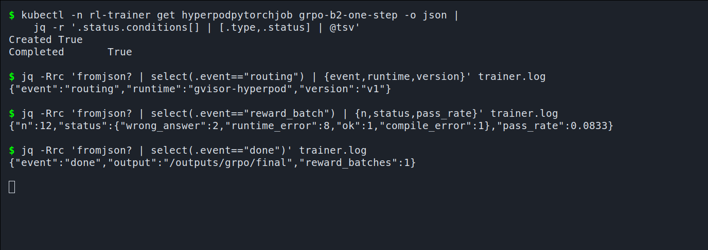
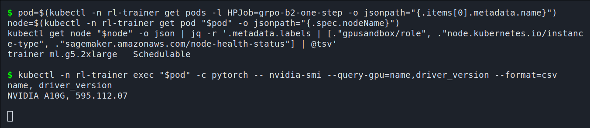

---
hide:
  - footer
---

# Run all workers on HyperPod (B2)

**Before training**　Complete the [B2 tab in shared step 03](../../common/03_pools/index.md#__tabbed_1_3). Both `sandbox-gvisor-hyperpod-v1` pods should be `Ready` and the pool verified.

<span id="b2--run-cpu-and-gpu-workers-on-hyperpod"></span>

The model sends the code it generates to a separate GPU sandbox for grading. In B2, SageMaker HyperPod runs the training workers, the grading workers and the CPU pods that provide cluster services such as DNS. Amazon EKS supplies the Kubernetes API and scheduler.


[](../../../images/architecture/scenario-b2.drawio.png?layout=aws)

| HyperPod group | Lab configuration in `us-east-1` | Workload |
|---|---|---|
| `system` | One `ml.m5.xlarge` | CoreDNS and CPU jobs |
| `trainer` | One `ml.g5.2xlarge` | GRPO training on an NVIDIA A10G |
| `sandbox` | Two `ml.g5.xlarge` | One gVisor grading pod per node, each with its own A10G |

[Download the Korean slide deck (PPTX, B1 and B2 comparison on slide 18)](../../../slides/gpu-sandbox-theory.pptx)

At `us-east-1` on-demand rates the four workers cost **$4.561 per hour** together. EKS, storage and networking have separate charges. [Cost breakdown](../../../production/08_cost.md)


## 1. Train for one GRPO step { #train-for-one-grpo-step }

When `verify.sh` prints `pool sandbox-gvisor-hyperpod-v1 verified`, submit the training job. On startup, the trainer downloads the default model `Qwen/Qwen2.5-Coder-1.5B-Instruct` from Hugging Face. Stream the logs to a local file while the worker pod is running. The operator removes it when the job finishes.

```bash
export RUN_ID="b2-$(date +%Y%m%d-%H%M%S)"
scripts/hyperpod/run_grpo.sh 1
kubectl -n rl-trainer wait --for=create pods -l "HPJob=grpo-${RUN_ID}" --timeout=5m
kubectl -n rl-trainer wait --for=condition=Ready pods -l "HPJob=grpo-${RUN_ID}" --timeout=20m
kubectl -n rl-trainer logs -f -l "HPJob=grpo-${RUN_ID}" -c pytorch --tail=-1 | tee "trainer-${RUN_ID}.log"
kubectl -n rl-trainer wait --for=condition=Completed "hyperpodpytorchjob/grpo-${RUN_ID}" --timeout=30m
jq -Rrc 'fromjson? | select(.event == "reward_batch" or .event == "done")' "trainer-${RUN_ID}.log"
```

The training pod ran on `ml.g5.2xlarge`. Its `reward_batch` reported `gvisor-hyperpod` and all 12 submissions went to v1. One passed, two returned a wrong answer, eight had runtime errors and one failed to compile. `Completed=True` means the training step finished and consumed these verdicts. TRL reported 51.07 seconds of training.

[](../../../images/terminal/hyperpod-b2-training.png)

??? note "Verify the trainer's GPU"
    The sandbox driver change applies only to `sandbox`. Here the training pod reports the stock driver on its A10G.

    [](../../../images/terminal/hyperpod-b2-trainer.png)

## 2. Benchmark the same grading pool { #benchmark-the-same-grading-pool }

Wait for the training job to reach `Completed`. The script sends 32 submissions of `relu_bias_triton` from the CPU system worker, then 32 from the trainer to the same two graders.

Before cleanup, run the [B2 tab of the runtime benchmark](../../benchmarks/index.md#__tabbed_1_3) and save both result files.

All 32 submissions passed in each run. Pool throughput was 0.189 eval/s for requests from the system worker and 0.190 eval/s for those from the trainer. [Benchmark results](../../benchmarks/index.md#hyperpod-b2)

## 3. Cleanup { #cleanup }

Save `trainer-${RUN_ID}.log` and both `b2-bench-*.jsonl` files in the project’s top-level directory before deleting the stack created by the HyperPod wizard. `delete-stack` removes the HyperPod instance groups and their EKS cluster. Wait for deletion before emptying the lifecycle bucket, as the stack also stores a generated template there.

```bash
source scripts/config.env
stack="${HYPERPOD_MANAGED_STACK:-${CLUSTER_NAME}-hyperpod}"
aws cloudformation delete-stack --region "$AWS_REGION" --stack-name "$stack"
aws cloudformation wait stack-delete-complete --region "$AWS_REGION" --stack-name "$stack"
```

### Resources retained after stack deletion { #retained-resources }

Once the stack is gone, remove the dedicated lab bucket and ECR images. For a Quickstart deployment, run `source .quickstart/B2/config.env` in your shell first to load the bucket name and ECR prefix.

```bash
aws s3 rm "s3://${HYPERPOD_LCS_BUCKET}/" --recursive --region "$AWS_REGION"
aws s3api delete-bucket --bucket "$HYPERPOD_LCS_BUCKET" --region "$AWS_REGION"
for image in sandbox trainer control; do
  aws ecr delete-repository --repository-name "${ECR_REPO_PREFIX}/${image}" --force --region "$AWS_REGION"
done
```

In this run the stack reached `DELETE_COMPLETE`. We confirmed that the HyperPod cluster, EKS cluster, lab VPC, lifecycle bucket and all three ECR repositories were gone. After saving the logs we removed seven CloudWatch log groups belonging to this deployment. For your run, match the HyperPod cluster ID, EKS cluster name and stack Lambda names before removing retained logs.

??? note "Earlier CDK deployments"
    If you maintain an older CDK cluster that boots its grading workers from a custom AMI, see the [custom AMI reference](../../../reference/hyperpod_custom_ami.md).
