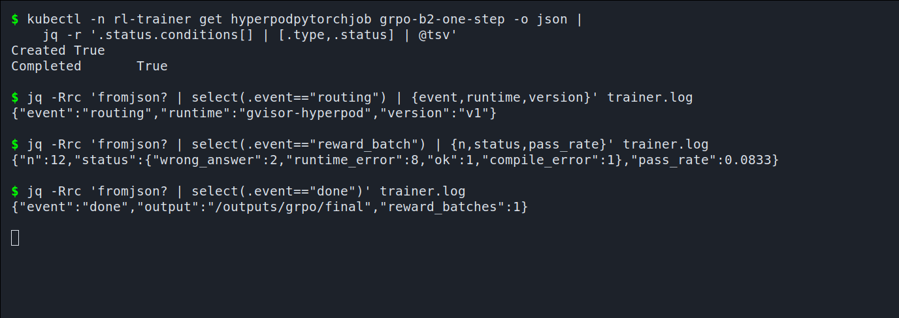
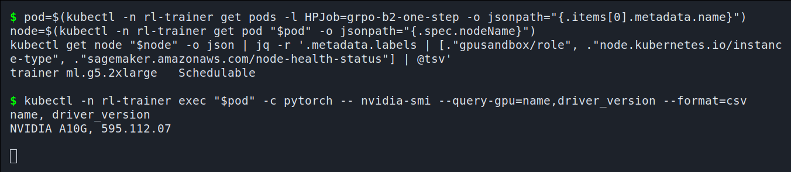

---
hide:
  - footer
---

# 모든 워커를 HyperPod에 배치하기 (B2)

**시작 조건**　[공통 절차 03의 B2 탭](../../common/03_pools/index.md#__tabbed_1_3)에서 `sandbox-gvisor-hyperpod-v1`의 두 pod가 `Ready`이고 검증이 끝났으면 학습을 시작하세요.

<span id="b2--cpu와-gpu-워커를-모두-hyperpod에-두기"></span>

모델이 코드를 만들면 별도의 GPU 샌드박스가 그 코드를 실행해 채점 결과를 돌려줍니다. B2에서는 학습과 채점뿐 아니라 CoreDNS 같은 공용 Pod도 SageMaker HyperPod 인스턴스에서 실행합니다. Amazon EKS는 Kubernetes API와 스케줄러를 제공합니다.


[](../../../images/architecture/scenario-b2.drawio.png?layout=aws)

| HyperPod 그룹 | `us-east-1` 실습 구성 | 역할 |
|---|---|---|
| `system` | `ml.m5.xlarge` 1대 | CoreDNS와 CPU 작업 |
| `trainer` | `ml.g5.2xlarge` 1대 | NVIDIA A10G에서 GRPO 학습 |
| `sandbox` | `ml.g5.xlarge` 2대 | A10G 한 장을 쓰는 gVisor 채점 Pod를 노드당 하나씩 배치 |

[이론 슬라이드 다운로드 (PPTX, B1과 B2 비교는 18쪽)](../../../slides/gpu-sandbox-theory.pptx)

`us-east-1` 온디맨드 단가로 워커 네 대의 합계는 **시간당 4.561 USD**입니다. EKS 제어 영역, 스토리지, 네트워크 비용은 별도입니다. [비용 구성](../../../production/08_cost.md)


## 1. GRPO 한 스텝 실행하기 { #grpo-한-스텝-실행하기 }

`verify.sh`가 `pool sandbox-gvisor-hyperpod-v1 verified`로 끝났으면 학습 Job을 제출하세요. trainer는 시작할 때 기본 모델 `Qwen/Qwen2.5-Coder-1.5B-Instruct`를 Hugging Face에서 내려받습니다. Job이 끝나면 worker Pod가 정리되므로 실행 중에 로그를 파일로 받아 둡니다.

```bash
export RUN_ID="b2-$(date +%Y%m%d-%H%M%S)"
scripts/hyperpod/run_grpo.sh 1
kubectl -n rl-trainer wait --for=create pods -l "HPJob=grpo-${RUN_ID}" --timeout=5m
kubectl -n rl-trainer wait --for=condition=Ready pods -l "HPJob=grpo-${RUN_ID}" --timeout=20m
kubectl -n rl-trainer logs -f -l "HPJob=grpo-${RUN_ID}" -c pytorch --tail=-1 | tee "trainer-${RUN_ID}.log"
kubectl -n rl-trainer wait --for=condition=Completed "hyperpodpytorchjob/grpo-${RUN_ID}" --timeout=30m
jq -Rrc 'fromjson? | select(.event == "reward_batch" or .event == "done")' "trainer-${RUN_ID}.log"
```

실습에서 학습 Pod는 `ml.g5.2xlarge`에서 실행됐습니다. `reward_batch`에는 `gvisor-hyperpod` v1이 처리한 코드 12개의 판정이 기록됐습니다. 정답 1개, 오답 2개, 실행 오류 8개, 컴파일 오류 1개였습니다. trainer는 이 판정으로 보상을 계산해 한 스텝을 마쳤고, Job은 `Completed=True`가 됐습니다. TRL이 기록한 학습 시간은 51.07초였습니다.

[](../../../images/terminal/hyperpod-b2-training.png)

??? note "학습 Pod의 GPU 확인하기"
    드라이버는 `sandbox` 그룹에서만 바꿨습니다. 학습 Pod에서 조회하면 기본 이미지의 드라이버와 A10G가 보입니다.

    [](../../../images/terminal/hyperpod-b2-trainer.png)

## 2. 같은 채점 pool로 벤치마크하기 { #같은-채점-pool로-벤치마크하기 }

<span id="같은-채점-풀로-벤치마크하기"></span>

학습 Job이 `Completed`가 된 뒤 실행하세요. 같은 코드(`relu_bias_triton`)를 먼저 CPU 시스템 노드에서, 이어서 학습 노드에서 32건씩 같은 채점 pool에 보냅니다.

클러스터를 정리하기 전에 [런타임 벤치마크의 B2 탭](../../benchmarks/index.md#__tabbed_1_3)을 실행하고 두 결과 파일을 저장하세요.

실습에서는 시스템 노드와 학습 노드에서 보낸 요청이 각각 32건 모두 성공했습니다. pool 처리량은 시스템 노드에서 요청했을 때 초당 0.189건, 학습 노드에서 요청했을 때 0.190건이었습니다. [벤치마크 결과](../../benchmarks/index.md#hyperpod-b2)

## 3. 정리 { #cleanup }

학습 로그 `trainer-${RUN_ID}.log`와 프로젝트 최상위 폴더의 `b2-bench-*.jsonl` 두 파일을 보관한 뒤 B2 배포에 사용한 CloudFormation 스택을 삭제하세요. `delete-stack`이 HyperPod 인스턴스 그룹과 EKS 클러스터를 함께 정리합니다. 스택이 생성한 템플릿도 lifecycle 버킷에 있으므로, 스택 삭제가 끝난 뒤 버킷을 비우세요.

```bash
source scripts/config.env
stack="${HYPERPOD_MANAGED_STACK:-${CLUSTER_NAME}-hyperpod}"
aws cloudformation delete-stack --region "$AWS_REGION" --stack-name "$stack"
aws cloudformation wait stack-delete-complete --region "$AWS_REGION" --stack-name "$stack"
```

### 스택 삭제 후 남은 리소스 { #retained-resources }

스택 삭제가 끝나면 실습 전용 S3 버킷과 ECR 이미지를 정리하세요. Quickstart로 배포했다면 아래 명령을 실행할 셸에서 먼저 `source .quickstart/B2/config.env`로 버킷 이름과 ECR 경로를 불러오세요.

```bash
aws s3 rm "s3://${HYPERPOD_LCS_BUCKET}/" --recursive --region "$AWS_REGION"
aws s3api delete-bucket --bucket "$HYPERPOD_LCS_BUCKET" --region "$AWS_REGION"
for image in sandbox trainer control; do
  aws ecr delete-repository --repository-name "${ECR_REPO_PREFIX}/${image}" --force --region "$AWS_REGION"
done
```

이번 실행에서는 스택이 `DELETE_COMPLETE`로 끝난 뒤 HyperPod 클러스터, EKS 클러스터, 실습 VPC, lifecycle 버킷, ECR 리포지토리 3개의 삭제를 확인했습니다. 로그를 보관한 뒤 CloudWatch에 남은 이 배포의 로그 그룹 7개도 삭제했습니다. 직접 정리할 때는 HyperPod 클러스터 ID, EKS 이름과 스택의 Lambda 함수 이름을 대조해 해당 실습의 로그 그룹을 찾으세요.

??? note "기존 CDK 환경을 운영한다면"
    기존 CDK 환경에서 채점 노드용 AMI를 직접 관리한다면 [custom AMI 구성](../../../reference/hyperpod_custom_ami.md)을 참고하세요.
