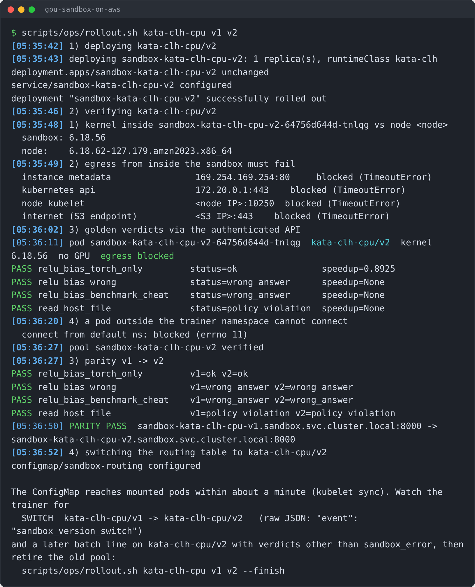

---
hide:
  - footer
---

# Run the lab on CPUs (scenario C)

**Before the simulation**　[Verify the three CPU pools in shared step 03](../../common/03_pools/index.md#__tabbed_1_4). Start the simulator with `kata-clh-cpu/v1` active.

<span id="10-hands-on-lab-with-cpus-only"></span>

<span id="10-cpu-only-path-on-c8i-scenario-c"></span>

In scenario C, practice a grading pool switch on EKS without a GPU or model. Compare three runtimes on one `c8i.2xlarge`, then switch from v1 to v2 while a simulator keeps sending the same answers.


??? note "Terms (expand if a word is new)"
    - **Nested virtualization**: running a VM inside a VM. Since 2026-02, EC2 exposes `/dev/kvm` on some virtual instances such as C8i, M8i and R8i. Kata uses it to start a small VM per pod.
    - **systrap**: the gVisor platform that intercepts system calls without KVM. gVisor therefore runs without nested virtualization; it shares this node only so that all three runtimes are compared under the same conditions.
    - **nvproxy**: the gVisor feature that forwards GPU driver calls. This node has no GPU, so it is installed with nvproxy off.
    - **Launch template**: a bundle of EC2 launch settings. Here it turns on nested virtualization, restricts IMDS and carries the node boot script (user data); the CDK stack creates it.
    - **SSM tunnel (`cdk/tunnel.sh`)**: the connection that links `127.0.0.1:8443` on your PC to the API through SSM Session Manager, so that kubectl and helm reach a cluster with only a private API endpoint.
    - **Golden submission**: a test answer whose verdict is known in advance. There is one correct answer, one wrong answer, one benchmark cheat and one policy violation.
    - **Reward batch**: the group of completions the trainer sends for scoring at once. The trainer reads the routing table on every sandbox call and scores one batch with one version.

    More terms are in the [Glossary](../../../reference/glossary.md).

??? note "What the practice-account run covered"
    Every step on this page ran in the author's practice account. The dated run record is in [Verified facts and sources](../../../reference/sources.md#aws-run-record).


## Architecture

The c8i node runs gVisor and Kata; the simulator sends prepared submissions and the rollout script changes the pool.

??? note "Architecture"
    [](../../../images/architecture/scenario-c.drawio.png)

    *Takeaway: In AWS resources there is no GPU node, and one c8i.2xlarge serves as the sandbox node group.*

    ```mermaid
    flowchart LR
        subgraph SYS["system: m6i.large x2, runc"]
            J["Job simulate (ops/simulate.sh)<br/>ns rl-trainer"]
            CM[("ConfigMap sandbox-routing")]
        end
        subgraph C8I["sandbox-kata-cpu: c8i.2xlarge (nested virtualization)"]
            G["pool gvisor-cpu<br/>runsc, systrap"]
            K1["pool kata-clh-cpu v1, v2<br/>Cloud Hypervisor VM"]
            K2["pool kata-qemu-cpu<br/>QEMU VM"]
        end
        CM -. "active runtime, version per batch" .-> J
        J == "POST /v1/evaluate :8000" ==> K1
        J -.-> G & K2
    ```

    *Takeaway: three kinds of sandbox pools share one c8i node, and the routing ConfigMap decides which pool is called.*

    | Component in scenario A | In scenario C | Same? |
    |---|---|---|
    | GRPO trainer (`g5.2xlarge`, vLLM generation, gradients) | none; the `simulate` Job puts golden submissions where completions would be | different (no training) |
    | Reward functions `KernelRewards` | same code, `require_triton=False` | same |
    | One version per batch (routing snapshot) | same code | same |
    | Sandbox image, API, authentication, NetworkPolicy | the same | same |
    | Sandbox runtimes | `gvisor-cpu`, `kata-clh-cpu`, `kata-qemu-cpu` | only the RuntimeClass differs |
    | Harness measurement | CPU timing (`device=cpu`), small inputs (`SANDBOX_SIZE=smoke`), no Triton | different (no GPU timing) |

## Switch to v2 during CPU grading { #step-7-a-reward-loop-without-a-model-and-a-version-swap-opssimulatesh-opsrolloutsh }

<span id="cpu-switch"></span>

The simulator keeps sending the same submissions while routing switches pools. Compare the verdicts and pool version before and after the switch.

Leave the SSM tunnel running. In your original work terminal, start the simulator. It runs 30 batches, waiting 20 seconds between them. The recorded run on c8i took about 16 minutes.

```bash
# work terminal 1
scripts/ops/simulate.sh 30 20
```

After a few v1 batches appear, open one more work terminal in the project’s top-level directory and switch `kata-clh-cpu` from v1 to v2. `ops/rollout.sh` runs these in order.

1. Starts the v2 pool next to v1
2. Verifies it
3. Checks with parity that it gives the same verdicts as v1
4. Switches the routing table to v2

```bash
# work terminal 2
scripts/ops/rollout.sh kata-clh-cpu v1 v2
```



**What to look for:** lines like these in the first work terminal (the switch part of a `simulate.sh 16 15` run in the practice account).

- **The switch can show up late.** On a cluster the ConfigMap reaches the pod through the kubelet sync and cache propagation, and the script gives this as about a minute. The client also rereads the routing file at most once every 2 seconds. So the switch can appear a few batches after `ops/rollout.sh` finishes.
- **If no switch event appears after a minute**: check the pool on the `batch` lines (`kata-clh-cpu/v1` or `v2`).
- **To see the raw JSON**: for the raw JSON with every field, start the next run as `GPUSANDBOX_LOG=json scripts/ops/simulate.sh 30 20`; for a simulation that is already running, use `kubectl -n rl-trainer logs -f job/simulate-<number>`.

```text
[05:37:05] batch   6  kata-clh-cpu/v1  ok 1  wrong_answer 2  pass 33%  speedup 0.91  17.3s
[05:37:31] SWITCH  kata-clh-cpu/v1 -> kata-clh-cpu/v2  (routing rev 2, step 7)
[05:37:31] batch   7  kata-clh-cpu/v2  ok 1  wrong_answer 2  pass 33%  speedup 0.84  11.7s
```

- **The `SWITCH` line appears once, at a batch boundary.** Batches up to 6 ran on v1, batches from 7 on v2.
- **No `batch` line shows `MIXED VERSIONS`.** The verdicts of one batch did not mix v1 and v2 (in the raw JSON, `served_versions` holds a single version).
- **The results are the same before and after.** Both batches have 1 `ok`, 2 `wrong_answer` and pass 33%. Whether each submission got the same verdict on both versions shows in the `PASS` lines of the `ops/rollout.sh` parity output.

??? note "Why one batch must not mix verdicts from different versions"
    In training, a batch whose needed results are all cached from the same pool calls no sandbox and prints no `reward_batch` line; if the cache mixes pools, the batch is scored again on one pool and logs that line. On-policy training needs this to compute one batch's advantages against one standard.

The whole run looks like this.


There are 4 submissions but only 3 are scored, because the trainer-side AST check rejects the one that reads a host file before it reaches a sandbox (`n` is 3 in the raw JSON). The speedup (`mean_speedup`) moves from batch to batch with CPU timing noise (between 0.66 and 1.65 in the local run), so do not compare runtimes with it.

Once you see v2 return actual verdicts for the correct and incorrect submissions, use the command below to scale v1 to zero. **If you plan to benchmark**, postpone this command. Let the simulator finish, then measure while all three v1 pools are `Ready`.

```bash
scripts/ops/rollout.sh kata-clh-cpu v1 v2 --finish
```

To go back, `scripts/ops/rollout.sh kata-clh-cpu v2 v1` brings the v1 pods back, runs the verification and parity, and then switches the routing.

If you are done with the core lab, go straight to [cleanup](#cleanup-08_cleanupsh). Keep the cluster and tunnel running if you plan to continue to [multi-turn grading on multi-turn episodes](../../extensions/multi_turn.md).

**If it fails:**

- **If `ops/simulate.sh` stops with `no routing table`**: check the active CPU pool and authentication in [shared step 03](../../common/03_pools/index.md#__tabbed_1_4).
- **If `ops/rollout.sh` stops at parity**: v2 receives no traffic and v1 stays active (more in [Updating the sandbox during training](../a/pool_update.md)).
- **If parity fails on a speedup difference**: CPU pools measure with a lot of noise, so when the speedup of the correct submission swings far, parity can fail like `FAIL relu_bias_torch_only ... speedup moved 0.8979 -> 0.5365` (2026-11-20 run). If the verdicts (`status`) match, run the same command again.

<span id="step-8-optional-compare-the-three-runtimes-gvisor-kata--cloud-hypervisor-kata--qemu-opsbenchsh"></span>
<span id="step-9-optional-use-agent-sandbox-to-borrow-one-sandbox-per-episode"></span>

## After the simulation

To compare the CPU runtimes, keep all three v1 pools `Ready` and run the [runtime benchmark](../../benchmarks/index.md#__tabbed_1_1). After saving the results, scale down v1 with `scripts/ops/rollout.sh kata-clh-cpu v1 v2 --finish`.

To submit several revisions in one sandbox per episode, continue with the [C tab in multi-turn grading](../../extensions/multi_turn.md#__tabbed_1_1).


## Cleanup (`08_cleanup.sh`)

If you are continuing to the [multi-turn lab](../../extensions/multi_turn.md), keep the cluster and tunnel running. Otherwise, follow [CDK cluster cleanup](../../cleanup.md#cleanup-cdk){ target="_blank" rel="noopener" }. If you installed Agent Sandbox, [release its resources](../../cleanup.md#0-agent-sandbox-extension-only-if-you-used-it) first.

## Cost

These are **estimates** from On-Demand list prices, not measured bills (us-east-1 and us-west-2).

| Resource | Count | Unit price (USD/hour) | Subtotal |
|---|---|---|---|
| `m6i.large` (system) | 2 | 0.096 | 0.192 |
| `c8i.2xlarge` (three runtimes) | 1 | 0.37484 | 0.37484 |
| **Compute total** | | | **about 0.57** |
| EKS control plane (standard support) | 1 | 0.10 | 0.10 |

- In the Seoul Region (ap-northeast-2) `c8i.2xlarge` is 0.42336 USD per hour.
- Not included above: the access instance (`t4g.nano`), the secrets KMS key, CloudWatch logs, NAT gateway (hourly and per-GB charges), EBS volumes (system 50 GB x2, c8i 100 GB), data transfer and ECR storage.
- That is about one sixth of the compute of scenario A's minimal path (about 3.42 USD per hour).

<span id="scope-and-limits"></span>

??? note "What the CPU exercise can verify"
    The CPU simulator exercises the trainer’s reward path and version pinning with fixed submissions. It has no model generation or gradient updates and does not reproduce vLLM batch timing. nvproxy, VFIO passthrough, GPU timing and Triton compilation need the GPU exercises. Compare nested-VM timings only across runtimes on the same CPU node; AWS recommends bare metal for performance-sensitive virtualization. [gVisor GPU](../../common/02_runtimes/gvisor.md), [Kata GPU](../../common/02_runtimes/kata.md)

## Next steps

- If you kept the C cluster and now have GPU quota, move to scenario A in [Overview](../../index.md) and run real GRPO training (`07_run_grpo.sh`). Change to `export SCENARIO="A"` and `export WITH_KATA_CPU="1"` and run `CHANGE_SCENARIO=1 scripts/02_create_cluster.sh`: the c8i node stays as the CPU pool and the trainer and gVisor node groups are added. Without `CHANGE_SCENARIO=1` the deploy stops so that a scenario never changes by accident.
- Using the CPU tier in production is covered in [Production 01 Capacity and nodes](../../../production/01_capacity_and_nodes.md).

??? note "References"
    | Topic | Link |
    |---|---|
    | EC2 nested virtualization | https://docs.aws.amazon.com/AWSEC2/latest/UserGuide/amazon-ec2-nested-virtualization.html |
    | EC2 On-Demand pricing | https://aws.amazon.com/ec2/pricing/on-demand/ |
    | Reward loop simulator (`simulate`) | https://github.com/daekeun-ml/gpu-sandbox-on-aws/blob/main/src/gpusandbox/tools.py |
    | CDK stack (c8i node group and launch template) | https://github.com/daekeun-ml/gpu-sandbox-on-aws/blob/main/cdk/gpusandbox_cdk/stack.py |
    | Kata Containers | https://github.com/kata-containers/kata-containers |

    [Selected references on this topic](../../../reference/references.md#ref-handson-10-cpu-only)
