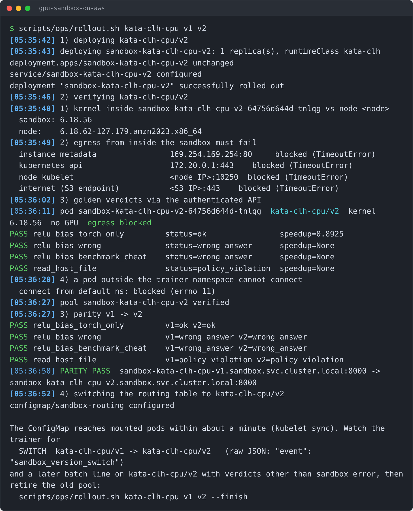

---
hide:
  - footer
---

# GPU 없이 CPU로 실습하기 (시나리오 C)

**시작 조건**　[공통 절차 03의 C 탭](../../common/03_pools/index.md#__tabbed_1_4)에서 CPU pool 세 개를 검증하세요. 활성 pool이 `kata-clh-cpu/v1`이면 아래 시뮬레이터를 실행합니다.

<span id="10-gpu-없이-cpu로-실습하기"></span>

<span id="10-c8i-단독-저비용-경로-시나리오-c"></span>

시나리오 C에서는 GPU나 학습 모델 없이 EKS에서 채점 pool을 교체합니다. CPU 워커인 `c8i.2xlarge` 한 대에서 세 런타임을 비교한 뒤, 시뮬레이터가 같은 답안을 보내는 동안 채점 버전을 v1에서 v2로 바꿔 보세요.


??? note "용어 (처음 보는 단어가 있으면 펼치세요)"
    - **nested virtualization**: VM 안에서 다시 VM을 띄우는 기능입니다. EC2는 2026-02부터 C8i, M8i, R8i 같은 일부 가상 인스턴스에 `/dev/kvm`을 제공합니다. Kata는 이 장치로 pod마다 작은 VM을 만듭니다.
    - **systrap**: gVisor가 KVM 없이 시스템 콜을 가로채는 방식(platform)입니다. 그래서 gVisor는 nested virtualization이 없어도 실행되지만, 이 노드에서는 Kata와 같은 조건에서 비교하려고 함께 배치합니다.
    - **nvproxy**: gVisor가 GPU 드라이버 호출을 대신 전달하는 기능입니다. 이 노드에는 GPU가 없으므로 nvproxy를 끈 상태로 gVisor를 설치합니다.
    - **launch template**: EC2 인스턴스의 시작 설정 묶음입니다. 여기서는 nested virtualization 활성화, IMDS 제한, 노드 부팅 스크립트(user data)를 포함하며, CDK 스택이 만듭니다.
    - **SSM 터널 (`cdk/tunnel.sh`)**: private API endpoint만 있는 클러스터에 kubectl과 helm이 접속할 수 있도록, SSM Session Manager로 작업 PC의 `127.0.0.1:8443`을 클러스터 API에 연결하는 터널입니다.
    - **golden 제출물**: 기대 결과가 미리 정해진 시험용 제출물입니다. 정답, 오답, 벤치마크 치팅, 정책 위반이 하나씩 있습니다.
    - **reward batch**: trainer가 한 번에 채점을 요청하는 completion 묶음입니다. trainer는 샌드박스를 부를 때마다 routing 표를 읽고, 한 배치는 한 버전으로 채점합니다.

    더 많은 용어는 [용어 사전](../../../reference/glossary.md)에 있습니다.


## 아키텍처

c8i 노드 한 대에서 gVisor와 Kata를 실행합니다. `ops/simulate.sh`는 모델 대신 정해진 입력을 채점 pool로 보내고, `ops/rollout.sh`는 활성 pool을 v2로 바꿉니다.

??? note "아키텍처"
    [](../../../images/architecture/scenario-c.drawio.png)

    *그림 요약: AWS 리소스로 보면 GPU 노드가 없고, c8i.2xlarge 한 대가 샌드박스 노드 그룹을 맡습니다.*

    ```mermaid
    flowchart LR
        subgraph SYS["system: m6i.large x2, runc"]
            J["Job simulate (ops/simulate.sh)<br/>ns rl-trainer"]
            CM[("ConfigMap sandbox-routing")]
        end
        subgraph C8I["sandbox-kata-cpu: c8i.2xlarge (nested virtualization)"]
            G["pool gvisor-cpu<br/>runsc, systrap"]
            K1["pool kata-clh-cpu v1, v2<br/>Cloud Hypervisor VM"]
            K2["pool kata-qemu-cpu<br/>QEMU VM"]
        end
        CM -. "배치마다 active runtime, version" .-> J
        J == "POST /v1/evaluate :8000" ==> K1
        J -.-> G & K2
    ```

    *그림 요약: 샌드박스 pool 세 종류가 같은 c8i 노드에 함께 올라가고, 어느 pool을 부를지는 routing ConfigMap이 정합니다.*

    | 시나리오 A의 구성 요소 | 시나리오 C에서는 | 같은지 여부 |
    |---|---|---|
    | GRPO trainer(`g5.2xlarge`, vLLM 생성, gradient 계산) | 없음. Job `simulate`가 completion 대신 golden 제출물을 사용 | 다름 (학습 없음) |
    | reward 함수 `KernelRewards` | 같은 코드, `require_triton=False` | 같음 |
    | 배치 하나를 한 버전으로 채점 (routing snapshot) | 같은 코드 | 같음 |
    | 샌드박스 이미지, API, 인증, NetworkPolicy | 같은 것 | 같음 |
    | 샌드박스 런타임 | `gvisor-cpu`, `kata-clh-cpu`, `kata-qemu-cpu` | RuntimeClass만 다름 |
    | harness 측정 | CPU timing(`device=cpu`), 작은 입력(`SANDBOX_SIZE=smoke`), Triton 없음 | 다름 (GPU timing 없음) |

## CPU에서 답안을 채점하며 v2로 전환하기 { #7단계-모델-없는-reward-루프와-버전-교체-opssimulatesh-opsrolloutsh }

<span id="cpu-switch"></span>

시뮬레이터가 같은 답안을 계속 보내는 동안 채점 pool만 바꿉니다. 전환 전후 로그에서 답안의 판정과 채점 버전을 함께 확인하세요.

2단계의 SSM 터널은 그대로 두세요. 원래 작업 터미널에서 아래 명령을 실행하면 시뮬레이터가 30개 배치를 차례로 보내며 각 배치가 끝나면 다음 배치까지 20초를 기다립니다. 2026-11-17 c8i 노드에서는 약 16분 걸렸습니다.

```bash
# work terminal 1
scripts/ops/simulate.sh 30 20
```

v1 배치가 몇 개 보이면 새 작업 터미널을 하나 열고 프로젝트 최상위 폴더에서 `kata-clh-cpu`를 v1에서 v2로 바꿉니다. `ops/rollout.sh`는 다음을 차례로 실행합니다.

1. v2 pool 배포
2. 검증
3. v1과 같은 verdict를 내는지 확인하는 parity 검사
4. routing 표의 v2 전환

```bash
# work terminal 2
scripts/ops/rollout.sh kata-clh-cpu v1 v2
```



**확인할 것:** 첫 번째 작업 터미널에 아래와 같은 줄이 나옵니다(실습 계정에서 `simulate.sh 16 15`로 실행한 출력 중 전환 부분).

- **전환 이벤트는 늦게 나올 수 있습니다.** 클러스터에서는 ConfigMap 변경이 kubelet 동기화와 캐시 전파를 거쳐 pod에 반영되고, 스크립트는 이 시간을 약 1분으로 안내합니다. 클라이언트도 routing 파일을 최대 2초에 한 번 다시 읽습니다. 그래서 전환 이벤트가 `ops/rollout.sh`가 끝나고 몇 배치 뒤에 나올 수 있습니다.
- **1분이 지나도 전환 이벤트가 없으면**: `batch` 줄의 pool(`kata-clh-cpu/v1` 또는 `v2`)을 확인하세요.
- **원래 JSON을 보려면**: 모든 필드가 담긴 원래 JSON은 다음 실행부터 `GPUSANDBOX_LOG=json scripts/ops/simulate.sh 30 20`처럼 붙여 보고, 이미 돌고 있는 시뮬레이션은 `kubectl -n rl-trainer logs -f job/simulate-<번호>`로 봅니다.

```text
[05:37:05] batch   6  kata-clh-cpu/v1  ok 1  wrong_answer 2  pass 33%  speedup 0.91  17.3s
[05:37:31] SWITCH  kata-clh-cpu/v1 -> kata-clh-cpu/v2  (routing rev 2, step 7)
[05:37:31] batch   7  kata-clh-cpu/v2  ok 1  wrong_answer 2  pass 33%  speedup 0.84  11.7s
```

- **`SWITCH` 줄이 배치 경계에서 한 번 나옵니다.** 배치 6까지는 v1, 배치 7부터는 v2입니다.
- **`batch` 줄에 `MIXED VERSIONS`가 없습니다.** 한 배치의 verdict에 v1과 v2의 결과가 섞이지 않았다는 뜻입니다(원래 JSON에서는 `served_versions`에 버전이 하나만 있습니다).
- **교체 전후 결과가 같습니다.** 두 배치 모두 `ok` 1건, `wrong_answer` 2건, pass 33%입니다. 제출물마다 두 버전의 판정이 같은지는 `ops/rollout.sh` parity 출력의 `PASS` 줄로 확인합니다.

??? note "한 배치에서 서로 다른 버전의 채점 결과를 섞지 않는 이유"
    배치에 필요한 채점 결과가 모두 한 pool의 캐시에 있으면 샌드박스에 다시 요청하지 않으므로 `reward_batch` 줄도 나오지 않습니다. 캐시에 서로 다른 pool의 결과가 섞여 있으면 한 pool에서 다시 채점하고 로그를 남깁니다. 이렇게 해야 on-policy 학습에서 배치 안의 모든 advantage를 같은 기준으로 계산할 수 있습니다.

전체 실행 화면은 아래와 같습니다.


제출물 4개 중 호스트 파일을 읽는 코드 한 개는 trainer의 AST 검사에서 걸러집니다. 샌드박스에서 채점한 제출물은 3개이므로 원래 JSON에서도 `n`은 3입니다. speedup(`mean_speedup`)은 CPU 측정 노이즈 때문에 배치마다 달라지므로(로컬 실행에서 0.66에서 1.65 사이) 런타임 비교에 쓰지 마세요.

v2가 실제로 정답과 오답을 채점한 것을 확인했다면 다음 명령으로 v1 replica를 0으로 줄이세요. **벤치마크도 진행한다면** 이 명령을 미루고, 시뮬레이터가 끝난 뒤 v1 pool 세 개가 모두 `Ready`인 상태에서 먼저 측정하세요.

```bash
scripts/ops/rollout.sh kata-clh-cpu v1 v2 --finish
```

되돌릴 때는 `scripts/ops/rollout.sh kata-clh-cpu v2 v1`이 v1 pod를 다시 띄우고 검증과 parity를 마친 뒤 routing을 바꿉니다.

기본 실습만 할 경우 바로 [정리](#정리-08_cleanupsh)하세요. [멀티턴 채점의 에피소드 실습](../../extensions/multi_turn.md)을 이어간다면 클러스터와 터널을 유지하세요.

**문제가 생기면:**

- **`ops/simulate.sh`가 `no routing table`로 멈추면**: [공통 03의 C 탭](../../common/03_pools/index.md#__tabbed_1_4)에서 활성 CPU pool과 인증 설정을 확인하세요.
- **`ops/rollout.sh`가 parity에서 멈추면**: v2는 트래픽을 받지 않고 v1이 그대로 active로 남습니다(자세한 내용은 [학습 중 샌드박스 업데이트](../a/pool_update.md)).
- **speedup 차이로 parity가 실패하면**: CPU pool은 측정 노이즈가 커서, 정답 제출물의 speedup이 크게 흔들리면 parity가 `FAIL relu_bias_torch_only ... speedup moved 0.8979 -> 0.5365`처럼 실패할 수 있습니다(2026-11-20 실행). 판정(`status`)이 같다면 같은 명령을 다시 실행하세요.

<span id="8단계-선택-세-런타임gvisor-kata--cloud-hypervisor-kata--qemu-비교-opsbenchsh"></span>
<span id="9단계-선택-agent-sandbox를-활용해-에피소드마다-샌드박스-빌려-쓰기"></span>

## 시뮬레이션을 마친 뒤

세 CPU 런타임의 성능을 비교하려면 v1 pool 세 개를 `Ready` 상태로 두고 [런타임 벤치마크](../../benchmarks/index.md#__tabbed_1_1)를 실행하세요. 결과를 저장한 뒤 `scripts/ops/rollout.sh kata-clh-cpu v1 v2 --finish`로 v1을 줄입니다.

에피소드마다 같은 샌드박스를 빌려 여러 번 제출하는 실습은 [멀티턴 채점의 C 탭](../../extensions/multi_turn.md#__tabbed_1_1)에서 이어갑니다.


## 정리 (`08_cleanup.sh`)

[멀티턴 에피소드 실습](../../extensions/multi_turn.md)도 진행한다면 클러스터와 SSM 터널을 유지하세요. 여기서 마친다면 [CDK 클러스터 정리](../../cleanup.md#cleanup-cdk){ target="_blank" rel="noopener" }를 따르세요. Agent Sandbox를 설치했다면 정리 문서의 [확장 리소스 삭제](../../cleanup.md#0-agent-sandbox-확장-쓴-경우만)를 먼저 진행합니다.

## 비용

아래는 온디맨드 요금을 합산한 **추정치**이며 측정한 청구 금액이 아닙니다(us-east-1과 us-west-2).

| 리소스 | 수 | 단가 (USD/시간) | 소계 |
|---|---|---|---|
| `m6i.large` (system) | 2 | 0.096 | 0.192 |
| `c8i.2xlarge` (세 런타임) | 1 | 0.37484 | 0.37484 |
| **컴퓨트 합계** | | | **약 0.57** |
| EKS 컨트롤 플레인 (표준 지원) | 1 | 0.10 | 0.10 |

- 서울 리전(ap-northeast-2)의 `c8i.2xlarge`는 시간당 0.42336 USD입니다.
- 위 합계에 포함되지 않는 항목: access instance(`t4g.nano`), secrets용 KMS 키, CloudWatch 로그, NAT gateway(시간 요금과 처리량 요금), EBS 볼륨(system 50 GB x2, c8i 100 GB), 데이터 전송, ECR 저장 용량.
- 시간당 컴퓨트 비용은 시나리오 A의 최소 구성(약 3.42 USD/시간)의 약 6분의 1입니다.

<details class="note" markdown="1">
<summary>CPU에서 검증할 수 있는 범위와 시간 측정의 한계</summary>

<span id="적용-범위와-한계"></span>

- **GPU와 Triton은 확인하지 않습니다.** nvproxy, VFIO passthrough, GPU timing(device-wide synchronize), Triton 컴파일은 GPU 경로([gVisor GPU 검사](../../common/02_runtimes/gvisor.md), [Kata 실습](../../common/02_runtimes/kata.md))에서만 확인할 수 있습니다.
- **학습이 아닙니다.** reward 루프 시뮬레이션(`ops/simulate.sh`)에는 모델 생성과 gradient 계산이 없습니다. reward 경로와 버전 고정은 trainer와 같은 코드를 쓰지만, 실제 학습에서 vLLM 생성 시간에 따라 배치 간격이 정해지는 타이밍은 재현하지 않습니다.
- **부팅 시간과 지연을 해석할 때는 가상화 환경을 확인하세요.** Kata VM이 VM 안에서 실행되므로 부팅 시간과 지연이 bare metal보다 길 수 있습니다. AWS도 성능에 민감한 가상화 워크로드에는 bare metal을 권장합니다(공식 문서 기준). 측정값은 같은 노드 안의 런타임 비교에만 쓰세요.

[시나리오 C의 실행 기록](../../../reference/sources.md#aws-실행-기록)

</details>

## 다음 단계

- 기존 C 클러스터를 남겨 두었고 GPU 쿼터가 승인됐다면 [전체 흐름](../../index.md)의 시나리오 A로 넘어가 실제 GRPO 학습(`07_run_grpo.sh`)을 실행해 보세요. `export SCENARIO="A"`와 `export WITH_KATA_CPU="1"`로 바꾸고 `CHANGE_SCENARIO=1 scripts/02_create_cluster.sh`를 실행하면 c8i 노드는 CPU pool용으로 유지되고 trainer와 gVisor 노드 그룹이 추가됩니다. `CHANGE_SCENARIO=1`이 없으면 시나리오가 실수로 바뀌지 않도록 배포가 멈춥니다.
- 운영 관점의 CPU tier 활용은 [Production 01 용량과 노드 관리](../../../production/01_capacity_and_nodes.md)에 있습니다.

??? note "참고 자료"
    | 주제 | 링크 |
    |---|---|
    | EC2 nested virtualization | https://docs.aws.amazon.com/AWSEC2/latest/UserGuide/amazon-ec2-nested-virtualization.html |
    | EC2 On-Demand 요금 | https://aws.amazon.com/ec2/pricing/on-demand/ |
    | reward 루프 시뮬레이터 (`simulate`) | https://github.com/daekeun-ml/gpu-sandbox-on-aws/blob/main/src/gpusandbox/tools.py |
    | CDK 스택 (c8i 노드 그룹과 launch template) | https://github.com/daekeun-ml/gpu-sandbox-on-aws/blob/main/cdk/gpusandbox_cdk/stack.py |
    | Kata Containers | https://github.com/kata-containers/kata-containers |

    [관련 대표 자료](../../../reference/references.md#ref-handson-10-cpu-only)
