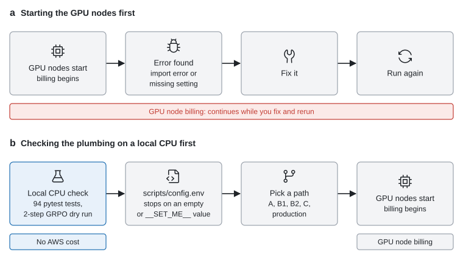

# Getting started

<span id="1-clone-the-repository"></span>

```bash
git clone https://github.com/daekeun-ml/gpu-sandbox-on-aws.git
cd gpu-sandbox-on-aws
./scripts/quickstart.sh
```

Already have the project? Run `./scripts/quickstart.sh` from its directory. Use AWS CLI credentials for your lab account. After you choose a scenario, `init` creates `.quickstart/<scenario>/config.env` with the defaults. [AWS profile and Region settings](../reference/scripts.md#quickstart)

<span id="5-create-scriptsconfigenv"></span>

<span id="6-choose-your-path"></span>

## Continue on AWS

To follow the guide and run each command yourself, choose A, B1, B2 or C in [shared step 01, cluster provisioning](common/01_provision/index.md).

## What you need

### Local tools

| Tool | Used for | Notes |
|---|---|---|
| AWS CLI v2 | every AWS step | `aws sts get-caller-identity` must work |
| AWS CDK CLI | creates (`02_create_cluster.sh`) and deletes (`08_cleanup.sh`) the VPC, cluster and node groups | 2.1148.1 or later, `npm install -g aws-cdk` |
| Node.js | runs the CDK CLI | 22 or 24 LTS (versions jsii supports) |
| Session Manager plugin | reaches the private API endpoint through `cdk/tunnel.sh` | the plugin for the AWS CLI. Check with `session-manager-plugin --version` |
| kubectl | deployment and verification | within one minor version of the cluster (1.36) |
| helm | device plugin, kata-deploy (OCI chart), GPU Operator, HyperPod dependency chart | Helm 3 |
| docker (buildx) | builds the three images for `linux/amd64` and pushes them to ECR | on an arm64 workstation, an x86_64 host with 100+ GB of disk is recommended |
| python3 | renders the manifest templates (`scripts/render.py`), runs the CDK app | the CDK app runs in the repository's virtual environment |
| jq | JSON processing | |
| git | clones the HyperPod dependency chart (Scenario B) | |
| uv | sets up the CDK Python environment for A, B1 and C | Check with `uv --version` |

`scripts/01_check_prereqs.sh` checks that `aws cdk node kubectl helm docker python3 jq session-manager-plugin` are installed. eksctl cannot create a cluster with only a private endpoint, so it is not used.

### AWS account and quotas

| Quota (vCPU-based) | Needed for the hands-on | Notes |
|---|---|---|
| Running On-Demand G and VT instances | scenario A 16, B1 8, B2 and C 0 | the default can be 0 for new accounts |
| Running On-Demand Standard (A, C, D, H, I, M, R, T, Z) instances | 6 (system `m6i.large` 2 x 2 + the SSM access instance `t4g.nano` 2) | documented default is 5 |
| `ml.g5.2xlarge for cluster usage` (SageMaker) | 1 (Scenario B) | HyperPod-specific quota |
| `ml.m5.xlarge for cluster usage` (SageMaker) | 1 (managed B2) | CPU `system` group |
| `ml.g5.xlarge for cluster usage` (SageMaker) | 2 (Scenario B2) | the B2 `sandbox` instance group (`HYPERPOD_SANDBOX_COUNT`) |

- **G and VT, scenario A**: the 16 is trainer `g5.2xlarge` 8 + gVisor `g5.xlarge` 4 x 2.
- **G and VT, B1**: the trainer moves to HyperPod, so the requirement drops to 8 (the gVisor nodes).
- **G and VT, B2 and C**: they have no EC2 GPU nodes and need no G and VT quota.
- **With Kata GPU**: add `g4dn.metal` 96 to G and VT.
- **Standard, scenario C or with Kata CPU**: add `c8i.2xlarge` 8, for 14.
- **Standard, CDK B2 and Kata GPU**: they need 2 more for the `m6i.large` builder while the custom AMI builds: 8, or 16 together with c8i.
- **B1 and B2**: check the SageMaker quotas above separately.

Quota increases can take time, so request them before creating the cluster.

## Optional local exercises

<details class="note" markdown="1">
<summary>Show setup and test commands</summary>

<span id="before-starting-gpu-nodes"></span>
<span id="what-you-can-verify-locally"></span>



??? note "Terms (expand if a word is new to you)"
    - **Sandbox**: an environment that runs untrusted code in isolation. In this asset it is the HTTP server that runs and scores kernel code written by the model.
    - **Harness**: the scoring program that runs candidate code, measures correctness and speed, and returns a verdict.
    - **Golden**: a test submission whose expected verdict is fixed in advance. It checks that the server scores correctly.
    - **Loopback**: an address (`127.0.0.1`) that only your own machine can reach. Other machines cannot connect to it.
    - **Smoke run**: a short run that only checks that the plumbing is connected, before the real run.
    - **GRPO**: an RL algorithm that generates several answers per prompt and reinforces the answers that beat the group average.
    - **Dry run**: a very short run (2 steps here) that checks the wiring instead of training for real.
    - **Reward**: the score RL gives one answer. In this asset it is the weighted sum of format, correctness and speedup.
    - **Quota**: the upper limit on the resources an AWS account can use at the same time. EC2 GPU quotas count vCPUs, not instances.
    - **Fail closed**: rejecting requests, instead of allowing them, when a setting is missing or cannot be verified.

    More detail is in the [Glossary](../reference/glossary.md).

### 2. Local Python environment

Create a virtual environment, install CPU-only PyTorch first, then install this package in editable mode (source changes apply without reinstalling) with the `dev` extra. The order matches the GitHub Actions test workflow.

=== "macOS"

    ```bash
    uv venv --python 3.14
    source .venv/bin/activate
    # macOS: the default PyPI wheels have no CUDA, so this is enough
    uv pip install torch numpy
    uv pip install -e ".[dev]"
    ```

=== "Linux"

    ```bash
    uv venv --python 3.14
    source .venv/bin/activate
    # Linux: CPU-only wheels, as in .github/workflows/tests.yml
    uv pip install --index-url https://download.pytorch.org/whl/cpu torch numpy
    uv pip install -e ".[dev]"
    ```

`.[dev]` contains pytest, FastAPI, uvicorn, httpx, PyJWT, PyYAML and kubernetes. The CI additionally installs the `gateway` extra and `shellcheck-py`, and runs shellcheck on the shell scripts after pytest.

Check the installation.

```bash
python -c "import torch, gpusandbox; print(torch.__version__, torch.cuda.is_available())"
```

**What to look for:** the PyTorch version followed by `False` (expected for a CPU-only install).

### 3. Run the tests

Run the whole test suite of the repository.

```bash
python -m pytest -q
```

**What to look for:** the last line starts with `110 passed` (the duration after it depends on your machine).

- **Breakdown**: the 110 tests are 69 core, 30 [Agent Sandbox extension](../concepts/06_agent_sandbox.md) and [multi-turn episode](extensions/multi_turn.md) and 11 [demo site](../reference/demo_site.md) tests.
- **Coverage**: the AST policy, the two-process harness on CPU (correct, wrong, crash, timeout, benchmark cheat, monkeypatch), fail-closed authentication, readiness after egress denial is verified, the client, the gateway's per-group version pinning, the operator tools, rendering of the manifest, node user data (`infra/eks/userdata.py`) and Karpenter templates, and the demo site's security properties. Per-file coverage is in [Repository map](../reference/repository_map.md#tests).
- **CDK stack tests**: the 18 CDK stack tests live separately in `cdk/tests`; after the CDK preparation in section 5, run them with `cd cdk && python -m pytest -q tests`.

**If it fails:** a `ModuleNotFoundError` usually means the virtual environment is not active or section 2 was skipped; run `source .venv/bin/activate` again and repeat section 2.

!!! warning "Steps that start servers on a Linux host"
    After every evaluation the sandbox server sends SIGKILL to every process in `/proc` except itself and its ancestors ([`procs.py`](https://github.com/daekeun-ml/gpu-sandbox-on-aws/blob/main/src/gpusandbox/server/procs.py)).

    - **Inside a pod**: the scope is limited to the container's PID namespace.
    - **Run directly on a Linux host**: it also hits your other processes (editor, the other server, the trainer), and system processes too when run as root.
    - **On macOS**: there is no `/proc`, so the behavior is off there.

    How to run things safely:

    - **pytest**: an autouse fixture in `tests/conftest.py` turns this behavior off under pytest, so `python -m pytest -q` above is safe on a Linux host as it is.
    - **Steps that start servers directly, such as section 4**: run them in a separate container (separate PID namespace) per server rather than on a Linux host.
    - **If the container has its own network namespace**: the server binds to `127.0.0.1` by default (`SANDBOX_HOST`), so the requests in 4.2 and 4.3 sent from the host do not reach it.
    - **If the container shares the host network**: (for example `docker run --network host`, which still keeps its own PID namespace) it can be reached with the default bind.

    To check only the tests that start no servers, skip `slow`.

    ```bash
    # Skips the tests marked "slow" (harness subprocesses and in-process servers)
    python -m pytest -q -m "not slow"
    ```

    **What to look for:** `92 passed, 18 deselected`.

### 4. Loopback smoke run (macOS)

Instead of two sandbox pods in a cluster, start two CPU sandbox servers on loopback for the golden probe and the GRPO dry run.

#### 4.1 Start two sandbox servers

Run one in each of two terminals. The servers differ only in port and work directory.

```bash
# Terminal 1
source .venv/bin/activate
SANDBOX_DEVICE=cpu SANDBOX_SIZE=smoke SANDBOX_AUTH_TEST_BYPASS=1 \
SANDBOX_RUNTIME=local SANDBOX_VERSION=v1 \
SANDBOX_WORK_ROOT=/tmp/gpusandbox/18001 SANDBOX_PORT=18001 \
gpusandbox-server
```

```bash
# Terminal 2
source .venv/bin/activate
SANDBOX_DEVICE=cpu SANDBOX_SIZE=smoke SANDBOX_AUTH_TEST_BYPASS=1 \
SANDBOX_RUNTIME=local SANDBOX_VERSION=v1 \
SANDBOX_WORK_ROOT=/tmp/gpusandbox/18002 SANDBOX_PORT=18002 \
gpusandbox-server
```

| Variable | Value | Meaning |
|---|---|---|
| `SANDBOX_DEVICE` | `cpu` | run the harness on CPU (default `cuda`) |
| `SANDBOX_SIZE` | `smoke` | small input shapes (default `full`) |
| `SANDBOX_AUTH_TEST_BYPASS` | `1` | turns token verification off. Local loopback only, off by default |
| `SANDBOX_RUNTIME`, `SANDBOX_VERSION` | `local`, `v1` | labels that appear in responses and logs |
| `SANDBOX_WORK_ROOT` | `/tmp/gpusandbox/<port>` | root of the per-request work directories. The default `/work` assumes a container, so change it locally |
| `SANDBOX_PORT` | `18001`, `18002` | default `8000` |

**What to look for:** each terminal shows a startup log like this one (a macOS run; versions and process numbers differ).

```text
WARNING:gpusandbox.auth:authentication TEST BYPASS is enabled; use only on loopback
WARNING:gpusandbox.server:egress self-test disabled (SANDBOX_EGRESS_PROBE_TARGETS is empty)
INFO:gpusandbox.server:device probe ok=True info={'torch': '2.15.0', 'cuda_runtime': None}
INFO:     Uvicorn running on http://127.0.0.1:18001 (Press CTRL+C to quit)
```

Both warnings are expected in a local run. By default the server binds to `127.0.0.1` only (`SANDBOX_HOST`).

??? note "Bind address and access limits in the cluster"
    In the cluster the pod manifest sets `SANDBOX_HOST=0.0.0.0`, and a headless ClusterIP Service (pod addresses through DNS, no virtual IP) plus a NetworkPolicy (a firewall rule between pods) admit the trainer namespace only.

**If it fails:** `address already in use` means another process holds that port; switch to another port (for example `18011`) and match the addresses in 4.2 and 4.3.

!!! warning "The test bypass is for loopback only"
    `SANDBOX_AUTH_TEST_BYPASS=1` turns off token verification for `/v1/evaluate`, `/info` and `/metrics` entirely.

    - **The bypass with `SANDBOX_HOST=0.0.0.0`**: the code does not block combining the two, so do not set both.
    - **In the cluster**: the repository's manifests do not set this variable. Sandbox pods in the cluster verify audience-bound ServiceAccount tokens and reject evaluation, server info and metrics requests (`/v1/evaluate`, `/info`, `/metrics`) with 401 when the authentication settings are missing (fail closed).
    - **`/healthz` and `/readyz`**: they report server state without authentication, so the `/readyz` response below says nothing about the authentication settings.

#### 4.2 Check the servers (golden probe)

In a third terminal, check readiness and send the golden probe to both servers. The probe is an operator tool that compares the verdicts of golden submissions with the expected ones.

```bash
source .venv/bin/activate
curl -s http://127.0.0.1:18001/readyz
python -m gpusandbox.tools probe --address 127.0.0.1:18001,127.0.0.1:18002 --device cpu
```

**What to look for:**

- Output similar to the following and exit code 0 (a macOS run).
- The server accepts requests only after the device probe finishes, so run this after both terminals show `Uvicorn running`. Before that the connection is refused and `curl -s` prints nothing.
- The `pod`, `kernel_release` and `speedup` values differ per machine and run.

```text
{"status":"ready"}
{"endpoint": "127.0.0.1:18001", "pod": "842f578ca5a5", "runtime": "local", "version": "v1", "kernel_release": "25.6.0", "gpu": null, "egress_blocked": true}
{"endpoint": "127.0.0.1:18002", "pod": "842f578ca5a5", "runtime": "local", "version": "v1", "kernel_release": "25.6.0", "gpu": null, "egress_blocked": true}
PASS relu_bias_torch_only         status=ok                speedup=0.9474
PASS relu_bias_wrong              status=wrong_answer      speedup=None
PASS relu_bias_benchmark_cheat    status=wrong_answer      speedup=None
PASS read_host_file               status=policy_violation  speedup=None
```

On CPU the goldens that need a Triton kernel are skipped and only these four run.

| Golden | Expected verdict |
|---|---|
| `relu_bias_torch_only` | `ok` |
| `relu_bias_wrong` | `wrong_answer` |
| `relu_bias_benchmark_cheat` | `wrong_answer` (code that turns wrong once the benchmark starts) |
| `read_host_file` | `policy_violation` |

`egress_blocked` is `true` because the self-test target list (`SANDBOX_EGRESS_PROBE_TARGETS`) is empty. In the cluster a pod turns Ready only after verifying that IMDS (the EC2 instance metadata service that hands out node credentials), the API server and the node's kubelet are unreachable.

**If it fails:**

- **If there is a `FAIL` line or a connection error**: first check that both startup logs contain `device probe ok=True`.
- **If it fails in the cluster**: see the "sandbox pools and readiness" section of [Troubleshooting](../reference/troubleshooting.md).

#### 4.3 TRL GRPO dry run

Install the TRL stack at the trainer image's versions, then run the dry run. It downloads `HuggingFaceTB/SmolLM2-135M-Instruct` from the Hugging Face Hub.

```bash
# Same pins as trainer/Dockerfile (as of 2026-11, re-verify)
uv pip install "trl==1.18.0" "peft==0.21.3" "datasets>=4.7"

SANDBOX_ADDRESS="127.0.0.1:18001,127.0.0.1:18002" SANDBOX_RUNTIME=local \
python rl/trl/train_grpo.py --dry-run \
  --model HuggingFaceTB/SmolLM2-135M-Instruct \
  --output-dir /tmp/grpo-dry-run \
  --allow-torch-only
```

- `--dry-run` runs 2 steps on CPU without vLLM and cuts completions at 32 tokens.
- `--output-dir` must be writable (the default `/outputs/grpo` is a pod path). `train_grpo.py` resumes from the latest `checkpoint-*` in this directory. Select a new output directory to start again.
- `--allow-torch-only` gives a correctness score of 1.0 to correct answers without a Triton kernel. Without it, a correct PyTorch-only answer gets 0.3. CPU cannot run Triton kernels, so this dry run turns it on.
- Locally, the comma-separated server addresses in `SANDBOX_ADDRESS` are used verbatim. The cluster Job does not set this variable; it reads the current pool's Service address from the routing table (ConfigMap) that `SANDBOX_ROUTING_FILE` points to.
- LoRA trains small adapter matrices instead of all model weights. The trainer uses it by default.

**What to look for:**

- First, `{"event": "routing", "mode": "direct", "runtime": "local", "version": "v1", "address": "127.0.0.1:18001,127.0.0.1:18002"}`.
- Two steps of TRL logs, with values per reward function (`rewards/format_reward` and so on).
- At the end, `{"event": "done", "output": "/tmp/grpo-dry-run/final", "reward_batches": ...}`.

**If it fails:**

- **A model download error**: it is a network or Hugging Face Hub access problem.
- **Errors from training in the cluster**: see the "training" section of [Troubleshooting](../reference/troubleshooting.md).

!!! note "`reward_batches` can be 0"
    If the 135M model does not close a code block within 32 tokens, the trainer scores the sample as `no_code` and never calls a sandbox. This step checks the wiring between TRL and the reward functions (routing, function signatures, LoRA, saving); the probe in 4.2 and pytest check the sandbox path.

When the dry run finishes, press Ctrl-C in each server terminal to stop the two local servers.

</details>

??? note "References"
    | Topic | Link |
    |---|---|
    | Install AWS CLI v2 | https://docs.aws.amazon.com/cli/latest/userguide/getting-started-install.html |
    | EC2 instance type quotas | https://docs.aws.amazon.com/ec2/latest/instancetypes/ec2-instance-quotas.html |
    | AWS CDK v2 Developer Guide, bootstrapping | https://docs.aws.amazon.com/cdk/v2/guide/home.html , https://docs.aws.amazon.com/cdk/v2/guide/bootstrapping.html |
    | uv | https://github.com/astral-sh/uv |
    | GRPO trainer, example settings | https://github.com/daekeun-ml/gpu-sandbox-on-aws/blob/main/rl/trl/train_grpo.py , https://github.com/daekeun-ml/gpu-sandbox-on-aws/blob/main/scripts/config.env.example |

    [Selected references on this topic](../reference/references.md#ref-getting-started)
