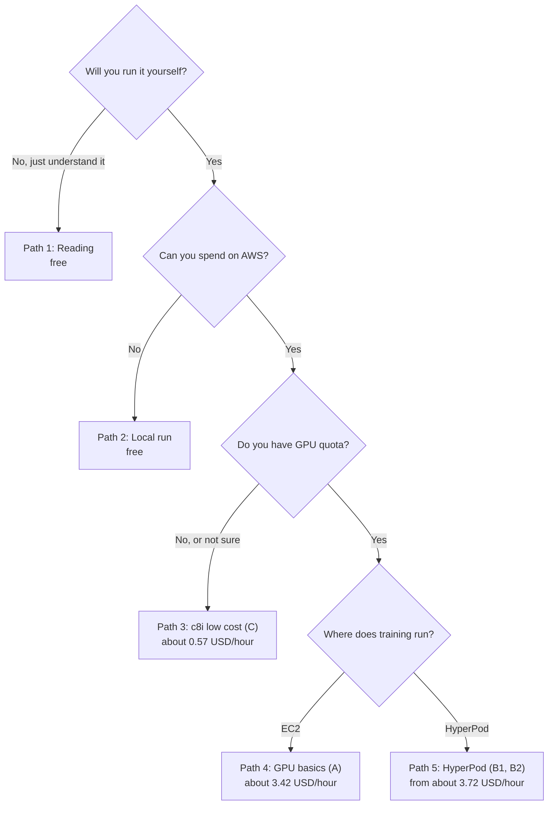
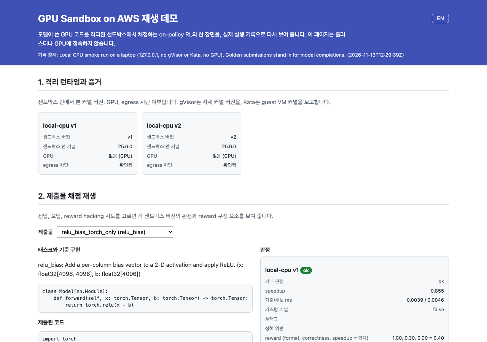
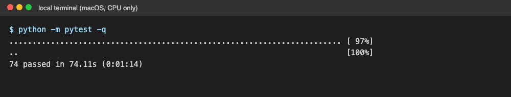
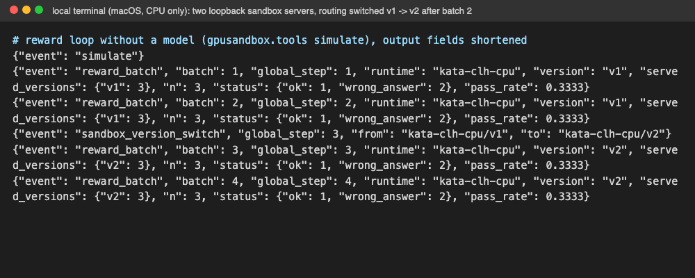

# Choose a learning path

**TL;DR** Answer at most four questions to get a path; if you are new, start with the free path 1 (reading) and path 2 (local run).

## Pain points

There are close to 70 pages and four scenarios (A, B1, B2, C), so it is hard to decide what to read first. Starting without telling apart readers who only need the concepts from those who need to run it makes it easy to overspend on GPU nodes, which cost a few dollars per hour while they run.

*Takeaway: Picking a GPU path without knowing where to start adds cost for every hour the nodes stay up. Do the free paths 1 and 2 first, and choose a paid path after checking its quota and hourly cost.*

## Why

- **Each path shows the account, quota and hourly cost it needs, up front.**
- **Two paths cost nothing.** Reading and a local run already show the core (isolation, scoring, version swaps).
- **You can stop anywhere.** Each path marks the point where you have done enough.

**Before you start:** nothing. [Home](index.md) shows what this asset builds on one screen.

## Pick a path with a few questions

*Takeaway: pick a paid path after the free ones; without GPU quota, path 3 is the cheapest way on AWS.*

If you design for production, read [Path 7: Production design](#course-7) in addition to the paths above.

## All paths at a glance

Costs are estimates that add up On-Demand compute list prices (us-east-1 and us-west-2). Times are rough estimates the author did not measure.

| Path | For | You need | Time (estimate) | Cost |
|---|---|---|---|---|
| 1. Reading | You want to know what a GPU sandbox is and why it is needed | a browser | 1 to 2 hours | free |
| 2. Local run | You want to see the code actually run | Python 3.14, git | 30 minutes to 1 hour | free |
| 3. c8i low cost (scenario C) | You want to try the three runtimes and a version swap cheaply on AWS | an AWS account, Standard vCPU quota 14, the AWS CDK CLI and the Session Manager plugin | half a day | compute about 0.57 USD/hour + EKS 0.10 + NAT |
| 4. GPU basics (scenario A) | You want to run real GRPO training and GPU sandboxes | G and VT vCPU quota 16 | a day | compute about 3.42 USD/hour |
| 5. HyperPod (scenarios B1, B2) | You plan to train on SageMaker HyperPod | path 4's needs + HyperPod quota | a day or more | B1 about 3.72, B2 about 4.52 USD/hour |
| 6. Add Kata GPU | You want to compare VM-boundary isolation and GPU passthrough | G and VT vCPU quota 112 | path 4 + half a day | path 4 + 7.824 USD/hour |
| 7. Production design | You are designing a structure for a real service | a browser | 2 to 3 hours | free |

## Steps per path

=== "1. Reading"

    1. [Home](index.md): what this asset builds, on one screen.
    2. [01 When the sandbox needs a GPU](concepts/01_why_gpu_sandbox.md): why GPU code written by a model is scored in isolation.
    3. [02 Isolation runtimes](concepts/02_isolation_runtimes.md): the difference between gVisor and Kata (a buildings and houses analogy).
    4. [03 On-policy RL with sandboxes](concepts/03_onpolicy_rl_with_sandboxes.md): when it is safe to change the sandbox during training.
    5. [09 Demo site](handson/09_demo_site.md): a demo that replays the recording shipped in the repository (screenshot below).
    6. [05 Decision guide](concepts/05_decision_guide.md): the runtime and instance for your situation.

    

    *The recording shipped in the repository (a CPU run on a laptop), opened locally; these are not GPU or cluster results.*

    **You can stop here:** items 2 to 4 let you explain the problem this asset solves and the shape of the solution.

=== "2. Local run"

    1. [Getting started](getting_started.md) sections 1 to 3: get the repository, build the Python environment and run the tests (a successful run below).
    2. [Getting started](getting_started.md) section 4: start two sandbox servers on your machine to score a correct answer, a wrong answer and a cheat.
    3. (Optional) [Getting started](getting_started.md) 4.3: run a 2-step GRPO dry run with a small model to see the trainer and the scoring functions connected.

    

    *A run on the author's laptop (macOS, CPU only); numbers and times can differ on your machine.*

    **You can stop here:** when item 2 shows `PASS` everywhere, you have seen the scoring flow of an isolated server.

    **If it fails:** see the "If it fails" notes in [Getting started](getting_started.md) and the "Config and scripts" section of [Troubleshooting](reference/troubleshooting.md).

=== "3. c8i low cost"

    1. Finish path 2 first.
    2. Follow [10 CPU-only path on c8i](handson/10_cpu_only.md) to the end. The cluster, the three runtimes, the model-free reward loop and the version swap are on one page.
    3. When you are done, delete everything with the "Cleanup" step on the same page.

    

    *The same reward loop reproduced locally with two servers. On a cluster, the model-free reward loop (`scripts/ops/simulate.sh`) prints the same shape, with one `sandbox_version_switch` between batches.*

    **You can stop here:** seeing `sandbox_version_switch` confirms the core of "swapping the sandbox during training".

=== "4. GPU basics"

    1. Finish path 2 first, then read the steps and costs in [00 Overview](handson/00_overview.md).
    2. [01 Cluster and images](handson/01_cluster_and_images.md) → [02 gVisor GPU sandboxes](handson/02_gvisor.md) → [04 Deploy and verify sandbox pools](handson/04_sandbox_pools.md)
    3. [05 On-policy GRPO training](handson/05_grpo_training.md) → [06 Updating the sandbox during training](handson/06_sandbox_update.md)
    4. (Optional) [08 Runtime benchmark](handson/08_benchmark.md)
    5. [99 Cleanup](handson/99_cleanup.md)

    **You can stop here:** when page 06 shows training moving to v2 without stopping, you have reached the goal.

=== "5. HyperPod"

    1. Start after you understand items 1 and 2 of path 4 (same cluster layout).
    2. Follow B1 in [07 HyperPod scenario](handson/07_hyperpod.md). Only the training runs on HyperPod.
    3. (Experimental) [B2](handson/07_hyperpod.md#b2) on the same page: put the sandboxes on HyperPod too, with a custom AMI whose driver is replaced.
    4. Delete HyperPod first, then run [99 Cleanup](handson/99_cleanup.md).

    **You can stop here:** the `reward_batch` log of the HyperPodPyTorchJob in B1 is enough. Do B2 only if you plan to maintain a custom AMI.

=== "6. Kata GPU"

    1. Finish path 4 or path 3 first.
    2. Stage 1 (c8i rehearsal) → stage 2 (`g4dn.metal`) of [03 Kata sandboxes](handson/03_kata.md)
    3. Compare with gVisor in [08 Runtime benchmark](handson/08_benchmark.md).
    4. When you are done, scale the `g4dn.metal` node group to zero right away or run [99 Cleanup](handson/99_cleanup.md).

    **You can stop here:** `pgpu=8` and the guest kernel of the Kata smoke pod confirm GPU passthrough.

=== "7. Production design"

    1. [00 Architecture](production/00_architecture.md): how it differs from the hands-on.
    2. [02 Security](production/02_security.md), [04 Reward integrity](production/04_reward_integrity.md): the threats to block and reward hacking.
    3. [03 Gateway and pools](production/03_gateway_and_pools.md), [05 Sandbox versioning](production/05_sandbox_updates.md)
    4. [01 Capacity and nodes](production/01_capacity_and_nodes.md), [08 Cost](production/08_cost.md)
    5. [09 Provisioning with CDK](production/09_cdk.md): the private-by-default infrastructure code that the hands-on uses too (stack layout, security defaults, tunnel)
    6. (When scaling up) [06 Scaling with veRL](production/06_scaling_with_verl.md), [07 Observability and operations](production/07_observability_and_operations.md)

    **You can stop here:** items 1 and 2 are enough to draft the questions for a design review.

## Path 7: Production design { #course-7 }

It is for reading, not running, and its order is in the tab above. It is easier after one hands-on path (3 to 6), because the components are familiar by then.

## Three habits that prevent cost accidents

!!! warning "Before starting an AWS path (3 to 6)"
    1. **Clean up as soon as you finish.** The last step of each path (`scripts/08_cleanup.sh`) asks you to type a confirmation word, so nothing is deleted by accident.
    2. **Scale nodes to zero while you take a break.** Scaling only a Deployment down does not stop node charges (how to scale nodes is under "Time and cost" in [00 Overview](handson/00_overview.md)).
    3. **Check what is left after cleanup.** The last table of `08_cleanup.sh` (tagged instances) must be empty, and resources that can stay behind and the commands to check them are in [99 Cleanup](handson/99_cleanup.md).

## If you get stuck

- A word you do not know: [Glossary](reference/glossary.md)
- An error message: [Troubleshooting](reference/troubleshooting.md)
- Behavior you did not expect: [Misconceptions](reference/faq.md)
- What a setting means: [Configuration](reference/configuration.md)

## Scope and limits

- The screenshots on this page are local runs on the author's laptop; console screenshots of a scenario C deployment in a practice account are in [09 Provisioning with CDK](production/09_cdk.md).
- The real bill is higher than the costs above (sums of On-Demand list prices) because of the NAT gateway, EBS, data transfer and so on.

## Next steps

Once you have picked a path, go to its first page. If you are unsure, [Getting started](getting_started.md) in path 2 is the easiest place to begin.
