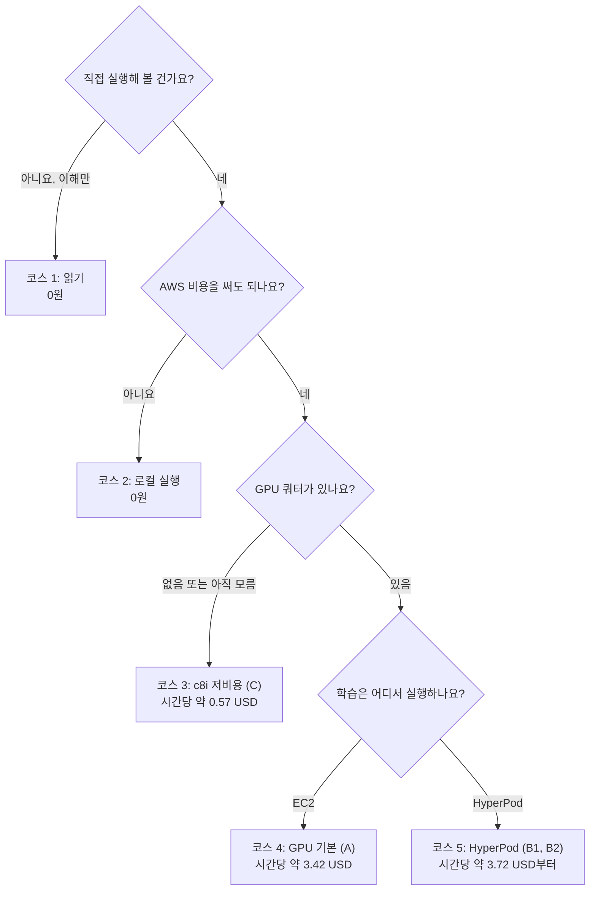

# 학습 코스 고르기

!!! info "TL;DR"
    아래 질문에 최대 네 개까지 답하면 코스 1~5 중 하나가 정해집니다. Kata GPU를 더하려면 코스 6, 운영 설계만 읽으려면 코스 7로 가세요. 처음이라면 무료인 코스 1(읽기)과 코스 2(로컬)부터 시작하세요.

## 기존 Pain Point

페이지가 46개나 되고 시나리오도 A, B1, B2, C로 나뉘어서 무엇부터 읽을지 정하기 어렵습니다. 개념만 알면 되는 사람도 직접 실행해야 하는 사람과 같은 순서로 시작하면, 켜 둔 동안 시간당 몇 달러씩 과금되는 GPU 노드에 필요 이상으로 비용을 쓰기 쉽습니다.

*그림 요약: 어디서 시작할지 모르는 상태에서 GPU 코스부터 고르면 노드를 켜 둔 시간만큼 비용이 듭니다. 무료인 코스 1과 2를 먼저 하고, 유료 코스는 쿼터와 시간당 비용을 확인한 뒤 고릅니다.*

## Why

- **코스마다 필요한 계정, 쿼터, 시간당 비용이 다릅니다.** 시작하기 전에 아래 표에서 확인하세요.
- **비용이 들지 않는 코스가 세 개 있습니다.** 읽기와 로컬 실행(코스 1, 2)만으로 핵심 내용(격리, 채점, 버전 교체)을 확인할 수 있고, 코스 7(Production 설계)도 읽기만 하는 무료 코스입니다.
- **코스마다 멈춰도 되는 지점을 정해 두었습니다.** 예를 들어 코스 2는 golden probe의 네 항목이 모두 `PASS`면 마쳐도 됩니다.

**사전 지식:** 없습니다.

## 질문으로 코스 고르기

*그림 요약: 유료 코스는 무료 코스를 마친 뒤에 고르고, GPU 쿼터가 없다면 코스 3이 AWS에서 가장 싼 코스입니다.*

운영 설계를 고민한다면 위 코스와 별개로 [코스 7: Production 설계](#course-7)를 읽으세요.

## 코스별 준비물과 비용

비용은 컴퓨트의 온디맨드 요금을 합산한 추정치이고(us-east-1과 us-west-2), 시간은 저자가 측정한 값이 아닌 대략적인 추정입니다.

| 코스 | 이런 분께 | 준비물 | 시간 (추정) | 비용 |
|---|---|---|---|---|
| 1. 읽기 | GPU 샌드박스가 무엇이고 왜 필요한지 알고 싶은 분 | 브라우저 | 1~2시간 | 0원 |
| 2. 로컬 실행 | 코드가 실제로 실행되는 과정을 보고 싶은 분 | Python 3.14, git | 30분~1시간 | 0원 |
| 3. c8i 저비용 (시나리오 C) | AWS에서 세 런타임과 버전 교체를 적은 비용으로 해 보고 싶은 분 | AWS 계정, Standard vCPU 쿼터 14, AWS CDK CLI와 Session Manager plugin | 반나절 | 컴퓨트 약 0.57 USD/시간 + EKS 0.10 + NAT |
| 4. GPU 기본 (시나리오 A) | 실제 GRPO 학습과 GPU 샌드박스를 실행해 보고 싶은 분 | G and VT vCPU 쿼터 16 (06의 버전 교체 중에는 gVisor 노드 2대를 더해 24) | 하루 | 컴퓨트 약 3.42 USD/시간 (버전 교체 중 약 2.01 추가) |
| 5. HyperPod (시나리오 B1, B2) | 학습을 SageMaker HyperPod에서 실행하려는 분 | B1: G and VT vCPU 쿼터 8과 HyperPod `ml.g5.2xlarge` 1대. B2: HyperPod `ml.g5.2xlarge` 1대와 `ml.g5.xlarge` 2대 (EC2 GPU 쿼터 불필요) | 하루 이상 | B1 약 3.72, B2 약 4.52 USD/시간 |
| 6. Kata GPU 추가 | VM 경계 격리와 GPU passthrough를 비교하려는 분 | G and VT vCPU 쿼터: 코스 3에 더하면 96, 코스 4에 더하면 112. IOMMU AMI를 빌드하는 동안 Standard vCPU 쿼터도 2가 더 필요(c8i 리허설과 함께면 16) | 코스 3이나 4 + 반나절 | 코스 3에 더하면 합계 약 8.39 USD/시간(7.824 추가). 코스 4에 c8i 리허설까지 더하면 합계 약 11.61 USD/시간 |
| 7. Production 설계 | 실제 서비스에 적용할 구조를 설계하는 분 | 브라우저 | 2~3시간 | 0원 |

## 코스별 순서

=== "1. 읽기"

    1. [홈](index.md): trainer가 커널 코드를 보내고 샌드박스가 채점 결과를 돌려주는 경로.
    2. [01 GPU 샌드박스가 필요한 경우](concepts/01_why_gpu_sandbox.md): 모델이 쓴 GPU 코드를 격리해서 채점하는 이유.
    3. [02 격리 런타임 비교](concepts/02_isolation_runtimes.md): gVisor와 Kata가 격리 계층을 만드는 방식의 차이.
    4. [03 On-policy RL과 샌드박스](concepts/03_onpolicy_rl_with_sandboxes.md): 학습 중에 샌드박스를 바꿔도 되는 조건.
    5. [09 데모 사이트](handson/09_demo_site.md): 저장소에 포함된 녹화를 재생하는 데모입니다(아래 화면).
    6. [05 상황별 선택 가이드](concepts/05_decision_guide.md): 내 상황에 맞는 런타임과 인스턴스를 고르는 기준.

    

    *저장소에 든 녹화(노트북의 CPU 실행 기록)를 로컬에서 연 화면으로, GPU나 클러스터의 결과가 아닙니다.*

    **여기서 멈춰도 됩니다:** 2~4번을 읽으면 이 에셋이 해결하는 문제와 해결 방법의 기본 구조를 설명할 수 있습니다.

=== "2. 로컬 실행"

    1. [시작하기](getting_started.md) 1~3장: 저장소를 받고 Python 환경을 만들어 테스트를 실행합니다(성공 화면은 아래).
    2. [시작하기](getting_started.md) 4장 (macOS): 내 PC에 샌드박스 서버 두 개를 띄워 정답, 오답, 치팅 답안을 채점합니다. Linux 호스트에서 서버를 직접 띄우면 같은 사용자의 다른 프로세스까지 종료될 수 있으니, 서버마다 별도 컨테이너에서 실행하세요.
    3. (선택) [시작하기](getting_started.md) 4.3: 작은 모델로 GRPO dry run 2 step을 실행해 trainer와 채점 함수가 제대로 연결됐는지 확인합니다.

    

    *테스트가 74개였을 때 저자의 노트북(macOS, CPU 전용)에서 찍은 화면입니다. 지금은 109개이고, 실행 시간은 환경마다 다릅니다.*

    **여기서 멈춰도 됩니다:** 2번에서 `PASS`가 모두 나오면 로컬 서버의 채점 흐름을 확인한 것입니다. gVisor나 Kata의 격리는 AWS 코스에서 확인합니다.

    **문제가 생기면:** [시작하기](getting_started.md)의 "문제가 생기면" 안내와 [문제 해결](reference/troubleshooting.md)의 "설정과 스크립트" 항목을 보세요.

=== "3. c8i 저비용"

    1. 코스 2를 먼저 끝냅니다.
    2. [10 c8i 단독 저비용 경로](handson/10_cpu_only.md)를 끝까지 따라갑니다. 클러스터, 세 런타임, 모델 없는 reward 루프, 버전 교체가 한 페이지에 있습니다.
    3. 끝나면 같은 페이지의 "정리" 단계로 모두 지웁니다.

    

    *같은 reward 루프를 로컬 서버 두 개로 재현한 출력입니다. 클러스터에서는 모델 없는 reward 루프(`scripts/ops/simulate.sh`)가 같은 형태로 출력하고, 배치 사이에 `sandbox_version_switch`가 한 번 나옵니다.*

    **여기서 멈춰도 됩니다:** `sandbox_version_switch` 다음 `reward_batch`에서 `version`이 `v2`이고 `status`에 `ok`와 `wrong_answer`가 있으면, 새 풀이 golden 제출물을 채점한 것입니다. 전환 이벤트만으로는 부족합니다. v2 요청이 모두 `sandbox_error`여도 이 이벤트는 나옵니다.

=== "4. GPU 기본"

    1. 코스 2를 먼저 끝내고, [00 전체 흐름](handson/00_overview.md)에서 단계와 비용을 확인합니다.
    2. [01 클러스터와 이미지](handson/01_cluster_and_images.md) → [02 gVisor GPU 샌드박스](handson/02_gvisor.md) → [04 샌드박스 풀 배포와 검증](handson/04_sandbox_pools.md)
    3. [05 On-policy GRPO 학습](handson/05_grpo_training.md) → [06 학습 중 샌드박스 업데이트](handson/06_sandbox_update.md)
    4. (선택) [08 런타임 벤치마크](handson/08_benchmark.md): 배포된 v1 풀만 재므로 06의 마지막 단계(`--finish`) 전에 실행하세요.
    5. [99 정리](handson/99_cleanup.md)

    **여기서 멈춰도 됩니다:** 06 페이지에서 학습이 중단 없이 v2로 넘어가면 목표를 달성한 것입니다.

=== "5. HyperPod"

    1. 클러스터 구조가 같으므로 코스 4의 1~2번을 이해한 뒤 시작합니다.
    2. [07 HyperPod 시나리오](handson/07_hyperpod.md)의 B1을 따라갑니다. B1에서는 학습만 HyperPod에서 실행됩니다.
    3. (실험) B1 대신 같은 페이지의 [B2](handson/07_hyperpod.md#b2): 드라이버를 바꾼 custom AMI로 샌드박스도 HyperPod 인스턴스 그룹에서 실행합니다. B1을 띄운 채로는 B2를 시작할 수 없으니, 둘 다 하려면 첫 시나리오를 정리한 뒤 두 번째를 시작하세요.
    4. HyperPod를 먼저 지우고 [99 정리](handson/99_cleanup.md)를 실행합니다.

    **여기서 멈춰도 됩니다:** B1에서 HyperPodPyTorchJob의 `reward_batch` 로그에 `runtime`이 `gvisor`이고, `status`에 `sandbox_error`가 아닌 채점 결과(`ok`, `wrong_answer` 등)가 하나 이상 있으면 충분합니다. B2는 custom AMI를 직접 관리할 계획이 있을 때만 하세요.

=== "6. Kata GPU"

    1. 코스 3은 정리 단계 직전까지 진행합니다. 코스 4에서 이어 가며 두 GPU 풀을 비교하려면 06의 버전 교체 전에 넘어오세요. 06의 마지막 단계(`--finish`)는 `gvisor v1`을 0개로 줄입니다. 클러스터를 지운 뒤에는 이어서 할 수 없습니다.
    2. [03 Kata 샌드박스](handson/03_kata.md)의 1단계(c8i 리허설) → 2단계(`g4dn.metal`)
    3. [04 샌드박스 풀 배포와 검증](handson/04_sandbox_pools.md)대로 `kata-qemu v1` 풀을 배포하고 `scripts/ops/verify.sh kata-qemu v1`로 검증합니다.
    4. (선택) [08 런타임 벤치마크](handson/08_benchmark.md)로 gVisor와 비교합니다. GPU끼리 비교하려면 `gvisor v1`(코스 4)과 `kata-qemu v1` 풀이 모두 Ready일 때 실행하세요.
    5. 끝나면 바로 `g4dn.metal` 노드 그룹을 0으로 줄이거나 [99 정리](handson/99_cleanup.md)를 실행합니다.

    **여기서 멈춰도 됩니다:** 3번의 `scripts/ops/verify.sh kata-qemu v1`에서 GPU가 `Tesla T4`로 나오고 golden verdict가 모두 PASS면 GPU passthrough까지 확인한 것입니다.

=== "7. Production 설계"

    1. [00 아키텍처](production/00_architecture.md): 핸즈온 구성과 무엇이 다른지 설명합니다.
    2. [02 보안](production/02_security.md), [04 Reward 무결성](production/04_reward_integrity.md): 막아야 할 위협과 reward hacking을 정리합니다.
    3. [03 Gateway와 샌드박스 풀](production/03_gateway_and_pools.md), [05 샌드박스 버전 관리](production/05_sandbox_updates.md)
    4. [01 용량과 노드 관리](production/01_capacity_and_nodes.md), [08 비용](production/08_cost.md)
    5. [09 CDK로 프로비저닝](production/09_cdk.md): 핸즈온에서도 쓰는, private 구성이 기본값인 인프라 코드입니다(스택 구성, 보안 기본값, 터널).
    6. (규모를 키울 때) [06 veRL로 확장](production/06_scaling_with_verl.md), [07 Observability와 운영](production/07_observability_and_operations.md)

    **여기서 멈춰도 됩니다:** 1~2번만 읽어도 설계 리뷰에서 물어야 할 질문 목록을 만들 수 있습니다.

## 코스 7: Production 설계 { #course-7 }

실행하지 않고 읽기만 하는 코스이며, 읽는 순서는 위 탭에 있습니다. 핸즈온 코스(3~6) 중 하나를 끝낸 뒤 읽으면 구성 요소가 익숙해서 이해하기 쉽습니다.

## 비용 사고를 막는 세 가지 습관

!!! warning "AWS 코스(3~6)를 시작하기 전에"
    1. **끝나면 바로 정리합니다.** 각 코스의 마지막 단계(`scripts/08_cleanup.sh`)는 확인 단어를 직접 입력해야 진행되므로 리소스가 실수로 지워지지 않습니다.
    2. **실습을 쉬는 동안에는 쓰지 않는 EC2 실습 노드 그룹을 0으로 줄입니다.** Deployment만 줄이면 노드는 계속 과금됩니다(방법은 [00 전체 흐름](handson/00_overview.md)의 "소요 시간과 비용" 참고). system 노드 두 대는 최솟값이 2라서 남고, HyperPod 인스턴스는 EKS 노드 그룹을 줄여도 과금되므로 코스 5를 마쳤다면 `scripts/hyperpod/delete.sh`로 지우세요.
    3. **정리한 뒤 남은 리소스를 확인합니다.** `08_cleanup.sh`의 마지막 표(태그가 붙은 인스턴스)가 비어 있어야 하고, 남을 수 있는 리소스와 확인 명령은 [99 정리](handson/99_cleanup.md)에 있습니다.

## 문제가 생기면

- 처음 보는 단어: [용어 사전](reference/glossary.md)
- 오류 메시지: [문제 해결](reference/troubleshooting.md)
- 예상과 다르게 동작할 때: [자주 하는 오해](reference/faq.md)
- 설정 값의 뜻: [설정 값](reference/configuration.md)

## 적용 범위와 한계

- 이 페이지의 화면 캡처는 저자의 노트북에서 실행한 로컬 화면이고, 시나리오 C를 실습 계정에 배포한 콘솔 화면은 [09 CDK로 프로비저닝](production/09_cdk.md)에 있습니다.
- 실제 청구액은 NAT gateway, EBS, 데이터 전송 요금이 추가되어 위 비용(온디맨드 요금의 합)보다 많습니다.

## 다음 단계

아직 코스를 정하지 못했다면 비용이 들지 않는 코스 2의 [시작하기](getting_started.md)부터 시작하세요.
