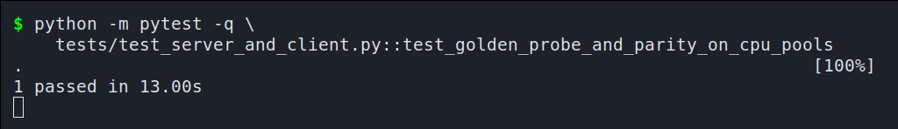

# 학습 코스 고르기

모델이 쓴 코드를 어디서 실행하고, 그 결과를 어떻게 학습에 쓸까요? 처음이라면 [초심자 가이드](beginner/index.md)에서 답안 하나가 채점되는 과정부터 보세요. 내 PC에서 채점까지 해 보려면 코스 2부터 시작해도 됩니다.

-   **AWS 계정 없이 무엇을 해 볼까요?**

    - [1 · 샌드박스와 채점 원리 읽기](#course-1)
    - [2 · 내 PC에서 답안 채점하기](#course-2)
    - [7 · 서비스 운영 구조 설계하기](#course-7)

-   **AWS에서 무엇을 실행할까요?**

    - [3 · GPU 없이 채점 pool 교체하기](#course-3)
    - [4 · EC2 GPU에서 모델 학습하기](#course-4)
    - [5 · HyperPod에서 모델 학습하기](#course-5)
    - [6 · 기존 클러스터에 Kata GPU 추가하기](#course-6)

## 브라우저와 내 PC에서 { #코스별-순서 }

### 1. 샌드박스가 코드를 채점하는 과정 { #course-1 }

[초심자 가이드 1~4편](beginner/index.md)을 읽고 [공개 데모](https://dohbsn4kn34ya.cloudfront.net/#try)에서 **ReLU 빠뜨린 오답**을 골라 채점 기록을 재생해 보세요. gVisor와 Kata가 같은 코드를 각자의 격리 환경에서 실행한 결과를 볼 수 있습니다. 읽고 둘러보는 데 1~2시간 정도 잡으세요.

두 환경에 모두 **오답**(`wrong_answer`)이 표시됩니다. 코드에서 어떤 연산이 빠졌을까요? 덧셈 뒤 음수를 0으로 바꾸는 연산이 빠져서 계산 결과가 달라졌습니다. 여기서 샌드박스는 코드를 실행하고, 채점기는 기대한 답과 대조하며, trainer는 그 결과를 학습에 씁니다.

??? note "격리 방식과 학습 원리를 더 읽고 싶다면"
    - GPU에서 직접 채점해야 하는 과제는 무엇일까요? [GPU 샌드박스가 필요한 경우](concepts/01_why_gpu_sandbox.md)
    - gVisor와 Kata에서는 어떤 커널이 제출 코드의 요청을 처리할까요? [격리 런타임 비교](concepts/02_isolation_runtimes.md)
    - 학습 도중 채점기를 바꾸려면 무엇을 맞춰야 할까요? [On-policy RL과 샌드박스](concepts/03_onpolicy_rl_with_sandboxes.md) · [상황별 선택 가이드](concepts/05_decision_guide.md)

### 2. 내 PC에서 정답과 오답 채점하기 { #course-2 }

[직접 해 보기](beginner/05_hands_on.md)의 1~2절을 따라 하세요. Git과 `uv`로 Python 3.14 환경을 준비하고, 로컬 CPU 서버 두 곳에 같은 답안을 보내는 테스트를 실행합니다. 설치를 포함해 30분~1시간 정도 걸립니다.

마지막에 **`1 passed`**가 나오면 두 서버 모두 정답, 오답, 정책 위반을 예상대로 구별한 것입니다. 여기까지는 AWS 계정과 GPU가 필요 없습니다.

??? example "테스트 결과 화면과 macOS 추가 실습"
    

    Linux에서는 위의 pytest로 확인하세요. macOS에서는 두 서버를 직접 띄워 개별 판정을 보거나 작은 모델로 GRPO 학습 두 스텝을 실행할 수도 있습니다. [시작하기의 로컬 실행 안내](getting_started.md#4-loopback-smoke-run-macos)

### 7. 서비스 운영 구조 설계하기 { #course-7 }

[운영 아키텍처](production/00_architecture.md)의 구성도에서 학습 노드가 보낸 요청을 따라가 보세요. 게이트웨이가 호출자를 확인하는 위치와 한 배치의 답을 같은 버전으로 채점할 방법을 그림에 표시해 보세요. 브라우저만으로 2~3시간 정도 들여 검토할 수 있습니다.

??? note "설계할 항목별로 읽기"
    - **누가 무엇을 실행할 수 있나?** [보안](production/02_security.md) · [Reward 무결성](production/04_reward_integrity.md)
    - **채점 요청을 어디로 보내고, 언제 새 버전으로 넘기나?** [게이트웨이와 채점 pool](production/03_gateway_and_pools.md) · [샌드박스 버전 관리](production/05_sandbox_updates.md)
    - **노드는 몇 대가 필요하고 비용은 얼마나 들까?** [용량과 노드 관리](production/01_capacity_and_nodes.md) · [비용](production/08_cost.md) · [CDK 스택 구성](production/09_cdk.md)
    - **여러 학습 노드의 지연과 오류를 어떻게 추적하나?** [veRL로 확장](production/06_scaling_with_verl.md) · [모니터링과 운영](production/07_observability_and_operations.md)

## AWS에서 실행하기 { #코스별-준비와-비용 }

AWS 실습이 처음이라면 [핸즈온 배포 전 확인](handson/00_overview.md#사전-준비)에서 도구와 리전별 쿼터를 확인하세요. 클러스터를 만들면 요금이 발생합니다.

??? note "코스 3~6의 예상 시간, 노드 비용과 쿼터"
    | 코스 | 실습 시간 | 노드 비용 (USD/시간) |
    |---|---|---:|
    | 3 · CPU 전용 (C) | 반나절 | 약 0.57 |
    | 4 · EC2 GPU (A) | 하루 | 약 3.42 |
    | 5 · HyperPod (B1 / B2) | 하루 이상 | 약 3.72 / 4.56 |
    | 6 · Kata GPU 추가 | 코스 3 또는 4에서 반나절 추가 | metal 노드 7.824 추가 |

    노드 비용은 `us-west-2`와 `us-east-1` 온디맨드 요금 기준 추정치입니다. EKS 컨트롤 플레인(표준 지원 0.10 USD/시간), 접속 인스턴스, NAT gateway, 스토리지와 전송 등에 따로 요금이 붙습니다.

    - **CPU와 EC2 GPU**　C에는 Standard 14 vCPU, A에는 Standard 6과 G/VT 16 vCPU가 필요합니다. A에서 gVisor v1과 v2를 함께 띄우는 동안 G/VT는 24 vCPU, 노드 비용은 시간당 약 2.01 USD 더 듭니다.
    - **HyperPod**　B1은 Standard 6과 G/VT 8 vCPU에 더해 SageMaker의 `ml.g5.2xlarge for cluster usage` 한 대분이 필요합니다. B2는 HyperPod `ml.m5.xlarge` 한 대, `ml.g5.2xlarge` 한 대, `ml.g5.xlarge` 두 대분이 필요합니다.
    - **Kata GPU**　metal 노드에 G/VT 96 vCPU가 더 필요합니다. C에 추가하면 시간당 약 8.39 USD, A에 CPU 리허설 노드와 metal 노드를 함께 추가하면 약 11.61 USD입니다. CPU 리허설 노드와 임시 AMI 빌더가 함께 떠 있으면 Standard 16 vCPU가 필요합니다. [구성별 쿼터와 비용](concepts/04_platforms_and_instances.md)

### 3. CPU에서 채점 pool 교체하기 · 시나리오 C { #course-3 }

[CPU 전용 실습](handson/10_cpu_only.md)에서 `c8i.2xlarge` 한 대에 gVisor와 Kata를 띄웁니다. GPU나 모델 학습 없이, 준비된 답안을 계속 보내면서 채점 서버 묶음(pool)을 v1에서 v2로 바꿉니다.

`SWITCH` 다음 `batch` 줄을 보세요. `kata-clh-cpu/v2`에서 `ok`와 `wrong_answer`가 나오면 새 pool이 실제로 답을 채점한 것입니다.

??? example "교체 전후 두 배치의 결과 비교하기"
    배치 6은 v1, 배치 7은 v2를 사용했고 둘 다 정답 1건과 오답 2건을 돌려줬습니다.

    

### 4. EC2 GPU에서 GRPO 학습하기 · 시나리오 A { #course-4 }

[클러스터와 이미지 준비](handson/01_cluster_and_images.md)에서 시작해 [gVisor의 GPU 연결](handson/02_gvisor.md)과 [채점 pool](handson/04_sandbox_pools.md)을 확인하세요. [GRPO 학습](handson/05_grpo_training.md)에서는 모델이 여러 답을 만들고 샌드박스가 매긴 점수로 모델을 업데이트합니다.

[학습 중 pool 교체](handson/06_sandbox_update.md)까지 따라가면 한 배치 안의 답은 같은 버전에서 채점되고 다음 배치부터 v2를 쓰는 모습을 볼 수 있습니다. [교체 전후의 배치 로그](handson/06_sandbox_update.md#switch-batches)

### 5. HyperPod에서 GRPO 학습하기 · 시나리오 B1 { #course-5 }

[HyperPod 실습](handson/07_hyperpod.md)에서 B1을 고르세요. 모델은 SageMaker HyperPod에서 학습하고 코드는 EC2의 gVisor pool에서 채점합니다. trainer가 HyperPod 노드에 배치됐는지, `reward_batch`에 채점 결과가 남았는지, 학습 Job이 `Completed`로 끝났는지 차례로 확인하세요.

가이드에는 한 스텝에서 보낸 코드 12개의 판정과, 학습을 마친 뒤 고정 커널을 32번 보내 얻은 벤치마크가 있습니다. [B1 실행 화면과 학습 로그](handson/07_hyperpod.md#확인-방법) · [B1 벤치마크 결과](handson/08_benchmark.md#hyperpod-b1)

??? note "채점 노드도 HyperPod에 두고 싶다면"
    [관리형 B2](handson/07_hyperpod_b2.md)는 시스템 CPU 한 대, 학습 GPU 한 대, 채점 GPU 두 대를 HyperPod EKS에서 함께 구성합니다. B1과 B2는 서로 다른 클러스터를 사용합니다.

### 6. Kata VM에서 GPU 사용하기 · 코스 3 또는 4에서 추가 { #course-6 }

코스 3이나 4의 클러스터를 정리하기 전에 [Kata 실습](handson/03_kata.md)의 CPU 리허설과 GPU 연결 단계를 진행하세요. [채점 pool 배포](handson/04_sandbox_pools.md) 후 `scripts/ops/verify.sh kata-qemu v1` 출력에 `Tesla T4`가 보이고 시험용 답안 여섯 개가 모두 `PASS`면 VM 안에서 GPU 채점까지 확인한 것입니다. [Kata VM의 GPU 확인 화면](handson/03_kata.md#gpu-run)

??? note "gVisor와 Kata의 GPU 성능도 비교하려면"
    코스 4에서 학습이 멈추고 `gvisor v1`과 `kata-qemu v1` pool이 모두 Ready일 때 실행하세요. 06편에서 이미 `--finish`로 gVisor v1을 줄였다면 먼저 v1을 복구하세요. [런타임 벤치마크 절차와 결과](handson/08_benchmark.md#runtime-results)

### 실습을 마치거나 쉬어 갈 때 { #비용-사고를-막는-세-가지-습관 }

코스 3~6을 마치면 [99 정리](handson/99_cleanup.md)를 실행하고 마지막 표에 실습 인스턴스가 남았는지 확인하세요. **HyperPod는 EKS를 지우기 전에 `scripts/hyperpod/delete.sh`로 먼저 삭제합니다.**

??? note "클러스터를 잠시 남겨 둘 때의 비용"
    쓰지 않는 EC2 실습 노드 그룹은 0대로 줄이세요. pod 수만 줄이면 노드 요금은 계속 나갑니다. 시스템 노드 두 대와 EKS, NAT gateway는 클러스터를 남겨 둔 동안에도 과금됩니다. [리소스 정리 절차](handson/99_cleanup.md)

실습 중 낯선 단어는 [용어 사전](reference/glossary.md), 오류 메시지는 [문제 해결](reference/troubleshooting.md)에서 찾을 수 있습니다. [자주 하는 질문](reference/faq.md) · [설정 값](reference/configuration.md)
