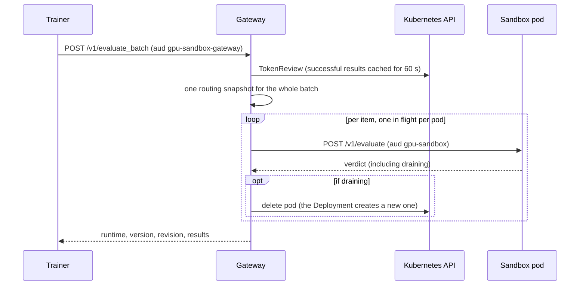

# Production reference architecture

!!! info "TL;DR"
    In production the trainer calls only one sandbox gateway, and each sandbox pool is one Deployment per (runtime, version) whose nodes a Karpenter NodePool adds from zero as pods need room.

## What changes beyond the hands-on setup

One trainer ran the exercise successfully. After adding workers, more evaluations can return `503` and training steps can take longer. Independent workers can choose the same supposedly idle pod. If routing changes at the same time, separate veRL requests for answers to the same prompt can also land on different grader versions.

![a: scaled up as is, the hands-on setup lets every trainer process pick a free pod alone, so requests pile onto sandbox pod A (more 503 retries); the veRL reward worker routes each sample separately, so v1 and v2 can mix inside one group; node group desired values set by hand leave GPU nodes idle or growing too late; and scripts/ops/sync_jwks.sh run by hand means tokens signed with a new key are all rejected until the new public key is synced. b: in production the trainers call only the sandbox gateway, which sends one evaluation per pod and versions stay one per batch for TRL (batch snapshot) and one per group for veRL (group_key pins); Karpenter NodePools grow and shrink their own nodes from zero with demand (one warm g4dn.metal), while the managed node groups from the hands-on CDK stay until you lower their desired value by hand; and the jwks-sync CronJob patches the ConfigMap hourly at :17 to follow key rotation](../images/figures/production-00_architecture.en.svg)

## The production design

The gateway selects an available pod and remembers the grading version. Karpenter provides nodes when there is pending sandbox capacity to schedule. After connecting them, confirm that a group uses one version and then check whether requests spend less time waiting. More nodes can reduce contention while leaving version consistency unresolved.

??? note "Conditions and exceptions"
    Scaled up as is, the hands-on setup, kept simple for a one-day exercise, runs into these problems.

    - **Each trainer process picks a free pod alone**: this breaks first. Several TRL ranks and dozens of veRL reward workers pile onto the same pods and 503 retries grow.
    - **veRL scores per sample**: veRL scores samples one at a time and has no batch routing snapshot, so versions can mix inside a group.
    - **Node group sizes handled by hand**: GPU nodes sit idle regardless of load or grow too late.
    - **`scripts/ops/sync_jwks.sh` run by hand**: when the issuer signing key changes, sandboxes reject every token signed with the new key (fail closed) until the new public key is synced.

    - **Scheduling and version pinning happen in one place, the gateway.** It sends one evaluation per pod and scores each batch request with one routing snapshot. TRL brings each rank's reward batch to the results of one pool, and veRL samples stay on one version per `group_key` while the pin is valid.
    - **Nodes follow the number of sandbox pods.** Karpenter NodePools start sandbox nodes from zero, and a warm placeholder keeps one slow-booting `g4dn.metal` ready.
    - **Training requests reach sandboxes only through the gateway.** The production NetworkPolicy admits only the gateway pod into sandbox pods. The `sandbox-probe` Jobs that run verification and parity need a separate policy ([03 Gateway and pools](03_gateway_and_pools.md)).

**Before you start**: this page compares against the hands-on setup, so read [Hands-on 00 Overview](../handson/00_overview.md), [04 Deploy and verify sandbox pools](../handson/04_sandbox_pools.md) and [03 On-policy RL with sandboxes](../concepts/03_onpolicy_rl_with_sandboxes.md) first.

??? note "Terms"
    - **sandbox gateway**: an HTTP service between trainers and sandbox pods. It authenticates callers, picks the pod for each request and pins the sandbox version.
    - **sandbox pool**: a set of sandbox pods with the same runtime and version, built from one Deployment and one headless Service.
    - **Karpenter NodePool**: a Karpenter rule that decides which EC2 instances to start and when to return them.
    - **RuntimeClass**: a Kubernetes object that selects the container runtime (runc, gVisor, Kata) for a pod.
    - **headless Service**: a Service without a virtual IP whose DNS returns the IPs of the Ready pods directly, so the client can pick a pod itself.
    - **projected ServiceAccount token, audience**: a short-lived token that kubelet writes into a pod file, and the name of the party meant to receive it (`aud`).
    - **TokenReview**: a Kubernetes API that asks the API server whether a token is valid.
    - **JWKS**: the set of public keys that verifies token signatures.
    - **warm placeholder**: a low-priority empty pod that keeps a slow-booting node ready.

    More terms are in the [Glossary](../reference/glossary.md).

## Preparing for production after the exercise

??? note "What has run on AWS"
    Steps 1, 4 and 5 share the scripts used in the scenario A run. The extra gateway, Karpenter NodePools, JWKS CronJob, pool hardening and warm capacity shown here have not been deployed together on AWS. Combining HyperPod autoscaling with the open-source Karpenter installation is also untested. [Run record](../reference/sources.md#aws-run-record)

    Local tests cover group pins across a switch and client requests to two loopback CPU servers. They render the EC2NodeClass and check NodePool references without applying them to a cluster. Tests check YAML and Service exposure for `pool-hardening.yaml` and `warm-capacity.yaml`; they do not render `k8s/production/*.tpl`.

If you need a repeatable deployment, start with [CDK stack ownership](09_cdk.md) and [node provisioning](01_capacity_and_nodes.md). Check what delays the first sandbox and what removes idle nodes after a run.

Before increasing the number of users or workers, review [isolation boundaries](02_security.md) alongside the [gateway request path](03_gateway_and_pools.md). Once requests succeed, use the [scoring rules](04_reward_integrity.md) and [log signals](07_observability_and_operations.md) to confirm that advancing steps receive usable scores.

For a change to a running workload, start with the verification and rollback steps in [version switching](05_sandbox_updates.md). For more workers, check pool capacity and checkpoint requirements in [scaling with veRL](06_scaling_with_verl.md). To decide whether to keep a node warm, compare the wait time and [idle cost](08_cost.md).

## Overall layout

The trainer generates answers, the gateway selects a pod and grading version, and the sandbox executes the answer. Trace that request path to locate delays.

Solid lines are evaluation requests, dotted lines Kubernetes API calls, and `aud` is the audience of the request token.

![TRL ranks (Job) and veRL Ray workers (RayCluster) in the rl-trainer namespace (trainer NodePool g6e, p5 or a HyperPod instance group) call only the sandbox gateway in the sandbox-gateway namespace (system nodes), with tokens of audience gpu-sandbox-gateway; the gateway does TokenReview, routing, group pins, one request per pod and recycling. With tokens of audience gpu-sandbox the gateway calls the pools of the sandbox namespace: sandbox-kata-qemu-v1 (kata-qemu-nvidia-gpu), sandbox-gvisor-v1, v2 (gvisor) and sandbox-kata-clh-cpu-v1 (kata-clh), while a warm placeholder holds a metal node. Below the pools sit the Karpenter NodePools sandbox-kata-gpu (g4dn.metal), sandbox-gvisor (g5.xlarge, g5.2xlarge) and sandbox-kata-cpu (c8i, m8i, r8i). Dashed lines are Kubernetes API calls: TokenReview and deleting draining pods from the gateway, reading JWKS and patching the ConfigMap from the jwks-sync CronJob](../images/figures/production-00_architecture--overview.en.svg)

*Figure: trainers call only the gateway, and their evaluation requests reach the sandbox pods through the gateway.*

## Components

| Component | Namespace | Role | Repository files |
|---|---|---|---|
| Trainer | `rl-trainer` | Generates rollouts and calls the gateway to compute rewards. | [`job-grpo.yaml.tpl`](https://github.com/daekeun-ml/gpu-sandbox-on-aws/blob/main/k8s/trainer/job-grpo.yaml.tpl) (TRL), [`raycluster-verl.yaml.tpl`](https://github.com/daekeun-ml/gpu-sandbox-on-aws/blob/main/k8s/production/raycluster-verl.yaml.tpl) (veRL) |
| Sandbox gateway | `sandbox-gateway` | TokenReview authentication, routing snapshots, group pins, one request per pod, recycling of draining pods | [`gateway/app.py`](https://github.com/daekeun-ml/gpu-sandbox-on-aws/blob/main/src/gpusandbox/gateway/app.py), [`gateway.yaml.tpl`](https://github.com/daekeun-ml/gpu-sandbox-on-aws/blob/main/k8s/production/gateway.yaml.tpl) |
| Sandbox pools | `sandbox` | One Deployment and one headless Service per (runtime, version) | [`deployment.yaml.tpl`](https://github.com/daekeun-ml/gpu-sandbox-on-aws/blob/main/k8s/sandbox/deployment.yaml.tpl) |
| JWKS sync | `sandbox-gateway` | Copies the issuer public keys into the `sandbox-auth-jwks` ConfigMap at minute 17 of every hour | [`jwks-sync.yaml.tpl`](https://github.com/daekeun-ml/gpu-sandbox-on-aws/blob/main/k8s/production/jwks-sync.yaml.tpl) |
| Capacity guards | `sandbox` | PriorityClasses, PDB, ResourceQuota, warm placeholder | [`pool-hardening.yaml`](https://github.com/daekeun-ml/gpu-sandbox-on-aws/blob/main/k8s/production/pool-hardening.yaml), [`warm-capacity.yaml`](https://github.com/daekeun-ml/gpu-sandbox-on-aws/blob/main/k8s/production/warm-capacity.yaml) |
| NodePools, EC2NodeClasses | Cluster scope | Three kinds of sandbox nodes plus trainer nodes | [`nodepools.yaml`](https://github.com/daekeun-ml/gpu-sandbox-on-aws/blob/main/infra/karpenter/nodepools.yaml), [`nodeclasses.yaml.tpl`](https://github.com/daekeun-ml/gpu-sandbox-on-aws/blob/main/infra/karpenter/nodeclasses.yaml.tpl) |
| Observability | All | `/metrics` on the gateway and sandboxes (token required), JSON events from the trainer | [07 Observability and operations](07_observability_and_operations.md) |

## NodePools and runtime placement

| NodePool | Instances (capacity type) | RuntimeClass | Purpose | Cap (`limits`) |
|---|---|---|---|---|
| `sandbox-gvisor` | `g5.xlarge`, `g5.2xlarge` (on-demand) | `gvisor` (handler `runsc`, nvproxy) | GPU measurement (A10G) | `nvidia.com/gpu: 16` |
| `sandbox-kata-gpu` | `g4dn.metal` (on-demand) | `kata-qemu-nvidia-gpu` (VFIO cold-plug) | GPU measurement (T4) behind a VM boundary | `cpu: 192` (two nodes) |
| `sandbox-kata-cpu` | `c8i`, `m8i`, `r8i` in 2xlarge, 4xlarge, 8xlarge (on-demand, spot) | `kata-clh`, `kata-qemu` (no devices) | CPU tier, Kata rehearsal | `cpu: 256` |
| `trainer` | `g6e.12xlarge`, `g6e.48xlarge`, `p5.48xlarge` (on-demand) | default runc | Training | `nvidia.com/gpu: 16` |

Taints, labels, consolidation, `expireAfter` and user data are covered in [01 Capacity and nodes](01_capacity_and_nodes.md).

## What changes from hands-on to production

| Item | Hands-on | Production | Reason |
|---|---|---|---|
| Node supply | EKS managed node groups from the CDK stack (fixed desired, min, max) | Karpenter NodePools (from zero, `limits`, consolidation) | See the list below the table. |
| Call path | trainer → sandbox headless Service (`SANDBOX_ROUTING_FILE`, direct mode) | trainer → gateway (`SANDBOX_GATEWAY`) → sandbox | One place for scheduling and version pins. |
| Sandbox ingress | Pods labelled `gpusandbox/client=true` in `rl-trainer` | Only the gateway pod in `sandbox-gateway` (replaces the policy of the same name, `allow-clients-to-sandbox-api`) | Training requests reach sandboxes along one path, through the gateway. |
| JWKS | Run `scripts/ops/sync_jwks.sh` by hand | `jwks-sync` CronJob (`17 * * * *`) | Follow signing key rotation automatically. |
| Shared storage | `emptyDir` (model cache, outputs) | PVC on a shared file system such as Amazon FSx (the veRL template mounts it at `/fsx`) | Checkpoints and caches survive node replacement. |
| Runtimes | One runtime per exercise | Pools per runtime, optionally a CPU tier and a GPU tier | Only measurement uses GPUs. |
| Version pinning | The trainer scores each batch with one version | The gateway offers batch snapshots and `group_key` pins | Supports trainers that score per sample, such as veRL. |
| Pod recycling | None (draining pods stay NotReady) | The gateway deletes draining pods | Under Kata a new pod is a new VM. |
| Capacity buffer | None | Warm placeholder, PDB, ResourceQuota | Hide slow metal boots and stop runaway usage. |

Node supply changes as follows.

- **When you raise a pool's replicas and new pods have no room**: Karpenter adds nodes.
- **When a node Karpenter created becomes empty**: it becomes a candidate for removal.
- **Managed node groups from the hands-on CDK stack (such as `sandbox-gvisor` in A and B1)**: Karpenter does not shrink them, so lower their desired size yourself based on usage.
- **If replicas stay the same**: evaluation requests wait for the existing pods.

## CPU tier and GPU tier (optional)

Put the stages that finish on the CPU first, such as loading the candidate module or compiling CUDA C++ with `nvcc`, and the GPU tier measures only survivors. The AST policy check never executes code, so the trainer and the sandbox harness already run it.

| Tier | NodePool | Runtime | Does | Does not |
|---|---|---|---|---|
| CPU tier | `sandbox-kata-cpu` (nested virtualization) | `kata-clh` (Cloud Hypervisor, no devices) | CPU work such as loading and compiling candidate code | Speedup measurement |
| GPU tier | `sandbox-gvisor` or `sandbox-kata-gpu` | `gvisor`, `kata-qemu-nvidia-gpu` | Correctness, timing, reward evidence | |

The CPU tier runs on Kata + Cloud Hypervisor.

- The `/dev/kvm` from EC2 nested virtualization (C8i, M8i, R8i and others) gives a VM boundary without `.metal`.
- CLH without devices is upstream-supported, with less RuntimeClass overhead than QEMU (Kata 4.3.1 `podFixed`: CLH 130Mi/250m, QEMU 320Mi/250m).
- Spot is acceptable. If a node is reclaimed and the connection drops, the gateway retries on another pod. A request that still fails becomes `sandbox_error`: TRL sets every reward component of that sample to `None`, and veRL records the 0.1 format score with `sandbox_error: 1`.

The EC2 documentation recommends bare metal for performance-sensitive virtualization workloads, so time measured under nested virtualization is not used as reward evidence.

!!! warning "What the repository provides and what you build"
    **Provided:** the `kata-clh-cpu` profile, the `sandbox-kata-cpu` NodePool, and a gateway API that lets each request choose a `runtime`.

    **You build:** the two-stage pipeline itself.

    - **Harness and image**: the harness has no compile-only mode, and the sandbox image (`pytorch/pytorch:*-runtime`) usually lacks `nvcc` (check the tag contents).
    - **Version names**: the single active version in the routing document applies to every runtime, so deploy CPU pools with the same version names as the GPU pools.
    - **Deploying CPU pools**: [`routing.json.tpl`](https://github.com/daekeun-ml/gpu-sandbox-on-aws/blob/main/k8s/base/routing.json.tpl) registers both `v1` and `v2` addresses for the three CPU runtimes (`gvisor-cpu`, `kata-clh-cpu`, `kata-qemu-cpu`), but you deploy the pools behind them yourself. Before you switch the active version, deploy that version of the CPU pools you use.

## Request flow

*Figure: one batch request is scored with one routing snapshot, and each pod gets one evaluation at a time.*

veRL sends each sample with a `group_key` to `POST /v1/evaluate`, and the gateway scores every sample of that key with the first one's snapshot (API and pin rules in [03 Gateway and pools](03_gateway_and_pools.md)).

!!! tip "When each episode needs its own sandbox"
    If one episode submits several kernels and reads feedback between them, as in multi-turn agentic RL, borrowing a pre-started sandbox per episode fits better than these per-request pools. The extension using `SandboxWarmPool` and `SandboxClaim` from kubernetes-sigs/agent-sandbox is in [06 Extending with Agent Sandbox](../concepts/06_agent_sandbox.md). Local tests replace the claim API with a fake and run two episodes end to end on two loopback CPU sandbox servers. It has not been run on a cluster.

## Scenario B: training on HyperPod

- **B1**: moves only the trainer to a HyperPod instance group and keeps the sandbox pools on EC2 NodePools in the same EKS cluster. The veRL RayCluster template selects HyperPod nodes through `VERL_NODE_SELECTOR`.
- **B2** runs system pods, the trainer and both gVisor graders on HyperPod. The two grading workers activate a supported NVIDIA driver with a managed reboot. [Managed B2 deployment](../handson/07_hyperpod_b2.md)

## Order of operations

1. Prepare the EKS cluster and the three images (`sandbox`, `trainer`, `control`) with hands-on [01 Cluster and images](../handson/01_cluster_and_images.md).
2. Install Karpenter with the official guide, then apply the EC2NodeClasses and NodePools. ([01 Capacity and nodes](01_capacity_and_nodes.md))
    - **The IOMMU AMI comes first**: all four EC2NodeClasses render from one template, so the IOMMU AMI for Kata GPU must exist first.
    - **If the AMI does not exist**: build it with `infra/kata/build-iommu-ami.sh` and put the printed `export KATA_IOMMU_AMI_ID=...` line into `scripts/config.env`.
3. Install the NVIDIA device plugin, the gVisor RuntimeClass, the GPU Operator and kata-deploy. ([01 Capacity and nodes](01_capacity_and_nodes.md))
4. Create namespaces, NetworkPolicies, JWKS and the routing table with `scripts/05_setup_namespaces_auth.sh`. Run it during the initial setup.
    - **If you re-run it after the gateway is deployed in step 7**: it puts back the hands-on `allow-clients-to-sandbox-api` NetworkPolicy, which lets trainer pods call sandboxes directly, and rebuilds the `rl-trainer` routing table with `ACTIVE_VERSION` (default `v1`).
    - **After that, when you only need to refresh the public keys**: use `scripts/ops/sync_jwks.sh`.
5. Deploy pools with `scripts/06_deploy_sandboxes.sh <runtime> [version] [replicas]`. In the pod list the script prints after the rollout, every pod should show READY `1/1`.
    - **When you deploy the Kata GPU pool (`kata-qemu`) for the first time and there are no metal nodes**: apply the placeholder from step 6 (`pool-hardening.yaml`, `warm-capacity.yaml`) first.
    - **Why**: the GPU Operator creates the `nvidia.com/pgpu` resource the pod requests and the `nvidia.com/cc.ready.state` label the RuntimeClass selects on a metal node, so with no such node Karpenter does not start one. The placeholder asks only for CPU and memory, so Karpenter starts a metal node for it.
6. Apply pool hardening and warm capacity. ([01 Capacity and nodes](01_capacity_and_nodes.md))
7. Deploy the gateway and the JWKS CronJob, then switch the trainer to gateway mode. ([03 Gateway and pools](03_gateway_and_pools.md))
8. Review the security controls and the reward controls. ([02 Security](02_security.md), [04 Reward integrity](04_reward_integrity.md))

If a step fails, look the symptom up in [Troubleshooting](../reference/troubleshooting.md) (for example, pods stuck at `0/1` in step 5 belong to the sandbox pool and readiness table).

## ❓ Misconceptions

!!! question "❓ Misconception: Kata only runs on `.metal`"
    Only for GPU passthrough. The host must own the physical GPU and the IOMMU, so this repository's x86 setup needs `g4dn.metal` on AWS. Kata without devices runs on the `/dev/kvm` from nested virtualization, and that is the CPU tier.

!!! question "❓ Misconception: with a gateway, sandbox pods no longer need authentication"
    NetworkPolicy and token verification are independent layers, so keep both and a misconfigured layer still leaves the other. Sandbox pods verify the gateway's token (audience `gpu-sandbox`) against the JWKS themselves and reject subjects outside the allowlist.

!!! question "❓ Misconception: more gateway replicas means more evaluation throughput"
    Throughput is capped by the number of Ready sandbox pods (one evaluation per pod). The gateway keeps group pins and per-pod in-flight state in memory, so it runs one replica on purpose; ways to scale it are in [03 Gateway and pools](03_gateway_and_pools.md).

??? note "References"
    | Topic | Link |
    |---|---|
    | VPC CNI NetworkPolicy | [Configure network policy (Amazon EKS)](https://docs.aws.amazon.com/eks/latest/userguide/cni-network-policy-configure.html) |
    | EC2 nested virtualization | [Amazon EC2 nested virtualization](https://docs.aws.amazon.com/AWSEC2/latest/UserGuide/amazon-ec2-nested-virtualization.html) |
    | GPU bare metal instances | [Accelerated computing instance types](https://docs.aws.amazon.com/ec2/latest/instancetypes/ac.html) |
    | Karpenter | [Karpenter documentation](https://karpenter.sh/docs/), [aws/karpenter-provider-aws](https://github.com/aws/karpenter-provider-aws) |
    | Runtimes | [google/gvisor](https://github.com/google/gvisor), [kata-containers/kata-containers](https://github.com/kata-containers/kata-containers) |

    [Selected references on this topic](../reference/references.md#ref-production-00-architecture)

Next: [01 Capacity and nodes](01_capacity_and_nodes.md)
