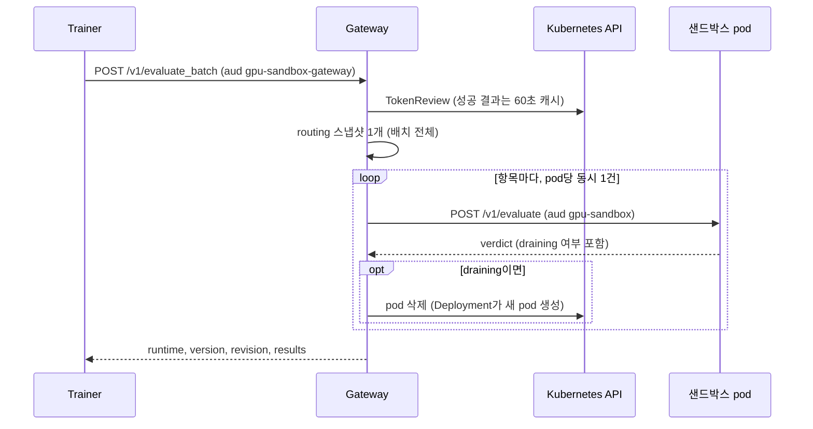

# Production 레퍼런스 아키텍처

!!! info "TL;DR"
    운영 환경에서는 trainer가 sandbox gateway 하나만 호출합니다. 샌드박스 pool은 (runtime, version)마다 Deployment 하나로 배포하고, pool이 쓰는 노드는 Karpenter NodePool이 0대부터, 배치할 pod 수에 맞춰 늘리고 줄입니다.

## 핸즈온을 확장할 때 생기는 문제

핸즈온에서 trainer 하나로는 잘 돌아갔는데, worker를 늘리자 평가 요청이 `503`으로 돌아오고 step이 길어질 수 있습니다. worker마다 빈 pod를 고르면 여러 worker가 같은 곳을 동시에 고릅니다. 그사이 운영자가 채점 버전을 바꾸면, 요청을 따로 보내는 veRL에서는 같은 문제의 답이 다른 버전으로 채점될 수도 있습니다.

![a: 핸즈온 구성을 그대로 확장하면 네 가지 문제가 생깁니다. trainer 프로세스가 각자 빈 pod를 판단해 요청이 샌드박스 pod A에 몰리고, 503 재시도가 늘어납니다. veRL reward worker는 샘플마다 따로 routing하므로 한 group 안에서 v1과 v2가 섞일 수 있습니다. 노드 그룹 desired 값을 수동으로 조정하면 GPU 노드 수가 부하와 맞지 않습니다(계속 실행되거나 늦게 증설). scripts/ops/sync_jwks.sh를 수동으로 실행하는 방식에서는 서명 키가 바뀌면 새 공개 키를 반영하기 전까지 새 키로 서명한 토큰이 모두 거부됩니다(fail closed). b: Production에서는 trainer가 sandbox gateway만 호출하고, gateway가 pod마다 평가 1건만 보냅니다. 버전은 TRL이 batch 스냅샷으로 batch마다, veRL이 group_key pin으로 group마다 하나씩 씁니다. Karpenter NodePool은 자기가 만든 노드를 0부터 limits 안에서 수요에 맞춰 늘리고 줄입니다(g4dn.metal은 warm 한 대). 핸즈온 CDK가 만든 관리형 노드 그룹은 그대로 남으므로 desired 값을 직접 줄입니다. jwks-sync CronJob은 매시 17분에 ConfigMap을 갱신해 서명 키 회전을 반영합니다.](../images/figures/production-00_architecture.ko.svg)

## 운영 구성에서 달라지는 점

gateway가 요청을 받아 빈 pod를 고르고 채점 버전을 기억합니다. 샌드박스가 부족하면 Karpenter가 실행할 노드를 마련합니다. 두 구성 요소를 연결한 뒤에는 먼저 같은 group에 같은 버전이 쓰이는지, 다음으로 요청이 기다리는 시간이 줄었는지 확인합니다. 노드를 늘려도 버전이 섞이는 문제는 그대로 남으므로 두 결과를 따로 봐야 합니다.

??? note "세부 조건과 예외"
    하루 실습용으로 단순하게 짠 핸즈온 구성의 규모만 키우면, 다음 문제가 생깁니다.

    - **trainer 프로세스마다 빈 pod를 따로 고름**: 이 구조가 먼저 문제가 됩니다. TRL rank 여러 개와 veRL reward worker 수십 개가 같은 pod에 요청을 보내므로 503 재시도가 늘어납니다.
    - **veRL의 샘플 단위 채점**: veRL은 샘플을 하나씩 채점해 배치 단위 routing 스냅샷이 없으므로, 한 group 안에서 샌드박스 버전이 섞일 수 있습니다.
    - **노드 그룹 desired 값을 수동으로 조정**: GPU 노드가 부하와 상관없이 계속 떠 있거나 늦게 늘어납니다.
    - **`scripts/ops/sync_jwks.sh`를 수동으로 실행**: issuer 서명 키가 바뀌면 새 공개 키를 반영하기 전까지 샌드박스가 새 키로 서명한 토큰을 모두 거부합니다(fail closed).

    - **스케줄링과 버전 고정을 gateway 한곳에서 처리합니다.** gateway는 pod마다 평가를 한 번에 하나만 보내고, 배치 요청 하나를 routing 스냅샷 하나로 채점합니다. TRL은 rank마다 reward batch 하나를 한 pool의 결과로 맞추고, veRL 샘플은 `group_key` pin이 유효한 동안 같은 버전에 고정합니다.
    - **노드 수가 샌드박스 pod 수에 맞춰 바뀝니다.** Karpenter NodePool이 샌드박스 노드를 0대부터 띄우고, 부팅이 느린 `g4dn.metal`은 warm placeholder로 한 대를 미리 확보해 둡니다.
    - **학습 요청은 gateway를 거쳐서만 샌드박스에 닿습니다.** 운영 구성의 NetworkPolicy는 샌드박스 pod로 들어오는 연결 중 gateway pod만 허용합니다. 검증과 parity를 실행하는 `sandbox-probe` Job은 별도 정책으로 허용해야 합니다([03 Gateway와 샌드박스 pool](03_gateway_and_pools.md)).

**읽기 전에**　이 페이지는 핸즈온 구성과 비교하며 설명하므로 [핸즈온 00 전체 흐름](../handson/00_overview.md), [04 샌드박스 pool 배포와 검증](../handson/04_sandbox_pools.md), [03 On-policy RL과 샌드박스](../concepts/03_onpolicy_rl_with_sandboxes.md)를 먼저 읽으세요.

??? note "용어"
    - **sandbox gateway**: trainer와 샌드박스 pod 사이에 있는 HTTP 서비스입니다. 호출자를 인증하고, 요청을 보낼 pod를 고르고, 샌드박스 버전을 고정합니다.
    - **샌드박스 pool**: 같은 runtime과 version으로 실행되는 샌드박스 pod 묶음입니다. Deployment 하나와 headless Service 하나로 구성합니다.
    - **Karpenter NodePool**: 어떤 EC2 인스턴스를 언제 띄우고 언제 반납할지 정하는 Karpenter 규칙입니다.
    - **RuntimeClass**: pod를 어떤 컨테이너 런타임(runc, gVisor, Kata)으로 실행할지 지정하는 Kubernetes 객체입니다.
    - **headless Service**: 가상 IP 없이, DNS가 Ready pod의 IP 목록을 그대로 반환하는 Service입니다. 클라이언트가 pod를 직접 고를 수 있습니다.
    - **projected ServiceAccount token, audience**: kubelet이 pod 안에 파일로 마운트해 주는 수명이 짧은 토큰과, 그 토큰을 받을 대상의 이름(`aud`)입니다.
    - **TokenReview**: 토큰이 유효한지 Kubernetes API server에 확인을 요청하는 API입니다.
    - **JWKS**: 토큰 서명을 검증하는 공개 키 묶음입니다.
    - **warm placeholder**: 부팅이 느린 노드를 미리 확보하려고 실행해 두는, 우선순위가 낮은 빈 pod입니다.

    더 많은 용어는 [용어 사전](../reference/glossary.md)에 있습니다.

## 핸즈온 이후 운영 준비

같은 구성으로 다시 실행할 수 있어야 한다면 [CDK 스택의 관리 범위](09_cdk.md)와 [노드 준비 과정](01_capacity_and_nodes.md)부터 확인하세요. 첫 샌드박스가 늦게 준비되는 이유와, 실습이 끝난 뒤 누가 노드를 회수하는지 알 수 있습니다.

사용자나 worker를 늘리기 전에는 [보안 경계](02_security.md)와 [gateway의 요청 흐름](03_gateway_and_pools.md)을 함께 검토하세요. 응답을 받기 시작하면 [채점 기준](04_reward_integrity.md)과 [로그에서 볼 신호](07_observability_and_operations.md)를 확인해, step이 진행되는 동안 학습에 쓸 점수가 실제로 들어오는지 봅니다.

이미 운영 중인 run을 바꾸는 경우에는 [버전 전환](05_sandbox_updates.md)의 확인과 롤백 절차부터 읽으세요. worker를 늘릴 계획이라면 [veRL 확장](06_scaling_with_verl.md)의 pool 용량과 checkpoint 조건을, 노드를 미리 켜 둘지 고민한다면 [비용](08_cost.md)의 대기 시간 계산을 참고하세요.

## 전체 구성

역할을 나눠 보면 trainer는 답안을 생성하고, gateway는 평가를 맡길 pod와 버전을 고르며, 샌드박스는 답안을 실행합니다. 어느 단계에서 지연이 생겼는지 알려면 목록에 있는 AWS 리소스보다 요청 경로를 먼저 따라가세요.

실선은 평가 요청, 점선은 Kubernetes API 호출이며, `aud`는 요청 토큰의 audience입니다.

![rl-trainer namespace(trainer NodePool g6e, p5 또는 HyperPod 인스턴스 그룹)의 TRL ranks(Job)와 veRL Ray workers(RayCluster)는 aud가 gpu-sandbox-gateway인 토큰으로 sandbox-gateway namespace(system 노드)의 sandbox gateway만 호출합니다. sandbox gateway는 TokenReview, routing, group pin, pod당 요청 1건, recycling을 처리합니다. gateway는 aud가 gpu-sandbox인 토큰으로 sandbox namespace의 pool을 호출합니다. pool은 sandbox-kata-qemu-v1(kata-qemu-nvidia-gpu), sandbox-gvisor-v1, v2(gvisor), sandbox-kata-clh-cpu-v1(kata-clh)이고, warm placeholder가 metal 노드 한 대를 확보해 둡니다. pool 아래에는 Karpenter NodePool sandbox-kata-gpu(g4dn.metal), sandbox-gvisor(g5.xlarge, g5.2xlarge), sandbox-kata-cpu(c8i, m8i, r8i)가 있습니다. 점선은 Kubernetes API 호출입니다. gateway는 TokenReview와 draining pod 삭제를 호출하고, jwks-sync CronJob은 JWKS 읽기와 ConfigMap patch를 호출합니다.](../images/figures/production-00_architecture--overview.ko.svg)

*그림: trainer는 gateway만 호출하고, trainer의 평가 요청은 gateway를 거쳐 샌드박스 pod에 전달됩니다.*

## 구성 요소

| 구성 요소 | namespace | 역할 | 저장소 파일 |
|---|---|---|---|
| Trainer | `rl-trainer` | rollout을 만들고 reward 계산을 위해 gateway를 호출합니다. | [`job-grpo.yaml.tpl`](https://github.com/daekeun-ml/gpu-sandbox-on-aws/blob/main/k8s/trainer/job-grpo.yaml.tpl) (TRL), [`raycluster-verl.yaml.tpl`](https://github.com/daekeun-ml/gpu-sandbox-on-aws/blob/main/k8s/production/raycluster-verl.yaml.tpl) (veRL) |
| Sandbox gateway | `sandbox-gateway` | TokenReview 인증, routing 스냅샷, group pin, pod당 요청 1건, draining pod 재활용 | [`gateway/app.py`](https://github.com/daekeun-ml/gpu-sandbox-on-aws/blob/main/src/gpusandbox/gateway/app.py), [`gateway.yaml.tpl`](https://github.com/daekeun-ml/gpu-sandbox-on-aws/blob/main/k8s/production/gateway.yaml.tpl) |
| 샌드박스 pool | `sandbox` | (runtime, version)마다 Deployment 하나와 headless Service 하나 | [`deployment.yaml.tpl`](https://github.com/daekeun-ml/gpu-sandbox-on-aws/blob/main/k8s/sandbox/deployment.yaml.tpl) |
| JWKS 동기화 | `sandbox-gateway` | 매시 17분에 issuer 공개 키를 `sandbox-auth-jwks` ConfigMap에 반영 | [`jwks-sync.yaml.tpl`](https://github.com/daekeun-ml/gpu-sandbox-on-aws/blob/main/k8s/production/jwks-sync.yaml.tpl) |
| 용량 보호 장치 | `sandbox` | PriorityClass, PDB, ResourceQuota, warm placeholder | [`pool-hardening.yaml`](https://github.com/daekeun-ml/gpu-sandbox-on-aws/blob/main/k8s/production/pool-hardening.yaml), [`warm-capacity.yaml`](https://github.com/daekeun-ml/gpu-sandbox-on-aws/blob/main/k8s/production/warm-capacity.yaml) |
| NodePool, EC2NodeClass | 클러스터 범위 | 샌드박스 노드 세 종류와 trainer 노드 | [`nodepools.yaml`](https://github.com/daekeun-ml/gpu-sandbox-on-aws/blob/main/infra/karpenter/nodepools.yaml), [`nodeclasses.yaml.tpl`](https://github.com/daekeun-ml/gpu-sandbox-on-aws/blob/main/infra/karpenter/nodeclasses.yaml.tpl) |
| observability | 전체 | gateway와 샌드박스의 `/metrics`(토큰 필요), trainer의 JSON 이벤트 | [07 Observability와 운영](07_observability_and_operations.md) |

## NodePool과 런타임 배치

| NodePool | 인스턴스 (capacity type) | RuntimeClass | 용도 | 상한 (`limits`) |
|---|---|---|---|---|
| `sandbox-gvisor` | `g5.xlarge`, `g5.2xlarge` (on-demand) | `gvisor` (handler `runsc`, nvproxy) | GPU 측정 (A10G) | `nvidia.com/gpu: 16` |
| `sandbox-kata-gpu` | `g4dn.metal` (on-demand) | `kata-qemu-nvidia-gpu` (VFIO cold-plug) | GPU 측정 (T4), VM 경계 | `cpu: 192` (2대) |
| `sandbox-kata-cpu` | `c8i`, `m8i`, `r8i`의 2xlarge, 4xlarge, 8xlarge (on-demand, spot) | `kata-clh`, `kata-qemu` (장치 없음) | CPU 계층, Kata 리허설 | `cpu: 256` |
| `trainer` | `g6e.12xlarge`, `g6e.48xlarge`, `p5.48xlarge` (on-demand) | 기본 runc | 학습 | `nvidia.com/gpu: 16` |

taint, label, consolidation, `expireAfter`, userData 설정은 [01 용량과 노드 관리](01_capacity_and_nodes.md)에서 설명합니다.

## 핸즈온에서 Production으로 바뀌는 것

| 항목 | 핸즈온 | Production | 바꾸는 이유 |
|---|---|---|---|
| 노드 공급 | CDK 스택의 EKS 관리형 노드 그룹 (desired, min, max 고정) | Karpenter NodePool (0부터, `limits`, consolidation) | 표 아래 목록을 참고하세요. |
| 호출 경로 | trainer → 샌드박스 headless Service (`SANDBOX_ROUTING_FILE`, direct 모드) | trainer → gateway (`SANDBOX_GATEWAY`) → 샌드박스 | 스케줄러와 버전 pin을 한곳에 둡니다. |
| 샌드박스 ingress | `rl-trainer`의 `gpusandbox/client=true` pod 허용 | `sandbox-gateway`의 gateway pod만 허용 (같은 이름 `allow-clients-to-sandbox-api`를 덮어씀) | 학습 요청이 샌드박스에 닿는 경로를 gateway 하나로 줄입니다. |
| JWKS | `scripts/ops/sync_jwks.sh` 수동 실행 | `jwks-sync` CronJob (`17 * * * *`) | 서명 키가 회전되면 자동으로 반영합니다. |
| 공유 저장소 | `emptyDir` (모델 캐시, 출력) | Amazon FSx 같은 공유 파일 시스템의 PVC (veRL 템플릿은 `/fsx`에 마운트) | 노드가 바뀌어도 checkpoint와 캐시가 유지됩니다. |
| 런타임 | 실습마다 한 런타임 | 런타임별 pool, 선택적으로 CPU 계층과 GPU 계층 | 측정이 필요한 단계만 GPU를 씁니다. |
| 버전 고정 | trainer가 배치 하나를 한 버전으로 채점 | gateway가 배치 스냅샷과 `group_key` pin을 모두 제공 | 샘플 단위로 채점하는 veRL을 지원합니다. |
| Pod 재활용 | 없음 (draining pod가 NotReady로 남음) | gateway가 draining pod를 삭제 | Kata에서는 pod를 새로 만들면 VM도 새로 만들어집니다. |
| 용량 완충 | 없음 | warm placeholder, PDB, ResourceQuota | 요청이 metal 노드 부팅을 기다리지 않게 하고, pod 수와 리소스 사용량이 한도를 넘지 않게 합니다. |

노드 공급은 다음과 같이 바뀝니다.

- **pool의 replica를 늘려 pod를 놓을 자리가 부족해지면**: Karpenter가 노드를 추가합니다.
- **Karpenter가 만든 노드가 비면**: 회수 대상이 됩니다.
- **핸즈온 CDK가 만든 관리형 노드 그룹(A와 B1의 `sandbox-gvisor` 등)**: Karpenter가 줄이지 않으므로 사용량을 보고 desired 값을 직접 줄이세요.
- **replica 수가 그대로면**: 평가 요청은 기존 pod를 기다립니다.

## CPU 계층과 GPU 계층 (선택)

모듈 로딩 확인이나 CUDA C++의 `nvcc` 컴파일처럼 CPU만으로 처리할 수 있는 단계를 앞에 두면, GPU 계층은 그 단계를 통과한 후보만 측정합니다. 코드를 실행하지 않는 AST 정적 검사는 trainer와 샌드박스 harness가 이미 수행합니다.

| 계층 | NodePool | 런타임 | 맡는 일 | 맡지 않는 일 |
|---|---|---|---|---|
| CPU 계층 | `sandbox-kata-cpu` (nested virtualization) | `kata-clh` (Cloud Hypervisor, 장치 없음) | 후보 코드 로딩, 컴파일 같은 CPU 작업 | speedup 측정 |
| GPU 계층 | `sandbox-gvisor` 또는 `sandbox-kata-gpu` | `gvisor`, `kata-qemu-nvidia-gpu` | 정확성, 타이밍, reward 근거 | |

CPU 계층은 Kata + Cloud Hypervisor로 실행합니다.

- EC2 nested virtualization(C8i, M8i, R8i 등)이 제공하는 `/dev/kvm`을 쓰면 `.metal` 인스턴스 없이 VM 격리 경계를 만들 수 있습니다.
- 장치 없이 쓰는 CLH는 upstream이 지원하는 구성이고, RuntimeClass overhead가 QEMU보다 작습니다(Kata 4.3.1 `podFixed`: CLH 130Mi/250m, QEMU 320Mi/250m).
- spot을 쓸 수 있습니다. 노드가 회수되어 연결이 끊기면 gateway가 다른 pod로 재시도합니다. 끝내 실패한 요청은 `sandbox_error`가 되며, TRL은 그 샘플의 reward 요소를 모두 `None`으로 두고 veRL은 format 점수 0.1과 `sandbox_error: 1`을 기록합니다.

EC2 문서가 성능에 민감한 가상화 워크로드에 bare metal을 권장하므로, nested virtualization 위에서 측정한 시간은 reward 근거로 쓰지 않습니다.

!!! warning "저장소가 제공하는 것과 직접 만들어야 하는 것"
    **제공:** `kata-clh-cpu` 프로필, `sandbox-kata-cpu` NodePool, 요청마다 `runtime`을 고를 수 있는 gateway API.

    **직접 만들어야 하는 것:** 두 단계 파이프라인 자체입니다.

    - **harness와 이미지**: harness에는 "컴파일만 하는" 모드가 없고, 샌드박스 이미지(`pytorch/pytorch:*-runtime`)에는 보통 `nvcc`가 없습니다(태그별 포함 여부 재확인).
    - **version 이름**: routing 문서의 active version 하나가 모든 runtime에 적용되므로 CPU pool도 GPU pool과 같은 version 이름으로 배포하세요.
    - **CPU pool 배포**: [`routing.json.tpl`](https://github.com/daekeun-ml/gpu-sandbox-on-aws/blob/main/k8s/base/routing.json.tpl)은 CPU runtime 세 종류(`gvisor-cpu`, `kata-clh-cpu`, `kata-qemu-cpu`)에도 `v1`과 `v2` 주소를 모두 등록해 두지만, 그 주소의 pool은 직접 배포해야 합니다. active version을 바꾸기 전에 사용할 CPU pool의 해당 버전부터 배포하세요.

## 요청 흐름

*그림: 배치 요청 하나는 routing 스냅샷 하나로 채점되고, pod 하나에는 한 번에 평가 하나만 갑니다.*

veRL은 샘플마다 `group_key`를 포함해 `POST /v1/evaluate`로 보냅니다. gateway는 같은 key의 샘플을 첫 요청 때 만든 스냅샷으로 채점합니다(API와 pin 규칙은 [03 Gateway와 샌드박스 pool](03_gateway_and_pools.md)).

!!! tip "에피소드마다 샌드박스 하나가 필요할 때"
    multi-turn agentic RL처럼 한 에피소드가 커널을 여러 번 제출하고 피드백을 읽는다면, 요청마다 빈 pod를 고르는 이 pool보다 미리 실행해 둔 샌드박스를 에피소드마다 하나씩 할당받는 방식이 적합합니다. kubernetes-sigs/agent-sandbox의 `SandboxWarmPool`과 `SandboxClaim`을 쓰는 확장 방법은 [06 Agent Sandbox로 확장](../concepts/06_agent_sandbox.md)에서 설명합니다. 로컬 테스트는 claim API를 대역(fake)으로 두고, loopback CPU 샌드박스 서버 두 개에서 에피소드 두 개를 끝까지 실행했습니다. 클러스터에서는 실행하지 않았습니다.

## 시나리오 B: HyperPod에서 학습할 때

- **B1**: trainer만 HyperPod 인스턴스 그룹으로 옮기고, 샌드박스 pool은 같은 EKS 클러스터의 EC2 NodePool에 둡니다. veRL RayCluster 템플릿은 `VERL_NODE_SELECTOR`로 HyperPod 노드를 지정합니다.
- **B2**는 시스템 Pod, 학습, gVisor 채점을 모두 HyperPod 워커에서 실행합니다. 두 채점 노드는 지원 드라이버를 설치한 뒤 HyperPod API로 재부팅합니다. [관리형 B2 배포](../handson/07_hyperpod_b2.md)

## 적용 순서

1. 핸즈온 [01 클러스터와 이미지](../handson/01_cluster_and_images.md)로 EKS 클러스터와 이미지 세 개(`sandbox`, `trainer`, `control`)를 준비합니다.
2. Karpenter를 공식 가이드대로 설치하고 EC2NodeClass와 NodePool을 적용합니다. ([01 용량과 노드 관리](01_capacity_and_nodes.md))
    - **IOMMU AMI가 먼저 필요**: EC2NodeClass 네 개를 한 템플릿에서 렌더링하므로 Kata GPU용 IOMMU AMI가 먼저 있어야 합니다.
    - **AMI가 없으면**: `infra/kata/build-iommu-ami.sh`로 만들고, 출력된 `export KATA_IOMMU_AMI_ID=...` 줄을 `scripts/config.env`에 넣으세요.
3. NVIDIA device plugin, gVisor RuntimeClass, GPU Operator, kata-deploy를 설치합니다. ([01 용량과 노드 관리](01_capacity_and_nodes.md))
4. `scripts/05_setup_namespaces_auth.sh`로 namespace, NetworkPolicy, JWKS, routing 표를 만듭니다. 이 스크립트는 최초 구성 때 실행합니다.
    - **7단계에서 gateway를 배포한 뒤 다시 실행하면**: `allow-clients-to-sandbox-api` NetworkPolicy가 trainer pod의 직접 접근을 허용하는 핸즈온 정책으로 돌아가고, `rl-trainer`의 routing 표도 `ACTIVE_VERSION`(기본 `v1`)으로 다시 만들어집니다.
    - **그 뒤에 공개 키만 갱신할 때**: `scripts/ops/sync_jwks.sh`를 쓰세요.
5. `scripts/06_deploy_sandboxes.sh <runtime> [version] [replicas]`로 pool을 배포합니다. 스크립트가 rollout 후 출력하는 pod 목록에서 모든 pod가 READY `1/1`이어야 합니다.
    - **Kata GPU pool(`kata-qemu`)을 처음 배포할 때 metal 노드가 0대이면**: 6단계의 placeholder(`pool-hardening.yaml`, `warm-capacity.yaml`)를 먼저 적용하세요.
    - **이유**: pod가 요청하는 `nvidia.com/pgpu` 리소스와 RuntimeClass가 고르는 `nvidia.com/cc.ready.state` label은 metal 노드에서 GPU Operator가 만들기 때문에, 그런 노드가 없으면 Karpenter가 노드를 띄우지 않습니다. placeholder는 CPU와 메모리만 요청하므로 Karpenter가 metal 노드를 띄웁니다.
6. pool hardening과 warm capacity를 적용합니다. ([01 용량과 노드 관리](01_capacity_and_nodes.md))
7. gateway와 JWKS CronJob을 배포하고 trainer를 gateway 모드로 바꿉니다. ([03 Gateway와 샌드박스 pool](03_gateway_and_pools.md))
8. 보안 통제와 reward 통제를 점검합니다. ([02 보안](02_security.md), [04 Reward 무결성](04_reward_integrity.md))

진행 중에 문제가 생기면 [문제 해결](../reference/troubleshooting.md)에서 증상으로 원인을 찾으세요. 예를 들어 5단계에서 pod가 `0/1`로 남으면 "샌드박스 pool과 readiness" 표를 보세요.

## 적용 범위와 한계

- **로컬 테스트로 확인한 것:** routing이 바뀌어도 gateway의 group pin이 유지되고, 클라이언트가 loopback 샌드박스 서버 두 개에 요청을 나눠 보내는 것을 확인했습니다(`pytest`, CPU, AWS 없음).
- **테스트가 다루지 않는 것:** 테스트는 Karpenter EC2NodeClass 템플릿(`infra/karpenter/`)을 렌더링해 NodePool과의 연결까지 확인하지만 API server에는 적용하지 않습니다. production 템플릿(`k8s/production/*.tpl`)은 렌더링하지 않습니다. `k8s/production/`의 정적 YAML(`pool-hardening.yaml`, `warm-capacity.yaml`)은 YAML 형식과 Service 노출 여부만 검사합니다.
- **AWS에서 실행하지 않은 것:** Karpenter NodePool, gateway, jwks-sync CronJob, pool hardening, warm capacity처럼 이 페이지가 핸즈온에 더하는 구성입니다. 핸즈온과 같은 스크립트를 쓰는 1, 4, 5단계는 시나리오 A 실습에서 실행했습니다([실행 기록](../reference/sources.md#aws-실행-기록)). 나머지는 각 페이지의 확인 단계로 직접 검증하세요.
- **HyperPod autoscaling과 Karpenter:** HyperPod의 Karpenter 기반 autoscaling과 오픈소스 Karpenter를 함께 쓸 때 두 기능이 서로 어떻게 동작하는지는 확인하지 않았습니다. 공식 문서로 확인하세요.

## ❓ 오해

!!! question "❓ 오해: Kata는 `.metal`에서만 실행된다"
    GPU passthrough를 쓸 때만 그렇습니다. 호스트가 물리 GPU와 IOMMU에 직접 접근해야 하므로 이 저장소의 x86 구성은 AWS에서 `g4dn.metal`이 필요합니다. 장치 없이 쓰는 Kata는 nested virtualization이 제공하는 `/dev/kvm`에서 실행되며, 이 구성이 CPU 계층입니다.

!!! question "❓ 오해: gateway가 있으니 샌드박스 pod는 인증하지 않아도 된다"
    NetworkPolicy와 토큰 검증은 서로 독립된 방어 층입니다. 한 층이 잘못 설정돼도 다른 층이 요청을 차단하도록 둘 다 적용합니다. 샌드박스 pod는 gateway 토큰(audience `gpu-sandbox`)을 JWKS로 직접 검증하고 허용 목록 밖의 subject를 거부합니다.

!!! question "❓ 오해: gateway replica를 늘리면 평가 처리량이 늘어난다"
    처리량 상한은 Ready 상태인 샌드박스 pod 수로 정해집니다(pod당 평가 1건). gateway는 group pin과 pod별 in-flight 정보를 메모리에 저장하므로 의도적으로 replica 1개로 운영합니다. 확장 방법은 [03 Gateway와 샌드박스 pool](03_gateway_and_pools.md)에서 설명합니다.

??? note "참고 자료"
    | 주제 | 링크 |
    |---|---|
    | VPC CNI NetworkPolicy | [Configure network policy (Amazon EKS)](https://docs.aws.amazon.com/eks/latest/userguide/cni-network-policy-configure.html) |
    | EC2 nested virtualization | [Amazon EC2 nested virtualization](https://docs.aws.amazon.com/AWSEC2/latest/UserGuide/amazon-ec2-nested-virtualization.html) |
    | GPU bare metal 인스턴스 | [Accelerated computing instance types](https://docs.aws.amazon.com/ec2/latest/instancetypes/ac.html) |
    | Karpenter | [Karpenter 문서](https://karpenter.sh/docs/), [aws/karpenter-provider-aws](https://github.com/aws/karpenter-provider-aws) |
    | 런타임 | [google/gvisor](https://github.com/google/gvisor), [kata-containers/kata-containers](https://github.com/kata-containers/kata-containers) |

    [관련 대표 자료](../reference/references.md#ref-production-00-architecture)

다음: [01 용량과 노드 관리](01_capacity_and_nodes.md)
