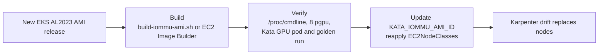

# Capacity and nodes

!!! info "TL;DR"
    Sandbox nodes scale from zero on Karpenter NodePools, a warm placeholder keeps only the slow `g4dn.metal` ready, and the gVisor node AMI and gVisor release go up together after CI confirms nvproxy driver support.

## Pain point

A `g4dn.metal` takes minutes to boot, install kata-deploy and bind its GPUs to vfio-pci.

- **Started on demand**: it makes reward batches wait that long.
- **Started early**: it bills while idle (7.824 USD/hour, us-east-1 and us-west-2 On-Demand).
- **With node counts managed by hand**: it is easy to forget to turn it off.
- **When an automatic AMI update brings an NVIDIA driver nvproxy does not know (unknown)**: gVisor GPU sandboxes never become Ready and pool capacity drops to zero.
- **The G and VT On-Demand quota**: it has a documented default of 0, so until it is raised you cannot launch a single 96-vCPU `g4dn.metal`.

![a: on the metal node (sandbox-kata-gpu) a reward batch arrives, the g4dn.metal then spends minutes booting, installing kata-deploy and binding vfio-pci, and the batch waits; on the gVisor node (sandbox-gvisor) an automatic AMI update through al2023@latest brings a driver unknown to nvproxy, GPU initialization fails, sandboxes never become Ready and pool capacity drops to 0. b: on metal a warm placeholder with priority -10 is preempted and steps aside, the sandbox pods run on a node that is already up and Karpenter adds a new spare; on gVisor the AMI is pinned to al2023@v20261107, CI checks support with nvproxy list-supported-drivers, and the AMI and GVISOR_RELEASE are raised together only when it passes](../images/figures/production-01_capacity_and_nodes.svg)

*Takeaway: Slow metal started on demand makes batches wait, and an automatic AMI update can drop the gVisor pool to zero capacity. A warm placeholder keeps one metal node ready, and the AMI and gVisor are pinned together and raised only after CI confirms support.*


## Why

- **Each runtime needs a different kind of node.** Instances, taints, labels, caps and disruption policy are split per NodePool so that one setting never leaks into another.
- **The coupling between driver and runtime stays visible.** nvproxy needs an exact driver match, so the AMI and gVisor are pinned together and checked in CI before a change.

**Before you start**: read the NodePool table in [00 Architecture](00_architecture.md), the instance choices in [04 Platforms and instances](../concepts/04_platforms_and_instances.md) and the IOMMU AMI step in [03 Kata sandboxes (CLH, QEMU)](../handson/03_kata.md) first.

??? note "Terms"
    - **NodePool, EC2NodeClass**: a NodePool states which nodes Karpenter may start (instances, taints, caps, disruption policy). An EC2NodeClass holds the AWS launch settings of those nodes (AMI, disks, subnets, user data).
    - **taint, toleration**: a taint is an entry restriction on a node, and a toleration is the pass that lets a pod in. Pods without the toleration never land on that node.
    - **consolidation, drift, expiration**: the three reasons Karpenter removes or replaces a node: tidying up empty or underused nodes, replacing nodes whose settings changed, and replacing nodes that reached their lifetime (`expireAfter`).
    - **IOMMU, VFIO**: the IOMMU is hardware that limits which memory a device can access; VFIO is the Linux feature that hands a whole PCI device such as a GPU to a VM.
    - **nvproxy**: the gVisor component that filters GPU driver calls (ioctls) and forwards them to the host driver. It works only with an exactly matching driver version.
    - **preemption**: the scheduler evicting a lower-priority pod to make room for a higher-priority one.
    - **PDB (PodDisruptionBudget)**: a cap on how many pods may go down at once during voluntary disruptions such as drains.

    More terms are in the [Glossary](../reference/glossary.md).

## Installing Karpenter and applying the manifests

This repository does not script the Karpenter install itself (IAM roles, interruption queue, Helm); follow the [official Getting Started guide](https://karpenter.sh/docs/getting-started/getting-started-with-karpenter/). The official guide uses Karpenter 1.15.2 (LTS 1.14.3), and the APIs are `karpenter.sh/v1` and `karpenter.k8s.aws/v1`.

The EC2NodeClasses find subnets and security groups by the tag `karpenter.sh/discovery: <CLUSTER_NAME>` (`subnetSelectorTerms`, `securityGroupSelectorTerms`). The hands-on CDK stack ([`cdk/gpusandbox_cdk/stack.py`](https://github.com/daekeun-ml/gpu-sandbox-on-aws/blob/main/cdk/gpusandbox_cdk/stack.py)) tags only the private subnets, so tag the EKS-created cluster security group (used by the nodes) yourself as the Karpenter documentation describes when you install Karpenter. Without the tag, Karpenter finds no security group for the nodes.

!!! note "An EC2NodeClass that selects its AMI by id needs `amiFamily`"
    The Karpenter v1.15.2 CRD requires `amiFamily` when `amiSelectorTerms` contains no alias (validation message `must specify amiFamily if amiSelectorTerms does not contain an alias`). The `sandbox-kata-gpu` template uses `id: ${KATA_IOMMU_AMI_ID}` and sets `amiFamily: AL2023`, which the local tests (`tests/test_manifests.py`) check.

After the install, run this from the repository root.

```bash
source scripts/config.env   # CLUSTER_NAME, GVISOR_RELEASE, KATA_IOMMU_AMI_ID
python3 scripts/render.py infra/karpenter/nodeclasses.yaml.tpl \
  KARPENTER_NODE_ROLE="<Karpenter node role name>" > /tmp/nodeclasses.yaml
kubectl apply -f /tmp/nodeclasses.yaml
kubectl apply -f infra/karpenter/nodepools.yaml
kubectl get ec2nodeclass,nodepool
```

- **`KARPENTER_NODE_ROLE`**: the node role you created while installing Karpenter.
- **How `render.py` handles variables**: unlike `envsubst`, it fails on an undefined variable, but it substitutes a variable defined as an empty string as is. Check that `KATA_IOMMU_AMI_ID` and `KARPENTER_NODE_ROLE` hold real values first.
- **If you have no `KATA_IOMMU_AMI_ID` yet**: build the AMI with `infra/kata/build-iommu-ami.sh` and put the printed `export KATA_IOMMU_AMI_ID=...` line into `scripts/config.env`.

What to look for:

- Four EC2NodeClasses (`sandbox-gvisor`, `sandbox-kata-gpu`, `sandbox-kata-cpu`, `trainer`) and four NodePools with the same names.
- All of them show READY `True`. Nodes start when pods ask for room, so having none yet is normal.

If it fails:

- **For `render: ... missing variable`**: see the configuration and scripts table in [Troubleshooting](../reference/troubleshooting.md).
- **If READY is not `True`**: look for conditions that are `False` in `kubectl describe ec2nodeclass <name>`.

`spec.cpuOptions.nestedVirtualization` (values `enabled` or `disabled`), used by `sandbox-kata-cpu`, is a field of the v1.15.2 CRD. If the FIELDS list of `kubectl explain ec2nodeclass.spec.cpuOptions` lacks `nestedVirtualization`, your Karpenter predates the feature; upgrade it first.

## NodePool design

| NodePool | Requirements | Taint | Labels |
|---|---|---|---|
| `sandbox-gvisor` | `g5.xlarge`, `g5.2xlarge`, on-demand | `gpusandbox/role=sandbox-gvisor:NoSchedule` | `gpusandbox/role=sandbox-gvisor`, `gpusandbox/device-plugin=cdi`, `nvidia.com/gpu.deploy.operands=false` |
| `sandbox-kata-gpu` | `g4dn.metal`, on-demand | `gpusandbox/role=sandbox-kata:NoSchedule` | `gpusandbox/role=sandbox-kata`, `gpusandbox/kata-gpu=true`, `nvidia.com/gpu.workload.config=vm-passthrough` |
| `sandbox-kata-cpu` | `c8i`, `m8i`, `r8i` families in 2xlarge, 4xlarge, 8xlarge, on-demand and spot | `gpusandbox/role=sandbox-kata:NoSchedule` | `gpusandbox/role=sandbox-kata`, `gpusandbox/kata-gpu=false` |
| `trainer` | `g6e.12xlarge`, `g6e.48xlarge`, `p5.48xlarge`, on-demand | `gpusandbox/role=trainer:NoSchedule` | `gpusandbox/role=trainer`, `gpusandbox/device-plugin=cdi`, `nvidia.com/gpu.deploy.operands=false` |

| NodePool | `limits` | Consolidation | `expireAfter` |
|---|---|---|---|
| `sandbox-gvisor` | `nvidia.com/gpu: 16` | `WhenEmpty`, 10 min | 720h |
| `sandbox-kata-gpu` | `cpu: 192` (two `g4dn.metal`) | `WhenEmpty`, 30 min | 720h |
| `sandbox-kata-cpu` | `cpu: 256` | `WhenEmptyOrUnderutilized`, 5 min | 336h |
| `trainer` | `nvidia.com/gpu: 16` | `WhenEmpty`, 15 min | 720h |

- **Labels wire the other components together.**
    - `gpusandbox/device-plugin=cdi` is the nodeSelector of the NVIDIA device plugin DaemonSet.
    - `nvidia.com/gpu.deploy.operands=false` keeps the GPU Operator away from container-mode nodes.
    - The GPU Operator binds T4s to vfio-pci only on nodes labelled `nvidia.com/gpu.workload.config=vm-passthrough`.
    - `gpusandbox/role` is shared by the `gvisor` RuntimeClass scheduling rules and the kata-deploy and sandbox Deployment nodeSelectors.
- **Taints make the nodes dedicated.** Only pods with the toleration land there, so untrusted code never shares a node with other workloads.
- **gVisor nodes have exactly one GPU.** One sandbox per node keeps per-GPU timing clean.
    - **The pool stays on g5 (A10G)**: the AMI loads the proprietary kernel module (GSP off) on g5, a combination verified by this repository rather than documented by gVisor.
    - **Alternative**: g6 (L4, open driver) can be added to the NodePool.
    - **Before adding another GPU family**: check driver support.
- **GPU pools use `WhenEmpty`.** Reclaiming a node mid-evaluation means the running evaluation starts over on another pod, and it becomes `sandbox_error` if the retries also fail, so only empty nodes are reclaimed; the CPU tier, cheap to restart, allows `WhenEmptyOrUnderutilized` and spot.
- **A metal node becomes a candidate for removal after 30 empty minutes.** Returned as soon as it is empty, a metal node pays its minutes of boot and setup again on the next demand; thirty idle minutes cost about 3.9 USD at 7.824 USD/hour, and billing runs until the node actually terminates.
- **`expireAfter` refreshes nodes periodically.** Per the Karpenter v1.15 documentation, expiration is forceful: `karpenter.sh/do-not-disrupt` does not stop it, and the drain follows PDBs and `terminationGracePeriod`. The gateway resends a cut-off evaluation to another pod.

!!! note "Protecting trainer nodes from disruption"
    Contrary to the `trainer` NodePool comment, the RayCluster pods in the current [`raycluster-verl.yaml.tpl`](https://github.com/daekeun-ml/gpu-sandbox-on-aws/blob/main/k8s/production/raycluster-verl.yaml.tpl) carry no `do-not-disrupt` annotation. Add `karpenter.sh/do-not-disrupt: "true"` to training pods to block consolidation and drift, and since it does not block expiration (`expireAfter`), keep the output path on shared storage to resume from a checkpoint.

## EC2NodeClasses and user data merging

| EC2NodeClass | AMI | Root volume | User data parts |
|---|---|---|---|
| `sandbox-gvisor` | `alias: al2023@latest` (GPU types get the NVIDIA variant) | 100 GiB gp3, encrypted | NodeConfig (containerd `runtimes.runsc` handler) + gVisor install (`GVISOR_RELEASE` pinned) + node guard |
| `sandbox-kata-gpu` | `id: ${KATA_IOMMU_AMI_ID}` | 200 GiB gp3, encrypted | NodeConfig (containerd `imports`, kubelet `runtimeRequestTimeout: 20m`) + create `/etc/containerd/conf.d` + node guard |
| `sandbox-kata-cpu` | `alias: al2023@latest`, `cpuOptions.nestedVirtualization: enabled` | 100 GiB gp3, encrypted | NodeConfig (containerd `imports`) + create `/etc/containerd/conf.d` + node guard |
| `trainer` | `alias: al2023@latest` | 500 GiB gp3, encrypted | None |

The user data is MIME multipart, and Karpenter adds its own NodeConfig with cluster details, labels, taints and `spec.kubelet` values. Per the Karpenter documentation its values take precedence, so the repository's NodeConfig only sets values Karpenter does not generate (the containerd runtime handler, drop-in `imports`, `runtimeRequestTimeout`). The IMDS defaults (IMDSv2, hop limit 1) alone keep pods away from node credentials.

The shell script parts come in through `@@include path@@` lines in `scripts/render.py`. The named file is inserted verbatim at the same indentation and its `${...}` is not substituted, which keeps [`install-gvisor.sh`](https://github.com/daekeun-ml/gpu-sandbox-on-aws/blob/main/infra/gvisor/install-gvisor.sh) and [`node-guard.sh`](https://github.com/daekeun-ml/gpu-sandbox-on-aws/blob/main/infra/eks/node-guard.sh) readable and editable as standalone scripts. One template line, `export GVISOR_RELEASE="${GVISOR_RELEASE}"`, pins the gVisor version.

Check that the values survived the merge by reading the live kubelet configuration (`configz`) of one Kata GPU node that Karpenter created, through the API server.

- **On a new cluster**: the placeholder, the PDB and the ResourceQuota live in the `sandbox` namespace, so create the namespaces first with `kubectl apply -f k8s/base/namespaces.yaml` (or `scripts/05_setup_namespaces_auth.sh`).
- **Getting a metal node**: a metal node appears only when something asks for room on it, so apply the placeholder from "Warm capacity for slow metal" below and run this once a `sandbox-kata-gpu` NodePool node is Ready.
- **Picking the node**: a CDK-managed Kata GPU node also carries `gpusandbox/kata-gpu=true`, so select the node by its `karpenter.sh/nodepool` label.

```bash
node="$(kubectl get nodes -l karpenter.sh/nodepool=sandbox-kata-gpu -o jsonpath='{.items[0].metadata.name}')"
kubectl get --raw "/api/v1/nodes/${node}/proxy/configz" | grep -o '"runtimeRequestTimeout":"[^"]*"'
```

What to look for:

- One line, `"runtimeRequestTimeout":"20m0s"`.
- **Any other value**: the repository's NodeConfig was not merged. Read the node's user data log with the node-level checks in [Troubleshooting](../reference/troubleshooting.md).

## Installing the GPU stack and runtimes

Karpenter nodes use the same values files as the hands-on track, except that you do not add the Kata node groups with CDK (leave `WITH_KATA_CPU` and `WITH_KATA_GPU` at `0`). The scripts that add Kata CPU nodes (`scripts/kata/cpu_nodes.sh`) and Kata GPU nodes (`scripts/kata/gpu_nodes.sh`) stop when their node group is missing, so for Kata, run only their helm steps yourself as below.

| Target | How | Why it works unchanged with Karpenter |
|---|---|---|
| NVIDIA device plugin (trainer, gVisor) | `scripts/04_install_gpu_stack.sh` | The DaemonSet nodeSelector `gpusandbox/device-plugin=cdi` matches the NodePool label. |
| gVisor RuntimeClass and smoke test | `scripts/04_install_gpu_stack.sh` (same run, after the device plugin) | The RuntimeClass nodeSelector and toleration match the `sandbox-gvisor` NodePool (per-scenario differences below the table). |
| GPU Operator, kata-deploy | The helm commands below (same as the helm steps of `scripts/kata/gpu_nodes.sh`) | kata-deploy runs as a DaemonSet, so it also covers nodes added later. |

The gVisor RuntimeClass and smoke test behave differently per scenario.

- **A and B1**: the smoke pod runs on a CDK-managed gVisor node if one has room, and Karpenter launches a new g5 node (billable) only when there is none.
- **B2 and C**: the script skips both the `gvisor` RuntimeClass and the smoke test. If you add the `sandbox-gvisor` NodePool to such a cluster, apply the RuntimeClass yourself with `kubectl apply -f k8s/runtimes/runtimeclass-gvisor.yaml`.

The GPU Operator installs in VM passthrough mode, and with `--wait` each chart waits up to 20 minutes for its resources.

```bash
source scripts/config.env
helm repo add nvidia https://helm.ngc.nvidia.com/nvidia
helm repo update nvidia
helm upgrade --install gpu-operator nvidia/gpu-operator --version "${GPU_OPERATOR_VERSION}" \
  --namespace gpu-operator --create-namespace \
  -f infra/kata/gpu-operator-values.yaml --wait --timeout 20m
helm upgrade --install kata-deploy oci://ghcr.io/kata-containers/kata-deploy-charts/kata-deploy \
  --version "${KATA_VERSION}" --namespace kube-system \
  -f infra/kata/kata-deploy-values.yaml --wait --timeout 20m
```

What to look for:

- Both helm commands end with `STATUS: deployed`.
- Once Kata nodes are up, `kubectl get runtimeclass` should list `kata-qemu-nvidia-gpu`, `kata-qemu` and `kata-clh`.

If it fails, see the Kata table in [Troubleshooting](../reference/troubleshooting.md).

## IOMMU AMI pipeline

AL2023 kernels ship with `CONFIG_INTEL_IOMMU_DEFAULT_ON` unset, so VFIO passthrough needs `intel_iommu=on` on the kernel command line. Baking the kernel arguments into an AMI means nodes need no reboot during initialization; the arguments do not depend on the instance type, so an `m6i.large` builder is enough.

[`infra/kata/build-iommu-ami.sh`](https://github.com/daekeun-ml/gpu-sandbox-on-aws/blob/main/infra/kata/build-iommu-ami.sh) works in three steps.

1. It looks up the standard (non-NVIDIA) EKS AL2023 AMI in the SSM parameter `/aws/service/eks/optimized-ami/${K8S_VERSION}/amazon-linux-2023/x86_64/standard/recommended/image_id`.
2. It launches an `m6i.large` with IMDSv2 and hop limit 1, whose user data does the following.
    - runs `grubby --update-kernel=ALL --args="intel_iommu=on iommu=pt"`
    - writes `/etc/modules-load.d/vfio-iommu-type1.conf` so the `vfio_iommu_type1` module loads at boot (without that module, QEMU fails to start the GPU VM with `No available IOMMU models` even when the kernel arguments are right)
    - runs `cloud-init clean --logs` and `shutdown -h now`

3. When the instance has stopped, it creates an AMI tagged with `base-ami`, terminates the builder and prints `export KATA_IOMMU_AMI_ID="ami-..."`.

In production this runs as a pipeline.



*Figure: every new EKS AMI release means rebaking the IOMMU AMI, and nodes change only after the new AMI passes verification.*

- **Trigger:** the SSM parameter above changes, or a new [awslabs/amazon-eks-ami](https://github.com/awslabs/amazon-eks-ami/releases) release appears.
- **Build:** use the script as is, or move it to an EC2 Image Builder recipe (same base AMI, a build component that adds the `grubby` kernel arguments and loads `vfio_iommu_type1` at boot, a test component), which adds scheduled pipelines and a test stage.
- **Verify:** kernel arguments in `/proc/cmdline` on a cheap instance, IOMMU groups and VFIO binding on one `g4dn.metal`, and last, that a GPU VM actually starts on that node. The command below reads how many GPUs that node (`${node}`, from the `configz` example) advertises for VM passthrough (`nvidia.com/pgpu`).

```bash
kubectl get node "${node}" -o jsonpath='{.status.allocatable.nvidia\.com/pgpu}'
```

What to look for:

- `8` once the GPU Operator has bound the GPUs.
- **An empty value or `0`**: see the `no passthrough GPUs advertised` row of the Kata table in [Troubleshooting](../reference/troubleshooting.md).
- **Even with `8`**: `8` only means the devices are registered with the scheduler. An AMI without the `vfio_iommu_type1` module also shows `8`, and QEMU then cannot start the VM.
- **Before you promote the AMI**: check in this order.
    1. Start a `kata-qemu-nvidia-gpu` pool pod on a node with the new AMI and check that it reaches READY `1/1`.
    2. The golden run goes to the pool's Service address, so if the pool also has pods on old-AMI nodes, one of them may answer instead. Check the NODE column of `kubectl -n sandbox get pods -l gpusandbox/runtime=kata-qemu,gpusandbox/version=<version> -o wide` and confirm that every Ready pod is on a new-AMI node.
    3. Promote the AMI only after the golden run of `scripts/ops/verify.sh kata-qemu <version>` passes.

- **Promote:** change `KATA_IOMMU_AMI_ID` in `scripts/config.env` and reapply the EC2NodeClasses. When the selected AMI changes, Karpenter marks the nodes as drifted and replaces them while respecting disruption budgets and PDBs (Karpenter v1.15 documentation).
- **Roll back:** keep the previous AMI (`scripts/08_cleanup.sh` deletes only the current `KATA_IOMMU_AMI_ID` from `config.env` and its snapshot, after confirmation).

The Kata GPU host must not load the NVIDIA driver; the guest driver (open kernel modules 615.71.09) comes with kata-deploy. The Kata GPU tier's driver therefore changes with `KATA_VERSION`, not the host AMI, and that is when you re-verify on a metal node.

## Pinning the gVisor node AMI and gVisor together

To nvproxy a driver is supported, unsupported (needs `--nvproxy-allow-unsupported-driver`) or unknown (fails), and `runsc nvproxy list-supported-drivers` prints the list.

| Item | Current pair |
|---|---|
| EKS AL2023 NVIDIA AMI | v20261107 |
| g5 driver | 580.178.04 (proprietary kernel module, GSP off), supported by nvproxy since release-20260831.0. g6 loads the open kernel module of the same version |
| gVisor | release-20261109.0 (`GVISOR_RELEASE="20261109.0"`) |
| Version to watch | 595.91.07 in the same AMI (g7 only) is unknown to nvproxy. The default HyperPod AMI ships this version too, which is why B2 uses a custom AMI with the driver replaced by 580.178.04. |

Today the `sandbox-gvisor` EC2NodeClass uses `alias: al2023@latest`, so Karpenter replaces nodes through drift when a new EKS AMI appears. If nvproxy does not know the new driver, this happens.

- `install-gvisor.sh` writes `WARNING: NVIDIA driver ... is not supported` to the user data log.
- Sandbox pods fail GPU initialization and never become Ready (fail closed). That is safe but drops pool capacity to zero.

The Karpenter documentation does not recommend `latest` for production either.

In production, do the following.

- **Pin the alias**: pin it to a version (for example `alias: al2023@v20261107`; re-verify the version syntax in the Karpenter documentation) and raise the AMI and `GVISOR_RELEASE` in the same change.
- **Re-verify after a change**: after changing the driver, the AMI or the gVisor version, re-run the `04_install_gpu_stack.sh` smoke test and `scripts/ops/verify.sh`. The g5 combination with the proprietary module rests on this repository's verification, not on the gVisor documentation.
- **If the sandbox pool holds every GPU on the nodes**: the smoke pod stays `Pending`, so scale the pool down by one replica to free a GPU first.

Before raising them, CI can verify the candidate gVisor release's checksum and nvproxy support list. This is an example, not a repository script, using the same URL and check as `install-gvisor.sh`.

```bash
# CI gate (example): fail if the pinned gVisor release does not know the AMI's driver.
set -eu   # stop at the first failed download or checksum
GVISOR_RELEASE="20261109.0"
DRIVER="580.178.04"   # from the release notes of the candidate EKS AMI
URL="https://storage.googleapis.com/gvisor/releases/release/${GVISOR_RELEASE}/x86_64"
curl -fsSLO "${URL}/gvisor.tar.bz2"
curl -fsSLO "${URL}/gvisor.tar.bz2.sha512"
sha512sum -c gvisor.tar.bz2.sha512
mkdir -p gvisor && tar -xjf gvisor.tar.bz2 -C gvisor
./gvisor/runsc nvproxy list-supported-drivers | grep -qwF "${DRIVER}" \
  || { echo "gVisor ${GVISOR_RELEASE} nvproxy does not support driver ${DRIVER}"; exit 1; }
```

What to look for:

- On success only `gvisor.tar.bz2: OK` appears and the exit code is 0.
- **For a release that does not know the driver**: it prints `gVisor ... nvproxy does not support driver ...` and exits with 1. In that case, wait for a gVisor release whose support list contains the driver, or do not raise the AMI.

After promotion, first confirm that a sandbox pod becomes Ready on one new node, then move on to the rest.

## Warm capacity for slow metal

[`warm-capacity.yaml`](https://github.com/daekeun-ml/gpu-sandbox-on-aws/blob/main/k8s/production/warm-capacity.yaml) follows the AWS China blog pattern (EKS + Kata + Cloud Hypervisor).

1. One low-priority placeholder pod occupies a `sandbox-kata-gpu` node.
2. When a sandbox pod needs room, the scheduler preempts the placeholder.
3. The placeholder goes back to Pending, and Karpenter starts a new spare node for it in the background (within the NodePool cap `cpu: 192`).

| Setting | Value | Reason |
|---|---|---|
| `priorityClassName` | `gpu-sandbox-warm-placeholder` (value -10) | It is preempted first. |
| `terminationGracePeriodSeconds` | 0 | It steps aside immediately when preempted. |
| nodeSelector | `karpenter.sh/nodepool: sandbox-kata-gpu` | It only holds metal nodes. |
| Requests | `cpu: "60"`, `memory: 200Gi`, no GPU | It fills most of the node but never takes a GPU. |
| Image | `registry.k8s.io/pause:3.10` | It does nothing. |

The placeholder needs its PriorityClass, so the PriorityClasses, the PDB and the ResourceQuota come first.

```bash
kubectl apply -f k8s/production/pool-hardening.yaml   # PriorityClasses first
kubectl apply -f k8s/production/warm-capacity.yaml
```

What to look for:

- `kubectl -n sandbox get pods -l app=kata-metal-warm-placeholder -o wide` shows the placeholder `Running` on a `sandbox-kata-gpu` node.
- A few minutes of `Pending` while Karpenter starts the metal node are normal.
- **If it stays `Pending`**: check the Events in `kubectl -n sandbox describe pod <pod>` and the service quota section below.

!!! warning "Cost and how to turn it off"
    A spare `g4dn.metal` bills all the time: at 7.824 USD/hour that is about 188 USD per day (us-east-1 and us-west-2 On-Demand, 9.624 USD/hour in Seoul). Scale the placeholder to zero with the command below while you are not training, and once the node has been empty for 30 minutes it becomes a candidate for removal under the `WhenEmpty` policy. Check when billing stopped by the time the node actually terminated.

    ```bash
    kubectl -n sandbox scale deployment/kata-metal-warm-placeholder --replicas=0
    ```

    What to look for: `kubectl -n sandbox get deployment kata-metal-warm-placeholder` shows READY `0/0`.

- **Pool pod priority**: `deployment.yaml.tpl` does not set `priorityClassName`, so pool pods run at the default priority 0, which is still above -10, so preemption works.
- **To use `gpu-sandbox-pool` (100000) from `pool-hardening.yaml`**: add `priorityClassName` to the template.
- **To keep a whole node empty**: sandbox pods also fit into the CPU and memory the placeholder leaves free without preemption, so size the requests close to the node's allocatable.

## PDB and ResourceQuota

[`pool-hardening.yaml`](https://github.com/daekeun-ml/gpu-sandbox-on-aws/blob/main/k8s/production/pool-hardening.yaml) limits voluntary disruption and runaway usage.

- **PDB `gpu-sandbox-pools` (`maxUnavailable: 1`).** Its single selector `app.kubernetes.io/name: gpu-sandbox` matches every pool (all runtimes and versions), so at most one sandbox pod across all pools is evicted at a time (the file comment says "of a pool"). NotReady pods already count as unavailable, so a draining pod left NotReady can block other evictions.
- **What the PDB does not stop.** PDBs apply to the eviction API only, so the gateway's recycling, which deletes pods directly, is unaffected; the Kubernetes documentation says "deleting deployments or pods bypasses Pod Disruption Budgets".
- **ResourceQuota `gpu-sandbox-quota`.** `requests.nvidia.com/gpu: 16` equals the `sandbox-gvisor` cap, and `requests.nvidia.com/pgpu: 8` is the number of T4s in one `g4dn.metal` (of the two nodes the metal NodePool allows, the second is the warm spare). `pods: 64` caps the pod count.
- **Interaction with blue/green.** While a new version's pool runs next to the old one, both count against the quota, so if the old Kata pool holds many pgpu, new-version pods exceed the quota and are not created. Scale the old pool down first or raise the quota. ([05 Sandbox versioning](05_sandbox_updates.md))

## Service quotas and Capacity Reservations

EC2 On-Demand quotas count vCPUs, not instances. The defaults below come from the EC2 documentation; they differ per account and EC2 may raise them automatically with usage, so check the current values in the Service Quotas console.

| Quota | Documented default | NodePools | Needed at the NodePool caps |
|---|---|---|---|
| Running On-Demand G and VT instances | 0 | `sandbox-gvisor`, `sandbox-kata-gpu`, `trainer` (g6e) | 192 vCPU for two metal nodes, 128 vCPU if the gVisor pool is filled with `g5.2xlarge` (8 vCPU) only, plus the trainer |
| Running On-Demand P instances | 0 | `trainer` (`p5.48xlarge`) | Only if you use p5 |
| Running On-Demand Standard (A, C, D, H, I, M, R, T, Z) instances | 5 | `sandbox-kata-cpu` (on-demand), system nodes, SSM access instance | 256 vCPU for the CPU NodePool limit, plus the system nodes (default two `m6i.large`) and the SSM access instance (`t4g.nano`) |
| All Standard (A, C, D, H, I, M, R, T, Z) Spot Instance Requests | 5 | `sandbox-kata-cpu` (spot) | Up to 256 vCPU |

`g4dn.metal` can be hard to get depending on the Region and AZ, so if you know how long you need it, consider an On-Demand Capacity Reservation, which holds capacity for an instance type in a specific AZ.

- **Immediate reservations**: no term commitment, but they bill until you cancel them and count toward the On-Demand quota.
- **Future-dated reservations**: available for the C, G, I, M, R, T, U and X families with a minimum of 32 vCPU.
- **Karpenter's `capacityReservationSelectorTerms`**: Beta in the Karpenter documentation, and it has to be enabled before use.

## Scope and limits

- **Not executed on AWS.** This covers the Karpenter, AMI pipeline and warm capacity procedures on this page. Verify them with the "What to look for" checks in each section.
- **What the local tests cover.** They render the templates in `infra/karpenter/` and check the AMI selection rule, the nested virtualization option, the node guard and the NodePool to EC2NodeClass references, without applying anything to an API server, so check the status conditions with `kubectl get ec2nodeclass` the first time you apply them.
- **The CI example is unverified.** Whether `runsc nvproxy list-supported-drivers` works without root on an x86_64 Linux runner has not been checked.
- **Karpenter behavior comes from its documentation.** The statements about drift, expiration and `do-not-disrupt` come from the Karpenter v1.15 documentation; re-verify them for your installed version.
- **Known mismatches:** the PDB comment in `pool-hardening.yaml` and the trainer comment in `nodepools.yaml` do not match the actual behavior (see "PDB and ResourceQuota" and "Protecting trainer nodes from disruption" above).

## ❓ Misconceptions

!!! question "❓ Misconception: `al2023@latest` patches itself, so it is safer for gVisor nodes too"
    On gVisor GPU nodes it can be the opposite: if nvproxy does not know the new driver, the node comes up but no sandbox becomes Ready. Raise the pinned AMI and `GVISOR_RELEASE` together after the CI check.

!!! question "❓ Misconception: the warm placeholder reserves a GPU"
    The placeholder requests CPU and memory only, never a GPU (`nvidia.com/pgpu`). It holds a node and steps aside as soon as a sandbox pod preempts it.

!!! question "❓ Misconception: with Karpenter, metal nodes come up quickly"
    Karpenter only requests the node earlier; bare metal boot, the kata-deploy install and VFIO binding take as long as before, so only metal gets warm capacity and a 30-minute consolidation delay.

??? note "References"
    | Topic | Link |
    |---|---|
    | Installing Karpenter | [Getting Started with Karpenter](https://karpenter.sh/docs/getting-started/getting-started-with-karpenter/) |
    | NodeClasses (alias pinning, amiFamily, capacity reservations) | [Karpenter NodeClasses](https://karpenter.sh/docs/concepts/nodeclasses/) |
    | EC2NodeClass CRD (v1.15.2) | [aws/karpenter-provider-aws](https://github.com/aws/karpenter-provider-aws) |
    | nvproxy driver policy | [gVisor GPU support](https://gvisor.dev/docs/user_guide/gpu/), [google/gvisor](https://github.com/google/gvisor) |
    | Quotas | [Amazon EC2 instance type quotas](https://docs.aws.amazon.com/ec2/latest/instancetypes/ec2-instance-quotas.html) |

    All sources: [this page in All references](../reference/references.md#ref-production-01-capacity-and-nodes)

Next: [02 Security](02_security.md)
