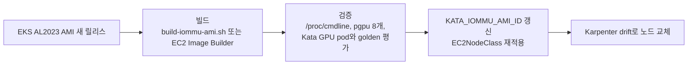

# 용량과 노드 관리

!!! info "TL;DR"
    샌드박스 노드는 Karpenter NodePool이 0대부터 늘리고 줄이며, 부팅이 느린 `g4dn.metal`만 warm placeholder로 한 대를 미리 띄워 둡니다. gVisor 노드의 AMI와 gVisor 릴리스는 CI에서 nvproxy 드라이버 호환성을 확인한 뒤 함께 업그레이드합니다.

## GPU 노드를 준비하는 데 걸리는 시간

`g4dn.metal`은 부팅, kata-deploy 설치, GPU의 vfio-pci 바인딩까지 수 분이 걸립니다.

- **수요가 생긴 뒤에 노드를 띄우면**: reward 배치가 그동안 대기합니다.
- **노드를 미리 띄워 두면**: 사용하지 않는 동안에도 과금됩니다(7.824 USD/시간, us-east-1과 us-west-2 온디맨드 요금).
- **노드 수를 수동으로 관리하면**: 노드를 종료하는 것을 잊기 쉽습니다.
- **AMI가 자동으로 바뀌면서 nvproxy가 인식하지 못하는(unknown) NVIDIA 드라이버가 설치되면**: gVisor GPU 샌드박스가 Ready가 되지 않아 풀 용량이 0이 됩니다.
- **G and VT On-Demand quota**: 문서상 기본값이 0이라, quota를 늘리기 전에는 96 vCPU짜리 `g4dn.metal`을 한 대도 띄우지 못합니다.

![a: metal 노드(sandbox-kata-gpu)에서는 reward batch가 도착한 뒤에 g4dn.metal 부팅, kata-deploy, vfio-pci 바인딩이 진행되어 수 분이 걸리고, batch는 그동안 대기합니다. gVisor 노드(sandbox-gvisor)에서는 al2023@latest의 AMI 자동 갱신(drift 교체)으로 nvproxy가 지원하지 않는 드라이버가 설치될 수 있습니다. 그러면 GPU 초기화가 실패해 샌드박스가 Ready가 되지 않고 풀 용량이 0이 됩니다. b: metal에서는 우선순위 -10인 warm placeholder가 선점되어 종료되고, 샌드박스 pod는 이미 실행 중인 노드에 배치됩니다. Karpenter는 새 예비 노드를 추가합니다. gVisor에서는 AMI를 al2023@v20261107로 고정하고, CI에서 nvproxy list-supported-drivers로 지원 여부를 확인해 통과할 때만 AMI와 GVISOR_RELEASE를 함께 승격합니다.](../images/figures/production-01_capacity_and_nodes.svg)

*그림 요약: 부팅이 느린 metal 노드를 수요가 생긴 뒤에 시작하면 batch가 기다려야 하고, AMI 자동 갱신은 gVisor 풀 용량을 0으로 만들 수 있습니다. metal은 warm placeholder로 한 대를 미리 확보하고, AMI와 gVisor 버전은 함께 고정한 뒤 CI 확인을 통과할 때만 올립니다.*


## 런타임별 용량 관리

- **런타임마다 필요한 노드 설정이 다릅니다.** 인스턴스, taint, label, 상한, 회수 정책을 NodePool 단위로 분리하면 한 런타임의 설정이 다른 런타임에 영향을 주지 않습니다.
- **드라이버와 런타임의 버전 조합을 명시적으로 관리합니다.** nvproxy는 드라이버 버전이 정확히 맞아야 동작하므로, AMI와 gVisor 버전을 같이 고정하고 바꾸기 전에 CI로 확인합니다.

**읽기 전에**　[00 아키텍처](00_architecture.md)의 NodePool 표, [04 플랫폼과 인스턴스 선택](../concepts/04_platforms_and_instances.md)의 인스턴스 선택 이유, [03 Kata 샌드박스 (CLH, QEMU)](../handson/03_kata.md)의 IOMMU AMI 단계를 먼저 보세요.

??? note "용어"
    - **NodePool, EC2NodeClass**: NodePool은 Karpenter가 띄울 노드의 조건(인스턴스, taint, 상한, 회수 정책)입니다. EC2NodeClass는 그 노드의 AWS 쪽 실행 설정(AMI, 디스크, subnet, user data)입니다.
    - **taint, toleration**: taint는 노드에 설정하는 배치 제한이고, toleration은 그 제한을 허용하도록 pod에 추가하는 설정입니다. toleration이 없는 pod는 그 노드에 배치되지 않습니다.
    - **consolidation, drift, expiration**: Karpenter가 노드를 회수하거나 교체하는 세 가지 이유입니다. 비었거나 덜 쓰이는 노드 정리, 설정이 바뀐 노드 교체, 수명(`expireAfter`)이 다한 노드 교체를 뜻합니다.
    - **IOMMU, VFIO**: IOMMU는 장치가 접근할 수 있는 메모리를 제한하는 하드웨어이고, VFIO는 GPU 같은 PCI 장치를 VM에 직접 할당하는 Linux 기능입니다.
    - **nvproxy**: gVisor가 GPU 드라이버 호출(ioctl)을 걸러 호스트 드라이버로 전달하는 구성 요소입니다. 드라이버 버전이 정확히 맞아야 동작합니다.
    - **preemption**: 우선순위가 높은 pod를 배치하려고 scheduler가 우선순위가 낮은 pod를 노드에서 제거하는 동작입니다.
    - **PDB (PodDisruptionBudget)**: drain 같은 자발적 중단 때 한 번에 중단될 수 있는 pod 수의 상한입니다.

    더 많은 용어는 [용어 사전](../reference/glossary.md)에 있습니다.

## Karpenter 설치와 적용

이 저장소에는 Karpenter 설치(IAM role, interruption queue, Helm) 스크립트가 없으니 [공식 Getting Started 가이드](https://karpenter.sh/docs/getting-started/getting-started-with-karpenter/)를 따르세요. 공식 가이드는 Karpenter 1.15.2(LTS는 1.14.3)를 쓰고, API 버전은 `karpenter.sh/v1`과 `karpenter.k8s.aws/v1`입니다.

EC2NodeClass는 subnet과 security group을 `karpenter.sh/discovery: <CLUSTER_NAME>` 태그로 찾습니다(`subnetSelectorTerms`, `securityGroupSelectorTerms`). 핸즈온 CDK 스택([`cdk/gpusandbox_cdk/stack.py`](https://github.com/daekeun-ml/gpu-sandbox-on-aws/blob/main/cdk/gpusandbox_cdk/stack.py))은 private subnet에만 이 태그를 붙입니다. 노드가 사용하는 cluster security group(EKS가 생성)에는 Karpenter를 설치할 때 문서대로 직접 태그를 붙이세요. 태그가 없으면 Karpenter가 노드의 security group을 찾지 못합니다.

!!! note "id로 AMI를 고르는 EC2NodeClass에는 `amiFamily`가 필요합니다"
    Karpenter v1.15.2 CRD는 `amiSelectorTerms`에 alias가 없으면 `amiFamily`를 요구합니다(검증 메시지 `must specify amiFamily if amiSelectorTerms does not contain an alias`). `id: ${KATA_IOMMU_AMI_ID}`를 쓰는 `sandbox-kata-gpu` 템플릿에는 `amiFamily: AL2023`이 있고 로컬 테스트(`tests/test_manifests.py`)가 이를 확인합니다.

Karpenter 설치를 마친 뒤 저장소 루트에서 다음 명령을 실행합니다.

```bash
source scripts/config.env   # CLUSTER_NAME, GVISOR_RELEASE, KATA_IOMMU_AMI_ID
python3 scripts/render.py infra/karpenter/nodeclasses.yaml.tpl \
  KARPENTER_NODE_ROLE="<Karpenter node role name>" > /tmp/nodeclasses.yaml
kubectl apply -f /tmp/nodeclasses.yaml
kubectl apply -f infra/karpenter/nodepools.yaml
kubectl get ec2nodeclass,nodepool
```

- **`KARPENTER_NODE_ROLE`**: Karpenter 설치 때 만든 node role 이름을 넣습니다.
- **`render.py`의 변수 처리**: `envsubst`와 달리 정의되지 않은 변수가 있으면 오류를 내고 종료합니다. 빈 문자열로 정의된 변수는 그대로 치환하므로, `KATA_IOMMU_AMI_ID`와 `KARPENTER_NODE_ROLE`에 실제 값이 들어 있는지 먼저 확인하세요.
- **`KATA_IOMMU_AMI_ID`가 아직 없으면**: `infra/kata/build-iommu-ami.sh`로 AMI를 만들고, 출력된 `export KATA_IOMMU_AMI_ID=...` 줄을 `scripts/config.env`에 넣습니다.

확인할 것:

- EC2NodeClass 네 개(`sandbox-gvisor`, `sandbox-kata-gpu`, `sandbox-kata-cpu`, `trainer`)와 같은 이름의 NodePool 네 개가 출력됩니다.
- 모두 READY가 `True`입니다. 노드는 pod가 배치될 자리를 요청할 때 생성되므로, 아직 노드가 하나도 없어도 정상입니다.

문제가 생기면:

- **`render: ... missing variable` 오류**: [문제 해결](../reference/troubleshooting.md)의 "설정과 스크립트" 표를 보세요.
- **READY가 `True`가 아니면**: `kubectl describe ec2nodeclass <이름>`의 Conditions에서 `False`인 항목을 찾습니다.

`sandbox-kata-cpu`가 쓰는 `spec.cpuOptions.nestedVirtualization`(값 `enabled` 또는 `disabled`)은 v1.15.2 CRD의 필드입니다. `kubectl explain ec2nodeclass.spec.cpuOptions` 출력의 FIELDS 목록에 `nestedVirtualization`이 없으면 설치한 Karpenter가 이 필드를 지원하지 않는 이전 버전이니 먼저 업그레이드하세요.

## NodePool 설계

| NodePool | requirements | taint | label |
|---|---|---|---|
| `sandbox-gvisor` | `g5.xlarge`, `g5.2xlarge`, on-demand | `gpusandbox/role=sandbox-gvisor:NoSchedule` | `gpusandbox/role=sandbox-gvisor`, `gpusandbox/device-plugin=cdi`, `nvidia.com/gpu.deploy.operands=false` |
| `sandbox-kata-gpu` | `g4dn.metal`, on-demand | `gpusandbox/role=sandbox-kata:NoSchedule` | `gpusandbox/role=sandbox-kata`, `gpusandbox/kata-gpu=true`, `nvidia.com/gpu.workload.config=vm-passthrough` |
| `sandbox-kata-cpu` | `c8i`, `m8i`, `r8i` 계열의 2xlarge, 4xlarge, 8xlarge, on-demand와 spot | `gpusandbox/role=sandbox-kata:NoSchedule` | `gpusandbox/role=sandbox-kata`, `gpusandbox/kata-gpu=false` |
| `trainer` | `g6e.12xlarge`, `g6e.48xlarge`, `p5.48xlarge`, on-demand | `gpusandbox/role=trainer:NoSchedule` | `gpusandbox/role=trainer`, `gpusandbox/device-plugin=cdi`, `nvidia.com/gpu.deploy.operands=false` |

| NodePool | `limits` | consolidation | `expireAfter` |
|---|---|---|---|
| `sandbox-gvisor` | `nvidia.com/gpu: 16` | `WhenEmpty`, 10분 | 720h |
| `sandbox-kata-gpu` | `cpu: 192` (`g4dn.metal` 2대) | `WhenEmpty`, 30분 | 720h |
| `sandbox-kata-cpu` | `cpu: 256` | `WhenEmptyOrUnderutilized`, 5분 | 336h |
| `trainer` | `nvidia.com/gpu: 16` | `WhenEmpty`, 15분 | 720h |

- **label로 각 구성 요소가 배치될 노드를 지정합니다.**
    - `gpusandbox/device-plugin=cdi`는 NVIDIA device plugin DaemonSet의 nodeSelector입니다.
    - `nvidia.com/gpu.deploy.operands=false`는 GPU Operator가 container 모드 노드에 구성 요소를 설치하지 않게 합니다.
    - GPU Operator는 `nvidia.com/gpu.workload.config=vm-passthrough`가 붙은 노드에서만 T4를 vfio-pci에 바인딩합니다.
    - `gpusandbox/role`은 RuntimeClass `gvisor`의 scheduling 규칙과 kata-deploy, 샌드박스 Deployment의 nodeSelector가 모두 사용합니다.
- **taint로 전용 노드를 만듭니다.** toleration이 있는 pod만 배치되므로, 신뢰할 수 없는 코드가 다른 워크로드와 같은 노드에서 실행되지 않습니다.
- **gVisor 노드는 GPU가 하나인 인스턴스만 씁니다.** 노드당 샌드박스가 하나이므로 GPU별 타이밍 측정이 다른 샌드박스의 영향을 받지 않습니다.
    - **인스턴스는 g5(A10G)로 한정**: AMI는 g5에서 proprietary 커널 모듈(GSP 꺼짐)을 로드하고, 이 조합은 gVisor 문서가 아니라 이 저장소에서 검증했습니다.
    - **대안**: g6(L4, open 드라이버)도 NodePool에 넣을 수 있습니다.
    - **다른 GPU 계열을 쓰려면**: nvproxy의 드라이버 지원 여부부터 확인하세요.
- **GPU 풀은 `WhenEmpty`를 씁니다.** 평가 중에 노드를 회수하면 진행 중인 평가를 다른 pod에서 처음부터 다시 실행해야 하고, 재시도까지 실패하면 `sandbox_error`가 됩니다. 그래서 빈 노드만 회수합니다. 노드를 다시 띄우는 비용이 작은 CPU 계층은 `WhenEmptyOrUnderutilized`와 spot을 허용합니다.
- **metal 노드는 빈 상태로 30분이 지나야 회수 대상이 됩니다.** 비자마자 반납하면 다음 요청 때 부팅과 준비에 걸리는 수 분을 다시 기다려야 하기 때문입니다. 30분 대기 비용은 7.824 USD/시간 기준 약 3.9 USD이고, 요금은 노드가 실제로 종료될 때까지 붙습니다.
- **`expireAfter`에 따라 노드를 주기적으로 교체합니다.** Karpenter v1.15 문서에 따르면 만료는 forceful 동작이라 `karpenter.sh/do-not-disrupt`로 만료를 막을 수 없고, drain은 PDB와 `terminationGracePeriod`를 따릅니다. 중단된 평가는 gateway가 다른 pod로 다시 보냅니다.

!!! note "trainer 노드의 중단 보호"
    `trainer` NodePool 주석과 달리 현재 [`raycluster-verl.yaml.tpl`](https://github.com/daekeun-ml/gpu-sandbox-on-aws/blob/main/k8s/production/raycluster-verl.yaml.tpl)의 RayCluster pod에는 `do-not-disrupt` annotation이 없습니다. consolidation과 drift로 학습 pod가 중단되지 않게 하려면 학습 pod에 `karpenter.sh/do-not-disrupt: "true"`를 붙이세요. 이 annotation으로 막을 수 없는 만료(`expireAfter`)에 대비해, 출력 경로를 공유 저장소에 두고 checkpoint에서 재개하세요.

## EC2NodeClass와 userData 병합

| EC2NodeClass | AMI | root volume | userData 구성 |
|---|---|---|---|
| `sandbox-gvisor` | `alias: al2023@latest` (GPU 타입은 NVIDIA 변형) | 100 GiB gp3, 암호화 | NodeConfig(containerd `runtimes.runsc` handler) + gVisor 설치(`GVISOR_RELEASE` 고정) + node guard |
| `sandbox-kata-gpu` | `id: ${KATA_IOMMU_AMI_ID}` | 200 GiB gp3, 암호화 | NodeConfig(containerd `imports`, kubelet `runtimeRequestTimeout: 20m`) + `/etc/containerd/conf.d` 생성 + node guard |
| `sandbox-kata-cpu` | `alias: al2023@latest`, `cpuOptions.nestedVirtualization: enabled` | 100 GiB gp3, 암호화 | NodeConfig(containerd `imports`) + `/etc/containerd/conf.d` 생성 + node guard |
| `trainer` | `alias: al2023@latest` | 500 GiB gp3, 암호화 | 없음 |

userData는 MIME multipart 형식입니다. Karpenter는 클러스터 정보, label, taint, `spec.kubelet` 값을 담은 자체 NodeConfig를 추가하고, 값이 겹치면 Karpenter 쪽 값이 우선합니다(Karpenter 문서). 그래서 이 저장소의 NodeConfig에는 Karpenter가 만들지 않는 값(containerd runtime handler, drop-in `imports`, `runtimeRequestTimeout`)만 넣습니다. IMDS는 기본값(IMDSv2, hop limit 1)만으로도 pod가 노드 자격 증명을 읽을 수 없습니다.

shell 스크립트 부분은 `scripts/render.py`가 `@@include path@@` 줄 위치에 같은 들여쓰기로 그대로 삽입하고, 그 안의 `${...}`는 치환하지 않습니다. 그래서 [`install-gvisor.sh`](https://github.com/daekeun-ml/gpu-sandbox-on-aws/blob/main/infra/gvisor/install-gvisor.sh)와 [`node-guard.sh`](https://github.com/daekeun-ml/gpu-sandbox-on-aws/blob/main/infra/eks/node-guard.sh)를 독립된 스크립트로 읽고 수정할 수 있습니다. gVisor 버전은 템플릿의 `export GVISOR_RELEASE="${GVISOR_RELEASE}"` 한 줄로 고정합니다.

병합 후에도 이 저장소의 값이 적용됐는지, Karpenter가 만든 Kata GPU 노드 하나의 실제 kubelet 설정(`configz`)을 API server로 읽어 확인합니다.

- **새 클러스터라면**: placeholder와 PDB, ResourceQuota는 `sandbox` namespace에 만들어지므로, `kubectl apply -f k8s/base/namespaces.yaml`(또는 `scripts/05_setup_namespaces_auth.sh`)로 namespace를 먼저 만드세요.
- **metal 노드 준비**: metal 노드는 무언가가 그 자리를 요청해야 생기므로, 아래 "느린 metal을 위한 warm capacity" 절의 placeholder를 적용하고 `sandbox-kata-gpu` NodePool의 노드가 Ready가 된 뒤 실행하세요.
- **대상 노드 고르기**: CDK가 만든 관리형 Kata GPU 노드도 `gpusandbox/kata-gpu=true` label을 쓰므로, `karpenter.sh/nodepool` label로 대상을 고릅니다.

```bash
node="$(kubectl get nodes -l karpenter.sh/nodepool=sandbox-kata-gpu -o jsonpath='{.items[0].metadata.name}')"
kubectl get --raw "/api/v1/nodes/${node}/proxy/configz" | grep -o '"runtimeRequestTimeout":"[^"]*"'
```

확인할 것:

- `"runtimeRequestTimeout":"20m0s"` 한 줄이 출력됩니다.
- **다른 값이면**: 이 저장소의 NodeConfig가 병합되지 않은 것이니, [문제 해결](../reference/troubleshooting.md)의 "노드에서 확인" 절차로 노드의 user data 로그를 보세요.

## GPU 스택과 런타임 설치

Karpenter 노드에도 핸즈온과 같은 values 파일을 씁니다. 다만 Kata 노드 그룹은 CDK로 추가하지 않습니다(`WITH_KATA_CPU`, `WITH_KATA_GPU`를 `0`으로 설정). Kata CPU 노드 추가(`scripts/kata/cpu_nodes.sh`)와 Kata GPU 노드 추가(`scripts/kata/gpu_nodes.sh`) 스크립트는 노드 그룹이 없으면 중단되므로, Kata 쪽은 스크립트 안의 helm 단계만 아래처럼 직접 실행합니다.

| 대상 | 방법 | Karpenter에서 그대로 동작하는 이유 |
|---|---|---|
| NVIDIA device plugin (trainer, gVisor) | `scripts/04_install_gpu_stack.sh` | DaemonSet nodeSelector `gpusandbox/device-plugin=cdi`가 NodePool label과 같습니다. |
| gVisor RuntimeClass와 smoke test | `scripts/04_install_gpu_stack.sh` (같은 실행에서 device plugin 다음에 설치) | RuntimeClass의 nodeSelector와 toleration이 `sandbox-gvisor` NodePool 설정과 일치합니다(시나리오별 차이는 표 아래). |
| GPU Operator, kata-deploy | 아래 helm 명령 (`scripts/kata/gpu_nodes.sh`의 helm 단계와 같음) | kata-deploy가 DaemonSet 모드라서 나중에 추가되는 노드에도 설치됩니다. |

gVisor RuntimeClass와 smoke test는 시나리오에 따라 다르게 동작합니다.

- **A와 B1**: CDK가 만든 관리형 gVisor 노드에 자리가 있으면 smoke pod가 그곳에서 실행되고, 자리가 부족할 때 Karpenter가 g5 노드를 새로 띄웁니다(과금 발생).
- **B2와 C**: 스크립트가 `gvisor` RuntimeClass 설치와 smoke test를 모두 건너뜁니다. 이 클러스터에 `sandbox-gvisor` NodePool을 추가한다면 `kubectl apply -f k8s/runtimes/runtimeclass-gvisor.yaml`로 RuntimeClass를 직접 적용하세요.

GPU Operator는 VM passthrough 모드로 설치되고, `--wait`으로 chart마다 리소스가 준비될 때까지 최대 20분 기다립니다.

```bash
source scripts/config.env
helm repo add nvidia https://helm.ngc.nvidia.com/nvidia
helm repo update nvidia
helm upgrade --install gpu-operator nvidia/gpu-operator --version "${GPU_OPERATOR_VERSION}" \
  --namespace gpu-operator --create-namespace \
  -f infra/kata/gpu-operator-values.yaml --wait --timeout 20m
helm upgrade --install kata-deploy oci://ghcr.io/kata-containers/kata-deploy-charts/kata-deploy \
  --version "${KATA_VERSION}" --namespace kube-system \
  -f infra/kata/kata-deploy-values.yaml --wait --timeout 20m
```

확인할 것:

- 두 helm 명령이 `STATUS: deployed`로 끝납니다.
- Kata 노드가 생성된 뒤에는 `kubectl get runtimeclass` 출력에 `kata-qemu-nvidia-gpu`, `kata-qemu`, `kata-clh`가 있어야 합니다.

문제가 생기면 [문제 해결](../reference/troubleshooting.md)의 "Kata" 표를 보세요.

## IOMMU AMI 파이프라인

AL2023 커널은 `CONFIG_INTEL_IOMMU_DEFAULT_ON`이 꺼져 있어, VFIO로 GPU를 VM에 직접 할당하려면 커널 명령줄에 `intel_iommu=on`이 필요합니다. 커널 인자를 AMI에 넣으면 노드 초기화 중에 재부팅할 필요가 없습니다. 이 인자는 인스턴스 타입과 무관하므로 AMI 빌더 인스턴스는 `m6i.large`면 충분합니다.

[`infra/kata/build-iommu-ami.sh`](https://github.com/daekeun-ml/gpu-sandbox-on-aws/blob/main/infra/kata/build-iommu-ami.sh)는 다음 순서로 동작합니다.

1. SSM parameter `/aws/service/eks/optimized-ami/${K8S_VERSION}/amazon-linux-2023/x86_64/standard/recommended/image_id`에서 표준(NVIDIA 아닌) EKS AL2023 AMI를 조회합니다.
2. IMDSv2, hop limit 1로 `m6i.large`를 띄우고 user data에서 다음을 실행합니다.
    - `grubby --update-kernel=ALL --args="intel_iommu=on iommu=pt"`
    - 부팅 때 `vfio_iommu_type1` 모듈을 로드하는 `/etc/modules-load.d/vfio-iommu-type1.conf` 작성(이 모듈이 로드되지 않으면 커널 인자가 맞아도 QEMU가 `No available IOMMU models` 오류로 GPU VM을 시작하지 못함)
    - `cloud-init clean --logs`, `shutdown -h now`

3. 인스턴스가 중지되면 `base-ami` 태그를 붙인 AMI를 만들고, 빌더를 종료한 뒤 `export KATA_IOMMU_AMI_ID="ami-..."` 줄을 출력합니다.

운영 환경에서는 이 작업을 파이프라인으로 실행합니다.



*그림: 새 EKS AMI가 나올 때마다 IOMMU AMI를 다시 빌드하고 검증한 뒤에만 노드를 바꿉니다.*

- **트리거:** 위 SSM parameter 값이 바뀌거나 [awslabs/amazon-eks-ami](https://github.com/awslabs/amazon-eks-ami/releases) 릴리스가 나오면 파이프라인을 시작합니다.
- **빌드:** 스크립트를 그대로 쓰거나, 일정 기반 파이프라인과 테스트 단계를 제공하는 EC2 Image Builder recipe(같은 base AMI, `grubby` 커널 인자와 `vfio_iommu_type1` 부팅 로드 설정을 넣는 build component, test component)로 옮깁니다.
- **검증:** 커널 인자는 비용이 적은 인스턴스의 `/proc/cmdline`으로, IOMMU 그룹과 VFIO 바인딩은 `g4dn.metal` 한 대에서 확인하고, 마지막으로 그 노드에서 GPU VM이 실제로 시작되는지 확인합니다. 아래 명령은 그 노드(`${node}`, 위 `configz` 예시에서 고른 노드)가 VM에 직접 할당할 수 있다고 보고하는 GPU 수(`nvidia.com/pgpu`)를 읽습니다.

```bash
kubectl get node "${node}" -o jsonpath='{.status.allocatable.nvidia\.com/pgpu}'
```

확인할 것:

- GPU Operator가 바인딩을 마친 뒤 `8`이 나옵니다.
- **빈 값이나 `0`이면**: [문제 해결](../reference/troubleshooting.md)의 "Kata" 표에서 `no passthrough GPUs advertised` 행을 보세요.
- **`8`이 나와도**: 장치가 스케줄러에 등록됐다는 뜻일 뿐이라, `vfio_iommu_type1` 모듈이 빠진 AMI에서도 `8`이 나오고 QEMU는 VM을 시작하지 못합니다.
- **AMI를 승격하기 전**: 다음 순서로 확인하세요.
    1. 새 AMI의 노드에 `kata-qemu-nvidia-gpu` 풀 pod를 띄워 READY `1/1`이 되는지 확인합니다.
    2. golden 평가는 풀의 Service 주소로 가므로, 같은 풀에 기존 AMI 노드의 pod가 섞여 있으면 그 pod가 대신 답할 수 있습니다. `kubectl -n sandbox get pods -l gpusandbox/runtime=kata-qemu,gpusandbox/version=<version> -o wide`의 NODE 열에서 Ready pod가 모두 새 AMI 노드에 있는지 확인합니다.
    3. `scripts/ops/verify.sh kata-qemu <version>`의 golden 평가까지 통과한 뒤에 AMI를 승격하세요.

- **승격:** `scripts/config.env`의 `KATA_IOMMU_AMI_ID`를 바꾸고 EC2NodeClass를 다시 적용합니다. Karpenter는 선택된 AMI가 바뀌면 노드를 drift로 표시하고, disruption budget과 PDB를 지키면서 교체합니다(Karpenter v1.15 문서).
- **롤백:** 롤백할 수 있도록 이전 AMI는 삭제하지 않습니다. `scripts/08_cleanup.sh`는 `config.env`에 있는 현재 `KATA_IOMMU_AMI_ID`와 그 snapshot만, 확인을 받은 뒤 삭제합니다.

Kata GPU 호스트에는 NVIDIA 드라이버를 설치하지 않고, guest 드라이버(open kernel modules 615.71.09)는 kata-deploy가 제공합니다. 따라서 Kata GPU 계층의 드라이버는 호스트 AMI가 아니라 `KATA_VERSION`을 올릴 때 바뀌며, 그때 metal 노드에서 다시 검증합니다.

## gVisor 노드의 AMI와 gVisor를 함께 고정

nvproxy는 드라이버 상태를 지원(supported), 미지원(unsupported, `--nvproxy-allow-unsupported-driver` 필요), 알 수 없음(unknown, 실패) 세 가지로 구분하고, 지원 목록은 `runsc nvproxy list-supported-drivers`로 확인합니다.

| 항목 | 현재 조합 |
|---|---|
| EKS AL2023 NVIDIA AMI | v20261107 |
| g5 드라이버 | 580.178.04 (proprietary kernel module, GSP 꺼짐), release-20260831.0부터 nvproxy가 지원. g6에서는 같은 버전의 open kernel module |
| gVisor | release-20261109.0 (`GVISOR_RELEASE="20261109.0"`) |
| 주의할 버전 | 같은 AMI의 595.91.07(g7 전용)은 nvproxy가 인식하지 못합니다(unknown). HyperPod 기본 AMI도 이 버전을 쓰므로, B2는 드라이버를 580.178.04로 바꾼 custom AMI를 씁니다. |

현재 `sandbox-gvisor` EC2NodeClass는 `alias: al2023@latest`라서, 새 EKS AMI가 나오면 Karpenter가 노드를 drift로 교체합니다. nvproxy가 새 드라이버를 인식하지 못하면 다음과 같이 됩니다.

- `install-gvisor.sh`가 user data 로그에 `WARNING: NVIDIA driver ... is not supported`를 남깁니다.
- 샌드박스 pod는 GPU 초기화에 실패해 Ready가 되지 않습니다(fail closed). 이 동작은 안전하지만 풀 용량이 0이 됩니다.

Karpenter 문서도 production에서는 `latest`를 권장하지 않습니다.

production에서는 다음과 같이 하세요.

- **alias 고정**: alias를 버전으로 고정하고(예: `alias: al2023@v20261107`, 버전 표기는 Karpenter 문서에서 재확인), AMI와 `GVISOR_RELEASE`를 같은 변경에서 함께 업그레이드하세요.
- **바꾼 뒤 다시 검증**: 드라이버, AMI, gVisor 버전을 바꾼 뒤에는 `04_install_gpu_stack.sh`의 smoke test와 `scripts/ops/verify.sh`를 다시 실행합니다. g5의 proprietary 모듈 조합은 gVisor 문서가 아니라 이 저장소의 검증에 근거하기 때문입니다.
- **샌드박스 풀이 노드의 GPU를 모두 쓰고 있으면**: smoke pod가 `Pending`으로 남으니, 풀의 replica를 하나 줄여 GPU를 비운 뒤 실행하세요.

업그레이드 전에 CI에서 후보 gVisor 릴리스의 체크섬과 nvproxy 지원 목록을 확인할 수 있습니다. 아래는 저장소에 포함된 스크립트가 아니라, `install-gvisor.sh`와 같은 URL과 검사를 사용한 예시입니다.

```bash
# CI gate (example): fail if the pinned gVisor release does not know the AMI's driver.
set -eu   # stop at the first failed download or checksum
GVISOR_RELEASE="20261109.0"
DRIVER="580.178.04"   # from the release notes of the candidate EKS AMI
URL="https://storage.googleapis.com/gvisor/releases/release/${GVISOR_RELEASE}/x86_64"
curl -fsSLO "${URL}/gvisor.tar.bz2"
curl -fsSLO "${URL}/gvisor.tar.bz2.sha512"
sha512sum -c gvisor.tar.bz2.sha512
mkdir -p gvisor && tar -xjf gvisor.tar.bz2 -C gvisor
./gvisor/runsc nvproxy list-supported-drivers | grep -qwF "${DRIVER}" \
  || { echo "gVisor ${GVISOR_RELEASE} nvproxy does not support driver ${DRIVER}"; exit 1; }
```

확인할 것:

- 통과하면 `gvisor.tar.bz2: OK` 한 줄만 출력되고 종료 코드는 0입니다.
- **그 드라이버를 지원하지 않는 릴리스라면**: `gVisor ... nvproxy does not support driver ...`를 출력하고 종료 코드 1로 끝납니다. 이 경우 AMI 업그레이드를 미루고, 그 드라이버가 지원 목록에 들어간 gVisor 릴리스가 나오기를 기다립니다.

승격한 뒤에는 새 노드 한 대에서 샌드박스 pod가 Ready가 되는지 먼저 확인하고, 그다음 나머지 노드를 교체하세요.

## 느린 metal을 위한 warm capacity

[`warm-capacity.yaml`](https://github.com/daekeun-ml/gpu-sandbox-on-aws/blob/main/k8s/production/warm-capacity.yaml)은 AWS China 블로그(EKS + Kata + Cloud Hypervisor)에 소개된 패턴을 따릅니다.

1. 우선순위가 낮은 placeholder pod 하나가 `sandbox-kata-gpu` 노드 한 대를 점유합니다.
2. 샌드박스 pod를 배치할 자리가 필요하면 scheduler가 placeholder를 선점(preempt)합니다.
3. 선점되어 다시 Pending이 된 placeholder를 배치하려고 Karpenter가 새 예비 노드를 백그라운드에서 띄웁니다(NodePool 상한 `cpu: 192` 이내).

| 설정 | 값 | 이유 |
|---|---|---|
| `priorityClassName` | `gpu-sandbox-warm-placeholder` (값 -10) | 가장 먼저 선점됩니다. |
| `terminationGracePeriodSeconds` | 0 | 선점되면 대기 없이 바로 종료됩니다. |
| nodeSelector | `karpenter.sh/nodepool: sandbox-kata-gpu` | metal NodePool의 노드에만 배치됩니다. |
| requests | `cpu: "60"`, `memory: 200Gi`, GPU 없음 | 노드 리소스 대부분을 점유하되 GPU는 요청하지 않습니다. |
| 이미지 | `registry.k8s.io/pause:3.10` | 아무 일도 하지 않습니다. |

placeholder가 쓰는 PriorityClass가 먼저 있어야 하므로 PriorityClass, PDB, ResourceQuota부터 만듭니다.

```bash
kubectl apply -f k8s/production/pool-hardening.yaml   # PriorityClasses first
kubectl apply -f k8s/production/warm-capacity.yaml
```

확인할 것:

- `kubectl -n sandbox get pods -l app=kata-metal-warm-placeholder -o wide`에서 placeholder가 `sandbox-kata-gpu` 노드에 `Running`으로 표시됩니다.
- Karpenter가 metal 노드를 띄우는 동안에는 몇 분간 `Pending`인 것이 정상입니다.
- **계속 `Pending`이면**: `kubectl -n sandbox describe pod <pod>`의 Events와 아래 "서비스 quota" 절을 보세요.

!!! warning "비용과 끄는 방법"
    예비 `g4dn.metal` 한 대는 계속 과금되어, 7.824 USD/시간이면 하루 약 188 USD입니다(us-east-1과 us-west-2 온디맨드 요금, 서울은 9.624 USD/시간). 학습하지 않는 동안 아래 명령으로 placeholder replica를 0으로 줄이면, 노드가 빈 채로 30분이 지난 뒤 `WhenEmpty` 정책의 회수 대상이 됩니다. 과금이 끝난 시각은 노드가 실제로 종료된 시각으로 확인하세요.

    ```bash
    kubectl -n sandbox scale deployment/kata-metal-warm-placeholder --replicas=0
    ```

    확인할 것: `kubectl -n sandbox get deployment kata-metal-warm-placeholder`의 READY가 `0/0`입니다.

- **풀 pod의 priority**: `deployment.yaml.tpl`은 `priorityClassName`을 지정하지 않으므로 풀 pod는 기본 priority 0으로 실행됩니다. 0도 -10보다 높으므로 선점은 동작합니다.
- **`pool-hardening.yaml`의 `gpu-sandbox-pool`(100000)을 쓰려면**: 템플릿에 `priorityClassName`을 추가하세요.
- **노드 전체를 예비 용량으로 확보하려면**: placeholder가 요청하지 않아 남는 CPU와 메모리에는 선점 없이도 샌드박스 pod가 배치될 수 있습니다. placeholder의 requests를 노드 allocatable에 가깝게 맞추세요.

## PDB와 ResourceQuota

[`pool-hardening.yaml`](https://github.com/daekeun-ml/gpu-sandbox-on-aws/blob/main/k8s/production/pool-hardening.yaml)은 자발적 중단과 리소스 사용량 급증을 제한합니다.

- **PDB `gpu-sandbox-pools` (`maxUnavailable: 1`).** selector가 `app.kubernetes.io/name: gpu-sandbox` 하나라서 모든 풀(모든 runtime과 version)을 통틀어 한 번에 pod 하나만 eviction됩니다(파일 주석의 "풀마다"와 다릅니다). PDB는 NotReady pod를 이미 unavailable로 계산하므로, draining pod가 NotReady로 남아 있으면 PDB가 다른 eviction을 거부할 수 있습니다.
- **PDB가 적용되지 않는 경우.** PDB는 eviction API에만 적용되므로, pod를 직접 삭제하는 gateway의 recycling은 PDB의 영향을 받지 않습니다(Kubernetes 문서: "deleting deployments or pods bypasses Pod Disruption Budgets").
- **ResourceQuota `gpu-sandbox-quota`.** `requests.nvidia.com/gpu: 16`은 `sandbox-gvisor` 상한과 같고, `requests.nvidia.com/pgpu: 8`은 `g4dn.metal` 한 대의 T4 수입니다(metal NodePool이 허용하는 2대 중 나머지 한 대는 warm 예비용). `pods: 64`는 pod 수를 제한합니다.
- **blue/green과의 관계.** 새 버전 풀을 기존 풀과 함께 실행하는 동안에는 두 풀의 사용량이 모두 quota에 합산됩니다. Kata 풀의 이전 버전이 pgpu를 많이 점유하고 있으면 새 버전 pod가 quota 초과로 생성되지 않습니다. 이전 풀을 먼저 줄이거나 quota를 늘리세요. ([05 샌드박스 버전 관리](05_sandbox_updates.md))

## 서비스 quota와 Capacity Reservation

EC2 On-Demand quota는 인스턴스 수가 아니라 vCPU 기준입니다. 아래 기본값은 EC2 문서 표의 값입니다. 실제 값은 계정마다 다르고 EC2가 사용량에 따라 자동으로 올리기도 하므로, Service Quotas 콘솔에서 현재 값을 확인하세요.

| quota | 문서 기본값 | 관련 NodePool | NodePool 상한 기준 필요량 |
|---|---|---|---|
| Running On-Demand G and VT instances | 0 | `sandbox-gvisor`, `sandbox-kata-gpu`, `trainer`(g6e) | metal 2대 192 vCPU, gVisor 풀을 `g5.2xlarge`(8 vCPU)로만 채우면 128 vCPU, 여기에 trainer 사용량 추가 |
| Running On-Demand P instances | 0 | `trainer`(`p5.48xlarge`) | p5를 쓸 때만 |
| Running On-Demand Standard (A, C, D, H, I, M, R, T, Z) instances | 5 | `sandbox-kata-cpu`(on-demand), system 노드, SSM 접속 인스턴스 | CPU NodePool 상한 256 vCPU에 system 노드(기본 `m6i.large` 2대)와 SSM 접속 인스턴스(`t4g.nano`) 사용량 추가 |
| All Standard (A, C, D, H, I, M, R, T, Z) Spot Instance Requests | 5 | `sandbox-kata-cpu`(spot) | 최대 256 vCPU |

`g4dn.metal`은 리전과 AZ에 따라 용량을 확보하기 어려울 수 있습니다. 필요한 기간이 분명하면 On-Demand Capacity Reservation을 검토하세요. 특정 AZ에서 필요한 인스턴스 타입의 용량을 미리 예약할 수 있습니다.

- **즉시 시작하는 예약**: 약정이 없지만, 취소하기 전까지 과금되고 On-Demand quota 사용량에도 포함됩니다.
- **미래 날짜 예약**: C, G, I, M, R, T, U, X 계열에서 최소 32 vCPU부터 가능합니다.
- **Karpenter의 `capacityReservationSelectorTerms`**: Karpenter 문서 기준 Beta이고, 사용하려면 기능을 활성화해야 합니다.

## 적용 범위와 한계

- **AWS에서 실행하지 않았습니다.** 이 페이지의 Karpenter, AMI 파이프라인, warm capacity 절차가 모두 해당합니다. 각 절의 "확인할 것"으로 직접 검증하세요.
- **로컬 테스트 범위.** 로컬 테스트는 `infra/karpenter/` 템플릿을 렌더링해 AMI 선택 규칙, nested virtualization 옵션, node guard 포함 여부, NodePool과 EC2NodeClass의 연결만 확인하고 API server에는 적용하지 않습니다. 처음 적용할 때 `kubectl get ec2nodeclass`의 상태 조건을 확인하세요.
- **CI 예시는 검증하지 않았습니다.** x86_64 Linux 러너에서 root 없이 `runsc nvproxy list-supported-drivers`가 동작하는지 확인하지 않았습니다.
- **Karpenter 동작은 문서 기준입니다.** drift, expiration, `do-not-disrupt`에 관한 설명은 Karpenter v1.15 문서에서 가져왔으니 설치한 버전의 문서로 재확인하세요.
- **알려진 불일치:** `pool-hardening.yaml`의 PDB 주석과 `nodepools.yaml`의 trainer 주석은 실제 동작과 다릅니다(위 "PDB와 ResourceQuota"와 "trainer 노드의 중단 보호" 참고).

## ❓ 오해

!!! question "❓ 오해: `al2023@latest`는 자동으로 패치되니 gVisor 노드에도 더 안전하다"
    gVisor GPU 노드에서는 반대일 수 있습니다. nvproxy가 새 드라이버를 인식하지 못하면 노드는 생성돼도 샌드박스가 하나도 Ready가 되지 않습니다. AMI와 `GVISOR_RELEASE`를 함께 고정하고, CI로 확인한 뒤에 업그레이드하세요.

!!! question "❓ 오해: warm placeholder가 GPU를 예약해 둔다"
    placeholder는 CPU와 메모리만 요청하고 GPU(`nvidia.com/pgpu`)는 요청하지 않습니다. 노드를 점유하고 있다가 샌드박스 pod를 배치해야 할 때 선점되어 바로 종료됩니다.

!!! question "❓ 오해: Karpenter로 바꾸면 metal 노드도 빨리 준비된다"
    Karpenter는 노드를 요청하는 시점을 앞당길 뿐이고, bare metal 부팅, kata-deploy 설치, VFIO 바인딩에 걸리는 시간은 줄지 않습니다. 그래서 metal NodePool에만 warm capacity와 30분 consolidation 대기를 둡니다.

??? note "참고 자료"
    | 주제 | 링크 |
    |---|---|
    | Karpenter 설치 | [Getting Started with Karpenter](https://karpenter.sh/docs/getting-started/getting-started-with-karpenter/) |
    | NodeClass (alias 고정, amiFamily, capacity reservation) | [Karpenter NodeClasses](https://karpenter.sh/docs/concepts/nodeclasses/) |
    | EC2NodeClass CRD (v1.15.2) | [aws/karpenter-provider-aws](https://github.com/aws/karpenter-provider-aws) |
    | nvproxy 드라이버 정책 | [gVisor GPU support](https://gvisor.dev/docs/user_guide/gpu/), [google/gvisor](https://github.com/google/gvisor) |
    | quota | [Amazon EC2 instance type quotas](https://docs.aws.amazon.com/ec2/latest/instancetypes/ec2-instance-quotas.html) |

    전체 출처: [참고 자료 모음의 이 페이지 절](../reference/references.md#ref-production-01-capacity-and-nodes)

다음: [02 보안](02_security.md)
