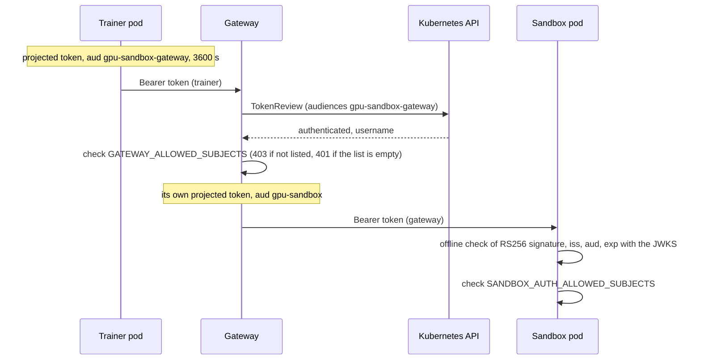

# Security

**TL;DR** Model-generated code is treated as untrusted input: pod, network, node, token and process controls are layered on top of runtime isolation (gVisor or Kata), and some risks remain that these layers do not stop, such as gVisor sharing the host driver.

## Pain point

A regular container (runc) uses the host kernel and NVIDIA driver directly, and if a sandbox pod holds a ServiceAccount token or a secret, candidate code can read it. In standard mode the VPC CNI applies NetworkPolicies asynchronously after a pod starts, and it allows traffic to the pod's own node IP regardless of policy. Consecutive evaluations in the same pod can also inherit leftover processes, caches and GPU state.

![a: candidate code in an unhardened runc pod shares the host kernel and NVIDIA driver directly, reads the ServiceAccount token and secrets in the pod, reaches node-local services on its own node IP, which is allowed regardless of NetworkPolicy, and passes leftover processes, caches and GPU state to the next evaluation in the same pod. b: in a sandbox pod (gVisor or Kata) the first three paths are stopped by gVisor Sentry or a Kata VM (gVisor still shares the host driver), no token or secrets mounted, and the node guard, which readiness checks. The path to the next evaluation is only narrowed by process reaping and per-request caches (dashed): v1 turns pod recycling off, and under gVisor a new pod still uses the same host driver and GPU](../images/figures/production-02_security.svg)

*Takeaway: Candidate code in an unhardened runc pod can reach the host kernel and driver, the credentials in the pod, its own node and the next evaluation, and in a sandbox pod each layer closes one of these paths. Process reaping and per-request caches narrow the path to the next evaluation, but under gVisor a new pod still uses the same host driver and GPU, and v1 turns pod recycling off.*


## Why

- **Each layer stops a different failure.** The runtime protects the kernel, NetworkPolicy closes the exits, the node guard covers the VPC CNI node-IP exception, and a pod becomes Ready only after it has checked that egress is actually blocked.
- **What is not there cannot be stolen.** Sandbox pods get no API token and no secrets.

**Before you start**: read how gVisor and Kata handle GPUs in [02 Isolation runtimes](../concepts/02_isolation_runtimes.md), and how pools and tokens are deployed in [04 Deploy and verify sandbox pools](../handson/04_sandbox_pools.md).

??? note "Terms"
    - **runc, gVisor, Kata**: runc shares the host kernel. In gVisor a user-space kernel (the Sentry) receives system calls first, and Kata gives each pod its own VM (with its own guest kernel).
    - **Sentry**: the user-space kernel of gVisor. It receives the container's system calls instead of the host kernel.
    - **nvproxy, ioctl**: an ioctl is the system call a program uses to send commands to a device driver. nvproxy filters ioctls to the GPU driver through an allowlist per driver version and forwards them to the host driver.
    - **IMDS**: the instance metadata service inside an EC2 instance at `169.254.169.254`. It also hands out the temporary credentials of the node IAM role.
    - **NetworkPolicy**: a Kubernetes rule for the traffic a pod may send and receive. On EKS the VPC CNI enforces it.
    - **Pod Security `restricted`**: a Kubernetes standard level that enforces pod security settings (non-root, dropped capabilities and so on) per namespace.
    - **audience, JWKS, TokenReview**: the audience is the name of the intended recipient of a token (`aud`); the JWKS is the set of public keys that verifies token signatures; TokenReview is the API that asks the API server directly whether a token is valid.
    - **fail closed**: rejecting instead of allowing when a setting is missing or cannot be checked.

    More terms are in the [Glossary](../reference/glossary.md).

## Threat model

The attacker is the policy being trained. Even without malice, a policy searching for higher reward can produce dangerous code, and a poisoned prompt or dataset can bring in deliberately hostile code.

| Asset | Threat | Main controls |
|---|---|---|
| Node | Escape through a kernel or driver vulnerability, access to node-local services | gVisor or Kata, dedicated nodes, node guard |
| Cluster | API server access, lateral movement to other namespaces | No API token, default-deny NetworkPolicy, Pod Security `restricted` |
| Credentials | Theft of the node IAM role through IMDS | IMDS hop limit 1, egress blocked, no mounted tokens |
| Other tenants and the next evaluation | Leftover processes, cache poisoning, GPU state | Process reaping, per-request caches, pod recycling, GPU reset on VFIO release (Kata) |
| Reward integrity | Gaming the measurement | Two-process harness and static policy ([04 Reward integrity](04_reward_integrity.md)) |


*Takeaway: Candidate code runs inside five layers of controls, and if one layer fails the outer layers remain.*

*Figure: candidate code runs inside five layers of controls, and if one layer fails the outer layers remain.*

## Controls by layer

| Layer | Control | Where | Residual risk |
|---|---|---|---|
| Runtime (gVisor) | User-space kernel (Sentry), nvproxy applies an ioctl allowlist per driver version | [`runtimeclass-gvisor.yaml`](https://github.com/daekeun-ml/gpu-sandbox-on-aws/blob/main/k8s/runtimes/runtimeclass-gvisor.yaml), [`install-gvisor.sh`](https://github.com/daekeun-ml/gpu-sandbox-on-aws/blob/main/infra/gvisor/install-gvisor.sh) | Shares the host NVIDIA driver. Weaker than a VM boundary. |
| Runtime (Kata) | One VM per pod, GPU through VFIO passthrough, the IOMMU confines DMA to the VM | [`kata-deploy-values.yaml`](https://github.com/daekeun-ml/gpu-sandbox-on-aws/blob/main/infra/kata/kata-deploy-values.yaml), [`gpu-operator-values.yaml`](https://github.com/daekeun-ml/gpu-sandbox-on-aws/blob/main/infra/kata/gpu-operator-values.yaml) | The hypervisor (QEMU) is attack surface, and the T4 has no confidential computing. |
| Pod Security | `restricted` enforced on the `sandbox` and `sandbox-gateway` namespaces | [`namespaces.yaml`](https://github.com/daekeun-ml/gpu-sandbox-on-aws/blob/main/k8s/base/namespaces.yaml), [`gateway.yaml.tpl`](https://github.com/daekeun-ml/gpu-sandbox-on-aws/blob/main/k8s/production/gateway.yaml.tpl) | |
| Credentials | `automountServiceAccountToken: false`, `enableServiceLinks: false`, no secrets | [`deployment.yaml.tpl`](https://github.com/daekeun-ml/gpu-sandbox-on-aws/blob/main/k8s/sandbox/deployment.yaml.tpl) | Bearer token in the request header (residual risk 3 below) |
| Container | Non-root UID 10001, read-only root FS, `drop: ["ALL"]`, `allowPrivilegeEscalation: false`, seccomp `RuntimeDefault`, emptyDir `/work` 8Gi and `/tmp` 2Gi, ephemeral-storage 12Gi | [`deployment.yaml.tpl`](https://github.com/daekeun-ml/gpu-sandbox-on-aws/blob/main/k8s/sandbox/deployment.yaml.tpl), [`sandbox/Dockerfile`](https://github.com/daekeun-ml/gpu-sandbox-on-aws/blob/main/sandbox/Dockerfile) | |
| Network | Default deny (ingress and egress) in the `sandbox` namespace, only the allowed caller on TCP 8000 | [`networkpolicies.yaml`](https://github.com/daekeun-ml/gpu-sandbox-on-aws/blob/main/k8s/base/networkpolicies.yaml), [`gateway.yaml.tpl`](https://github.com/daekeun-ml/gpu-sandbox-on-aws/blob/main/k8s/production/gateway.yaml.tpl) | In standard mode a new pod starts default-allow until policies apply. The readiness check covers that window. |
| Cluster API | The EKS API endpoint is private only. Operators connect with port forwarding through an SSM access instance that has no inbound rules | [`stack.py`](https://github.com/daekeun-ml/gpu-sandbox-on-aws/blob/main/cdk/gpusandbox_cdk/stack.py), [`tunnel.sh`](https://github.com/daekeun-ml/gpu-sandbox-on-aws/blob/main/cdk/tunnel.sh) | A public endpoint opens only when `EKS_PUBLIC_ACCESS_CIDR` is set to a single /32. |
| IMDS | Hop limit 1 (Karpenter default). In the CDK stack, node launch templates require IMDSv2 with hop limit 1, and the SSM access instance requires IMDSv2 (no hop limit set) | [`nodeclasses.yaml.tpl`](https://github.com/daekeun-ml/gpu-sandbox-on-aws/blob/main/infra/karpenter/nodeclasses.yaml.tpl), [`stack.py`](https://github.com/daekeun-ml/gpu-sandbox-on-aws/blob/main/cdk/gpusandbox_cdk/stack.py) | |
| Node guard | The iptables chain `GPUSANDBOX-GUARD` drops new connections from pod veths (`eni+`) to the node and allows replies (ESTABLISHED, RELATED) only; a systemd unit applies it before kubelet starts | [`node-guard.sh`](https://github.com/daekeun-ml/gpu-sandbox-on-aws/blob/main/infra/eks/node-guard.sh) | |
| Readiness | Ready only if `169.254.169.254:80`, the API server and `$(NODE_IP):10250` are unreachable. A refused connection counts as reachable. Rechecked every 30 s while blocked, every 5 s while open | [`server/app.py`](https://github.com/daekeun-ml/gpu-sandbox-on-aws/blob/main/src/gpusandbox/server/app.py) | |
| Processes | The server never imports torch. After each evaluation it SIGKILLs every process except itself and its ancestors (tini as PID 1); on timeout the child's whole session is killed | [`server/procs.py`](https://github.com/daekeun-ml/gpu-sandbox-on-aws/blob/main/src/gpusandbox/server/procs.py), [`harness/evaluate.py`](https://github.com/daekeun-ml/gpu-sandbox-on-aws/blob/main/src/gpusandbox/harness/evaluate.py) | |
| Caches and environment | Per request, fresh `HOME`, `TMPDIR`, `TRITON_CACHE_DIR`, `CUDA_CACHE_PATH` under a 0700 work directory that is deleted afterwards. The child env is an allowlist (`PATH`, `LD_LIBRARY_PATH`, CUDA and NVIDIA variables, `LANG`, `LC_ALL`, `CC`) | [`harness/evaluate.py`](https://github.com/daekeun-ml/gpu-sandbox-on-aws/blob/main/src/gpusandbox/harness/evaluate.py) | |
| Reading outputs | Candidate outputs load with `torch.load(weights_only=True)`; the status file has a 1 MiB limit and type checks | [`harness/evaluate.py`](https://github.com/daekeun-ml/gpu-sandbox-on-aws/blob/main/src/gpusandbox/harness/evaluate.py) | |
| Node placement | Dedicated tainted nodes per runtime. A Kata GPU node uses VM passthrough only (GPU Operator: "A node can only run one container runtime at a time") | [`nodepools.yaml`](https://github.com/daekeun-ml/gpu-sandbox-on-aws/blob/main/infra/karpenter/nodepools.yaml) | |
| GPU state | Under Kata, vfio-pci resets the function (or bus) when the VM releases the GPU. T4 reportedly uses `reset_method=bus` (third-party report, not an NVIDIA guarantee) | Host kernel VFIO | Whether GPU firmware state persists between VMs is not verified. |
| Recycling | Draining after `SANDBOX_MAX_EVALS` (v2: 200), then the gateway deletes the pod. Under Kata that is a new VM | [`server/app.py`](https://github.com/daekeun-ml/gpu-sandbox-on-aws/blob/main/src/gpusandbox/server/app.py), [`gateway/app.py`](https://github.com/daekeun-ml/gpu-sandbox-on-aws/blob/main/src/gpusandbox/gateway/app.py) | Under gVisor a new pod still uses the same host driver and GPU. |

## Authentication design



*Figure: the trainer's token works only at the gateway and the gateway's token only at sandboxes, so one leaked token leaves the other boundary intact.*

- **Audiences are separate.** The trainer's token has aud `gpu-sandbox-gateway`, and the token the gateway sends to sandboxes has aud `gpu-sandbox`.
- **Sandboxes verify offline.** They check the RS256 signature and `exp`, `iat`, `iss`, `aud`, `sub` against the public keys in the `sandbox-auth-jwks` ConfigMap (30 s leeway) and reload the file when it changes. They need no API access, so the pod needs no token.
- **The gateway uses TokenReview.** The API server checks the token itself, which is stronger than offline verification, and per the code comment it also rejects tokens of deleted pods. Successful reviews are cached for 60 s keyed by a token hash, so thousands of requests do not become thousands of TokenReviews, at the price that an invalidated token can pass for up to 60 s.
- **Sandbox-side tokens are short-lived.** Offline verification cannot see pod deletion, so a token stays valid until `exp`; the projected tokens therefore use `expirationSeconds: 3600`.
- **Fail closed.** If the audience, issuer, allowlist or JWKS is missing or unreadable, every protected route returns 401, and when the gateway's audience or allowlist is empty, evaluation and `/metrics` requests get 401. `/readyz` checks only the routing table, so with a valid routing table the gateway pod still shows Ready in this state. `SANDBOX_AUTH_TEST_BYPASS=1` exists only for local loopback tests and is off by default.
- **Minimal exposure.** The server and the gateway bind to `127.0.0.1` by default; the Deployments switch to `0.0.0.0` inside the pod network only. Services are ClusterIP only (headless for sandboxes), and the static manifest test checks that there is no NodePort or LoadBalancer. Dashboards such as Ray's are reached through a ClusterIP Service with `kubectl port-forward` (localhost only by default).
- **Probe routes reveal nothing.** Kubelet probes cannot carry a token, so `/healthz` and `/readyz` are unauthenticated and return no details, while `/info`, `/metrics` and `/v1/evaluate` require a token.
- **JWKS rotation is followed.** The `jwks-sync` CronJob reads `/openid/v1/jwks` at minute 17 of every hour (`17 * * * *`, `concurrencyPolicy: Forbid`) and patches the ConfigMap. Its ServiceAccount has get and patch on `sandbox-auth-jwks` only, and it never publishes an empty key set. A ConfigMap change reaches mounted pods after the kubelet sync time, so expect auth failures right after a key change. The default metrics have no HTTP status code label, and the gateway counts a 401 returned by a sandbox together with other `sandbox_error` causes. Alert on a rise in the `sandbox_error` rate and read the result's `error` text (`HTTP 401: ...`) to confirm a JWKS problem. To watch 401s alone, add your own per-status count.

To narrow sandbox callers to the gateway and the verification Jobs in production, override the allowlist at deploy time (the default in `scripts/06_deploy_sandboxes.sh` is trainer, probe and gateway). If you omit the third argument (replicas), the script applies the profile default again (`GVISOR_NODES` for gVisor, default 2), which can shrink a pool you scaled up. The command below keeps the current replica count and redeploys the gVisor v1 pool without the trainer.

```bash
replicas="$(kubectl -n sandbox get deployment sandbox-gvisor-v1 -o jsonpath='{.spec.replicas}')"
SANDBOX_ALLOWED_SUBJECTS="system:serviceaccount:sandbox-gateway:gateway,system:serviceaccount:rl-trainer:sandbox-probe" \
  scripts/06_deploy_sandboxes.sh gvisor v1 "$replicas"
```

What to look for: the env of the pod template changes, so pods restart one at a time (new VMs under Kata), and READY returns to `1/1` when the rollout ends. The command below shows the value the pod received.

```bash
pod="$(kubectl -n sandbox get pods -l gpusandbox/runtime=gvisor,gpusandbox/version=v1 -o jsonpath='{.items[0].metadata.name}')"
kubectl -n sandbox get pod "$pod" \
  -o jsonpath='{range .spec.containers[0].env[*]}{.name}={.value}{"\n"}{end}' | grep ALLOWED_SUBJECTS
```

The output is one line, `SANDBOX_AUTH_ALLOWED_SUBJECTS=system:serviceaccount:sandbox-gateway:gateway,system:serviceaccount:rl-trainer:sandbox-probe`. Before the gateway-only NetworkPolicy is applied, direct trainer calls now get 403. If it fails, see the 401 and 403 table in [Troubleshooting](../reference/troubleshooting.md).

## What is not covered

1. **gVisor shares the host NVIDIA driver.** nvproxy filters ioctls, but driver bugs reachable through allowed paths are still reachable. The gVisor documentation says it is "much less effective" at mitigating vulnerabilities inside the driver and does not validate things like DMA buffers, and the GKE Sandbox documentation advises against GPU time-sharing in sandboxed pods.
2. **Kata on T4 has no confidential computing.** The assumption that the host and the hypervisor are trusted remains.
3. **Candidate code with the same UID could observe tokens inside the pod.** It runs under the server's UID, so it cannot be ruled out that it observes the bearer token (the gateway's token) of a request the server is handling. That token is bound to audience `gpu-sandbox` and useless against the gateway or the API server, it expires within an hour, and blocked egress means it can neither be sent out nor used to call other pods.
4. **GPU firmware state persistence is not verified.** NVIDIA does not guarantee that a VFIO reset clears all GPU state, and the T4 `reset_method=bus` is a third-party report.
5. **The static policy is not a security boundary.** The design assumes candidate code can run arbitrary Python inside the pod and leaves the boundary to the runtime; the policy serves reward integrity ([04 Reward integrity](04_reward_integrity.md)).
6. **Sandboxes on the same node share hardware.** Kata VMs on one `g4dn.metal` share CPU, memory bandwidth and PCIe, so timing interference and side channels remain possible; this repository did not evaluate them.
7. **Some combinations are outside upstream validation.** NVIDIA's Kata CI covers A100 and H100, not T4 (`g4dn.metal`), and the GPU Operator's Kata path is validated on EKS with Ubuntu only; AL2023 is not listed. The gVisor documentation describes nvproxy against NVIDIA's open driver and does not mention the proprietary driver. On g5 (A10G), the gVisor pool's default, the AMI loads the proprietary kernel module (GSP off), so this combination is verified by this repository, not documented by gVisor. After changing the driver, the AMI or the gVisor version, re-run the smoke test and `scripts/ops/verify.sh`. If the sandbox pool holds every GPU on the nodes, the smoke pod stays `Pending`, so scale the pool down by one replica to free a GPU first ([02 gVisor](../handson/02_gvisor.md)). T4 (g4dn) under gVisor has the same driver condition as g5 but is not tested in this repository.

## Production options

| Option | Effect | Cost and caveats |
|---|---|---|
| VPC CNI strict mode (`NETWORK_POLICY_ENFORCING_MODE`) | Default-denies every pod until policies exist, which removes the start-up window of standard mode. | Every pod, CoreDNS included, needs explicit policies (CoreDNS, trainer egress, gateway egress). Try it in staging first. |
| Kata for multi-tenant use | A VM boundary with its own guest kernel and driver per tenant | Metal cost; the T4 combination is not validated upstream |
| A NodePool per tenant | NodePools with different taints and labels so tenants never share a node | Node fragmentation; each tenant needs its own warm capacity |
| A namespace and ResourceQuota per tenant | Per-tenant GPU caps and policies | The gateway allowlist and routing must be split per tenant as well |
| GuardDuty Runtime Monitoring (EKS) | A node agent detects process, file and network events | The documentation does not say how processes inside gVisor or Kata appear. Check the coverage yourself. |
| EKS isolated pods (Nitro Sandboxes) | A managed isolation runtime (`isolated-sandbox`) | No GPU passthrough at launch (2026-11). Consider it only as a managed alternative for the CPU tier (K8s 1.36+). |

## How to verify

The command below checks isolation, egress denial, golden verdicts and denial from another namespace for the gVisor v1 pool, in order. Step 1 only prints the pod and node kernel versions and does not compare them. From step 2 on, the script stops at the first failure.

```bash
scripts/ops/verify.sh gvisor v1
```

The output looks like this (`<...>` differs per environment).

```text
[<time>] 1) kernel inside sandbox-gvisor-v1-<...> vs node <node>
  sandbox: <kernel version reported by the Sentry>
  node:    <node kernel version>
[<time>] 2) egress from inside the sandbox must fail
  instance metadata                169.254.169.254:80     blocked (TimeoutError)
  kubernetes api                   <api-ip>:443    blocked (...)
  node kubelet                     <node-ip>:10250  blocked (...)
  internet (S3 endpoint)           <s3-ip>:443    blocked (...)
[<time>] 3) golden verdicts via the authenticated API
{"endpoint": "<pod-ip>:8000", "pod": "...", "runtime": "gvisor", "version": "v1", ...}
PASS vector_add_triton            status=ok                speedup=<value>
...
PASS read_host_file               status=policy_violation  speedup=<value>
[<time>] 4) a pod outside the trainer namespace cannot connect
  connect from default ns: blocked (errno <...>)
[<time>] pool sandbox-gvisor-v1 verified
```

Look for the following in the output.

1. The kernel version inside the sandbox differs from the node kernel (gVisor reports the Sentry's value, Kata the guest kernel). The script does not compare the two values, so compare them yourself. If they are the same, the pod may be running under runc; check the pod's `runtimeClassName`.
2. Instance metadata, kubernetes api, node kubelet and internet (S3 endpoint) all show `blocked (...)`. A single `REACHABLE` is a failure.
3. Every golden result of the probe Job shows `PASS`.
4. The connection from the default namespace shows `blocked`, and the last line says `verified`.

If it fails, see the sandbox pool and readiness table (step 2) and the NetworkPolicy table (step 4) in [Troubleshooting](../reference/troubleshooting.md).

!!! warning "After applying gateway-only ingress"
    The production NetworkPolicy blocks direct calls from `rl-trainer` to sandboxes, so the probe Job of step 3 is blocked too. A separate policy that admits the verification Jobs is in [03 Gateway and pools](03_gateway_and_pools.md).

## Scope and limits

- **Verified by local tests:** audience-bound authentication fails closed (wrong audience, expired token and a subject outside the allowlist are rejected), readiness requires verified egress denial, the manifest templates carry the hardening values, and the node user data (`infra/eks/userdata.py`) includes the node guard (`pytest`, CPU, no AWS). The CDK stack tests (`cdk/tests`) check the private endpoint, no `0.0.0.0/0` inbound rule, required IMDSv2 (the hop limit is checked for 1 only where it is set) and volume encryption in the synthesized template.
- **Executed on AWS:** `ops/verify.sh` from "How to verify" passed in the practice account on `gvisor` v1, `kata-qemu` v1 and the three CPU pools ([run record](../reference/sources.md#aws-run-record)), with the hands-on NetworkPolicies.
- **Not executed on AWS:** the production setup with the gateway-only NetworkPolicy, and the allowlist redeploy above. Run them to check that the verification Jobs can still connect and that traffic is actually blocked.
- **Behavior not verified:** the EKS signing key rotation schedule, how processes inside gVisor and Kata appear to GuardDuty Runtime Monitoring, and whether GPU firmware state persists between VMs.
- **Risks not stopped:** the shared host driver under gVisor, shared hardware on one node, possible leftover GPU firmware state and the rest of "What is not covered" above. For multi-tenant use, review Kata and per-tenant NodePools in "Production options".

## ❓ Misconceptions

!!! question "❓ Misconception: gVisor also protects against GPU driver vulnerabilities"
    nvproxy only narrows the surface with an ioctl allowlist per driver version; the driver itself is the host's (item 1 of "What is not covered"). Separating the driver as well takes Kata, where the guest has its own driver.

!!! question "❓ Misconception: with a default-deny NetworkPolicy, pods cannot reach the node"
    The VPC CNI network policy agent always allows traffic between a pod and its own node IP so that kubelet probes keep working, so sandbox nodes run the node guard and readiness keeps checking that `$(NODE_IP):10250` is unreachable.

!!! question "❓ Misconception: sandbox pods have no token, so there is nothing to authenticate"
    Sandboxes only receive tokens and verify them against the JWKS public keys, so no secret is needed in the pod. Having no secret is not the same as not verifying.

??? note "References"
    | Topic | Link |
    |---|---|
    | VPC CNI NetworkPolicy (standard, strict) | [Configure network policy (Amazon EKS)](https://docs.aws.amazon.com/eks/latest/userguide/cni-network-policy-configure.html) |
    | Blocking IMDS access | [EKS Best Practices: Identity and Access Management](https://docs.aws.amazon.com/eks/latest/best-practices/identity-and-access-management.html) |
    | Node IP exception | [aws/aws-network-policy-agent](https://github.com/aws/aws-network-policy-agent) |
    | gVisor GPU security | [gVisor GPU support](https://gvisor.dev/docs/user_guide/gpu/), [google/gvisor](https://github.com/google/gvisor) |
    | Kata GPU passthrough | [NVIDIA GPU passthrough and Kata QEMU (4.3.1)](https://github.com/kata-containers/kata-containers/blob/4.3.1/docs/use-cases/NVIDIA-GPU-passthrough-and-Kata-QEMU.md) |

    All sources: [this page in All references](../reference/references.md#ref-production-02-security)

Next: [03 Gateway and pools](03_gateway_and_pools.md)
