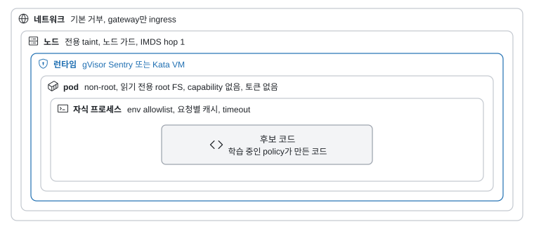
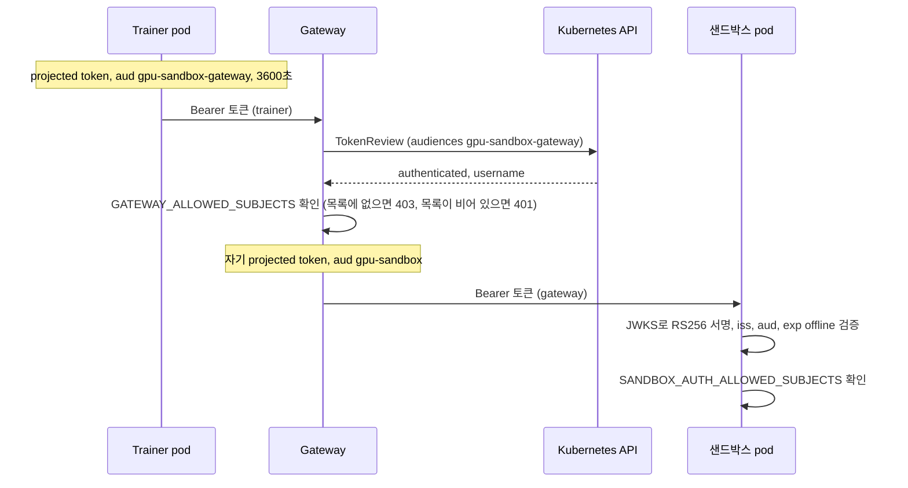

# 보안

!!! info "TL;DR"
    모델이 만든 코드는 신뢰할 수 없는 입력으로 취급하고, 런타임 격리(gVisor 또는 Kata)와 함께 pod, 네트워크, 노드, 토큰, 프로세스 통제를 여러 계층으로 적용합니다. gVisor의 호스트 드라이버 공유처럼 이 통제로 막지 못하는 위험도 남습니다.

## 격리 경계와 접근 경로

- **일반 컨테이너(runc)**: 호스트 커널과 NVIDIA 드라이버를 그대로 사용합니다.
- **pod 안의 자격 증명**: 샌드박스 pod에 ServiceAccount token이나 시크릿이 있으면 후보 코드가 이를 읽을 수 있습니다.
- **NetworkPolicy 적용 시점**: VPC CNI NetworkPolicy는 standard 모드에서 pod가 시작된 뒤 비동기로 적용됩니다.
- **노드 IP 예외**: VPC CNI는 pod와 그 pod가 실행 중인 노드 IP 사이의 통신을 정책과 관계없이 허용합니다.
- **같은 pod에서 이어지는 평가**: 같은 pod에서 다음 평가를 실행하면 이전 평가가 남긴 프로세스, 캐시, GPU 상태가 그대로 남아 있을 수도 있습니다.


*그림 요약: 하드닝하지 않은 runc pod의 후보 코드는 호스트 커널과 드라이버, pod 안의 자격 증명, 자기 노드, 다음 평가에 모두 접근할 수 있습니다. 샌드박스 pod에서는 계층마다 이 중 한 경로를 막습니다. 다음 평가로 가는 경로는 프로세스 정리와 요청별 캐시로 줄이지만, gVisor에서는 pod를 바꿔도 같은 호스트 드라이버와 GPU를 계속 쓰고 v1은 pod 재활용을 끕니다.*


## 방어 설계 요약

- **계층마다 다른 위험을 차단합니다.** 런타임은 커널 접근을, NetworkPolicy는 egress를, 노드 가드는 VPC CNI의 노드 IP 예외를 담당합니다. pod는 egress가 실제로 차단됐는지 확인한 뒤에만 Ready가 됩니다.
- **pod에 없는 자격 증명은 탈취할 수 없습니다.** 샌드박스 pod에는 API token도 시크릿도 넣지 않습니다.

**읽기 전에**　[02 격리 런타임 비교](../concepts/02_isolation_runtimes.md)에서 gVisor와 Kata가 GPU를 다루는 방식을, [04 샌드박스 풀 배포와 검증](../handson/04_sandbox_pools.md)에서 풀과 토큰 배포 절차를 먼저 보세요.

??? note "용어"
    - **runc, gVisor, Kata**: runc는 호스트 커널을 공유합니다. gVisor에서는 사용자 공간 커널(Sentry)이 system call을 먼저 받아 처리하고, Kata는 pod마다 별도의 VM(guest 커널)을 실행합니다.
    - **Sentry**: gVisor의 사용자 공간 커널입니다. 컨테이너의 system call을 호스트 커널 대신 받아 처리합니다.
    - **nvproxy, ioctl**: ioctl은 프로그램이 장치 드라이버에 명령을 보내는 system call입니다. nvproxy는 GPU 드라이버에 보내는 ioctl을 드라이버 버전별 허용 목록으로 걸러 호스트 드라이버에 전달합니다.
    - **IMDS**: EC2 인스턴스 안에서 `169.254.169.254`로 접근하는 메타데이터 서비스입니다. 노드 IAM role의 임시 자격 증명도 여기서 제공됩니다.
    - **NetworkPolicy**: pod가 주고받을 수 있는 트래픽을 정하는 Kubernetes 규칙입니다. EKS에서는 VPC CNI가 이 규칙을 적용합니다.
    - **Pod Security `restricted`**: namespace 단위로 pod 보안 설정(non-root, capability 제거 등)을 강제하는 Kubernetes 표준 수준입니다.
    - **audience, JWKS, TokenReview**: audience는 토큰을 받을 대상의 이름(`aud`)이고, JWKS는 토큰 서명을 검증하는 공개 키 묶음입니다. TokenReview는 토큰이 유효한지 API server에 직접 확인을 요청하는 API입니다.
    - **fail closed**: 설정이 빠지거나 확인할 수 없을 때 허용하지 않고 거부하는 동작입니다.

    더 많은 용어는 [용어 사전](../reference/glossary.md)에 있습니다.

## 위협 모델

운영할 때는 제출 코드가 파일을 열 수 있는지, 다른 서비스로 연결할 수 있는지, 누가 평가 API를 호출할 수 있는지를 따로 확인합니다. 런타임 격리, 네트워크 정책, 토큰 검증은 각각 다른 경계를 통제합니다.

이 페이지가 가정하는 공격자는 학습 중인 policy입니다. policy는 악의가 없어도 reward를 높이는 과정에서 위험한 코드를 만들 수 있고, 프롬프트나 데이터셋이 오염되면 의도적인 공격 코드를 생성할 수도 있습니다.

| 보호 대상 | 위협 | 주요 통제 |
|---|---|---|
| 노드 | 커널이나 드라이버 취약점으로 탈출, 노드의 로컬 서비스 접근 | gVisor 또는 Kata, 전용 노드, 노드 가드 |
| 클러스터 | API server 접근, 다른 namespace로 이동 | API token 없음, NetworkPolicy 기본 거부, Pod Security `restricted` |
| 자격 증명 | IMDS를 통한 노드 IAM role 탈취 | IMDS hop limit 1, egress 차단, 마운트된 토큰 없음 |
| 다른 테넌트와 다음 평가 | 남은 프로세스, 캐시 오염, GPU 상태 | 프로세스 정리, 요청별 캐시, pod 재활용, VFIO 해제 시 GPU reset(Kata) |
| reward 무결성 | 측정 조작 | 2-프로세스 harness와 정적 정책 ([04 Reward 무결성](04_reward_integrity.md)) |



*그림 요약: 후보 코드는 다섯 겹의 통제 안에서 실행되므로, 한 겹의 통제가 실패해도 바깥쪽 통제가 계속 적용됩니다.*


## 계층별 통제

| 계층 | 통제 | 구현 위치 | 남는 위험 |
|---|---|---|---|
| 런타임 (gVisor) | 사용자 공간 커널(Sentry), nvproxy가 드라이버 버전별 ioctl allowlist 적용 | [`runtimeclass-gvisor.yaml`](https://github.com/daekeun-ml/gpu-sandbox-on-aws/blob/main/k8s/runtimes/runtimeclass-gvisor.yaml), [`install-gvisor.sh`](https://github.com/daekeun-ml/gpu-sandbox-on-aws/blob/main/infra/gvisor/install-gvisor.sh) | 호스트 NVIDIA 드라이버를 공유합니다. 격리 수준이 VM 경계보다 약합니다. |
| 런타임 (Kata) | pod마다 VM, GPU는 VFIO passthrough, IOMMU가 DMA를 VM 안으로 제한 | [`kata-deploy-values.yaml`](https://github.com/daekeun-ml/gpu-sandbox-on-aws/blob/main/infra/kata/kata-deploy-values.yaml), [`gpu-operator-values.yaml`](https://github.com/daekeun-ml/gpu-sandbox-on-aws/blob/main/infra/kata/gpu-operator-values.yaml) | 하이퍼바이저(QEMU)가 공격 표면이고, T4에는 confidential computing이 없습니다. |
| Pod Security | `sandbox`, `sandbox-gateway` namespace에 `restricted` enforce | [`namespaces.yaml`](https://github.com/daekeun-ml/gpu-sandbox-on-aws/blob/main/k8s/base/namespaces.yaml), [`gateway.yaml.tpl`](https://github.com/daekeun-ml/gpu-sandbox-on-aws/blob/main/k8s/production/gateway.yaml.tpl) | |
| 자격 증명 | `automountServiceAccountToken: false`, `enableServiceLinks: false`, 시크릿 없음 | [`deployment.yaml.tpl`](https://github.com/daekeun-ml/gpu-sandbox-on-aws/blob/main/k8s/sandbox/deployment.yaml.tpl) | 요청 헤더의 bearer token (아래 잔여 위험 3) |
| 컨테이너 | UID 10001 non-root, 읽기 전용 root FS, `drop: ["ALL"]`, `allowPrivilegeEscalation: false`, seccomp `RuntimeDefault`, `/work` 8Gi와 `/tmp` 2Gi emptyDir, ephemeral-storage 12Gi | [`deployment.yaml.tpl`](https://github.com/daekeun-ml/gpu-sandbox-on-aws/blob/main/k8s/sandbox/deployment.yaml.tpl), [`sandbox/Dockerfile`](https://github.com/daekeun-ml/gpu-sandbox-on-aws/blob/main/sandbox/Dockerfile) | |
| 네트워크 | `sandbox` namespace 기본 거부(ingress, egress), 허용된 호출자만 TCP 8000 | [`networkpolicies.yaml`](https://github.com/daekeun-ml/gpu-sandbox-on-aws/blob/main/k8s/base/networkpolicies.yaml), [`gateway.yaml.tpl`](https://github.com/daekeun-ml/gpu-sandbox-on-aws/blob/main/k8s/production/gateway.yaml.tpl) | standard 모드에서는 정책이 적용되기 전까지 새 pod가 default allow로 시작합니다. 이 구간은 readiness 확인이 보완합니다. |
| 클러스터 API | EKS API endpoint는 private 전용. 운영자는 inbound 규칙이 없는 SSM access instance를 거쳐 포트 포워딩으로 접속 | [`stack.py`](https://github.com/daekeun-ml/gpu-sandbox-on-aws/blob/main/cdk/gpusandbox_cdk/stack.py), [`tunnel.sh`](https://github.com/daekeun-ml/gpu-sandbox-on-aws/blob/main/cdk/tunnel.sh) | public endpoint는 `EKS_PUBLIC_ACCESS_CIDR`에 /32 하나를 지정할 때만 활성화됩니다. |
| IMDS | hop limit 1 (Karpenter 기본값). CDK 스택의 노드 launch template은 IMDSv2 필수와 hop limit 1, SSM 접속 인스턴스는 IMDSv2 필수(hop limit은 지정하지 않음) | [`nodeclasses.yaml.tpl`](https://github.com/daekeun-ml/gpu-sandbox-on-aws/blob/main/infra/karpenter/nodeclasses.yaml.tpl), [`stack.py`](https://github.com/daekeun-ml/gpu-sandbox-on-aws/blob/main/cdk/gpusandbox_cdk/stack.py) | |
| 노드 가드 | pod veth(`eni+`)에서 노드로 들어오는 새 연결을 iptables chain `GPUSANDBOX-GUARD`가 DROP, 응답(ESTABLISHED, RELATED)만 허용, kubelet보다 먼저 systemd로 적용 | [`node-guard.sh`](https://github.com/daekeun-ml/gpu-sandbox-on-aws/blob/main/infra/eks/node-guard.sh) | |
| Readiness | `169.254.169.254:80`, API server, `$(NODE_IP):10250`에 연결되지 않아야 Ready(판정 방식은 표 아래) | [`server/app.py`](https://github.com/daekeun-ml/gpu-sandbox-on-aws/blob/main/src/gpusandbox/server/app.py) | |
| 프로세스 | 서버는 torch를 import하지 않음. 평가가 끝나면 서버와 그 조상(tini PID 1)을 뺀 모든 프로세스를 SIGKILL, timeout이면 자식 session 전체를 kill | [`server/procs.py`](https://github.com/daekeun-ml/gpu-sandbox-on-aws/blob/main/src/gpusandbox/server/procs.py), [`harness/evaluate.py`](https://github.com/daekeun-ml/gpu-sandbox-on-aws/blob/main/src/gpusandbox/harness/evaluate.py) | |
| 캐시와 환경 | 요청마다 `HOME`, `TMPDIR`, `TRITON_CACHE_DIR`, `CUDA_CACHE_PATH`를 0700 작업 디렉터리 아래에 새로 만들고 끝나면 삭제. 자식 env는 allowlist(`PATH`, `LD_LIBRARY_PATH`, CUDA와 NVIDIA 변수, `LANG`, `LC_ALL`, `CC`)만 | [`harness/evaluate.py`](https://github.com/daekeun-ml/gpu-sandbox-on-aws/blob/main/src/gpusandbox/harness/evaluate.py) | |
| 출력 읽기 | 후보 출력은 `torch.load(weights_only=True)`, 상태 파일은 1 MiB 제한과 타입 검사 | [`harness/evaluate.py`](https://github.com/daekeun-ml/gpu-sandbox-on-aws/blob/main/src/gpusandbox/harness/evaluate.py) | |
| 노드 배치 | 런타임별 전용 taint 노드. Kata GPU 노드는 VM passthrough 한 가지 모드만 씀(GPU Operator: "A node can only run one container runtime at a time") | [`nodepools.yaml`](https://github.com/daekeun-ml/gpu-sandbox-on-aws/blob/main/infra/karpenter/nodepools.yaml) | |
| GPU 상태 | Kata에서 VM이 GPU를 해제하면 vfio-pci가 function(또는 bus)을 reset. T4는 `reset_method=bus`로 보고됨(제3자 보고, NVIDIA 보증 아님) | 호스트 커널 VFIO | GPU firmware 상태가 VM 사이에 남는지는 확인하지 않았습니다. |
| 재활용 | `SANDBOX_MAX_EVALS`(v2: 200)에 이르면 draining, gateway가 pod 삭제. Kata에서는 새 VM | [`server/app.py`](https://github.com/daekeun-ml/gpu-sandbox-on-aws/blob/main/src/gpusandbox/server/app.py), [`gateway/app.py`](https://github.com/daekeun-ml/gpu-sandbox-on-aws/blob/main/src/gpusandbox/gateway/app.py) | gVisor에서는 새 pod여도 같은 호스트 드라이버와 GPU를 씁니다. |

- **Readiness 판정**: 연결 거부(refused)도 도달한 것으로 판정합니다. 차단돼 있으면 30초, 연결되면 5초마다 재확인합니다.

## 인증 설계



*그림: trainer 토큰은 gateway에서만, gateway 토큰은 샌드박스에서만 통하므로 토큰 하나가 유출되어도 다른 경계는 남습니다.*

- **audience를 분리합니다.** trainer 토큰은 aud `gpu-sandbox-gateway`, gateway가 샌드박스에 보내는 토큰은 aud `gpu-sandbox`입니다.
- **샌드박스는 offline으로 검증합니다.** ConfigMap `sandbox-auth-jwks`의 공개 키로 RS256 서명과 `exp`, `iat`, `iss`, `aud`, `sub`를 확인하고(leeway 30초), 파일이 바뀌면 다시 읽습니다. 샌드박스는 Kubernetes API를 호출하지 않으므로 pod에 토큰이 필요 없습니다.
- **gateway는 TokenReview를 씁니다.** API server가 직접 토큰을 확인하므로 offline 검증보다 엄격하고, 코드 주석에 따르면 삭제된 pod의 토큰도 거부합니다.
    - **성공 결과 캐시**: gateway는 성공 결과를 토큰 해시를 키로 60초 동안 캐시합니다. 그래서 요청이 수천 건이어도 TokenReview 호출이 수천 건으로 늘지 않지만, 무효가 된 토큰이 최대 60초 동안 통과할 수 있습니다.
- **샌드박스에 보내는 토큰의 수명을 짧게 설정합니다.** offline 검증은 pod 삭제 여부를 확인할 수 없고 토큰은 `exp`까지 유효하므로, projected token의 `expirationSeconds`를 3600으로 설정합니다.
- **설정이 없으면 거부합니다(fail closed).**
    - **샌드박스**: audience, issuer, allowlist, JWKS 중 하나라도 없거나 읽을 수 없으면 보호된 경로에서 모두 401을 반환합니다.
    - **gateway**: audience나 allowlist가 비어 있으면 평가와 `/metrics` 요청에 401을 반환합니다. `/readyz`는 routing 표만 확인하므로, routing 표가 유효하면 이 상태에서도 gateway pod는 Ready로 보입니다.
    - **`SANDBOX_AUTH_TEST_BYPASS=1`**: loopback 로컬 테스트 전용이고 기본값은 비활성입니다.
- **노출을 줄입니다.**
    - **bind 주소**: 서버와 gateway의 기본 bind는 `127.0.0.1`이고, Deployment가 pod 네트워크 안에서만 `0.0.0.0`으로 바꿉니다.
    - **Service 타입**: Service는 ClusterIP 타입만 쓰고(샌드박스는 headless), 정적 매니페스트 테스트가 NodePort나 LoadBalancer가 없는지 확인합니다.
    - **웹 UI**: Ray dashboard 같은 웹 UI는 ClusterIP Service에 `kubectl port-forward`로 접속합니다(기본적으로 localhost에서만 열립니다).
- **probe 경로는 상세 정보를 반환하지 않습니다.** kubelet probe는 토큰을 붙일 수 없으므로 `/healthz`와 `/readyz`는 인증 없이 호출할 수 있지만 상세 정보 없이 응답합니다. `/info`, `/metrics`, `/v1/evaluate`는 토큰이 필요합니다.
- **JWKS 회전을 자동으로 반영합니다.** `jwks-sync` CronJob이 매시 17분(`17 * * * *`, `concurrencyPolicy: Forbid`)에 `/openid/v1/jwks`를 읽어 ConfigMap을 patch합니다.
    - **권한**: 이 Job의 ServiceAccount에는 `sandbox-auth-jwks` 하나에 대한 get과 patch 권한만 있고, Job은 빈 키 집합을 게시하지 않습니다.
    - **반영 시점**: ConfigMap 변경 내용은 kubelet 동기화 주기가 지난 뒤에 pod에 마운트된 파일에 반영됩니다.
    - **키가 바뀐 직후의 인증 실패 감지**: 기본 지표에는 HTTP 상태 코드 label이 없고, 샌드박스가 돌려준 401은 gateway에서 다른 원인의 `sandbox_error`와 합산됩니다. `sandbox_error` 비율 상승으로 감지하고, 결과의 `error` 본문(`HTTP 401: ...`)으로 JWKS 문제인지 확인하세요.
    - **401만 따로 감시하려면**: 상태 코드별 집계를 직접 추가해야 합니다.

production에서 샌드박스 호출자를 gateway와 검증 Job으로 줄이려면, 배포할 때 allowlist(`scripts/06_deploy_sandboxes.sh`의 기본값은 trainer, probe, gateway)를 덮어씁니다.

- **세 번째 인자(replica 수)를 생략하면**: 스크립트가 프로필의 기본값(gVisor는 `GVISOR_NODES`, 기본 2)을 다시 적용하므로, 운영 중에 늘린 풀이 줄어들 수 있습니다.

아래 명령은 현재 replica 수를 유지한 채 allowlist에서 trainer를 제외하고 gVisor v1 풀을 다시 배포합니다.

```bash
replicas="$(kubectl -n sandbox get deployment sandbox-gvisor-v1 -o jsonpath='{.spec.replicas}')"
SANDBOX_ALLOWED_SUBJECTS="system:serviceaccount:sandbox-gateway:gateway,system:serviceaccount:rl-trainer:sandbox-probe" \
  scripts/06_deploy_sandboxes.sh gvisor v1 "$replicas"
```

pod template의 env가 바뀌면 pod가 하나씩 다시 생성됩니다(Kata라면 새 VM). rollout이 끝나면 READY가 다시 `1/1`이 됩니다. 실제로 적용된 값은 아래 명령으로 확인합니다.

```bash
pod="$(kubectl -n sandbox get pods -l gpusandbox/runtime=gvisor,gpusandbox/version=v1 -o jsonpath='{.items[0].metadata.name}')"
kubectl -n sandbox get pod "$pod" \
  -o jsonpath='{range .spec.containers[0].env[*]}{.name}={.value}{"\n"}{end}' | grep ALLOWED_SUBJECTS
```

- 출력은 `SANDBOX_AUTH_ALLOWED_SUBJECTS=system:serviceaccount:sandbox-gateway:gateway,system:serviceaccount:rl-trainer:sandbox-probe` 한 줄입니다.
- **gateway-only NetworkPolicy를 적용하기 전이라면**: trainer가 샌드박스를 직접 호출할 때 이제 403 응답을 받습니다.

문제가 생기면 [문제 해결](../reference/troubleshooting.md)의 "401, 403 응답" 표를 보세요.

## 다루지 않는 위험

1. **gVisor는 호스트 NVIDIA 드라이버를 공유합니다.** nvproxy가 ioctl을 필터링하지만, 허용된 ioctl로 호출할 수 있는 드라이버 버그는 막지 못합니다. gVisor 문서는 드라이버 내부 취약점 완화에는 "much less effective"하고 DMA buffer 같은 내용은 검증하지 않는다고 설명합니다. GKE Sandbox 문서도 sandboxed pod에서 GPU time-sharing을 쓰지 말라고 권장합니다.
2. **T4를 쓰는 Kata 구성에는 confidential computing이 없습니다.** 따라서 호스트와 하이퍼바이저는 신뢰해야 합니다.
3. **같은 UID로 실행되는 후보 코드가 pod 안의 토큰을 읽을 수 있습니다.** 후보 코드는 서버와 같은 UID로 실행되므로, 처리 중인 요청의 bearer token(gateway의 토큰)을 읽을 가능성을 배제할 수 없습니다. 이 토큰은 audience가 `gpu-sandbox`로 제한되어 gateway나 API server에서는 쓸 수 없고, 1시간 안에 만료됩니다. 또 egress가 차단되어 있으므로 후보 코드는 토큰을 외부로 보내거나 다른 pod를 호출할 수 없습니다.
4. **GPU firmware 상태가 남는지는 확인하지 않았습니다.** NVIDIA는 VFIO reset이 모든 GPU 상태를 지운다고 보장하지 않으며, T4의 `reset_method=bus`는 제3자 보고입니다.
5. **정적 정책은 보안 경계가 아닙니다.** 이 설계는 후보 코드가 pod 안에서 임의의 Python을 실행할 수 있다고 가정하고, 격리는 런타임이 담당합니다. 정적 정책은 reward 무결성을 지키는 장치입니다([04 Reward 무결성](04_reward_integrity.md)).
6. **같은 노드의 다른 샌드박스와 하드웨어를 공유합니다.** Kata VM들은 같은 `g4dn.metal`의 CPU, 메모리 대역폭, PCIe를 공유하므로 타이밍 간섭과 side channel 가능성이 있습니다. 이 저장소는 이 위험을 평가하지 않았습니다.
7. **upstream 검증 범위 밖의 조합을 씁니다.**
    - **Kata**: NVIDIA의 Kata CI는 A100과 H100을 테스트하고 T4(`g4dn.metal`)는 테스트하지 않습니다. GPU Operator의 Kata 구성은 EKS에서 Ubuntu로만 검증되었고 AL2023은 목록에 없습니다.
    - **gVisor와 proprietary 드라이버**: gVisor 문서는 nvproxy를 NVIDIA open 드라이버 기준으로 설명하고 proprietary 드라이버는 언급하지 않습니다. gVisor 풀의 기본값인 g5(A10G)에서는 AMI가 proprietary 커널 모듈(GSP 꺼짐)을 로드하므로, 이 조합은 gVisor 문서가 아니라 이 저장소에서 검증한 것입니다.
    - **드라이버, AMI, gVisor 버전을 바꾸면**: smoke test와 `scripts/ops/verify.sh`를 다시 실행하세요. 샌드박스 풀이 노드의 GPU를 모두 쓰고 있으면 smoke pod가 `Pending`으로 남으니, 풀의 replica를 하나 줄여 GPU를 비운 뒤 실행합니다([02 gVisor](../handson/02_gvisor.md)).
    - **gVisor에서 T4(g4dn)**: 드라이버 조건이 g5와 같지만 이 저장소에서 테스트하지 않았습니다.

## Production 옵션

| 옵션 | 효과 | 비용과 주의 |
|---|---|---|
| VPC CNI strict 모드 (`NETWORK_POLICY_ENFORCING_MODE`) | 정책이 생기기 전까지 모든 pod를 기본 거부해서 standard 모드에서 pod 시작 직후 정책이 적용되지 않는 구간을 없앱니다. | CoreDNS를 포함한 모든 pod에 명시적 정책이 필요합니다(CoreDNS, trainer egress, gateway egress). staging에서 먼저 시험하세요. |
| 멀티 테넌트에는 Kata | 테넌트마다 VM 경계와 자체 guest 커널, 드라이버 | metal 비용, T4 조합은 upstream 미검증 |
| 테넌트별 NodePool | taint와 label이 다른 NodePool로 테넌트끼리 노드를 공유하지 않게 함 | 노드 단편화, 테넌트마다 warm capacity가 따로 필요 |
| 테넌트별 namespace와 ResourceQuota | 테넌트별 GPU 상한과 정책 | gateway allowlist와 routing도 테넌트별로 나눠야 함 |
| GuardDuty Runtime Monitoring (EKS) | 노드 에이전트가 프로세스, 파일, 네트워크 이벤트를 탐지 | gVisor와 Kata 안쪽 프로세스가 어떻게 보이는지는 문서에 없습니다. 적용 범위를 직접 확인하세요. |
| EKS isolated pods (Nitro Sandboxes) | 관리형 격리 런타임(`isolated-sandbox`) | 출시 시점(2026-11)에 GPU passthrough를 지원하지 않습니다. CPU 계층의 관리형 대안으로만 검토하세요(K8s 1.36 이상). |

## 확인 방법

아래 명령은 gVisor v1 풀 하나에서 격리, egress 차단, golden verdict, 다른 namespace의 접속 차단을 차례로 확인합니다. 1단계는 pod와 노드의 커널 버전을 출력만 하고 비교하지 않습니다. 2단계부터는 하나라도 실패하면 그 단계에서 중단합니다.

```bash
scripts/ops/verify.sh gvisor v1
```

출력 형식은 다음과 같습니다(`<...>`는 환경마다 다른 값).

```text
[<시각>] 1) kernel inside sandbox-gvisor-v1-<...> vs node <node>
  sandbox: <Sentry가 보고하는 커널 버전>
  node:    <노드 커널 버전>
[<시각>] 2) egress from inside the sandbox must fail
  instance metadata                169.254.169.254:80     blocked (TimeoutError)
  kubernetes api                   <api-ip>:443    blocked (...)
  node kubelet                     <node-ip>:10250  blocked (...)
  internet (S3 endpoint)           <s3-ip>:443    blocked (...)
[<시각>] 3) golden verdicts via the authenticated API
{"endpoint": "<pod-ip>:8000", "pod": "...", "runtime": "gvisor", "version": "v1", ...}
PASS vector_add_triton            status=ok                speedup=<값>
...
PASS read_host_file               status=policy_violation  speedup=<값>
[<시각>] 4) a pod outside the trainer namespace cannot connect
  connect from default ns: blocked (errno <...>)
[<시각>] pool sandbox-gvisor-v1 verified
```

출력에서 다음을 확인하세요.

1. 샌드박스 안의 커널 버전이 노드 커널과 다릅니다(gVisor는 Sentry가 보고하는 값, Kata는 guest 커널). 스크립트는 두 값을 비교하지 않으니 출력을 직접 대조하세요. 값이 같으면 pod가 runc로 실행되고 있을 수 있으므로 pod의 `runtimeClassName`을 확인합니다.
2. instance metadata, kubernetes api, node kubelet, internet(S3 endpoint)이 모두 `blocked (...)`입니다. `REACHABLE`이 하나라도 있으면 실패입니다.
3. probe Job의 golden 결과가 모두 `PASS`입니다.
4. default namespace에서의 연결이 `blocked`이고, 마지막 줄이 `verified`입니다.

문제가 생기면 [문제 해결](../reference/troubleshooting.md)의 "샌드박스 풀과 readiness" 표(2단계)와 "NetworkPolicy" 표(4단계)를 보세요.

!!! warning "gateway-only ingress를 적용한 뒤에는"
    production NetworkPolicy는 `rl-trainer`에서 샌드박스를 직접 호출하는 트래픽을 차단하므로, 3단계의 probe Job 요청도 차단됩니다. 검증 Job을 허용하는 별도 정책은 [03 Gateway와 샌드박스 풀](03_gateway_and_pools.md)에서 설명합니다.

## 적용 범위와 한계

- **로컬 테스트로 확인한 것:** audience 기반 인증의 fail closed 동작(잘못된 audience, 만료, 허용 목록에 없는 subject 거부), egress 차단을 확인해야 Ready가 되는 readiness, 매니페스트 템플릿의 하드닝 값, 노드 user data(`infra/eks/userdata.py`)의 node guard 포함 여부를 확인했습니다(`pytest`, CPU, AWS 없음). CDK 스택 테스트(`cdk/tests`)는 synth한 템플릿에서 private endpoint, `0.0.0.0/0` inbound 없음, IMDSv2 필수(hop limit은 지정된 경우에만 1인지 검사), 볼륨 암호화를 확인합니다.
- **AWS에서 실행한 것:** "확인 방법"의 `ops/verify.sh`를 실습 계정의 `gvisor` v1, `kata-qemu` v1, CPU 풀 세 개에서 실행해 통과했습니다([실행 기록](../reference/sources.md#aws-실행-기록)). 이 검증은 핸즈온 NetworkPolicy에서 실행했습니다.
- **AWS에서 실행하지 않은 것:** gateway-only NetworkPolicy를 적용한 production 구성과 위의 allowlist 재배포입니다. 이 구성에서 검증 Job이 접근할 수 있는지와 실제 차단 여부는 직접 실행해 확인하세요.
- **확인하지 않은 동작:** EKS의 서명 키 회전 일정, GuardDuty Runtime Monitoring에 gVisor와 Kata 안쪽 프로세스가 보이는 방식, GPU firmware 상태가 VM 사이에 남는지 여부.
- **대응하지 않는 위험:** gVisor의 호스트 드라이버 공유, 같은 노드의 하드웨어 공유, GPU firmware 상태 잔존 등은 위 "다루지 않는 위험"에 있습니다. 멀티 테넌트라면 "Production 옵션"의 Kata와 테넌트별 NodePool을 검토하세요.

## ❓ 오해

!!! question "❓ 오해: gVisor를 쓰면 GPU 드라이버 취약점까지 방어할 수 있다"
    nvproxy는 드라이버 버전별 ioctl allowlist로 공격 표면을 줄일 뿐이고, 샌드박스는 여전히 호스트 드라이버를 사용합니다(위 "다루지 않는 위험" 1). 드라이버까지 분리하려면 guest VM이 자체 드라이버를 쓰는 Kata가 필요합니다.

!!! question "❓ 오해: 기본 거부 NetworkPolicy를 적용하면 pod가 노드에도 접근할 수 없다"
    VPC CNI network policy agent는 kubelet probe를 위해 pod와 그 pod가 실행 중인 노드 IP 사이의 통신을 정책과 관계없이 허용합니다. 그래서 샌드박스 노드에 노드 가드를 두고, readiness 검사에서 `$(NODE_IP):10250`에 연결되지 않는지 계속 확인합니다.

!!! question "❓ 오해: 샌드박스 pod에 토큰이 없으니 인증할 것도 없다"
    샌드박스는 요청에 담긴 토큰을 JWKS 공개 키로 검증하므로 pod 안에 비밀 값을 둘 필요가 없습니다. pod에 비밀 값이 없어도 샌드박스는 보호된 경로로 들어오는 요청의 토큰을 모두 검증합니다.

??? note "참고 자료"
    | 주제 | 링크 |
    |---|---|
    | VPC CNI NetworkPolicy (standard, strict) | [Configure network policy (Amazon EKS)](https://docs.aws.amazon.com/eks/latest/userguide/cni-network-policy-configure.html) |
    | IMDS 접근 차단 | [EKS Best Practices: Identity and Access Management](https://docs.aws.amazon.com/eks/latest/best-practices/identity-and-access-management.html) |
    | 노드 IP 예외 | [aws/aws-network-policy-agent](https://github.com/aws/aws-network-policy-agent) |
    | gVisor GPU 보안 | [gVisor GPU support](https://gvisor.dev/docs/user_guide/gpu/), [google/gvisor](https://github.com/google/gvisor) |
    | Kata GPU passthrough | [NVIDIA GPU passthrough and Kata QEMU (4.3.1)](https://github.com/kata-containers/kata-containers/blob/4.3.1/docs/use-cases/NVIDIA-GPU-passthrough-and-Kata-QEMU.md) |

    전체 출처: [참고 자료 모음의 이 페이지 절](../reference/references.md#ref-production-02-security)

다음: [03 Gateway와 샌드박스 풀](03_gateway_and_pools.md)
