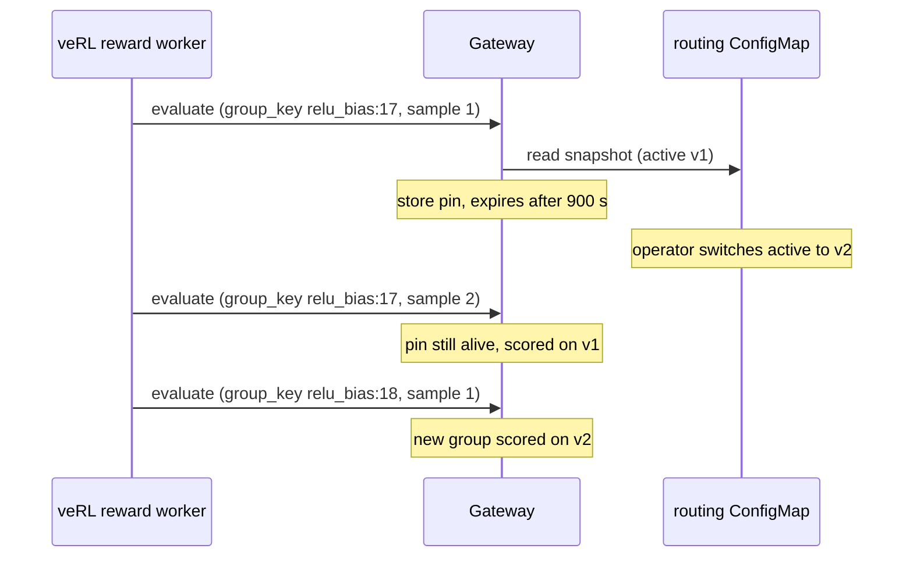

# Gateway and sandbox pools

!!! info "TL;DR"
    The sandbox gateway is a single scheduler in front of every trainer process: it authenticates callers, pins the sandbox version per batch or per GRPO group, sends one evaluation at a time to each pod and replaces draining pods with new ones.

## When trainers connect directly to the pool

Two workers can choose the same idle pod. One request starts, and the other gets `503` and retries. More workers can make that contention visible in batch times. A version switch during the same run can also split a group across grading standards.


## What the gateway handles

The gateway counts requests in flight, selects a free pod, and pins the scoring version. Batch requests use one routing snapshot. Individual requests use `group_key` to connect answers to the same prompt. Watch both retries and waiting time after adding it. When every ready pod is busy, evaluation capacity is the limiting factor.

??? note "Conditions and exceptions"
    - **When each trainer process decides alone which pod is free**: several TRL ranks and veRL reward workers send requests to the same pod, get 503 and retry.
    - **veRL scoring samples one at a time**: with no batch snapshot, samples of the same GRPO group can be scored by different versions before and after a routing switch.
    - **If the pinning rules live separately in each trainer's code**: it is also hard to version environments independently of the trainer.
    - **Another case**: INTELLECT-3 reported that `kubectl exec` through the API grew to about 2.5 s per command, and switched to a gateway, headless Service and sidecar design (arXiv 2512.16144).

    - **In-flight requests are counted in one place.** Normally every request passes through a single gateway process, so it never sends two requests to the same pod at once.
        - **While the gateway Deployment is being replaced**: the old and new gateway run side by side for a short time and can pick the same pod. The sandbox then answers the second request with 503 (busy), and the gateway sends it to another pod.
    - **Version pinning is centralized.** A batch is bound to one snapshot and samples to a `group_key` pin, and TRL and veRL use the same path through a single `SANDBOX_GATEWAY` without knowing the pinning rules.
    - **Recycling is automatic.** Worn-out pods are deleted and replaced with new ones; under Kata a new pod is a new VM.

??? note "Terms"
    - **TokenReview**: a Kubernetes API that asks the API server directly whether a token sent by a caller is valid. The gateway authenticates callers with its result.
    - **routing snapshot**: a copy of the routing table (`routing.json`) read and frozen at one point in time. One batch is scored with one such copy.
    - **group pin, `group_key`, TTL**: a pin that keeps scoring the samples of one `group_key` (one GRPO group) with the snapshot taken at the first sample. The TTL is how long that pin lasts.
    - **headless Service**: a Service without a virtual IP, whose DNS returns the list of Ready pod IPs. The gateway picks pods directly from this list.
    - **draining, recycling**: draining is the state in which a pod leaves Ready so that it takes no new evaluations; recycling is the gateway deleting such a pod so that the Deployment creates a new one.
    - **cooldown**: a short period during which no requests are sent to a pod that returned 503 or a connection error.

    More terms are in the [Glossary](../reference/glossary.md).

## API

| Method, path | Auth | Request | Response | Purpose |
|---|---|---|---|---|
| `POST /v1/evaluate_batch` | Bearer (aud `gpu-sandbox-gateway`) | `{runtime?, items: [{task_id, code, request_id?}]}`, 1 to 4096 items | `{runtime, version, revision, results}` | The whole batch on one snapshot (TRL) |
| `POST /v1/evaluate` | Bearer | `{task_id, code, request_id?, group_key, runtime?}` | One verdict | Per sample, `group_key` pin (veRL) |
| `GET /v1/routing` | Bearer | | `{runtime, version, revision}` | Check the current routing |
| `GET /metrics` | Bearer | | Prometheus format | Monitoring |
| `GET /healthz`, `GET /readyz` | None | | `readyz` returns 503 when there is no valid routing table or the active pool has no address in it (below the table) | kubelet probes |

- **When `readyz` returns 503**: if no valid routing table has been read yet or the active pool has no address in the table. After a good table has been read, file read or JSON parse errors fall back to the last good table.
- **Field lengths**: limited to 64 characters for `task_id`, 32,768 for `code`, 128 for `request_id`, 256 for `group_key` and 32 for `runtime`.
- **A result from a pod that finished the evaluation**: it carries the sandbox verdict (`status`, `correct`, `custom_kernel`, `speedup`, `flags` and so on) plus the gateway's `sandbox_version`, `runtime`, `routing_revision`, `pod`, `endpoint`, `attempts` and `draining`.
- **A `sandbox_error` result**: for a request that got no free pod or a 4xx from the sandbox, it has only `status`, `error` and the three gateway fields, so read `status` and `error` first and use the other fields only when present.

Trainers call it through the client library (a one-item batch example).

```python
from gpusandbox.client import SandboxClient

client = SandboxClient.from_env()  # reads SANDBOX_GATEWAY and SANDBOX_TOKEN_FILE
# code: the candidate module source as a string
info, results = client.evaluate_batch_sync([{"task_id": "relu_bias", "code": code}])
print(info.runtime, info.version, info.revision, results[0]["status"])
```

The gateway metrics are `gateway_evaluations_total{runtime, version, status}`, `gateway_evaluation_seconds` and `gateway_recycled_pods_total`. Dashboards and alerts are covered in [07 Observability and operations](07_observability_and_operations.md).

## Group pins and TTL

A group pin records the scoring version for answers to one prompt. The TTL determines how long that record is kept. The pin must last through the final evaluation to provide a common standard across workers.



*Figure: even when the active version changes, a group that has already started finishes on its first sample's version for the TTL, and only new groups use the new version.*

- The first request (or the first after expiry) stores its routing snapshot (runtime, version, address) with an expiry time, and later requests with the same `group_key` use it even after the active version changes.
- The default TTL is 900 seconds (`GATEWAY_GROUP_PIN_TTL_S`), and when there are more than 100,000 pins, expired ones are removed first.
- veRL's [`reward_fn.py`](https://github.com/daekeun-ml/gpu-sandbox-on-aws/blob/main/rl/verl/reward_fn.py) builds `group_key` as `f"{task_id}:{info.get('index', 'na')}"`. The same row in a later epoch, after the TTL, gets a new snapshot.
- The runtime is pinned at the first request too, so once a pin exists the request's `runtime` value is ignored.
- Pins live only in gateway memory and disappear when the gateway restarts, so groups in flight at that moment can mix versions.
- The TTL must be longer than the longest time to score one group (otherwise the last sample gets a new snapshot).
- Keep the old pool until every pin has expired. ([05 Sandbox versioning](05_sandbox_updates.md))
    - **If you scale it to zero with `scripts/ops/rollout.sh <runtime> <from> <to> --finish` right after the switch**: groups pinned to the old version are left without a destination. The gateway waits up to 600 seconds for a free pod, but a veRL per-sample request ends as `sandbox_error` first if the client gets no response within its default 300 seconds.
    - **When to finish the switch**: wait for the TTL (15 minutes by default) plus the time in-flight batches need, then finish.

`evaluate_batch` takes one snapshot for the whole batch, without group pins.

- **When one process sends all completions of a group in one batch**: this is enough.
- **If one group's completions are split across several training ranks (depends on the TRL configuration)**: each rank takes its own snapshot, so a group can span two versions at the moment of a switch.
- **How to check**: collect the `reward_batch` events of every rank for the same `global_step` and compare `version` and `served_versions`. These fields count only the items that process actually sent, and a rank that scored everything from its cache emits no event, so the event cannot tell you which pool that rank's results came from.

## Scheduling

- The gateway keeps one `SandboxPool` per routing address (headless Service) and re-resolves DNS every 10 seconds to get the IP list of Ready pods, so pods that have not passed the egress check are never candidates.
- It sends one request at a time to each pod (`per_endpoint_concurrency=1`), picking among free pods the one with the fewest in-flight requests that was used longest ago.
- If no pod is free, it waits up to 600 seconds (`acquire_timeout_s`) and then returns `sandbox_error` (`no free sandbox`).
- When a pod answers 503 (busy, not ready), the gateway rests it for 5 seconds (cooldown) and sends the request to another free pod; once the cooldown ends, that pod is a candidate again. Connection errors are handled the same way, with at most 4 attempts.
- 4xx responses are not retried, because an authentication or request problem is not fixed by another pod.
- The timeout for one sandbox call is 300 seconds, and the outer limit of the harness inside the sandbox is `SANDBOX_EVAL_TIMEOUT_S` (default 90 s) × 2 + 30 s = 210 s.

GPU timing is clean only with one GPU to itself, so requests are limited to one per pod: concurrent evaluations equal the number of Ready sandbox pods, and one batch takes roughly ⌈items / pods⌉ × evaluation time.

The AWS numbers in [Runtime benchmark](../handson/benchmarks/index.md) come from calling the sandbox pools directly, without the gateway. Batch time through the gateway was not measured, so measure it yourself.

## Recycling

- After `SANDBOX_MAX_EVALS` evaluations (v2: 200, v1: 0 = off), or after a CUDA error (`gpu_fault`) on the reference path, the sandbox enters the draining state and drops out of Ready; on `gpu_fault` liveness also fails and the container restarts.
- When the response carries `draining: true` and the pod name, the gateway (`GATEWAY_RECYCLE_PODS=1`) deletes that pod with a 10-second grace period using the Role `gpu-sandbox-gateway-recycler` (pods get, delete in the sandbox namespace), and the Deployment creates a new pod. Deletion is best effort; failures are only logged.
- Under Kata a new pod is a new VM, and vfio-pci resets the GPU when the old VM releases it. A container restart inside the same VM does not reset the GPU, so the gateway deletes the pod itself.
- Under gVisor a new pod gets a new Sentry, but the host driver and the GPU stay the same.
- In direct mode without the gateway, nothing deletes draining pods. A pod that reached its evaluation limit stays NotReady while holding its GPU, so delete it yourself (`kubectl -n sandbox delete pod <pod>`) or use the gateway. On `gpu_fault` the liveness probe fails and the kubelet restarts the container in the same pod.
- A direct delete bypasses the eviction API and therefore the PDB.

## Deployment

This assumes you have finished `scripts/05_setup_namespaces_auth.sh` (namespaces, JWKS, routing table) and `scripts/06_deploy_sandboxes.sh` (pools) from the hands-on, and that `scripts/config.env` contains `CONTROL_IMAGE_URI` (the output of `scripts/03_build_push_images.sh`). Run from the repository root.

```bash
source scripts/config.env   # CONTROL_IMAGE_URI, SANDBOX_AUDIENCE
# 1) Gateway, RBAC, Service and the gateway-only NetworkPolicies.
python3 scripts/render.py k8s/production/gateway.yaml.tpl \
  GATEWAY_ALLOWED_SUBJECTS="system:serviceaccount:rl-trainer:grpo-trainer" | kubectl apply -f -
# 2) The routing table in the gateway namespace: a copy of the trainer's.
kubectl -n rl-trainer get configmap sandbox-routing \
  -o jsonpath='{.data.routing\.json}' > /tmp/routing.json
kubectl -n sandbox-gateway create configmap sandbox-routing \
  --from-file=routing.json=/tmp/routing.json --dry-run=client -o yaml | kubectl apply -f -
# 3) JWKS sync CronJob (replaces running scripts/ops/sync_jwks.sh by hand).
python3 scripts/render.py k8s/production/jwks-sync.yaml.tpl | kubectl apply -f -
# Verify.
kubectl -n sandbox-gateway rollout status deployment/gateway
kubectl -n sandbox get networkpolicy allow-clients-to-sandbox-api -o jsonpath='{.spec.ingress[0].from}'
```

What to look for: `rollout status` ends with `deployment "gateway" successfully rolled out`, and the last command prints one JSON line like the following.

```text
[{"namespaceSelector":{"matchLabels":{"kubernetes.io/metadata.name":"sandbox-gateway"}},"podSelector":{"matchLabels":{"app.kubernetes.io/name":"gpu-sandbox-gateway"}}}]
```

If it fails:

- **For an error such as `render: ... missing variable 'CONTROL_IMAGE_URI'`**: see the configuration and scripts table in [Troubleshooting](../reference/troubleshooting.md).
- **If the gateway pod does not become Ready**: see the runbook in [07 Observability and operations](07_observability_and_operations.md).

- The gateway pod stays in ContainerCreating until the `sandbox-routing` ConfigMap exists, and starts after step 2.
- Step 2 copies the `rl-trainer` routing table as is, so the gateway uses the same active pool as the trainer (for example `gvisor-hyperpod` in B2 or `kata-clh-cpu` in C). The gateway's `/readyz` only checks that it can read the routing table, not that the active pool is deployed.
- `scripts/05_setup_namespaces_auth.sh` creates the routing ConfigMap only in `rl-trainer`; for later switches `scripts/ops/rollout.sh` updates `rl-trainer` and `sandbox-gateway` together.
- `GATEWAY_ALLOWED_SUBJECTS` is a comma-separated list of the ServiceAccounts that may call the gateway; the TRL Job and veRL RayCluster templates both use `rl-trainer:grpo-trainer`.

| Deployment setting | Value | Reason |
|---|---|---|
| `replicas`, uvicorn `workers` | 1, 1 | It is a single scheduler and holds group pins in memory. |
| `priorityClassName` | `system-cluster-critical` | If the gateway is evicted, every reward stops. |
| nodeSelector | `gpusandbox/role: system` | Keeps it away from sandbox and GPU nodes. |
| resources | requests 1 CPU, 1Gi, limits 2 CPU, 2Gi | Most of the work is async I/O waiting on requests. |
| projected token 1 | `kubernetes.io/serviceaccount/token` (API audience, 3600 s), CA, namespace | Used only for TokenReview and pod deletion. Automount is off and the token is mounted explicitly. |
| projected token 2 | `gpusandbox/token` (aud `${SANDBOX_AUDIENCE}`, 3600 s) | The token sent to sandboxes. The file is re-read on every request, so it follows kubelet rotation. |

One replica is the intended design; to scale, consider these steps in order.

1. **Scale up first.** The gateway mostly waits on requests, so the bottleneck is usually the number of sandbox pods. Raise the limits and check that the TokenReview cache (60 s) is effective.
2. **Split by pool.** A separate gateway per runtime keeps pins and in-flight information from mixing, and each trainer gets its own `SANDBOX_GATEWAY`.
3. **Several replicas need an external pin store.** As the template comment says, move group pins to a shared store outside the replicas, and either send the same group to the same replica by a `group_key` hash or rely on the sandbox's 503 and retries (not implemented in this repository).

With one replica, requests fail while the gateway restarts. The trainer gets `sandbox_error`; under TRL the sample is left out of the reward, and under veRL it gets only the format score and a flag ([04 Reward integrity](04_reward_integrity.md)).

## NetworkPolicy switch

| Policy | Namespace | Allows |
|---|---|---|
| `allow-trainers-to-gateway` | `sandbox-gateway` | Every pod in the `rl-trainer` namespace to the gateway on TCP 8080 |
| `allow-clients-to-sandbox-api` | `sandbox` | The gateway pod in `sandbox-gateway` to sandboxes on TCP 8000 (overwrites the hands-on policy of the same name) |
| `default-deny-all` | `sandbox` | Kept as is |

Because it overwrites the policy of the same name, the trainer and the probe Jobs no longer reach sandboxes directly from the moment you apply it. Step 3 of `scripts/ops/verify.sh` and the parity step of `scripts/ops/rollout.sh` call sandboxes directly from a Job in `rl-trainer`, so in production add a policy that admits the verification Jobs.

NetworkPolicies are additive: save the example below (not a file in the repository) and add it with `kubectl apply -f <file>`. If step 3 shows `PASS` again afterwards, the policy works.

```yaml
# Example (not in the repo): admit the operator Jobs (probe, parity) in production.
apiVersion: networking.k8s.io/v1
kind: NetworkPolicy
metadata:
  name: allow-probe-to-sandbox-api
  namespace: sandbox
spec:
  podSelector:
    matchLabels: {app.kubernetes.io/name: gpu-sandbox}
  policyTypes: ["Ingress"]
  ingress:
    - from:
        - namespaceSelector:
            matchLabels: {kubernetes.io/metadata.name: rl-trainer}
          podSelector:
            matchLabels: {app: sandbox-probe}
      ports: [{protocol: TCP, port: 8000}]
```

`app: sandbox-probe` is the label that [`job-probe.yaml.tpl`](https://github.com/daekeun-ml/gpu-sandbox-on-aws/blob/main/k8s/probe/job-probe.yaml.tpl) sets. Other pods in the same namespace can set it too, so keep the second layer, the token allowlist (`system:serviceaccount:rl-trainer:sandbox-probe`), in place as well.

## Client configuration

`SandboxClient.from_env()` runs in gateway mode when `SANDBOX_GATEWAY` is set, and otherwise in direct mode, reading `SANDBOX_ROUTING_FILE`.

| Trainer | Current template | To use gateway mode |
|---|---|---|
| veRL | [`raycluster-verl.yaml.tpl`](https://github.com/daekeun-ml/gpu-sandbox-on-aws/blob/main/k8s/production/raycluster-verl.yaml.tpl) already uses `SANDBOX_GATEWAY` and an aud `gpu-sandbox-gateway` token | Use as is |
| TRL | [`job-grpo.yaml.tpl`](https://github.com/daekeun-ml/gpu-sandbox-on-aws/blob/main/k8s/trainer/job-grpo.yaml.tpl) runs in direct mode (`SANDBOX_ROUTING_FILE`, aud `${SANDBOX_AUDIENCE}`) | Change the env and the token audience as below |

```yaml
# TRL Job changes for gateway mode (fragment).
env:
  - {name: SANDBOX_GATEWAY, value: "gateway.sandbox-gateway.svc.cluster.local:8080"}
  - {name: SANDBOX_TOKEN_FILE, value: /var/run/secrets/gpusandbox/token}
volumes:
  - name: sandbox-token
    projected:
      sources:
        - serviceAccountToken:
            audience: gpu-sandbox-gateway
            expirationSeconds: 3600
            path: token
```

Change the trainer container's `env` and the pod's `volumes` in `k8s/trainer/job-grpo.yaml.tpl` as above, then resubmit the Job. If the trainer log starts with `{"event": "routing", "mode": "gateway", "gateway": "gateway.sandbox-gateway.svc.cluster.local:8080"}`, it runs in gateway mode. The `reward_batch` event records the batch `version` and `routing_revision`, and the count of results per `sandbox_version` (`served_versions`).

## Failure modes

| Symptom | Cause | What the trainer gets | Action |
|---|---|---|---|
| Gateway returns 401 | Token audience is not `gpu-sandbox-gateway`, the token expired, or the gateway's audience or allowlist is not set | `sandbox_error` for every item in that request (cached items below the table) | Check the trainer's projected token audience and `GATEWAY_AUTH_AUDIENCE` |
| Gateway returns 403 | Subject not in `GATEWAY_ALLOWED_SUBJECTS` | Same as 401 | Add the ServiceAccount to the allowlist |
| Sandbox returns 401, 403 to the gateway | Gateway subject not in `SANDBOX_ALLOWED_SUBJECTS`, stale JWKS | `sandbox_error` for that item (no retry) | Check the allowlist and the status of the `jwks-sync` CronJob |
| `no free sandbox` after a long wait | No Ready pods (scaled to zero, NotReady), or all of them busy | `sandbox_error` after up to 600 s (300 s client timeout for veRL per-sample requests) | Check replicas, NodePool limits, ResourceQuota and pod readiness |
| The whole batch fails immediately | A runtime and version combination missing from the routing table | Gateway returns 500, `sandbox_error` for every item in that request | Align `routing.json.tpl` with the deployed pools |
| Connection errors | Gateway restart or failure | `sandbox_error`, in-flight group pins are lost | Check the gateway pod status and events |
| Draining pods remain | Pod deletion failed (RBAC, API errors) | Lower throughput | Check `could not recycle` in the gateway log and the Role |
| `gpu_fault` flag | CUDA error on the reference path | `sandbox_error` for that item | Check that the pod is recycled and whether it repeats on the same node |

- **Cached items when the gateway returns 401 or 403**: cached items re-sent because another pool produced them also get `sandbox_error`. In TRL, items decided locally and cached items not in that request keep their results.

## ❓ Misconceptions

!!! question "❓ Misconception: more gateway replicas means more throughput"
    Throughput is set by the number of Ready sandbox pods. If you only add replicas without a shared pin store, the same group can be scored on a different version by each replica.

!!! question "❓ Misconception: group pins last until training ends"
    Pins live in gateway memory, expire after 900 seconds by default and disappear when the gateway restarts, so leave more than the pin TTL before you finish a version switch.

!!! question "❓ Misconception: verification Jobs keep working after the NetworkPolicy switches to gateway-only"
    The probe and parity Jobs call sandboxes directly from `rl-trainer`, so they are blocked; add the separate policy shown above.

??? note "References"
    | Topic | Link |
    |---|---|
    | VPC CNI NetworkPolicy | [Configure network policy (Amazon EKS)](https://docs.aws.amazon.com/eks/latest/userguide/cni-network-policy-configure.html) |
    | Projected tokens, TokenReview | [Kubernetes Service Accounts](https://kubernetes.io/docs/concepts/security/service-accounts/) |
    | Direct deletion and PDBs | [Kubernetes: Disruptions](https://kubernetes.io/docs/concepts/workloads/pods/disruptions/) |
    | Trainers | [verl-project/verl](https://github.com/verl-project/verl), [huggingface/trl](https://github.com/huggingface/trl), [TRL docs](https://huggingface.co/docs/trl) |
    | Code | [`gateway/app.py`](https://github.com/daekeun-ml/gpu-sandbox-on-aws/blob/main/src/gpusandbox/gateway/app.py), [`client/pool.py`](https://github.com/daekeun-ml/gpu-sandbox-on-aws/blob/main/src/gpusandbox/client/pool.py), [`gateway.yaml.tpl`](https://github.com/daekeun-ml/gpu-sandbox-on-aws/blob/main/k8s/production/gateway.yaml.tpl) |

    [Selected references on this topic](../reference/references.md#ref-production-03-gateway-and-pools)

Next: [04 Reward integrity](04_reward_integrity.md)
