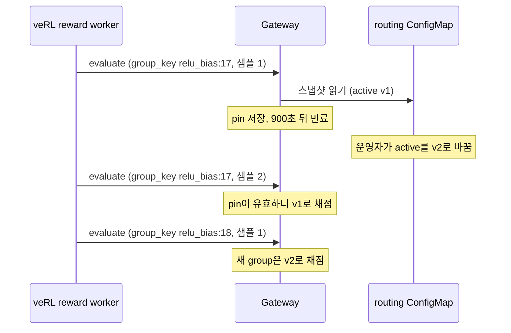

# Gateway와 샌드박스 pool

<span id="gateway와-샌드박스-풀"></span>

!!! info "TL;DR"
    sandbox gateway는 모든 trainer 프로세스의 요청을 받아 호출자를 인증하고, 배치나 GRPO group 단위로 샌드박스 버전을 고정하는 단일 스케줄러입니다. pod마다 평가를 한 번에 하나만 보내고, draining pod는 새 pod로 교체합니다.

## trainer가 pool에 직접 연결할 때

<span id="trainer가-풀에-직접-연결할-때"></span>

worker 두 개가 동시에 같은 pod를 빈 것으로 판단하면, 한 요청은 평가를 받고 다른 요청은 `503`을 받아 다시 시도합니다. worker가 늘수록 이 충돌이 배치 시간을 늘릴 수 있습니다. 여기에 채점 중 버전 전환까지 겹치면, 같은 group이 서로 다른 기준으로 비교될 수 있습니다.


## Gateway가 맡는 일

gateway는 완료되지 않은 요청을 세고, 빈 pod를 고른 뒤 버전을 고정합니다. 배치 요청은 한 routing 스냅샷을 사용하고 낱개 요청은 `group_key`로 같은 문제의 답을 연결합니다. 도입 후에는 `503` 재시도와 대기 시간을 함께 봅니다. 준비된 pod가 모두 작업 중이라면 gateway만 늘려서는 평가 용량이 늘지 않습니다.

??? note "세부 조건과 예외"
    - **trainer 프로세스마다 빈 pod를 따로 판단하면**: 여러 TRL rank와 veRL reward worker가 같은 pod에 요청을 보내 503을 받고 재시도합니다.
    - **샘플을 하나씩 채점하는 veRL**: 배치 스냅샷이 없어, 같은 GRPO group의 샘플이 routing 전환 전후로 다른 버전으로 채점될 수 있습니다.
    - **버전 고정 규칙이 trainer 코드마다 따로 있으면**: 샌드박스 환경의 버전을 trainer와 독립적으로 관리하기도 어렵습니다.
    - **다른 사례**: INTELLECT-3는 API를 거친 `kubectl exec`의 지연이 명령당 약 2.5초까지 늘어나자 gateway, headless Service, sidecar 구성으로 바꿨다고 보고했습니다(arXiv 2512.16144).

    - **in-flight 요청 수를 한곳에서 집계합니다.** 평상시에는 모든 요청이 gateway 프로세스 하나를 거치므로 한 pod에 요청 두 개를 동시에 보내지 않습니다.
        - **gateway Deployment를 교체하는 동안**: 이전 gateway와 새 gateway가 잠시 함께 실행되어 같은 pod를 고를 수 있습니다. 이때 샌드박스는 두 번째 요청에 503(busy)을 반환하고, gateway가 그 요청을 다른 pod로 다시 보냅니다.
    - **버전 고정을 gateway에서 처리합니다.** 배치는 스냅샷 하나로, 샘플은 `group_key` pin으로 같은 버전에 고정합니다. TRL과 veRL은 고정 규칙을 직접 구현하지 않아도 `SANDBOX_GATEWAY` 하나로 같은 호출 경로를 씁니다.
    - **pod 재활용을 자동으로 처리합니다.** gateway가 draining 상태의 pod를 삭제하면 새 pod가 만들어지며, Kata에서는 새 pod마다 새 VM이 만들어집니다.

??? note "용어"
    - **TokenReview**: 호출자가 보낸 토큰이 유효한지 Kubernetes API server에 직접 확인을 요청하는 API입니다. gateway는 이 결과로 호출자를 인증합니다.
    - **routing snapshot**: routing 표(`routing.json`)를 한 시점에 읽어 고정한 사본입니다. 배치 하나는 이 사본 하나로 채점됩니다.
    - **group pin, `group_key`, TTL**: 같은 `group_key`(GRPO group 하나)의 샘플을 첫 샘플을 처리할 때 만든 snapshot으로 계속 채점하도록 고정하는 기능입니다. TTL은 그 고정이 유지되는 시간입니다.
    - **headless Service**: 가상 IP 없이 DNS가 Ready pod의 IP 목록을 반환하는 Service입니다. gateway는 이 목록에서 pod를 직접 고릅니다.
    - **draining, recycling**: draining은 pod가 새 평가를 받지 않도록 Ready에서 제외된 상태이고, recycling은 gateway가 그런 pod를 삭제해 Deployment가 새 pod를 만들게 하는 동작입니다.
    - **cooldown**: 503이나 연결 오류를 낸 pod에 잠시 요청을 보내지 않는 시간입니다.

    더 많은 용어는 [용어 사전](../reference/glossary.md)에 있습니다.

## API

| Method, path | 인증 | 요청 | 응답 | 용도 |
|---|---|---|---|---|
| `POST /v1/evaluate_batch` | Bearer (aud `gpu-sandbox-gateway`) | `{runtime?, items: [{task_id, code, request_id?}]}`, items 1개에서 4096개 | `{runtime, version, revision, results}` | 배치 전체를 스냅샷 하나로 (TRL) |
| `POST /v1/evaluate` | Bearer | `{task_id, code, request_id?, group_key, runtime?}` | verdict 하나 | 샘플 단위, `group_key` pin (veRL) |
| `GET /v1/routing` | Bearer | | `{runtime, version, revision}` | 현재 routing 확인 |
| `GET /metrics` | Bearer | | Prometheus 형식 | 모니터링 |
| `GET /healthz`, `GET /readyz` | 없음 | | `readyz`는 유효한 routing 표가 없거나 active pool의 주소가 표에 없으면 503(표 아래) | kubelet probe |

- **`readyz`가 503을 반환할 때**: 유효한 routing 표를 한 번도 읽지 못했거나 active pool의 주소가 표에 없으면 503입니다. 정상 표를 읽은 뒤의 파일 읽기나 JSON 파싱 오류에는 마지막 정상 표를 씁니다.
- **필드 길이**: `task_id` 64자, `code` 32,768자, `request_id` 128자, `group_key` 256자, `runtime` 32자까지입니다.
- **pod가 평가를 마친 결과**: 샌드박스 verdict(`status`, `correct`, `custom_kernel`, `speedup`, `flags` 등)와 gateway가 붙인 `sandbox_version`, `runtime`, `routing_revision`과 `pod`, `endpoint`, `attempts`, `draining`이 포함됩니다.
- **`sandbox_error` 결과**: 빈 pod를 얻지 못했거나 샌드박스가 4xx를 반환한 결과에는 `status`, `error`와 gateway가 붙인 세 필드만 있으므로, `status`와 `error`를 먼저 읽고 나머지 필드는 있을 때만 쓰세요.

trainer에서는 클라이언트 라이브러리로 gateway를 호출합니다. 아래는 항목이 하나인 배치 예시입니다.

```python
from gpusandbox.client import SandboxClient

client = SandboxClient.from_env()  # reads SANDBOX_GATEWAY and SANDBOX_TOKEN_FILE
# code: the candidate module source as a string
info, results = client.evaluate_batch_sync([{"task_id": "relu_bias", "code": code}])
print(info.runtime, info.version, info.revision, results[0]["status"])
```

gateway 메트릭은 `gateway_evaluations_total{runtime, version, status}`, `gateway_evaluation_seconds`, `gateway_recycled_pods_total`입니다. 대시보드와 알람은 [07 Observability와 운영](07_observability_and_operations.md)에서 다룹니다.

## Group pin과 TTL

**Group pin**은 같은 문제에서 생성한 답을 채점하는 동안 사용할 pool의 버전을 기억하는 기능입니다. **TTL**은 그 기록을 유지하는 시간입니다. 요청이 여러 worker에서 오더라도 같은 group의 비교가 성립하려면 pin이 마지막 평가까지 남아 있어야 합니다.



*그림: active version이 바뀌어도 이미 시작한 group은 TTL 동안 첫 샘플의 버전으로 끝나고, 새 group부터 새 버전을 씁니다.*

- gateway는 첫 요청(또는 만료 뒤 첫 요청) 때 만든 routing 스냅샷(runtime, version, 주소)을 만료 시각과 함께 저장합니다. 같은 `group_key`의 이후 요청은 active version이 바뀌어도 이 스냅샷을 씁니다.
- TTL 기본값은 900초(`GATEWAY_GROUP_PIN_TTL_S`)이고, pin이 10만 개를 넘으면 만료된 pin부터 삭제합니다.
- veRL [`reward_fn.py`](https://github.com/daekeun-ml/gpu-sandbox-on-aws/blob/main/rl/verl/reward_fn.py)는 `group_key`를 `f"{task_id}:{info.get('index', 'na')}"`로 만듭니다. 같은 데이터 행이 TTL이 지난 뒤 다음 epoch에 다시 나오면 새 스냅샷으로 채점됩니다.
- runtime도 첫 요청 때 고정되므로, pin이 생긴 뒤에는 gateway가 요청의 `runtime` 값을 무시합니다.
- pin은 gateway 메모리에만 저장되므로 gateway가 재시작하면 사라집니다. 이때 진행 중이던 group은 버전이 섞일 수 있습니다.
- TTL은 group 하나를 채점하는 최대 시간보다 길어야 합니다(TTL이 더 짧으면 마지막 샘플이 새 스냅샷으로 채점됩니다).
- 이전 pool은 pin이 모두 만료될 때까지 유지하세요. ([05 샌드박스 버전 관리](05_sandbox_updates.md))
    - **전환 직후 `scripts/ops/rollout.sh <runtime> <from> <to> --finish`로 이전 pool을 0으로 줄이면**: 이전 버전에 고정된 group의 요청을 처리할 pod가 없습니다. gateway는 빈 pod를 최대 600초 기다리지만, veRL 단건 요청은 클라이언트가 기본 300초 안에 응답을 받지 못하면 먼저 `sandbox_error`로 끝납니다.
    - **전환을 마무리하는 시점**: TTL(기본 15분)과 진행 중인 배치가 끝나는 시간만큼 기다린 뒤 전환을 마무리합니다.

`evaluate_batch`는 group pin 없이 배치 전체에 스냅샷 하나를 사용합니다.

- **프로세스 하나가 group의 completion을 모두 한 배치로 보낸다면**: 이것으로 충분합니다.
- **여러 rank로 학습해 한 group의 completion이 여러 rank에 나뉘면(TRL 설정에 따라 다름)**: 스냅샷도 rank마다 따로 만들어집니다. 이 경우 전환 시점에 한 group이 두 버전으로 채점될 수 있습니다.
- **확인 방법**: 같은 `global_step`에서 모든 rank의 `reward_batch` 이벤트를 모아 `version`과 `served_versions`를 비교하세요. 이 필드는 그 프로세스가 실제로 보낸 항목만 세고, 전부 캐시로 채점한 rank는 이벤트를 남기지 않으므로 그 rank가 어느 pool의 결과를 썼는지는 이 이벤트로 알 수 없습니다.

## 스케줄링

- gateway는 routing 주소(headless Service)마다 `SandboxPool` 하나를 두고, DNS를 10초마다 다시 조회해 Ready pod의 IP 목록을 가져옵니다. 따라서 egress 확인을 통과하지 못한 pod는 처음부터 후보에 포함되지 않습니다.
- pod마다 동시에 요청 하나만 보냅니다(`per_endpoint_concurrency=1`). 빈 pod 가운데 in-flight 요청이 가장 적고 가장 오래전에 사용한 pod를 고릅니다.
- 빈 pod가 없으면 최대 600초(`acquire_timeout_s`) 기다렸다가 `sandbox_error`(`no free sandbox`)를 반환합니다.
- pod가 503(busy, not ready)을 반환하면 gateway는 그 pod를 5초 동안 후보에서 제외하고(cooldown) 다른 유휴 pod로 요청을 다시 보냅니다. cooldown이 끝난 pod는 다시 후보가 됩니다. 연결 오류도 같은 방식으로 처리하며, 시도는 최대 4번입니다.
- 4xx는 인증이나 요청 자체의 문제라 다른 pod로 보내도 결과가 같으므로 재시도하지 않습니다.
- 샌드박스 호출 하나의 timeout은 300초이고, 샌드박스 안 harness 전체에 걸리는 제한 시간은 `SANDBOX_EVAL_TIMEOUT_S`(기본 90초) × 2 + 30초 = 210초입니다.

GPU 타이밍 측정이 다른 평가의 영향을 받지 않도록 pod당 요청을 하나로 제한합니다. 평가 하나가 GPU 하나를 독점하므로 동시 평가 수는 Ready 샌드박스 pod 수와 같습니다. 배치 하나에 걸리는 시간은 대략 ⌈항목 수 / pod 수⌉ × 평가 시간입니다.

[08 런타임 벤치마크](../handson/08_benchmark.md)의 AWS 측정값은 gateway 없이 샌드박스 pool을 직접 호출한 결과입니다. gateway를 거친 배치 시간은 측정하지 않았으니 직접 측정하세요.

## Recycling

- 샌드박스는 `SANDBOX_MAX_EVALS`번(v2: 200, v1: 0 = 끄기) 평가했거나 reference 경로에서 CUDA 오류(`gpu_fault`)가 나면 draining 상태가 되어 Ready에서 제외됩니다. `gpu_fault`면 liveness도 실패해 컨테이너가 재시작됩니다.
- 응답에 `draining: true`와 pod 이름이 포함되면 gateway(`GATEWAY_RECYCLE_PODS=1`)는 Role `gpu-sandbox-gateway-recycler`(sandbox namespace의 pods get, delete)의 권한으로 그 pod를 grace period 10초로 삭제하고, Deployment가 새 pod를 만듭니다. 삭제는 best effort이며 실패하면 로그만 남깁니다.
- Kata에서는 새 pod마다 새 VM이 만들어지고, 이전 VM이 GPU를 해제할 때 vfio-pci가 GPU를 reset합니다. 같은 VM 안에서 컨테이너만 재시작하면 GPU가 reset되지 않으므로 gateway는 pod 자체를 삭제합니다.
- gVisor에서는 새 pod가 새 Sentry로 실행되지만 호스트 드라이버와 GPU는 그대로입니다.
- gateway가 없는 direct 모드에서는 draining pod를 삭제하는 구성 요소가 없습니다. 평가 횟수 상한에 이른 pod는 NotReady로 남아 GPU를 계속 점유하니, 직접 삭제하거나(`kubectl -n sandbox delete pod <pod>`) gateway를 쓰세요. `gpu_fault`이면 liveness가 실패해 kubelet이 같은 pod의 컨테이너를 재시작합니다.
- pod 직접 삭제는 eviction API를 쓰지 않으므로 PDB가 적용되지 않습니다.

## 배포

아래 명령은 핸즈온의 `scripts/05_setup_namespaces_auth.sh`(namespace, JWKS, routing 표)와 `scripts/06_deploy_sandboxes.sh`(pool)를 이미 실행했고, `scripts/config.env`에 `CONTROL_IMAGE_URI`(`scripts/03_build_push_images.sh`의 출력)가 있다고 가정합니다. 저장소 루트에서 실행하세요.

```bash
source scripts/config.env   # CONTROL_IMAGE_URI, SANDBOX_AUDIENCE
# 1) Gateway, RBAC, Service and the gateway-only NetworkPolicies.
python3 scripts/render.py k8s/production/gateway.yaml.tpl \
  GATEWAY_ALLOWED_SUBJECTS="system:serviceaccount:rl-trainer:grpo-trainer" | kubectl apply -f -
# 2) The routing table in the gateway namespace: a copy of the trainer's.
kubectl -n rl-trainer get configmap sandbox-routing \
  -o jsonpath='{.data.routing\.json}' > /tmp/routing.json
kubectl -n sandbox-gateway create configmap sandbox-routing \
  --from-file=routing.json=/tmp/routing.json --dry-run=client -o yaml | kubectl apply -f -
# 3) JWKS sync CronJob (replaces running scripts/ops/sync_jwks.sh by hand).
python3 scripts/render.py k8s/production/jwks-sync.yaml.tpl | kubectl apply -f -
# Verify.
kubectl -n sandbox-gateway rollout status deployment/gateway
kubectl -n sandbox get networkpolicy allow-clients-to-sandbox-api -o jsonpath='{.spec.ingress[0].from}'
```

확인할 것: `rollout status`가 `deployment "gateway" successfully rolled out`으로 끝나고, 마지막 명령이 아래와 같은 JSON 한 줄을 출력합니다.

```text
[{"namespaceSelector":{"matchLabels":{"kubernetes.io/metadata.name":"sandbox-gateway"}},"podSelector":{"matchLabels":{"app.kubernetes.io/name":"gpu-sandbox-gateway"}}}]
```

문제가 생기면:

- **`render: ... missing variable 'CONTROL_IMAGE_URI'` 같은 오류**: [문제 해결](../reference/troubleshooting.md)의 "설정과 스크립트" 표를 보세요.
- **gateway pod가 Ready가 되지 않으면**: [07 Observability와 운영](07_observability_and_operations.md)의 런북을 보세요.

- gateway pod는 `sandbox-routing` ConfigMap이 생길 때까지 ContainerCreating 상태로 있다가 2단계가 끝난 뒤에 시작합니다.
- 2단계는 `rl-trainer`의 routing 표를 그대로 복사하므로 gateway도 trainer와 같은 active pool(예: B2의 `gvisor-hyperpod`, C의 `kata-clh-cpu`)을 씁니다. gateway의 `/readyz`는 routing 표를 읽을 수 있는지만 확인하고, active pool이 실제로 배포돼 있는지는 확인하지 않습니다.
- `scripts/05_setup_namespaces_auth.sh`는 routing ConfigMap을 `rl-trainer`에만 만들고, 이후 전환 때는 `scripts/ops/rollout.sh`가 `rl-trainer`와 `sandbox-gateway`를 함께 갱신합니다.
- `GATEWAY_ALLOWED_SUBJECTS`는 gateway를 호출할 ServiceAccount를 쉼표로 구분한 목록이고, TRL Job과 veRL RayCluster 템플릿은 둘 다 `rl-trainer:grpo-trainer`를 씁니다.

| Deployment 설정 | 값 | 이유 |
|---|---|---|
| `replicas`, uvicorn `workers` | 1, 1 | gateway는 단일 스케줄러이고 group pin을 메모리에 저장합니다. |
| `priorityClassName` | `system-cluster-critical` | gateway가 축출되면 모든 reward 계산이 멈춥니다. |
| nodeSelector | `gpusandbox/role: system` | 샌드박스 노드와 GPU 노드에는 배치하지 않습니다. |
| resources | requests 1 CPU, 1Gi, limits 2 CPU, 2Gi | 대부분의 시간을 응답을 기다리는 비동기 I/O에 씁니다. |
| projected token 1 | `kubernetes.io/serviceaccount/token` (API audience, 3600초), CA, namespace | TokenReview와 pod 삭제에만 씁니다. 자동 마운트는 끄고 명시적으로 마운트합니다. |
| projected token 2 | `gpusandbox/token` (aud `${SANDBOX_AUDIENCE}`, 3600초) | 샌드박스에 보내는 토큰이고, 요청마다 파일을 다시 읽어 kubelet이 회전한 토큰을 사용합니다. |

replica 1은 의도한 설계입니다. replica를 늘려야 한다면 다음 순서로 검토하세요.

1. **먼저 수직 확장합니다.** gateway는 대부분 응답을 기다리기만 하므로 병목은 대개 샌드박스 pod 수입니다. limits를 올리고 TokenReview 캐시(60초)가 효과가 있는지 확인합니다.
2. **pool 단위로 gateway를 나눕니다.** runtime마다 gateway를 따로 두면 pin과 in-flight 정보가 섞이지 않습니다. 이때 trainer마다 다른 `SANDBOX_GATEWAY`를 지정합니다.
3. **여러 replica에는 외부 pin 저장소가 필요합니다.** 템플릿 주석에 적힌 대로 group pin을 replica 외부의 공유 저장소로 옮겨야 합니다. 그리고 `group_key` 해시로 같은 group을 같은 replica에 보내거나, 샌드박스의 503 응답과 재시도에 의존해야 합니다(이 저장소에는 구현되어 있지 않습니다).

replica가 1개이므로 gateway가 재시작하는 동안에는 요청이 실패합니다. trainer는 `sandbox_error`를 받습니다. TRL에서는 그 샘플이 reward 계산에서 제외되고, veRL에서는 그 샘플이 format 점수와 오류 표시만 받습니다([04 Reward 무결성](04_reward_integrity.md)).

## NetworkPolicy 전환

| 정책 | namespace | 허용 |
|---|---|---|
| `allow-trainers-to-gateway` | `sandbox-gateway` | `rl-trainer` namespace의 모든 pod에서 gateway TCP 8080으로 |
| `allow-clients-to-sandbox-api` | `sandbox` | `sandbox-gateway`의 gateway pod에서 샌드박스 TCP 8000으로 (핸즈온의 같은 이름 정책을 덮어씀) |
| `default-deny-all` | `sandbox` | 그대로 유지 |

같은 이름의 정책을 덮어쓰므로, 적용하는 순간부터 trainer와 probe Job은 샌드박스에 직접 연결할 수 없습니다. `scripts/ops/verify.sh`의 3단계와 `scripts/ops/rollout.sh`의 parity 단계는 `rl-trainer`의 Job에서 샌드박스를 직접 호출하므로, production에서는 검증 Job을 허용하는 정책을 추가하세요.

NetworkPolicy는 허용 규칙이 합집합으로 적용되므로, 아래 예시(저장소에 없는 파일)를 파일로 저장해 `kubectl apply -f <파일>`로 추가하면 됩니다. 적용한 뒤 3단계가 다시 `PASS`를 출력하면 정책이 적용된 것입니다.

```yaml
# Example (not in the repo): admit the operator Jobs (probe, parity) in production.
apiVersion: networking.k8s.io/v1
kind: NetworkPolicy
metadata:
  name: allow-probe-to-sandbox-api
  namespace: sandbox
spec:
  podSelector:
    matchLabels: {app.kubernetes.io/name: gpu-sandbox}
  policyTypes: ["Ingress"]
  ingress:
    - from:
        - namespaceSelector:
            matchLabels: {kubernetes.io/metadata.name: rl-trainer}
          podSelector:
            matchLabels: {app: sandbox-probe}
      ports: [{protocol: TCP, port: 8000}]
```

`app: sandbox-probe`는 [`job-probe.yaml.tpl`](https://github.com/daekeun-ml/gpu-sandbox-on-aws/blob/main/k8s/probe/job-probe.yaml.tpl)이 붙이는 label입니다. 같은 namespace의 다른 pod도 이 label을 붙일 수 있으니 두 번째 방어 층인 토큰 allowlist(`system:serviceaccount:rl-trainer:sandbox-probe`)도 함께 유지하세요.

## 클라이언트 설정

`SandboxClient.from_env()`는 `SANDBOX_GATEWAY`가 있으면 gateway 모드로, 없으면 `SANDBOX_ROUTING_FILE`을 읽는 direct 모드로 동작합니다.

| trainer | 현재 템플릿 | gateway 모드로 쓰려면 |
|---|---|---|
| veRL | [`raycluster-verl.yaml.tpl`](https://github.com/daekeun-ml/gpu-sandbox-on-aws/blob/main/k8s/production/raycluster-verl.yaml.tpl)이 이미 `SANDBOX_GATEWAY`와 aud `gpu-sandbox-gateway` 토큰을 씀 | 그대로 사용 |
| TRL | [`job-grpo.yaml.tpl`](https://github.com/daekeun-ml/gpu-sandbox-on-aws/blob/main/k8s/trainer/job-grpo.yaml.tpl)은 direct 모드 (`SANDBOX_ROUTING_FILE`, aud `${SANDBOX_AUDIENCE}`) | 아래처럼 env와 토큰 audience를 바꿈 |

```yaml
# TRL Job changes for gateway mode (fragment).
env:
  - {name: SANDBOX_GATEWAY, value: "gateway.sandbox-gateway.svc.cluster.local:8080"}
  - {name: SANDBOX_TOKEN_FILE, value: /var/run/secrets/gpusandbox/token}
volumes:
  - name: sandbox-token
    projected:
      sources:
        - serviceAccountToken:
            audience: gpu-sandbox-gateway
            expirationSeconds: 3600
            path: token
```

`k8s/trainer/job-grpo.yaml.tpl`의 trainer 컨테이너 `env`와 pod의 `volumes`를 위 조각대로 바꾸고 Job을 다시 제출하세요. trainer 로그 앞부분에 `{"event": "routing", "mode": "gateway", "gateway": "gateway.sandbox-gateway.svc.cluster.local:8080"}`가 있으면 gateway 모드로 동작하는 것입니다. `reward_batch` 이벤트에는 배치의 `version`과 `routing_revision`, 결과의 `sandbox_version`별 건수(`served_versions`)가 기록됩니다.

## 장애 모드

| 증상 | 원인 | trainer가 받는 것 | 조치 |
|---|---|---|---|
| gateway가 401 | 토큰 audience가 `gpu-sandbox-gateway`가 아님, 만료, gateway의 audience나 allowlist 미설정 | 그 요청에 실린 항목 모두 `sandbox_error`(캐시 항목은 표 아래) | trainer의 projected token audience와 `GATEWAY_AUTH_AUDIENCE` 확인 |
| gateway가 403 | subject가 `GATEWAY_ALLOWED_SUBJECTS`에 없음 | 401과 같음 | ServiceAccount를 allowlist에 추가 |
| 샌드박스가 gateway에 401, 403 | gateway subject가 `SANDBOX_ALLOWED_SUBJECTS`에 없음, JWKS가 갱신되지 않음 | 해당 항목 `sandbox_error` (재시도 없음) | allowlist와 `jwks-sync` CronJob 상태 확인 |
| 오래 걸린 뒤 `no free sandbox` | Ready pod 없음(0으로 줄임, NotReady), 모두 사용 중 | 최대 600초 뒤 `sandbox_error`(veRL 단건 요청은 클라이언트 timeout 300초) | replicas, NodePool 상한, ResourceQuota, pod readiness 확인 |
| 배치 전체가 바로 실패 | routing 표에 없는 runtime과 version 조합 | gateway가 500, 그 요청에 실린 항목 모두 `sandbox_error` | `routing.json.tpl`과 배포된 pool을 일치시킴 |
| 연결 오류 | gateway 재시작이나 장애 | `sandbox_error`, 진행 중인 group pin 사라짐 | gateway pod 상태와 이벤트 확인 |
| draining pod가 남음 | pod 삭제 실패 (RBAC, API 오류) | 처리량 감소 | gateway 로그의 `could not recycle`과 Role 확인 |
| `gpu_fault` 표시 | reference 경로의 CUDA 오류 | 해당 항목 `sandbox_error` | pod가 재활용되는지, 같은 노드에서 반복되는지 확인 |

- **gateway가 401, 403을 반환할 때 캐시 항목**: 다른 pool의 결과라서 다시 채점하려고 보낸 캐시 항목도 `sandbox_error`에 포함됩니다. TRL에서 로컬로 판정한 항목과 그 요청에 싣지 않은 캐시 항목은 기존 결과를 유지합니다.

## ❓ 오해

!!! question "❓ 오해: gateway replica를 늘리면 처리량이 늘어난다"
    처리량은 Ready 샌드박스 pod 수로 정해집니다. 공유 pin 저장소 없이 replica만 늘리면 같은 group이 replica마다 다른 버전으로 채점될 수 있습니다.

!!! question "❓ 오해: group pin은 학습이 끝날 때까지 유지된다"
    pin은 gateway 메모리에 저장되며 기본 900초 뒤 만료되고, gateway가 재시작하면 사라집니다. 버전 전환은 pin TTL보다 긴 간격을 두고 마무리하세요.

!!! question "❓ 오해: NetworkPolicy를 gateway-only로 바꿔도 검증 Job은 그대로 동작한다"
    probe와 parity Job은 `rl-trainer`에서 샌드박스를 직접 호출하므로, gateway-only NetworkPolicy가 이 요청을 차단합니다. 위의 별도 정책을 추가하세요.

??? note "참고 자료"
    | 주제 | 링크 |
    |---|---|
    | VPC CNI NetworkPolicy | [Configure network policy (Amazon EKS)](https://docs.aws.amazon.com/eks/latest/userguide/cni-network-policy-configure.html) |
    | projected token, TokenReview | [Kubernetes Service Accounts](https://kubernetes.io/docs/concepts/security/service-accounts/) |
    | 직접 삭제와 PDB | [Kubernetes: Disruptions](https://kubernetes.io/docs/concepts/workloads/pods/disruptions/) |
    | trainer | [verl-project/verl](https://github.com/verl-project/verl), [huggingface/trl](https://github.com/huggingface/trl), [TRL 문서](https://huggingface.co/docs/trl) |
    | 코드 | [`gateway/app.py`](https://github.com/daekeun-ml/gpu-sandbox-on-aws/blob/main/src/gpusandbox/gateway/app.py), [`client/pool.py`](https://github.com/daekeun-ml/gpu-sandbox-on-aws/blob/main/src/gpusandbox/client/pool.py), [`gateway.yaml.tpl`](https://github.com/daekeun-ml/gpu-sandbox-on-aws/blob/main/k8s/production/gateway.yaml.tpl) |

    [관련 대표 자료](../reference/references.md#ref-production-03-gateway-and-pools)

다음: [04 Reward 무결성](04_reward_integrity.md)
